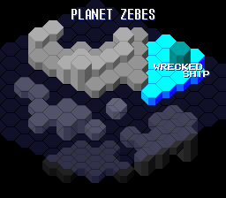
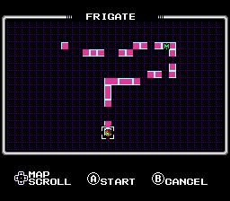
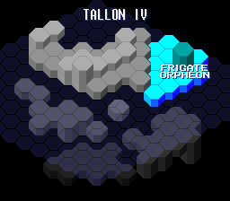

# 01 — Tela de continue com a fragata

Estado: verificada (22/10/2026; sha1 do .ips e3384e95209de084f33e58821b5729a8653be4ba; testes 16/16)
Esforço estimado: código ~1 h (módulo novo de ~90 linhas + 3 linhas no build); testes ~1 h (2 testes
no emulador + 1 checagem no validate); verificação completa ~5 min de máquina. Total: meio dia, folgado.

## Contexto

Depois de um game over, ao escolher "YES", e também ao carregar um save pela tela de arquivos, o jogo
mostra primeiro uma tela com o planeta inteiro: em cima está escrito **"PLANET ZEBES"** e, na região
acesa, **"WRECKED SHIP"**. Só depois aparece o mapa de salas (esse já diz "FRIGATE" e está certo).
O jogador da demo vê o nome do jogo errado logo na primeira tela depois de morrer. Está na lista de
pendências do `HANDOFF.md` e do `README.md`.

*Antes (emulador, continue depois de game over com o save na Reactor Core Entrance).*

*A segunda tela (mapa de salas) já está certa: nome "FRIGATE", cursor na sala do save.*

## Estado atual (verificado)

Conferido no código C de referência (`vendor/sm/src`), nos bytes de `base/sm_fix.sfc` e da ROM
gerada (cópia privada do projeto) e no emulador `tools/snesrun`.

1. **Que tela é.** É o estado de jogo 5 (`$7E0998 = 5`, "file select map", `GameState_5_FileSelectMap`
   `$82:89EA`). O passo do menu fica em `$7E0727`: **6 = tela do planeta** (`FileSelectMap_6_AreaSelectMap`
   `$81:A800`), que espera o A; 7–8 = quadrado que cresce a partir do nome da área; 9–10 = mapa de salas
   (`FileSelectMap_10_RoomSelectMap` `$81:AD7F`). Medido no emulador:
   - continue depois do game over: estado `$1A` → 5 (passos 5, 6, …, 8, 10, 14) → 6 → 8;
   - carregar save da tela de título (slot A → "start"): estado 4 → 2 → 5 (passos 6 … 10) → 6 → 8.
     As duas entradas passam pela mesma tela;
   - jogo novo: 4 → 2 → 6, **não** passa por ela.
   - Sem modo debug a tela não deixa escolher nada: o A sempre leva à área e à estação do save
     (`SelectFileSelectMapArea` `$81:A8A9`: `area_index = sram_area_index`, `load_station = sram_save_station_index`).
2. **"PLANET ZEBES" é sprite, não tilemap.** `DrawAreaSelectMapLabels` (`$81:A97E`) começa com
   `64 03 A2 80 00 A0 10 00 AF 49 C7 82 22 1F 89 81` = `STZ $03; LDX #$0080; LDY #$0010;
   LDA $82C749; JSL $81891F` (DrawMenuSpritemap). `$82:C749` = `$0038`: spritemap de menu nº `$38`.
   A tabela de ponteiros das spritemaps de menu é `$82:C569` (104 entradas, `$82:C569–$82:C638`);
   a nº `$38` está em **`$82:CBFB`**, com **22 peças** (`16 00`), cada peça com 5 bytes
   (x 16 bits com 9 bits úteis, y 8 bits, atributo 16 bits = tile | paleta<<9 | prioridade `$3000`).
   As 22 peças são as metades de cima e de baixo de 11 letras grandes (8x16).
3. **"WRECKED SHIP" também é sprite.** O nome de cada área é a spritemap `$38 + 1 + área` (C:
   `g_word_82C749[0] + area + 1`): área 0 `$39` CRATERIA … área 3 **`$3C` em `$82:CD2E`, 11 peças**
   (`0B 00`, "WRECKED" em cima, "SHIP" embaixo), área 5 `$3E` TOURIAN. O nome só é desenhado para
   áreas com estação usada (`$7ED8F8 + 2*área`); hoje só aparece o da área 3.
   Posição de cada nome: tabela **`$81:AA1C`** (x, y por área; área 3 = `$CE, $50` em `$81:AA28`).
   O comentário "0x81A97E" no C está errado para esta tabela; o endereço certo foi achado pelos bytes.
   A mesma tabela é a origem do quadrado que cresce até o mapa de salas (`$81:AAAC`), então o nome e a
   animação já apontam para a região certa.
4. **Fontes disponíveis** (tiles de sprite do menu, sem compressão: `$B6:C000`, `$2000` bytes,
   copiados por DMA para a VRAM `$6000` em `LoadInitialMenuTiles` `$81:8DDB`; o pause do jogo usa o
   mesmo bloco, `$82:8E75`). Imagem: [`img/01-tiles-de-sprite-do-menu.png`](img/01-tiles-de-sprite-do-menu.png).
   - **Letra pequena (8x8)**: A–Z completas e contíguas nos tiles **106–131** (`$6A–$83`), 0–9 em 96–105.
     Conferido nos nomes vanilla (A=106, E=110, R=123, W=128) e na imagem (G=112 existe).
   - **Letra grande (8x16, a do título)**: pares (cima, baixo) conferidos desenhando cada par:
     A(10,26) B(11,27) C(12,28) D(13,29) E(14,30) F(14,31) G(12,48) H(33,49) I(34,17) J(35,51)
     K(36,52) L(37,53) M(38,54) N(39,55) P(13,56) R(13,58) S(43,59) T(44,17) U(45,28) V(45,62)
     W(47,63) X(64,80) Y(65,17) Z(66,82). **Não existe O nem Q**: os tiles onde estariam foram
     ocupados pelos botões L/R do menu. Logo "TALLON IV" e "ORPHEON" em letra grande precisam de um O novo.
   - Tiles livres: lendo todas as 104 spritemaps de menu, o tile **15** é todo zero e nunca usado; o
     tile **23** (pedaço de um texto rosa pré-desenhado) também nunca é usado por nenhuma spritemap.
5. **Mapa de salas (segunda tela) já está certo.** O nome vem de `$82:965F` (ponteiros dos nomes de
   12 tiles), que `write_pause_map` (`tools/build.py`) já troca por "FRIGATE"; o cursor da Samus usa
   a lista de ícones de save da área 3 (`$82:C7CB + $40 + 6` → `$82:C991`), que o build já preenche
   com a estação 0 (hangar) e a 1 (Reactor Core Entrance). Na foto, o cursor está na sala do save.
6. **O que fica do Zebes mesmo depois da troca do texto:** o desenho do planeta (tilemap BG1
   `$81:B71A`, `$800` bytes; tiles BG `$8E:8000`, `$5600` bytes), o fundo por área (BG3, `$81:BF1A +
   $800*área`) e as cores da região acesa (`$81:A4CE` ativas / `$81:A4DA` apagadas). Tudo sem
   compressão (DMA direto), mas redesenhar o planeta fica fora desta spec.
7. **Buffer de sprites na RAM.** O jogo monta os sprites em `$7E0370` (4 bytes por sprite: x, y,
   tile, atributo) e na tela do planeta só `DrawAreaSelectMapLabels` desenha. Lido no emulador, ROM
   atual, passo 6: sprite 0 = `A8 10 3B 30` (metade de baixo do último S de "ZEBES"; a spritemap
   vanilla está de trás para frente), sprite 16 (`$7E03B0`) = `60 10 1A 30`. Isso permite testar sem
   ler a VRAM (o `snesrun` só lê a WRAM).

## Causa (problemas)

O hack trocou as salas, o mapa de pausa e o mapa de salas da área 3, mas não as duas spritemaps de
texto da tela do planeta (`$38` título e `$3C` nome da área 3). Elas continuam as do Super Metroid.

## Mudança proposta

Só dados, nenhuma rotina nova. Módulo novo **`tools/frigate/areaselect.py`**, função
`apply(rom: Rom, bank82: Allocator) -> None`, chamada em `tools/build.py` logo depois de
`write_pause_map(rom, rooms)` (linha 458).

**Texto escolhido:** título **"TALLON IV"** (o planeta desta tela; vale também quando as áreas do
Tallon Overworld forem usadas, spec 07; combina com o texto da spec 05) e nome da área 3
**"FRIGATE" / "ORPHEON"** em duas linhas, como "WRECKED / SHIP". O desenho do planeta e a região
acesa não mudam.

*Protótipo exatamente com os dados abaixo, feito numa cópia da ROM (emulador, continue depois de
game over). Com ele os 13 testes atuais passaram na cópia.*

1. **Letra O grande** (dois tiles novos em `$B6:C000`, sem compressão):
   - O de cima no tile 15 (`$B6:C1E0`): cópia do tile 12 (C de cima) com as colunas 5–7 das linhas
     4–7 tiradas do tile 13 (D de cima). Bytes esperados:
     `00000000003c18661166116611661166000000003c3c7e7e7777777777777777`.
   - O de baixo no tile 23 (`$B6:C2E0`): cópia do tile 28 (C de baixo) com as colunas 5–7 das
     linhas 0–2 tiradas do tile 29 (D de baixo). Bytes esperados:
     `11661166116611661166033c1e000000777777777777777777773f3f1e1e0000`.
   - Antes de escrever, conferir: tile 15 = 32 bytes zero; tile 23 =
     `0618041804180418041804180c0000001e1e1c1c1c1c1c1c1c1c1c1c0c0c0000` (vanilla).
2. **Título** reescrito **no lugar** em `$82:CBFB` (cabe: 16 peças ≤ 22). Conferir antes `$82:C749 =
   $0038`, ponteiro `$82:C569 + 2*$38 = $CBFB` e contagem `$0016`. Uma peça por meia letra, na
   ordem: para cada letra, cima (y = −8) e depois baixo (y = 0); x = −36 + 8 × posição (o espaço só
   avança). Atributo `$3000 | tile`. Resultado (82 bytes):
   `10 00 dc 01 f8 2c 30 dc 01 00 11 30 e4 01 f8 0a 30 e4 01 00 1a 30 ec 01 f8 25 30 ec 01 00 35 30
   f4 01 f8 25 30 f4 01 00 35 30 fc 01 f8 0f 30 fc 01 00 17 30 04 00 f8 27 30 04 00 00 37 30 14 00 f8
   22 30 14 00 00 11 30 1c 00 f8 2d 30 1c 00 00 3e 30`. Os bytes antigos depois disso ficam (a
   contagem manda).
3. **Nome da área 3** numa spritemap nova de 14 peças (72 bytes; não cabe nas 11 de `$82:CD2E`) no
   espaço livre do banco `$82`, e o ponteiro `$82:C569 + 2*$3C` (`$82:C5E1`, hoje `$CD2E`, conferir)
   passa a apontar para ela. Letras pequenas (tile = 106 + letra), atributo `$3000 | tile`. Avanço de
   8 px, mas 6 px antes de um I e 7 px depois dele (como os nomes vanilla); cada linha centrada
   (x inicial = −(largura // 2), largura = soma dos avanços + 8). Linha 1 em y = −8, linha 2 em y = 0.
   Resultado: FRIGATE x = −27, −19, −13, −6, 2, 10, 18; ORPHEON x = −28, −20, −12, −4, 4, 12, 20.
   Bytes: `0e 00 e5 01 f8 6f 30 ed 01 f8 7b 30 f3 01 f8 72 30 fa 01 f8 70 30 02 00 f8 6a 30 0a 00 f8 7d
   30 12 00 f8 6e 30 e4 01 00 78 30 ec 01 00 7b 30 f4 01 00 79 30 fc 01 00 71 30 04 00 00 6e 30 0c 00
   00 78 30 14 00 00 77 30`.
4. **Espaço livre do `$82`:** hoje o build escreve a rotina de jogo novo direto em `$82:F70F`
   (≈`$47` bytes; livre até `$82:FFFF`, `research/sm_room_format.md` seção 10). Em `build()`, logo
   depois de `rom.write(NEW_GAME_ROUTINE, routine)` (linha 453), criar
   `bank82 = Allocator(rom, NEW_GAME_ROUTINE + len(routine), 0x82FFFF, "$82")` e passar para
   `areaselect.apply`. O `Allocator` já recusa bytes que não sejam `$FF`.
5. **Organização do módulo** (mesmo estilo de `pausemap.py`/`ending.py`): constantes
   (`OBJ_TILES = 0xB6C000`, `MENU_SPRITEMAPS = 0x82C569`, `TITLE_ID = 0x38`, `AREA3_LABEL_ID = 0x3C`,
   `O_TOP, O_BOTTOM = 15, 23`, `TITLE = "TALLON IV"`, `AREA3_LABEL = ("FRIGATE", "ORPHEON")`, a tabela
   `BIG` de pares acima), funções puras `o_tiles(rom) -> (bytes, bytes)`, `title_spritemap(text) ->
   bytes`, `label_spritemap(lines) -> bytes`, e `oam_entries() -> list[tuple[x, y, tile]]` (posição
   na tela, para os testes: título em (`$80`, `$10`), nome em (`$CE`, `$50`)). Toda escrita sobre
   dado vanilla usa a checagem de bytes antigos (como `replace_checked` em `build.py`) e falha com
   mensagem em português se não bater.

## Critérios de aceite

1. Continue depois de game over mostra o texto novo (teste novo `continue_mostra_a_fragata` em
   tests/run_tests.py: mesmo começo de `save_station_grava_e_continue_volta_nela` até o game over;
   depois `hold A 2`, `wait 300`; `expect 7E0998 0005`, `expect 7E0727 0006`, `expect 7E079F 0003`,
   `expect 7E078B 0001`; `expect 7E0370 085C` e `expect 7E0372 302C` (1º sprite = T de cima em x
   `$5C`, y 8); `expect 7E03B0 48B3` e `expect 7E03B2 306F` (17º sprite = F pequeno em `$B3, $48`);
   `shot build/tests/continue_tela_de_area.png`; depois `GAME_OVER_CONTINUE[2:]`,
   `expect 7E079B <reactor_entrance>` e `expect 7E0998 0008`. Roteiro rodado na cópia: passa no
   protótipo; na ROM atual as 4 checagens de sprite falham e as outras passam. protege = título e nome da área 3 na tela do planeta e que a
   tela ainda leva à sala do save; falha_quando = spritemaps vanilla (na ROM atual o sprite 0 é
   `303B` e o 16 é `301A`, conferido), ponteiro errado ou fonte trocada; não_prova = a aparência
   do O (ver critério 4) nem o desenho do planeta).
2. Carregar o save pela tela de título mostra a mesma tela (teste novo `carregar_save_mostra_a_fragata`:
   mesmo começo até o game over; `hold DOWN 2`, `wait 30`, `hold A 2` (NO), `wait 600`,
   `hold START 2`, `wait 200`, 3× (`hold A 2`, `wait 120`), `wait 200`; mesmas 8 checagens do
   critério 1. Sequência medida no protótipo: 2 A's param no menu de opções (estado 2), 4 A's já
   passam para o mapa de salas (passo `$0A`). protege = a outra entrada da tela; falha_quando = igual
   ao 1; não_prova = save em outro slot).
3. Os dados ficam onde a spec diz (`tools/validate.py`, checagem nova: lê a ROM gerada e confere
   ponteiro `$82:C569+2*$38 = $CBFB` com contagem 16, ponteiro `$82:C569+2*$3C` dentro de
   `$82:F70F–$82:FFFF` com contagem 14, tiles 15 e 23 iguais aos bytes da seção "Mudança proposta" e
   todos os tiles de letra das duas spritemaps entre os pares da tabela `BIG`/106–131.
   falha_quando = qualquer valor diferente).
4. Leitura humana (imagem `build/tests/continue_tela_de_area.png`): lê-se "TALLON IV" em cima e
   "FRIGATE" / "ORPHEON" na região acesa, sem letra cortada nem sobreposta; o O parece O, não C nem D.
   Quem revisa compara com `specs/img/01-prototipo-selecao-de-area.png`.
5. Nada mais muda: `python3 -I tools/validate.py` sem problemas e os 13 testes atuais passando
   (`mapa_de_pausa`, que também usa os tiles `$B6:C000`, inclusive).

## Plano de testes

| Camada | O quê | Qtde |
|---|---|---|
| validate.py | spritemaps `$38`/`$3C` (ponteiro, contagem, tiles válidos) e bytes dos tiles 15/23 | +1 |
| run_tests.py (emulador) | `continue_mostra_a_fragata`, `carregar_save_mostra_a_fragata` (RAM de estado + buffer de sprites `$7E0370`) | +2 |
| imagem | `build/tests/continue_tela_de_area.png`, revisão humana (critério 4) | +1 |

Conferir que os dois testes novos **falham** na ROM de antes da mudança (como o handoff pede).

## Riscos e reversão

- **Tiles 15 e 23 voltarem a ser usados.** Nenhuma das 104 spritemaps de menu usa esses tiles hoje
  (varredura completa da tabela `$82:C569`). Se uma spec futura criar spritemap de menu nova, deve
  evitar 15 e 23 (o validate desta spec avisa se os bytes mudarem).
- **Espaço do `$82`:** passa a ter um alocador; outras specs que escreverem em `$82` devem usar o
  mesmo `bank82` em vez de endereço fixo.
- **Tempo dos roteiros:** os `wait` do critério 2 foram medidos (2 A's ficam no menu de opções, 4 A's
  passam da tela). Se mudar algo no menu de arquivos, reajustar; o teste falha (não passa errado).
- **Região acesa ainda é o desenho do Zebes** (a fatia do Wrecked Ship). Aceito: o texto explica a
  tela; o planeta é outra spec.
- Reversão: tirar a chamada `areaselect.apply` de `tools/build.py` e reconstruir; todas as mudanças
  vêm de `tools/`.

## Fora de escopo

- Redesenhar o planeta (BG1 `$81:B71A`, tiles `$8E:8000`), o fundo BG3 por área e as cores da região.
- Mostrar a fragata "em órbita" (nome fora do planeta, nenhuma região acesa).
- Títulos diferentes por área (exigiria trocar o `LDA $82C749` de `$81:A986` por código).
- Nomes das áreas 0, 1, 2, 4, 5 (CRATERIA etc.): só aparecem quando a área tiver estação usada;
  entram junto com a spec 07.
- Tela de game over: ainda diz "FIND THE METROID LARVA! TRY AGAIN?" (outro texto, outra tela;
  vale uma spec própria).
- Mapa de salas (segunda tela): já está certo.

## Desvios (preenchido na implementação)

- **Centralização do nome (item 3):** o texto diz "x inicial = −(largura // 2)", mas os x e os bytes
  listados (FRIGATE começa em −27, largura 53) só saem com o arredondamento para baixo,
  `−largura // 2` em Python. Valem os bytes da spec; o código usa `-(soma + 8) // 2` (linhas de
  largura ímpar pendem para a esquerda).
- **Espaço livre do `$82`:** conferido no código atual (depois das specs 02 e 03): nada mais escreve
  em `$82:F70F–$82:FFFF` além da rotina de jogo novo (`$4E` bytes, até `$82:F75C`). O nome da área 3
  ficou em `$82:F75D–$82:F7A4`; o build imprime "$82 até $82F7A5".
- **validate.py lê a ROM de `build/`:** o validate roda antes do build, então a checagem nova só roda
  se `build/metroid_prime_snes.sfc` existir; sem ela imprime um `AVISO` (não conta como problema).
  Com a ROM de antes da mudança acusa 4 problemas (título com 22 peças, nome em `$CD2E` com 11,
  tiles 15 e 23).
- **Testes:** as expectativas de sprite vêm de `areaselect.oam_entries()` (dão os mesmos valores da
  spec: `085C`/`302C`, `48B3`/`306F`). O teste `carregar_save_mostra_a_fragata` também tira foto
  (`build/tests/carregar_tela_de_area.png`). Na ROM de antes os dois testes falham só nas 4 checagens
  de sprite; depois, 16/16 passam.
- **Imagem:** `build/tests/continue_tela_de_area.png` é idêntica byte a byte a
  `specs/img/01-prototipo-selecao-de-area.png`. Conferido também, num roteiro à parte (poke
  `$7ED8F8 = 1` na tela), que o nome de outra área ("CRATERIA", spritemap vanilla) continua aparecendo
  certo junto com o título novo; não virou teste porque nenhuma área além da 3 tem estação usada no jogo.
