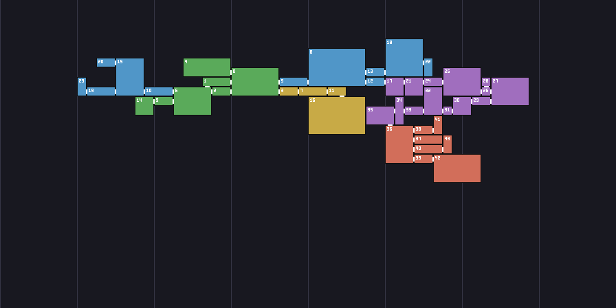

# 07d — Grafo e mapa do Tallon

Estado: verificada (22/10/2026: validate 28/60/0 + linha do Tallon; .ips sha1 `e9b0db22…8555` igual; 21/21 testes)
Esforço estimado: 1 dia (spec 1 h, busca da disposição 2 h, código 2 h, verificação 1 h)
Épico: [07 — Tallon Overworld](07-tallon-overworld.md) (decisões 4, 5 e 8; linha 07d)

## Contexto

Antes de desenhar qualquer sala do Tallon (07g), o projeto precisa da "planta" do mundo inteiro:
quais são as 44 salas, de que tamanho, onde cada uma fica no mapa de pausa da área 0 e por qual
porta cada uma liga na vizinha. Se isso for feito sala por sala, a 07k/07l/07m descobrem tarde que
uma região não cabe no mapa, ou que o mapa passa da cota de bytes do save. Esta spec declara a
tabela inteira de uma vez, com as checagens do validador, **sem pôr nenhuma sala na ROM**.

## Estado atual (verificado)

- `research/prime_worlds.json`, MLVL "Tallon Overworld": 44 salas (P0–P43), 44 pares de portas
  (88 docks, todos com volta). O grafo é uma árvore mais **um ciclo**: Landing Site → Gully →
  Tallon Canyon → Canyon Cavern → Landing Site. Conferido com um script que lê `areas[].docks`.
- A fragata (`tools/frigate/rooms.py`) declara salas com `RoomDef` (tamanho, `map_x/map_y`) e
  `LINKS` ((sala, lado, tela) ↔ (sala, lado, tela)); `tools/validate.py` `check_map` exige que a
  célula da porta encoste na célula da porta vizinha no mapa (lados opostos).
- Os tamanhos da fragata não seguem fórmula (ex.: Reactor Core 86×106×138 m → 1×1, Biotech 2
  116×116×187 m → 3×2): `research/frigate_design.md` diz que só os pares de salas ligadas vêm do
  Prime. O épico propôs tamanhos "na mesma escala solta" para algumas salas (soma 249 telas).
- `tools/areas.py` (07a): `AreaDef`, `AREAS = [FRIGATE]`; `stations_from_rooms` exige uma sala com
  spawn; `build.py` monta todas as áreas de `AREAS` e para se a área não tiver entrada em
  `VANILLA_PAUSE` (só a 3 tem).
- `tools/frigate/mapsave.py` (spec 03): a lista do mapa salvo da área 0 cabe no lugar vanilla até
  **80 bytes** (`LIST_ROOM[0]`; o épico cita 74, que é a contagem vanilla, não o espaço).
- `smlib/crateria.py` (07c): `SURFACE` (tileset 0), `CAVE` (tileset 2), `RAIN_FX`,
  `LANDING_SITE_MUSIC`; `RoomDef.fx`, `RoomDef.style`, `RoomDef.tileset`.
- `smlib/reach.py` (07b): `POWER_BEAM_ONLY` (sem Space Jump, sem Morph).

## Mudança proposta

### 1. `tools/tallon/rooms.py` (novo)

Mesmo lugar e formato da fragata (`tools/<mundo>/rooms.py`; a 07a deixou `RoomDef` em
`frigate/rooms.py` e não move módulos). Conteúdo:

- `TABLE`: uma linha `Row` por sala do Prime: chave `tallon_*`, P#, nome do Prime, região A–E,
  visual, caixa do Prime em metros (`aabb` arredondada), `map_x`, `map_y`.
- **Tamanho derivado da caixa** (`screens`): largura = maior entre x e y do Prime, altura = z;
  30 m por tela, arredondando (meio para cima), mínimo 1, máximo **6 × 4** (as salas gigantes,
  Frigate Crash Site 315×353×222 m e Artifact Temple 406×447×234 m, ficam com 24 telas). Soma:
  **251 telas** (o épico estimou 249). Uma só regra para as 44 salas, conferível contra o JSON.
- **Visual** (decisão 5): superfície = `crateria.SURFACE` no tileset 0 (padrão da área);
  cavernas, túneis e salas de transporte = `crateria.CAVE`, tileset 2; fragata afundada =
  `FRIGATE`, tileset 4. **Chuva** (`RAIN_FX`) nas 6 salas com Rain Simulator no Prime (Landing
  Site, Tallon Canyon, Temple Security Station, Root Cave, Arbor Chamber, Life Grove), todas de
  superfície.
- `LINKS`: os 44 pares de portas do Prime, com lado e tela escolhidos para encostar no mapa.
- Regiões: `REGIONS` (A–E), `ACTIVE_REGIONS = frozenset()` (nenhuma nesta spec),
  `build_rooms(regiões)` monta só as salas dessas regiões; uma ligação para sala de região
  desligada **não entra** (vira parede: sem porta no level), então o validador nem a vê
  (decisão 8). `ALL_ROOMS = build_rooms(todas)` para o validador; `ROOMS =
  build_rooms(ACTIVE_REGIONS)` para o build.
- Salas com um `Canvas` provisório (caixa aberta); os desenhos são da 07g e das specs de região.
- `check_prime(json)`: cada P# uma vez, nome e caixa iguais ao Prime, região/visual conhecidos,
  `LINKS` = pares de docks do Prime (sem faltar nem sobrar), salas de chuva na tabela.

### 2. Disposição no mapa

Achada com uma busca em feixe (script descartável, fora do projeto) e congelada como números na
tabela. Custo: bytes do save (cada byte = 8 colunas de uma linha) + caixa total + portas de
teto/chão (mais difíceis sem Space Jump) + lado da porta contra a direção dela no Prime + distância
da posição "geográfica" (oeste→leste e altura do Prime) + região espalhada. A rota do MVP só com
portas laterais.

`specs/img/07d-mapa.png` (gerado com `python3 -I tools/preview_rooms.py --mapa-tallon`): cada
quadrado = 1 tile do mapa de pausa; número = P#; marca branca = porta; linhas verticais a cada 8
colunas (limite dos bytes do save). Cores: **A verde, B amarelo, C azul, D roxo, E vermelho.**

- Oeste→leste como no Prime: raízes (C oeste: 23, 19, 15, 20, 10) | Tallon Canyon e transporte
  oeste (A) | Landing Site, Alcove, Gully, Canyon Cavern (A) | templo (B) embaixo da cachoeira |
  Crash Site e Transport Tunnel C (C leste) | fragata afundada (D) | Grande Árvore (E) embaixo
  da D, ligada pela Hydro Access Tunnel.
- **Rota do MVP só com portas laterais**, da direita para a esquerda: Landing Site (L2) → Canyon
  Cavern → Tallon Canyon (L1) → Transport Tunnel A → Transport to Chozo Ruins West.
- Só 4 ligações verticais: Gully→Tallon Canyon, Temple Lobby→Artifact Temple,
  Savestation→Reactor Access, Hydro Access Tunnel→Great Tree Hall.
- Ocupa x 8–54, linhas de tile 4–18 da grade 64×32 (a Crateria vanilla usa y 1–19).

| Região | Salas | Telas | Bytes do save (região sozinha) |
|--------|-------|-------|--------------------------------|
| A Superfície | 7 | 48 | 11 |
| B Templo | 4 | 31 | 6 |
| C Cachoeira/Crash Site/Raízes | 11 | 71 | 14 |
| D Fragata afundada | 14 | 60 | 13 |
| E Grande Árvore | 8 | 41 | 10 |
| **Tallon inteiro** | **44** | **251** | **47 de 80** |
| Rota do MVP (5 salas) | 5 | 35 | 8 |

(As regiões dividem alguns bytes, por isso a soma 54 passa do total 47.)

Tamanhos por sala (P# L×A): A: 0 5×3, 1 3×1, 2 2×1, 4 5×2, 6 4×3, 9 2×1, 14 2×2.
B: 3 2×1, 7 3×1, 11 2×1, 16 6×4. C: 5 3×1, 8 6×4, 10 3×1, 12 2×1, 13 2×1, 15 3×4, 18 4×4,
19 3×1, 20 2×1, 22 1×2, 23 1×2. D: 17 2×2, 21 2×2, 24 2×1, 25 4×3, 26 1×1, 27 4×3, 28 1×1,
29 2×1, 30 2×2, 31 1×1, 32 2×3, 33 2×1, 34 1×3, 35 3×2. E: 36 3×4, 37 3×1, 38 2×1, 39 2×1,
40 3×1, 41 1×2, 42 5×3, 43 1×2.

### 3. `AreaDef` do Tallon (`tools/areas.py`)

`TALLON = AreaDef(key="tallon", number=0, name="TALLON", rooms=tallon.ROOMS, tileset=0,
music=LANDING_SITE_MUSIC, layer2=$C1C1, library_bg=$B8B4, load_stations=[],
loadout=POWER_BEAM_ONLY)`.

**Fica fora de `AREAS`** (decisão desta spec). Por quê: com zero regiões ativas a área não tem
salas, nem estação 0 (chegada, 07e), nem mapa de pausa (`VANILLA_PAUSE` da área 0, 07f), e a lista
do save aceita 1–255 bytes; pôr em `AREAS` obrigaria a mexer no build só para pular uma área vazia.
Fora da lista o build não a vê e a ROM fica igual por construção. Quem liga a área (07e/07f/07g)
põe `TALLON` em `AREAS` junto com a primeira região. Fundo/BG2 = os do Parlor (`$B8B4`/`$C1C1`,
citados na 07c) como valor provisório; a 07g escolhe.

### 4. Validador (`tools/validate.py`)

- `check_layout(área, salas)`: a parte de tabela/mapa que estava dentro de `check_area` (tamanho
  ≤ 50 telas, sobreposição, portas fora da sala ou repetidas, volta da ligação, estilo × tileset,
  `check_map`: dentro de 64×32 e porta encostando na vizinha). `check_area` passa a chamá-la
  (mesmas checagens para a fragata).
- `check_tallon()` (sempre, esteja o Tallon no build ou não): `check_prime`; `check_layout` nas
  44 salas juntas e em **cada região sozinha** (prova que cortar as ligações para regiões
  desligadas deixa tudo coerente); bytes do mapa salvo (`mapsave.needed` da máscara de
  `pausemap.build`) com `mapsave.check` e ≤ `LIST_ROOM[0]` = 80.
- Sem problemas, imprime uma linha de informação antes do total:
  `tallon (tabela inteira, regiões ativas: nenhuma): 44 salas, 44 ligações, 251 telas, mapa 47/80
  bytes de SRAM (por região: A 11 B 6 C 14 D 13 E 10)`. A linha final da fragata não muda.

### 5. Prévia

`tools/preview_rooms.py --mapa-tallon` desenha `specs/img/07d-mapa.png` (sem a opção, nada muda).

## Critérios de aceite

1. `python3 -I tools/validate.py` → 0 problemas, com a linha do Tallon (44 salas, 44 ligações,
   mapa ≤ 80 bytes) e "28 salas, 60 portas, 0 problemas". (protege=tabela, mapa e cota; falha_quando
   =ver 2–4; não_prova=que as salas são jogáveis, isso é da 07g)
2. Mutação: duas salas sobrepostas no mapa (Gully uma coluna para a direita) → "sobrepõe" e
   portas que não encostam; validate sai com 1.
3. Mutação: porta que não encosta (porta da Alcove para a Landing Site na tela 0 em vez da 1) →
   "não encosta na vizinha no mapa" nos dois lados; validate sai com 1.
4. Mutações de dados: ligação do Prime faltando → "ligações diferentes do Prime"; nome trocado →
   "P0 no Prime é…"; cota de 40 bytes → "mapa usa 47 bytes".
5. `python3 -I tools/build.py` → `build/metroid_prime_snes.ips` sha1
   `e9b0db220a7f5d7540b02b2ccbbd6e3889e28555` (nenhuma sala nova na ROM).
6. `python3 -I tests/run_tests.py` → 21/21.
7. `specs/img/07d-mapa.png`: regiões agrupadas, rota do MVP legível, nenhuma sala solta (olhando).

## Plano de testes

| Camada | O quê | Qtde |
|--------|-------|------|
| validate.py | `check_tallon`: Prime × tabela, mapa das 44 salas, mapa por região, bytes do save | +1 (4 partes) |
| mutações à mão | sobreposição, porta sem encostar, ligação, nome, cota | 5 |
| run_tests.py | nenhum novo (nada na ROM) | 0 |
| imagem | `specs/img/07d-mapa.png` | +1 |
| build | sha1 igual | 1 |

## Riscos e reversão

- A disposição é um compromisso entre bytes, legibilidade e geografia; mudar um tamanho na 07g
  (ex.: uma sala precisar de mais uma tela) pode empurrar vizinhas. O validador acusa na hora;
  o script de busca não ficou no projeto (os números ficaram), então o ajuste é à mão.
- Salas muito estreitas no mapa (Canyon Cavern 2×1 entre Landing Site e Tallon Canyon) limitam o
  desenho; a 07g pode precisar mexer.
- 47 bytes deixam 33 de folga; se o mundo crescer, a 07f move a lista para `$81:EF1A+`.
- Reversão: apagar `tools/tallon/`, `TALLON` de `areas.py`, `check_layout/check_tallon` do
  validador (voltar o trecho para dentro de `check_area`) e `--mapa-tallon` da prévia.

## Fora de escopo

- Desenho das salas (layouts jogáveis sem Space Jump) → 07g e specs de região.
- Mapa de pausa e minimapa da área 0 na ROM (tilemap, nome, ícones, lista de bytes do save) → 07f.
- Chegada na Landing Site, load station 0, nave salvando → 07e.
- Pôr `TALLON` em `AREAS` e ligar qualquer região.
- Fechar Gully e Alcove no MVP: a ativação é por região; se a 07g quiser só 5 das 7 salas da A,
  ela acrescenta isso.

## Desvios (preenchido na implementação)

Verificação (22/10/2026, na pasta real):

- `python3 -I tools/validate.py` → linha do Tallon "44 salas, 44 ligações, 251 telas, mapa 47/80
  bytes de SRAM (por região: A 11 B 6 C 14 D 13 E 10)" e "28 salas, 60 portas, 0 problemas",
  saída 0.
- Mutações (na memória, sem mexer nos arquivos): Gully +1 coluna → 5 problemas ("tallon_gully
  sobrepõe tallon_landing_site no mapa em (24,7)" e portas sem encostar); porta da Alcove na tela
  0 → `validate.main()` com 2 problemas ("porta L0 -> tallon_alcove não encosta…" e a volta),
  saída 1; última ligação removida → "faltam [[40, 43]]"; nome "Landing" → "P0 no Prime é
  'Landing Site'…"; `LIST_ROOM[0] = 40` → "mapa usa 47 bytes da SRAM; o lugar vanilla da área 0
  tem 40".
- `python3 -I tools/build.py` → `.ips` sha1 `e9b0db220a7f5d7540b02b2ccbbd6e3889e28555` (igual).
- `python3 -I tests/run_tests.py` → 21/21.
- `specs/img/07d-mapa.png` conferida olhando.

Desvios e detalhes:

- Tamanhos: regra única (30 m/tela, máx. 6×4) em vez dos números soltos do épico. Diferenças na
  região A: Landing Site 5×3 (épico 6×3), Gully 3×1 (3×2), Alcove 5×2 (3×2), Transport to Chozo
  Ruins West 2×2 (1×2); Tallon Canyon 4×3, Canyon Cavern 2×1 e Transport Tunnel A 2×1 iguais.
  Rota do MVP: 35 telas (épico 36). Artifact Temple 6×4 (épico 6×3), Great Tree Hall 3×4 (3×6),
  Life Grove 5×3 (4×4), Frigate Crash Site 6×4 (8×4).
- Hydro Access Tunnel (P35, região D) usa o visual de caverna, não o da fragata: no Prime é um
  túnel de rocha debaixo d'água entre a fragata e a Great Tree Hall.
- O validador roda `check_tallon` sempre (não só enquanto o Tallon está fora de `AREAS`): a
  tabela inteira continua conferida quando só algumas regiões estiverem no build.
- Cota: o épico cita 74 bytes para a área 0; o limite real do lugar vanilla é 80 (`LIST_ROOM`,
  spec 03). O mundo inteiro usa 47, então nada vai para a 07f além de escrever a lista.
