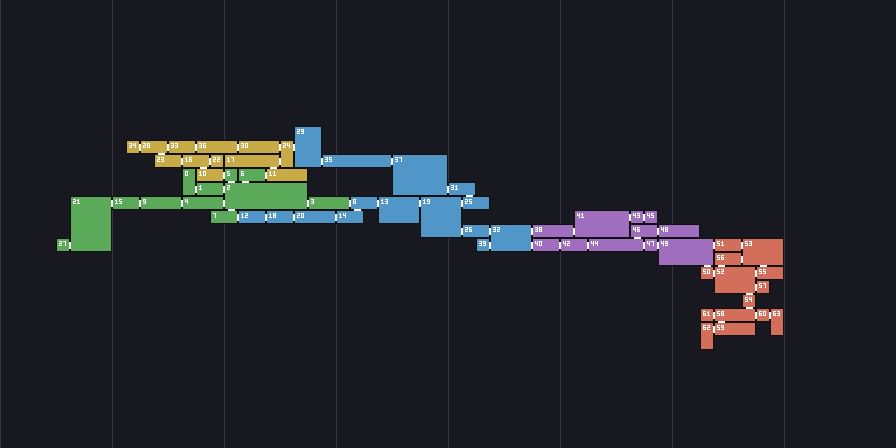

# 12c — Grafo, mapa e travas do Prime da Chozo

Estado: verificada (26/10/2026: validate 72/148/0 com a linha nova "chozo (tabela inteira, specs/12c …)"; .ips sha1
`3919c3c73d46afc45ffd4eb51083daebbe8264ff` igual em dois builds; 53/53 testes)
Esforço estimado: 1 dia
Épico: [12 — Chozo Ruins](12-chozo-ruins.md) (decisões 2 e 3; não depende da decisão dos itens)

## Contexto

Como a 07d fez para o Tallon, antes de desenhar qualquer sala da Chozo o projeto precisa da planta do mundo inteiro: as 64
salas, o tamanho de cada uma, onde fica no mapa de pausa da área 1 e por qual porta liga na vizinha, com as checagens do
validador. Esta filha também grava as **travas do Prime** de cada porta como dados lidos do jogo, **sem escolher item nem
mecanismo do SM** (isso é da 12g, depois da decisão do usuário). Nenhuma sala vai para a ROM.

## Estado atual (verificado)

- `research/prime_worlds.json`, MLVL "Chozo Ruins": 64 salas, 136 docas = 68 ligações, todas com volta; o grafo tem 5 ciclos
  independentes (68 − 64 + 1): o grande da ala norte (Main Plaza → Nursery → … → Vault → Plaza Access → Main Plaza, 13 salas), o
  da Main Plaza com a fonte e a Training Chamber, o da Sun Tower e dois na região E (Hall of the Elders / Crossway).
- Posições dos objetos do Prime: as docas do JSON estão no espaço da sala (precisam do `transform` da sala); os objetos (lidos dos
  bytes crus, como na 07k) em coordenadas do mundo. Com isso 128 portas comuns + 8 portas de túnel de Morph caem a ≤ 3 m da doca
  delas (136 de 136).
- Tamanho pela regra do Tallon (`tallon/rooms.py screens`): **202 telas**; 15 salas com 2+ telas de altura.
- `frigate/mapsave.py`: a lista do mapa salvo da área 1 cabe no lugar vanilla até 80 bytes (`LIST_ROOM[1]`).

## Mudança proposta

1. `tools/dump_prime_locks.py` (novo, roda no `tools/venv`): para cada sala de um mundo do Prime, os objetos em cada doca (o mais
   perto, a ≤ 3 m) e as "features" da sala que travam movimento (nomes/tipos: `spider`, `bomb_slot`, `breakable`, `halfpipe`,
   `grapple`, `heat`, `water`, `lava`, `morph_door`). Saída `research/prime_chozo_locks.json` (gerada, 64 salas).
2. `tools/chozo/rooms.py` (novo, mesmo formato do Tallon): `TABLE` (64 `Row`: chave `chozo_*`, P#, nome, região, caixa, `map_x`,
   `map_y`), `LINKS` (68 pares com lado e tela), `REGIONS` A–E (as do épico), `ACTIVE_REGIONS` vazio, `ROOMS = []`,
   `ALL_ROOMS` (caixas provisórias, só para o validador), e as travas como dados:
   - `DOCK_LOCKS[(sala, vizinha)]` = tipos de trava da doca, pela regra `prime_dock_locks`: **missile** (`Actor Missile Lock`),
     **key** (`Trigger_DoorKey` sem escudo de míssil = porta de cor; a cor não está nos nomes), **morph** (porta
     `Door_Area Morphball`), **event** (`Actor Door Lock`: fecha durante uma luta/evento), **one_way** (scan "one way door").
   - `FEATURES[sala]` = as features acima.
   - `check_prime(worlds, locks)`: salas, nomes, caixas e ligações iguais ao Prime; `DOCK_LOCKS`/`FEATURES` iguais ao que o JSON dá.
3. **Disposição no mapa** achada por recozimento simulado (script descartável no scratchpad, `s12c/layout_sa.py`; os números
   ficaram na tabela): sem sobreposição, toda porta encostando na vizinha com lados opostos e telas livres, custo para porta de
   chão/teto, bytes do save e distância da posição do Prime (oeste→leste, norte em cima). Resultado: **15 ligações de chão/teto**
   (o mínimo achado em ~30 rodadas; salas de 1 tela de altura com 3+ portas e os 5 ciclos obrigam algumas), **41 bytes** de SRAM,
   colunas 4–55, linhas 8–23 (`map_y`).
4. `tools/validate.py` `check_chozo()` (sempre): `check_prime`; `check_layout` na tabela inteira e em **cada região sozinha**; as
   salas `chozo_*` do build = `ROOMS` (nenhuma); bytes do mapa salvo ≤ `LIST_ROOM[1]`. Linha nova antes do total.
5. `tools/preview_rooms.py --mapa-chozo` → `specs/img/12c-mapa.png` (mesmo desenho da 07d: cor por região, P#, marca de porta,
   linha a cada 8 colunas).

Cores: **A verde, B amarelo, C azul, D roxo, E vermelho.** Oeste→leste como no Prime: Tower of Light (A) à esquerda, Main
Plaza no meio de A, a ala norte (B) em cima, fonte/Arboreto/Sunchamber (C) no centro, D e E descendo para a direita, com os dois
transportes para o Tallon (62, 63) embaixo à direita.

| Região | Salas | Telas | Bytes do save (região sozinha) |
|---|---|---|---|
| A | 12 | 45 | 13 |
| B | 12 | 27 | 6 |
| C | 15 | 62 | 15 |
| D | 11 | 35 | 9 |
| E | 14 | 33 | 8 |
| **Chozo inteira** | **64** | **202** | **41 de 80** |

### Travas do Prime (dados; cor e item ficam para a 12g)

51 docas com trava: **missile 14** (Main Plaza → Ruined Shrine Access, Arboretum Access → Arboretum, Arboretum → Sunchamber
Lobby e → Gathering Hall Access, Ruined Gallery → Map Station, Transport Access North ↔ Hive Totem, Gathering Hall → Save Station 2,
Watery Hall Access → Watery Hall, Watery Hall → Dynamo Access, Dynamo Access → Dynamo, Crossway → Elder Hall Access, Reflecting
Pool → Save Station 3 e → Antechamber), **key 23** (porta de cor: Ruined Shrine → Tower of Light Access, Tower of Light Access ↔
Tower of Light ↔ Tower Chamber, Training Chamber Access ↔ Training Chamber / Magma Pool, Furnace ↔ East Furnace Access ↔ Hall of
the Elders, Crossway Access West → Crossway, Crossway ↔ Crossway Access South ↔ Hall of the Elders, Hall of the Elders ↔ Elder
Chamber, Reflecting Pool ↔ Transport Access South, Antechamber → Reflecting Pool), **morph 8** (Main Plaza ↔ Piston Tunnel ↔
Training Chamber, Energy Core ↔ Burn Dome Access, Furnace ↔ Crossway Access West), **event 8** (Training Chamber, Sunchamber
(Flaahgra), Energy Core, Burn Dome (Incinerator Drone), Hall of the Elders ×4), **one_way 1** (Main Plaza → Plaza Access).
A cor das portas `key` não está nos dados; pelo conhecimento do Prime (incerto, para a 12g conferir): onda na Tower of Light e
na Training Chamber Access, gelo na Furnace/East Furnace Access e no Reflecting Pool.
Features por sala (spider em 8 salas, halfpipe em 9, bomb_slot em 4, breakable em 5, água em 16, lava em 2, heat em 8, grapple em
2): a tabela inteira em `chozo/rooms.py FEATURES`.

## Critérios de aceite

1. validate 0 problemas, "72 salas, 148 portas" (igual) e a linha "chozo (tabela inteira, specs/12c, salas construídas: 0): 64 salas,
   68 ligações (15 de chão/teto), 202 telas, mapa 41/80 bytes de SRAM (por região: A 13 B 6 C 15 D 9 E 8); travas do Prime em 51
   docas (event 8, key 23, missile 14, morph 8, one_way 1), sem item SM". (protege = tabela, mapa, cota e travas iguais ao Prime;
   falha_quando = mutações abaixo; não_prova = salas jogáveis, isso é da 12f em diante)
2. Mutações (scratchpad `s12c/mutate_c.py`, em memória), cada uma pega.
3. ROM igual: sha1 `3919c3c7…64ff` em dois builds; 53/53.
4. `specs/img/12c-mapa.png` olhada: regiões juntas, nenhuma sala solta; `07d-mapa.png` igual byte a byte.

## Plano de testes

| Camada | O quê | Qtde |
|---|---|---|
| validate.py | `check_chozo` (Prime × tabela × travas, mapa inteiro e por região, cota) | +1 |
| scratchpad | 12 mutações | 12 |
| run_tests.py | nenhum (ROM igual) | 0 |
| imagem | `specs/img/12c-mapa.png` | +1 |

## Riscos e reversão

- 15 portas de chão/teto: sem Space Jump são mais difíceis (spec 08, 10b); as salas da 12f em diante desenham o acesso (degraus até
  a borda) ou a 12f pede para mexer na disposição (o validador acusa na hora).
- Desenhar uma sala com outro tamanho empurra vizinhas; o script de busca ficou no scratchpad, não no projeto (como na 07d).
- Reversão: apagar `tools/chozo/`, `tools/dump_prime_locks.py`, `research/prime_chozo_locks.json`, `check_chozo` e `--mapa-chozo`.

## Fora de escopo

- Desenho das salas, `AreaDef` da Chozo, mapa de pausa na ROM (12f).
- Itens, cor das portas e mecanismo SM de cada trava (12g, depende da decisão do usuário).

## Desvios (preenchido na implementação)

- **Docas no espaço da sala**: o JSON guarda os cantos das docas relativos à sala; o primeiro leitor (sem o `transform`) achava só 2
  portas perto das docas. Com o `transform` são 136 de 136.
- **Features** além do pedido "por doca": o épico pedia "portas de cor, blocos, túneis"; blocos e trilhos ficam dentro das salas, por
  isso entram por sala (`FEATURES`), não por doca.
- `dump_prime_locks.py` é ferramenta do projeto (como os outros `dump_prime_*`), e o JSON gerado ficou em `research/`: o validador
  compara a tabela com ele sem precisar do `venv`.
- O recozimento achou várias disposições com 15 portas de chão/teto; a escolhida (semente 42) tem 41 bytes. Antes de pesar mais as
  portas de chão/teto as disposições tinham 19–27.
- Mutações (`s12c/mutate_c.out`), todas pegas: C1 Vault uma coluna à direita (porta não encosta, 6 problemas); C2 ligação faltando;
  C3 nome; C4 caixa; C5 míssil virou cor; C6 trava de morph esquecida; C7 feature inventada; C8 cota de 30 bytes; C9 porta numa tela
  fora da sala; C10 lados não opostos (o `build_rooms` para); C11 região desconhecida; C12 chave sem prefixo (e as ligações dela
  apontam para fora da tabela). Sem mutação: limpo.
- Verificação (26/10/2026, pasta real): `python3 -I tools/validate.py` → "72 salas, 148 portas, 0 problemas" com a linha da Chozo do
  critério 1 e a do Tallon igual; `python3 -I tools/build.py` duas vezes → sha1 `3919c3c73d46afc45ffd4eb51083daebbe8264ff` (igual);
  `python3 -I tests/run_tests.py` → **53/53**.
