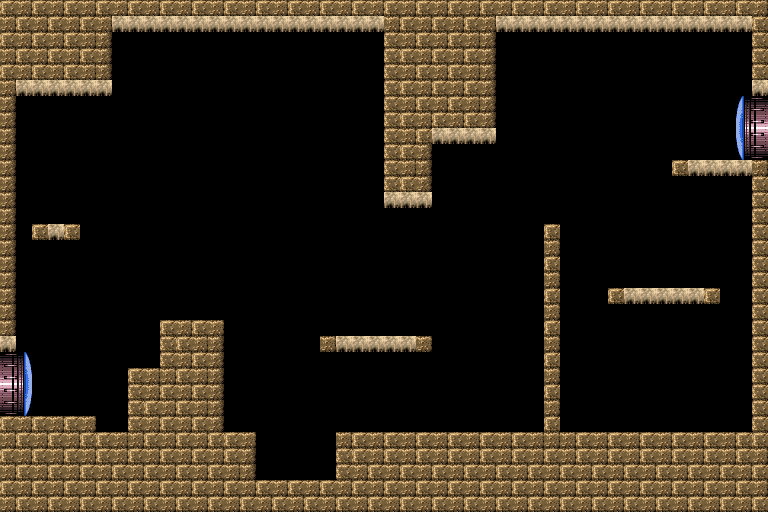
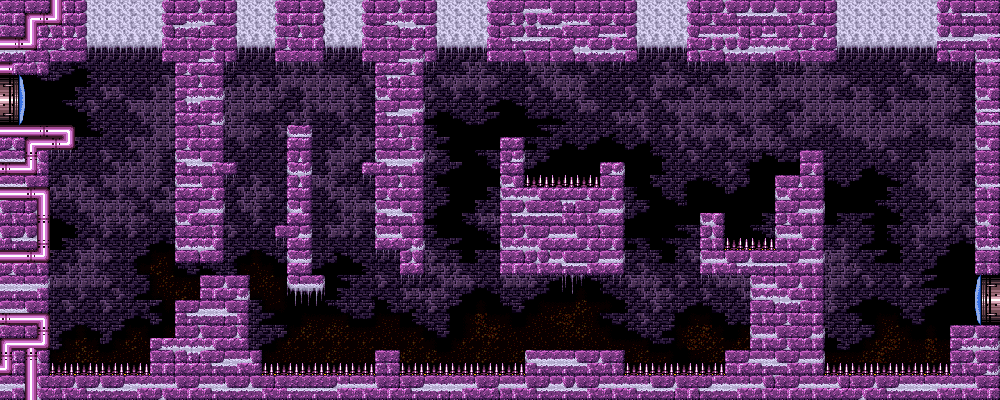
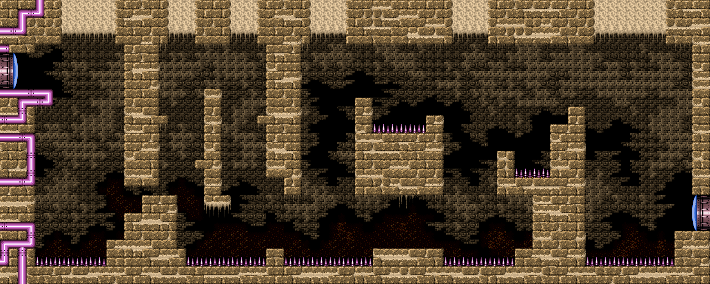

# 12d — Estilo das ruínas (tileset 0C em arenito)

Estado: verificada (26/10/2026: validate 72/148/0 com a linha nova "ruínas (specs/12d) …"; .ips sha1
`04dc19affd46326b94602f19eefcf2ea8fe3d9dc` igual em dois builds; 53/53 testes)
Esforço estimado: 1 dia
Épico: [12 — Chozo Ruins](12-chozo-ruins.md) (decisão 5 "Visual"; não depende da decisão dos itens; a cor espera a pergunta 8)

## Contexto

As salas da Chozo (12f em diante) vão ser desenhadas em ASCII como as do Tallon, e um estilo troca cada bloco de parede pela peça
certa do tileset (07c fez isso para a Crateria). O épico escolheu o tileset **0C** (Maridia rochosa: tijolos e colunas), que nenhuma
sala nossa nem nenhuma demo usa, recolorido para arenito. Esta filha faz o estilo, a cor (uma tabela só, fácil de trocar: o usuário
ainda não confirmou), grava a paleta recolorida na ROM e prova que ninguém a vê ainda.

## Estado atual (verificado)

- Tileset 0C (`$8F:E7A7 + 2·$0C` → entrada `$8F:E70E`, só dele): 27 salas vanilla, todas da área 4 (Maridia), nenhuma num caminho
  nosso (spec 11) nem nas 19 salas das demos. 768 metatiles próprios. Tem três visuais: rocha verde (algas), areia e **tijolos roxos**.
- Tijolos (salas `$8F:DA2B`, `$D7E4`, `$D72A`; contagem por vizinhança de ar dos blocos sólidos, roteiro `s12c/ts0c.py`): recheio
  `$1E1`/`$1E3` alternando por (x+y) (as linhas de `$D7E4`: `81E1 81E3 81E1 …`), parede com ar à esquerda `$1E6` (33), à direita
  `$1E7` (34), fileira de teto `$15B` (80, tijolo com a borda de baixo; as gotas `$15C` embaixo são blocos de ar), chão = o próprio
  tijolo (`$1F8/$1F9/$1E1/$1E3` no topo). A peça de chão mais comum do 0C, `$116` (94), é da linha de paleta **2**, que o tileset
  divide com portas e itens: fica de fora.
- Paleta: todas as peças acima usam a **linha 7** (a própria do tileset). Linha 7 vanilla: 3 marrons + 12 roxos/lavandas.
- Recolor do build (`build.py` passo 3): por área (`AreaDef.palette_rows`), cópia da paleta no alocador fixo e o ponteiro da entrada
  do tileset trocado (gráficos e metatiles continuam os vanilla).

## Mudança proposta

1. `tools/smlib/ruins.py` (novo): `RUINS_TILESET = $0C`, `PALETTE_LINE = 7`, **`SANDSTONE`** (as 15 cores da linha 7 em hex RGB: os 3
   marrons vanilla e os 12 roxos levados a arenito, matiz 0,10; a tabela é o único lugar a mudar se o usuário quiser outra cor),
   `RUINS` (`EdgeStyle`: recheio/chão `$1E1/$1E3`, teto e saliência `$15B`, paredes `$1E6`/`$1E7`, cantos seguem o tijolo), `recolor`,
   `check(rom)` (cada peça no tileset, tipo de colisão vanilla igual ao do estilo, todas na linha 7, `SANDSTONE` com 15 cores).
2. `tools/build.py`: depois da Parasite Queen (o último blob fixo, para nada mudar de lugar), grava a paleta do 0C com a linha 7 =
   `SANDSTONE` no alocador fixo e aponta a entrada do 0C para ela. Para se o 0C já for recolorido por uma área.
3. `tools/validate.py`: `ruins.check(base)` sempre; na ROM construída **`check_ruins_in_rom`**: entrada do 0C só dele, no lugar vanilla,
   metatiles e gráficos vanilla, paleta no alocador fixo = vanilla com a linha 7 = `SANDSTONE`, e **nenhuma sala do manifest fora da
   Chozo nem nenhuma sala das demos usa o 0C** (com `check_orphans`, que prova que o manifest é tudo que o jogo carrega, isso cobre
   todas as salas alcançáveis). O blob entra em `fixed_blobs` (sobreposição, banco). Linha nova "ruínas (specs/12d) …".
4. `tools/preview_rooms.py --estilo-ruinas` → `specs/img/12d-ruinas.png` (com contorno de tipo de bloco), `12d-ruinas-limpo.png`
   (sala de teste sintética da 07c com o estilo) e `12d-sala-DA2B-antes.png`/`-depois.png` (sala vanilla de tijolos).

## Critérios de aceite

1. validate 0 problemas, "72 salas, 148 portas", linha "ruínas (specs/12d): tileset 0C com a linha 7 em arenito (paleta em $F0DDB7);
   nenhuma das 72 salas nossas nem das 19 salas das demos usa o tileset" e "alocador fixo …: 7 blobs". (protege = o recolor não muda
   nada que o jogador veja hoje e é o definido; falha_quando = mutações abaixo; não_prova = que a cor agrada ao usuário)
2. Mutações (`s12c/mutate_d.py`), cada uma pega.
3. Dois builds com o mesmo sha1; 53/53 (a ROM muda só na entrada do 0C, 3 bytes, e no blob novo depois do último: 253 bytes
   diferentes da ROM anterior; nenhum blob fixo anterior mudou de lugar).
4. Foto do emulador numa cópia (`s12c/emu`): a sala vanilla `$D78F` (área 4, estação $11 por RAM) antes e depois, os tijolos de baixo
   em arenito: `specs/img/12d-emulador-D78F-antes-depois.png`.

## Plano de testes

| Camada | O quê | Qtde |
|---|---|---|
| validate.py | `ruins.check`, `check_ruins_in_rom`, blob em `check_banks` | +2 |
| scratchpad | 11 mutações + 2 sem mutação | 13 |
| run_tests.py | nenhum novo (nenhuma sala usa o 0C) | 0 |
| imagem | 4 prévias + 1 foto do emulador | 5 |

## Riscos e reversão

- A cor no jogo sai um pouco mais oliva que na prévia (a sala da Maridia tem FX de paleta da área 4; na área 1 da Chozo será outro):
  conferir na 12f com uma sala de verdade.
- Recolor global por tileset: uma sala vanilla 0C que voltasse a ser carregada (demo nova, spec 11) apareceria em arenito; o validador
  acusa.
- As peças de tijolo não têm borda própria (como a caverna da 07c): cantos e pontas continuam o tijolo.
- Reversão: tirar o bloco do `build.py`, `smlib/ruins.py`, as duas checagens, o blob de `fixed_blobs` e `--estilo-ruinas`.

## Fora de escopo

- Salas da Chozo, `AreaDef` da Chozo, música, FX de água/lava (12f e as regiões); recolorir os canos rosa (outra linha) e a rocha verde
  e a areia do 0C (não fazem parte do estilo).

## Desvios (preenchido na implementação)

- **"Numa cópia"**: o recolor fica numa cópia da paleta no alocador fixo (como a fragata); a paleta vanilla não muda. A ROM muda (sha1
  novo), mas nada visível: provado por `check_ruins_in_rom` e pelos 53 testes.
- **FX e música** do épico ficaram para a 12f (dependem de salas e da área existir); só o estilo e a cor aqui.
- O blob da paleta foi primeiro posto no passo 3 do build (junto do recolor das áreas) e empurrou a Parasite Queen 256 bytes; foi
  movido para o fim (depois da Queen), e os blobs anteriores ficaram onde estavam.
- `SANDSTONE` é uma tabela de cores escrita (não uma fórmula) para ser fácil de trocar; a fórmula que a gerou está no comentário.
- `preview_rooms.py` regravou também `research/render/*` (como sempre faz); `tallon_canyon.png` e `tallon_life_grove.png` saíram
  diferentes das que estavam (eram de antes da 09d/09e); nada do Tallon mudou nesta filha.
- Mutações (`s12c/mutate_d.out`), todas pegas: D1 chão `$116` (tipo 3 no vanilla e linha 2); D2 recheio com a gota `$15C` (ar); D3
  parede `$3FE` (não aparece, linha 3); D4 `SANDSTONE` com 14 cores; D6 paleta apontando para a vanilla; D7 um byte da cópia trocado; D8
  Landing Site com o tileset 0C; D9 sala da demo `$91F8` com o 0C; D10 tileset 0B apontando para a entrada do 0C; D11 metatiles do 0C
  trocados. Sem mutação (D0, D5): limpo.
- Verificação (26/10/2026, pasta real): `python3 -I tools/validate.py` → "72 salas, 148 portas, 0 problemas" (linhas da Chozo 12b/12c,
  do Tallon e "órfãs" iguais; nova "ruínas"); `python3 -I tools/build.py` duas vezes → sha1 `04dc19affd46326b94602f19eefcf2ea8fe3d9dc`;
  `python3 -I tests/run_tests.py` → **53/53**.
