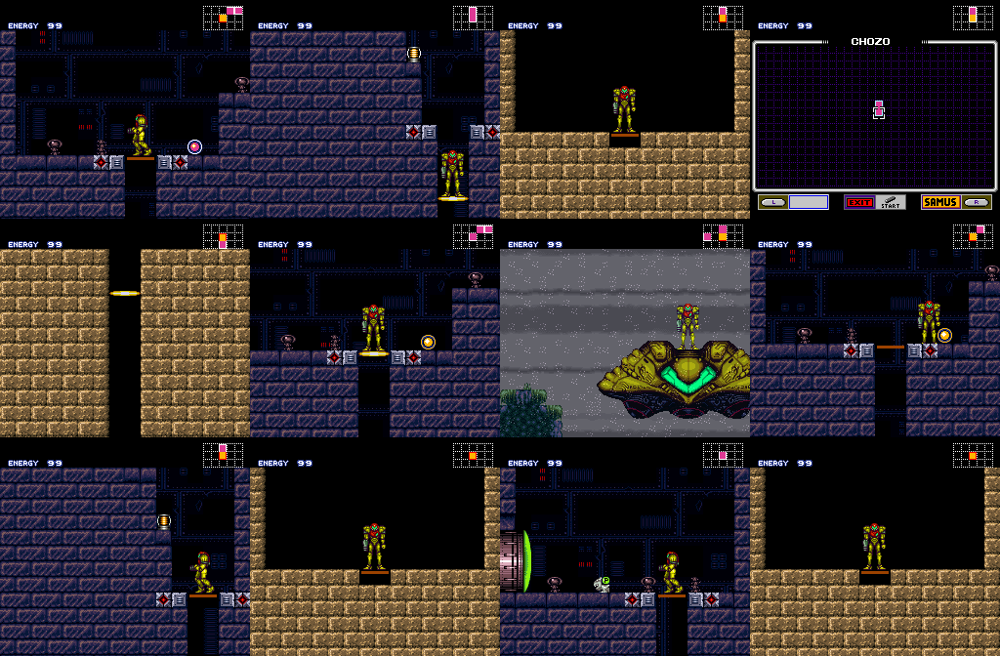

# 12e — Elevadores de verdade (Tallon ↔ Chozo)

Estado: **verificada** (26/10/2026: validate "75 salas, 148 portas, 0 problemas" com a linha do Tallon igual e a linha nova
"chozo (specs/12e) …"; `.ips` sha1 `d90984d0f621c88f8e5e2bac77ddb1a2e88026e6` igual em dois builds; **55/55** testes)
Esforço estimado: 2–3 dias depois das decisões (gasto: 1 sessão)
Épico: [12 — Chozo Ruins](12-chozo-ruins.md) (decisão 4; todas as opções de itens precisam)

## Contexto

Os três transportes do Tallon para a Chozo (`tallon_transport_chozo_west`, rodada 0; `…_east`, rodada 4; `…_south`, rodada 5) eram
elevadores de enfeite (spec 07j). No Prime eles levam às salas P0, P62 e P63 da Chozo (destinos lidos dos bytes no épico 12). Esta
filha liga os três: cada um desce até a sala de elevador da Chozo (área 1) e volta.

## Decisões do usuário (finais, 26/10/2026)

- **Área 1** para a Chozo (a 12b reservou; confirmada).
- **Os três elevadores agora** (Chozo West, East e South); o da Magmoor North continua de enfeite.
- **Morph Ball (Chozo West) e Gravity Suit (Chozo East)**, que estavam em cima das plataformas de enfeite, vão para o lado da
  plataforma, na mesma sala. A tabela de rodadas do Tallon não muda: 44 salas, 20 itens em 7 rodadas.
- As salas da Chozo, por ora, são só as três salas de elevador, prontas e em arenito (tileset 0C, 12d), com a porta ainda fechada
  (beco); a região A vem na 12f. Ficam fora da contagem de rodadas do Tallon: o validador as mostra à parte e prova a ida e volta.
- Itens e progressão: opção B do épico (o Tallon fica intacto). Nada disso pesa aqui: as salas novas não têm item.

## Estado antes (verificado)

### O elevador do SM nos bytes (ROM base, roteiro `s12c/elev2.py`)

Sala de cima `$8F:9938` (Crateria, 1×1, área 0) ↔ sala de baixo `$8F:9AD9` (Brinstar verde, 4×12, área 1):

| | Sala de cima `$9938` | Sala de baixo `$9AD9` |
|---|---|---|
| Plataforma | inimigo **`$D73F`** (Elevator) em (128, 162), props `$2C00`, **p1 = 0** (desce), **p2 = `$0140`** (y onde aparece quando chega) | `$D73F` em (128, 706), **p1 = 1** (sobe), **p2 = `$0018`** |
| Blocos sob os pés | (7,10), (8,10), tipo 9 (`$90FF`, desenhados como ar: a plataforma é o sprite), BTS 2 → porta `$88FC` (sala `$0000`: "não é porta"; `BlockColl_Vert_Door` `$94:93CE`: sólido, e a Samus de pé nela liga `elevator_flags` `$0E16`) | (7,44), (8,44), BTS 9 → `$88FC` |
| Saída | (7,15), (8,15), tipo 9, BTS 1 → porta `$8C0A`: sala `$9AD9`, **flags `$C0`** (`$80` elevador + `$40` troca de área: salva/carrega o mapa explorado, `$82:DF99`/`$82:DFB6`), orientação 2 (desce), dist `$0000` | (7,0), (8,0), BTS 0 → `$8CA6`: sala `$9938`, flags `$D0`, orientação 3 (sobe) |

O set de inimigos de `$9938` é vazio: a espécie `$D73F` não tem tiles próprios (cabeçalho `$A0:D73F`: tamanho dos tiles 0). Tecla
que liga: tabela `$A3:94E2` = `$0400` (↓) para p1 = 0 e `$0800` (↑) para p1 = 1, lida nos bytes. O nibble baixo das flags (índice de
"elevador usado", `$80:CD07`) é 0: nenhum ícone de elevador no mapa.

### No emulador (antes, `s12c/emu/ride.txt`)

Ida e volta `$9938` ↔ `$9AD9`, `$079F` 0 → 1 → 0; parada depois de carregar estação, `$0E16` fica 0 (precisa pousar na plataforma).

## O que foi feito

1. **Elevador como dado de sala** (`tools/frigate/rooms.py`): `Elevator(x, row, up)` = coluna esquerda dos 2 blocos da plataforma,
   linha deles, sentido; `RoomDef.elevator`. A lista de portas da sala segue, depois das portas, com a **saída** e a **plataforma**
   (`RoomDef.elevator_slots`); `RoomDef.level()` põe os 4 blocos tipo 9 (`$90FF`, como o vanilla): 2 na linha da plataforma (BTS =
   vaga da plataforma) e 2 na borda da sala (linha 0 se sobe, a última se desce; BTS = vaga da saída). O desenho da sala abre o poço
   de 2 blocos entre eles.
2. **Pares** (`tools/areas.py`): `ELEVATORS` = (sala do Tallon, sala da Chozo) — West ↔ North, East ↔ East, South ↔ South — e
   `elevator_target`.
3. **Lado do Tallon** (`tools/tallon/layouts.py`): `elevator(..., ride=True)` tira a arte dos 2 blocos do meio da plataforma de metal
   e abre o poço deles até a última linha da sala (como `$9938`); `ride_down` dá o `Elevator`. As três salas de transporte para a
   Chozo usam isso; Magmoor East e Mines East continuam de enfeite (mesma função, `ride=False`, bytes iguais).
4. **Lado da Chozo** (`tools/chozo/layouts.py`, novo; `tools/chozo/rooms.py`): `transport(door_screen)`, sala 1×2 em arenito (estilo
   `ruinas`, tileset 0C): um salão na tela da futura porta da sala (linhas 3–9 dela, chão na linha 10, a linha do batente de porta
   lateral) e o poço de 2 blocos da linha 0 até a plataforma, em x 128 (como os vanilla). A outra tela é rocha (o mapa de pausa a
   omite, regra da 10c). **Sem porta ainda**: a parede da porta da tabela (`LINKS`) fica fechada (beco) até a vizinha existir (12f:
   Ruins Entrance; 12l: Save Station 3, Transport Access South); como o chão do salão já está no batente da porta, a filha da região
   só abre a parede. `ELEVATOR_ROOMS` entram no build fora das regiões ativas (`build_rooms(..., extra=…)`).
5. **Área 1 no build** (`tools/areas.py` `CHOZO`): as 3 salas, tileset 0C, fundo = lista nossa `0A 00 00 00` (comando `$000A`
   ClearBG2Tilemap `$82:EA56`; scroll `$0101`), música `$0F/$05` (a da sala de chegada vanilla `$9AD9`; provisória, a 12f escolhe),
   estação 0 = chão ao lado da plataforma da North (x 72, y 395; o épico: "0 = chegada"), mapa de pausa/minimapa "CHOZO", lista do
   mapa salvo = a tabela inteira da 12c (41 bytes) no bloco depois do Tallon (**+404**; SRAM 445/1280), `AREAS = [FRIGATE, TALLON,
   CHOZO]`.
6. **Build** (`tools/build.py`): a porta da plataforma = cópia própria dos 12 bytes de `$83:88FC` (conferidos na ROM base antes) no
   nosso `$83`; a saída = `elevator_exit_entry` (sala do outro lado, flags `$C0`, orientação 2/3, sem empurrão, câmera na tela da
   plataforma de lá); a população de cada sala com elevador começa pela plataforma (`elevator_spawn`: `$D73F`, x = borda comum dos 2
   blocos, y = linha·16 + 2, props `$2C00`, p1 = 0/1, p2 = altura da sala + 64 se desce, `$0018` se sobe); set de inimigos vazio,
   como o vanilla. Mapa de pausa de área sem chefe nosso: a lista vanilla de ícone de chefe é esvaziada (a área 1 tinha o do Kraid).
   Manifest com `elevator` (saída, plataforma).
7. **Itens** (`tools/tallon/items.py`): **Morph Ball** (8, 25) → **(12, 25)**, no chão ao pé dos degraus, a leste da plataforma (pega
   antes de chegar nela); **Gravity Suit** (12, 25) → **(10, 21)**, no último degrau, ao lado da plataforma (a sala não tem chão ao
   lado da plataforma: os degraus descem direto nela). Bits e rodadas iguais.
8. **Validador** (`tools/validate.py`): os 2 blocos da plataforma contam como sólidos em todos os modelos (`elevator_solid`: o jogo
   os trata como sólidos); `reach_on_foot` ganha a entrada "elevador" (ela chega de pé na plataforma) e o alvo "plataforma" (de toda
   entrada a plataforma é alcançável; nenhum lugar sem volta a uma porta **ou à plataforma**: `reach.stuck(..., exits)`);
   **`check_elevators`** (cada par é do Prime — `PRIME_ELEVATORS` = (P14, P0), (P22, P62), (P41, P63) —, Tallon na área 0 descendo,
   Chozo na área 1 subindo, nenhum elevador fora da tabela; blocos e poço no nível; linha "chozo (specs/12e) …" com a rodada de cada
   lado do Tallon); **`check_elevators_in_rom`** (lista de portas, bytes da saída e da plataforma, flags `$C0` com troca de área de
   verdade, população começando pela plataforma, byte de área do cabeçalho); `check_orphans` conta as 2 vagas do elevador e não exige
   código de porta da entrada sem sala; `check_pause_maps` acusa ícone de chefe vanilla sobrando; as linhas 12b e "ruínas" passam a
   falar das 3 salas. As rodadas do Tallon andam só por portas: a Chozo fica fora delas, sem mudar a tabela.
9. **Testes** (`tests/run_tests.py`): `elevador_chozo_ida_e_volta` e `elevador_chozo_east_e_south` (abaixo) e as medidas novas dos
   testes que andam até o Morph e a Gravity.

Da esquerda para a direita, de cima para baixo: Samus na plataforma da Chozo West (a Morph à direita, ao pé dos degraus); descendo no
poço da Chozo East; chegada na Chozo North (área 1); mapa de pausa "CHOZO"; subindo pelo poço de arenito; de volta à Chozo West;
continue na nave depois do save; a Morph ao lado da plataforma; Chozo East (Tallon) e sua sala da Chozo; Chozo South e sua sala.

## Como o elevador liga (medido no emulador)

- A plataforma só parte com a tecla apertada num quadro em que `elevator_flags` (`$0E16`) está ligado. Ele liga quando a Samus, **de
  pé**, colide por baixo com os blocos da plataforma: depois de andar ou cair neles; **não** depois de ser posta por RAM nem de uma
  estação carregar (como a medida da proposta). Com o corpo todo sobre os 2 blocos ele fica ligado em todo quadro; com parte do corpo
  no bloco sólido vizinho (borda da plataforma), **só um quadro sim, outro não** — aí um ↓ de 1 quadro pode falhar e ela agacha
  (agachada não liga mais; levantar e tentar de novo). É o vanilla (mesma geometria: blocos sólidos dos dois lados).
- Posta por RAM ela fica de frente para a tela (pose `$9B`) e o A não pula; 4 quadros → e 4 ← a deixam de volta no meio da plataforma
  com `$0E16` = 1.
- Tempos: ↓ na Chozo West → troca de sala ~120 quadros depois; de pé na plataforma da North (`$0E18` volta a 0) ~600; ↑ → ~540.
  Chega em x = centro da plataforma, y = y da plataforma − 26.
- Cor do arenito numa sala da Chozo de verdade: a linha 7 da paleta na WRAM (`$7EC0E2…`) é exatamente `ruins.SANDSTONE` (as salas
  não têm FX). O tom oliva da foto da 12d vinha do FX de paleta da sala da Maridia (`$D78F`), não da tabela: **nada a corrigir** em
  `SANDSTONE`. O teste novo confere isso.

## Critérios de aceite

1. validate 0 problemas; linha do Tallon igual ("44 salas construídas, alcançáveis agora: 44, 20 itens em 7 rodadas"); linha nova
   "chozo (specs/12e): 3 elevadores área 0 <-> área 1: … (rodada 0) … (rodada 4) … (rodada 5) …; 3 salas da Chozo construídas (becos,
   0 itens), fora das rodadas do Tallon; ida e volta: …"; `check_orphans` com a área 1 ("órfãs" igual). **Passa.**
2. Teste `elevador_chozo_ida_e_volta` (protege = ida, volta, área `$079F`, mapa e minimapa de cada área, save/continue com os dois mapas
   explorados, cor do arenito; falha_quando = flags sem `$40`, plataforma sem p2, bloco da plataforma faltando, saída para a sala
   errada; não_prova = as salas de verdade da Chozo). **Passa.**
3. Teste `elevador_chozo_east_e_south` (protege = os outros dois pares, ida e volta). **Passa.**
4. Os 53 testes antigos passam; cada expectativa mudada vem anotada (abaixo). **55/55.**
5. Mutações (`s12e/mutate_e.py`), cada uma pega. **Pegam** (abaixo).

## Plano de testes (feito)

| Camada | O quê | Qtde |
|---|---|---|
| validate.py | `check_elevators`, `check_elevators_in_rom`, a plataforma no `reach_on_foot`, ícone de chefe sobrando | +3 |
| run_tests.py (emulador) | `elevador_chozo_ida_e_volta`, `elevador_chozo_east_e_south` | +2 |
| scratchpad | 8 mutações estáticas + 4 de ROM (`s12e/mutate_e.out`) | 12 |
| imagem | `specs/img/12e-*.png` (12 fotos do emulador + a montagem) | 13 |

### `elevador_chozo_ida_e_volta`

Do pouso no Tallon (jogo de verdade: fim da fragata, nave), por teleporte de porta pelas salas da rodada 0 até a Chozo West (atalho:
o caminho a pé é o da `tallon_rota_mvp`); Samus posta na plataforma (atalho) e andando 4+4 quadros nela (`$0E16` = 1); ↓: `$0E18` =
1, ~900 quadros depois sala = Chozo North, `$079F` = 1, de pé na plataforma (x `$0080`, y `$0188`); bit explorado da North no mapa
atual e o da Chozo West na cópia salva da área 0 (`$7ECD52`); paleta linha 7 = `SANDSTONE`; pausa: VRAM com o tile da North e o nome
"CHOZO", um tile fora das salas em branco; ↑: de volta à Chozo West, `$079F` = 0, o bit da North na cópia da área 1 (`$7ECE52`); de
volta à nave (teleportes), salva, game over, continue: Landing Site, `$079F` = 0, os bits das duas áreas mantidos.

### `elevador_chozo_east_e_south`

Por teleporte de porta (Tunnel C → Chozo East, atrás da porta de gelo, rodada 4; Tunnel D → Chozo South, rodada 5): cada um desce para
a sua sala da Chozo (área 1) e volta (área 0), com as mesmas conferências de sala, área e posição. A Gravity e o Plasma ficam onde
estão (fora do caminho).

## Expectativas de teste mudadas

- `tallon_rota_bc`: a caminhada da subida (`TALLON_CLIMB`) 28 → **25** ciclos (a Morph agora é pega na ida, ao pé dos degraus; 24–26
  terminam na Tallon Canyon, 20–23 e 27–30 não: medido).
- `tallon_mapa_salvo`: a ida 70 → **71** ciclos (`MAP_WALK_WEST`): com 70 a volta pula a Morph; medido: 67, 69, 71, 73 pegam, 66, 68,
  70, 72, 74 não.
- `tallon_rota_mvp`: **nenhuma** (com a pausa na parede ela continua pegando a Morph com 70/65).
- `tallon_morph_e_bombas` e `tallon_cadeia_completa` (rodada 0): a Morph é pega andando de **2 blocos a oeste** (`MORPH_START` = −2; era
  de 3 a leste, que agora é parede de degrau).
- `tallon_gravity`: da porta ela para no degrau da coluna 9; **14 quadros** para a direita (`GRAVITY_STEP_OFF`; 10–20 pegam, 40 passava
  direto) a levam ao degrau da Gravity; depois da cena x = **`$00AC`** (era `$00D0`, na plataforma); e anda **para a direita 30**
  quadros até a plataforma, x **`$00CC`**, y 26·16−21 (era ← 30 até x `$00B5`).
- `tallon_cadeia_completa` (rodada 4): Samus posta no degrau antes da Gravity (coluna 9, chão 18) e `GRAVITY_STEP_OFF` (era: 1 bloco a
  oeste dela no chão da plataforma e → 40).
- Novos: `elevador_chozo_ida_e_volta`, `elevador_chozo_east_e_south` (53 → 55).

## Mutações (`s12e/mutate_e.py` → `s12e/mutate_e.out`)

Sem mutação: limpo. Estáticas: E1 Chozo North sem elevador → "sem RoomDef.elevator"/"sala sem portas"; E2 Chozo na área 0 → "na área
0, esperado 1"; E3 Chozo East descendo → o nível não monta (bloco de saída na rocha: o validador e o build param com o erro); E4 pares
trocados (West ↔ Chozo East) → "P14 <-> P62, o Prime liga …"; E5 elevador na Magmoor East (fora da tabela) → idem E3 (para com erro);
E6 plataforma da North soterrada → "entrada elevador sem lugar para a Samus ficar de pé"; E7 parede entre a porta e a plataforma da
Chozo West → "a plataforma do elevador fica fora de alcance a partir da entrada porta 0"; E8 poço da North fechado → "poço do elevador
fechado". De ROM (build mutado num processo, validador limpo noutro): R1 **flag errada** (`$80`, sem troca de área) → "saída do
elevador sem as flags de elevador e troca de área"; R2 **sem volta** (a saída da North leva à Chozo East do Tallon) → "saída do
elevador = …, esperado … (para tallon_transport_chozo_west)"; R3 plataforma fora da população → "sem a plataforma do elevador";
R4 porta da plataforma com sala → "porta da plataforma do elevador diferente". Depois, ROM normal de volta: limpo.

## Riscos e reversão

- Um ↓/↑ apertado num quadro sem `$0E16` não pega (ver "Como o elevador liga"); o jogador aperta de novo, como no SM. Os testes ficam
  no meio da plataforma, onde o flag não pisca.
- As salas da Chozo são becos: sem save; se a Samus morrer lá, o continue volta ao último save (do Tallon).
- Reversão: tudo vem de `tools/`; tirar `CHOZO` de `AREAS`, `ride=True` e as duas posições de item devolve a ROM da 12d.

## Fora de escopo

- Salas de verdade da Chozo (12f+), portas delas, itens da Chozo (12g), o elevador da Magmoor North (fica de enfeite), ícones/rótulos
  de elevador no mapa, música e fundo definitivos das ruínas (12f).

## Desvios (preenchido na implementação)

- **Fundo**: a proposta não dizia; a lista vanilla do Phantoon (`$8F:E0FD`, transfere `$7E:2000` para o BG2) mostrou lixo fora da sala
  dele (visto no emulador, na primeira viagem); trocada por uma lista nossa de 4 bytes com o comando `$000A` (limpa o BG2):
  fundo preto.
- **Ícone de chefe**: a área 1 vanilla tem o do Kraid; `write_pause_map` agora esvazia a lista de chefe de uma área sem `boss_room`
  (só muda a área 1; o Tallon vanilla não tinha).
- **Porta da plataforma**: cópia própria de `$83:88FC` no nosso `$83` (não a vanilla), para `check_orphans` continuar exigindo que
  toda porta das nossas salas esteja no espaço do build; o código de porta dela (`$8000`) nunca roda (sala `$0000`) e não é cobrado.
- **Morph**: primeiro foi para o chão a oeste da plataforma (5, 25); as rotas cegas pulavam por cima nas duas direções. A leste, ao pé
  dos degraus (12, 25), é pega antes da plataforma e a `tallon_rota_mvp` nem mudou.
- **Gravity**: (10, 21), no degrau: é o único lugar de pé ao lado da plataforma; quem desce correndo passa por cima dela (o teste
  anda 14 quadros a partir do degrau anterior).
- **Salas da Chozo**: o salão fica na tela da porta futura (North: de baixo; East e South: de cima, a de baixo rocha), em vez de todas
  iguais, para a porta da região só abrir a parede.
- **Chozo fora das rodadas**: nenhuma mudança no passeio do Tallon foi precisa (ele anda só por `DoorLink`); a linha nova mostra a
  rodada em que cada elevador fica alcançável (0, 4, 5).
- Experimentos (scratchpad `s12e/`): `ride*.py` (primeiras viagens), `van_ride.py` (flag no `$9938` vanilla), `flag*.py`, `onto.py`,
  `grav*.py`, `mapa_try.py`, `bc_try.py`, `pal.py`, `mutate_e.py`; cópia do projeto em `s12e/proj` (nada em `build/` do projeto antes
  da verificação).
- Verificação (26/10/2026, pasta real): `python3 -I tools/validate.py` → "75 salas, 148 portas, 0 problemas"; `python3 -I
  tools/build.py` duas vezes → sha1 `d90984d0f621c88f8e5e2bac77ddb1a2e88026e6`; `python3 -I tests/run_tests.py` → **55/55**.
