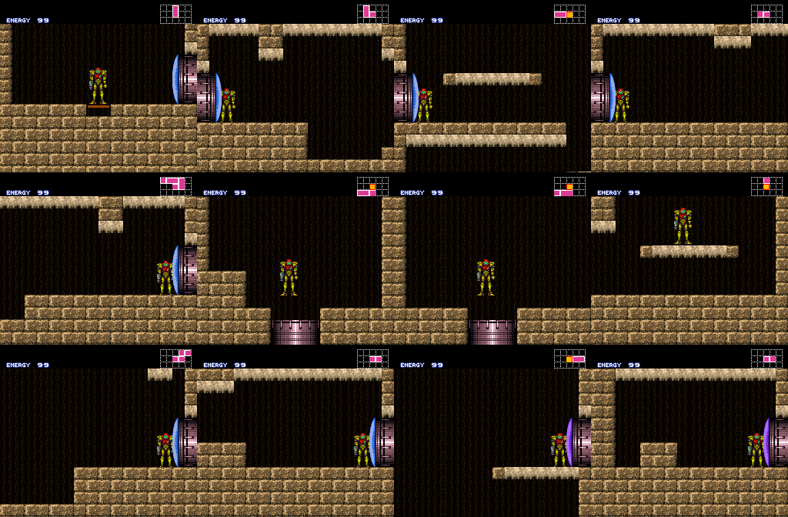
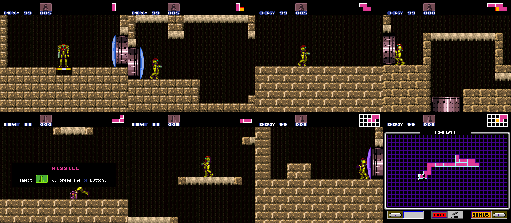
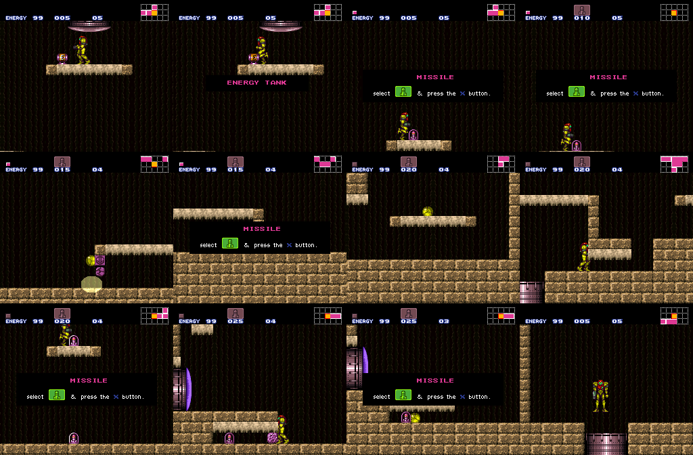

# 12f — Região A da Chozo (entrada, Main Plaza, Ruined Shrine, Tower of Light)

Estado: **verificada** (26/10/2026: validate "86 salas, 170 portas, 0 problemas", linha do Tallon igual; `.ips` sha1
`e22a2f9f78f4fb2b2d2ac49ab281be5b0fb4572c` igual em dois builds; **57/57** testes)
Esforço estimado: 2–3 dias (salas 1 d; travas e itens 0,5 d; validador 0,5 d; emulador e mutações 0,5–1 d)
Épico: [12 — Chozo Ruins](12-chozo-ruins.md) (decisões do usuário 1, 2, 4, 5; linha 12f da tabela de filhas)

## Contexto

Desde a 12e o elevador da Chozo West do Tallon (rodada 0) desce até a Transport to Tallon Overworld North da Chozo, um
beco. Esta filha constrói a região A (12 salas, tabela da 12c), abre a parede da North para a Ruins Entrance, põe as travas
do Prime da região com os itens do Tallon (decisão B), os itens da região A e o visual definitivo (fundo e música). O
validador passa a andar o Tallon e a Chozo juntos, pelos elevadores.

## Estado atual (verificado)

- `python3 -I tools/validate.py` → "75 salas, 148 portas, 0 problemas"; linha do Tallon "44 salas construídas,
  alcançáveis agora: 44, 20 itens em 7 rodadas"; `.ips` sha1 `d90984d0f621c88f8e5e2bac77ddb1a2e88026e6`; 55/55 testes.
- `tools/chozo/rooms.py`: `TABLE` (região A = P0, 1, 2, 3, 4, 5, 6, 7, 9, 15, 21, 27), `LINKS`, `DOCK_LOCKS` e `FEATURES`
  (12c); `ROOMS` = as 3 salas de elevador. As travas do Prime na região A (dados, `research/prime_chozo_locks.json`):
  Main Plaza → Ruined Shrine Access **missile**; Main Plaza ↔ Piston Tunnel **morph** (os dois lados); Main Plaza →
  Plaza Access **one_way**; Ruined Shrine → Tower of Light Access, Tower of Light Access ↔ Tower of Light ↔ Tower Chamber
  **key** (cor: conhecimento, roxa = Wave Beam). Features: Main Plaza grapple/halfpipe/morph_door, Ruined Shrine
  breakable/halfpipe/heat/spider, Piston Tunnel morph_door, Tower of Light water.
- Itens do Prime na região A (épico, tabela de itens): Main Plaza (P2) 3 Missile Expansions + 1 Energy Tank; Ruined Shrine
  (P9) Morph Ball + 2 mísseis; Tower of Light Wavebuster (sem item SM); Tower Chamber artefato (fora). Charge (Watery Hall,
  D) e Varia (Sunchamber, C) **não** são da região A.
- Salas de save e mapa: Save Station 1 (P22) e Map Station (P34) são da **região B** (12c), não da A.
- Bits: itens vanilla 0–`$9A`, Tallon `$A0–$B3`; portas vanilla até `$A9`, Tallon `$B0–$B2` (validador, etapa 11).
- Tileset 0C (12d): os 768 metatiles têm desenhos em `$3F0–$3F7` (no tileset 4 são enchimento); a linha de paleta 6 do 0C é
  a do fundo vanilla `$8F:E25A` (o tilemap `$BA:A69F` só usa a linha 6: lido); nenhuma peça do estilo `ruinas` usa as
  linhas 4–6.
- Música e fundo das salas vanilla do 0C (cabeçalhos de estado lidos): música `$1B/$05` (Maridia; `$D5A7`, `$D617`, `$D78F`,
  `$D7E4`; as outras `$00` = mantém), fundo de biblioteca `$8F:E25A` com scroll `$01C1` (`$D461`, `$D4C2`).

## Mudança proposta

1. **Salas** (`tools/chozo/layouts.py`), em arenito, formas do Prime, regras do Tallon (portas laterais nas linhas 6–9 com
   chão na 10; degraus de no máximo 4–5 blocos, o pulo medido decide):
   - Ruins Entrance: corredor com o chão quebrado no meio.
   - Main Plaza (6×2): pátio aberto, chão na linha 26; balcão da porta L0 e escada de 3 plataformas; plataforma da T0;
     **porta B0 (Piston Tunnel) atrás de túnel de Morph** (fosso, túnel de 1 linha, câmara sob um estrado); **T1 (Plaza
     Access) de mão única** (tampa cinza que nunca abre do lado da praça, sobre uma borda de Space Jump); bordas de Space Jump
     do meio-tubo e do gancho; **tronco caído da árvore** com o vão atrás de 3 blocos de Power Bomb.
   - Ruined Fountain Access, Ruined Shrine Access, Tower of Light Access: corredores.
   - Ruined Shrine: tigela (chão na linha 13), terraços, **túnel baixo** fechado por bloco de bomba, borda de Space Jump.
   - Tower of Light (3×4): R0 no alto, L3 embaixo; 10 plataformas em zigue-zague de 5 em 5 linhas (8 deixaria a plataforma
     de cima sobre a coluna do pulo); seca (pergunta 7 do épico).
   - Nursery Access, Plaza Access, Piston Tunnel, Tower Chamber: pequenas; a porta para outra região é parede, com o chão
     já na linha da borda dela.
   - Transport North: a porta R1 abre (a sala da 12e já tinha o chão no batente).
2. **Travas** (`tools/chozo/rooms.py` `GATES`, `ONE_WAY_DOORS`): missile = porta vermelha (bit `$B3`); morph = túnel
   (geometria, lado da praça); key = porta de onda roxa nos lados dos dados; one_way = cinza "nunca abre" + borda de Space
   Jump do lado da praça, gate `one_way` que nada dá. Portas para B–E = parede (lista abaixo).
3. **Itens** (`tools/chozo/items.py`, novo; bits `$B4–$BA`): 6 mísseis e 1 E-tank (abaixo). A Charge e a Varia não são da
   região A: ficam para as regiões D e C (as travas novas, 12g).
4. **Porta de onda no 0C** (`tools/tallon/beamdoors.py`, `tools/build.py`): os 8 metatiles roxos `$3F0–$3F7` numa cópia da
   tabela de metatiles do 0C (blob fixo novo, depois da paleta) e a linha **5** da paleta do 0C roxa (`RUINS_PAINT_LINE`).
5. **Visual**: fundo `$8F:E25A` (`VANILLA_SHARED`), linha 6 do 0C em arenito escuro (`ruins.SANDSTONE_BACKGROUND`), música
   `$1B/$05` (`areas.CHOZO`). Nenhum FX (sem água: a da Tower of Light fica seca; sem lava na região A).
6. **Validador**: o passeio das rodadas anda o Tallon e a Chozo juntos (elevador = entrada/saída `ELEVATOR`), a linha do
   Tallon conta só o Tallon; `check_chozo_rounds` (salas `FIRST_ROUND`/`WAITS_FOR`, itens `Item.round`, linha nova);
   `check_bombed_items` + `check_bombed_items_in_rom` (achado abaixo); `check_gates`, `check_tallon_items`,
   `check_breakables`, `check_item_geometry`, `check_wave_paint_free`, `check_ruins_in_rom`, `fixed_blobs` cobrem a Chozo.
7. **Testes**: `chozo_regiao_a_rota` e `chozo_regiao_a_itens`.

## Critérios de aceite

1. validate 0 problemas, linha do Tallon igual ("44 salas construídas, alcançáveis agora: 44, 20 itens em 7 rodadas"),
   linha nova "chozo (specs/12f …)" com as salas e itens por rodada. (protege = travas, rodadas, softlock, mapa, bits;
   falha_quando = mutações; não_prova = que a forma agrada)
2. `chozo_regiao_a_rota` (do pouso, elevador, andando até a Tower Chamber) e `chozo_regiao_a_itens` (os outros 6 itens,
   mão única, Piston Tunnel ida e volta) passam; os 55 antigos passam (expectativas mudadas anotadas).
3. Mutações (`s12f/mutate_f.py`) pegas.
4. Dois builds com o mesmo sha1; fotos `specs/img/12f-*.png` olhadas.

## Fora de escopo

- Save (P22) e map station (P34): região B (12i). Nome da Chozo na tela de continue: sem save na Chozo um continue nunca
  começa lá (fica com a 12i).
- Charge, Varia, portas de Charge, salas quentes (12g); inimigos (12h); chefes; artefatos; Wavebuster.

## Resultado

### Salas, portas fechadas e travas

| Sala (P#) | Tamanho | Rodada | Notas |
|---|---|---|---|
| Transport North (0) | 1×2 | 0 | R1 aberta para a Ruins Entrance |
| Ruins Entrance (1) | 2×1 | 0 | chão quebrado |
| Main Plaza (2) | 6×2 | 0 | 6 portas; L1 vermelha (bit `$B3`); B0 atrás de túnel de Morph; T1 de mão única |
| Ruined Fountain Access (3) | 3×1 | 0 | **R0 → Ruined Fountain (C): parede** |
| Nursery Access (5) | 1×1 | 0 | **L0 → Eyon Tunnel (B): parede** |
| Ruined Shrine Access (4) | 3×1 | 1 | atrás da vermelha (mísseis do Landing Site) |
| Ruined Shrine (9) | 3×1 | 1 | L0 porta de onda (lado do shrine) |
| Piston Tunnel (7) | 2×1 | 1 | Morph (da Chozo West); **R0 → Training Chamber (C): parede** |
| Tower of Light Access (15) | 2×1 | 2 | onda (Magmoor East, rodada 1) |
| Tower of Light (21) | 3×4 | 2 | portas de onda nos dois lados |
| Tower Chamber (27) | 1×1 | 2 | onda |
| Plaza Access (6) | 2×1 | fora | **R0 → Vault (B): parede**; só se entra pelo Vault (mão única): `WAITS_FOR` "B" |

### Itens (bits `$B4–$BA`, depois dos `$A0–$B3` do Tallon; nenhum vanilla)

| Bit | Sala | Prime | Lugar / trava | Rodada |
|---|---|---|---|---|
| `$B4` | Main Plaza | míssil "Half-Pipe" (Boost) | borda de Space Jump (36, 12) | 3 |
| `$B5` | Main Plaza | míssil "Grapple Ledge" | borda de Space Jump (83, 13) | 3 |
| `$B6` | Main Plaza | míssil "Tree" (Super Missile) | fim do tronco oco atrás de 3 blocos de Power Bomb (68, 25) | 6 |
| `$B7` | Main Plaza | E-tank "Locked Door" | borda da porta de mão única, Space Jump (21, 5) | 3 |
| `$B8` | Ruined Shrine | Morph Ball → **míssil** (decisão B) | chão da tigela (24, 12) | 1 |
| `$B9` | Ruined Shrine | míssil "Half-Pipe" | borda de Space Jump (24, 3) | 3 |
| `$BA` | Ruined Shrine | míssil "Lower Tunnel" | túnel de Morph atrás de bloco de bomba (5, 12) | 2 |

Linha do validador: "chozo (specs/12f, regiões ativas: A): 14 salas construídas, alcançáveis a pé da nave do Tallon: 13, 7
itens; andadas junto com o Tallon (mesmas rodadas): rodada 0: 5 salas, 0 itens; rodada 1: 3 salas, 1 itens; rodada 2: 3
salas, 1 itens; rodada 3: 0 salas, 4 itens; rodada 4: 1 salas, 0 itens; rodada 5: 1 salas, 0 itens; rodada 6: 0 salas, 1
itens; fora das rodadas: plaza_access (espera a região B)" (as rodadas 4 e 5 são as salas de elevador East/South da 12e).
Linha do Tallon igual: "44 salas construídas, alcançáveis agora: 44, 20 itens em 7 rodadas".

Fotos inteiras: `img/12f-sala-main_plaza.png`, `img/12f-sala-ruined_shrine.png`, `img/12f-sala-tower_of_light.png`.

### Espaço

`$8F`: 563 bytes (livre agora a partir de `$8F:FBCF`, 1073 bytes); **faixa recuperada da 12a: 0 bytes usados**. `$83`: 264
(`$83:B60A`). Nível: +2339 bytes (86 níveis). Fixo: +4457 (a tabela de metatiles do 0C com a porta roxa, `$F0:DEB2`; a paleta
do 0C continua em `$F0:DDB7`). `$84`, `$A1`, `$B4`: nada. SRAM do mapa: igual (a lista da Chozo já era a tabela inteira, 41
bytes). Órfãs: `$8F` 20637 → 20619 (o fundo `$8F:E25A`, 18 bytes, agora é compartilhado de propósito).

## Desvios (preenchido na implementação)

- **Save e map station não entram**: P22 e P34 são da região B (12c). O épico punha "save" e "nome na tela de continue" na
  12f; sem save na Chozo um continue nunca começa lá, e o nome fica para a 12i (decisão a confirmar).
- **One-way**: a T1 da praça tem tampa cinza que nunca abre do lado da praça (o 09d tirou as cinzas do Tallon; aqui é a do
  Prime). A Plaza Access fica construída mas inalcançável até a região B (emulador: entrando por teleporte de porta pela
  B0 dela, a Samus cai na borda da praça e a tampa segura: um pulo com Space Jump não passa). O E-tank "Locked Door" fica
  na borda, com Space Jump (no Prime se pega vindo do Vault).
- **Torre**: degraus de 5 linhas (com 4, a plataforma 8 linhas acima cobria a coluna do pulo, regra do modelo).
- **Câmara do Piston**: 6 linhas de altura. Com 3, subindo pela porta de chão ela batia no estrado e caía de volta (medido);
  com 6, pulando do lado leste da plataforma do Piston e segurando →, ela pousa na borda leste (o teste faz isso; parada no
  meio ela cai de volta para o Piston Tunnel: não é softlock, como as portas de chão da spec 10b).
- **Achado do motor (Power Bomb + item)**: uma Power Bomb que varre o bloco de um item (tipo B, BTS `$45`) cria um PLM
  (`kBlockBombedReact_Special_Plm[$45]`) que termina sem limpar o índice do bloco; o toque da Samus (`sub_84EEAB`) procura o
  item pelo índice do bloco do slot 39 para baixo, sem olhar o cabeçalho. Com um slot mais alto livre (item pego, porta
  aberta) acha o PLM morto e **não pega o item** até a sala recarregar (emulador: o míssil da árvore depois do E-tank e dos
  dois mísseis de Space Jump; com o vão aberto por RAM, pega). Correção: o item atrás de Power Bomb vai **primeiro na lista
  de PLMs** da sala (slot 39, acima de qualquer morto) e fica no fim do tronco, fora da caixa da explosão posta contra a
  parede; validador `check_bombed_items` (todo item na caixa de uma Power Bomb que quebra os blocos é o item da Power Bomb,
  um por sala) e `check_bombed_items_in_rom` (ele é o primeiro PLM). **O X-Ray da Life Grove do Tallon tem o mesmo risco
  latente** (fora do escopo; recuperável saindo e voltando).
- **Fundo**: linha 6 do 0C em arenito escuro (`SANDSTONE_BACKGROUND`), regra da `SANDSTONE` com valor 0,6; a vanilla era verde.
- **Porta de onda no 0C**: linha 5 (a 6 é a do fundo); a tabela de metatiles do 0C deixa de ser a vanilla (só `$3F0–$3F7`).
- **Testes**: `door_teleport` e `level_block` aceitam qualquer sala construída (antes só do Tallon); helpers `chozo_*`. Nenhuma
  expectativa antiga mudou.
- **Mutações** (`s12f/mutate_f.py` → `mutate_f.out`, `mut_extra.py` → `mut_extra.out`), todas pegas: S1/S1b sala da praça ou
  do acesso da fonte deslocada no mapa (o validador para: tile do mapa repetido), S1c Tower Chamber uma linha acima (porta não
  encosta); S2 escudo de míssil esquecido (rodada 0); S3 torre de gelo (rodada 4); S4 rodada de item errada; S5 bits da Chozo
  sobre o `$B3` do Tallon; S6 bits vanilla; S7 bit de porta vermelha repetido; S8 plataforma da torre a menos (sem volta do
  fundo); S9 câmara aberta (porta com trava de Morph alcançável sem); S10b borda do meio-tubo baixa (item na rodada 0); S11 mão
  única esquecida (Plaza Access alcançável); S12 bloco de bomba fora do ar (para) e S12b sem bloco (item sem Bombas); S13 item
  dentro do chão; S14 Space Jump no shrine (rodadas do Tallon mudam: 48 problemas); S15 E-tank na explosão; S16 ligação esquecida;
  R1 item da PB fora do topo dos PLMs; R2 sem tampa de onda (o build para); R3 metatiles do 0C sem a porta roxa; R4 item sem PLM.
- Verificação (pasta real): `tools/build.py` duas vezes → sha1 `e22a2f9f78f4fb2b2d2ac49ab281be5b0fb4572c`; validate "86 salas,
  170 portas, 0 problemas"; **57/57** testes (novos: `chozo_regiao_a_rota`, `chozo_regiao_a_itens`).
- 27/10/2026 ([12g2](12g2-ajustes-calor-e-cor.md), decisão do usuário): a ordem "item da Power Bomb primeiro na lista de PLMs" e
  `check_bombed_items(_in_rom)` saíram (a spec 13 corrige o toque no motor); `chozo_regiao_a_itens` ganhou o caso que de fato
  exercita o defeito (`tree_dead_slot`).
