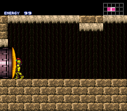
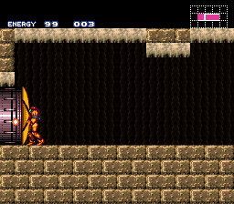
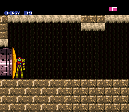
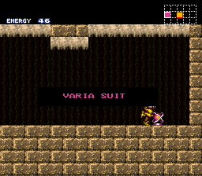

# 12g — Itens e travas novas da Chozo (Charge Beam e Varia Suit)

Estado: **verificada** (26/10/2026: validate "86 salas, 170 portas, 0 problemas", linha do Tallon igual; `.ips` sha1
`3fb636cf46244959557e8855b0fc526196a9691c` igual em dois builds; **60/60** testes)
Esforço estimado: 1,5–2,5 dias (itens 0,25 d; porta de charge 0,5 d; calor 0,5 d; validador e ROM de teste 0,5 d; emulador 0,5 d)
Épico: [12 — Chozo Ruins](12-chozo-ruins.md) (decisões do usuário 1 e 2; linha 12g da tabela de filhas)

## Contexto

Decisão B do épico: a Chozo dá as duas habilidades que o jogo ainda não tem, o **Charge Beam** (Watery Hall, região D) e a
**Varia Suit** (Sunchamber, região C), e a decisão 2 pede as duas travas novas: **porta que só abre com tiro carregado** e
**salas quentes que machucam sem a Varia**. As salas desses itens ainda não existem (12j, 12k): esta filha faz os itens e os
mecanismos, prova no emulador numa ROM de teste, e deixa o lugar para a filha da região.

## Estado atual (verificado)

Na pasta real, depois da spec 13: validate "86 salas, 170 portas, 0 problemas"; `.ips` sha1 `425f0796…981f`; 58/58.

- **Itens** (bytes da ROM base): Charge Beam = PLM `$EEEB` (setup `$EE64`, lista `$E15B`), Varia Suit = `$EF07` (setup `$EE64`,
  lista `$E2A1`), item visível `$EED7 + 4·n` (research §5). A cena da Varia (`VariaSuitPickup`, `$91:D4E4`, `sm_91.c:1282`)
  põe a Samus no meio da tela: os 26 bytes de posição em **`$91:D576`** são os mesmos da Gravity (`$91:D64E`, patch da 09b).
- **Tiro carregado** (`sm_90.c:3490`, `4312–4396`): tipo do projétil = `equipped_beams & $100F | $8010`; o não carregado não
  tem o `$10`. O tiro numa tampa de cor põe `tipo & $1FFF | $8000` no timer do PLM da porta (`PlmSetup_Door_Strange`,
  `$84:C7E2`); a pré-instrução das portas de feixe (cópia de `$84:BD88`, 09a) testa `AND #($0F00|m) / CMP #m`.
- **Calor do SM** (bytes e C): não é checagem de área. O FX da sala (16 bytes no `$83`) tem um byte de FX de paleta (13);
  `LoadFXHeader` (`sm_89.c:97`) cria, para cada bit k, o objeto k da lista da área (`$83:AC46` + 2·área). Na Norfair (área 2,
  `$83:ACA6`) o bit 0 é **`$F761`** (init `$8D:E440`, lista `$8D:E45E`), que liga **`PalPreInstr_SamusInHeat`** (`$8D:E379`:
  `AD A2 09 29 21 00 D0 2A AD 4E 0A 18 69 00 40 …` = sem `$0001` (Varia) **e** sem `$0020` (Gravity) em `$09A2`, dano
  periódico `+$4000` sub por quadro = ¼ de energia por quadro). `Samus_HandlePeriodicDamage` (`$90:E9CE`) ainda divide por 2
  com a Varia e por 4 com a Gravity (calor já zerado pelo `AND #$21`). A lista da **área 1** (`$83:AC86`): bits 0–3 Brinstar
  (`$F775 $F77D $F781 $F779`), bits 4–7 = `$F745`; nenhuma sala vanilla da área 1 usa os bits 4–7 (todas as entradas de FX lidas).

## Mudança

1. **Itens** (`tools/tallon/items.py`, `tools/chozo/items.py`): `CHARGE_BEAM = $EEEB`, `VARIA_SUIT = $EF07`, nomes e `GRANTS`
   (`charge`, `varia`); linhas 7 e 8 da Chozo: Charge na Watery Hall (P41), Varia na Sunchamber (P37), **bits `$BB` e `$BC`**
   (dados agora, não mudam), **sem lugar** (as salas não existem). `varia_patch` (= `gravity_patch` em `$91:D576`) no build.
2. **Porta de charge** (`tools/tallon/beamdoors.py`): a mesma construção das portas de feixe, acrescentada depois da pintura da
   onda (ids antigos iguais): pré-instrução com `AND #$0F10 / CMP #$0010` (abre com tiro carregado de quaisquer feixes; nunca
   com tiro não carregado, míssil, bomba ou PB), quadros copiados da porta **amarela** vanilla (`CHARGE_COLOUR`, decisão
   abaixo), PLMs **`$F3F5` (R) / `$F3FB` (L)**, argumento `$8000` (fecha a cada visita). Trava `charge` (`tallon/rooms.py`:
   `CHARGE`, `LOCK_OF`, `BEAM_LOCKS`): o `check_gates` e o build já tratam qualquer porta de feixe.
3. **Calor** (`tools/chozo/heat.py`, `RoomDef.heat`, `tools/build.py`): o build põe `$F761` na entrada **4** da lista da área 1
   (`$83:AC8E`, era `$F745`); sala quente recebe o FX `HEAT_FX` = `0000 FFFF FFFF 0000 00 00 02 02 00 10 00 00` (o "sem FX"
   mais comum da área 1, com o bit 4), escrito no `$83` só quando alguma sala é quente; só na área 1 e sem água (o build para).
   `chozo/rooms.py HOT_ROOMS` (vazio: nenhuma sala da região A é quente) e `heat_gates`.
4. **Modelo** (decisão do usuário: simples e conservador): **sala quente = intransponível sem a Varia**. Toda porta para uma
   sala quente ganha `varia` na trava (`heat_gates`); o passeio das rodadas só passa com a Varia. Nenhum dano é "aguentado".
5. **Validador**: `check_heat` (sala quente só na Chozo, fora de elevador, em `HOT_ROOMS`; toda porta para ela com a Varia),
   `check_heat_in_rom` (entrada 4 da lista = `$F761`, as outras = base; sala quente com `HEAT_FX` em todo estado, nenhuma outra
   da Chozo com o bit; nenhuma sala vanilla da área 1 usa o bit 4) e linha "chozo (specs/12g): …"; `check_tallon_items`
   confere o `varia_patch`; `check_gates` confere os bytes da porta de charge (vêm de `beamdoors.code`).
6. **ROM de teste** (`tools/chozo/testrooms.py`, `tools/build.py --teste-12g` → `build/teste-12g/`, nunca a ROM do jogo): a
   Ruined Fountain Access (beco da Main Plaza; a porta para a Ruined Fountain é parede até a região C) fica quente, a porta dela
   para a praça vira porta de charge do lado dela, o Charge Beam em (24, 7) na plataforma e a Varia em (44, 9) no chão, com os
   bits de verdade. O `tests/run_tests.py` constrói essa ROM antes dos dois testes novos.

## Critérios de aceite

1. validate 0 problemas, linha do Tallon igual (44 salas, 20 itens em 7 rodadas), linha da Chozo igual, linha nova "12g".
2. `porta_de_charge`: Power Beam sem carga, mísseis e Charge Beam sem carga não abrem; o tiro carregado abre; fechada de novo
   na volta. `sala_quente`: sem suit cai 60 de energia em 240 quadros; com a Gravity só (por RAM) não cai; a Varia pega andando
   (bit, `$09A2`) e a Samus fica onde pegou (x `$02BD`; a cena vanilla a poria em `$0278`); com a Varia não cai.
3. Mutações (validador e emulador) pegas; dois builds com o mesmo sha1; fotos `specs/img/12g-*.png` olhadas.

## Resultado

- **Números medidos** (ROM de teste): calor sem suit **−60 em 240 quadros** (¼ por quadro, 15 por segundo); **com a Gravity Suit
  só: 0**; com a Varia: 0. Porta de charge: 3 tiros sem carga + 2 mísseis = fechada (Samus para em x `$0025`); com o Charge Beam
  pego, 3 tiros sem carga = fechada; X segurado 90 quadros e solto = abre, ela passa para a Main Plaza; volta por teleporte:
  fechada. Varia: x `$02BD` depois da cena (701; o meio da tela seria 632).
- Linha nova do validador: "chozo (specs/12g): travas novas prontas: porta de charge (PLMs $F3F5/$F3FB, laranja), calor (lista de
  FX de paleta da área 1, bit 4 = $F761; sala quente = sem a Varia não entra); itens Charge Beam $BB (chozo_watery_hall: sem
  lugar), Varia Suit $BC (chozo_sunchamber: sem lugar); salas quentes: nenhuma; portas de charge: nenhuma …".
- **Rodadas**: iguais (Tallon e Chozo); nenhum lugar novo na ROM do jogo.
- **Fotos** (olhadas): `img/12g-porta-fechada.png` (tampa amarela no arenito), `img/12g-tiro-carregado.png`,
  `img/12g-porta-aberta.png`, `img/12g-charge-mensagem.png` ("CHARGE BEAM"), `img/12g-calor-sem-varia.png` (energia 39),
  `img/12g-calor-com-gravity.png` (99), `img/12g-varia-mensagem.png` ("VARIA SUIT", a Samus no chão à direita, não no meio),
  `img/12g-calor-com-varia.png` (99, a roupa da Varia).

  

### Espaço

`$84`: +154 bytes (porta de charge, `$84:F367–F400`; livre a partir de `$84:F401`, além dos 33 da spec 13 no fim do banco).
`$83`: 0 na ROM do jogo (o `HEAT_FX` só entra com sala quente; a lista da área 1 muda 2 bytes no lugar). `$91`: 2 bytes trocados
(`varia_patch`). `$8F`, `$A1`, `$B4`, nível, fixo, SRAM: nada. Bits de item `$BB`/`$BC` reservados.

## Mutações

Validador (`s13/mutate_12g.py` → `mutate_12g.out`), todas pegas: M1 sala quente sem a Varia nas portas; M2 Ruined Shrine
quente (sem Varia no jogo: as salas atrás ficam fora das rodadas); M3 sala quente no Tallon; M4 `HOT_ROOMS` fora da tabela; M5
porta de charge na entrada da praça (rodadas: a praça some) e M5b sem a tampa na ROM; M6 lista da área 1 sem o calor; M7 outra
entrada da lista mexida; M8 sala quente sem o FX na ROM; M9 porta de charge com máscara `$0F00`; M10 sem o `varia_patch`; M11 calor
numa entrada usada da lista (o build para). Emulador (`s13/emu_mut_12g.sh` → `emu_mut_12g.out`, cópia do projeto no scratchpad):
E1 sem o `varia_patch` (x errado), E2 sem o calor na lista (energia não cai), E3 máscara 0 (abre sem carga).

## Desvios

- **Sem lugar no jogo**: Charge (região D) e Varia (região C) não têm sala; os itens existem como linhas (bits fixos) e os
  mecanismos são provados numa **ROM de teste** separada (`build/teste-12g/`), nunca na ROM do jogo. A filha da região põe o item,
  as portas de charge (`GATES` com `CHARGE`) e `HOT_ROOMS`; os testes de lá trocam a ROM de teste pela real.
- **Calor = lista de FX de paleta, não área**: o SM liga o calor por objeto de FX de paleta da lista da área; a área 1 ganhou o
  objeto da Norfair numa entrada livre (4), em vez de usar a área 2 (que muda o gelo, épico 12).
- **Modelo do calor**: "sem a Varia não entra" (pedido). **No SM a Gravity Suit também protege** (`AND #$0021`, medido: 0 de dano)
  e ela vem no Tallon (rodada 4): com a Gravity, um jogador entra numa sala quente antes do que as rodadas dizem (não prende:
  o calor não segura ninguém). Nenhuma sala é quente hoje; decisão abaixo antes da região C.
- **Cor da porta de charge**: cópia da amarela (a da porta de plasma do Tallon), uma constante; decisão abaixo.

- **27/10/2026, decisões do usuário (spec [12g2](12g2-ajustes-calor-e-cor.md))**: (1) opção (b), **só a Varia protege do
  calor**: patch de 1 byte em `$8D:E37D` (`#$21` → `#$01`), o modelo "sala quente pede a Varia" fica e agora o jogo concorda
  (`sala_quente`: com a Gravity só a energia cai, 15 em 240 quadros: a Gravity ainda divide todo dano periódico por 4,
  `$90:E9CE`); (2) **cor própria para a porta de charge**: branca, linha 4 e metatiles `$3E8–$3EF` do tileset `$0C` (o tileset 4
  não tem linha livre; porta de charge só na Chozo, `check_charge_doors`). As perguntas abaixo ficam respondidas (a 3 continua
  com as filhas das regiões).

## Decisões para o usuário

1. **Gravity × calor**: (a) deixar o SM (Gravity protege; o validador passa a aceitar Varia **ou** Gravity), (b) patch de 1 byte
   em `$8D:E37D` (`#$21` → `#$01`: só a Varia protege, como o modelo diz), (c) deixar como está (modelo mais restrito que o jogo).
2. **Cor da porta de charge**: amarela (igual à de plasma) ou uma cor pintada própria, como a roxa da onda (8 metatiles e uma
   linha de paleta no tileset 0C; ~0,5 d)?
3. Onde vão as portas de charge e quais salas ficam quentes (candidatas do Prime: Arboretum, Magma Pool, Ruined Gallery,
   Sunchamber; a Ruined Shrine tem `heat` nos dados mas a 12f a fez fria): nas filhas das regiões.
