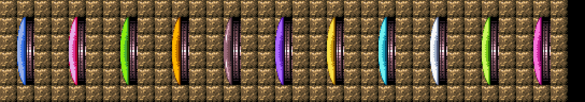
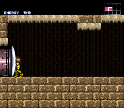

# 12g2 — Ajustes da 12g: calor só com a Varia, porta de charge branca, a ordem da 12f sai, tiro na porta de cor

Estado: **verificada** (27/10/2026: validate "86 salas, 170 portas, 0 problemas", linha do Tallon igual; `.ips` sha1
`8371049f04df077c09df8a56aeafe8f1bba314d3` igual em dois builds; **60/60** testes)
Esforço estimado: 0,5–1 dia
Épico: [12 — Chozo Ruins](12-chozo-ruins.md) (decisões do usuário 8 e 9, 27/10/2026); responde às perguntas abertas da
[12g](12g-itens-e-travas-novas.md) e da [spec 13](13-power-bomb-apaga-item.md).

## Contexto

A 12g deixou duas perguntas (Gravity × calor; cor da porta de charge) e a spec 13 outras duas (tirar a ordem da 12f, que
ficou redundante; corrigir a mesma busca no tiro em porta de cor). O usuário decidiu: **só a Varia protege do calor**, **a
porta de charge ganha cor própria**, **a ordem da 12f sai** e **a busca do tiro na porta é corrigida** se for pequena e segura.

## Estado antes (verificado)

validate "86 salas, 170 portas, 0 problemas"; `.ips` sha1 `3fb636cf46244959557e8855b0fc526196a9691c`; 60/60.

- **Calor**: `PalPreInstr_SamusInHeat` (`$8D:E379`) começa com `AD A2 09 29 21 00 D0 2A` (lido da ROM base): `AND #$0021`
  em `$8D:E37C`, o byte do operando em **`$8D:E37D` = `$21`** (Varia `$01` ou Gravity `$20`). Medido na 12g: com a Gravity só,
  0 de dano.
- **Porta de charge**: cópia da amarela vanilla (laranja, igual à de plasma).
- **Ordem da 12f**: o build punha o item da Power Bomb da Chozo (o míssil da árvore da Main Plaza) primeiro na lista de PLMs
  (slot 39); `check_bombed_items` e `check_bombed_items_in_rom` conferiam.
- **Tiro na porta de cor**: `PlmSetup_Door_Strange` (`$84:C7E2`, `sm_84.c:2129`), setup do PLM `$C83E` que o tiro num bloco
  C/BTS `$44` cria (`kBlockShotBombedReactionShootablePlm[$44]`, `$94:9EA6`): bytes `BB BD 87 1C 9E 87 1C` + o laço
  `A2 4E 00 DD 87 1C F0 05 CA CA 10 F7 60` (`$84:C7E9–C7F5`) + `found` (`$84:C7F6`): procura do slot 39 para baixo o primeiro
  com o índice de bloco, sem olhar o cabeçalho; sem nenhum, `RTS`.

## Mudança

1. **Só a Varia protege** (`tools/chozo/heat.py` `varia_only_patch`, build): `$8D:E37C` `29 21 00` → `29 01 00` (1 byte,
   conferido na ROM base antes). O modelo do validador não muda (sala quente pede a Varia; a Gravity nunca abre essa trava) e
   agora o jogo concorda. `check_heat_in_rom` confere o byte. As duas demos de atração em salas quentes da Norfair (`$AFFB`,
   `$AF14`) dão a Varia à Samus (`$6105`, `$E325`, lidos de `$91:8885`): nada muda nelas.
2. **Porta de charge branca** (`tools/tallon/beamdoors.py`, como a roxa da 10d/12f): cópia da porta **verde** (`CHARGE_COLOUR`)
   com 8 metatiles próprios **`$3E8–$3EF`** (`CHARGE_METATILES`) na cópia da tabela do tileset `$0C`, desenhados na linha de
   paleta **4** (`CHARGE_LINE`), que ganha o branco (`WHITE` = `$7FFF $6AF5 $3D6A`) nas cores 1–3 e as cores da moldura da
   linha 1. Quadros e lista de abertura próprios depois dos cabeçalhos dela (PLMs `$F3F5`/`$F3FB` iguais); `$84` 754 → 892
   bytes (livre a partir de `$84:F48B`).
   - **Linha livre** (varredura no scratchpad, `s12h/scripts/palette_lines.py`): no `$0C`, os níveis das 14 salas da Chozo usam
     as linhas 0, 1, 3, 7; a tabela CRE inteira 0–3; os gráficos de item (Charge, Varia, os outros) 0–3; o fundo é a 6, a porta
     de onda a 5: **a 4 está livre**. No **tileset 4 nenhuma linha está livre** (0, 1, 3, 4, 5 nos níveis; 2 na CRE; 6 a onda; 7 a
     Parasite Queen): a porta de charge fica **só no `$0C`** — a trava de charge é só da Chozo — e o validador recusa porta de
     charge em sala de outro tileset (`check_charge_doors`).
   - **Cor**: escolhida lado a lado com as tampas azul, de míssil, de gelo, de plasma, cinza e de onda, sobre o arenito, entre
     5 candidatas (ouro, ciano, branco, lima, magenta): ouro fica perto da laranja, ciano da azul, lima da verde, magenta da rosa;
     o **branco** não se confunde com nenhuma (a cinza é rosada e apagada). `specs/img/12g2-cores-das-portas.png`.
3. **A ordem da 12f sai**: o build põe os PLMs na ordem de sempre (portas, depois itens); `check_bombed_items`,
   `check_bombed_items_in_rom`, `power_bomb_box` e `POWER_BOMB_BOX_*` saíram do validador; comentários de `chozo/layouts.py` e
   `chozo/items.py` atualizados.
4. **Tiro na porta de cor** (`tools/smlib/itemtouch.py`, junto da correção da spec 13): o laço de `$84:C7E9` vira
   `JSR $FFBB / BCC $C7F5 / BRA $C7F6` (7 bytes; os outros 6 ficam, inalcançáveis); a rotina em **`$84:FFBB–FFDE`** (36 bytes,
   logo antes da da spec 13) procura primeiro um slot **vivo** com o índice, depois a busca vanilla, e volta com carry ligado
   (achou, X = slot) ou desligado (nenhum: o `RTS` vanilla). Y preservado.
5. **Validador**: além das checagens de bytes, `itemtouch.behaviour_problems` roda as duas rotinas da ROM construída num
   **interpretador mínimo de 65816** (os opcodes que elas usam) sobre tabelas de PLM sintéticas (morto acima do vivo → o vivo;
   só mortos → o mais alto, como vanilla; nenhum → `BRK` / carry desligado): pega uma rotina errada mesmo que o gerador de bytes
   tenha mudado junto. `check_ruins_in_rom` lê direto as linhas 4/5 da paleta e os 16 metatiles pintados (não pela função do
   build). `check_wave_paint_free` cobre `$3E8–$3EF` no `$0C`.

## Critérios de aceite

1. validate 0 problemas, linha do Tallon igual (44 salas, 20 itens em 7 rodadas), linha da Chozo igual.
2. `sala_quente`: com a Gravity só a energia **cai** (15 em 240 quadros); sem suit cai 60; com a Varia não cai.
3. `porta_de_charge`: o bloco de cima da tampa no nível da WRAM é `$C7E8` (lado L) e a linha 4 da paleta da WRAM tem o branco.
4. `chozo_regiao_a_itens` passa sem a ordem da 12f e prova o caso (abaixo); na ROM sem a correção da spec 13, falha.
5. Mutações pegas; dois builds com o mesmo sha1.

## Resultado

- **Calor medido** (ROM de teste): sem suit −60 em 240 quadros; **com a Gravity só −15** (o calor passa pelo `AND #$01`, e
  `Samus_HandlePeriodicDamage` `$90:E9CE` divide todo dano periódico por 4 com a Gravity: fica ¼ do dano); com a Varia 0.
- **A prova da ordem da 12f** (emulador, cópia do projeto em `s12h/proj`, roteiros `s12h/scripts/tree_probe*.py`):
  - O `chozo_regiao_a_itens` da 12f, numa ROM **sem a ordem e sem a correção da spec 13**, **passa** (`tree_no_order_no_fix.out`):
    nessa ordem (E-tank, os dois mísseis de Space Jump, depois a árvore) o PLM morto que a Power Bomb deixa no bloco do míssil
    fica no slot 37, acima do míssil vivo (35), mas é o slot livre mais alto; o PLM do toque nasce nele e apaga o índice. **O
    teste da 12f não exercitava o defeito** nesta disposição de PLMs.
  - Abrir a porta vermelha antes (slot 39 livre) também não: o morto vai para o 39 e o toque nasce nele (`tree2_*.out`).
  - Com um slot acima do morto livre na hora do toque (atalho por RAM: o PLM da porta vermelha, slot 39, termina, como no
    `power_bomb_nao_apaga_item` da spec 13): **sem a ordem e sem a correção, o míssil da árvore não é pego** (bit `$B6` desligado,
    25 de capacidade); **sem a ordem e com a correção, é pego** (`tree3_*.out`). Esse atalho entrou no teste
    (`tree_dead_slot`): o `chozo_regiao_a_itens` agora confere o morto (slot 37, cabeçalho 0, índice `$1348` do míssil) acima do
    vivo (slot 35) e libera o 39 antes de andar até a árvore.
- **Tiro na porta de cor**: medido que o defeito **não aparece no jogo de hoje**. Cada tiro numa tampa cria **dois** PLMs `$C83E`
  no mesmo quadro (o segundo nasce no slot livre seguinte); com um morto só acima da porta, o primeiro se perde nele e o segundo
  nasce no próprio morto e acha a porta (Great Tree Hall, 3 portas de gelo nos slots 39–37, morto no 38 por RAM: a porta abre com
  e sem a correção; em pé, agachada e pulando). Para perder o tiro seriam precisos ≥ 2 mortos com o índice e uma porta no slot 36
  ou abaixo: nenhuma sala tem porta de cor abaixo do slot 37. A correção fica como defesa (36 bytes), provada pelo
  interpretador do validador; **sem teste no emulador** (um teste que passa com e sem a correção não prova nada: saiu).

| Teste | Expectativa mudada |
|---|---|
| `sala_quente` | com a Gravity só: energia 99 → **84** em 240 quadros (era: fica 99) |
| `porta_de_charge` | + bloco de cima da tampa = `$C7E8` e linha 4 da paleta = `$7FFF $6AF5 $3D6A` (5 expects novos) |
| `chozo_regiao_a_itens` | + morto no slot 37 com o índice `$1348`, míssil vivo no 35, slot 39 liberado por RAM antes de pegar a árvore (4 expects + atalho) |

Linha nova do validador: "chozo (specs/12g): … porta de charge (PLMs $F3F5/$F3FB, branca), calor (…, só a Varia protege; …)";
linha "ruínas" com "specs/12g2: linha 4 e metatiles da porta de charge, branca".

Fotos (olhadas): `img/12g2-cores-das-portas.png` (as 6 tampas do jogo e as 5 candidatas no arenito),
`img/12g2-porta-de-charge-branca.png` (a tampa branca no emulador), `img/12g2-tiro-carregado.png`, `img/12g2-calor-com-gravity.png`
(energia 84).

### Espaço

`$84`: +138 (quadros e abertura da porta branca, até `$84:F48A`) e +36 (`$84:FFBB–FFDE`, o tiro na porta) + 7 trocados em
`$84:C7E9`; `$8D`: 1 byte trocado. Fixo: a tabela de metatiles e a paleta do `$0C` mudam de conteúdo (mesmos blobs). `$8F`, `$83`,
`$A1`, `$B4`, nível, SRAM: nada.

## Mutações

`s12h/scripts/mutate_12g2.py` → `mutate_12g2.out`, `mutate_12g2_b.out` (cópia do projeto), todas pegas: V1 sem o patch do calor
(validate + `sala_quente` falha: 99 em vez de 84); V2 o build sem a correção da porta (bytes e interpretador); V2b/V2c rotina da
porta sem olhar o cabeçalho (o interpretador: "com mortos [38] e vivos [35] a rotina dá o slot 38"); V3 porta de charge numa
sala do tileset 4 (`check_charge_doors`); V4 sala da Chozo desenhando `$3E8`; V5 paleta do `$0C` sem a linha 4 (validate e
`porta_de_charge`); V6 tabela sem os metatiles brancos; V7 sem a correção da spec 13 (validate e `chozo_regiao_a_itens`: a árvore
não é pega). Primeira rodada: V2b, V5, V6 passavam (o validador comparava com as funções do próprio build): daí o interpretador e
a leitura direta da paleta e dos metatiles.

## Desvios

- **A Gravity ainda reduz o calor a ¼** (regra geral do SM para dano periódico, `$90:E9CE`): o patch pedido (1 byte) faz a
  Gravity deixar de **anular** o calor; ela não fica igual à Power Suit. Para igualar seria outro patch no `$90:E9CE` (que mudaria
  ácido/lava também): não feito; decisão do usuário.
- **Cor só no `$0C`**: o pedido citava o tileset 4 também; ele não tem linha livre, e nenhuma porta de charge pode existir fora da
  Chozo (validador).
- **Tiro na porta**: corrigido, mas sem teste no emulador (acima).
