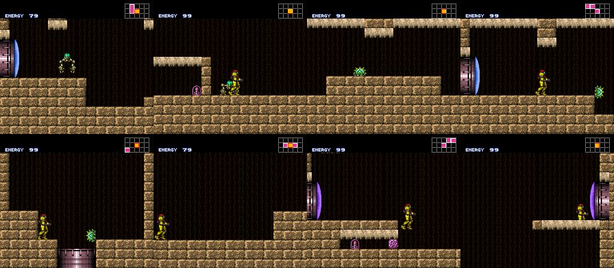
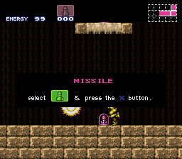

# 12h — Inimigos da Chozo (região A)

Estado: **verificada** (27/10/2026: validate "86 salas, 170 portas, 0 problemas", linha do Tallon igual; `.ips` sha1
`9a632d29fa3b6e80ac9bc2663d45a6d4a5785971` igual em dois builds; **61/61** testes)
Esforço estimado: 1–2 dias
Épico: [12 — Chozo Ruins](12-chozo-ruins.md) (linha 12h: "camada 0 do Prime → SM, set por sala, justiça por rodada"); modelo:
[07i — Inimigos do Tallon](07i-inimigos-tallon.md).

## Contexto

A região A da Chozo (12f) está construída, sem inimigos. Esta filha põe os da camada 0 do Prime nas 12 salas da região A
(as 3 de elevador não têm nenhum no Prime), com espécies do SM no lugar, como a 07i fez no Tallon, e grava a tabela do Prime
das regiões B–E (sem pôr inimigo em sala que não existe).

## Estado antes (verificado)

Depois da [12g2](12g2-ajustes-calor-e-cor.md): validate 86/170/0, sha1 `8371049f…14d3`, 60/60. `areas.CHOZO` sem `enemies`.

### O Prime, camada por camada (dados)

Roteiro `s12h/scripts/chozo_layers_all.py` (venv, retro-data-structures 0.44.1, `research/prime_fs`): objetos de cada camada
das 64 salas (`s12h/chozo_layers_all.json`). Região A e elevadores, camada 0 ("Default"):

| P# | Sala | Camada 0 | Outras camadas (fora) |
|---|---|---|---|
| 0, 62, 63 | Transport to Tallon North / East / South | — | — |
| 1 | Ruins Entrance | Beetle 2 | — |
| 2 | Main Plaza | Beetle 4 | 1 "First Pass": Beetle 5; 2 "Second Pass": Beetle 1; 4 "Wasps": War Wasp 3 |
| 3 | Ruined Fountain Access | Wall Crawler Swarm 4 | — |
| 4 | Ruined Shrine Access | Wall Crawler Swarm 3 | — |
| 5 | Nursery Access | Wall Crawler Swarm 2 | — |
| 6 | Plaza Access | Beetle 3 | — |
| 7 | Piston Tunnel | — | — |
| 9 | Ruined Shrine | Beetle 7 | 1 "First Pass": Beetle 1; 3 "Third pass - Ghosts": Chozo Ghost 2; 4 "2 1/2 Pass BETA BEETLE": Beetle 1 (o Plated Beetle) |
| 15 | Tower of Light Access | — | — |
| 21 | Tower of Light | Oculus 6, Puffer 12 | 1 "2nd Pass": Puddle Spore 2 |
| 27 | Tower Chamber | — | — |

(FishCloud, câmeras, `VisorGoo` e afins fora; nenhum AmbientAI/Snake Weed na região A.)

Regiões B–E, camada 0 (só registro, `chozo/enemies.py PRIME_LAYER0_LATER`): Fire Flea (P8 4, P33 3, P45 1), Eyeball/Eyon
(P10 5, P41 6, P42 3), Metaree Alpha (P13 8, P32 20, P38 12, P40 8, P44 12), War Wasp (P16 2, P29 1, P36 3, P48 1), Beetle (P16 2),
Wall Crawler (P23 2), Oculus (P29 8), Parasite (P49 8), Stone Toad (P44 1); armadilhas e enfeite (Spank Weed, Snake Weed,
AmbientAI, Thermal Heat Fader).

### O SM (cabeçalhos em `$A0`, nomes de debug em `$B4`, lidos da ROM base)

| Espécie | Vida | Toque | Raio | Tiles | Tiros do Power Beam | Colocação vanilla copiada |
|---|---|---|---|---|---|---|
| SSIDE `$D93F` (Sidehopper pequeno) | 60 | 20 | 16×13 | `$400` | 3 | (07i) |
| HZOOMER `$DC3F` (o rastejador da fragata) | 15 | 5 | 8×8 | `$600` | 1 | (fragata) |
| **VIOLA `$DABF`** | 30 | 15 | 8×8 | `$400` | 2 | `$8F:AB07`: init 3, prop. `$2001`, p1 2, p2 6 |
| **MELLA `$D13F`** | 30 | 16 | 8×4 | `$400` | 2 | `$8F:A815`: tudo 0, prop. `$2000` |
| PUYO `$CFBF` (proposta do épico) | 100 | **60** | 8×4 | `$200` | 5 | recusado |
| PUU `$E8BF` (proposta do épico) | 10 | **100** | 8×16 | `$400` | 1 | recusado |
| EYE `$E6BF` (Eyon, região B) | 20 | 0 | 8×8 | `$400` | **imune** | a decidir na 12i |

## Mudança

1. **Prime → SM** (`tools/chozo/enemies.py`, `STAND_IN`): Beetle → Sidehopper pequeno (como no Tallon); Wall Crawler Swarm →
   HZOOMER (como na região D do Tallon); **Oculus → Viola** (rastejador de parede e chão, como o olho que anda nas paredes da
   torre; o do épico); **Puffer → Mella** (flutuante pequeno que vem na direção da Samus; desvio do épico: PUYO tira 60 por
   toque e pula no chão, PUU tira 100).
2. **Espécies** (`tools/frigate/enemies.py SPECIES`): `oculus` (`$DABF`, paleta 2) e `puffer` (`$D13F`, paleta 7), parâmetros
   das colocações vanilla.
3. **Por sala**, no máximo 1 por tela (regra da 07i), posições pelo desenho (o Prime não dá posições pela biblioteca):

| Sala | Rodada | Inimigos (SM) | Onde |
|---|---|---|---|
| Ruins Entrance (2×1) | 0 | 2 Sidehoppers | no rebaixo do chão quebrado (12,13), (20,13) |
| Main Plaza (6×2) | 0 | 4 Sidehoppers | no chão do pátio, a leste da escada, do fosso e do estrado (42, 52, 76, 87; linha 26) |
| Ruined Fountain Access (3×1) | 0 | 3 rastejadores | (12,10), (26,8) no trecho alto, (38,10) |
| Nursery Access (1×1) | 0 | 1 rastejador | (12,13), a leste do buraco da porta de chão |
| Ruined Shrine Access (3×1) | 1 | 3 rastejadores | um em cada trecho do chão (9,10), (24,12), (39,10) |
| Ruined Shrine (3×1) | 1 | 3 Sidehoppers | na tigela (14, 20, 31; linha 13), o míssil do chão (24) entre eles |
| Tower of Light (3×4) | 2 | 6 Violas, 6 Mellas | Violas em 4 plataformas e no chão; Mellas em 5 plataformas e no chão |
| Plaza Access (2×1) | fora | 2 Sidehoppers | (22,13), (29,10) (espera a região B) |
| as outras 6 | — | nenhum (o Prime não tem na camada 0) | |

   Total **30 inimigos em 8 salas**; set "CHOZO  " (nome de 7 bytes); paletas Sidehopper 3, rastejador 1, Viola 2, Mella 7.
4. **Build**: nada novo (o passo 1 já monta população `$A1` e set `$B4` de toda sala com `area.enemies`); `areas.CHOZO.enemies`.
   A ROM de teste da 12g tira os inimigos da sala de teste (`testrooms.apply`: a medida do calor e a porta não podem levar toque).
5. **Validador**: `check_tallon_enemies` virou `check_layer0_enemies(area, tabela)` e serve também à Chozo (`check_chozo_enemies`):
   cada inimigo do Prime com substituto está lá (≥ 1, ≤ a conta do Prime), nada que o Prime não tenha, todo tipo com decisão em
   `STAND_IN`, ≤ 1 por tela, e nas salas em que a Samus chega com no máximo Power Beam, mísseis e Morph (o passeio Tallon + Chozo
   registra; aqui as rodadas 0–1) cada espécie morre com ≤ 5 tiros e tira ≤ 20 por toque; `PRIME_LAYER0` só com salas da tabela.
   `check_enemies`, `check_enemy_sets` e `check_enemies_in_rom` já percorriam toda área: agora cobrem a Chozo. Linha nova "chozo
   (specs/12h): 30 inimigos em 8 salas (beetle 11, oculus 6, parasite 7, puffer 6); …".

## Critérios de aceite

1. validate 0 problemas, linha do Tallon igual (44 salas, 20 itens em 7 rodadas), linha da Chozo (12f) igual, linha nova 12h.
2. `chozo_inimigos_vivos`: em cada sala, cada inimigo no seu slot da WRAM com a vida cheia, e parada na porta de entrada 300
   quadros a Samus não perde energia. `chozo_regiao_a_rota` anda a região A **com os inimigos vivos**; `chozo_regiao_a_itens` passa.
3. Justiça de porta (regra da 07i/10): nenhuma entrada com dano inevitável (auditoria abaixo).
4. Mutações pegas; dois builds com o mesmo sha1; fotos olhadas.

## Resultado

- **Auditoria das entradas** (`s12h/scripts/door_audit.py` → `door_audit.out`): as 18 entradas de porta das 8 salas, a Samus
  parada 180 quadros depois da transição: **nenhum dano** em 17; na **Nursery Access** (porta de chão) o rastejador chega a ela
  ~2,5 s depois (−5): evitável (ela sai do buraco ou atira; o rastejador morre com 1 tiro). Na primeira versão, um Sidehopper da
  Plaza Access em (14,13) pulava nela ao subir pela porta de chão e a derrubava de volta para a praça: os dois foram para o leste.
- **Rota** (`chozo_regiao_a_rota`, com inimigos): passa depois de duas mudanças (abaixo); no Ruined Shrine a Samus atira e
  avança na tigela, pega o míssil e **dois dos três Sidehoppers morrem com o Power Beam** (conferido na WRAM).
- **Fotos** (olhadas): `img/12h-inimigos-montagem.png` (as 8 salas: Sidehoppers na entrada e na praça, rastejadores verdes nos
  acessos, a torre), `img/12h-shrine-luta.png` (a caixa "MISSILE" e um Sidehopper explodindo), `img/12h-torre-plataformas.png`
  (uma Viola na plataforma), `img/12h-main-plaza.png`, `img/12h-nursery-access.png`.

### Mudanças de expectativa dos testes

| Teste | Mudança |
|---|---|
| `chozo_regiao_a_rota` | `chozo_walk` repõe a energia no começo de cada ciclo (como o `tallon_walk` desde a 07i); no shrine, em vez de `hold LEFT 60`, `SHRINE_FIGHT` (20 × atira e anda 8 quadros, energia reposta) e 2 expects novos (slots 1 e 2 sem espécie: mortos). Ciclos medidos iguais (42, 18, 40, 20, 30, 20) |
| `chozo_regiao_a_itens` | atalho novo `clear_room_enemies`: os inimigos da praça (3 vezes, a cada recarga) e do shrine apagados por RAM ao chegar (bit `$0200` das propriedades, como o motor apaga; expects de espécie 0); o teste é dos itens |
| `porta_de_charge`, `sala_quente` | nenhuma (a sala de teste fica sem inimigos na ROM de teste) |
| novo `chozo_inimigos_vivos` | as 8 salas, por transição de porta por RAM (`enter_through`, atalho anotado) |

### Espaço

`$A1` (populações) +504 bytes (livre a partir de `$A1:F35F`), `$B4` (sets) +108 (`$B4:F6B4`); `$8F`, `$83`, `$84`, nível, fixo,
SRAM: nada.

## Mutações

Validador (`s12h/scripts/mutate_12h.py` → `mutate_12h.out`), todas pegas: a rastejador sem chão; b Sidehopper fora da sala; c
sem chão; d colado na porta; e 3 na entrada (Prime 2, 2 telas); f os da entrada faltando; g inimigo na Tower Chamber (o Prime não
tem); h 2 na Nursery Access (1 tela); i Viola e Mella na mesma paleta; j Sidehopper grande (80 por toque) na rodada 0 (pega no
Tallon e na Chozo); k altura do Mella errada; l Oculus sem decisão em `STAND_IN`; m `PRIME_LAYER0` com sala fora da tabela; n
dois tipos que o Prime não tem na torre; o tabela mudada sem reconstruir a ROM. Emulador (`emu_mut_12h.out`): ROM sem os inimigos
da Chozo → `chozo_inimigos_vivos` falha ("7E0F78 = 0000, esperado D93F").

## Desvios

- **Puffer = Mella**, não PUYO/PUU do épico (toque de 60/100 numa sala da rodada 2 com 99 de energia).
- **Torre**: 6 + 6 (12 telas), não 6 + 12. **Shrine**: 3 dos 7. Camadas de evento (os Beetles do 1st/2nd pass, as War Wasps
  da praça, os Chozo Ghosts e o Plated Beetle do shrine, os Puddle Spores da torre) fora, como no Tallon.
- **Teste de itens com inimigos apagados por RAM** (atalho anotado): o teste é dos itens; a rota anda com eles vivos e o
  `chozo_inimigos_vivos` confere cada um.
- **Regiões B–E**: só a tabela do Prime e as propostas (`PROPOSED_LATER`: War Wasp → HACHI1, Eyon → EYE — imune ao Power Beam e
  sem dano de toque na ROM, a decidir na 12i —, Metaree → SKREE, Fire Flea → HOTAR, Parasite → Zeela).
