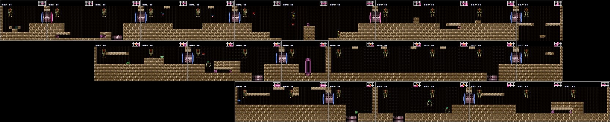
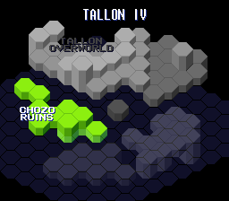
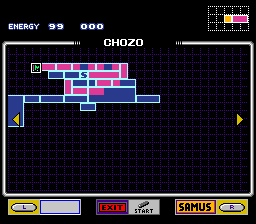

# 12i — Região B da Chozo (Nursery, Gallery, Hive Totem, Vault), Save Station 1 e Map Station

Estado: **verificada** (27/10/2026: validate "98 salas, 196 portas, 0 problemas", linha do Tallon igual; `.ips` sha1
`8bd21bf1644bffe3befe1038e59d13991ec983a9` igual em dois builds; **65/65** testes)
Esforço estimado: 2 dias (salas 0,5 d; travas, itens e inimigos 0,5 d; save e map station 0,25 d; validador 0,25 d; emulador,
fotos e mutações 0,5 d)
Épico: [12 — Chozo Ruins](12-chozo-ruins.md) (decisões do usuário 1, 2, 4, 6; linha 12i da tabela de filhas); modelos:
[12f](12f-regiao-a-chozo.md) (salas e travas), [12h](12h-inimigos-chozo.md) (inimigos), [07k](07k-regioes-b-e-c.md) (regiões do Tallon).

## Contexto

A região A (12f) deixou duas paredes no lugar das portas para a região B (Nursery Access L0 → Eyon Tunnel, Plaza Access R0 →
Vault) e a Plaza Access inalcançável (só se entra nela pelo Vault: a porta da praça é de mão única). Esta filha constrói as 12
salas da região B (tabela da 12c), abre essas duas paredes, põe as travas do Prime da região com os itens do Tallon (decisão
B), os itens e os inimigos da região, a **primeira save da Chozo** (Save Station 1, P22) e a **map station** (P34).

## Estado antes (verificado)

Depois da 12h: validate "86 salas, 170 portas, 0 problemas"; `.ips` sha1 `9a632d29fa3b6e80ac9bc2663d45a6d4a5785971`; 61/61.

- **Grafo** (`chozo/rooms.py`, 12c): a região B é um laço — Nursery Access → Eyon Tunnel (R0; T0 ↑) → Ruined Nursery (B1; R0 →
  Save Station 1; L0 →) North Atrium (R0; T0 ↑) → Ruined Gallery (B1; L0 → Map Station; R0 →) Totem Access → Hive Totem (L0;
  R0 →) Transport Access North → Transport to Magmoor North (L0 em cima; L1 embaixo; R0 → Sun Tower, região C) → Vault Access
  (R0; B3 ↓) → Vault (T0; L0 →) Plaza Access → (B0 ↓, mão única) Main Plaza.
- **Travas do Prime na região B** (`DOCK_LOCKS`, dados): só escudos de míssil — Ruined Gallery → Map Station (lado da galeria) e
  Hive Totem ↔ Transport Access North (os dois lados). Nenhuma porta de cor (`key`): **nenhuma porta de charge** cabe aqui.
  `FEATURES`: Ruined Gallery `heat` e `water`, Totem Access e Hive Totem `water`. O `heat` da galeria são dois objetos
  "Check Varia Suit" (lidos no scratchpad, `s12i/objs_b.txt`): trocam a água venenosa da poça por água limpa — um perigo da
  poça (seca aqui, pergunta 7 do épico), **não uma trava**: nenhuma sala quente.
- **Itens do Prime na região B** (objetos perto de cada `Pickup`, `s12i/scripts/objs_b.py` → `s12i/objs_b.txt`): Vault — míssil
  numa jaula com 3 "BallTrigger - Suck In Ball" e "Lock Destroyed" (bombas nos encaixes da Morph Ball); Ruined Nursery — míssil
  do "Wall Puzzle" (Morph Ball e Bombas, conhecimento); Ruined Gallery — míssil "Tunnel" ("Enter Tunnel Trigger", "Ball Opening
  1/2": Morph Ball) e míssil atrás de "Missile Wall"; Transport Access North — E-tank depois de um "ball hole" (Morph Ball); Hive
  Totem — o Missile Launcher (depois do Hive Mecha). **Charge e Varia não são da região B** (Watery Hall, D; Sunchamber, C).
- **Camada 0 do Prime** (12h, `PRIME_LAYER0_LATER`): Eyon Tunnel Eyeball 5; Ruined Nursery War Wasp 2 + Beetle 2; North Atrium
  Wall Crawler 2; Ruined Gallery Snake Weed 6 + AmbientAI 3; Transport Access North Snake Weed 2; Totem Access Fire Flea 3 +
  Snake Weed 5; Hive Totem War Wasp 3; as outras nenhum.
- **Save e map station**: o build já faz as duas para qualquer área (`RoomDef.save_station` com o PLM `$B76F`, argumento = a
  estação; `RoomDef.map_station` com o PLM `$B6D3`, argumento `$8000`; ícones e máscara de revelação da área); a área 1 só
  tinha a estação 0 (chegada). A tela de continue mostrava "BRINSTAR" para a área 1 (spritemap `$3A`, `$82:CC95`, 8 peças; lugar
  `(0x2A, 0x7F)` na tabela `$81:AA1C`, lidos).
- **Bits**: itens vanilla 0–`$9A`, Tallon `$A0–$B3`, Chozo `$B4–$BC` (o último, a Varia); portas vermelhas vanilla até `$A9`,
  Tallon `$B0–$B2`, Chozo `$B3`.

## Mudança

1. **Salas** (`tools/chozo/layouts.py`, arenito, regras da 12f), formas do Prime:

| Sala (P#) | Tamanho | Rodada | Forma |
|---|---|---|---|
| Eyon Tunnel (10) | 2×1 | 0 | túnel (linhas 2–9, chão 10), plataforma da T0, teto que desce no meio |
| Ruined Nursery (16) | 2×1 | 0 | salão (chão 13), degraus sob as portas laterais, **estrado** no meio com túnel na base fechado por bloco de bomba |
| Save Station 1 (22) | 1×1 | 0 | a estação no chão (pedestal em (8, 13)) |
| North Atrium (23) | 2×1 | 0 | corredor com trecho elevado, plataforma da T0 |
| Ruined Gallery (28) | 2×1 | 0 | salão, **poça seca** (linhas 13–14) com dois túneis nas pontas: oeste aberto (Morph), leste com bloco de bomba |
| Totem Access (33) | 2×1 | 0 | corredor com depressão seca |
| Hive Totem (36) | 3×1 | 0 | salão com o **totem** (colunas 22–25, topo na linha 9) entre duas poças secas, favos pendurados |
| Map Station (34) | 1×1 | 1 | a map station (base em T, (5, 13)), atrás da porta vermelha da galeria |
| Transport Access North (30) | 3×1 | 1 | corredor com caixotes e um **poço** (colunas 22–23) com túnel para o E-tank |
| Transport to Magmoor North (24) | 1×2 | 1 | salão de cima e de baixo ligados por um **poço com degraus de 4**; o elevador é de enfeite (o chão sob o poço) |
| Vault Access (17) | 4×1 | 1 | corredor longo com costelas no teto, a porta de chão no leste |
| Vault (11) | 3×1 | 1 | ponta oeste elevada sob a plataforma da T0, a **jaula** no leste com túnel e bloco de bomba |

   As paredes da região A abertas: **Nursery Access L0** (o degrau sob a borda da porta vai até a coluna 5: as colunas 4–5
   deixavam um vão de 2 linhas) e **Plaza Access R0** (o degrau sob a borda da porta vai até a coluna 26, idem). Portas para a
   região C (Magmoor North R0 → Sun Tower) = parede, com o chão já na linha da borda (como a 12f). O elevador da Magmoor North
   fica de enfeite (decisão 6 do épico): nenhum inimigo `$D73F`, nenhum bloco de porta.
2. **Travas** (`chozo/rooms.py` `GATES`, regra da 07k/12f): os dois escudos de míssil = **portas vermelhas** — Ruined Gallery →
   Map Station (lado da galeria, bit de porta **`$B4`**) e Hive Totem ↔ Transport Access North (**os dois lados, um bit só,
   `$B5`**: abrir de um lado abre o outro). `WAITS_FOR` vazio (a Plaza Access deixou de esperar). Nenhuma porta de charge (o
   Prime não tem porta de cor na região B), nenhuma sala quente (acima).
3. **Itens** (`chozo/items.py`, bits **`$BD–$C2`**, depois do `$BC` da Varia; nenhum vanilla, nenhum do Tallon):

| Bit | Sala | Prime | Lugar / trava (decisão B) | Rodada |
|---|---|---|---|---|
| `$BD` | Vault | míssil da jaula (3 encaixes de bomba) | túnel da jaula atrás de bloco de bomba (34, 12) | 2 |
| `$BE` | Ruined Nursery | míssil do "Wall Puzzle" (Bombas) | túnel do estrado atrás de bloco de bomba (14, 12) | 2 |
| `$BF` | Ruined Gallery | míssil "Tunnel" (Morph Ball) | túnel aberto a oeste da poça (3, 14) | 1 |
| `$C0` | Ruined Gallery | míssil da "Missile Wall" | nicho a leste da poça atrás de bloco de bomba (19, 14): **o SM não tem bloco que só míssil quebra** | 2 |
| `$C1` | Transport Access North | E-tank do "ball hole" (Morph Ball) | fim do túnel do poço (28, 11) | 1 |
| `$C2` | Hive Totem | **Missile Launcher** → Missile Expansion (os mísseis já existem desde o Tallon) | topo do totem (23, 8) | 0 |

   E o E-tank "Locked Door" da Main Plaza (`$B7`, 12f): **rodada 3 → 1** — agora se pega como no Prime, vindo do Vault e descendo
   pela porta de chão da Plaza Access até a borda da porta de mão única.
4. **Save Station 1** (`chozo/layouts.py SAVE_STATION_1`, `areas.chozo_stations`): **estação 1 da área 1** (a 0 é a chegada), Samus
   no bloco direito do pedestal (regra das outras); o build escreve a estação na tabela da área 1 (`$80:C5DD`), o PLM de save com
   argumento 1, o ícone de save na lista da área 1 e a sala no mapa com o "S" (sala 1×1 com save). **Tela de continue**: o nome da
   área 1 vira **"CHOZO / RUINS"** (`areaselect.LABELS[1]`, spritemap nova no `$82` livre, 10 peças; o lugar no planeta continua o
   vanilla da Brinstar). A lista do mapa salvo da área 1 já era a tabela inteira (41 bytes, 12e): o mapa e o minimapa voltam no
   continue.
5. **Map Station** (`chozo/layouts.py MAP_STATION`): PLM `$B6D3` (como a Map Facility da fragata), ícone de map station da área 1,
   máscara de revelação = as salas construídas da Chozo (`pausemap.build`).
6. **Inimigos** (`chozo/enemies.py`, modelo da 12h, ≤ 1 por tela, justos na chegada):

| Sala | Prime (camada 0) | SM | Onde |
|---|---|---|---|
| Eyon Tunnel | Eyeball 5 | **1 olho (EYE `$E6BF`)** | na parede oeste, na altura da Samus, olhando para leste |
| Ruined Nursery | Beetle 2, War Wasp 2 | 1 Sidehopper pequeno, 1 **Mella** | no chão a oeste do estrado; em cima do estrado (x 168) |
| North Atrium | Wall Crawler 2 | 2 rastejadores (HZOOMER) | no chão e no trecho elevado |
| Totem Access | Fire Flea 3 (Snake Weed fora) | 2 **Fireflea (HOTARY `$D6BF`)** | flutuando 24 px acima do chão, sobe e desce 24 px |
| Hive Totem | War Wasp 3 | 3 **Mella** | a oeste do totem, no topo dele (a leste do míssil), a leste da poça |
| Ruined Gallery, Transport Access North | Snake Weed, AmbientAI | nenhum (fora, como na 12h) | |

   - **Eyon → olho da Morph Ball** (`$E6BF`, decisão do orquestrador: aceito se for justo): **inofensivo** — dano de toque 0 no
     cabeçalho, o init liga "sem colisão com a Samus" (`$A8:9058`: `ORA #$2000`), nenhum tiro (só o facho de luz, uma janela HDMA
     que acende quando a Samus tem a Morph Ball: `MorphBallEye_Main`, `sm_a8.c:425`); nunca bloqueia porta (atravessa-se). Como
     nas colocações vanilla (`$8F:9E9F`, `$A1:93AC`), cada olho são **dois registros**: o encaixe (parâmetro 2 `$8000 | lado da
     parede`) e o olho (parâmetro 1 = 1 olhando para a direita); 0 mortes contadas.
   - **War Wasp → Mella** (`$D13F`, a espécie do Puffer, como o Cacatac é Blood Flower e Seedling desde a 07m): plana num círculo e
     **dispara contra a Samus a menos de `$70` px** (`Flies_4`, `sm_a2.c:1802`), como uma vespa. **Recusados, medidos**: o Kihunter
     verde do épico (HACHI1 `$EABF`) morre com **6** tiros do Power Beam (vulnerabilidade 1: acima da regra de 5); o **Rio** (`$D27F`,
     mergulha do teto) mergulha a menos de `$A0` px (`Rio_1`) e na Ruined Nursery não há lugar tão longe das duas portas laterais e
     do buraco da porta de chão — por cima do buraco ele derrubava a Samus de volta pela porta quando ela subia (emulador).
   - **Fire Flea → Fireflea** (proposta da 12h): 20 de vida (1 tiro), 4 por toque; o escurecimento da sala só existe com o FX dela.
7. **Validador** (`tools/validate.py`):
   - linha da Chozo (`check_chozo_rounds`) por rodada com as regiões ativas "AB"; a linha 12h lista as regiões ainda só na tabela;
   - **porta vermelha dos dois lados**: um bit pode ser o mesmo nos dois lados de **uma** ligação, nunca entre duas
     (`check_gates`);
   - inimigos: `Species.mount` ("floor", "wall": a parede do encaixe ao lado; "ceiling": o teto em cima), `hover`/`bob` (o corpo
     inteiro no ar durante o sobe e desce), **`harmless`** (lido da ROM: dano 0 e o init que desliga a colisão,
     `HARMLESS_INIT`; aceito na regra de justiça mesmo sem morrer ao Power Beam), parte companheira com dano ≤ 20;
   - `check_arrival` (agora para o Tallon **e a Chozo**): a sala de cada estação **e a sala da porta fantasma dela** (o jogo carrega
     o destino da porta, `build.write_load_station`); o PLM de save de toda sala com save station (estação certa) e o PLM da map
     station em todo estado.
8. **Testes** (`tests/run_tests.py`): novos `chozo_regiao_b_rota`, `chozo_regiao_b_itens`, `chozo_save_e_continue`,
   `chozo_map_station`; `chozo_inimigos_vivos` cobre as 5 salas da região B com inimigos.

## Critérios de aceite

1. validate 0 problemas; linha do Tallon igual ("44 salas construídas, alcançáveis agora: 44, 20 itens em 7 rodadas"); linha da
   Chozo por rodada. (protege = travas, rodadas, bits, softlock, save/map station na ROM; falha_quando = mutações; não_prova =
   que a forma agrada)
2. `chozo_regiao_b_rota`: a região B andada a pé, com inimigos vivos, do Nursery Access até voltar à Main Plaza pela Plaza Access,
   pegando o míssil do totem e o E-tank "Locked Door"; `chozo_regiao_b_itens`: os outros 5 itens pegos andando ou rolando.
3. `chozo_save_e_continue`: salva na Save Station 1, game over, a tela de área escolhe a área 1 e escreve "CHOZO / RUINS",
   continue no pedestal com o mapa e o minimapa. `chozo_map_station`: a map station revela as salas não visitadas.
4. Justiça de porta (12h): nenhuma entrada com dano inevitável. Mutações pegas. Dois builds com o mesmo sha1; fotos olhadas.

## Resultado

- Linha nova do validador: "chozo (specs/12f, 12i; regiões ativas: AB): 26 salas construídas, alcançáveis a pé da nave do
  Tallon: 26, 13 itens; andadas junto com o Tallon (mesmas rodadas): rodada 0: 12 salas, 1 itens; rodada 1: 9 salas, 4 itens;
  rodada 2: 3 salas, 4 itens; rodada 3: 0 salas, 3 itens; rodada 4: 1 salas, 0 itens; rodada 5: 1 salas, 0 itens; rodada 6: 0
  salas, 1 itens; fora das rodadas: nenhuma". Inimigos: "40 inimigos em 13 salas (beetle 12, eyon 1, fireflea 2, oculus 6,
  parasite 9, puffer 6, wasp 4) … regiões CDE: só a tabela do Prime". **Linha do Tallon igual.**
- **Rota** (`chozo_regiao_b_rota`, trechos medidos no emulador, `s12i/try.py`, `s12i/upto.py`): do pouso, o míssil do lago, o
  elevador, a praça e a subida para a Nursery Access são atalhos anotados; daí **a pé**: o buraco da Nursery Access pulado, o Eyon
  Tunnel até a plataforma, **a subida pela porta de teto** para a Ruined Nursery (técnica da 10b: de pé na metade oeste da porta,
  pulo inteiro guiando para oeste; da metade leste ela cai de volta, não é softlock), o estrado, o North Atrium, a mesma subida
  para a Ruined Gallery, o pulo sobre a porta de chão da galeria, o Totem Access, **o totem escalado** da poça (um pulo inteiro de
  6 blocos: o andador de pulos curtos não sobe), o míssil (10 mísseis), a porta vermelha aberta com mísseis (bit `$B5`), o
  Transport Access North, **o poço da Magmoor descido**, a Vault Access e a porta de chão até a plataforma do Vault, a Plaza Access e
  a porta de chão até a borda da mão única: **o E-tank** (199). Bits de explorado das salas e o mapa de pausa conferidos.
- **Itens** (`chozo_regiao_b_itens`): cada bloco de bomba fica de pé, a bola põe a bomba, o bloco vira ar no nível da WRAM, ela rola
  até o item; os dois túneis de Morph rolando. 5 bits, 20 de capacidade de mísseis, 199 de energia.
- **Save e continue** (`chozo_save_e_continue`): estação 1, área 1, bit de estação usada `$7ED8FA` bit 1; game over → a tela de
  área com "CHOZO / RUINS" (desenhado depois de "TALLON / OVERWORLD": a nave já salvou na estação 0 da área 0), o mapa de salas
  da Chozo, continue no pedestal (marcador de horas 7 carregado), bits de explorado mantidos.
- **Map station** (`chozo_map_station`): a porta vermelha da galeria aberta com mísseis (bit `$B4`); antes, salas não visitadas em
  branco na pausa; depois de usar o terminal, `$7ED909 = $FF` e as salas aparecem (paleta 3, não exploradas).
- **Auditoria das entradas** (`s12i/door_audit.py` → `s12i/door_audit.out`, cópia da 12h): as 15 entradas das 7 salas com
  inimigos (com a Nursery Access e a Plaza Access da região A), parada 180 quadros: **nenhum dano** em 14; na Nursery Access B0 o
  rastejador chega ~2,5 s depois (−5), o caso já aceito na 12h (evitável).
- **Fotos** (olhadas): `img/12i-montagem-salas.png` (as 14 salas tocadas, cada tela no seu lugar do mapa), `img/12i-rota-*`,
  `img/12i-itens.png`, `img/12i-save-*`/`12i-continue-*`, `img/12i-mapa-*`, `img/12i-olho-eyon.png` (o olho fechado e, com a Morph
  Ball, o facho na direção da Samus).

 

### Mudanças de expectativa dos testes

| Teste | Mudança |
|---|---|
| `chozo_inimigos_vivos` | + Eyon Tunnel, Ruined Nursery (pela porta lateral do North Atrium), North Atrium, Totem Access, Hive Totem; `enemies_alive` e `clear_room_enemies` contam os slots pela população (o olho ocupa dois: encaixe e olho) |
| `stand_before_door` (ajudante) | aceita qualquer sala construída (era só o Tallon) |
| os outros 61 | nenhuma |

### Espaço

`$8F`: **+600 bytes** (livre a partir de `$8F:FE27`: **473 bytes**; a faixa recuperada da 12a, 2254, continua sem uso — as
regiões C–E (38 salas) vão precisar dela). `$83`: +324 (`$83:B74E`). `$A1`: +191 (`$A1:F41E`). `$B4`: +69 (`$B4:F6F9`). `$82`: +52
(o nome "CHOZO / RUINS", `$82:F826`). Nível: +2585 (98 níveis, livres 494782). Fixo, `$84`, `$A0`: nada. **SRAM do mapa: igual**
(445/1280; a lista da área 1 já era a tabela inteira, 41 de 80 bytes no lugar vanilla).

## Mutações

Validador (`s12i/mutate_12i.py` → `s12i/mutate_12i.out`, cópia do projeto em `s12i/proj`), **todas pegas**: S1 sem o escudo da
Map Station (rodada 0); S2 sem o escudo Hive ↔ TAN (6 salas na rodada 0); S3 rodada de item errada; S4 bits da Chozo sobre o
`$B3` do Tallon; S5 jaula sem o bloco de bomba (pega-se sem Bombas); S6 item do túnel dentro da rocha; S7 Gallery quente e S20 Hive
Totem quente (metade do laço inalcançável sem a Varia); S8 porta de charge na entrada da região (região inteira some); S9 save sem
pedestal; S10 olho longe da parede; S11 Fireflea marcado inofensivo; S12 Fireflea sem a altura (bob no chão); S13 War Wasp sem
decisão; S14 vespa colada na porta; S15 bit de porta vermelha repetido entre ligações; S16 Magmoor sem um degrau (porta de cima
inalcançável); S17 Plaza Access ainda esperando a região B; S18 E-tank da praça declarado na rodada 3; S19 túnel da Nursery sem o
bloco. ROM: R1 PLM de save com a estação 2; R2 map station sem o PLM; R3 a porta fantasma da estação 1 levando à Ruined Nursery; R4
nome da área 1 de volta a BRINSTAR; R5 olho sem o encaixe. Emulador (`s12i/emu_mut_12i.py` → `s12i/emu_mut_12i.out`): E1 a porta
da estação 1 na Ruined Nursery → `chozo_save_e_continue` falha (continua na Nursery); E2 sem o PLM da map station →
`chozo_map_station` falha; E3 o míssil do totem dentro da rocha → `chozo_regiao_b_rota` falha.

## Desvios

- **Missile Wall da Ruined Gallery = bloco de bomba** (rodada 2, não 1): o SM não tem bloco que só míssil quebra (o bloco de tiro
  quebra com qualquer tiro; o de super míssil pede Super Missiles, `$84:CF67` confere o tipo `$200`). Decisão a confirmar.
- **Missile Launcher = Missile Expansion** no topo do totem (pedido do orquestrador); o Hive Mecha fica para a etapa dos chefes.
- **War Wasp = Mella** (não o Kihunter do épico nem o Rio: medidos acima); **Eyon = 1 olho** (o Prime tem 5): o facho do olho é
  desenhado errado quando a Samus passa por trás dele (um segundo olho no toco do teto acendeu uma cunha até o alto da tela,
  emulador) e o vanilla nunca tem dois acesos.
- **Subida pelas portas de chão** (Ruined Nursery, Ruined Gallery, e a Nursery Access da região A agora que a L0 abriu): só a borda
  do lado oposto à porta lateral serve de pouso (a outra fica sob o degrau da porta lateral); da metade errada da porta ela cai de
  volta (como as portas de chão do Tallon na 10b): não é softlock. A Nursery Access da região A agora pousa a leste (a borda oeste
  ficou sob o degrau da L0 aberta); a subida dela nos testes é por RAM (`rise_through`: o rastejador derrubava a Samus no pulo de
  verdade, o caso da 12h).
- **Inimigo da Plaza Access** (12h): o Sidehopper em (29, 10), na borda da R0 aberta, foi para o chão (18, 13).
- **Validador**: a estação de load confere também a porta fantasma (antes só a palavra da sala, que o jogo não usa para carregar).

## Decisões para o usuário (padrão escolhido, a confirmar)

1. Missile Wall → bloco de bomba (ou outro: Power Bomb; ou um item sem trava).
2. War Wasp → Mella (a mesma espécie do Puffer) e Eyon → 1 olho inofensivo.
3. O elevador da Magmoor North sem arte de elevador (o 0C não tem peça de plataforma): o "pad" é o chão sob o poço.
