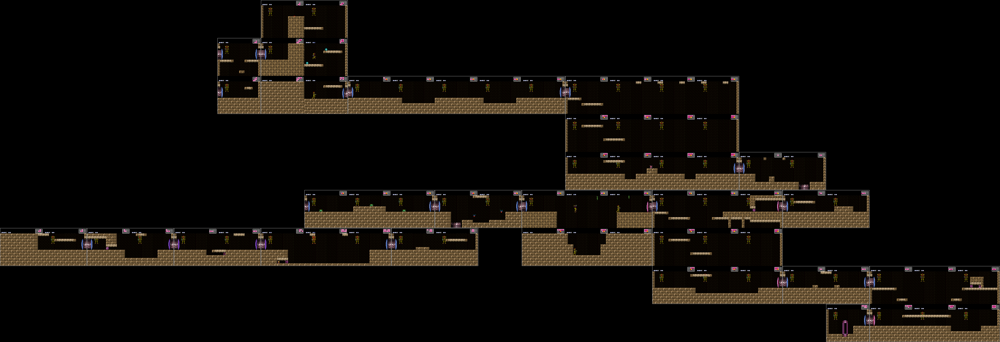
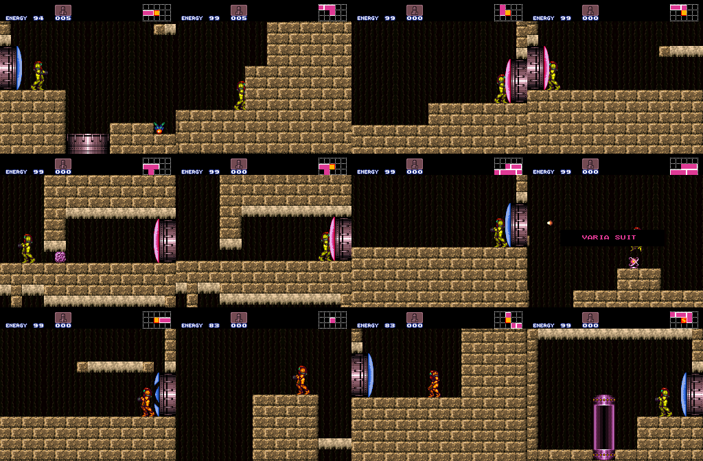
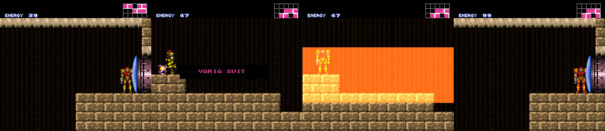

# 12j — Região C da Chozo (Ruined Fountain, Arboretum, Sunchamber com a Varia, Sun Tower, Save Station 2)

Estado: **verificada** (27/10/2026: validate "113 salas, 230 portas, 0 problemas", linha do Tallon igual; `.ips` sha1
`3df756e39c5098c35e911073f4a39e97b2bde840` igual em dois builds; **70/70** testes)
Esforço estimado: 2–3 dias (salas 0,75 d; travas, itens e inimigos 0,5 d; validador 0,25 d; emulador, fotos e mutações 0,75 d)
Épico: [12 — Chozo Ruins](12-chozo-ruins.md) (decisões do usuário 1–4, 6 e o padrão aceito 9; linha 12j da tabela de filhas);
modelos: [12f](12f-regiao-a-chozo.md) e [12i](12i-regiao-b-chozo.md) (salas, travas, itens), [12h](12h-inimigos-chozo.md)
(inimigos), [12g](12g-itens-e-travas-novas.md) + [12g2](12g2-ajustes-calor-e-cor.md) (Varia, calor só com a Varia).

## Contexto

As regiões A (12f) e B (12i) estão construídas. Ficaram paredes no lugar das três portas para a região C: Ruined Fountain
Access R0 → Ruined Fountain, Piston Tunnel R0 → Training Chamber e Transport to Magmoor North R0 → Sun Tower (todas com o
chão já na linha da borda). Esta filha constrói as 15 salas da região C (tabela da 12c), abre essas três paredes, põe as
travas do Prime da região com os itens do Tallon e os novos (decisão B), os itens da região (entre eles a **Varia Suit**, na
Sunchamber), a primeira **sala quente** de verdade (Magma Pool), a **Save Station 2** e os inimigos da camada 0.

## Estado antes (verificado)

Depois da 12i: validate "98 salas, 196 portas, 0 problemas" (linha do Tallon "44 salas construídas, alcançáveis agora: 44, 20
itens em 7 rodadas"); `.ips` sha1 `8bd21bf1644bffe3befe1038e59d13991ec983a9`; 65/65.

- **Grafo** (`chozo/rooms.py`, 12c; 15 salas, mapa da área 1): Ruined Fountain Access (A) → Ruined Fountain (R0 → Arboretum
  Access; B0 ↓ Meditation Fountain T1) ; Meditation Fountain L0 → Magma Pool R0; Magma Pool L0 → Training Chamber Access R0;
  Training Chamber Access L0 → Training Chamber R0; Training Chamber L0 → Piston Tunnel (A); Arboretum Access R0 → Arboretum
  L0; Arboretum R0 → Sunchamber Lobby L0, R2 → Gathering Hall Access L0; Sunchamber Lobby T0 ↑ Sunchamber Access B1;
  Sunchamber Access L0 → Sunchamber R2; Sunchamber L0 → Sun Tower Access R0; Sun Tower Access L0 → Sun Tower R2; Sun Tower
  L1 → Transport to Magmoor North (B); Gathering Hall Access R0 → Gathering Hall L0; Gathering Hall L1 → Save Station 2;
  Gathering Hall R0 → Watery Hall Access e R1 → East Atrium (região D). Tamanhos (regra da 12c): Arboretum 3×3, Sunchamber
  4×3, Sun Tower 2×3, Arboretum Access 3×2, Gathering Hall 3×2, Magma Pool 3×1, Sun Tower Access 5×1, Save Station 2 1×1, as
  outras 2×1. **No mapa da 12c a porta da Magmoor (L1) fica acima da porta da Sun Tower Access (R2)**; no Prime a da Sun Tower
  Access fica no alto da torre e a do elevador no pé.
- **Travas do Prime** (`DOCK_LOCKS`, dados): escudos de míssil — Arboretum Access → Arboretum, Arboretum → Sunchamber Lobby,
  Arboretum → Gathering Hall Access, Gathering Hall → Save Station 2 (cada um só do lado citado); "key" (porta de cor) — Training
  Chamber ↔ Training Chamber Access e Training Chamber Access ↔ Magma Pool, **dos dois lados**; morph — Piston Tunnel ↔ Training
  Chamber (os dois lados); event — Training Chamber → Training Chamber Access (luta dos Chozo Ghosts, camada 1) e Sunchamber →
  Sun Tower Access (Flaahgra). `FEATURES`: Ruined Fountain heat/spider/water, Training Chamber bomb_slot/halfpipe/morph_door/
  spider, Meditation Fountain heat/lava/water, Training Chamber Access heat, Arboretum breakable/heat/water, Magma Pool
  grapple/heat/lava/water, Sun Tower spider, Sunchamber bomb_slot/heat/water, Gathering Hall e Sun Tower Access water.
- **Cor das portas "key"** (novo, dos dados; roteiro `s12j/scripts/doorkeys.py` → `s12j/doorkeys.out`): a `DamageVulnerability`
  de cada `Trigger_DoorKey` (1 = normal, 2 = rebate; ordem power, ice, wave, plasma…): as portas com escudo de míssil são
  azuis por baixo (tudo 1); as da região C (Training Chamber, Training Chamber Access ×2, Magma Pool) são **só Wave**
  (`02 02 01 02 …`), o mesmo padrão das da Tower of Light, que a 12f pôs roxas. **Nenhuma porta de charge**: o Prime não tem
  porta de tiro carregado.
- **Calor** (novo, dos dados; `s12j/scripts/specialfn.py` → `s12j/specialfn.out`): o número da função de cada
  `SpecialFunction` (u32 depois do nome, posição e rotação), calibrado pelos nomes (Save Station = 7, Map Station = 6,
  PlayerInAreaRelay = 25, HintSystem = 20): **a função 18, `Area Damage` (o calor do Prime), aparece em 1 sala da Chozo — a
  Magma Pool** — e em 13 da Magmoor (todas as superaquecidas). Os outros "heat" da região C são `Check Varia Suit` (função 5,
  troca a água venenosa da poça por limpa: perigo da poça, seca aqui, como a galeria da 12i) e `ThermalHeatFader` (o brilho do
  Thermal Visor perto das portas da Magma Pool).
- **Itens do Prime na região C** (`s12j/scripts/objs_c.py` → `s12j/objs_c.txt`, objetos perto de cada `Pickup`): Ruined
  Fountain — míssil no alto de um trilho de Spider Ball (`SpiderBallWaypoint`s até ele); Training Chamber — Energy Tank da
  "Powerup Room" (trilho de Spider Ball, bomb slots, meio-tubo); Training Chamber Access — míssil no fim de um caminho de Morph
  Ball (`Path Camera`); Magma Pool — **expansão de Power Bomb** atrás da "Grapple Powerbomb wall"; Gathering Hall — míssil atrás
  de uma grade ("Bomb Gate", bombas); Sunchamber — **Varia Suit** (depois do Flaahgra) e um artefato (fora). **O Charge Beam é da
  Watery Hall (região D, 12k).**
- **Camada 0 do Prime** (12h, `PRIME_LAYER0_LATER`): Ruined Fountain Fire Flea 4; Arboretum Access Metaree 8; Meditation
  Fountain AmbientAI 4; Sunchamber Lobby Spank Weed 2 + Snake Weed 3; Sun Tower Oculus 8 + War Wasp 1; Sunchamber Access Spank
  Weed 3 + Snake Weed 1; Gathering Hall Metaree 20 + AmbientAI 20; Sun Tower Access Snake Weed 3; as outras nenhum (os Chozo
  Ghosts, as War Wasps do Arboretum e o Flaahgra são de camadas de evento/chefe).
- **Bits**: itens vanilla 0–`$9A`, Tallon `$A0–$B3`, Chozo `$B4–$C2`; portas vermelhas vanilla até `$A9`, Tallon `$B0–$B2`,
  Chozo `$B3–$B5`.
- **Espaço**: `$8F` livre a partir de `$8F:FE27` (473 bytes); a faixa recuperada da 12a (`$8F:D4EF–DD57` e `$DD59–DDBD`, 2254
  bytes) sem uso.

## Mudança

1. **Salas** (`tools/chozo/layouts.py`, arenito, regras da 12f/12i):

| Sala (P#) | Tamanho | Rodada | Forma |
|---|---|---|---|
| Ruined Fountain (8) | 2×1 | 0 | salão (chão 13), degraus sob as portas laterais, porta de chão B0 no oeste, bacia seca da fonte e, sobre ela, a borda do trilho de Spider Ball (linha 4: Space Jump) com o míssil |
| Arboretum Access (13) | 3×2 | 0 | corredor de cima (chão 10) cortado por um poço até o salão de baixo (chão 28): desce por degraus de 4 a oeste, sobe a leste (o "U" do Prime) |
| Meditation Fountain (14) | 2×1 | 0 | corredor (chão 10), plataforma da porta de teto T1, a borda da fonte |
| Arboretum (19) | 3×3 | 1 | pátio (chão 42, poça seca), zigue-zague de bordas (5 linhas por degrau) do chão à borda da L0, um galho até a copa da árvore (linhas 10–12) e da copa um túnel de Morph (linha 9) com bloco de bomba até a câmara murada da R0 (o "breakable block" do Prime) |
| Gathering Hall Access (26) | 2×1 | 1 | corredor com grades de vapor |
| Gathering Hall (32) | 3×2 | 1 | piso de baixo (26, poça seca), duas galerias (linha 10), escadas de plataformas até cada uma, a jaula do míssil na galeria leste (túnel com bloco de bomba) |
| Save Station 2 (39) | 1×1 | 1 | a estação (pedestal em (6, 13)) |
| Training Chamber (12) | 2×1 | 1 (a câmara do pistão; o salão na 2) | a L0 abre na câmara do pistão; túnel de Morph (linha 9) com bloco de bomba até o salão (chão 13); E-tank numa borda (linha 4) sobre o salão (Space Jump) |
| Sun Tower (29) | 2×3 | 1 | bolso da porta L1 (Magmoor) no pé de um poço de 18 linhas; da R2 (Sun Tower Access) um zigue-zague sobe a leste até a passagem de cima e dela se cai pelo poço até a L1 (o caminho livre do Prime é descer); subir o poço = trilho de Spider Ball = Space Jump |
| Sunchamber Lobby (25) | 2×1 | 2 | corredor (chão 10), plataforma da T0 |
| Sunchamber Access (31) | 2×1 | 2 | salão (chão 13), porta de chão B1, caixotes e cipós |
| Sunchamber (37) | 4×3 | 2 | arena (chão 42), dois fossos secos dos bomb slots, a **Varia num pedestal** no meio, zigue-zague até a L0 |
| Sun Tower Access (35) | 5×1 | 2 | corredor longo com dois canais secos e arcos |
| Training Chamber Access (18) | 2×1 | 2 | corredor entre duas portas de onda, um buraco com túnel de Morph até o míssil |
| Magma Pool (20) | 3×1 | 3 | **quente**; bacia seca (5 de fundo, entra e sai a pé), na parede oeste dela um túnel com bloco de Power Bomb até a expansão |

   Paredes abertas: Ruined Fountain Access R0, Piston Tunnel R0, Transport to Magmoor North R0 (as três já tinham o chão na
   linha da borda: nenhum desenho mudou). Portas para a região D (Gathering Hall R0 → Watery Hall Access, R1 → East Atrium) =
   parede, com o chão na linha da borda.
2. **Travas** (`chozo/rooms.py` `GATES`, `HOT_ROOMS`):
   - escudos de míssil = **portas vermelhas** do lado dos dados: Arboretum Access → Arboretum (bit de porta `$B6`), Arboretum →
     Sunchamber Lobby (`$B7`), Arboretum → Gathering Hall Access (`$B8`), Gathering Hall → Save Station 2 (`$B9`) — bits na
     ordem de `GATES` (`CHOZO_MISSILE_BIT0 + n`), depois dos `$B3–$B5`;
   - Arboretum → Sunchamber Lobby: além da vermelha, o "breakable" = **túnel de Morph com bloco de bomba** na frente da porta
     (gate `{missile, morph, bombs}`, borda do lado do Arboretum); o portão de runas (Scan Visor) fica fora (sem item SM);
   - Piston Tunnel ↔ Training Chamber: morph dos dois lados + o pistão dos bomb slots = **túnel de Morph com bloco de bomba**
     do lado da Training Chamber (gate `{morph, bombs}`, borda da Training Chamber);
   - Training Chamber ↔ Training Chamber Access ↔ Magma Pool: **portas de onda roxas** dos dois lados (como a Tower of Light);
   - Sun Tower: o trilho de Spider Ball = **borda de Space Jump** na porta R2 (gate `{space_jump}`, borda da Sun Tower): da L1
     não se chega à R2 sem o Space Jump; da R2 à L1, a pé;
   - **Magma Pool quente** (`HOT_ROOMS`): toda porta para ela pede a Varia (`heat_gates`), FX `HEAT_FX` na ROM;
   - event (Chozo Ghosts, Flaahgra): fora (camadas de evento; chefes depois, decisão 3) — a porta da Sunchamber para a Sun
     Tower Access fica sem trava até o chefe.
3. **Itens** (`chozo/items.py`, bits **`$C3–$C7`**, depois do `$C2` da 12i; a Varia já tinha a linha 8, bit `$BC`):

| Bit | Sala | Prime | Lugar / trava (decisão B) | Rodada |
|---|---|---|---|---|
| `$BC` | Sunchamber | **Varia Suit** (depois do Flaahgra) | pedestal no meio da arena (31, 39), item comum (chefe depois) | 2 |
| `$C3` | Ruined Fountain | míssil no alto do trilho de Spider Ball | borda de Space Jump sobre a fonte (16, 3) | 3 |
| `$C4` | Training Chamber | E-tank da "Powerup Room" (Spider Ball) | borda de Space Jump sobre o salão (19, 3) | 3 |
| `$C5` | Training Chamber Access | míssil do caminho de Morph Ball | fim do túnel do buraco (18, 11) | 2 |
| `$C6` | Magma Pool | **expansão de Power Bomb** atrás da parede de PB (gancho) | fim do túnel atrás do bloco de PB (6, 14); sala quente | 6 |
| `$C7` | Gathering Hall | míssil atrás da "Bomb Gate" | jaula na galeria leste, bloco de bomba (40, 9) | 2 |

4. **Save Station 2** (`chozo/layouts.py SAVE_STATION_2`): **estação 2 da área 1** (`areas.chozo_stations`, a ordem da tabela),
   ícone de save no mapa, "S" na sala.
5. **Inimigos** (`chozo/enemies.py`, modelo da 12h, ≤ 1 por tela, justos na chegada): Metaree Alpha → **Skree `$DB7F`** (pendura
   no teto e mergulha na Samus, como o Metaree; 15 de vida = 1 tiro, 10 por toque; a proposta do épico; `mount="ceiling"`);
   Fire Flea → Fireflea, Oculus → Viola, War Wasp → Mella (como 12h/12i); AmbientAI, Spank Weed e Snake Weed fora.

| Sala | Prime (camada 0) | SM |
|---|---|---|
| Ruined Fountain | Fire Flea 4 | 2 Firefleas (na bacia e no chão a leste) |
| Arboretum Access | Metaree 8 | 3 Skrees no teto do corredor de cima |
| Sun Tower | Oculus 8, War Wasp 1 | 4 Violas nas bordas do zigue-zague, 1 Mella no alto da parede; nada no bolso da L1 |
| Gathering Hall | Metaree 20 (AmbientAI fora) | 3 Skrees no teto, sobre as escadas |
| Meditation Fountain, Sunchamber Lobby/Access, Sun Tower Access | só AmbientAI/Spank/Snake Weed | nenhum |

6. **Validador**: as checagens de sempre cobrem a região (rodadas, travas, bits, itens, blocos de bomba/PB, calor na ROM,
   inimigos, `check_reclaimed` agora com estruturas nossas na faixa recuperada); novos: **`check_chozo_locks_mapped`** — toda
   trava do Prime (`DOCK_LOCKS`) numa ligação entre salas construídas tem o seu mecanismo SM do lado da doca (missile = tampa
   vermelha, key = tampa de feixe, morph = Morph Ball no gate, one_way = mão única; event fora até os chefes; linha "chozo
   (specs/12j): 22 travas do Prime …"): antes, uma trava esquecida entre salas da mesma rodada passava (mutação S10); e sala
   construída com a camada 0 do Prime ainda só em `PRIME_LAYER0_LATER` é erro (`check_chozo_enemies`).
7. **Build**: o alocador do `$8F` comparava só os 16 bits de baixo do endereço; com a faixa livre cheia até `$8F:FFFF` o
   próximo pedido ia para `$90:0000`. Agora compara o endereço inteiro (e o que não cabe vai para a faixa recuperada).
8. **Testes** (`tests/run_tests.py`): novos `chozo_regiao_c_rota`, `chozo_regiao_c_itens`, `chozo_varia_e_calor`,
   `chozo_save_station_2`; `chozo_inimigos_vivos` com as salas da região C; o teste automático de nível que cruza banco aceita
   sala da Chozo (o nível da Sunchamber cruza `$E0:FFFF`: `nivel_cruza_banco_chozo_sunchamber`).
9. **ROM de teste da 12g** (`tools/chozo/testrooms.py`): a Ruined Fountain Access tem agora 2 portas; a porta de charge continua
   a da Main Plaza (a 1ª), a outra (Ruined Fountain) só ganha a Varia no gate (sala quente, só na ROM de teste).

## Critérios de aceite

1. validate 0 problemas; linha do Tallon igual ("44 salas construídas, alcançáveis agora: 44, 20 itens em 7 rodadas"); linha
   da Chozo por rodada com as regiões "ABC". (protege = travas, rodadas, bits, softlock, calor, save na ROM; falha_quando =
   mutações; não_prova = que a forma agrada)
2. `chozo_regiao_c_rota`: a região C andada a pé com inimigos vivos da Ruined Fountain Access até a Save Station 2 (portas
   vermelhas com mísseis), o túnel da copa com bomba, a Sunchamber e a Varia pega andando, a descida da Sun Tower até a
   Magmoor; `chozo_regiao_c_itens`: os outros 5 itens pegos andando ou rolando, o túnel do pistão com bomba;
   `chozo_varia_e_calor`: a Magma Pool tira energia sem a Varia e não tira com ela; `chozo_save_station_2`: salva e continua
   na estação 2 da área 1.
3. Justiça de porta (12h): nenhuma entrada com dano inevitável (auditoria). Mutações pegas. Dois builds com o mesmo sha1;
   fotos olhadas.

## Plano de testes

| Camada | O quê | Qtde |
|---|---|---|
| validate.py | região C pelas checagens de sempre; camada 0 decidida para sala construída | +1 checagem |
| run_tests.py | rota, itens, Varia e calor, save 2; inimigos da região C; nível que cruza banco na Chozo | +4 (+1 automático) |
| scratchpad | auditoria das entradas de porta, fotos por tela, mutações (validador, ROM, emulador) | — |

## Riscos e reversão

- `$8F`: a faixa livre acaba nesta filha; o resto vai para a faixa recuperada da 12a (`check_reclaimed` prova cada byte).
- O nível da Sunchamber cruza o banco `$E0` → `$E1` (seguro: 09c; teste automático `nivel_cruza_banco_chozo_sunchamber`).
- Reversão: tudo vem de `tools/` (tirar "C" de `ACTIVE_REGIONS` e as linhas novas).

## Fora de escopo

- Chefes (Flaahgra, a luta e as portas de evento), Chozo Ghosts, artefatos, Wavebuster, Scan Visor (o portão de runas do
  Arboretum), lava e água (pergunta 7 do épico: tudo seco), o elevador da Magmoor (de enfeite), região D (12k: Charge Beam).

## Desvios (preenchido na implementação)

- **Ordem do mapa na Sun Tower**: a porta da Magmoor (L1) fica acima da da Sun Tower Access (R2) no mapa da 12c (no Prime, o
  contrário). O desenho mantém o sentido do Prime: da Sun Tower Access (o lado da Sunchamber) ela sobe um zigue-zague até a
  passagem de cima e cai pelo poço até a porta da Magmoor (livre); da Magmoor ao resto só subindo o poço (18 linhas) = trilho de
  Spider Ball = Space Jump. A sala entra na rodada 1 pelo bolso da porta da Magmoor (só a porta).
- **Magma Pool**: só o calor (Varia). O cruzamento por gancho do Prime não ficou (a sala tem 1 tela de altura: a bacia de 5
  linhas se atravessa a pé; uma trava de Space Jump ali deixaria a bacia sem saída); a parede de PB do gancho = bloco de PB.
  Lava seca (pergunta 7 do épico).
- **Training Chamber**: as portas de evento (Chozo Ghosts) e o meio-tubo/trilho ficaram como: o pistão = túnel de Morph com bloco
  de bomba na L0, o E-tank numa borda de Space Jump. A sala conta na rodada 1 (a câmara do pistão, logo depois da porta do
  Piston Tunnel); o salão só com as Bombas (rodada 2).
- **E-tank da Training Chamber**: a borda ia na linha 3 (2 linhas de ar sobre ela); o modelo do Space Jump (enchimento) dava o
  item como pego, mas no emulador a Samus não fica de pé ali (o teste não pegou). Foi para a linha 4. O validador não confere
  altura de corpo num item de borda de Space Jump (preocupação registrada; nenhum outro item está assim).
- **Arboretum**: o galho do zigue-zague até a copa subiu para a linha 12 (na 14 ele barrava quem andava pelo 17 até o chão).
- **Alocador do `$8F`** (`build.Allocator.put`): comparava só os 16 bits de baixo; com a faixa livre cheia até `$8F:FFFF` o próximo
  pedido ia para `$90:0000` (erro de endereço). Corrigido para o endereço inteiro (mutação B2).
- **Testes**: `chozo_inimigos_vivos` repõe a energia 10 quadros dentro da transição de cada porta (um Mella da foto do Hive Totem
  acertava a Samus no início da transição e o Ruined Fountain levava a culpa); `check_level_in_ram` lê só as duas últimas
  leituras do y (o elevador também imprime uma); `b_bomb_tunnel`/`b_ball_tunnel` com o caminho da foto como parâmetro (padrão: o
  da 12i). Atalhos novos anotados nas docstrings: mísseis repostos por RAM antes das portas vermelhas 2–4 da rota; a Samus posta
  na copa do Arboretum e na passagem de cima da Sun Tower (as subidas são do validador; num ensaio no emulador o zigue-zague da
  Sun Tower foi subido às cegas até a borda da linha 22, não até o topo).
- **31/10/2026, [14c](14c-flaahgra.md)**: a Sunchamber foi refeita em volta do Spore Spawn (o Flaahgra): o fosso do chefe no
  canto de baixo a oeste, a Varia aparece no chão dele quando o chefe morre (8, 43), sem pedestal; a L0 virou porta cinza
  de chefe; a Varia continua na rodada 2. Os testes desta filha que andam na sala foram medidos de novo lá.
- **A cena da Varia** desenha a janela laranja vanilla (foto `12j-varia-e-calor.png`, 3ª); a Samus fica onde pegou (x `$0204`
  vindo do leste; `$01FC` na rota, vindo pelo pulo).

## Resultado

- validate: "113 salas, 230 portas, 0 problemas"; linha do Tallon **igual** ("44 salas construídas, alcançáveis agora: 44, 20
  itens em 7 rodadas"); "chozo (specs/12f, 12i, 12j; regiões ativas: ABC): 41 salas construídas, alcançáveis a pé da nave do
  Tallon: 41, 19 itens; … rodada 0: 15 salas, 1 itens; rodada 1: 15 salas, 4 itens; rodada 2: 8 salas, 7 itens; rodada 3: 1
  salas, 5 itens; rodada 4: 1 salas, 0 itens; rodada 5: 1 salas, 0 itens; rodada 6: 0 salas, 2 itens; fora das rodadas:
  nenhuma"; "chozo (specs/12h): 53 inimigos em 17 salas (… fireflea 4, metaree 6, oculus 10, … wasp 5) … regiões DE: só a
  tabela do Prime"; "chozo (specs/12j): 22 travas do Prime nas ligações construídas, cada uma com o seu mecanismo SM"; "chozo
  (specs/12g): … salas quentes: chozo_magma_pool"; "bancos: AVISO nível de chozo_sunchamber cruza banco ($E0FF0A + 309)".
- **Rota** (`chozo_regiao_c_rota`, trechos medidos com `s12j/sweep.py` e `s12j/try.py`): do pouso, a pé com inimigos vivos, a
  Ruined Fountain Access, o pulo sobre a porta de chão da fonte, o "U" da Arboretum Access (subida com pulos inteiros), a porta
  vermelha `$B6` com os mísseis do Landing Site, o Arboretum do alto até o chão, a vermelha `$B8`, a Gathering Hall da galeria
  ao piso, a vermelha `$B9`, a Save Station 2; com Morph e Bombas, da copa o bloco de bomba, a vermelha `$B7`, a Sunchamber
  Lobby, a subida pela porta de teto até a Sunchamber Access, a Sunchamber e a **Varia pega andando** (bit `$BC`, `$09A2` bit
  0); a Sun Tower Access e, do alto da torre, a queda pelo poço até a porta da Magmoor. Bits de explorado e o mapa de pausa.
- **Itens** (`chozo_regiao_c_itens`): o míssil da fonte (borda), o da Gathering Hall (bloco de bomba), a expansão de PB da Magma
  Pool (Power Bomb na bola, o bloco vira ar, 10 de capacidade), o míssil da Training Chamber Access (túnel), o E-tank (199) e o
  pistão: da borda do túnel, bola, bomba, a câmara e a porta para o Piston Tunnel.
- **Varia e calor** (`chozo_varia_e_calor`): na Magma Pool sem a Varia −60 em 240 quadros; a Varia pega na Sunchamber; de volta,
  0. **Save Station 2** (`chozo_save_station_2`): estação 2 da área 1, bit `$7ED8FA` bit 2, "CHOZO / RUINS" na tela de área,
  continue no pedestal.
- **Auditoria das entradas** (`s12j/door_audit.py` → `s12j/door_audit.out`): as 11 entradas das 5 salas com inimigos tocadas
  (Ruined Fountain Access, Ruined Fountain, Arboretum Access, Sun Tower, Gathering Hall), parada 180 quadros: **nenhum dano**.
- **Fotos** (olhadas): `img/12j-montagem-salas.png` (as 15 salas e as 3 de A/B tocadas, cada tela no seu lugar do mapa),
  `img/12j-rota.png`, `img/12j-itens.png`, `img/12j-varia-e-calor.png`, `img/12j-save-station-2.png`, `img/12j-mapa.png`.

### Mudanças de expectativa dos testes

| Teste | Mudança |
|---|---|
| `chozo_inimigos_vivos` | + Ruined Fountain, Arboretum Access, Sun Tower (pelo bolso da Magmoor), Gathering Hall; a energia reposta também 10 quadros dentro de cada transição |
| `nivel_cruza_banco_chozo_sunchamber` | novo (automático): o nível da Sunchamber cruza `$E0:FFFF`; o gerador aceita sala da Chozo (elevador + `door_teleport`, `rise_through` em porta de teto) |
| `porta_de_charge`, `sala_quente` | nenhuma (a ROM de teste ajusta a sala de teste de 2 portas) |
| os outros 65 | nenhuma |

### Espaço

`$8F`: a faixa livre **acabou** (473 → 0, até `$8F:FFFF`) e **288 bytes** foram para a faixa recuperada da 12a (`$8F:D4EF–D60E`;
1966 livres nela; `check_reclaimed`: só estruturas nossas, nenhum cabeçalho nosso num endereço comparado): 761 no total. `$83`:
+436 (`$83:B902`). `$A1`: +220 (`$A1:F4FA`). `$B4`: +56 (`$B4:F731`). Nível: +3659 (113 níveis; o da Sunchamber cruza o banco).
Fixo, `$84`, `$82`, `$A0`: nada. SRAM do mapa: igual (445/1280).

## Mutações

Validador e build (`s12j/mutate_12j.py` → `s12j/mutate_12j.out`, cópia `s12j/proj`), **todas pegas** (31): S1 sem o escudo da
Arboretum Access; S2 túnel da copa sem bloco; S3 trava da copa sem Bombas; S4 Magma Pool fria; S5 Sunchamber quente (a Varia atrás
do próprio calor); S6 Sun Tower sem a borda; S7 parede do poço aberta (R2 a pé da L1); S8 rodada da Varia; S9 linha de item a
menos (bits deslocados); **S10 portas de onda da Training Chamber esquecidas (só a checagem nova pega)**; S11 pistão sem bloco;
S12 bloco de PB tirado (pega até a rodada do X-Ray do Tallon); S13 míssil da fonte no chão; S14 jaula sem bloco; S15 camada 0 só
em `PRIME_LAYER0_LATER`; S16 Skrees esquecidos; S17 Skree sem teto; S18 Metaree sem decisão; S19 Viola na porta; S20 Arboretum sem
rodada; S21 Magmoor R0 fechada (lugares sem volta na torre); S22 porta de onda da região A esquecida (a nova checagem e a rodada);
S23 vermelha do lado errado; B1 sem a faixa recuperada (o build para: sem espaço no `$8F`); B2 a comparação antiga de 16 bits (o
build para em `$90:0000`). ROM: R1 Magma Pool sem o FX de calor; R2 Varia trocada por míssil; R3 vermelha da Gathering Hall sem
PLM; R4 save da Save Station 2 com a estação 1. Emulador (`s12j/emu_mut_12j.py` → `s12j/emu_mut_12j.out`): E1 sem calor →
`chozo_varia_e_calor` falha; E2 Varia trocada → `chozo_regiao_c_rota` falha; E3 estação 1 → `chozo_save_station_2` falha; E4
bloco do pistão vira rocha → `chozo_regiao_c_itens` falha.

## Decisões para o usuário (padrão escolhido, a confirmar)

1. **Varia como item comum no pedestal** da Sunchamber (o Flaahgra vem com os chefes; a porta de evento para a Sun Tower Access
   fica aberta até lá).
2. **Metaree → Skree** (`$DB7F`, 1 tiro, 10 por toque): a proposta do épico.
3. **Magma Pool**: só a Varia (calor); o gancho não vira Space Jump (sala de 1 tela de altura); lava seca.
4. **Sun Tower**: o trilho de Spider Ball = subir o poço com Space Jump; a descida da Sunchamber à Magmoor fica livre (como no
   Prime), apesar do mapa da 12c pôr a porta da Magmoor acima.
5. **Arboretum**: o portão de runas (Scan Visor) fica fora; só o bloco quebrável (bloco de bomba) e as vermelhas.
