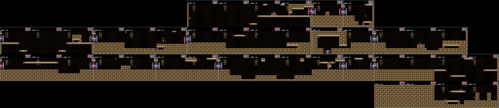
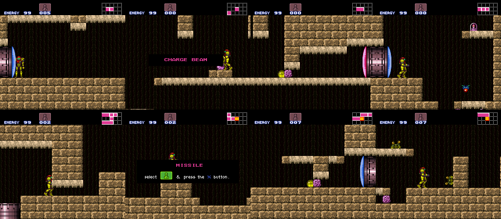
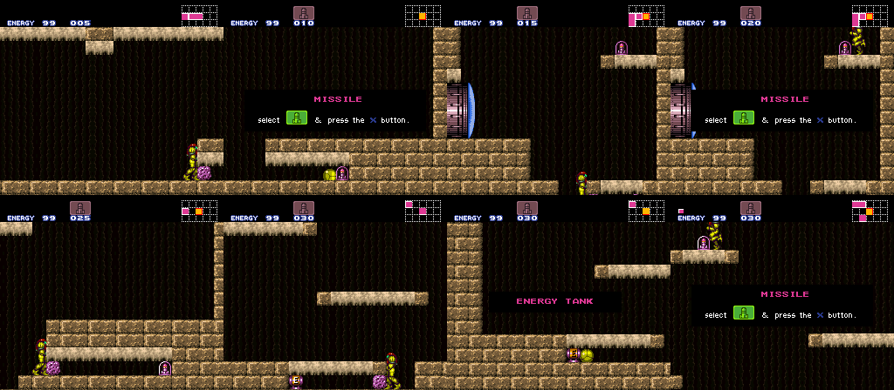

# 12k — Região D da Chozo (Watery Hall com o Charge Beam, Energy Core, Burn Dome, Dynamo, Furnace)

Estado: **verificada** (27/10/2026: validate "124 salas, 252 portas, 0 problemas", linha do Tallon igual; `.ips` sha1
`ebad8fa673c701847863a1ff8a16ae0a04f07093` igual em dois builds; **72/72** testes)
Esforço estimado: 2 dias (salas 0,5 d; travas, itens e inimigos 0,5 d; validador 0,25 d; emulador, fotos e mutações 0,75 d)
Épico: [12 — Chozo Ruins](12-chozo-ruins.md) (decisões do usuário 1–4, 6, 8 e o padrão aceito 9; linha 12k da tabela de filhas);
modelos: [12j](12j-regiao-c-chozo.md), [12i](12i-regiao-b-chozo.md), [12f](12f-regiao-a-chozo.md) (salas, travas, itens),
[12h](12h-inimigos-chozo.md) (inimigos), [12g](12g-itens-e-travas-novas.md) + [12g2](12g2-ajustes-calor-e-cor.md) (Charge Beam,
porta de charge branca, calor só com a Varia).

## Contexto

As regiões A, B e C estão construídas. A Gathering Hall (região C) ficou com duas paredes no lugar das portas para a região D
(R0 → Watery Hall Access, R1 → East Atrium), os chões já na linha da borda. Esta filha constrói as 11 salas da região D
(tabela da 12c), abre essas duas paredes, mapeia as travas do Prime da região nos mecanismos SM, põe os itens da região (entre
eles o **Charge Beam**, na Watery Hall) e os inimigos da camada 0. As duas portas da Furnace para a região E (B3 → East Furnace
Access, R0 → Crossway Access West) ficam parede até a 12l.

## Estado antes (verificado)

Depois da 12j: validate "113 salas, 230 portas, 0 problemas" (linha do Tallon "44 salas construídas, alcançáveis agora: 44, 20
itens em 7 rodadas"); `.ips` sha1 `3df756e39c5098c35e911073f4a39e97b2bde840` (dois builds); 70/70 (medido de novo nesta sessão,
`s12k/tests_before.txt`).

- **Grafo** (`chozo/rooms.py`, 12c; 11 salas, mapa da área 1): Gathering Hall R0 → Watery Hall Access L0; Gathering Hall R1 →
  East Atrium L0; Watery Hall Access R0 → Watery Hall L1; Watery Hall R0 → Dynamo Access L0 → Dynamo (R0/L0); East Atrium R0 →
  Energy Core Access L0 → Energy Core L0; Energy Core T3 ↑ Burn Dome Access B0; Burn Dome Access R0 → Burn Dome L0; Energy Core R0
  → West Furnace Access L0 → Furnace L0; Furnace B3 → East Furnace Access, R0 → Crossway Access West (região E). Tamanhos (regra
  da 12c): Watery Hall 4×2, Furnace 4×2, Energy Core 4×1, Watery Hall Access 3×1, Burn Dome 3×1, East Atrium, Energy Core Access e
  Burn Dome Access 2×1, Dynamo Access, Dynamo e West Furnace Access 1×1 (35 telas).
- **Travas do Prime** (`DOCK_LOCKS`, dados): escudos de míssil — Watery Hall Access → Watery Hall, Watery Hall → Dynamo Access,
  Dynamo Access → Dynamo (cada um só do lado citado); morph — Energy Core ↔ Burn Dome Access (os dois lados: um só objeto
  `Door_Area Morphball`); event — Energy Core → West Furnace Access e Burn Dome → Burn Dome Access. Nenhuma "key" na região (a
  única perto é Furnace → East Furnace Access, região E). `FEATURES`: Watery Hall Access water; Watery Hall breakable/water;
  Energy Core Access breakable; Energy Core bomb_slot/morph_door/water; Dynamo spider; Burn Dome Access morph_door; Burn Dome
  breakable/water; Furnace halfpipe/morph_door/spider.
- **Cor das portas** (novo, dos dados; `s12k/scripts/dtrig.py` → `s12k/dtrig.out`: a `DamageVulnerability` de todo
  `DamageableTrigger` das 11 salas): toda porta da região é azul por baixo do escudo (vulnerabilidade 1 a todo feixe); **nenhuma
  porta de cor, logo nenhuma porta de charge** (o Prime não tem porta que só abre com tiro carregado). A porta Furnace → East
  Furnace Access (região E, 12l) é **só Ice** (`02 01 02 02 …`): nota para a 12l (no projeto a porta de gelo é verde; a branca é a
  de charge, decisão 8).
- **Calor** (`s12k/scripts/specialfn.py` → `s12k/specialfn.out`, o roteiro da 12j rodado de novo): a função 18 (`Area Damage`)
  só existe na Magma Pool em toda a Chozo. **Nenhuma sala quente na região D**; a **Furnace não é quente** no Prime (sem `Area
  Damage`, sem `lava` nos `FEATURES`: o nome é só o nome).
- **Os blocos quebráveis** (`s12k/dtrig.out`): Watery Hall "Breakable Block" (459,18) = só bombas e Power Bomb (`3 3 3 3 1 1 …`),
  ao lado do Charge Beam e de um "Trigger_path camera" de túnel de Morph, a caminho da porta da Dynamo Access; Burn Dome "Breakable
  Block" = bombas/PB, na frente do "Trigger_mb tunnel" que leva ao míssil; Energy Core Access, dois "Breakable Block" bombas/PB
  num "TunnelTrigger" fora do caminho (o Energy Core se alcança antes das bombas no Prime: as Bombas são do Burn Dome, depois
  dele); as **paredes de míssil** (Watery Hall Access, Dynamo: "missile_wall", "Platform-breakable wall") = só míssil, tiro
  carregado do Power Beam e super míssil (`3 3 3 3 3 3 1 …`, carregados `1 3 3 3`).
- **Itens do Prime na região D** (`s12k/scripts/objs_d.py` → `s12k/objs_d.txt`): Watery Hall Access — míssil atrás da parede de
  míssil; Watery Hall — **Charge Beam** (atrás do portão das 4 runas: Scan Visor; cena do pickup) e o míssil no fim da poça (um
  caminho de Morph Ball: "Path Camera", "Collsionblocker"); Dynamo — míssil atrás da parede quebrável e míssil no alto do trilho
  de Spider Ball; Burn Dome — **Bombas** no suporte depois do Incinerator Drone e um míssil atrás do bloco quebrável/túnel; Furnace
  — E-tank no núcleo, sob o chão que quebra ("dest floor"), e um míssil no alto do trilho de Spider Ball, bem acima dele.
- **Camada 0 do Prime** (12h, `PRIME_LAYER0_LATER`): Watery Hall Access Metaree 12 + AmbientAI 2; East Atrium Metaree 8; Watery
  Hall Spank Weed 3 + Eyeball 6 + AmbientAI 11; Energy Core Access Eyeball 3; Energy Core Metaree 12 + Puddle Toad Gamma 1;
  Dynamo Fire Flea 1; Burn Dome War Wasp 1; Furnace Parasite 8 (os Beetles e os Chozo Ghosts da Furnace são das camadas 1/2).
- **Bits**: itens vanilla 0–`$9A`, Tallon `$A0–$B3`, Chozo `$B4–$C7`; portas vermelhas vanilla até `$A9`, Tallon `$B0–$B2`, Chozo
  `$B3–$B9`.
- **Espaço**: `$8F` livre principal 0 (acabou na 12j); faixa recuperada da 12a com 1966 livres a partir de `$8F:D60F`; `$83` de
  `$83:B902`, `$A1` de `$A1:F4FA`, `$B4` de `$B4:F731`; nível 113 blobs.
- **Lacuna do validador da 12j**: num item de borda de Space Jump o modelo (enchimento) dava o item como pego mesmo com só 2
  linhas de ar sobre a borda (a Samus não fica de pé ali: o E-tank da Training Chamber, corrigido à mão na 12j).

## Mudança

1. **Salas** (`tools/chozo/layouts.py`, arenito, regras das 12f–12j: portas laterais nas linhas 6–9 com o chão na 10, degraus de
   até 4, zigue-zagues de 5 linhas, o pulo medido decide toda subida):

| Sala (P#) | Tamanho | Rodada | Forma |
|---|---|---|---|
| Watery Hall Access (38) | 3×1 | 1 | corredor (chão 10), trecho afundado (3 de fundo) e, na parede leste dele, túnel de 1 linha com bloco de bomba até o míssil |
| Watery Hall (41) | 4×2 | 1 | salão de baixo (chão 26) com a poça seca (3 de fundo) e o túnel de Morph na ponta leste dela (míssil); escada de plataformas (4 por degrau) até a galeria de cima (linha 10); o **Charge Beam no pedestal** da galeria; os postes do portão de runas (aberto); na ponta leste a câmara da R0 (linhas 7–9 sob a rocha) só por túnel de 1 linha com bloco de bomba |
| Dynamo Access (43) | 1×1 | 2 | corredor curto com um caixote |
| Dynamo (45) | 1×1 | 2 | sala (chão 13), poço (2) com túnel e bloco de bomba até o míssil (a parede quebrável); borda alta no leste (linha 4, 3 linhas de ar), longe da borda da L0: Space Jump (o trilho) |
| East Atrium (40) | 2×1 | 1 | corredor (chão 10), trecho elevado, vigas |
| Energy Core Access (42) | 2×1 | 1 | corredor (chão 10) com uma abóbada sobre a L0 (o olho) e a curva do teto |
| Energy Core (44) | 4×1 | 1 (o salão; a câmara da R0 na 2) | salão (chão 13), poças secas, colunas dos núcleos; a leste um degrau (3) sob a plataforma da T3 (linha 6) e, sob a plataforma, a câmara da R0 (linhas 7–9) só por túnel com bloco de bomba (os bomb slots) |
| Burn Dome Access (46) | 2×1 | 1 | câmara fechada sobre a porta de chão B0 (subindo, ela cai na borda leste) e túnel de Morph de 1 linha até um poço no chão do corredor (chão 10) da R0 |
| Burn Dome (48) | 3×1 | 1 | salão (chão 13), o **suporte** no meio (2 de altura, um míssil em cima: o lugar das Bombas do Prime), poça seca, bloco a leste com túnel e bloco de bomba até o míssil |
| West Furnace Access (47) | 1×1 | 2 | corredor curto |
| Furnace (49) | 4×2 | 2 | corredor de cima da L0 até uma sacada sobre o salão (chão 28); zigue-zague de 3 plataformas (5 linhas) entre o chão e a sacada; no chão um poço (2) com túnel e bloco de bomba até o E-tank; borda alta (linha 4, 3 linhas de ar) longe das sacadas: Space Jump (o trilho); grades de 4; sacada leste na linha 10 (a futura R0) e chão na linha 28 sob a futura B3 |

   Paredes abertas: Gathering Hall R0 e R1 (os chões já estavam na linha da borda: nenhum desenho da região C mudou). Furnace B3 e
   R0 (região E) = parede, com o chão/sacada na linha da borda.
2. **Travas** (`chozo/rooms.py` `GATES`, `EVENT_LOCKS`):
   - escudos de míssil = **portas vermelhas** do lado dos dados: Watery Hall Access → Watery Hall (bit de porta `$BA`), Watery
     Hall → Dynamo Access (`$BB`), Dynamo Access → Dynamo (`$BC`) (`CHOZO_MISSILE_BIT0 + n` na ordem de `GATES`);
   - Watery Hall → Dynamo Access: além da vermelha, o "Breakable Block" (bombas/PB nos dados) e o túnel do path camera = **túnel de
     Morph com bloco de bomba** na frente da porta (gate `{missile, morph, bombs}`, borda da Watery Hall);
   - Energy Core ↔ Burn Dome Access: a porta de Morph Ball do Prime = **túnel de Morph** do lado da Burn Dome Access, sobre a porta
     de chão dela (gate `{morph}`, borda da Burn Dome Access; o lado do Energy Core é aberto, como a Piston Tunnel da 12f);
   - Energy Core → West Furnace Access: o "Actor Door Lock" é o **quebra-cabeça dos bomb slots** (sem luta: "Part 1/2 Solved") =
     **túnel com bloco de bomba** na frente da porta (gate `{morph, bombs}`, borda do Energy Core); registrado em
     `EVENT_LOCKS` para o validador conferir;
   - Burn Dome → Burn Dome Access: o "Actor Door Lock" é a luta do Incinerator Drone: fora (chefes depois, decisão 3);
   - **porta de charge: nenhuma** (dados: nenhuma porta de cor na região); **sala quente: nenhuma** (dados: nenhum `Area Damage`).
3. **Itens** (`chozo/items.py`, bits **`$C8–$CF`**, depois do `$C7` da 12j; o Charge Beam já tinha a linha 7, bit `$BB`):

| Bit | Sala | Prime | Lugar / trava (decisão B) | Rodada |
|---|---|---|---|---|
| `$BB` | Watery Hall | **Charge Beam** (atrás do portão das runas, Scan Visor; cena sem chefe) | pedestal na galeria (44, 8), item comum | 1 |
| `$C8` | Watery Hall Access | míssil atrás da parede de míssil | túnel com bloco de bomba no trecho afundado (35, 12) | 2 |
| `$C9` | Watery Hall | míssil no fim da poça (caminho de Morph) | túnel de 1 linha na ponta da poça seca (56, 28) | 1 |
| `$CA` | Dynamo | míssil atrás da parede quebrável | túnel com bloco de bomba no poço (13, 14) | 2 |
| `$CB` | Dynamo | míssil no alto do trilho de Spider Ball | borda de Space Jump (12, 3) | 3 |
| `$CC` | Burn Dome | **Bombas** (no suporte, depois do Incinerator Drone) | míssil no suporte (23, 10) (o lugar das Bombas, como o Morph da Ruined Shrine) | 1 |
| `$CD` | Burn Dome | míssil atrás do bloco quebrável e do túnel | túnel com bloco de bomba (43, 12) | 2 |
| `$CE` | Furnace | E-tank no núcleo, sob o chão que quebra | túnel com bloco de bomba sob um poço (37, 29) | 2 |
| `$CF` | Furnace | míssil no alto do trilho de Spider Ball | borda de Space Jump (48, 3) | 3 |

4. **Inimigos** (`chozo/enemies.py`, modelo da 12h, ≤ 1 por tela, justos na chegada): **Parasite → Zeela** (`$DC7F`, o do Tallon,
   `zoomer`, a proposta da 12h); Puddle Toad Gamma fora (cenário, a proposta da 12h); Metaree → Skree, Eyeball → 1 olho (12i: nunca
   dois acesos), Fire Flea → Fireflea, War Wasp → Mella como antes; Spank Weed/AmbientAI fora.

| Sala | Prime (camada 0) | SM |
|---|---|---|
| Watery Hall Access | Metaree 12 | 3 Skrees no teto |
| Watery Hall | Eyeball 6 | 1 olho na parede oeste, alto sobre a L1, olhando para leste |
| East Atrium | Metaree 8 | 2 Skrees no teto |
| Energy Core Access | Eyeball 3 | 1 olho na parede oeste, no alto da abóbada sobre a L0 (5 linhas acima da porta), olhando para leste |
| Energy Core | Metaree 12 | 3 Skrees no teto, entre as colunas |
| Dynamo | Fire Flea 1 | 1 Fireflea sobre o chão |
| Burn Dome | War Wasp 1 | 1 Mella a oeste do suporte (14 blocos da porta) |
| Furnace | Parasite 8 | 4 Zeelas (chão do salão e duas plataformas) |
| Dynamo Access, Burn Dome Access, West Furnace Access | — | nenhum |

5. **Validador**:
   - **altura de corpo nos itens do enchimento do Space Jump** (`flood_touch`, fecha a lacuna da 12j): com o Space Jump um item só
     conta como pego num bloco onde a Samus fica de pé (chão embaixo, 3 linhas livres: `reach.Grid.stands`) ou onde a bola descansa
     sob um teto (túnel de 1 linha); um bloco que ela só atravessa voando, ou uma borda com 2 linhas de ar, não basta. Vale para
     todo item do Tallon e da Chozo (as linhas do Tallon e as rodadas não mudaram);
   - `check_chozo_locks_mapped` confere também os "event" que são quebra-cabeça (`EVENT_LOCKS`: os itens do mecanismo no gate da
     ligação) e que toda entrada de `EVENT_LOCKS` é uma trava event do Prime; linha "chozo (specs/12j, 12k): 28 travas …";
   - as checagens de sempre cobrem a região (rodadas, travas, bits, blocos de bomba, inimigos, `check_reclaimed` com mais
     estruturas na faixa recuperada).
6. **Testes** (`tests/run_tests.py`): novos `chozo_regiao_d_rota`, `chozo_regiao_d_itens`; `chozo_inimigos_vivos` com as 8 salas
   da região D com inimigos.

## Critérios de aceite

1. validate 0 problemas; linha do Tallon igual ("44 salas construídas, alcançáveis agora: 44, 20 itens em 7 rodadas"); linha da
   Chozo por rodada com as regiões "ABCD"; toda trava do Prime da região com o seu mecanismo (`check_chozo_locks_mapped`).
   (protege = travas, rodadas, bits, softlock, altura de corpo; falha_quando = mutações; não_prova = que a forma agrada)
2. `chozo_regiao_d_rota`: a região andada a pé com inimigos vivos (Watery Hall Access e a porta vermelha com os mísseis do
   Landing Site, East Atrium, Energy Core Access, Energy Core), o **Charge Beam pego andando** (bit `$BB`, `$09A6/$09A8` com
   `$1000`), o túnel com bomba da Watery Hall até a Dynamo, a subida pela porta de teto do Energy Core até a câmara da Burn Dome
   Access e o túnel de Morph, o míssil do suporte do Burn Dome, o túnel dos bomb slots até a West Furnace Access e a Furnace;
   `chozo_regiao_d_itens`: os outros 7 itens pegos andando ou rolando (os dois de borda de Space Jump **de pé** na borda).
3. Justiça de porta (12h): nenhuma entrada com dano (auditoria). Mutações pegas. Dois builds com o mesmo sha1; fotos olhadas.

## Plano de testes

| Camada | O quê | Qtde |
|---|---|---|
| validate.py | região D pelas checagens de sempre; altura de corpo no enchimento; event de quebra-cabeça | +2 regras |
| run_tests.py | rota, itens; inimigos da região D | +2 (+1 ampliado) |
| scratchpad (`s12k/`) | auditoria das entradas de porta, fotos por tela e montagem, mutações (validador, ROM, emulador) | — |

## Riscos e reversão

- `$8F`: as estruturas da região vão para a faixa recuperada da 12a (`check_reclaimed` prova cada byte); a região E precisa de
  ~600 bytes (12 salas novas a ~50).
- A regra de altura de corpo muda o modelo de todos os itens do enchimento: se um item do Tallon dependesse do voo, a linha do
  Tallon mudaria (não mudou).
- Reversão: tudo vem de `tools/` (tirar "D" de `ACTIVE_REGIONS`, as linhas novas e `flood_touch`).

## Fora de escopo

- Chefes (Incinerator Drone, a luta do Burn Dome e a porta de evento), Chozo Ghosts, Scan Visor (o portão de runas da Watery Hall),
  Puddle Toad, água (pergunta 7 do épico: tudo seco), região E (12l: as portas B3 e R0 da Furnace).

## Desvios (preenchido na implementação)

- **Energy Core Access**: os dois "Breakable Block" do Prime (bombas/PB) ficam fora: estão num túnel ao lado do caminho e
  nada (item ou porta) fica atrás deles; o validador não aceita bloco de bomba numa sala sem trava de Bombas. O olho foi para o
  alto de uma abóbada sobre a L0 (na parede oeste, 5 linhas acima da porta): na altura da Samus ele ficava colado na porta
  (`DOOR_CLEARANCE`), e em qualquer parede do meio ela passaria "atrás" dele (o facho sai errado, 12i).
- **Energy Core**: a plataforma da T3 (linha 6) é o teto da câmara da R0; a rocha sobre a porta (linhas 1–5, colunas 60–62)
  impede que se ande da plataforma para a câmara sem o túnel.
- **Furnace**: as grades começaram com 8 de altura (bolsos sem saída sem Space Jump, e o da futura B3 seria um deles); ficaram com
  4 (sobe-se a pé). A sacada leste (linha 10) e o chão da linha 28 sob a futura B3 já estão desenhados para a 12l.
- **Testes**: num corredor de 1 tela o `chozo_walk` (um pulo a cada 2 ciclos) às vezes termina **em cima da tampa** da porta
  azul/vermelha (East Atrium, Watery Hall Access): `to_the_door` anda sem pular até a porta, atira e passa; antes da vermelha da
  Watery Hall Access o mesmo. Subir pela T3 do Energy Core por `door_teleport` trava (a 10a já tinha visto subir por porta de teto
  por teleporte): `chozo_regiao_d_itens` usa `rise_through`, a rota faz a subida de verdade (`chozo_climb`, guiando para leste).
  Na Furnace, correndo da sacada ela cai na plataforma de cima do zigue-zague (o impulso a leva) e dela ao chão.
- **Charge Beam**: sem porta de charge na região, o teste confere o item e os bits `$09A6/$09A8` (`$1000`); o tiro carregado
  abrindo a porta branca segue provado pela ROM de teste (`porta_de_charge`, 12g/12g2).

## Resultado

- validate: "124 salas, 252 portas, 0 problemas"; linha do Tallon **igual** ("44 salas construídas, alcançáveis agora: 44, 20
  itens em 7 rodadas"); "chozo (specs/12f, 12i, 12j, 12k; regiões ativas: ABCD): 52 salas construídas, alcançáveis a pé da nave
  do Tallon: 52, 28 itens; … rodada 0: 15 salas, 1 itens; rodada 1: 22 salas, 7 itens; rodada 2: 12 salas, 11 itens; rodada 3:
  1 salas, 7 itens; rodada 4: 1 salas, 0 itens; rodada 5: 1 salas, 0 itens; rodada 6: 0 salas, 2 itens; fora das rodadas:
  nenhuma"; "chozo (specs/12h): 69 inimigos em 25 salas (… eyon 3, fireflea 5, metaree 14, … wasp 6, zoomer 4) … regiões E: só a
  tabela do Prime"; "chozo (specs/12j, 12k): 28 travas do Prime nas ligações construídas, cada uma com o seu mecanismo SM";
  "chozo (specs/12g): … itens Charge Beam $BB (chozo_watery_hall: (44, 8)) …; salas quentes: chozo_magma_pool; portas de charge:
  nenhuma".
- **Rota** (`chozo_regiao_d_rota`): do pouso, com inimigos vivos, a Watery Hall Access e a vermelha `$BA` com os mísseis do Landing
  Site, o **Charge Beam pego andando** (bit `$BB`, `$09A6`/`$09A8` com `$1000`), o túnel com bomba da galeria, a vermelha `$BB` e
  a Dynamo Access com a vermelha `$BC` até a Dynamo; East Atrium, Energy Core Access e Energy Core andados; a subida pela T3 até a
  câmara da Burn Dome Access, o túnel de Morph, o poço, o Burn Dome e o míssil do suporte; o túnel dos bomb slots até a West
  Furnace Access e a Furnace. Bits de explorado e o mapa de pausa.
- **Itens** (`chozo_regiao_d_itens`): os 7 outros (Watery Hall Access e Dynamo: bloco de bomba; poça da Watery Hall: túnel;
  Dynamo e Furnace: bordas de Space Jump **de pé**; Burn Dome: túnel com bomba; Furnace: E-tank sob o chão, 199), 35 de
  capacidade de mísseis.
- **Auditoria das entradas** (`s12k/door_audit.py` → `s12k/door_audit.out`): as 18 entradas das 9 salas com inimigos (as 8 da
  região D e a Gathering Hall com as portas novas), parada 180 quadros: **nenhum dano**.
- **Fotos** (olhadas): `img/12k-montagem-salas.png` (as 11 salas e a Gathering Hall, cada tela no seu lugar do mapa),
  `img/12k-rota.png`, `img/12k-itens.png`, `img/12k-mapa.png`.

### Mudanças de expectativa dos testes

| Teste | Mudança |
|---|---|
| `chozo_inimigos_vivos` | + Watery Hall Access, Watery Hall, East Atrium, Energy Core Access, Energy Core, Dynamo, Burn Dome, Furnace |
| `chozo_regiao_d_rota`, `chozo_regiao_d_itens` | novos |
| os outros 70 | nenhuma |

### Espaço

`$8F`: faixa recuperada da 12a de 288 para **846** usados (+558; **1408 livres** para a região E, que pede ~600); faixa principal
igual (cheia). `$83`: +264 (`$83:B902` → `$83:BA0A`). `$A1`: +312 (`$A1:F4FA` → `$A1:F632`). `$B4`: +104 (`$B4:F731` →
`$B4:F799`). Nível: +2489 (124 níveis; só o da Sunchamber cruza banco). Fixo, `$84`, `$82`, `$A0`: nada. SRAM do mapa: igual
(445/1280; a lista da área 1 é a tabela inteira desde a 12e).

## Mutações

Validador e build (`s12k/mutate_12k.py` → `s12k/mutate_12k.out`, cópia `s12k/proj`), **todas pegas** (23 do fonte e 3 de ROM; a S10 é o controle da lacuna): S1
sem o escudo da Watery Hall Access; S2 túnel da Watery Hall sem o bloco; S3 trava sem Bombas; S4 bomb slots só com a Morph; S5
sem o gate dos bomb slots; S5b sem gate e sem bloco; S6 `EVENT_LOCKS` numa doca sem event; S7 túnel da Burn Dome Access sem teto;
**S8 borda da Dynamo com 2 linhas de ar; S9 o caso da 12j (E-tank da Training Chamber na linha 3)**: pegas só pela regra nova;
**S10 = S9 com o validador antigo: nenhum erro de modelo** (só o aviso de reconstruir: a lacuna era real); S11 borda da Furnace ao
alcance de um pulo; S12 rodada do Charge; S13 linha de item a menos; S14 Furnace só em `PRIME_LAYER0_LATER`; S15 Zeelas
esquecidas; S16 Parasite sem decisão; S17 olho colado na porta; S18 Watery Hall quente; S19 Gathering Hall R1 fechada; S20
vermelha do lado errado; S21 Furnace sem rodada; S22 E-tank sem bloco; B1 sem a faixa recuperada (o build para). ROM: R1 Charge
trocado por míssil; R2 vermelha da Watery Hall Access sem PLM; R3 E-tank da Furnace trocado. Emulador (`s12k/emu_mut_12k.py` →
`s12k/emu_mut_12k.out`): E1 Charge trocado → `chozo_regiao_d_rota` falha; E2 bloco da Watery Hall vira rocha → rota falha; E3
borda da Furnace com 2 linhas de ar → `chozo_regiao_d_itens` falha (o emulador concorda com a regra nova); E4 túnel da Burn Dome
Access fechado → rota falha.

## Decisões para o usuário (padrão escolhido, a confirmar)

1. **Charge Beam como item comum** no pedestal da galeria (o portão de runas do Scan Visor fica aberto; sem a cena do pickup).
2. **Bombas do Burn Dome → míssil** no suporte (como o Morph da Ruined Shrine na 12f); a luta do Incinerator Drone fica para os
   chefes.
3. **Paredes de míssil → bloco de bomba** (Watery Hall Access, Dynamo), como a 12i (pendente desde lá); nos dados elas também
   quebram com o tiro carregado do Power Beam: uma alternativa seria usar o Charge como trava ali (não há bloco SM só de tiro
   carregado; seria código novo).
4. **Watery Hall → Dynamo Access atrás do bloco quebrável** (túnel com bomba): a ligação vem da posição dos objetos (o bloco e a
   câmera de túnel entre o Charge e a porta), não de um dado direto; a Dynamo passa a pedir as Bombas (rodada 2).
5. **Bomb slots do Energy Core = túnel com bomba** na porta da West Furnace Access (o "event" é o quebra-cabeça, não uma luta).
6. **Furnace seca e fria** (o Prime não tem `Area Damage` nem lava nela); **Parasite → Zeela**; Puddle Toad fora; os blocos da
   Energy Core Access fora.
