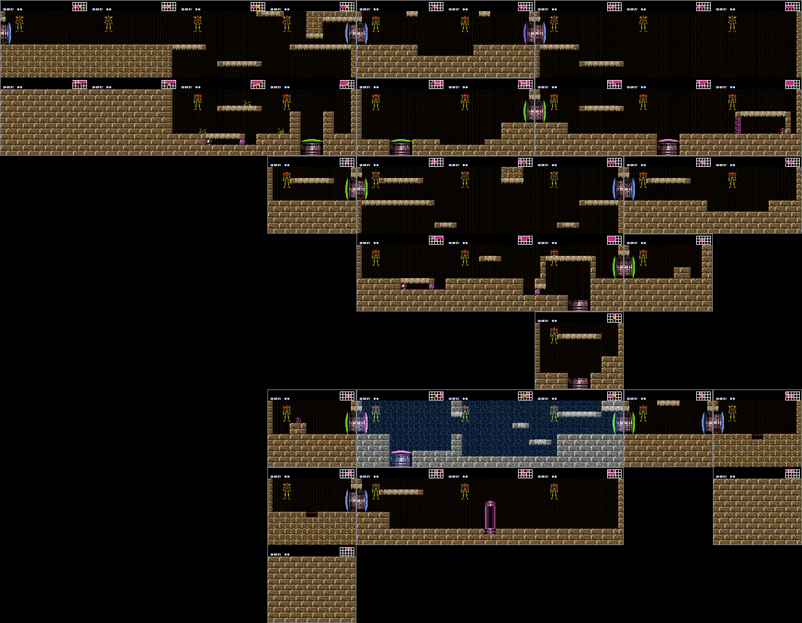
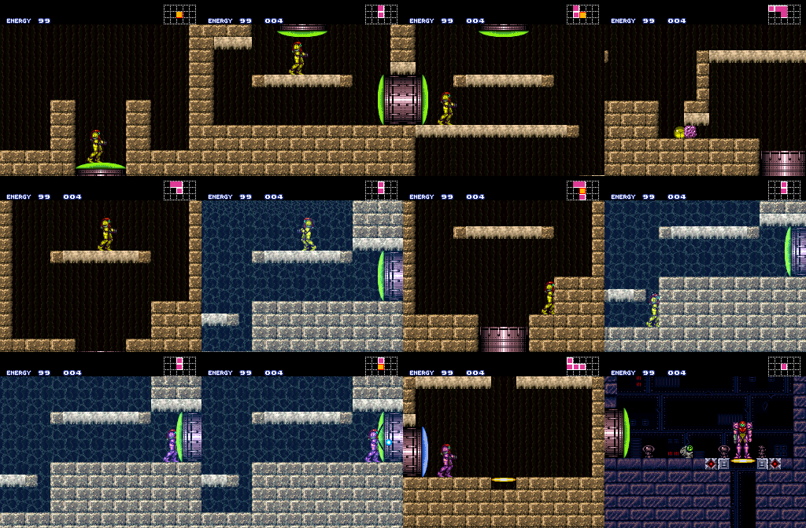
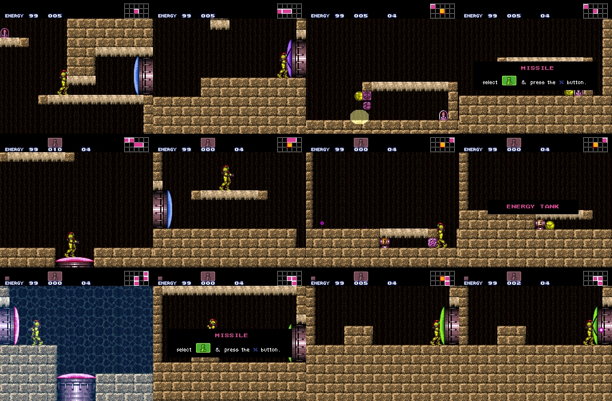
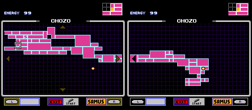

# 12l — Região E da Chozo (Hall of the Elders, Crossway, Reflecting Pool, Save Station 3 e as saídas East/South)

Estado: **verificada** (27/10/2026: validate "136 salas, 284 portas, 0 problemas", linha do Tallon igual; `.ips` sha1
`0bcb610afa5639eb2cadc657ac9f357a1a8dcaf0` igual em dois builds; **75/75** testes)
Esforço estimado: 2 dias (salas 0,75 d; travas, porta de gelo de chão/teto e água 0,5 d; validador 0,25 d; emulador, fotos e
mutações 0,5 d)
Épico: [12 — Chozo Ruins](12-chozo-ruins.md) (decisões do usuário 1–4, 6, 8 e o padrão aceito 9; linha 12l da tabela de filhas);
modelos: [12k](12k-regiao-d-chozo.md), [12j](12j-regiao-c-chozo.md), [12i](12i-regiao-b-chozo.md), [12f](12f-regiao-a-chozo.md),
[12e](12e-elevadores-de-verdade.md) (as salas de elevador East/South), [09a](09a-portas-de-feixe.md) e
[10d](10d-porta-de-onda-roxa.md) (portas de feixe), [07l](07l-regiao-d-fragata-afundada.md) (sala inundada).

## Contexto

As regiões A–D estão construídas (52 salas: as 49 delas + as 3 salas de elevador). A Furnace (região D) ficou com duas paredes
no lugar das portas para a região E (B3 → East Furnace Access, R0 → Crossway Access West), e as salas de elevador East/South
(12e) são becos com a porta da tabela fechada (R0 → Save Station 3; L0 → Transport Access South). Esta filha constrói as 12 salas
que faltam da região E, abre essas quatro paredes, mapeia as travas do Prime da região e põe os itens. Com ela as **64 salas**
da Chozo ficam construídas.

## Estado antes (verificado)

validate "124 salas, 252 portas, 0 problemas" (linha do Tallon "44 salas construídas, alcançáveis agora: 44, 20 itens em 7
rodadas"); `.ips` sha1 `ebad8fa673c701847863a1ff8a16ae0a04f07093`; 72/72 (medido de novo nesta sessão, `s12l/tests_before.txt`).

- **Grafo** (`chozo/rooms.py`, 12c): Furnace B3 ↔ East Furnace Access T0; Furnace R0 ↔ Crossway Access West L0; East Furnace
  Access R0 ↔ Hall of the Elders L0; Crossway Access West R0 ↔ Crossway L0; Hall B2 ↔ Reflecting Pool Access T0; Hall R0 ↔ Elder
  Hall Access L0; Hall T0 ↔ Crossway Access South B0; Hall R1 ↔ Elder Chamber L0; Crossway B1 ↔ Elder Hall Access T0; Crossway L1
  ↔ Crossway Access South R0; Reflecting Pool Access B0 ↔ Reflecting Pool T2; Reflecting Pool B0 ↔ Save Station 3 T0, R0 ↔
  Transport Access South L0, L0 ↔ Antechamber R0; Save Station 3 L0 ↔ Transport East R0; Transport Access South R0 ↔ Transport
  South L0. Tamanhos: Hall e Crossway 3×2; Reflecting Pool e Save Station 3 3×1; Crossway Access West/South e Elder Hall Access
  2×1; East Furnace Access, Reflecting Pool Access, Elder Chamber, Transport Access South, Antechamber 1×1.
- **Cor das portas** (dados; `s12l/scripts/dtrig.py` → `s12l/dtrig.out`, a `DamageVulnerability` de cada `Trigger_DoorKey`,
  ordem power, ice, wave, plasma; 1 = dano normal, 2 = imune): **só Ice** (`2 1 2 2`) nos dois lados de Furnace ↔ East Furnace
  Access, East Furnace Access ↔ Hall, Hall ↔ Elder Chamber, Hall ↔ Crossway Access South, Crossway Access South ↔ Crossway,
  Reflecting Pool ↔ Transport Access South, e do lado da Antechamber na Antechamber ↔ Reflecting Pool; **só Wave** (`2 2 1 2`)
  do lado da Crossway Access West na porta para a Crossway; azuis (`1 1 1 1`) sob os escudos de míssil (Crossway → Elder Hall
  Access, Reflecting Pool → Save Station 3 e → Antechamber). Nenhuma porta de charge.
- **Calor**: nenhum `Area Damage` na região (`s12k/specialfn.out`: só a Magma Pool em toda a Chozo).
- **Itens do Prime** (`s12l/scripts/objs_d.py` → `s12l/objs_e.txt`): Hall of the Elders E-tank (na alcova sob o chão, onde cai o
  "Down Launch" da estátua); Crossway "Missile Launcher" (alto, sobre o pistão das duas bomb slots e da placa rachada); Elder
  Chamber artefato (fora, decisão 1); Antechamber **Ice Beam** (já é do Tallon: decisão B, um míssil no lugar).
- **A estátua da Hall of the Elders** ("Chozo bowling", `s12l/scripts/conns.py` → `s12l/conns52.txt`): 3 bomb slots com
  membranas roxa/branca/laranja (Slot1/2/3, `DamageableTrigger` só bomba); o Slot1 (roxo) liga `Relay_BeginMoveBridgeRight` →
  lançamento "Right" até o trilho de cima e a porta da Reflecting Pool Access; o Slot2 (branco) `BeginMoveBridgeDown` →
  lançamento "Down" até o E-tank; um Slot4 no alto do trilho de Spider Ball ativa a estátua. As travas `event` das 4 portas da
  sala são as lutas dos Chozo Ghosts (camadas 1/2): fora até os chefes, como a Training Chamber.
- **Camada 0 do Prime** (12h, `s12h/chozo_layers_all.txt`): **nenhum inimigo** na região E (os Chozo Ghosts, os Beetles e
  Wall Crawlers de "1st Pass", os Stone Toads são de outras camadas).
- **Rodadas do Tallon** que a região toca: Transport Chozo East do lado do Tallon na rodada 4 (atrás da porta de gelo), South na
  5 (atrás da Gravity Suit da região D/E do Tallon); o gelo é pego na rodada 3, a Gravity Suit na 4.
- **Espaço**: `$8F` principal cheio; faixa recuperada da 12a 846 de 2254 usados (1408 livres); `$83` de `$83:BA0A`, `$A1` de
  `$A1:F632`, `$B4` de `$B4:F799`; `$84` portas de feixe 892 bytes a partir de `$84:F10F`.

## O conflito (e a escolha)

No Prime a Hall of the Elders se alcança pela Crossway (Furnace → Crossway Access West → Crossway → Elder Hall Access) sem o
gelo, e a estátua (roxo = Wave) leva à Reflecting Pool, de onde saem os dois elevadores (Save Station 3 → East; Transport
Access South → South). Aqui a Hall fica na rodada 3: sem nada a mais, a Save Station 3 e o elevador East ficariam na rodada 3 e
o South na 4, **antes** dos lados do Tallon (4 e 5): a Gravity Suit e o Plasma do Tallon seriam pegos uma rodada antes e a
tabela do Tallon mudaria (contra a decisão 1, "Tallon intacto", e o invariante desta filha). Escolha: a **Reflecting Pool
inundada** (o Prime tem água nela: `FEATURES` water; FX de água de sala inteira, o mecanismo da 07l) com as portas dela para a
Save Station 3, a Antechamber e a Transport Access South atrás de um degrau de 4 blocos debaixo d'água: **a Gravity Suit**
(rodada 4 → 5). A porta de cima (da Reflecting Pool Access) fica num bolso de onde se volta sem a suit. Decisão a confirmar.

## Mudança

1. **Salas** (`tools/chozo/layouts.py`, arenito, regras das 12f–12k; nenhuma tem inimigo):

| Sala (P#) | Tamanho | Rodada | Forma |
|---|---|---|---|
| East Furnace Access (50) | 1×1 | 4 | corredor (chão 10); da porta de teto (a de chão da Furnace) ela cai na plataforma da T0 e desce para a R0 |
| Crossway Access West (51) | 2×1 | 3 | corredor (chão 10) com a bacia do meio-tubo (2); porta de onda roxa na R0 |
| Hall of the Elders (52) | 3×2 | 3 | salão (chão 26), a estátua pendurada no teto, escadas de plataformas (4 linhas) até as sacadas oeste (L0, com a plataforma da T0 em cima) e leste (R0); o estrado (topo 22) sobre a porta de chão B2 com a câmara (linhas 23–28) só por túnel de 1 linha com bloco de bomba (as bomb slots da estátua); a borda da R1 a leste do estrado; o E-tank num túnel com bloco de bomba sob um poço no chão (a alcova do "Down Launch") |
| Crossway (53) | 3×2 | 3 | salão (chão 28), zigue-zague de plataformas (5 linhas) até a sacada da L0 (linha 10), a borda da L1 (26); a porta de chão B1 (vermelha) no meio; o míssil numa cabana de blocos de Power Bomb a leste (a placa do Super Missile, como a árvore da 12f) |
| Reflecting Pool Access (54) | 1×1 | 3 | poço curto da T0 à B0, plataforma da T0 e um degrau (linha 10) para subir de volta |
| Elder Hall Access (55) | 2×1 | 3 | corredor (chão 10), plataforma da T0 (vinda da porta vermelha da Crossway), bacia do meio-tubo |
| Crossway Access South (56) | 2×1 | 4 | corredor (chão 13) entre duas portas de gelo (a B0, de chão, e a R0) |
| Elder Chamber (57) | 1×1 | 4 | santuário vazio (o artefato fica fora) atrás da porta de gelo |
| Reflecting Pool (58) | 3×1, **inundada** | 3 (o alto) / 4–5 | da T2 ela cai na plataforma da porta e na piscina (chão 14) e volta por degraus de 3 linhas; o lado oeste (as bordas da porta de chão B0 e a L0, chão 13) atrás de uma passagem no divisor 4 linhas acima do fundo; a borda da R0 por um degrau sob a plataforma da T2, 4 acima do fundo (rocha sobre a porta: da plataforma não se cai nela) |
| Save Station 3 (59) | 3×1 | 4 | salão (chão 13), a estação no meio; da porta de teto (a de chão da piscina) ela cai na plataforma da T0 |
| Transport Access South (60) | 1×1 | 5 | corredor curto |
| Antechamber (61) | 1×1 | 4 | o míssil no pedestal (o lugar do Ice Beam) |

   Abertas: a B3 e a R0 da Furnace (a sacada leste ganha a câmara da R0 sob a rocha e o túnel de Morph de 1 linha; o chão da
   linha 28 sob a B3 já estava), a R0 da Transport East e a L0 da Transport South (os salões das salas de elevador já estavam
   na linha da porta, 12e).
2. **Portas de gelo de chão/teto** (`tools/tallon/beamdoors.py` `VERTICAL`): blocos e cabeçalhos de gelo para as paredes B/T,
   cópias da porta verde vanilla `$C87E`/`$C884` (estrutura igual à das laterais, lida dos bytes por `vanilla_parts`), depois
   da porta de charge: PLMs **`$F4EF`** (B) e **`$F4F5`** (T); os ids antigos não mudam (112 bytes a mais no `$84`). A cor verde
   no tileset 0C é a vanilla (linha 1, conferida na foto da 12g2 e no emulador).
3. **Travas** (`chozo/rooms.py`):

| Ligação (lado) | Prime (dados) | SM |
|---|---|---|
| Furnace ↔ East Furnace Access (os dois) | key: só Ice | porta de gelo de chão (Furnace) e de teto (EFA) |
| East Furnace Access ↔ Hall (os dois) | key: só Ice (+ event do lado da Hall: os fantasmas) | portas de gelo |
| Furnace ↔ Crossway Access West | morph (uma porta de Morph nos dois) | túnel de Morph na sacada leste da Furnace, que só o Space Jump alcança (o meio-tubo e o trilho do Prime): gate `{morph, space_jump}` do lado da Furnace |
| Crossway Access West → Crossway | key: só Wave | porta de onda roxa |
| Hall → Reflecting Pool Access | event (os fantasmas); a estátua leva à porta (slot roxo) | túnel com bloco de bomba até a câmara da B2: gate `{morph, bombs}` |
| Hall → Elder Hall Access | event (os fantasmas) | nenhuma (luta fora) |
| Hall ↔ Crossway Access South (os dois) | key: só Ice (+ event) | porta de gelo de teto (Hall) e de chão (CAS) |
| Hall ↔ Elder Chamber (os dois) | key: só Ice | portas de gelo |
| Crossway → Elder Hall Access | missile | vermelha de chão (bit `$BD`) |
| Crossway ↔ Crossway Access South (os dois) | key: só Ice | portas de gelo |
| Reflecting Pool → Save Station 3 | missile | vermelha de chão (bit `$BE`) + Gravity Suit (a piscina) |
| Reflecting Pool ↔ Transport Access South (os dois) | key: só Ice | portas de gelo + Gravity Suit do lado da piscina |
| Reflecting Pool → Antechamber / Antechamber → Reflecting Pool | missile / key: só Ice | vermelha (bit `$BF`) do lado da piscina, gelo do lado da Antechamber (`SIDE_CAPS`) + Gravity Suit do lado da piscina |

   `SIDE_CAPS` (novo): uma ligação com tampas diferentes por lado; cada lado pede só o item da sua tampa (passar pela porta
   pede os itens do lado de onde se sai: na Antechamber, o gelo, como no Prime, onde ele é achado ali). `KEY_BEAM` (novo): o
   feixe de cada porta "key" do Prime (as 23 da Chozo, de `s12j/doorkeys.out` e `s12l/dtrig.out`); o validador confere que a
   tampa de cada lado construído é desse feixe.
4. **Itens** (`chozo/items.py`, bits **`$D0–$D2`**, depois do `$CF` da 12k):

| Bit | Sala | Prime | Lugar / trava (decisão B) | Rodada |
|---|---|---|---|---|
| `$D0` | Hall of the Elders | E-tank na alcova sob o chão (o "Down Launch" da estátua, slot branco) | túnel com bloco de bomba sob um poço (8, 27) | 3 |
| `$D1` | Crossway | expansão de míssil (o objeto se chama "P_Missile_Launcher"; é uma das 19 do épico) sobre o pistão das bomb slots, a placa do Super Missile | cabana de blocos de Power Bomb (44, 27) | 6 |
| `$D2` | Antechamber | **Ice Beam** (já é do Tallon) | míssil no pedestal (5, 7) | 4 |

   O artefato da Elder Chamber fica fora (decisão 1). Com eles a Chozo tem os 31 itens da decisão B: Charge, Varia, 20
   mísseis do Prime (as 19 expansões, entre elas a da Crossway, que nos dados se chama "Missile Launcher", + o launcher do
   totem), 5 E-tanks, a expansão de PB e 3 mísseis nos lugares do Morph, das Bombas e do Ice.
5. **Save Station 3** = estação 3 da área 1 (`areas.chozo_stations`: a ordem das salas com estação).
6. **Rodadas** (`FIRST_ROUND`): 3: Crossway Access West, Crossway, Elder Hall Access, Hall of the Elders, Reflecting Pool
   Access, Reflecting Pool (o alto); 4: East Furnace Access, Crossway Access South, Elder Chamber, Save Station 3, Antechamber (e
   a Transport East, como antes); 5: Transport Access South (e a Transport South, como antes).
7. **Validador**: `check_tallon_water` anda também as salas inundadas da Chozo (`chozo_rooms.FLOODED`) sem a suit e confere
   que toda sala inundada está em `FLOODED`; linha nova "água (specs/07l, 12l)"; `check_chozo_locks_mapped` lê a tampa de cada
   lado (`SIDE_CAPS`) e a cor do Prime (`KEY_BEAM`); a linha de inimigos diz "todas as regiões construídas".
8. **Testes** (`tests/run_tests.py`): `chozo_regiao_e_rota`, `chozo_regiao_e_itens`, `chozo_save_station_3`.

## Critérios de aceite

1. validate 0 problemas; linha do Tallon **igual** ("44 salas construídas, alcançáveis agora: 44, 20 itens em 7 rodadas");
   linha da Chozo com "ABCDE", 64 salas construídas; `check_chozo_locks_mapped` com a cor de cada porta key.
   (protege = travas, cores, rodadas, bits, softlock na água; falha_quando = mutações; não_prova = que a forma agrada)
2. `chozo_regiao_e_rota`: a porta de gelo de chão da Furnace não abre com Power Beam, mísseis nem Wave e abre com o gelo; a
   EFA, a porta de gelo dela, a Hall, a estátua (bloco de bomba), a Reflecting Pool Access e a piscina; sem a Gravity Suit ela
   volta pela porta de teto e não sobe o degrau; com a suit sobe, a porta de gelo da R0, a Transport Access South, a Transport
   South e o elevador para o Tallon.
3. `chozo_regiao_e_itens`: a porta de Morph da Furnace, a onda da Crossway Access West, o míssil da Crossway (Power Bomb), a
   vermelha de chão da Crossway (bit `$BD`), a Elder Hall Access, a Hall (sem gelo, o caminho do Prime), o E-tank, a Save
   Station 3 subindo para a piscina sem a suit, a vermelha da Antechamber (`$BF`), o míssil, a porta de gelo da Antechamber
   (Power Beam, mísseis e Wave não abrem; o gelo abre). `chozo_save_station_3`: pelo elevador East a pé, salvar e continuar.
4. Mutações pegas; dois builds com o mesmo sha1; fotos olhadas.

## Plano de testes

| Camada | O quê | Qtde |
|---|---|---|
| validate.py | região E pelas checagens de sempre; água da Chozo; cor das portas key; tampas por lado | +3 regras |
| run_tests.py | rota, itens, Save Station 3 | +3 |
| scratchpad (`s12l/`) | auditoria das entradas de porta, fotos por tela e montagem, mutações (fonte, ROM, emulador) | — |

## Riscos e reversão

- A piscina inundada é um desvio do "tudo seco" (pergunta 7 do épico): tirar a sala de `FLOODED` reabre a linha do Tallon (as
  mutações mostram); a alternativa é a 12m refazer as rodadas do Tallon.
- Reversão: tudo vem de `tools/` (tirar "E" de `ACTIVE_REGIONS`, as linhas novas, `VERTICAL`, `SIDE_CAPS`, `KEY_BEAM`).

## Fora de escopo

Chefes e Chozo Ghosts (as lutas da Hall of the Elders e as camadas de "1st/2nd Pass"), o arremesso da estátua e as membranas
coloridas (o slot roxo = Wave antes da Reflecting Pool Access, o branco = Ice antes do E-tank, o laranja = Plasma), os Stone
Toads e os peixes da piscina, o artefato, o Scan Visor, a água das outras salas.

## Desvios (preenchido na implementação)

- **A Reflecting Pool inundada** (o conflito acima): é a primeira sala com água na Chozo (pergunta 7 do épico aberta: até a
  12k tudo seco). Sem ela, a Save Station 3 e o elevador East ficariam na rodada 3 e o South na 4 (o caminho do Prime, pela
  Crossway e pela estátua, sem gelo), e a Gravity Suit e o Plasma do Tallon seriam pegos antes (mutações S1, S2 e S16: a
  linha do Tallon muda). Com a água, as portas da piscina para a Save Station 3, a Antechamber e a Transport Access South
  pedem a Gravity Suit (rodada 4 → 5); pelo elevador East (Tallon, rodada 4) ela entra na Save Station 3 e sobe para o lado
  oeste da piscina sem a suit (a Antechamber, com o gelo, na rodada 4).
- **Furnace**: a sacada leste foi alargada (colunas 52–62) e ganhou a câmara da R0 sob a rocha com o túnel de Morph (o lado
  da Furnace, não o da Crossway Access West: o validador prova a trava de geometria de um lado só); um Zeela passou da coluna
  50 para a 48 (colado na porta B3, que agora existe).
- **Estátua**: as membranas coloridas (slot roxo = Wave antes da Reflecting Pool Access, branco = Ice antes do E-tank) e o
  arremesso ficam fora; a trava é o bloco de bomba (as bomb slots, só bombas nos dados). Para as rodadas nada muda: a Wave é
  da rodada 1; o E-tank fica na rodada 3 (no Prime pediria o gelo, rodada 4).
- **Crossway**: o míssil foi para uma cabana de Power Bomb no chão (numa borda de Space Jump o validador não modela a cabana:
  "a bola não chega a 2 blocos"); os trilhos de Spider Ball e o pistão ficam fora (a rodada é a da Power Bomb, 6, como a
  árvore da praça).
- **Validador**: a mutação S17 (a câmara da R0 da Furnace aberta) só era pega pelo aviso de reconstruir: o túnel de Morph numa
  borda de Space Jump não era provado (a pé a borda já é inalcançável; o enchimento do Space Jump supõe a bola). Regra nova
  `check_ball_ledges` (linha "bola na borda"): a Samus de pé, voando, não chega à porta sem a bola.
- **Testes**: posta por RAM ela fica de frente e o A não pula (um toque de direção antes de atirar para baixo); numa porta de
  chão vermelha, um míssil por pulo: 5 pulos abrem; depois de andar para leste na Transport South o `onto_platform` parava 2
  px fora (um toque para oeste antes, medido); da porta de teto da piscina para a Reflecting Pool Access sem a suit ela sobe
  e precisa guiar (com qualquer lado ela pousa; parada cai de volta, como as portas de chão secas, 10b).

## Resultado

- validate: "136 salas, 284 portas, 0 problemas"; linha do Tallon **igual** (inteira: "… 44 salas construídas, alcançáveis
  agora: 44, 20 itens em 7 rodadas …"); "chozo (specs/12f, 12i, 12j, 12k, 12l; regiões ativas: ABCDE): 64 salas construídas,
  alcançáveis a pé da nave do Tallon: 64, 31 itens; … rodada 0: 15 salas, 1 itens; rodada 1: 22 salas, 7 itens; rodada 2: 12
  salas, 11 itens; rodada 3: 7 salas, 8 itens; rodada 4: 6 salas, 1 itens; rodada 5: 2 salas, 0 itens; rodada 6: 0 salas, 3
  itens; fora das rodadas: nenhuma"; "chozo (specs/12j, 12k, 12l): 47 travas do Prime nas ligações construídas …"; "água
  (specs/07l, 12l): … tallon_vent_c porta 0, chozo_reflecting_pool porta 0 …"; "bola na borda (specs/12l): 1 porta(s) …";
  "chozo (specs/12h): 69 inimigos em 25 salas … todas as regiões construídas".
- **As 64 salas da Chozo construídas** (52 + 12), alcançáveis da nave; nenhuma sala da tabela da 12c ficou de fora.
- **Testes** (`s12l/tests_after.txt`): 75/75; novos `chozo_regiao_e_rota`, `chozo_regiao_e_itens`, `chozo_save_station_3`.
- **Auditoria das entradas** (`s12l/door_audit.py` → `s12l/door_audit.out`): a região E não tem inimigo; as 3 entradas da
  Furnace (L0, B3 nova, R0 nova), paradas 180 quadros: **nenhum dano**.
- **Fotos** (olhadas): `img/12l-montagem-salas.png` (as 12 salas, a Furnace e as duas salas de elevador, cada tela no seu lugar
  do mapa), `img/12l-rota.png`, `img/12l-itens.png`, `img/12l-save3.png`, `img/12l-mapa-pausa.png` (o mapa de pausa da Chozo
  inteira, as duas metades: bits de explorado e a map station postos por RAM só para a foto).

### Mudanças de expectativa dos testes

| Teste | Mudança |
|---|---|
| `chozo_regiao_e_rota`, `chozo_regiao_e_itens`, `chozo_save_station_3` | novos |
| `chozo_inimigos_vivos` | nenhuma (a Furnace já estava; o Zeela que mudou de coluna continua vivo; a região E não tem inimigo) |
| os outros 72 | nenhuma |

### Espaço

| Banco | Antes | Depois |
|---|---|---|
| `$8F` principal | cheio | cheio (igual) |
| `$8F` faixa recuperada (12a) | 846 de 2254 usados | **1524** (+678; **730 livres**: 629 na faixa grande, 101 na pequena) |
| `$83` | livre a partir de `$83:BA0A` | `$83:BB96` (+396) |
| `$84` (portas de feixe) | 892 bytes | 1004 (+112: as portas de gelo de chão/teto) |
| `$A1`, `$B4` | `$A1:F632`, `$B4:F799` | iguais (nenhum inimigo novo) |
| nível | 124 blobs, 35654 bytes | 136 blobs, 38579 (+2925) |
| fixo, `$82`, `$A0`, `$A2`, `$A6` | — | iguais |
| SRAM do mapa | 445/1280 | igual (a lista da área 1 já era a tabela inteira) |

Nenhum pedaço órfão novo foi preciso.

## Mutações

Validador e build (`s12l/mutate_12l.py` → `s12l/mutate_12l.out`, cópia `s12l/proj`), **todas pegas** (17 do fonte, 1 de build,
3 de ROM): S1 piscina seca; S2 passagem do divisor ao alcance sem a suit; S3 Furnace ↔ EFA sem o gelo; S4 porta de onda onde o
Prime tem gelo (`KEY_BEAM`); S5 tampa de míssil do lado da Antechamber; S6 sem `SIDE_CAPS`; S7 Crossway → Elder Hall Access sem
o escudo; S8 estátua sem o bloco de bomba; S9 rodada do E-tank; S10 cabana sem os blocos de PB; S11 Save Station 3 na rodada 3;
S12 bits de porta sobre os do Tallon; S13 bits de item sobre os do Tallon; S14 degrau da R0 mais baixo; S15 `KEY_BEAM` sem a
Antechamber; S16 sem a rocha sobre a R0 (a linha do Tallon muda); S17 câmara da R0 da Furnace aberta (**pega só pela regra
nova** `check_ball_ledges`); B1 sem as portas de gelo de chão/teto (o build para). ROM: R1 B3 sem PLM; R2 míssil da Antechamber
trocado; R3 piscina sem o FX. Emulador (`s12l/emu_mut_12l.py`, `s12l/emu_mut_12l_rom.py` → `s12l/emu_mut_12l.out`): E1 a porta
de gelo de chão com a pré-instrução da onda (ROM) → `chozo_regiao_e_rota` falha (a onda a abre); E2 piscina seca → a rota falha
(sem a suit ela sobe o degrau); E3 bloco da estátua vira rocha → a rota falha; E4 porta da Antechamber de onda → os itens
falham. (A E1 pelo fonte não chega ao emulador: o build recusa porta de onda de chão, só existe a de gelo.)

## Decisões para o usuário (padrão escolhido, a confirmar)

1. **A Reflecting Pool inundada** (Gravity Suit nas portas dela) para manter a tabela do Tallon (decisão 1) com o caminho do
   Prime; a alternativa é seca, e a 12m refazer as rodadas do Tallon (East e South uma rodada antes).
2. **A estátua sem as membranas**: o E-tank da Hall com bomba (no Prime, o slot branco = gelo), a Reflecting Pool Access com
   bomba (slot roxo = Wave, que já é da rodada 1).
3. **O míssil da Crossway numa cabana de Power Bomb no chão** (Super Missile → Power Bomb, como a árvore da praça), sem os
   trilhos de Spider Ball nem o pistão.
4. **Antechamber → míssil** no lugar do Ice Beam (decisão B), e a porta dela fica só de gelo do lado de dentro (como no Prime).
5. **As lutas dos Chozo Ghosts** da Hall (as 4 travas event) ficam para os chefes; nenhuma porta de charge, nenhuma sala quente
   (dados).
