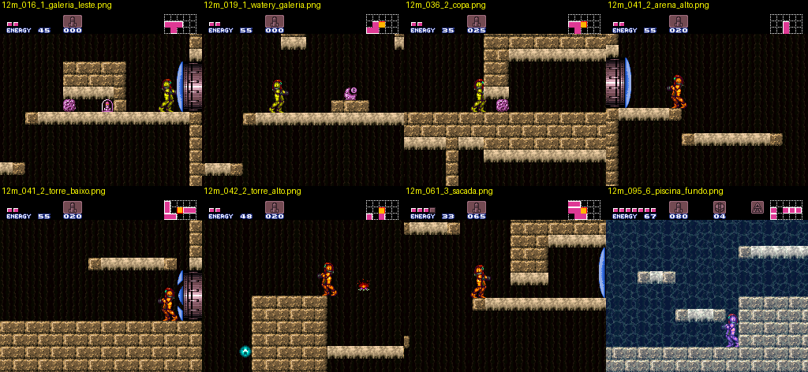
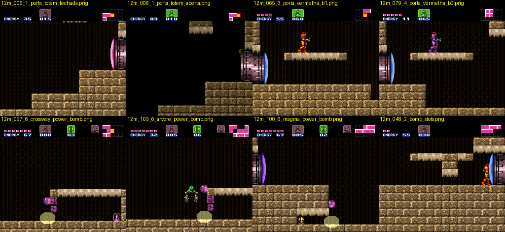
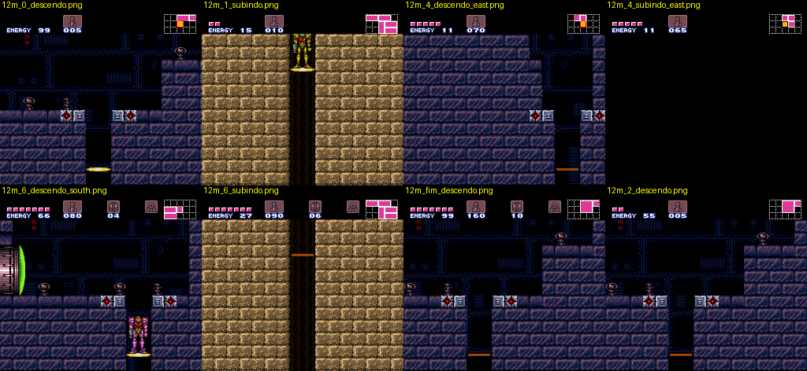
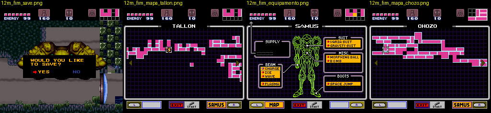

# 12m — Rodadas das duas áreas e a cadeia completa (Tallon + Chozo)

Estado: **verificada** (28/10/2026: validate "136 salas, 284 portas, 0 problemas", linha do Tallon igual; `.ips` sha1
`0bcb610afa5639eb2cadc657ac9f357a1a8dcaf0` igual em dois builds e igual ao de antes; **76/76** testes)
Esforço estimado: 2 dias (validador 0,25 d; cadeia no emulador 1,5 d; docs 0,25 d)
Épico: [12 — Chozo Ruins](12-chozo-ruins.md) (linha 12m da tabela de filhas; definição de pronto, critério 3); modelo:
[09f](09f-rodadas-e-cadeia-completa.md) (rodadas declaradas e `tallon_cadeia_completa`).

## Contexto

Com a 12l as 64 salas da Chozo estão construídas. Desde a 12f o passeio do validador anda o Tallon e a Chozo juntos
(pelos três elevadores) e cada sala e item da Chozo tem rodada declarada (`chozo/rooms.py FIRST_ROUND`, `chozo/items.py
Item.round`), conferida por `check_chozo_rounds`. Faltavam: uma checagem das duas áreas como um todo (todos os 51 itens, as
rodadas sem buraco, a porcentagem do fim) e a prova no emulador — **uma cadeia só**, de um jogo de verdade, pegando os 51
itens na ordem das rodadas e trocando de área pelos elevadores de verdade, com o mínimo de atalhos por RAM. As filhas 12i–12l
deixaram atalhos de RAM em subidas em zigue-zague (copa do Arboretum, passagem alta da Sun Tower, escada da Watery Hall,
galeria leste da Gathering Hall, fundo da Reflecting Pool, sacada da Furnace): a 12m tenta fazê-las com botões.

Decisões do usuário de 28/10/2026 (registradas no épico, decisão 10): a **Reflecting Pool fica inundada** (a Gravity Suit
guarda a Save Station 3, a Antechamber e a Transport Access South; fecha a pergunta 7 do épico); **a porta de charge branca
fica para uma área futura**, a Chozo não tem nenhuma (fiel ao Prime); as paredes de míssil continuam blocos de bomba.

## Estado antes (verificado)

validate "136 salas, 284 portas, 0 problemas" (linha do Tallon "… 44 salas construídas, alcançáveis agora: 44, 20 itens em 7
rodadas …"; linha da Chozo "… rodada 0: 15 salas, 1 itens; rodada 1: 22 salas, 7 itens; rodada 2: 12 salas, 11 itens; rodada
3: 7 salas, 8 itens; rodada 4: 6 salas, 1 itens; rodada 5: 2 salas, 0 itens; rodada 6: 0 salas, 3 itens"); `.ips` sha1
`0bcb610afa5639eb2cadc657ac9f357a1a8dcaf0`; 75/75 testes, **7 min 41 s** a bateria (medido nesta sessão,
`s12m/tests_before.txt`); `tallon_cadeia_completa` sozinho 200 s (66 030 quadros a ~330 quadros/s).

- Rodadas do passeio das duas áreas (script `s12m/rounds.py`): itens por rodada, Tallon + Chozo: 0: 2 + 1; 1: 4 + 7; 2: 1 + 11;
  3: 2 + 8; 4: 2 + 1; 5: 7 + 0; 6: 2 + 3 (51). O Charge Beam (rodada 1) não abre nada.
- A porcentagem do fim do SM (`CalcItemPercentageCount`, `$8B:E627`; tabelas lidas dos bytes: palavras de RAM `$8B:E70D` =
  `$09C4 $09D4 $09C8 $09CC $09D0`, divisores `$8B:E717` = 100 100 5 5 5, 11 bits de item `$8B:E721`, 5 bits de feixe
  `$8B:E737`) conta 1 por E-tank (100), por 5 mísseis, por 5 power bombs, por bit: com os 51 itens dá **51%** (o jogo só a
  mostra no fim vanilla, que a fragata não usa; aqui ela é calculada e conferida).

## Mudança

1. **Validador** (`tools/validate.py`): `check_world_rounds` (linha nova "rodadas (specs/12m)"): o passeio das duas áreas
   pega todos os itens com lugar das duas tabelas (`world_items`), cada rodada do passeio acrescenta alguma coisa, as rodadas
   declaradas (salas e itens das duas áreas) são exatamente as do passeio (0–6), e a porcentagem do fim com todos os itens
   (`item_percentage`, tabelas da ROM base; `ITEM_GAIN` = o que cada tipo de item soma) é **um por item**. As comparações item
   a item continuam em `check_tallon_rounds` / `check_chozo_rounds` (mensagem com a rodada achada e o equipamento).
2. **Teste `cadeia_completa_tallon_chozo`** (`tests/run_tests.py`, `full_chain`): do pouso (como `tallon_cadeia_completa`), os
   51 itens na ordem das rodadas declaradas, os elevadores de verdade (North nas rodadas 0–3 e 6, East na 4, South na 6),
   cada item andando/rolando para dentro dele e a caixa fechada com A, cada trava aberta de verdade, as subidas com botões
   (tabela abaixo); `FullChain` guarda o que foi pego (confere o bit de cada item desligado antes e ligado depois, com os
   16 bits do byte dele e do seguinte), a munição (porta vermelha = 5 mísseis que ela tem; repõe só com menos de 5, contado),
   a seleção do HUD e os atalhos (`note`); `check_order` levanta erro **ao gerar o roteiro** se a rodada de algum item da
   cadeia for diferente da declarada ou se faltar/sobrar item. No fim: os 51 bits, equipamento, capacidades (799 de
   energia, 160 mísseis, 10 power bombs), a porcentagem calculada com a fórmula e as tabelas da ROM = 51; salva na nave, game
   over, continue: tudo volta, os bits de explorado das telas de porta das duas áreas (a Chozo na cópia salva da área 1); o
   mapa de pausa do Tallon, a tela de equipamento; desce o elevador North: o mapa de pausa da Chozo. Uma cadeia só, ~215 000
   quadros, **~270 s sozinha** (o teste mais longo).
3. **Emulador** (`tools/snesrun.c`, `vendor/LakeSnes/snes/ppu.c/.h`): só o último quadro de cada `wait`/`hold` é desenhado
   (`Ppu.skipRender`: os pixels do PPU nunca são lidos pelo jogo; a avaliação de sprites, que liga as flags de tempo/faixa,
   continua todo quadro). Medido: o `tallon_cadeia_completa` dá saída **idêntica** (todas as linhas e os 57 PNG byte a byte) em
   85 s em vez de 200 s (2,4×). Sem isso a cadeia nova (~650 s) não cabia nos 600 s da verificação.
4. **Ordem dos testes** (`run_tests.main`): os roteiros mais longos (soma dos quadros) começam primeiro; os resultados saem na
   ordem de sempre.

## Critérios de aceite

1. validate 0 problemas; linha do Tallon **igual** ("44 salas construídas, alcançáveis agora: 44, 20 itens em 7 rodadas");
   linha nova "rodadas (specs/12m): … 51 itens em 7 rodadas … porcentagem … 51%". (protege = rodada de cada item/sala das
   duas áreas, porcentagem; falha_quando = mutações V1–V7; não_prova = que a ordem é a única possível)
2. `cadeia_completa_tallon_chozo` passa; gerar o roteiro com uma rodada de item mudada levanta erro (T1–T5). (protege = a
   cadeia na ROM real na ordem declarada; falha_quando = mutações T e E; não_prova = os trechos feitos por `door_teleport`)
3. Dois builds com o sha1 de antes (só validador, testes e emulador mudam). Bateria inteira < 600 s com a verificação.

## Plano de testes

| Camada | O quê | Qtde |
|---|---|---|
| validate.py | `check_world_rounds` (linha "rodadas") | +1 |
| run_tests.py | `cadeia_completa_tallon_chozo` | +1 |
| scratchpad (`s12m/`) | mutações do validador (V), do gerador do roteiro (T), da ROM no emulador (E); saída idêntica do emulador | — |

## Riscos e reversão

- A cadeia é o teste mais longo (~270 s sozinha, ~300 s com a bateria); a verificação inteira deu **5 min 40 s a 5 min 54 s** (duas medidas). Mexer numa
  sala do caminho pode pedir novo ajuste dos trechos medidos (as constantes `*_CLIMB`, `zig_jump`, `CHAIN_*_PAD`: cada uma
  tem o `expect` da posição logo depois, então a falha aponta o trecho).
- Reversão: `tools/validate.py` (`check_world_rounds`, `ITEM_GAIN`, `item_percentage`), `tests/run_tests.py` (bloco da 12m e a
  ordem dos jobs), `tools/snesrun.c` + `vendor/LakeSnes/snes/ppu.c/.h` (recompilar com o comando do README).

## Fora de escopo

Chefes, artefatos, as subidas dos testes antigos das regiões (12i–12l continuam com os atalhos deles: a cadeia prova as
mesmas subidas com botões), as demos de atração, a tela de título.

## Desvios (preenchido na implementação)

- **Rodadas**: as das duas áreas já eram declaradas e conferidas uma a uma desde a 12f (`check_chozo_rounds`); a 12m acrescenta
  o todo (`check_world_rounds`) e o teste. Uma regra pensada ("os dois lados de cada elevador na mesma rodada") saiu: é
  sempre verdade por construção (o passeio anda o elevador nos dois sentidos; mutação V4b), e o que guarda a tabela do
  Tallon é o `check_tallon_rounds` (mutação V4).
- **Emulador mais rápido** (item 3 da mudança): mudança de infraestrutura fora do que o pedido citava, necessária para o tempo.
  Saída conferida idêntica antes de adotar.
- **Inimigos**: os Oculus da Sun Tower derrubavam a Samus no meio dos pulos: ela atira para cima antes de cada pulo
  (`zig_jump(..., shoot)`), sem RAM. Onde um inimigo fica exatamente onde ela vira bola (Ruined Nursery, Ruined Shrine, Watery
  Hall Access, Dynamo, Burn Dome, Furnace, Ruined Fountain) os inimigos da sala são apagados por RAM (atalho contado).
- **Artifact Temple**: o `door_teleport` para cima pela porta de teto deixa a Samus no templo (medido de novo, como a 09f):
  volta à nave por RAM (estação 0) uma vez.
- **Primeiro tiro numa porta vermelha**: andando contra a tampa, o primeiro X só faz a Samus mirar (medido: nenhum míssil
  sai): `FullChain.red_door` dá um tiro de feixe antes de trocar para mísseis; 5 mísseis abrem. O SELECT de volta ao feixe é
  dado na sala seguinte (um inimigo pode empurrá-la pela porta aberta durante a troca: medido no Hive Totem).
- **Recarga na nave**: com 799 de energia a nave leva ~800 quadros para encher (o `save_on_tallon_ship` espera 600):
  a cadeia espera 1000.
- **Nenhuma correção de layout**: todas as subidas fecharam com botões; nenhuma sala mudou (ROM igual).

## Resultado

- validate: "136 salas, 284 portas, 0 problemas"; linha do Tallon **igual** ("… 44 salas construídas, alcançáveis agora: 44, 20
  itens em 7 rodadas …"); linha da Chozo igual ("… rodada 0: 15 salas, 1 itens; rodada 1: 22 salas, 7 itens; rodada 2: 12
  salas, 11 itens; rodada 3: 7 salas, 8 itens; rodada 4: 6 salas, 1 itens; rodada 5: 2 salas, 0 itens; rodada 6: 0 salas, 3
  itens; fora das rodadas: nenhuma"); nova: "rodadas (specs/12m): Tallon + Chozo andados juntos, 51 itens em 7 rodadas, cada
  um na rodada declarada (itens por rodada, Tallon + Chozo: 0: 2 + 1; 1: 4 + 7; 2: 1 + 11; 3: 2 + 8; 4: 2 + 1; 5: 7 + 0; 6: 2 + 3);
  elevadores a partir da rodada: chozo_west 0, chozo_east 4, chozo_south 5; porcentagem do fim ($8B:E627) com todos: 51%
  (energia 799, mísseis 160, power bombs 10)".
- build: sha1 `0bcb610afa5639eb2cadc657ac9f357a1a8dcaf0` nas duas vezes (igual ao de antes).
- testes: **76/76** (novo `cadeia_completa_tallon_chozo`; nenhuma expectativa antiga mudou); a verificação inteira (dois
  builds, validate, testes) **5 min 54 s** na medida final (antes: ~8 min 15 s com os 75).

### A cadeia, rodada a rodada

| Rodada | Tallon | Chozo | Elevador |
|---|---|---|---|
| 0 | míssil do lago (andando), **a pé até a Chozo West** (`tallon_walk`), Morph | entrada e praça a pé, **sobe a T0 da praça**, laço da região B a pé (rota B), míssil do totem | desce North (andando até a plataforma) |
| 1 | Bombas, míssil do Tunnel B, Wave, míssil da Crash Site; 3 portas vermelhas com os mísseis que ela tem | galeria (bola), porta vermelha do totem, E-tank da TAN (bola), poço da Magmoor, Vault, E-tank da mão única, porta vermelha do Shrine, míssil do Shrine (luta), fonte e Arboretum a pé (2 vermelhas), **galeria leste da Gathering Hall subida**, vermelha da WHA, **escada da Watery Hall subida**, Charge, míssil da poça, Energy Core a pé e **subida da T3**, míssil do suporte do Burn Dome | sobe North |
| 2 | blocos de bomba da Canyon, Gully, Space Jump | Nursery e galeria (blocos de bomba), Vault, túnel do Shrine, **copa do Arboretum subida**, vermelha do Lobby, Varia, **arena da Sunchamber subida**, **Sun Tower subida** até a Magmoor, **galeria leste de novo** + gaiola da Gathering Hall, parede da WHA, **escada de novo** + bloco da galeria, 2 vermelhas até a Dynamo, Burn Dome, bomb slots, E-tank da Furnace, porta de onda da Magma Pool (Varia contra o calor), túnel da TCA | desce North; |
| 3 | Root Cave com o Space Jump: míssil, Ice | porta de onda da TC: E-tank; **Meditation Fountain subida**; bordas de Space Jump (fonte, praça ×2, Shrine, Dynamo); **Furnace com o Space Jump de verdade** (míssil do trilho, sacada), porta de Morph, onda da CAW, porta vermelha de chão da Crossway, Hall: E-tank | sobe North |
| 4 | portas de gelo, míssil da Overgrown, Gravity | **Save Station 3 subida** para a piscina, vermelha da Antechamber, míssil, porta de gelo de dentro, vermelha de chão da piscina | desce East, sobe East |
| 5 | anteparo da Vent C, porta de onda, 2 E-tanks, 3 mísseis, Plasma, Power Bomb | — | — |
| 6 | cabana de PB, X-Ray; Root Cave de novo, porta de plasma, míssil da Arbor | porta de gelo da TAS, **piscina inundada a pé** (desce do degrau ao fundo, sobe o degrau, plataforma da T2), **subidas da RPA e da EHA**, estátua (bloco de bomba), **Space Jump até a sacada leste da Hall**, cabana de PB da Crossway, expansão de PB da Magma Pool, árvore da praça | desce South, sobe North |

### As subidas em zigue-zague (atalhos de RAM das 12i–12l)

| Subida | Antes (teste) | Na cadeia 12m |
|---|---|---|
| Copa do Arboretum | Samus posta na copa (`chozo_regiao_c_rota`) | **trocada** por botões (`ARBORETUM_CROWN`, rodada 2) |
| Passagem alta da Sun Tower | posta na passagem (`chozo_regiao_c_rota`) | **trocada** (`SUN_TOWER_CLIMB`, rodada 2; atira nos Oculus antes dos pulos de cima) |
| Escada da Watery Hall | posta na galeria (`chozo_regiao_d_rota`) | **trocada** (`WATERY_STAIR`, rodadas 1 e 2) |
| Galeria leste da Gathering Hall | `door_teleport` direto para a WHA (`chozo_regiao_d_rota`) | **trocada** (`GH_EAST_GALLERY` + `GH_CAGE_TOP`, rodadas 1 e 2) |
| Fundo da Reflecting Pool | posta no fundo (`chozo_regiao_e_rota`) | **trocada** (`POOL_R0_TO_FLOOR`, rodada 6, com a Gravity) |
| Sacada da Furnace | posta na sacada (`chozo_regiao_e_itens`) | **trocada** (`FURNACE_TO_TRACK` com o Space Jump + `FURNACE_TRACK_TO_BALCONY`, rodada 3) |
| Arena da Sunchamber até a STA (fora da lista) | `door_teleport` | **trocada** (`SUNCHAMBER_TO_STA`) |
| Portas de teto: T0 da praça, Meditation Fountain, Energy Core T3, Save Station 3, T2 da piscina, RPA, EHA | `rise_through` (transição por RAM) ou Samus posta na plataforma | **trocadas** (pulo de verdade, `climb_jump`) |

Nenhuma precisou de correção de layout. Os testes antigos das regiões ficam como estão (testam outras coisas; a cadeia prova
as subidas).

### Atalhos que ficam (contados por `FullChain.note` ao gerar o roteiro)

| Atalho | Vezes | Por quê |
|---|---|---|
| `door_teleport` entre salas | 217 portas | as idas e voltas longas entre os elevadores e as regiões (sem ele a cadeia passaria de 600 s); só por portas sem trava ou já abertas na cadeia (a regra da 09f) |
| Samus posta perto de um item | 30 | os itens do Tallon (como a 09f) e, na Chozo, os túneis de bomba/PB e as 6 bordas de Space Jump da rodada 3 (o voo é o enchimento do validador; a cadeia voa de verdade na Root Cave, na Furnace e na Hall) |
| Samus posta diante de uma porta do Tallon | 7 | como a 09f (portas vermelhas e de feixe do Tallon) |
| inimigos da sala apagados por RAM | 10 | um inimigo parado onde ela vira bola (ver Desvios) |
| energia reposta por RAM | nas caminhadas e lutas | os andadores cegos (`chozo_walk`, `tallon_walk`) e as portas vermelhas; nunca capacidade |
| mísseis repostos por RAM | 1 | a porta vermelha da Watery Hall Access chega com 0 mísseis na rodada 1 |
| plataforma da Tallon Canyon, em cima da nave | 1 + 1 | como a 09f |
| volta à nave por RAM (estação 0) | 1 | o `door_teleport` para cima no Artifact Temple não troca de sala |

Nenhum item, feixe ou capacidade por RAM. Os elevadores: a Samus **anda** até a plataforma nas 9 viagens (sem
`onto_platform`).

### Fotos (olhadas)

`specs/img/12m-subidas.png` (galeria leste, galeria da Watery Hall, copa, alto da arena da Sunchamber, Sun Tower embaixo e
em cima, sacada da Furnace, fundo da piscina), `12m-travas.png` (porta vermelha do totem fechada e aberta, as vermelhas de chão da
Crossway e da piscina, as power bombs da Crossway, da árvore e da Magma Pool, os bomb slots), `12m-elevadores.png` (as viagens:
North descendo/subindo, East, South, a do fim), `12m-fim.png` (save na nave com 799, mapa de pausa do Tallon, tela de
equipamento: Charge, Ice, Wave, Plasma, Varia, Gravity, Morph, Bombas, Space Jump; mapa de pausa da Chozo).

### Mudanças de expectativa dos testes

| Teste | Mudança |
|---|---|
| `cadeia_completa_tallon_chozo` | novo |
| os outros 75 | nenhuma (saída do emulador idêntica; só a ordem de execução muda) |

## Mutações

Validador (`s12m/mut_validate.py` → `s12m/mut_validate.out`, cópia `s12m/proj`, na memória; sem mutação: 0 problemas), todas
pegas: V1 rodada do E-tank da Hall 3 → 4 ("é pego na rodada 3 (…), declarado na rodada 4"); V2 míssil da Antechamber 4 → 3; V3
Charge Beam e míssil da Crossway trocados de lugar (2 problemas: rodadas 6 e 1); V4 piscina seca (43 problemas, a linha do
Tallon muda para 6 rodadas); V5 míssil valendo 10 na porcentagem ("… é 83%"); V6 um míssil da Chozo vira uma segunda Varia
("… é 50%"); V7 `FIRST_ROUND` da Crossway 3 → 4. V4b (piscina seca **e** todas as declarações reescritas para o passeio novo)
passa no validador (é mudança de projeto: a linha do Tallon mostra 6 rodadas) e é pega pelo gerador da cadeia (T5).

Gerador do roteiro (`s12m/mut_chain.py` → `s12m/mut_chain.out`): T1 rodada do E-tank da Hall 3 → 4, T2 Antechamber 4 → 3, T3
Ice do Tallon 3 → 4, T4 um item a mais na tabela, T5 = V4b: **ValueError** "cadeia 12m: itens/rodadas diferentes das
declaradas" em todas (o teste nem roda).

ROM no emulador (`s12m/mut_emu.py`, trecho da rodada 1 da Chozo a partir do savestate do fim da rodada 0, na ROM da cópia
construída com a mutação): E1 sem o degrau da linha 18 da escada da Watery Hall → 9 FAIL (a escada para no degrau de baixo, o
Charge não é pego; o validador também acusa); E2 o Charge Beam trocado por um míssil no mesmo lugar → **o validador passa** (0
problemas: a porcentagem continua 51) e a cadeia falha (6 FAIL: `$09A7/$09A9` sem o Charge, mísseis a mais).

Emulador (`s12m/cmpA*`, `cmpB*`): o `tallon_cadeia_completa` com o `snesrun` antigo e o novo: stdout idêntico, 57 PNG idênticos.

## Decisões para o usuário (padrão escolhido, a confirmar)

1. **O emulador de teste desenha só o último quadro de cada comando** (2,4× mais rápido, saída idêntica; mexe em
   `vendor/LakeSnes`): sem isso a cadeia não cabia no tempo.
2. **Uma cadeia só** (~270 s) em vez de trechos ligados por savestate: com o emulador mais rápido coube; `tallon_cadeia_completa`
   (09f) continua (agora 85 s).
3. **Atalhos que ficam** (tabela acima), em especial os 217 `door_teleport` e os inimigos apagados em 7 salas.
