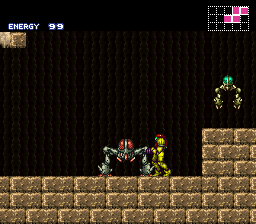
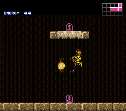

# 14a — Plated Beetle (Sidehopper grande na Ruined Shrine)

Estado: **verificada** (30/10/2026: validate "136 salas, 284 portas, 0 problemas", linha do Tallon e `check_world_rounds`
iguais; `.ips` sha1 `9dfaba59b3dc29ec409c7e3db354aea5fcfc3a37` igual em dois builds; **77/77** testes; verificação inteira
6 min 4 s)
Esforço estimado: 0,5–1 dia (medido: ~1 dia, a maior parte achando uma luta de verdade que o roteiro cego vence)
Épico: [14 — Chefes](14-chefes.md) (linha 14a; decisões do usuário 1 e 5, padrões aceitos 7 e 9); modelo:
[12h — Inimigos da Chozo](12h-inimigos-chozo.md) (regra de justiça, auditoria de entrada).

## Contexto

Na Ruined Shrine do Prime (P9) a primeira passagem tem o **Plated Beetle** (`GarBeetle` na camada 1 "First Pass", com o
`Master Beetle Generator` e os 7 Alpha Beetles da camada 0); a sala **não tem** `Actor Door Lock` (épico, inventário 3). Hoje
(12f/12h/12m) a sala tem só os 3 Sidehoppers pequenos e o míssil do chão (24, 12), rodada 1. O épico (decisão 5, padrão
aceito) pede um **Sidehopper grande** com o toque cortado para 40, junto com os pequenos, sem trancar porta; e (decisão 7)
as cores tiradas das texturas do Prime.

## Estado antes (verificado)

validate "136 salas, 284 portas, 0 problemas"; `.ips` sha1 `0bcb610afa5639eb2cadc657ac9f357a1a8dcaf0`; 76/76 testes.

- **Sidehopper grande** `$A0:D9BF` ("SIDE", base ROM): tiles `$600` de `$AE:AA00`, paleta `$A3:B085` (a mesma 16 cores do
  pequeno `$A3:AA48`: 1–8 casco amarelo, 9–12 corpo marrom, 13–15 olhos verdes), vida **320**, toque **80**, raio 24×20,
  IA no banco `$A3` (init `$AB09`, main `$ABCF`: as mesmas do pequeno), vulnerabilidade padrão `$B4:EC1C` (×2: o Power Beam
  tira 20, o míssil 100). O init escolhe grande/pequeno pelo campo `+$2A` do **cabeçalho** (`Sidehopper_Init`,
  `sm_a3.c:1234`), não pelo endereço da espécie: uma cópia do cabeçalho é um Sidehopper grande completo. Nenhum código
  compara o ponteiro `$D9BF` (busca em `vendor/sm/src`).
- Colocações vanilla no chão (`find_species.txt` do épico, `$8F:9E9F`): init 0, propriedades `$2000`, parâmetros 0.
- Espaço: `$A0` livre a partir de `$A0:F83F` (depois do Meta Ridley, etapa 7); `$A3` livre `$A3:F311–FFFF` (3311 bytes, só
  `$FF`, base e build).
- Prime: o objeto `GarBeetle` da Shrine (`04090078`, camada 1; `10092902` na camada 4) usa o ANCS `469111D0`, personagem
  `gar_beetle_beta`, CMDL `78A82871` (roteiro `s14a/scripts/beetle_ancs.py`; os Beetles comuns usam `763ABB1B`). Texturas
  exportadas com `tools/dump_prime_textures.py` (`s14a/beetle_tex/`): placas de metal verde-acinzentado (verdete) e partes
  vermelhas.
- Rodada da Shrine: **1**; chegada (o passeio das rodadas) com Power Beam, mísseis e Morph, 99 de energia (`FAIR_ARRIVAL`).

## Mudança

1. **Cópia da espécie** (`tools/chozo/bosses.py`, novo): `SpeciesCopy(ptr $F83F, fonte $D9BF, toque 40, cores)`; o build
   (`build_copies`, chamado logo depois do Meta Ridley) copia os 64 bytes do cabeçalho vanilla para `$A0:F83F` (grade de 64
   bytes, como o Ridley), troca o toque para 40 e o ponteiro da paleta para uma paleta nova de 16 cores no espaço livre do
   banco da IA (`$A3:F311`). Tudo o mais (vida 320, tiles, ponteiro dos gráficos `$AE:AA00`, IA, vulnerabilidades, itens que
   solta) é o vanilla. O endereço declarado na tabela é conferido pelo build (erro se o alocador der outro). A espécie vanilla
   `$D9BF` e a paleta `$A3:B085` ficam intactas (o vanilla usa as duas nas salas da área 1 do SM).
2. **Cores do Plated Beetle**: cada cor do Sidehopper grande guarda o brilho e toma a rampa do seu grupo (o jeito da Parasite
   Queen e do Meta Ridley, `frigate/bosses.along`): 1–8 (casco) → `ARMOUR`, o verdete das placas; 9–12 (corpo) e 13–15
   (olhos) → `GLOW`, o vermelho. Rampas = médias de fatias por brilho dos pixels das texturas (`s14a/beetle_tex`; as texturas
   de ruído cinza e de bolhas de vidro fora); a última parada do vermelho é um brilho acrescentado (não está nas texturas),
   senão os marrons claros e os olhos ficavam todos no mesmo vermelho.
3. **Espécie e lugar** (`tools/frigate/enemies.py`): `plated_beetle` = `Species($F83F, 20, init 0, $2000, 0, 0, 0, paleta 2,
   boss=True)`; `Species.boss` novo: um chefe não é inimigo da camada 0 do Prime. Na Ruined Shrine
   (`tools/chozo/enemies.py`): `Spawn(PB, 26, 13)`, no meio da tigela, **no último slot** (os 3 pequenos continuam nos slots
   0–2). Set: SSIDE paleta 3 + a cópia paleta 2, `$A00` bytes de VRAM. A cota da população passa de 3 para 4.
4. **Tabela de chefes** (`chozo/bosses.py BOSSES`): `Boss(sala, tipo, "GarBeetle", camada 1, tiros 16, trava False)`.
5. **Validador** (`tools/validate.py`):
   - `species_info` entende cópias (o cabeçalho da fonte com o toque da cópia);
   - `check_layer0_enemies` deixa os chefes de fora (contagem do Prime, 1 por tela, justiça comum); a linha "chozo
     (specs/12h)" também (fica **igual**: 69 inimigos em 25 salas);
   - `check_bosses` novo (linha "chefes (specs/14a)"): cada chefe da tabela está na sala (um só, em nenhuma outra), é
     `boss=True` e cópia de `COPIES`; os tiros declarados = vida / dano do tiro; **regra de justiça de chefe** na chegada com
     no máximo Power Beam, mísseis e Morph: morre só com o Power Beam em até `FAIR_BOSS_SHOTS = 20` tiros (a regra comum de 5
     é para os inimigos da sala; o chefe tem o número exato anotado) e tira no máximo `FAIR_BOSS_TOUCH = 40` por toque (99 de
     energia = 3 toques); luta sem trava = nenhuma porta cinza na sala; nenhuma sala nossa usa a espécie vanilla de uma cópia;
   - `check_species_copies` (ROM construída contra a base): os 64 bytes da cópia = os da fonte com só o toque (e o ponteiro
     da paleta) trocados — vida, tiles, ponteiro dos gráficos, raio, IA conferidos; a paleta própria fica no espaço livre do
     banco da fonte e tem as cores da tabela; o cabeçalho e a paleta vanilla iguais aos da base.
6. **Testes** (`tests/run_tests.py`): `chozo_plated_beetle` novo (abaixo); `chozo_regiao_a_rota` com a expectativa nova da
   luta da Shrine (tabela de mudanças).

## Critérios de aceite

1. validate 0 problemas; linha do Tallon **igual** ("44 salas construídas, alcançáveis agora: 44, 20 itens em 7 rodadas"),
   `check_world_rounds` **igual** (51 itens em 7 rodadas, 51%), linha 12h igual; linha nova "chefes (specs/14a)". Nenhum item
   muda de lugar. (protege = cópia, lugar, justiça; falha_quando = mutações V1–V11; não_prova = que a luta é vencível: isso é o
   teste 2)
2. Teste `chozo_plated_beetle` (emulador): do pouso à Ruined Shrine (atalhos anotados: `door_teleport` e o elevador, como o
   `chozo_inimigos_vivos`), entrando pela R0 (o caminho da rodada 1); o besouro no slot 3 com 320; a Samus com **só o Power
   Beam**, 0 mísseis, 99 de energia; a luta com botões, **nada reposto, nenhuma RAM**; no fim o slot vazio (morto), energia
   39, cota de mortes da sala (`$0E50`) = 2 (ele e um pequeno). (protege = espécie, população, que a luta se vence com menos que
   o equipamento da rodada; falha_quando = E1–E3; não_prova = outras entradas/tempos: o roteiro é medido para esta entrada)
3. Auditoria de entrada: entrar pela R0 e pela L0 e ficar parada não leva dano **do besouro** (ele fica parado fora da tela).
4. `cadeia_completa_tallon_chozo` passa; dois builds com o mesmo sha1; fotos olhadas; bateria < 10 min.

## Plano de testes

| Camada | O quê | Qtde |
|---|---|---|
| validate.py | `check_bosses` + `check_species_copies` (linha "chefes (specs/14a)") | +1 |
| run_tests.py | `chozo_plated_beetle` | +1 (77) |
| scratchpad (`s14a/`) | mutações do validador (V) e da ROM no emulador (E); auditoria de entrada; busca da luta | — |
| imagem | `specs/img/14a-luta.png`, `14a-luta-2.png`, `14a-morto.png` | +3 |

## Riscos e reversão

- **Roteiro da luta** (`BEETLE_FIGHT`): achado por busca no emulador, vale para a entrada exata do teste (medido: vence igual
  com 0–17 quadros de espera antes da porta; de 18 em diante a entrada muda e o mesmo roteiro perde). Mexer na Shrine, nos
  pequenos, na Shrine Access ou no `door_teleport` pode pedir nova busca (`s14a/scripts/beam.py`).
- **Paleta**: no `$A3` (banco da IA do Sidehopper); se outra cópia precisar de paleta em outro banco, `build_copies` recebe o
  alocador desse banco.
- Reversão: tirar `Spawn(PB, …)` e `PLATED_BEETLE` de `COPIES`/`BOSSES` e reconstruir volta à ROM `0bcb610a…`.

## Fora de escopo

- Música de mini-chefe durante a luta (padrão aceito 7): pede um estado de sala ligado a um bit de chefe que a morte liga, a
  rotina da 14b; aqui a música das ruínas continua (decisão a confirmar).
- O `Master Beetle Generator` (os besouros que saem do chão no Prime), a cena do Morph Ball, as camadas 2–4 (o 2º besouro).
- Prêmio: o Plated Beetle não guarda nada no Prime (o Morph está no Tallon, opção B do épico 12).

## Desvios (preenchido na implementação)

- **Cadeia completa sem atalho**: a `cadeia_completa_tallon_chozo` passou sem mudança, com o besouro vivo (na rodada 1 ela anda
  pela tigela até o míssil com a energia reposta a cada passo, `SHRINE_FIGHT`, e sai pelo `door_teleport`). O padrão aceito 9
  fala em matar cada chefe por atalho de RAM na cadeia; como o besouro não atrapalha e não guarda nada, nenhum atalho foi
  posto (menor mudança). Decisão a confirmar.
- **Teste da luta só com o Power Beam**: o épico falava em "tiros do Power Beam (contagem medida)"; o roteiro cego de andar e
  atirar (`chozo_walk`, ou parado no terraço) **perde** com 99 de energia (medido: o besouro fica com 20–240 de vida). O roteiro
  do teste foi achado por busca em feixe no emulador (`s14a/scripts/beam.py`, ~25 passos de 24 quadros), sem RAM e sem repor
  energia. Uma segunda busca, com 10 mísseis (o equipamento da rodada) e 4 entradas diferentes ao mesmo tempo
  (`beam2.py`), achou um roteiro que vence nas 22 entradas medidas (`robust.py`: 3 mísseis + 1 tiro); o teste ficou com o do
  Power Beam só (a afirmação mais forte: vence com menos que o equipamento da rodada).
- **Achado anterior (não corrigido, fora do escopo)**: um Sidehopper **pequeno** da Shrine sobe no terraço e acerta a Samus
  parada na porta, ~195 quadros depois de entrar pela R0 e ~60 pela L0 (5 toques de 20 a matam em ~20 s se ela não se mexer).
  Medido **igual** com e sem o besouro (ROM de rascunho sem a entrada dele, `s14a/rom/noboss.sfc`). A auditoria da 12h ficava
  180 quadros e entrava por transição de RAM (a Samus fora do lugar), por isso não viu. Evitável (3 tiros do Power Beam), como a
  Nursery Access da 12h; mudar a colocação dos pequenos fica para decisão.
- **Música de mini-chefe**: não feita (ver Fora de escopo).

## Resultado

- validate: "136 salas, 284 portas, 0 problemas"; linha do Tallon **igual** ("… 44 salas construídas, alcançáveis agora: 44,
  20 itens em 7 rodadas …"); "rodadas (specs/12m): … 51 itens em 7 rodadas … 51%" **igual**; "chozo (specs/12h): 69 inimigos em
  25 salas …" igual; nova: "chefes (specs/14a): plated_beetle na chozo_ruined_shrine (Prime: GarBeetle, camada 1): cópia
  $A0:F83F de $D9BF, vida 320, toque 40, 16 tiros do Power Beam (chegada rodada 1: missile, morph, 99 de energia; máximo de
  chefe 20 tiros, 40 por toque), sem trava de porta; 1 cópia(s) de espécie conferida(s) nos bytes, as espécies vanilla intactas".
- **Números da luta**: vida 320; toque 40 (vanilla 80); o Power Beam tira 20 por tiro → **16 tiros** (visto no emulador: 320 →
  300 → … → 0); o míssil tira 100 → 4 mísseis (ou 3 + 1 tiro); 99 de energia = 3 toques dele. No teste: 24 movimentos, 576
  quadros (~10 s de jogo), ela termina com **39** de energia (medido: 99 → 79 → 59 → 79 (item) → 59 → 39: só
  toques de 20, dos pequenos; o besouro não a toca neste roteiro), `$0E50 = 2` (o besouro e um pequeno). O teste sozinho leva ~14 s.
- **Auditoria de entrada** (`s14a/scripts/fight.py idle/idle10`, R0 e L0, parada 600–1200 quadros): o besouro **nunca se mexe**
  enquanto está fora da tela (x 424; ele só acorda com a Samus a oeste de x ≈ 606), então nenhuma entrada leva toque dele; a
  energia na entrada é a mesma com e sem ele (o achado dos pequenos acima é anterior).
- **Espaço**: `$A0` +64 (cópia em `$A0:F83F`, livre a partir de `$A0:F87F`), `$A3` +32 (paleta em `$A3:F311`, livre a partir de
  `$A3:F331`), `$A1` +16 (a entrada da população), `$B4` +4 (a entrada do set). `$8F`, `$84`, nível, fixo, SRAM: nada.
- **Fotos** (olhadas): `img/14a-luta.png` (o besouro cinza-verde de corpo vermelho ao lado da Samus, um pequeno amarelo atrás),
  `img/14a-luta-2.png` (ele pulando na tigela, o míssil do chão), `img/14a-morto.png` (a explosão da morte, dois pequenos vivos).
  **Refeitas na [14f](14f-rodadas-e-cadeia-com-chefes.md)** (31/10/2026, a luta de hoje, `BEETLE_FIGHT` da 14b): o besouro ao
  lado da Samus e um pequeno no terraço leste; a Samus pulando sobre ele, dois pequenos e o míssil do chão; a explosão da morte
  com os pequenos já mortos.

### Mudanças de expectativa dos testes

| Teste | Mudança |
|---|---|
| `chozo_regiao_a_rota` | na Shrine, depois do `SHRINE_FIGHT`: em vez de "slots 1 e 2 mortos" (12h), "slot 1 morto e o besouro (slot 3) vivo" (medido: com ele na tigela ela mata 1 dos 3 pequenos e acerta 2 tiros nele; o resto do teste igual) |
| novo `chozo_plated_beetle` | a luta (acima) |
| `cadeia_completa_tallon_chozo`, `chozo_inimigos_vivos`, `chozo_regiao_a_itens` | nenhuma (o `enemies_alive` já confere o slot 3 com 320, `clear_room_enemies` apaga os 4) |

## Mutações

Validador (`s14a/scripts/mutate_14a.py` numa cópia do projeto → `s14a/mutate_14a.out`), **todas pegas**: V1 cópia com toque 80
(justiça de chefe + bytes); V2 `BOSSES` com 15 tiros; V3 o chefe com a espécie vanilla `$D9BF`; V4 dois besouros; V5 sem a marca
de chefe (cai nas regras da camada 0: fora do `STAND_IN`, 4 em 3 telas, 5 tiros, 20 por toque); V6 cópia de outra espécie
(ATOMIC); V7 o besouro tirado da sala; na ROM construída: V8 vida 400, V9 ponteiro dos gráficos, V10 toque 80, V11 a espécie vanilla
mudada, V12 a paleta vanilla mudada, V13 uma cor da paleta da cópia, V14 a cópia com a paleta vanilla. Emulador
(`s14a/emu_mut_14a.out`, o roteiro do teste em ROMs de rascunho): sem o besouro → falha ("7E1038 = 0000, esperado F83F"); vida
400 → falha (vida na entrada e "7E1038 = F83F, esperado 0000" no fim). **Não pego pelo emulador**: toque 80 na ROM (o roteiro
nunca leva toque do besouro) — o validador pega (V1, V10).
