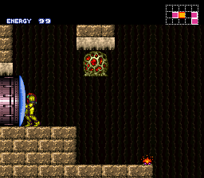
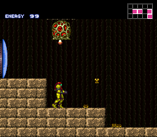
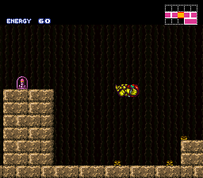
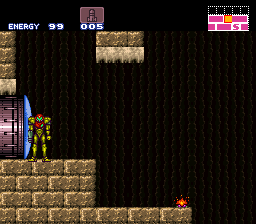

# 14b — Arena (rotina comum) e Hive Mecha

Estado: **verificada** (30/10/2026: validate "136 salas, 284 portas, 0 problemas", linha do Tallon e `check_world_rounds`
iguais; `.ips` sha1 `694be017c0e389dc750d708b8609ea00a7b7d157` igual em dois builds; **80/80** testes; bateria de testes
5 min 47 s)
Esforço estimado: 1,5–2 dias (medido: ~1,5 dia, junto com a [spec 15](15-auditoria-de-entrada.md))
Épico: [14 — Chefes](14-chefes.md) (linha 14b; decisões 1, 3, 4, 7, 9 e os padrões aceitos de 30/10/2026). Depende da
[14a](14a-plated-beetle.md) (besouro, `check_bosses`); a [spec 15](15-auditoria-de-entrada.md) (problema achado na 14a) veio antes.

## Contexto

O épico pede uma rotina **comum** em `$84` que, chamada pelo "main ASM" da sala, perceba o fim de uma luta (cota de mortes,
bit de chefe ou item pego), ligue um bit de chefe **nosso** e gere um PLM (o prêmio); a sala ganha um estado "morto". Com
ela, o **Hive Mecha** no Hive Totem: colmeias (Kago) + as vespas; todas mortas, o míssil do topo do totem (bit `$C2`,
rodada 0) aparece; nenhuma porta tranca (padrão aceito 4). E a música de mini-chefe só durante a luta (padrão aceito 7),
aplicada ao Hive Mecha e, se barato, ao Plated Beetle da 14a.

## Estado antes (verificado)

Depois da spec 15: validate 136/284/0, 77/77 testes; Hive Totem com 3 Mellas e o míssil comum no topo do totem (23, 8),
rodada 0; Ruined Shrine com o besouro (14a) sem música própria.

- **Medido (o que o épico deixou sem medir)**: um Kago (`$A0:E7FF`) pendurado num favo do Hive Totem morre a tiro do
  **Power Beam** (a rodada 0). Ele não morre pela vida (1600): `Kago_Shot` (`$A8:AB83`, bytes `BF 08 78 7E 38 E9 01 00 9F 08 78
  7E 10 10`) conta os golpes a partir do parâmetro 1 e morre abaixo de 0: **parâmetro 1 + 1 golpes**. Com o vanilla `$000A`:
  **11 golpes** (emulador: `$7E78C8` de `$0A` a `$FFFF`, o slot zera, `$0E50` sobe). Detalhe que custou o E3 do épico: o tiro
  para cima só sai para cima com o **cima apertado antes** do tiro (`hold UP` e depois `UP+X`); apertados juntos, o tiro sai
  para a frente e nunca acerta. Cada golpe solta um inseto (`$86:D02E`, propriedades `$0014`: **20** por toque) que pula perto
  da colmeia (não persegue a Samus: `EprojInstr_D15C`); a colmeia não encosta (`DisableSamusColl`).
- **Rotinas do motor (bytes)**: `RunRoomMainCode` `$8F:E8BD` = `LDX $07DF / BEQ / PHB / PHK / PLB / LDX #0 / JSR ($07DF,X) /
  PLB / RTL` (o main ASM roda no `$8F` com JSR); `SetBossBitForCurArea` `$80:81A6` e `CheckBossBitForCurArea` `$80:81DC`
  (`A` = máscara, preservam X/Y; carry = bit ligado); `SpawnRoomPLM` `$84:846A` (X = entrada de 6 bytes no `$8F`, `RTL`);
  `QueueMusic_Delayed8` `$80:8FC1` (`RTL`). Música de mini-chefe: song set `$2A`, faixa `$05` (estados vivos do Spore Spawn
  `$8F:9DD9` e do Botwoon `$8F:D970`).
- **Música ao morrer (medido)**: pôr de volta o song set da área (`0`, `$FF1B`, `$05` na fila, como `LoadRoomMusic`
  `$82:E071`) **para o jogo ~38 quadros** (o contador `$05B6` parado enquanto o set sobe para o APU) — e esse congelamento
  mudou o tempo das caminhadas medidas da cadeia. Escolhido: só **parar** a música (`0` na fila): sem congelar; a sala fica em
  silêncio até a Samus sair (o próximo cômodo carrega a música da área).
- **Transição de porta com troca de song set** (medido, `s14b/scripts/trans.py`): ~216 quadros até o estado 8 entrando ou
  saindo de uma arena viva (set `$2A` ↔ `$1B`), ~170 entre duas salas da área.
- Espaço: `$84:F4FB–FFBA` só `$FF` (base e build); `$8F` principal cheio, faixa recuperada da 12a com 629 + 101 livres.

## Mudança

1. **Rotina comum** (`tools/chozo/bosses.py`, `ROUTINE = $84:F500`, 140 bytes, montada à mão como `itemtouch`/`beamdoors`):
   `PHP / REP #$30 / PHB / PHK / PLB`; procura a sala (`$079B`) na tabela; achou e o bit da arena desligado
   (`CheckBossBitForCurArea`), confere a condição: `KILLS` = `$0E50 >= $0E52` (a cota que o último byte da população põe;
   `sm_a0.c:423`); `SLOT` = o slot de inimigo `$0F78 + arg` vazio; `BOSS_BIT` = um bit de chefe da área (`arg` = máscara: o do
   próprio chefe do SM, o Spore Spawn da 14c); `ITEM` = um bit de item pego (`$7ED870 + bit/8`, o da 14d); valendo:
   `SetBossBitForCurArea`, `QueueMusic(0)` (para a música; `$FFFF` = não mexe), `SpawnRoomPLM` com a entrada do prêmio (0 =
   nenhum); `PLB / PLP / RTL`. **Tabela** logo depois (`$84:F58C`, 10 bytes por arena: sala, condição, argumento (no `ITEM`:
   byte | máscara << 8), bit, entrada do prêmio no `$8F`, música; fim `0000`). Não usa o evento 0 (nem a porta cinza tipo 3).
   `BOSS_BIT` e `ITEM` ainda não têm arena: conferidos no emulador numa ROM de rascunho (abaixo).
2. **Chamada** (`bosses.stub`): 5 bytes no `$8F` (`JSL $84:F500 / RTS`, em `$8F:EA7D`), uma só para todas as arenas: é o main
   ASM do estado vivo.
3. **`ARENAS`** (`bosses.py`): `Arena(sala, bit, condição, argumento, prêmio (sala, lugar), needs, objeto do Prime, música)`:
   - Hive Totem: bit **`$08`** da área 1, `KILLS`, prêmio = o míssil (23, 8) (bit `$C2`), `needs` vazio (Power Beam);
   - Ruined Shrine (retrofit do Plated Beetle, padrão aceito 7): bit **`$20`**, `SLOT` 3 (o besouro, depois dos 3 pequenos),
     sem prêmio. (`$10` fica para o Incinerator Drone, 14d; o SM usa `$01/$02/$04`.)
4. **Build** (`tools/build.py`): sala de arena = cabeçalho com `E629 #bit` → estado **morto** (população sem as espécies de
   chefe, `Species.boss`; a música da área; sem main ASM) e o **vivo** como padrão (todos os inimigos, música `2A/05`, a chamada
   como main ASM). Lista de PLMs: o prêmio só na do estado morto; o vivo tem a mesma sem ele (estados iguais dividem a lista).
   A tabela (na ordem de `ARENAS`) aponta para a entrada do prêmio na lista do morto; o build confere que `$84:F500…` está livre.
5. **Hive Mecha** (`tools/chozo/enemies.py`, `frigate/enemies.py`): espécie `hive` = Kago `$E7FF`, valores das colocações
   vanilla (init 0, propriedades `$A000`) mas **parâmetro 1 = 4** (`bosses.KAGO_HITS = 5` golpes), pendurada no teto
   (`mount="ceiling"`), paleta 2, `boss=True`; no Hive Totem `Spawn(HV, 7, 6)` e `Spawn(HV, 40, 6)` sob os favos (o do leste
   no bloco oeste do favo: 5 blocos da porta R0), nos últimos slots. Set: Mella paleta 7 + Kago paleta 2, `$C00` de VRAM.
   Cota da população: 5. (A vespa do oeste já tinha ido de 10 para 11 na spec 15.)
6. **Validador** (`tools/validate.py`):
   - **trava `boss`** no passeio das rodadas: `boss_locks` (item colocado → arena que o gera); `tallon_rounds` só pega o
     prêmio quando a Samus está na sala com o `needs` da arena (a luta vencível com o que ela tem);
   - `check_arenas` (linha nova "arenas (specs/14b)"): sala construída com inimigos de arena (`Species.boss`; `SLOT`: o
     slot é de um deles); bit um de `$08–$80`, um por arena; prêmio = item colocado da sala; **justiça de chefe** na chegada
     (Power Beam, mísseis, Morph; `needs` vazio): os inimigos que a condição espera morrem só com o Power Beam em até
     `FAIR_BOSS_SHOTS = 20` tiros **somados** (Kago pela regra dos golpes, conferida nos bytes de `$A8:AB83`) e tiram no
     máximo `FAIR_BOSS_TOUCH = 40` por golpe (o inseto do Kago: 20, lido de `$86:D02E`);
   - `check_arenas_in_rom`: o cabeçalho escolhe o morto por `E629 #bit` e o vivo é o padrão; vivo = a chamada (bytes) e
     `2A/05`; morto = sem main ASM e a música da área; a rotina = os bytes que `bosses.py` gera; a tabela = uma entrada por
     arena com o endereço do prêmio na lista do morto; **nenhuma sala nossa usa a condição `E612`** (evento 0);
   - `check_enemies_in_rom` (estado morto sem as espécies de chefe), `check_tallon_items` (o prêmio fora do estado vivo:
     "aparece antes da luta"), `check_bosses` (espécies de chefe de arena não precisam estar em `BOSSES`).
7. **Testes** (`tests/run_tests.py`): `chozo_hive_mecha` novo; `arena_won_by_ram` (atalho anotado) na rota B e na cadeia;
   `chozo_plated_beetle` com a luta procurada de novo e o estado morto; ver a tabela de mudanças.

## Critérios de aceite

1. validate 0 problemas; Tallon "44 salas construídas, alcançáveis agora: 44, 20 itens em 7 rodadas" e "rodadas (specs/12m):
   … 51 itens em 7 rodadas … 51%" **iguais**; linha nova "arenas (specs/14b)". (protege = tabela/ROM/rodadas; falha_quando =
   mutações M1–M9, R1–R8; não_prova = que a luta se vence: teste 2)
2. `chozo_hive_mecha` (emulador): entra pela L0 (o caminho da rodada 0) só com o Power Beam, 99 de energia; a arena viva
   (3 vespas + 2 colmeias, música `2A/05`, o míssil **não** carregado, bit desligado); a luta **de verdade** (`HIVE_FIGHT`,
   nada reposto, nenhuma RAM): no lance 35 quatro mortos, o bit ainda desligado e o míssil ainda ausente; no fim 5 mortos,
   bit `$08`, o míssil (`$EEDB`) no slot 38 no bloco (23, 8); `HIVE_PICKUP` pega andando (bit `$C2`, 5 mísseis), música
   parada, energia 60; sai e volta: estado morto (as 3 vespas, nenhuma colmeia, música `1B/05`), o míssil não volta; salva na
   Save Station 1, game over, continue: bit e item ligados; de volta ao Hive Totem: morto. (falha_quando = E1, E2, E5)
3. `chozo_plated_beetle`: a luta só com o Power Beam vence; bit `$20`, música parada; saindo e voltando, estado morto.
4. A cadeia completa passa (o Hive Mecha bloqueia o míssil do totem: atalho de RAM anotado); 2 builds iguais; fotos olhadas;
   bateria < 10 min.

## Plano de testes

| Camada | O quê | Qtde |
|---|---|---|
| validate.py | `check_arenas` + `check_arenas_in_rom`, trava `boss` no passeio | +1 linha |
| run_tests.py | `chozo_hive_mecha` | +1 (80 com os 2 da spec 15) |
| scratchpad (`s14b/`) | mutações do validador e do emulador; buscas das lutas (`hive_beam.py`, `hive_beam2.py`, `beetle_beam.py`) | — |
| imagem | `specs/img/14b-*.png` | +5 |

## Riscos e reversão

- **Roteiros de luta** (Hive Mecha e besouro): achados por busca no emulador, valem para a entrada exata do teste (como na
  14a). Mexer nas salas, nos inimigos ou no caminho até elas pode pedir nova busca (`s14b/scripts/hive_beam.py`,
  `hive_beam2.py`, `beetle_beam.py`).
- **Atalho na cadeia e na rota B**: a arena do Hive Totem é vencida por RAM ao entrar (inimigos apagados, cota posta); a
  caminhada seguinte mudou (sem as vespas) e o trecho da galeria da rodada 1 ganhou 8 quadros de corrida antes do pulo.
- **Silêncio depois da luta**: a música para e só volta na próxima sala (o set da área não sobe na hora: congelaria ~38
  quadros). Decisão a confirmar.
- Reversão: tirar `ARENAS` (e as colmeias) e reconstruir volta às salas como na spec 15.

## Fora de escopo

- Cores do Hive Mecha (as colmeias ficam com a paleta vanilla do Kago; padrão aceito 7 fala em cores do Prime): decisão a
  confirmar.
- O "estágio" do totem do Prime (4 estágios, a boca `DamageableTrigger`), geradores de vespas que repõem vespas.
- A trava `boss` em **porta** (o Incinerator Drone, 14d): o passeio só modela o item agora.

## Desvios (preenchido na implementação)

- (Nota da [14d](14d-incinerator-drone.md), 31/10/2026: a espécie `hive` agora é a cópia do Kago com 1 parte em `$A0:F87F`; a
  condição `ITEM` foi redefinida: a luta começa no item e termina na cota; a tabela tem 12 bytes por arena e a rotina 222.)

- **Música**: o épico dizia "música de mini-chefe só durante a luta"; feita assim, mas no fim da luta a música **para** (não
  volta à das ruínas na hora): pôr o set de volta congela o jogo ~38 quadros (medido) e esse congelamento desmontou as
  caminhadas medidas da cadeia. O estado morto toca a música das ruínas desde a entrada.
- **Plated Beetle**: além da música, ganhou estado morto (bit `$20`): voltando à Shrine depois de matá-lo, só os 3 pequenos.
  Efeito colateral aceito: quem apaga os inimigos da Shrine por RAM (os testes de itens e a cadeia, `clear_room_enemies`)
  liga o bit (o slot dele esvazia); nesses testes a Shrine fica "morta" nas visitas seguintes.
- **Hive Mecha = 2 Kagos com 5 golpes**, não o vanilla (11): com 11, a arena somava 28 tiros (o validador recusa > 20).
- **A justiça de chefe** vale para a arena **somada** (16 tiros: 2 × 5 + 3 × 2), não para cada inimigo.
- A luta procurada termina sob a colmeia do leste; depois dela os insetos ainda pulam ali: a busca de fase 2 (`hive_beam2.py`)
  acha o caminho ao míssil com a energia 60 (medido: os insetos não a tocam nesse caminho).

## Resultado

- validate: "136 salas, 284 portas, 0 problemas"; Tallon e `check_world_rounds` **iguais**; nova: "arenas (specs/14b):
  chozo_hive_totem (Prime: Actor - Totem (Hive Mecha)): 2 hive + 3 outros, cota de mortes, bit $08, 16 tiros do Power Beam
  (rodada 0), até 20 por golpe, o item 14 (Missile Expansion, rodada 0) aparece; chozo_ruined_shrine (Prime: GarBeetle (Plated
  Beetle)): 1 plated_beetle + 3 outros, slot 3 vazio, bit $20, 16 tiros do Power Beam (rodada 1), até 40 por golpe, nenhum
  prêmio"; "chozo (specs/12h): 69 inimigos em 25 salas" igual (as colmeias não são camada 0).
- **Números do Hive Mecha**: Kago com parâmetro 4 = 5 golpes do Power Beam cada (vanilla `$0A` = 11, medido); Mella 30 de
  vida = 2 tiros; arena = 16 tiros no mínimo. No teste: 41 lances, 1347 quadros (~22 s de jogo), 92 tiros disparados (rajadas),
  energia 99 → **60** (vespas 16 por toque, insetos 20; um drop no caminho); o míssil aparece no slot 38 na hora; 228 quadros
  até pegá-lo; teste inteiro ~28 s.
- **Plated Beetle** (de novo, ver spec 15): `BEETLE_FIGHT = "LLLLssLLLJsHuHJcLuLussH"` (23 lances, 552 quadros), energia 99 →
  **44**, `$0E50 = 4` (ele e os 3 pequenos), bit `$20`, música parada; voltando: estado morto.
- **As 4 condições no emulador**: `KILLS` e `SLOT` pelos testes; `BOSS_BIT` e `ITEM` com a entrada do Hive Totem trocada numa
  ROM de rascunho (`s14b/scripts/conds.py`): bit de chefe `$01` ligado por RAM → o bit `$08` e o míssil; nada ligado → nada;
  item `$A0` ligado → dispara; condição no item `$A1` com só o `$A0` ligado → nada.
- **Espaço**: `$84` +162 (rotina 140 + tabela 22; livre a partir de `$84:F5A2`); `$8F` +75 (chamada 5, dois estados extras e
  seletores 62, a lista viva do Hive 8; a faixa recuperada da 12a passa de 1524 para 1599 usados de 2153); `$A1` +128
  (populações vivas e mortas); `$B4` +4 (o Kago no set). Fixo, nível, SRAM: nada.
- **Fotos** (olhadas): `img/14b-entrada.png` (a Samus na porta L0, a colmeia pendurada no favo, uma vespa no chão),
  `img/14b-luta.png` (tiro para cima na colmeia, um inseto caindo), `img/14b-missil.png` (o míssil no topo do totem, a Samus
  pulando para ele), `img/14b-mensagem.png` ("MISSILE"), `img/14b-morto.png` (depois do continue: o favo sem colmeia, uma vespa).

### Mudanças de expectativa dos testes

| Teste | Mudança |
|---|---|
| novo `chozo_hive_mecha` | a luta e o estado morto (acima) |
| `chozo_plated_beetle` | `BEETLE_FIGHT` procurado de novo (os pequenos mudaram de lugar na spec 15; a Shrine ganhou a música): energia 39 → 44, `$0E50` 2 → 4; novo: música `2A/05` na entrada, bit `$20` e música parada no fim, saindo e voltando o estado morto |
| `chozo_regiao_b_rota` | `arena_won_by_ram` ao entrar no Hive Totem (atalho anotado): o míssil do totem espera a arena |
| `cadeia_completa_tallon_chozo` | o mesmo atalho na rodada 0 (`FullChain.note`: "arena vencida por RAM (cota de mortes): Hive Mecha"); `GALLERY_TO_TUNNEL` com 8 quadros de corrida antes do pulo e 80/40 no fim (ela entra na galeria parada, não pulando: medido do estado da própria cadeia) |
| `chozo_regiao_a_rota` | `out_of_arena`: a saída da Shrine (viva, set `$2A`) para a Tower of Light Access espera 150 quadros a mais (a troca de song set); e a expectativa da spec 15 (os 4 vivos depois do `SHRINE_FIGHT`) |

## Mutações

Validador (`s14b/scripts/mutate_14b.py` numa cópia do projeto → `s14b/mutate_14b.out`), **todas pegas**: M1 a arena tirada de
`ARENAS` (colmeias ficam); M2 as colmeias tiradas da sala; M3 colmeia que não morre (espécie imune); M4 parâmetro vanilla (28
tiros); M5 a luta pede mísseis (o passeio leva o míssil para a rodada 1); M6 bit `$04`; M7 bit repetido; M8 slot errado na
Shrine; M9 prêmio fora de um item; na ROM: R1 bit da tabela; R2 o cabeçalho escolhe por outro bit; R3 cota 5 → 6; R4 o
prêmio no estado vivo; R5 `E629` → `E612`; R6 um byte da rotina; R7 o estado vivo sem main ASM; R8 a condição da tabela.
Emulador (`s14b/scripts/emu_mut_14b.py` → `s14b/emu_mut_14b.out`, os roteiros dos próprios testes em ROMs de rascunho):
E1 cota 6 (maior que os inimigos) → `chozo_hive_mecha` falha (bit e míssil não aparecem); E2 condição trocada para o slot 0
→ falha no lance 35 (bit e míssil antes da hora); E5 bit da tabela `$10` → falha (voltando, a arena está viva de novo); sem
mutação passa.
