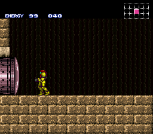
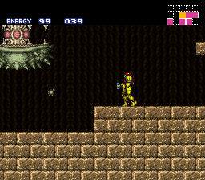
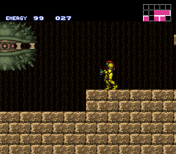
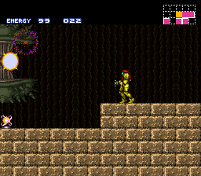
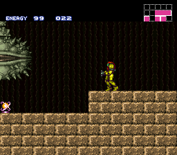
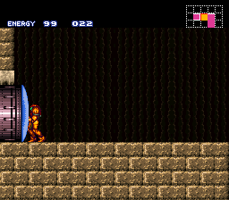

# 14c — Flaahgra = Spore Spawn na Sunchamber (e a sobra da spec 15: a Ruined Nursery)

Estado: **verificada** (31/10/2026: validate "136 salas, 284 portas, 0 problemas", linha do Tallon e `check_world_rounds`
iguais; `.ips` sha1 `6a35922626f8f315955d9fe83d6541e45cb4448e` igual em dois builds; **81/81** testes; bateria de testes
5 min 59 s)
Esforço estimado: 2–3 dias (medido: ~1,5 dia, com o passo 1)
Épico: [14 — Chefes](14-chefes.md) (linha 14c; decisões do usuário 1 e 2, padrões aceitos 3, 7, 9, 10, 11 e os de
31/10/2026). Depende da [14b](14b-arena-e-hive-mecha.md) (rotina das arenas em `$84:F500`, condição `BOSS_BIT`) e da
[spec 15](15-auditoria-de-entrada.md) (auditoria de entrada; o passo 1 tira a exceção da Ruined Nursery).

## Contexto

O épico (opção F1, decisão 2 do usuário) põe o **Spore Spawn** do SM no lugar do Flaahgra, com as cores do Flaahgra; a Varia
aparece quando ele morre; a porta da Sunchamber para a Sun Tower Access ganha uma tampa cinza que abre com o chefe morto; a
entrada fica azul. O E1 do épico mostrou que ele luta no tileset 0C, mas o código dele supõe a sala vanilla e a morte
repinta o arenito de marrom. Antes disso (passo 1, pedido do orquestrador): a Ruined Nursery L0 estava em `ENTRY_EXCEPTIONS`
porque mover a vespa quebrava a caminhada cega da cadeia completa.

## Estado antes (verificado)

validate 136/284/0, sha1 `694be017…d157`, 80/80 testes (5 min 58 s medidos).

- **Código do Spore Spawn** (bytes da ROM base; C em `vendor/sm/src/sm_a5.c`): caule em x 128 (`SporeSpawn_Func_5`
  `$A5:EC49`); morte em (128, 624) (`$A5:E87C`: `LDA #$0080 / STA $0F7A / LDA #$0270 / STA $0F7E`); esporos nascem em y 520
  sobre x 32–224 (`$86:DCD4`); a morte gera o PLM `$B78F` em (7, 30) (`$A5:EE41`: `JSL $84:83D7 / db 07 1E / dw B78F`, 2×2
  blocos viram ar, metatile `$0FF`, o mesmo ar das nossas salas); o init põe o gancho de câmera
  `Samus_ScrollFinishedHook_SporeSpawnFight` (`$90:9589`: câmera em y ≥ 464) em `$A5:EAD7` (`LDA #$9589 / STA $07E9`); ele
  guarda o estado nos campos do **inimigo 0** (tem que estar no slot 0). A morte liga **`$7ED829` bit `$02`** (área 1; o
  `boss_bits_for_area[area_index] |= 2` de `$A5:EDF3`), medido no emulador: nenhuma colisão com os nossos `$08/$10/$20`.
- **Tiro** (`SporeSpawn_Shot` `$A5:ED5A`, bytes `AD A6 18 0A AA BD 18 0C 89 00 07 D0 06 89 10 00 D0 01 6B`): só projéteis de
  tipo `& $0700` (míssil, super, bomba) ou carregados (`$0010`) chegam ao dano. **Os hitboxes vêm dos spritemaps estendidos**
  (`$A5:EE6F`…): fechado, o casco inteiro é `$8046` (tiro sem efeito); o núcleo (`±15, ±24`, `$ED5A`) só fica exposto entre
  as cascas nas listas `$E719–$E741` (ele para e treme, ~180 quadros por volta; `$EF4F` alterna com `$EF61`, núcleo sem dano).
  Tabela de vulnerabilidade `$B4:F094`: míssil ×2 → **100** por míssil (dano `$93:8641` = 100), tiro carregado ×4 → **120**
  (Power Beam carregado `$93:8539` = 60); vida 960 → **10 mísseis** ou **8 tiros carregados**; o feixe comum, nada.
- **Paletas** (16 cores cada): corpo no init `$A5:E359` (linha de sprite 7), por vida `$A5:E379` (4 linhas, linha de sprite 9),
  o desbotar da morte `$A5:E3F9` (8 linhas, sprite 9) e, no mesmo laço, **`$A5:E4F9` → linha 4 do BG e `$A5:E5D9` → linha 7
  do BG** (7 passos cada; `Draygon_Instr_29/19` `$A5:E8CA/$E91C`). A nossa linha 7 é o arenito (`smlib/ruins.py`), a 4 é a da
  porta de charge (branca).
- **População vanilla** `$A1:A0FD`: `DF3F, x 128, y 624, init 0, propriedades $2800, extras $0004, 0, 0` (o `$0004` são os
  spritemaps estendidos: sem ele o corpo não aparece, medido); set `$B4:8663` paleta 1.
- **Sunchamber (12j)**: 4×3, arena com chão na linha 42, zigue-zague no oeste até a L0, a Varia num pedestal (31, 39), rodada
  2; porta L0 sem trava. Prime: Flaahgra `0425001E` na camada 1, ANCS `BF5F05CD` personagem `Plant_Boss_Creature`, CMDL
  `EC81CD52` (roteiro `s14c/scripts/flaahgra_ancs.py`).
- **Nursery (spec 15)**: a vespa em (10, 9) desce na Samus que entra andando pela L0 (~60 quadros); em 11 não (auditoria de 8
  jeitos); a cadeia, com ela em 11, terminava a caminhada do North Atrium em outro lugar (um rastejador a derrubava no pulo,
  `s14c/scripts/probe.py`) e caía no buraco da galeria.

## Mudança

**Passo 1 — Ruined Nursery.** Vespa (10, 9) → **(11, 9)** (`tools/chozo/enemies.py`); exceção tirada de `ENTRY_EXCEPTIONS`.
A cadeia ganhou dois trechos medidos (andados, sem RAM; `s14c/scripts/try_seq.py` a partir do estado da própria cadeia):
`CHAIN_ATRIUM_TO_DOOR` (no North Atrium: para oeste por baixo da plataforma até a parede, x `$15`, sobe pela ponta oeste,
para leste até x `$7A` virada para oeste: a subida para a galeria sai de um ponto fixo) e, na rodada 1, um tiro e um passo a
mais quando a caminhada termina contra a tampa fechada da L0 da Totem Access.

**Passo 2 — Flaahgra.**
1. **Sala** (`layouts.sunchamber`): o fosso do chefe no canto de baixo a oeste, como a sala vanilla: colunas 1–15, linhas
   32–43, **chão 44** (2 abaixo da linha da R2: a tigela), sob um teto de rocha até a galeria da L0 (chão 10); o **entalhe
   (7–8, 30–31)** já é ar (o PLM da morte não muda nada); a leste o salão (chão 42) com os dois fossos secos dos bomb slots
   (36–39, 48–51) e o zigue-zague de 12j (5 linhas por degrau) encostado no teto do fosso até a galeria da L0. A Varia aparece
   no chão do fosso **sob a casca**, (8, 43) (onde o Flaahgra cai no Prime; a casca acaba em y 679, o item começa em 688).
2. **Inimigo** (`frigate/enemies.py` `flaahgra`, `chozo/enemies.py`): Spore Spawn `$DF3F` com os valores da população
   vanilla (`$2800`, extras `$0004`, paleta 1), **sozinho, slot 0**, `Species.fixed = (128, 624)` (novo: o código o põe lá).
3. **Arena** (`bosses.ARENAS`): `Arena("chozo_sunchamber", 0x40, BOSS_BIT, 0x02, Varia (8, 43), needs {missile})`: a
   condição é o bit **`$02`** do próprio Spore Spawn; o bit da arena é **`$40`** (a rotina para quando o bit dela liga: não
   pode ser o `$02`). Estado morto por `E629 #$40` (sem o chefe, música da área), vivo com `2A/05` e a rotina.
4. **Porta cinza** (`chozo/rooms.py BOSS_DOORS`, `BOSS_GATE`; `build.GREY_DOOR_MINI_BOSS = $8400`): a L0 da Sunchamber
   (lado da arena) vira porta cinza **tipo 1** (bit de mini-chefe `$02`, `$84:BDE3`) sem bit de porta salvo; a R0 da Sun
   Tower Access (o outro lado) fica azul. O build recusa porta de chefe sem arena que espere o `$02`.
5. **Patches no `$A5`** (`bosses.spore_spawn_patches`, conferidos contra os bytes vanilla): as 13 linhas de paleta de
   sprite nas **cores do Flaahgra** (rampas por brilho das texturas do CMDL `EC81CD52`, `s14c/scripts/flaahgra_ramps.py`:
   verde-oliva das placas e folhas, creme das vértebras, vermelho-rosado das guelras; a última parada de cada rampa é um
   brilho acrescentado); cada linha das tabelas **`$A5:E4F9` e `$A5:E5D9` = a linha 4 e a linha 7 da paleta das ruínas
   como o build a escreve** (a morte não muda o fundo); o gancho de câmera **desligado** (`LDA #$0000`: com o zigue-zague
   sobre o fosso, a Samus subindo durante a luta saía por cima da tela).
6. **Validador** (`tools/validate.py`):
   - passeio das rodadas: `door_open` (porta com `BOSS_GATE` só com o `needs` da arena; `exit_open` e o `stuck` por rodada
     a usam) — a trava `boss` vale para a Varia (14b) **e para a porta cinza**;
   - `check_arenas`: justiça de chefe **com o equipamento da rodada** quando a luta tem `needs` (o feixe comum não vence):
     `arena_gear_fight` = vence com os mísseis que ela pode ter na chegada (`round_missiles`: capacidade dos itens das
     rodadas antes, `ITEM_GAIN`; cada míssil acerta, `weapon_damage` lido da ROM) **ou** com até `FAIR_BOSS_SHOTS = 20`
     tiros carregados se tem o Charge Beam; o `needs` declarado tem que ser, sozinho, um desses jeitos e estar na chegada;
     toque/projéteis até 40 (`arena_kills`: toque 12, esporos 4 lidos de `$86:DE7A`); com a ROM construída o cálculo usa a
     ROM construída; `check_spore_spawn`: sozinho no slot 0, posição fixa = a do código, PLM da morte e os blocos que ele
     abre = ar, o tiro vanilla, a entrada da população = a vanilla;
   - `check_arenas_in_rom`: os patches do `$A5` = os que `bosses.py` gera; cabeçalho e vulnerabilidades do Spore Spawn = os
     da base;
   - `check_gates`: a tampa `boss` = PLM cinza `$C848` com `$8400`; `check_chozo_locks_mapped`: a trava event do Prime numa
     sala com arena tem que ser porta de chefe (linha "48 travas"); `check_enemies`: inimigo de posição fixa sem chão.
7. **Testes** (`tests/run_tests.py`): `chozo_flaahgra` novo; `flaahgra_won_by_ram` (atalho anotado: vida 0 por RAM, ele morre
   no primeiro toque pelo próprio código) na rota C, na cadeia e no `chozo_varia_e_calor`; `SUNCHAMBER_TO_STA` medido de novo;
   `out_of_arena` também na entrada da arena viva (troca de song set).

## Critérios de aceite

1. validate 0 problemas; Tallon "44 salas construídas, alcançáveis agora: 44, 20 itens em 7 rodadas" e "rodadas (specs/12m):
   … 51 itens em 7 rodadas … 51%" iguais; nenhum item muda de rodada; linha "arenas" com a Sunchamber.
2. `chozo_flaahgra` (abaixo); a cadeia passa (atalho de RAM anotado); `entradas_de_porta_*` passam sem a exceção da Nursery.
3. Mutações (validador, ROM, emulador) pegas; dois builds iguais; fotos olhadas; bateria < ~7,5 min.

## Plano de testes

| Camada | O quê | Qtde |
|---|---|---|
| validate.py | trava `boss` em porta, justiça com o equipamento da rodada, `check_spore_spawn`, patches do `$A5` | linhas existentes |
| run_tests.py | `chozo_flaahgra` | +1 (81) |
| scratchpad (`s14c/`) | mutações (`mutate_14c.py`, `emu_mut_14c.py`), a luta (`policy2.py`), trechos medidos (`try_seq.py`, `probe.py`, `resume.py`) | — |
| imagem | `specs/img/14c-*.png` | +5 |

## Riscos e reversão

- **Roteiro da luta** (`FLAAHGRA_FIGHT`): gravado de uma política em malha fechada no emulador (`s14c/scripts/policy2.py`);
  vale para a entrada exata do teste (R2 por `door_teleport`, x 300 no salão). O movimento do chefe não usa o RNG (só os
  esporos), mas mexer na sala ou no caminho pede rodar a política de novo.
- **Atalhos das caminhadas**: o chefe morre no primeiro toque; a Samus espera na ponta leste do fosso, sob o lóbulo direito do
  "8" (900 quadros = uma volta e a parada).
- **Gancho de câmera desligado**: a câmera segue a Samus como em qualquer sala (o vanilla a prende em y ≥ 464).
- Reversão: tirar a arena, `BOSS_DOORS`, o `flaahgra` e os patches; a sala de 12j volta do `layouts.py` anterior.

## Fora de escopo

- A forma do Flaahgra (só cores), os tentáculos e bomb slots do Prime (`FlaahgraTentacle`, `Bomb Slot DamageableTrigger`), a
  troca de camadas do Prime depois do Flaahgra (2ª passagem).
- Incinerator Drone (14d), Chozo Ghosts (fora).

## Desvios (preenchido na implementação)

- **A sala nova não tem pedestal**: a Varia aparece no chão do fosso, sob a casca do Spore Spawn (no Prime ela surge onde o
  Flaahgra cai). Decisão a confirmar.
- **Gancho de câmera desligado** (2 bytes em `$A5:EAD7`): o épico falava em desenhar a sala em volta das suposições do Spore
  Spawn; as outras três (x 128, (128, 624), o PLM em (7, 30)) estão respeitadas pelo desenho, mas com o gancho a Samus que
  sobe o zigue-zague durante a luta sumia pelo alto da tela. Decisão a confirmar.
- **Extras `$0004`**: a primeira versão copiou só propriedades e parâmetros; sem os spritemaps estendidos o corpo ficava
  invisível e o hitbox virava o do cabeçalho (uma luta "fácil" e falsa). O validador agora confere a entrada inteira contra a
  vanilla.
- **Luta só com mísseis** (o teste): 40 mísseis por RAM (a capacidade da rodada 2 que o validador calcula), sem o Charge Beam
  (menos que o equipamento da rodada).
- **A morte não muda a música**: a rotina para a música (padrão aceito); o chefe não troca nada.
- **Transição para fora/dentro da arena**: 150 quadros a mais (`out_of_arena`) na entrada pela Sunchamber Access e na saída
  pela L0 (troca de song set, como na 14b).
- **Passo 1**: a cadeia ficou com dois trechos novos (acima); o resto dela passou igual com o RNG novo.
- **Roteiro da luta por política, não por busca em feixe** (a das 14a/14b, `s14c/scripts/beam.py`, não achou acertos: o míssil
  só conta no núcleo exposto, ~180 quadros por volta, e à altura dele): uma política em malha fechada (pula e atira quando ele
  para, com o A segurado pela altura do núcleo) rodada no emulador e gravada como roteiro aberto.
- **Atalho de RAM das caminhadas** = vida 0 e o primeiro toque (a morte pelo próprio código do Spore Spawn: o bit `$02`, o PLM,
  o desbotar), não o bit `$02` por RAM (o chefe ficaria vivo, com os esporos).
- **Build**: um prêmio de arena que não é item colocado parava com `StopIteration`; agora com a mensagem (mutação V5).

## Resultado

- validate: "136 salas, 284 portas, 0 problemas"; Tallon **igual** ("44 salas construídas, alcançáveis agora: 44, 20 itens em
  7 rodadas"); "rodadas (specs/12m): … 51 itens em 7 rodadas … 51%" **igual** (nenhum item mudou de rodada; a Varia continua
  na 2); "chozo (specs/12j, 12k, 12l): **48** travas do Prime nas ligações construídas" (era 47: a do Flaahgra mapeada);
  "arenas (specs/14b): … chozo_sunchamber (Prime: Flaahgra): 1 flaahgra + 0 outros, bit de chefe $02, bit $40, imune ao
  Power Beam; 10 mísseis (capacidade na rodada 2: 40) ou 8 tiros carregados (com o Charge Beam na chegada; máximo de chefe
  20) (rodada 2), até 12 por golpe, o item 8 (Varia Suit, rodada 2) aparece"; "chozo (specs/12h): 69 inimigos" igual.
- `.ips` sha1 `6a35922626f8f315955d9fe83d6541e45cb4448e` igual em dois builds.
- **Números da luta** (`chozo_flaahgra`): vida 960; míssil 100 (×2 da tabela `$B4:F094`), tiro carregado 120 (×4); só no
  núcleo exposto (listas `$E719–$E741`). Roteiro: `FLAAHGRA_HALL` (~420 quadros) + 18 pulos com míssil (`FLAAHGRA_FIGHT`,
  ~8400 quadros, ~2,3 min de jogo): **18 mísseis, 10 acertos**, sobram 22 de 40, energia **99** (em x 300 nada a alcança);
  depois de 2 pulos 860 e nenhum bit; no fim bits `$02` e `$40`, a Varia (`$EF07`) no slot 37 do PLM no bloco (8, 43), música
  parada; 900 quadros depois da morte as linhas 4 e 7 do BG na WRAM = as das ruínas. Teste sozinho ~40 s.
- **Porta e estado morto**: a L0 cinza (PLM `$C848`, `$8400`, slot 39) durante a luta; depois da morte um tiro a abre e a Samus
  passa para a Sun Tower Access (zigue-zague subido de verdade, `SUNCHAMBER_TO_STA`); de volta pela L0: estado morto (slot 0
  vazio, música `1B/05`, nenhuma Varia: pega), a porta azul; salvo na Save Station 2, game over, continue: bits e item
  ligados, a Sunchamber morta.
- **Espaço**: `$84` +10 (a entrada da tabela das arenas: 32 bytes); `$8F` +45 (faixa recuperada da 12a: 1599 → 1644 de 2153;
  a principal já estava cheia); `$A1` +22 (populações viva e morta); `$B4` +13 (o set); nível +41 (a Sunchamber: o nível
  dela ainda cruza `$E0:FFFF`, `nivel_cruza_banco_chozo_sunchamber` continua); `$A5` 0 (patches no lugar: 13 linhas de paleta
  de sprite, 14 linhas das tabelas da morte, 2 bytes do gancho); `$A0`, `$90`, fixo, SRAM: nada.
- **Passo 1**: `entradas_de_porta_chozo` confere agora a entrada da Ruined Nursery L0 (a vespa em 11); `ENTRY_EXCEPTIONS` só com o
  pirata do Elevator Beta. A cadeia passa com os trechos novos.
- **Testes**: **81/81** (o novo `chozo_flaahgra`); bateria de testes **5 min 59 s** (358,6 s; antes 5 min 58 s medidos no
  começo; a cadeia continua a mais longa); verificação inteira (2 builds, validate, testes) 6 min 11 s.
- **Fotos** (olhadas): `img/14c-porta-cinza.png` (a L0 cinza durante a luta, do roteiro `s14c`), `img/14c-luta.png` (o casco
  verde-oliva do Flaahgra, a Samus no salão em x 300), `img/14c-luta-2.png` (o núcleo exposto, moldura creme e núcleo
  vermelho-rosado), `img/14c-morte.png` (as explosões, a Varia no chão do fosso), `img/14c-depois-da-morte.png` (900
  quadros depois: a casca, o arenito com as cores de sempre, não marrom), `img/14c-reentrada.png` (de volta pela L0 com a
  Varia: a porta azul, a sala sem o chefe).

### Mudanças de expectativa dos testes

| Teste | Mudança |
|---|---|
| novo `chozo_flaahgra` | a luta com mísseis, a Varia, a porta, a volta morta, save/continue, as cores (acima) |
| `entradas_de_porta_chozo` | + a Ruined Nursery L0 (sem exceção); + as entradas da Sunchamber (R2, L0: o chefe não alcança a Samus parada na porta) |
| `cadeia_completa_tallon_chozo` | `CHAIN_ATRIUM_TO_DOOR` (rodada 0), o tiro e o passo na Totem Access (rodada 1); na Sunchamber (rodada 2) `out_of_arena` na entrada, `flaahgra_won_by_ram` + `C_TO_THE_PIT` (o chefe morre no primeiro toque), a Varia pega andando para oeste (`C_PIT_TO_VARIA`), `SUNCHAMBER_TO_STA` medido de novo (da parede oeste do fosso), 150 quadros a mais na porta da L0; `FullChain.note`: "arena vencida por RAM (vida 0, morre no primeiro toque): Flaahgra" |
| `chozo_regiao_c_rota` | o mesmo trecho da Sunchamber (atalho de RAM anotado) até a Varia; depois `door_teleport` para a Sun Tower Access, como antes |
| `chozo_varia_e_calor` | `flaahgra_won_by_ram` + a Samus posta por RAM sob o chefe (900 quadros); `VARIA_TAKEN_X` `$0204` → `$0094` (a Varia no fosso) |
| `nivel_cruza_banco_chozo_sunchamber` | nenhuma (o nível novo ainda cruza `$E0:FFFF`, 350 bytes) |
| os outros | nenhuma |

## Mutações

Validador e build (`s14c/scripts/mutate_14c.py` → `s14c/mutate_14c.out`, cópia `s14c/mut`), **todas pegas** (18): V1 a luta
sem `needs` (o feixe comum não mata: "não morre com o Power Beam"); V2 sem a porta de chefe (`BOSS_DOORS` vazio: a trava
event do Prime numa sala com arena fica sem mecanismo — esta regra é nova: antes desta mutação ela passava); V3 o bit da
arena `$02`; V4 a condição no bit `$04` (o build recusa: a porta tipo 1 espera o `$02`); V5 o prêmio fora do item (o build
para, agora com a mensagem); V6 o entalhe do teto fechado (o PLM da morte abriria um buraco); V7 outro inimigo antes do Spore
Spawn (slot 0); V8 posição fixa (130, 624); V9 extras 0 (o corpo invisível); V10 a Varia declarada na rodada 3; V11 a luta
pedindo o Space Jump (as rodadas mudam); V12 a porta de chefe trocada por cinza que nunca abre; V13 o prêmio também no estado
vivo. Na ROM construída: R1 a tabela da linha 7 vanilla (o arenito escureceria); R2 o gancho de câmera de volta; R3 uma cor
do corpo vanilla; **R4 o Spore Spawn imune a mísseis e a tiro carregado (invencível): "não se vence com o equipamento da
rodada 2"** (a justiça calcula com a ROM construída); R5 vida 3000 (cabeçalho ≠ base).

Emulador (`s14c/scripts/emu_mut_14c.py` → `s14c/emu_mut_14c.out`, o roteiro de `chozo_flaahgra` em ROMs de rascunho): E1 as
tabelas das linhas 4 e 7 vanilla → falha (as cores na WRAM depois da morte: `7EC082 = 6318`, esperado `7FFF`); E2 a L0
cinza que nunca abre → falha (não chega à Sun Tower Access); E3 a condição da arena no bit `$04` → falha (a Varia não
aparece no slot 37); E5 o bit da arena `$10` → falha (de volta, o chefe vivo e a música `2A`); sem mutação passa. **Não pego
pelo emulador**: E4 o gancho de câmera de volta (a luta e o resto passam; o validador pega, R2).

## Decisões para confirmar

1. Gancho de câmera do Spore Spawn desligado (câmera livre na luta).
2. A Varia no chão do fosso, sob a casca (sem pedestal).
3. A casca seca fica na sala depois da luta (vanilla) até a Samus sair; na volta a sala está vazia.
4. As cores do Flaahgra só por rampas de brilho (a forma continua a do Spore Spawn).
