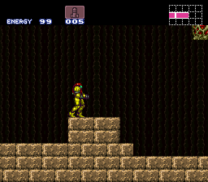
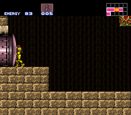
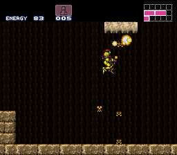
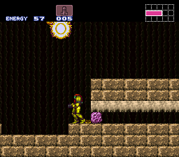
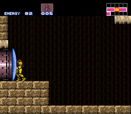

# 14d — Incinerator Drone (arena do Burn Dome)

Estado: **verificada** (31/10/2026: validate "136 salas, 284 portas, 0 problemas", linha do Tallon e `check_world_rounds`
iguais; `.ips` sha1 `31218abaaf3b1cb047f1ee6684ecd82fe45aa6c5` igual em dois builds; **82/82** testes; bateria de testes
5 min 55 s)
Esforço estimado: 1–1,5 dia (medido: ~1 dia)
Épico: [14 — Chefes](14-chefes.md) (linha 14d; decisão 6 do usuário: "pegar o item tranca a porta; colmeias + vespas; todas
mortas, abre"; padrões aceitos 3, 7, 9, 10, 12). Depende da [14b](14b-arena-e-hive-mecha.md) (rotina das arenas em
`$84:F500`, condição `ITEM`, estado morto, música) e da [14c](14c-flaahgra.md) (porta de chefe `BOSS_DOORS`/`BOSS_GATE`,
`door_open`).

## Contexto

No Prime, pegar as Bombas no suporte do Burn Dome (P48) acorda o Incinerator Drone: a única porta (→ Burn Dome Access) tranca
(`Actor Door Lock`), as colmeias (`Actor Hive`) e as vespas (`g_warwasp_generator`) entram na luta, e a porta abre quando ela
acaba. Aqui (12k, opção B) o suporte tem um míssil (bit `$CC`, rodada 1) e a porta não tinha trava ("os chefes depois"). O
usuário escolheu a arena (I1 do épico): o míssil começa a luta.

## Estado antes (verificado)

validate 136/284/0, sha1 `6a359226…448e`, 81/81 testes (~6 min).

- **Burn Dome** (`layouts.burn_dome`, 3×1): salão nas linhas 1–12 (chão 13), a borda da L0 nas colunas 0–5 (topo na linha
  10), o suporte nas colunas 22–25 (topo 11) com o míssil em (23, 10), o poço seco (27–32, 1 de fundo), o bloco a leste
  (35–46, linhas 9–12) com o túnel do míssil `$CD` (rodada 2), os favos no teto (14–16 e 31–33, linhas 1–2); 1 Mella em
  (16, 13); porta L0 sem tampa; música das ruínas `1B/05`.
- **Rotina das arenas** (14b): 4 condições; `ITEM` = "item pego → venceu" (liga o bit, para a música, gera o prêmio), sem
  arena; tabela de 10 bytes por arena.
- **Como o SM gera inimigo no meio da sala** (bytes e C): `SpawnEnemy` `$A0:9275` (`X` = entrada de população de 16 bytes,
  `DB` = o banco dela; acha slots livres, copia a entrada, roda o init da espécie, `RTL`); gráficos e paleta vêm do set da sala
  (`$7E:EF5C…`), então a espécie tem que estar no set. Usado pelo vanilla em `$A6` (Ridley/Ceres) e `$A9` (Mother Brain).
- **Pré-requisitos medidos no emulador** (roteiros `s14d/scripts/`):
  - o `SpawnEnemy` gera **tantos slots quanto as partes do cabeçalho** (`+$14`, `LDA $A00014,X / DEC` em `$A0:9291`) lendo
    entradas consecutivas; o Kago diz **9** (`$A0:E813`; a carga da população ignora o campo): gerado, leu além da lista e
    pulou para lixo (`BRK`, a CPU presa em `$80:8573`; `scripts/pc2.py` com um `snesrun` de depuração no scratchpad);
  - `EnemyMain` (`$A0:8FD4`) só roda se a população da sala tinha inimigo (`first_free_enemy_index`, `$0E4C`, posto pela
    carga): a sala precisa de um inimigo antes da luta;
  - a Mella (`Flies_6/Flies_7`, `$A2:B1AA`) volta de cada mergulho **um passo além** de onde saiu (`var_A` contado N vezes
    na ida, N+1 na volta) e não colide com a sala: uma Mella abaixo da altura da Samus afunda a cada mergulho; a do 12k (no
    chão, y 204, a Samus de pé no chão em y 187) afundou no chão, saiu da câmera e **parou para sempre** (inimigo fora da
    câmera não roda, `$A0:8EB6`): luta invencível com a porta trancada;
  - o item do suporte toca a fanfarra e enfileira `0` (360 quadros) e a faixa atual (`PlayRoomMusicTrackAfterAFrames`,
    `$82:E118`); trocar de song set no meio da sala congela ~38 quadros (14b). O vanilla do Bomb Torizo (`$8F:9804`) carrega
    o set de chefe com a **faixa 3** e o acordar enfileira a **5** (`Torizo_Instr_42` `$AA:CAE2`): sem troca de set na sala.

## Mudança

1. **Rotina** (`tools/chozo/bosses.py`, `$84:F500`, 140 → **222** bytes). Condição **`ITEM` redefinida**: a luta *começa*
   quando o item é pego e termina pela cota de mortes. A população viva da sala tem **cota 0** ("não começou"); com `$0E52`
   = 0 a rotina espera o bit do item (`$7ED870 + bit/8`); pego, ela lê o **registro de luta** (`$84`, depois da tabela;
   ponteiro no campo novo +10 da entrada, `ENTRY_SIZE` 10 → 12): põe `$0E52` = a cota do registro (todos os inimigos da sala
   que morrem, os gerados também), enfileira a canção da luta (`QueueMusic`, faixa do set já carregado), gera a **tampa
   cinza** (`SpawnRoomPLM`, uma entrada de 6 bytes no `$8F` fora de qualquer lista: `$C848` na L0, argumento `$8C00` =
   tipo 3, cota de mortes `$84:BE01`, sem bit de porta), gera os inimigos do registro (`SpawnEnemy`, `DB` = `$84`) e liga
   **`$0800`** (processar fora da câmera) em todo slot ocupado. Daí em diante `$0E52` ≠ 0 e a arena é de cota (`KILLS`): a
   rotina liga o bit e para a música no mesmo quadro em que a tampa abre pela própria pré-instrução. `$0E52` vale por visita
   (a carga da sala o põe): recarregar a sala com o item pego e o bit desligado (só por RAM) começa a luta de novo.
2. **Arena** (`ARENAS`): `Arena("chozo_burn_dome", 0x10, ITEM, item_bit("chozo_burn_dome", (23, 10)), None, frozenset(),
   …, WAITING_MUSIC, FIGHT_SONG)`: bit **`$10`** (o reservado desde a 14b), o item `$CC`, nenhum prêmio (o míssil é o
   gatilho), `needs` vazio (Power Beam), estado vivo com o set `$2A` **faixa 3** (como o Torizo; a troca de set fica na
   transição de porta), a luta enfileira a **5** (mini-chefe), a vitória **para** a música (padrão aceito 12a).
3. **Inimigos** (`chozo/enemies.py`, `frigate/enemies.py`): no Burn Dome `Spawn(WW, 40, 9)` (a vespa da camada 0, do chão
   (16, 13) para cima do bloco leste: acima de onde a Samus fica de pé), `Spawn(HV, 15, 5)` e `Spawn(HV, 32, 5)` (colmeias sob
   os favos), `Spawn(AW, 13, 13)` e `Spawn(AW, 34, 13)` (espécie nova `arena_wasp` = a Mella da vespa com `boss=True` e
   `hover=72`: nascem em y 132, acima da Samus no chão e no suporte). As espécies `boss` de uma arena `ITEM` não entram na
   população: vão para o registro. **Cópia do Kago** `bosses.KAGO_COPY` em `$A0:F87F` com **1 parte** (o resto do
   cabeçalho igual); a espécie `hive` passa a ser ela (também no Hive Totem: um Kago só para as duas arenas). Set: Mella
   (paleta 7) + a cópia (paleta 2).
4. **Porta** (`chozo/rooms.py BOSS_DOORS`): + (Burn Dome → Burn Dome Access). O build (`item_arena_door`) não põe tampa na
   lista: a porta fica azul (a entrada de porta que chega nela fecha a tampa azul atrás, como uma porta comum) até a rotina
   gerar a cinza; a entrada da tampa vai para o `$8F` e o ponteiro para o registro.
5. **Build** (`tools/build.py`): população viva da arena `ITEM` = `item_arena_population` (sem as espécies `boss`, cota 0;
   recusa sala sem inimigo antes da luta); registros de luta depois da tabela (`bosses.fight_record`: cota, canção, tampa,
   entradas, `0000`); recusa arena `ITEM` sem porta de chefe ou com duas.
6. **Validador** (`tools/validate.py`):
   - passeio das rodadas: `boss_locks` inclui o **item que começa** uma luta `ITEM` (pegá-lo tranca a porta até a vitória:
     só com o `needs` da arena); `door_open` deixa a porta de chefe de uma arena `ITEM` aberta (ela só tranca depois do item);
   - `check_arenas` + `check_item_arena`: o item é um item colocado da sala; uma porta de chefe na sala e nenhuma outra tampa;
     inimigo antes da luta; espécies geradas de 1 parte (lido da cópia ou do cabeçalho); canção da luta no set de mini-chefe;
     justiça somada sobre **todos** os inimigos que a cota espera (16 tiros, até 20 por golpe);
   - `check_arenas_in_rom`: a tabela com o ponteiro do registro, o registro (cota, canção, tampa, entradas) e a tampa no
     `$8F` (`$C848` em (1, 6), `$8C00`); `check_gates`: nenhuma tampa cinza da porta numa lista de estado;
     `check_enemies_in_rom`: a população viva sem as espécies `boss` e cota 0; `check_reclaimed`: a tampa do registro é
     estrutura nossa; `check_species_copies`: as partes da cópia; `arena_kills`: a cópia do Kago pela regra dos golpes.
7. **Testes** (`tests/run_tests.py`): `chozo_incinerator_drone` novo; `arena_won_by_ram` depois do míssil do suporte na rota D
   e na cadeia (anotado); `enemies_alive` sem as espécies geradas de uma arena `ITEM`.

## Critérios de aceite

1. validate 0 problemas; Tallon "44 salas construídas, alcançáveis agora: 44, 20 itens em 7 rodadas" e "rodadas (specs/12m):
   … 51 itens em 7 rodadas … 51%" **iguais** (o míssil `$CC` continua na rodada 1); linha "arenas" com o Burn Dome; "49 travas
   do Prime" (a do Burn Dome mapeada). (falha_quando = mutações V1–V16, R1–R7; não_prova = que a luta se vence: teste 2)
2. `chozo_incinerator_drone` (emulador, abaixo): a luta de verdade só com o Power Beam, nenhuma RAM na luta; a porta trancada;
   a morte no meio da luta e o continue reiniciam a luta; vitória, saída pela porta, volta morta, save/continue morto.
   (falha_quando = E1–E7)
3. A cadeia e a rota D passam (atalho de RAM anotado); 2 builds iguais; fotos olhadas; bateria < ~7,5 min.

## Plano de testes

| Camada | O quê | Qtde |
|---|---|---|
| validate.py | `check_item_arena`, registro e tampa na ROM, `boss_locks` do item que começa | linhas existentes |
| run_tests.py | `chozo_incinerator_drone` | +1 (82) |
| scratchpad (`s14d/`) | `mutate_14d.py`, `emu_mut_14d.py`, a busca da luta (`drone_beam.py`), os experimentos (`pick.py`, `variants*.py`, `pc*.py`, `music.py`, `trace.py`) | — |
| imagem | `specs/img/14d-*.png` | +9 |

## Riscos e reversão

- **Roteiro da luta** (`DRONE_FIGHT`): achado por busca em feixe no emulador (`s14d/scripts/drone_beam.py`, a partir do estado
  do próprio teste: o prefixo inteiro, a morte e o continue incluídos, muda o RNG); mexer no caminho, na sala ou nos inimigos
  pede nova busca (`scripts/prefix.py` gera o estado de partida).
- **Mella**: deriva um passo por mergulho; com `$0800` ela sempre volta à altura da Samus no mergulho seguinte (matável),
  mas uma luta longa pode deixá-la fora da tela entre mergulhos. O Hive Mecha (14b) tem o mesmo risco sem porta trancada
  (sair e voltar recarrega a sala).
- **Evento 0**: a tampa tipo 3 liga "Zebes acordou" ao abrir (como a 14b previa); nenhuma sala nossa usa `E612`
  (`check_arenas_in_rom`).
- Reversão: tirar a arena do Burn Dome, a porta de `BOSS_DOORS`, as espécies `boss` do Burn Dome e a cópia do Kago (e a rotina
  volta a 140 bytes) e reconstruir.

## Fora de escopo

- O Drone em si (o "olho", os 4 estágios), cores das colmeias (paleta vanilla do Kago, padrão aceito 12c), geradores que repõem
  vespas.
- A Mella do Hive Mecha (o mesmo risco de deriva; nada mudou lá além da cópia do Kago).

## Desvios (preenchido na implementação)

- **Inimigos gerados, não escondidos**: o épico permitia inimigos desde a entrada; o `SpawnEnemy` do SM serve, com uma cópia
  do Kago de 1 parte (o vanilla diz 9 e travava o jogo). O Hive Totem usa a mesma cópia (bytes diferentes na ROM, luta igual:
  `chozo_hive_mecha` passa sem mudança).
- **`ITEM` redefinida** (14b a descrevia como "item pego → venceu", nunca usada): agora é a luta que começa no item.
- **A vespa da camada 0 mudou de lugar** (16, 13) → (40, 9) e as vespas da arena nascem 72 px acima do chão: uma Mella abaixo
  da Samus afunda (medido); a do chão saiu da tela e travou a luta.
- **`$0800` em todos os inimigos da sala** quando a luta começa (processar fora da câmera): sem isso a vespa parada fora da tela
  deixava a luta invencível com a porta trancada (mutação E4: o teste falha).
- **Música**: antes do item a faixa 3 do set de mini-chefe (o zumbido do Torizo vanilla), não a das ruínas; a troca de set fica
  na porta (+~45 quadros na transição, como as outras arenas). Trocar o set no meio da sala congelaria o jogo depois da caixa
  de mensagem.
- **Morte no meio da luta**: não há estação dentro da sala e a porta está trancada: não dá para salvar com o item pego. Morrendo,
  o continue volta ao último save (item e bit desligados): a luta recomeça inteira (testado). Sair antes de pegar o item: a porta
  é azul. A porta trancada só abre pela cota.

## Resultado

- validate: "136 salas, 284 portas, 0 problemas"; Tallon **igual**; "rodadas (specs/12m): … 51 itens em 7 rodadas … 51%"
  **igual**; "chozo (specs/12h): 69 inimigos em 25 salas" igual; "chozo (specs/12j, 12k, 12l): **49** travas do Prime" (era 48);
  "arenas (specs/14b): … chozo_burn_dome (Prime: ActorContraption (Incinerator Drone)): 2 arena_wasp, 2 hive + 1 outros, o item
  $CC pego começa a luta (a porta tranca, os 4 gerados), cota de mortes 5, bit $10, 16 tiros do Power Beam (rodada 1), até 20
  por golpe, nenhum prêmio"; "chefes (specs/14a): … 2 cópia(s) de espécie conferida(s)".
- `.ips` sha1 `31218abaaf3b1cb047f1ee6684ecd82fe45aa6c5` igual em dois builds.
- **Números da luta** (`chozo_incinerator_drone`): Kago (cópia) 5 golpes (parâmetro 4), Mella 2 tiros: 16 tiros no mínimo;
  bug 20 por toque, vespa 16. Antes do item: a Mella no slot 0, `$0E52` = 0, set `$2A` faixa 3, bit `$10` desligado, nenhuma
  tampa. Pego (sem ser tocada no caminho, 99): `$0E52` = 5, faixa 5, colmeias nos slots 1–2 (`$F87F`), vespas 3–4 (`$D13F`),
  a tampa `$C848` no slot de PLM 37. Até a porta, um tiro, empurrando: continua no Burn Dome. Energia 0 por RAM: game over,
  continue na Save Station 2 (o save antes da luta): `$CC` e `$10` desligados, 0 mísseis; de volta, a sala viva e o míssil no
  suporte. A luta de verdade (`DRONE_FIGHT`, 29 lances, 851 quadros ≈ 14 s, 41 tiros disparados): 99 → **57** de energia,
  `$0E50` = 5, bit `$10`, música parada; a tampa abre pela cota; 10 pulos para oeste com tiros até a porta e a Burn Dome Access.
  De volta: estado morto (só a Mella, `1B/05`, nenhuma tampa, o míssil do suporte não volta; o do túnel continua). Salva na
  Save Station 2, game over, continue: bits ligados; o Burn Dome morto. Teste inteiro 31 099 quadros, ~40 s.
- **Espaço**: `$84` +172 (rotina +82, tabela +18, registro 72; o código e os dados das arenas em `$84:F500–F657`, livre a
  partir de `$84:F658`); `$8F` +37 (faixa recuperada da 12a: 1644 → 1681 de 2254: o seletor e o estado morto, a tampa de 6
  bytes); `$A0` +64 (a cópia do Kago em `$A0:F87F`); `$A1` +19 (população morta); `$B4` +5 (o Kago no set); `$83` 0 (o byte de
  direção da entrada de porta para o Burn Dome: fecha a tampa azul atrás); nível, fixo, SRAM: nada.
- **Fotos** (olhadas): `img/14d-entrada.png` (a L0 azul atrás da Samus, a sala vazia), `img/14d-mensagem.png` ("MISSILE" no
  suporte), `img/14d-comeco.png` (a Samus no suporte, uma colmeia no favo leste), `img/14d-porta-cinza.png` (a Samus na borda da
  L0 contra a tampa cinza, a colmeia no alto), `img/14d-luta-colmeia.png` (a colmeia oeste, um inseto caindo), `img/14d-luta.png`
  (tiro para cima na colmeia, explosões, insetos), `img/14d-vitoria.png` (a última colmeia explodindo, a Samus no poço),
  `img/14d-morto.png` (de volta: a porta azul, a sala vazia), `img/14d-depois-do-continue.png` (morto depois do continue).

### Mudanças de expectativa dos testes

| Teste | Mudança |
|---|---|
| novo `chozo_incinerator_drone` | acima |
| `chozo_regiao_d_rota` | depois do míssil do suporte, `arena_won_by_ram("chozo_burn_dome")` (atalho anotado) e o bit `$10` |
| `cadeia_completa_tallon_chozo` | o mesmo na rodada 1 (`FullChain.note`: "arena vencida por RAM (cota de mortes, depois do míssil do suporte): Incinerator Drone"; `expectbit 7ED829 10`, música parada); a docstring lista os três chefes vencidos por RAM e o besouro deixado vivo |
| `chozo_inimigos_vivos` | o Burn Dome vivo sem as espécies geradas (`enemies_alive`), a Mella no lugar novo |
| `chozo_hive_mecha` | nenhuma (as colmeias agora são a cópia `$F87F`: o teste lê a espécie da tabela) |
| os outros | nenhuma |

## Mutações

Validador e build (`s14d/scripts/mutate_14d.py` → `s14d/mutate_14d.out`, cópia `s14d/mut`): **pegas**: V1 a luta pede o Charge
Beam (o míssil do suporte iria para a rodada 2: o passeio só pega o item que começa a luta com o `needs`); V2 sem a porta de
chefe (build); V3 a colmeia de 9 partes; V4 nenhum inimigo antes da luta (build); V6 a condição num item de outra sala; V7 colmeias
vanilla (28 tiros); V8 bit `$08` repetido; V9 bit `$04`; V10 a tampa na lista (build); V11 sem canção (build); V13 uma vespa da
arena colada na porta; V14 bit `$02` (vanilla da área 1); V15/V16 (da 14f, abaixo). Na ROM: R1 a cota do registro 6; R2 a tampa
gerada de tipo 1; R3 cota 5 na população viva; R4 a cópia do Kago com 9 partes; R5 um byte da rotina; R6 a condição da tabela
`KILLS`; R7 o registro apontando para o espaço livre. **Não pegas pelo validador, pegas pelo emulador**: V5 a condição no míssil
do túnel (`$CD`, um item da sala: E2) e V12 as vespas da arena sem `hover` (E5).

Emulador (`s14d/scripts/emu_mut_14d.py` → `s14d/emu_mut_14d.out`, o próprio `chozo_incinerator_drone` em builds de rascunho),
**todas falham**: E1 cota 6 (a porta nunca abre); E2 a condição no míssil do túnel (a luta não começa); E3 bit da arena `$20`
(volta viva); E4 sem o laço do `$0800` (a luta gravada não vence); E5 vespas da arena no chão (não vence); E6 a tampa gerada
de tipo 1 (não sai da sala); E7 o registro sem tampa (a luta não começa direito); sem mutação passa.

## Decisões para confirmar

1. A faixa 3 do set de mini-chefe (o zumbido do Torizo vanilla) no Burn Dome antes do item, em vez da música das ruínas.
2. A vespa da camada 0 do Burn Dome em cima do bloco leste (era no chão a oeste do suporte) e as vespas da luta nascendo no ar.
3. As colmeias geradas no item (não estão na sala antes; no Prime as `Actor Hive` estão na camada 0).
4. A luta conta a vespa de antes (todas as mortes da sala): matá-la antes do item já adianta uma.
5. Ao morrer na luta, o continue volta ao último save com o míssil no suporte (a luta inteira de novo).
