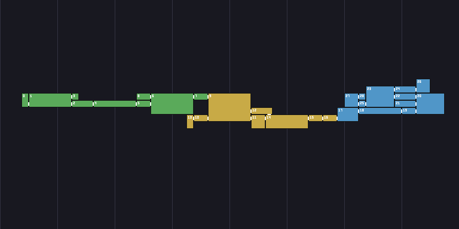

# 17c — Grafo, mapa e travas do Prime da Magmoor

Estado: verificada (01/11/2026: validate 136/284/0 com a linha nova "magmoor (tabela inteira, specs/17c …)"; .ips sha1
`0f5cc669fc89800b65e43169c9cd5a816fde0653` igual em dois builds; manifest igual; 83/83 testes)
Esforço estimado: 1,5 dia
Épico: [17 — Magmoor Caverns](17-magmoor-caverns.md) (decisões 1 e 6; dados, nenhuma sala na ROM)

## Contexto

Como a 12c fez para a Chozo, antes de desenhar qualquer sala da Magmoor o projeto precisa da planta do mundo inteiro: as 29 salas,
o tamanho de cada uma, onde fica no mapa de pausa da área 2 (17b) e por qual porta liga na vizinha, com as checagens do validador.
Esta filha grava também as **travas do Prime** de cada porta (com a **cor** das portas de feixe), as features que travam movimento
dentro das salas e as **salas quentes**, como dados lidos do jogo, **sem escolher item nem mecanismo do SM** (isso é das regiões,
17f–17i, pela decisão técnica 5 do épico). Nenhuma sala vai para a ROM.

## Estado atual (verificado)

- `research/prime_worlds.json`, MLVL "Magmoor Caverns": 29 salas, 58 docas = 29 ligações, todas com volta; um ciclo só (Monitor Station
  → Warrior Shrine → Fiery Shores → Shore Tunnel → Monitor Station).
- `tools/dump_prime_locks.py` (12c) dá, por doca, os objetos a ≤ 3 m e, por sala, as features por nome; **não** guardava a cor das portas
  (a 12l a leu à parte, num roteiro do scratchpad, e a escreveu à mão em `chozo/rooms.py KEY_BEAM`) nem o calor (`SpecialFunction` de
  função 18, Area Damage; a 12j também leu à parte). O roteiro do épico (`s17/scripts/magmoor_objs.py`) leu os dois da Magmoor: 12 salas
  com Area Damage (13 objetos: a Lava Lake tem 2), e as vulnerabilidades dos `Trigger_DoorKey` (power, ice, wave, plasma; 1 = dano,
  2 = imune).
- Tamanho pela regra do Tallon (`tallon/rooms.py screens`): **156 telas** (A 48, B 51, C 57).
- `frigate/mapsave.py`: a lista do mapa salvo da área 2 cabe no lugar vanilla até 80 bytes (`LIST_ROOM[2]`).

## Mudança proposta

1. `tools/dump_prime_locks.py`: por doca, `"key_vuln"` = as 4 vulnerabilidades de feixe do `Trigger_DoorKey` dela (40 bytes depois do nome,
   o método da 12l) ou `null`; por sala, `"area_damage"` = quantos `SpecialFunction` de função 18 (24 bytes depois do nome). Campos novos,
   os antigos iguais (a saída da Chozo, rodada de novo no scratchpad, dá `docks`/`features` idênticos ao `research/prime_chozo_locks.json`;
   este não é regravado). Saída da Magmoor: `research/prime_magmoor_locks.json` (29 salas; `docks`/`features` iguais ao `s17/magmoor_locks.json`
   do épico).
2. `tools/magmoor/rooms.py` (novo, no molde de `chozo/rooms.py`): `TABLE` (29 `Row`: chave `magmoor_*`, P#, nome, região, caixa, `map_x`,
   `map_y`), `LINKS` (29 pares com lado e tela), `REGIONS` A–C (as do épico), `ACTIVE_REGIONS` vazio, `ROOMS = []`, `ALL_ROOMS` (caixas
   provisórias, só para o validador), `ELEVATOR_ROOMS` (P0 → Chozo P24, P16 → Tallon P23: de verdade a partir da 17e),
   `DECORATIVE_ELEVATORS` (P13, P27 → Phendrana; P26 → Mines: de enfeite, decisão 5), `TRANSPORT_TO`, e os dados do Prime:
   - `DOCK_LOCKS` pela regra da Chozo (`chozo/rooms.py prime_dock_locks`, importada): 16 docas — **missile 2** (Burning Trail → Save Station A,
     Transport to Phendrana South → Save Station B), **key 13**, **morph 1** (Warrior Shrine → Fiery Shores); nenhum event, nenhum one_way;
   - `KEY_BEAM` (cor do Prime de cada doca key, por `BEAM_OF_VULN`): **wave 9** (Twin Fires ↔ North Core Tunnel ↔ Geothermal Core,
     Geothermal Core ↔ South Core Tunnel ↔ Workstation, Workstation ↔ Transport Tunnel C ↔ Transport to Phendrana South), **ice 3**
     (Geothermal Core → Plasma Processing, Workstation Tunnel ↔ Transport to Mines West), **plasma 1** (Plasma Processing → Geothermal Core:
     a porta de dentro; vira gelo no SM na 17i, decisão técnica 5 — aqui fica o dado do Prime);
   - `FEATURES` (24 salas: lava em 23, spider na Twin Fires Tunnel e na Geothermal Core, bomb_slot na Geothermal Core, grapple em 4,
     breakable na Lava Lake e na Triclops Pit, morph_door na Warrior Shrine e na Fiery Shores);
   - `HOT_ROOMS` = as 12 com Area Damage (decisão 3).
   - `check_prime(worlds, locks)`: salas, nomes, caixas, ligações, travas, cores, features e salas quentes iguais ao Prime; as listas de
     elevador = os transportes da tabela.
3. **Disposição no mapa** por busca (roteiro descartável `s17c/layout_dfs.py`; o recozimento da 12c, `s17c/layout_sa.py`, empacava aqui
   em disposições com ligação solta): colocação aleatória em largura a partir da P0, cada sala encostando em todas as vizinhas já
   postas, a melhor de 8 × 60 000 tentativas por um custo (portas de chão/teto, bytes do save, porta de elevador fora da tela de baixo,
   ordem do Prime). O mapa corre **de oeste para leste do norte para o sul do Prime** (a Magmoor é comprida no eixo norte–sul: 1,5 km ×
   0,6 km; o mapa tem 64 × 32), em cima/embaixo pela altura do Prime, solta. Resultado: **1 ligação de chão/teto** (Shore Tunnel B2 →
   Fiery Shores T0 — o mínimo: o ciclo pede uma, porque a Warrior Shrine, 2 de largura, e a Shore Tunnel, 3, não cabem no mesmo vão entre
   a Monitor Station e a Fiery Shores), nenhuma porta de chão/teto em sala de elevador (o poço é o teto), **30 bytes** de SRAM, colunas
   3–61, linhas 10–16.
4. `tools/validate.py` **`check_magmoor()`** (sempre): `check_prime`; `check_layout` na tabela inteira e em **cada região sozinha**; sala de
   elevador sem porta de chão/teto; as salas `magmoor_*` do build = `ROOMS` (nenhuma); bytes do mapa salvo ≤ `LIST_ROOM[2]`. Linha nova.
   `HOT_WORLDS` (17b) ganha a área 2 com a tabela e as `HOT_ROOMS` da Magmoor (uma sala quente construída fora dela vira erro).
5. `tools/preview_rooms.py --mapa-magmoor` → `specs/img/17c-mapa.png` (o desenho da 07d/12c: cor por região, P#, marca de porta, linha a
   cada 8 colunas).

Cores: **A verde, B amarelo, C azul.** Da esquerda para a direita: a P0 (elevador da Chozo) e a Burning Trail com a Save Station A, a Lava
Lake, a Triclops Pit (com a Storage Cavern à esquerda e o Monitor Tunnel à direita); a Monitor Station, o Transport Tunnel A e o elevador
de Phendrana North embaixo à esquerda, o ciclo Warrior Shrine / Shore Tunnel / Fiery Shores, o Transport Tunnel B e o elevador do Tallon
West (P16); a Twin Fires Tunnel, a Twin Fires embaixo, a Geothermal Core na ponta direita com a Plasma Processing e a South Core Tunnel
à esquerda dela, a Workstation em cima com o Workstation Tunnel e o elevador das Mines (P26) em cima à direita, e o Transport Tunnel C,
o elevador de Phendrana South (P27) e a Save Station B à esquerda da Workstation.

| Região | Salas | Telas | Bytes do save (região sozinha) |
|---|---|---|---|
| A | 9 | 48 | 10 |
| B | 8 | 51 | 12 |
| C | 12 | 57 | 12 |
| **Magmoor inteira** | **29** | **156** | **30 de 80** |

## Critérios de aceite

1. validate "136 salas, 284 portas, 0 problemas" (igual) e a linha "magmoor (tabela inteira, specs/17c, salas construídas: 0): 29 salas,
   29 ligações (1 de chão/teto), 156 telas, mapa 30/80 bytes de SRAM (por região: A 10 B 12 C 12); travas do Prime em 16 docas (key 13,
   missile 2, morph 1; cor das portas: ice 3, plasma 1, wave 9); 12 salas quentes (Area Damage); elevadores: 2 de verdade (17e), 3 de
   enfeite; sem item SM". (protege = tabela, mapa, cota, travas, cores e calor iguais ao Prime; falha_quando = mutações abaixo; não_prova =
   salas jogáveis, isso é da 17e em diante)
2. Mutações (`s17c/mutate_c.py`, em memória), cada uma pega.
3. ROM igual: sha1 `0f5cc669…0653` em dois builds; 83/83.
4. `specs/img/17c-mapa.png` olhada: regiões juntas, nenhuma sala solta; `07d-mapa.png` e `12c-mapa.png` iguais byte a byte.

## Plano de testes

| Camada | O quê | Qtde |
|---|---|---|
| validate.py | `check_magmoor` (Prime × tabela × travas × cores × calor, mapa inteiro e por região, elevadores, cota); `check_heat` com a área 2 | +1 |
| scratchpad | 19 mutações; o dumper rodado de novo para a Chozo (campos antigos iguais) | 20 |
| run_tests.py | nenhum (ROM igual) | 0 |
| imagem | `specs/img/17c-mapa.png` | +1 |

## Riscos e reversão

- A única porta de chão/teto (Shore Tunnel → Fiery Shores) é do ciclo: a 17h desenha o acesso (degraus até a borda, como a 12f) ou pede
  para mexer na disposição (o validador acusa na hora).
- As salas de elevador P0 (1×2, porta R1) e P16 (2×1, portas L0 e R0) têm os tamanhos da regra; a P16 é baixa (1 tela): o poço do elevador
  (`tallon/layouts.py elevator`) cabe em qualquer altura, mas a 17e confere no emulador.
- Desenhar uma sala com outro tamanho empurra vizinhas; o roteiro de busca ficou no scratchpad.
- Reversão: apagar `tools/magmoor/`, `research/prime_magmoor_locks.json`, `check_magmoor`, a entrada da área 2 em `HOT_WORLDS`,
  `--mapa-magmoor` e os dois campos novos do dumper.

## Fora de escopo

- Desenho das salas, `AreaDef` da Magmoor, mapa de pausa na ROM, elevadores (17e em diante).
- Itens, mecanismo SM de cada trava, lava, inimigos (17d–17i).

## Desvios (preenchido na implementação)

- **Busca do mapa**: o recozimento da 12c (`s17c/layout_sa.py`, 6 sementes × 300 000 passos) parava em disposições com uma ligação que não
  encostava (custo > 1000) ou com 5–8 portas de chão/teto; trocado por colocação construtiva aleatória (`s17c/layout_dfs.py`), que só
  aceita sala encostando em todas as vizinhas já postas. Com peso 25 por porta de chão/teto, o melhor teve 2; com peso 60, a semente 12 achou
  **1** (o mínimo, ver item 3). A escolhida: `s17c/dfs_60_12.json`, deslocada para a coluna 3 e a linha 10.
- **Cor e calor nos dados, não à mão**: o épico pedia `KEY_BEAM` e `HOT_ROOMS`; em vez de copiá-los de um roteiro do scratchpad (como a
  12l/12j fizeram), o dumper do projeto passou a gravar `key_vuln` e `area_damage`, e `check_prime` os compara. Rodar o dumper de novo para a
  Chozo dá os campos antigos iguais (`s17a/chozo_locks_new.json`; `area_damage` só na Magma Pool, a sala quente da 12j: confere).
- **Checagem a mais**: sala de elevador sem porta de chão/teto (não estava no pedido; a busca já evitava, a checagem guarda para a 17e).
- `magmoor/rooms.py` importa `prime_dock_locks` e os nomes das travas de `chozo/rooms.py` (mesma regra, sem copiar).
- `check_magmoor` devolve o erro do `build_rooms` (lados não opostos, porta além das da vizinha) como problema, em vez de deixar o
  validador cair.
- O `preview_rooms.py` (qualquer opção) redesenha todas as salas em `research/render/`: 3 arquivos mudaram
  (`tallon_tallon_transport_chozo_{west,east,south}.png`), mas eram antigos (de antes da 12e); desenhados na cópia da 17a (antes da 17b/17c),
  saem iguais aos de agora. `07d-mapa.png` e `12c-mapa.png` iguais byte a byte.
- Mutações (`s17c/mutate_c.out`), todas pegas: C1 Lava Lake uma coluna à direita (10 problemas); C2 ligação faltando; C3 nome; C4 caixa;
  C5 escudo de míssil virou cor; C6 trava de morph esquecida; C7 feature inventada; C8 cota de 20 bytes; C9 porta numa tela fora da sala;
  C10 lados não opostos (o `build_rooms` para); C11 região desconhecida; C12 chave sem prefixo; C13 a porta de Plasma marcada gelo; C14
  Burning Trail quente; C15 Fiery Shores fria; C16 elevador de Phendrana North como de verdade; C17 elevador com porta de teto (disposição
  válida, só essa checagem pega); C18 sala da Magmoor no build fora de `ROOMS`; C19 cor inventada numa porta sem trava. Sem mutação: limpo.
- Verificação (01/11/2026, pasta real): `python3 -I tools/build.py` duas vezes → sha1 `0f5cc669fc89800b65e43169c9cd5a816fde0653` nas duas,
  `build/manifest.json` igual; `python3 -I tools/validate.py` → "136 salas, 284 portas, 0 problemas" com a linha do critério 1, as do Tallon
  e das rodadas iguais; `python3 -I tests/run_tests.py` → **83/83**.
