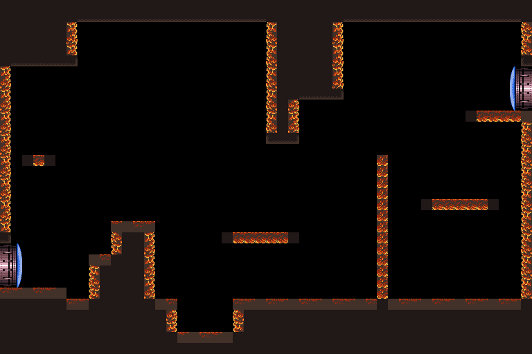
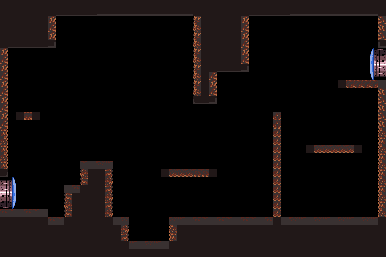
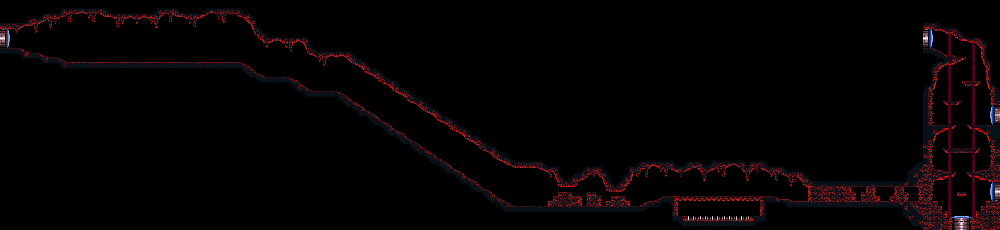
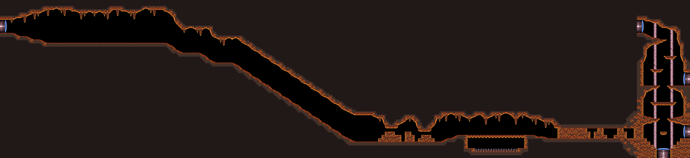
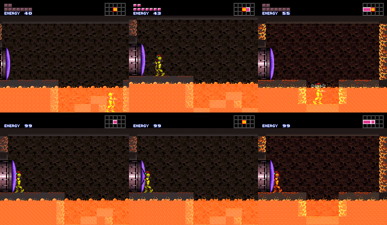

# 17d — Estilo das cavernas de lava (tilesets 09/0A), lava e a porta de onda

Estado: verificada (01/11/2026: validate "136 salas, 284 portas, 0 problemas" com as linhas novas "lava (specs/17d) …"; .ips
sha1 `87e0c517f6daf7509fe5470c5647fd26b6ee6363` igual em dois builds; 85/85 testes; verificação inteira 6 min 40 s)
Esforço estimado: 2–3 dias (gasto: 1 sessão)
Épico: [17 — Magmoor Caverns](17-magmoor-caverns.md) (decisão técnica 3; decisão do usuário 4: lava de verdade, nunca no caminho
obrigatório sem saída; 3: calor só nas 12 salas)

## Contexto

As salas da Magmoor (17e em diante) precisam de um estilo de parede (como a 12d fez para as ruínas), das cores do Prime (rocha escura,
brilho laranja/vermelho), da porta de onda roxa nos tilesets delas (10d, 12f) e da **lava**, que o projeto nunca usou. O épico pediu
medir a lava no emulador numa ROM de teste antes de qualquer sala depender dela, e regras do validador que toda sala com lava tenha de
cumprir, para as regiões (17f, 17h, 17i) serem conferidas automaticamente.

## Estado antes (verificado nos bytes; roteiros em `s17d/scripts/`)

- Tabela de tilesets: `$8F:E6F3` (09) e `$8F:E6FC` (0A) apontam os **mesmos** metatiles `$C1:E361` e gráficos `$BD:C3F9`; paletas
  `$C2:B5E4` (09) e `$C2:B6BB` (0A). Nenhuma sala nossa nem demo usa 09/0A.
- Peças (`pieces.py`, salas vanilla de rocha escura com crosta vermelha `$8F:A923` e `$AE07`, a peça mais comum por vizinhança de ar):
  recheio `$3FF`, chão `$11D/$11C/$10E`, teto `$113` (v), paredes `$107/$105`, cantos de baixo `$13B`, pilar `$10C`, saliência `$101`;
  **todas na linha 4** da paleta. As cores que usam (`render_vanilla.py`, contagem de pixels): 8–11, 13 e 15 (15 = preto, o mesmo do ar).
- FX de paleta da área 2 (`palfx_targets.py`, decodificando `$8D`): bit 0 = calor (`$F761`, linha 12 = Samus); bits 1–4 = brilhos da
  lava, que reescrevem a cada quadro a linha 3 (cores 5–7, 11–12) e as linhas 4, 5, 6 (cores 1–3, 12–13). As salas quentes vanilla da
  Norfair usam `$1F`.
- Fundo: `$8F:BE5A` descomprime `$B9:A714` no BG2, todos os tiles na **linha 6** (cores 4–7 e 15); a linha **7** não é usada por peça
  do estilo, pelo CRE (só linhas 0–3, lidas da tabela `$B9:A09D`) nem pelo fundo; metatiles `$3F0–$3F7` da tabela são enchimento
  (`$03FF ×4`).
- Cores das portas: linhas 0/1, cores 1–3 (e o batente da linha 1, 4–7) iguais às do tileset 4 nos dois.
- Lava vanilla: FX `$83:8430` = `0000 00B8 FFFF 0000 00 02 02 1E 0B 1F 02 02` (tipo 2, opções `$0B`, brilhos `$1F`). C: `Samus_Animate_LavaFx`
  (`$90:81C0`) ½ de energia por quadro sem a Gravity, o pulo começa com a velocidade de líquido (`Samus_InitJump`, índice 2), o Space
  Jump não funciona com a cabeça dentro (`Samus_Movement_03_SpinJumping`).

## O que foi feito

1. **`tools/smlib/lava.py`** (novo): `HOT_TILESET = 09`, `COOL_TILESET = 0A`, estilos `LAVA_HOT`/`LAVA_COOL` (as mesmas peças),
   `COLOURS_HOT`/`COLOURS_COOL` (as **únicas tabelas** de cor a mudar: linha 4 cores 8–11, 13, 15 — recheio de rocha escura, faixa
   marrom, crosta laranja-vermelha na quente e brasa apagada na fria — e linha 6 cores 4–7, o fundo em rocha quente escura),
   `PAINT_LINE = 7` (a porta roxa), `BACKGROUND $BE5A / LAYER2 $C1C1`, `MUSIC $15/$05` (Norfair de cima), `fx_entry` (FX de lava
   da área 2 no molde do `$83:8430`), `FX_HOT = $1F` (calor + brilhos) e `FX_COOL = 0`, `check(rom)`.
2. **`tools/build.py`**: depois do logo do título (o último blob fixo; nada anterior muda de lugar), grava as paletas 09 e 0A
   (`lava_palette`: cores da Magmoor + linha 7 roxa) e **uma** cópia da tabela de metatiles que os dois dividem com os 8 metatiles da
   porta roxa (`lava_metatiles`), e aponta as duas entradas para elas. `room_fx(area, sala)`: o FX de calor (12g) ou de lava
   (`RoomDef.lava` = linha da superfície; só na área 2), cada entrada posta uma vez no `$83`. `heat.heat_fx(2)` ganhou os brilhos
   (`heat.GLOWS`), como as salas quentes vanilla. Modo **`--teste-17d`** → `build/teste-17d/`.
3. **`tools/magmoor/testrooms.py`** (só na ROM de teste): uma área 2 de duas salas penduradas numa porta L1 da Magmoor East do Tallon
   (desde a 17e: na porta R0 da P16 da Magmoor, dentro da área dela; as portas de onda passaram para a parede oeste):
   `teste_lava_fria` (0A, 2×1, fosso de lava com chão a 1, 2 e 3 linhas abaixo da superfície; porta de onda na R0) e
   `teste_lava_quente` (09, quente, fosso pequeno; porta de onda na R0).
4. **Modelo (`tools/smlib/reach.py`)**: `LAVA` (tipo falso: nem corpo nem chão), `with_lava` (do nível da superfície para baixo),
   `Loadout.lava_depth` com o pulo medido (`LAVA_RISE_PX = {1: 46, 2: 58, 3: 69}`, sem pulo de vão, sem Space Jump), `lava_escapes`,
   `LAVA_MAX_DEPTH = 3`, `LAVA_MAX_MOVES = 5`, `LAVA_DAMAGE_PER_FRAME`; casos sintéticos no `self_test`.
5. **Regras do validador** (`check_lava`, toda sala com lava, em `check_room`):
   - lava só na área 2, sem água nem outro FX, superfície dentro da sala, nem plataforma de elevador nem save dentro dela;
   - **nunca no caminho**: os passeios (`foot_grid`, o flood fill do Space Jump, as rodadas) tratam a lava como lugar nenhum — toda
     porta, item e estação tem de ser alcançada sem entrar nela;
   - **sempre com saída**: de todo lugar de pé dentro da lava (caiu, foi empurrada), no máximo 5 movimentos (bloco andado, queda,
     subida) até um lugar fora dela que as entradas da sala alcançam, com o pulo medido na profundidade de cada lugar, nunca o Space
     Jump; fundo de no máximo 3 linhas (o medido). Andado com o equipamento da área e com Morph + Bombas (o mais fraco de qualquer
     rodada que chegue lá: mais equipamento só dá mais saídas, e a Gravity tira a lava da física).
   - `check_lava_test_rooms`: as salas de teste cumprem a regra e têm chão nas 3 profundidades medidas; linha "lava (specs/17d) …".
   - **`check_lava_in_rom`**: entradas no lugar, gráficos vanilla, paletas = as do build (e o roxo lido direto), uma tabela só =
     vanilla + porta roxa; **nenhuma sala fora da área 2 usa 09/0A**; todo estado de sala com lava aponta o FX dela e nenhuma outra
     sala nossa tem lava. `check_wave_paint_free` cobre 09/0A; os blobs entram em `fixed_blobs`.
6. **Testes** (ROM de teste, construída pelo `run_tests.py` antes deles): **`lava_medida`** (dano em 120 quadros: Gravity 0, Varia
   30, sem roupa 60; pulos de 1/2/3 linhas, Varia igual, Gravity = o seco 113, conferidos com `reach.py`; saída do fosso fundo para os
   dois lados; na sala quente: calor fora da lava 30 em 120, calor + lava 45 em 60, Varia na lava 30 em 120) e
   **`porta_de_onda_lava`** (porta de onda roxa no 0A e no 09: bloco `$C3F0` no nível da WRAM, linha 7 roxa na paleta da WRAM; o Power
   Beam não abre, o Wave abre e ela passa).
7. Prévia `python3 -I tools/preview_rooms.py --estilo-lava`.

 

De cima, da esquerda: no fundo do fosso sem roupa (a lava cobre a Samus; energia caindo), fora da lava depois do pulo (foto da verificação
da 17e, com a câmera posta nela), na sala quente (09, crosta brilhando) dentro
da lava; embaixo: a porta de onda roxa fechada no 0A, abrindo com o Wave, e no 09 (desde a 17e as salas de teste penduram na P16 da
Magmoor e as portas roxas ficam na parede oeste: ver a 17e).

## Medidas (emulador, ROM de teste)

| | sem roupa | Varia | Gravity |
|---|---|---|---|
| dano na lava por quadro | ½ (60 em 120) | ¼ (30 em 120) | 0 |
| pulo de dentro, pé a 1 / 2 / 3 linhas da superfície | 46 / 58 / 69 px (o pé passa a superfície em 30 / 26 / 21 px) | igual | 113 (seco) |
| sala quente (09) fora da lava / dentro | ¼ / ¾ | 0 / ¼ | — |

Saídas: do chão fundo (3 linhas) pulando com a direção ela fica de pé no chão seco dos dois lados do fosso (x `$0144` e `$003C`).
A lava (BG3) cobre toda a largura da sala da superfície para baixo, por cima da rocha: as salas das regiões põem a superfície abaixo
de todo chão andável, menos os fossos (o modelo marca do nível da superfície para baixo em toda a largura).

## Critérios de aceite

1. validate 0 problemas, "136 salas, 284 portas" (nenhuma sala nova no jogo), as linhas do Tallon e das rodadas iguais, linhas novas
   "lava (specs/17d)" (regra e medidas; tilesets na ROM). **Passa.**
2. `lava_medida` e `porta_de_onda_lava` passam; os 83 antigos passam (a ROM do jogo só ganhou os 3 blobs e as 6 palavras das entradas
   dos tilesets 09/0A). **Passa.**
3. Mutações pegas (abaixo). **Passa.**

## Mutações (`s17d/scripts/mutate_d.py` → `s17d/mutate_d.out`; emulador `s17d/emu_mut_d.out`)

Sem mutação: limpo. M1 peça de rampa `$106` no estilo; M2 peça da linha 5; M3 cor numa linha fora do estilo; M4 fosso de 4 linhas
("mais fundo que o medido"); M5 fosso largo de 16 colunas (sem saída em 5 movimentos); M6 lava numa sala da Chozo; M7 lava acima do
chão das portas; M8 pulo na lava maior que o medido (o `self_test` acusa); R1 cor da porta roxa trocada na paleta do 09; R2 0A apontando
a tabela vanilla; R3 sala do Tallon com o tileset 09; R4 sala do Tallon com FX de lava; R5 paleta do 0A igual à do 09. Emulador: com
`LAVA_RISE_PX[2] = 60` o `lava_medida` falha ("subiu 58 px, reach.py diz 60"); sem a pintura da linha 7 o `porta_de_onda_lava` falha
(cores `0596…` em vez do roxo). Todas pegas.

## Riscos e reversão

- **Lava cobre a sala inteira** abaixo da superfície (BG3 do SM): uma sala com chão em alturas diferentes precisa da superfície abaixo
  de todos; o validador acusa lugar de pé na lava sem saída.
- O pulo de mais de 3 linhas de fundo não foi medido: o validador proíbe.
- Os brilhos (bits 1–4) também reescrevem as cores 1–3/12–13 das linhas 3–6 nas salas quentes: a cor 13 da crosta brilha (como na
  Norfair); nada nosso fica nessas cores além dela.
- Reversão: tirar o bloco das paletas/tabela do `build.py`, `smlib/lava.py`, `RoomDef.lava`, as checagens e os testes.

## Fora de escopo

- Salas da Magmoor (17e em diante), inimigos, música definitiva por sala, jatos de fogo e estalactites.

## Decisões para o usuário (escolhidas as recomendadas; confirmar)

1. **Cores** (`lava.COLOURS_HOT/COOL`): rocha marrom-escura, crosta laranja na quente, brasa apagada na fria; fundo em rocha quente
   escura (era roxo). Mudar a tabela e reconstruir.
2. **Regra da lava**: nunca no caminho; saída em até 5 movimentos; no máximo 3 linhas de fundo. (Sem roupa, cair e sair custa ~10–20 de
   energia, medido.)
3. **Brilho**: salas quentes com o calor e os brilhos da Norfair (`$1F`); frias sem FX de paleta.

## Desvios (preenchido na implementação)

- A ROM do jogo muda (3 blobs fixos: paleta 09, paleta 0A, a tabela dividida; e os ponteiros das duas entradas), sem nada visível: nenhuma
  sala usa 09/0A (provado por `check_lava_in_rom`).
- O épico pedia "quente 09 / fria 0A" com a mesma tabela: uma cópia só da tabela serve aos dois.
- Fundo: recolorido também (linha 6 cores 4–7): o fundo vanilla roxo destoava.
- `LAVA_MAX_MOVES` começou em 3; o fosso de 4 colunas com parede 1 bloco acima precisava de 4–5 (andar até a borda e subir): 5.
- A regra "saída com o equipamento da rodada" usa o equipamento mais fraco que chega (o da área e Morph + Bombas), sem Space Jump: vale
  para toda rodada (mais equipamento só dá mais saídas).
- `heat.heat_fx(2)` agora inclui os brilhos (`$1F`); nenhuma sala quente da área 2 existe ainda.
- Experimentos e mutações na cópia `s17d/proj` (nada em `build/` da pasta real antes da verificação).
- Verificação (01/11/2026, pasta real): `python3 -I tools/build.py` duas vezes → sha1 `87e0c517f6daf7509fe5470c5647fd26b6ee6363`;
  `python3 -I tools/validate.py` → "136 salas, 284 portas, 0 problemas" (linhas do Tallon e das rodadas iguais; novas "lava (specs/17d)");
  `python3 -I tests/run_tests.py` → **85/85**; tudo em 6 min 40 s.
