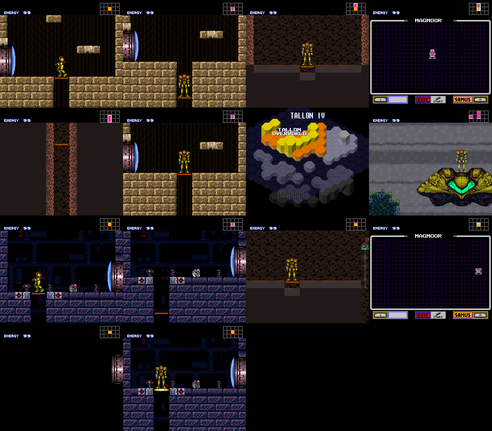

# 17e — Elevadores de verdade para a Magmoor (Chozo ↔ Magmoor, Tallon ↔ Magmoor)

Estado: verificada (01/11/2026: validate "138 salas, 284 portas, 0 problemas", linhas do Tallon e das rodadas iguais, linha nova
"magmoor (specs/17e) …"; .ips sha1 `a35c10615644dee6da2debcb4f385aed4d264348` igual em dois builds; **87/87** testes em 6 min 25 s; verificação inteira 6 min 39 s)
Esforço estimado: 2 dias (gasto: 1 sessão)
Épico: [17 — Magmoor Caverns](17-magmoor-caverns.md) (decisão técnica 6; decisão do usuário 5: os de Phendrana/Mines ficam de enfeite)

## Contexto

Os dois elevadores do Tallon e da Chozo que no Prime levam à Magmoor eram de enfeite: `chozo_transport_magmoor_north` (Chozo P24) e
`tallon_transport_magmoor_east` (Tallon P23). Esta filha os liga, como a 12e ligou os três da Chozo: cada um desce até a sua sala de
elevador da Magmoor (área 2) e volta. As salas da Magmoor, por ora, são só essas duas, prontas no estilo da 17d e **becos** (as portas
da tabela ficam fechadas até as regiões: 17f, 17h, 17i). Critério duro do pedido: **as rodadas do Tallon e da Chozo não mudam** (51
itens em 7 rodadas, 51%; elevadores chozo_west 0, chozo_east 4, chozo_south 5).

## Estado antes (verificado)

- Destinos dos `WorldTeleporter` (épico 17, dos bytes): Magmoor P0 ↔ Chozo P24, Magmoor P16 ↔ Tallon P23.
- Chozo P24 (`chozo/layouts.py transport_magmoor_north`): salão de cima (portas L0, R0), poço com degraus até o salão de baixo (porta
  L1, chão na linha 26), "plataforma" de enfeite no chão sob o poço. Tallon P23 (`low_transport("R")`): salão na tela de baixo, a
  plataforma de metal em x 3–6 e o Wave Beam no chão em (9, 25), fora dela. As duas na rodada 1.
- Área 2: `VANILLA_PAUSE[2]`, lista do mapa salvo até 80 bytes, 23 estações vanilla (17b); a tabela da Magmoor e o mapa (17c);
  nome vanilla na tela de continue: spritemap `$3B` em `$82:CCBF`, 7 peças ("NORFAIR"), lugar `$81:AA1C` área 2 = (`$5E`, `$B5`).

## O que foi feito

1. **Salas da Magmoor** (`tools/magmoor/layouts.py`, novo; `magmoor/rooms.py` `build_rooms` com os desenhos e o estilo da lava, quente
   no 09 e fria no 0A; `ROOMS = ELEVATOR_ROOMS`): **P0** (1×2): salão na tela de baixo (linhas 19–25, chão 26 = o batente da futura
   R1) e o poço de 2 blocos da linha 0 até a plataforma em x 7–8 (o centro em x 128); **P16** (2×1, uma tela de altura): salão nas
   duas telas (linhas 3–9, chão 10 = o batente das futuras L0 e R0) e o poço da linha 0 até a plataforma em x 7–8 da tela oeste (10
   linhas). As duas sobem (`Elevator(up=True)`), frias, secas, sem porta. `FIRST_ROUND` = 1 nas duas.
2. **Lados de cima**: Tallon P23 → `low_transport("R", ride=True)` (o meio da plataforma vira os blocos de porta e o poço desce até a
   última linha; o Wave fica em (9, 25)); Chozo P24 → os 2 blocos sob o poço (7–8, 26) e o poço até a linha 31 (`Elevator(7, 26,
   up=False)`).
3. **`tools/areas.py`**: `MAGMOOR` (área 2, "MAGMOOR", tileset 0A, fundo `$BE5A`/`$C1C1` e música `$15/$05` da 17d, estação 0 = o chão
   ao lado da plataforma da P0, lista do mapa salvo = a tabela inteira, 30 bytes); `ELEVATORS` agora é (sala de cima, sala de baixo)
   com os 2 pares novos; `AREAS = [FRIGATE, TALLON, CHOZO, MAGMOOR]` (a Magmoor por último: nada alocado antes muda de ordem).
4. **Tela de continue** (`frigate/areaselect.py`): nome da área 2 = **"MAGMOOR / CAVERNS"** (letras pequenas, como os outros nomes;
   o épico citava as grandes, que são só do título), spritemap nova no `$82` depois das outras (14 peças; a vanilla tem 7).
5. **Build**: nada novo além das tabelas da área 2 (mapa de pausa e minimapa "MAGMOOR" sobre as tabelas vanilla da Norfair, ícone de
   chefe vanilla apagado, lista do mapa salvo da área 2 em +445: 475/1280 da SRAM) — o resto é a máquina da 12e.
6. **Validador**: `check_elevators` geral (cada par = um do Prime por (área, P#) — `PRIME_ELEVATORS` com os 2 novos —, áreas
   diferentes, o de cima desce e o de baixo sobe), a linha "chozo (specs/12e)" continua só com os 3 Tallon↔Chozo; `world_rooms` passa
   pela Magmoor; **`check_magmoor_rounds`** (cada sala da Magmoor na rodada declarada e na mesma rodada do outro lado do seu elevador;
   linha nova "magmoor (specs/17e)"); a linha das rodadas mostra só os elevadores Tallon↔Chozo (**igual**); o fundo `$BE5A` entrou na
   `VANILLA_SHARED`.
7. **ROM de teste da 17d**: as salas de lava agora penduram na porta R0 da P16 (uma parede no jogo; no mapa onde ficará a Twin Fires
   Tunnel), dentro da própria área da Magmoor; antes era uma porta L1 na P23 do Tallon, que agora tem o poço do elevador ali.
8. **Testes**: `elevador_magmoor_ida_e_volta` e `elevador_magmoor_tallon` (abaixo).

Da esquerda para a direita, de cima para baixo: na plataforma da P24 da Chozo; descendo no poço; chegada na P0 da Magmoor (área 2, a
caverna fria); o mapa de pausa "MAGMOOR"; subindo pelo poço de lava; de volta à P24; a tela de continue com "MAGMOOR / CAVERNS"; o
continue na nave; a P23 do Tallon (a plataforma de metal, o Wave ao lado); descendo; chegada na P16 (uma tela de altura); o mapa com a
P16; subindo (a tela escura da troca de sala); de volta à P23.

## Medidas (emulador)

- P0 ← P24: chega de pé na plataforma (x `$0080`, y 26·16 + 2 − 26), área 2, `$0E18` = 0, no tempo do `ride_elevator` da 12e (900
  quadros). P16 ← P23: igual, com a plataforma descendo só 10 linhas (de y `$0018` a 162): **o poço de uma tela funciona**, ela chega
  de pé e o ↑ a leva de volta.
- O nome "MAGMOOR / CAVERNS" aparece na tela de continue quando a área 2 tem estação usada (no teste o bit é posto por RAM: a Magmoor
  ainda não tem save), apagado (paleta de área não escolhida) como os outros.

## Critérios de aceite

1. validate 0 problemas, "138 salas, 284 portas" (2 salas novas, nenhuma porta nova); **"44 salas construídas, alcançáveis agora: 44,
   20 itens em 7 rodadas"** e **"51 itens em 7 rodadas … chozo_west 0, chozo_east 4, chozo_south 5 … 51%"** iguais; linha "magmoor
   (specs/17e): 2 salas construídas (becos, 0 itens) … chozo_transport_magmoor_north (rodada 1) <-> magmoor_transport_chozo_north
   (rodada 1), tallon_transport_magmoor_east (rodada 1) <-> magmoor_transport_tallon_west (rodada 1)". **Passa.**
2. `elevador_magmoor_ida_e_volta` (protege = ida e volta Chozo ↔ Magmoor, área `$079F`, bits explorados das três áreas, mapa "MAGMOOR",
   paleta da 17d na WRAM, save, game over, nome na tela de continue, continue com os mapas salvos; falha_quando = mutações R1/R2/R3)
   e `elevador_magmoor_tallon` (Tallon ↔ P16, o Wave não é pego). **Passam.**
3. Os testes antigos passam; as expectativas mudadas vêm anotadas (abaixo). **Passa.**
4. Mutações pegas (abaixo). **Passa.**

## Expectativas de teste mudadas

- `chozo_regiao_b_rota` e `cadeia_completa_tallon_chozo`: a caminhada cega da P24 para a Vault Access (`B_WELL_TO_VAULT`) agora tem uma
  **pausa de 16 quadros depois do ciclo 13** (`B_WELL_SPLIT`, `B_WELL_PAUSE`, `chozo_walk_paused`). Com o elevador, a saída da P24
  mudou alguns quadros (a sala tem agora o inimigo da plataforma e mais duas entradas na lista de portas) e o andador pulava por cima
  da porta de chão da Vault Access (medido: ela parava em x `$034A` sem cair). Medido: pausas de 12–20 depois do ciclo 13 ou 14
  funcionam na ROM nova; na ROM antiga qualquer pausa de 0–20 depois dos ciclos 13–15 funciona (a mudança não depende da ROM).
- `lava_medida`/`porta_de_onda_lava` (17d): entram pela P16 (porta R0) e as portas de onda das salas de teste ficam na parede oeste.

## Mutações (`s17d/scripts/mutate_e.py` → `s17d/mutate_e.out`)

Sem mutação: limpo. E1 pares trocados (P24 ↔ P16) → "o Prime liga …"; E2 P0 descendo → o nível não monta; E3 rodada declarada errada
da P16; E4 salão da P16 soterrado → "entrada elevador sem lugar para a Samus ficar de pé"; E5 Magmoor na área 1 → "P24 (área 1) <-> P0
(área 1)…"; E6 poço da P0 fechado; **E7 um atalho da P0 para uma sala do Tallon da rodada 0** → "magmoor_transport_chozo_north fica
alcançável na rodada 0" (a guarda das rodadas pega um atalho pela Magmoor). ROM: R1 saída da P0 sem troca de área (flags `$80`); R2 a P24
levando à P16; R3 uma letra do nome trocada; R4 o nome do mapa de pausa da área 2 apagado. Todas pegas.

## Riscos e reversão

- As salas da Magmoor são becos sem save: morrer lá volta ao último save (do Tallon/Chozo). O nome no continue só aparece com um save
  na Magmoor (17f).
- Caminhadas cegas medidas que passem pela P23 ou P24 podem mudar de ritmo (a 12e viu o mesmo): o teste mostra a sala onde parou.
- Reversão: tirar `MAGMOOR` de `AREAS` e os 2 pares de `ELEVATORS`, `ride=True` da P23, o elevador da P24 e o nome da área 2.

## Fora de escopo

- As regiões (17f em diante), saves da Magmoor, os elevadores de Phendrana/Mines (de enfeite, 17h/17i), ícones de elevador no mapa.

## Desvios (preenchido na implementação)

- **Nome em letras pequenas** ("MAGMOOR / CAVERNS"), como CHOZO / RUINS: as grandes (`areaselect.BIG`) são do título.
- **`ELEVATORS` = (de cima, de baixo)** em vez de (Tallon, Chozo): o par Chozo → Magmoor tem a Chozo em cima. `PRIME_ELEVATORS` por (área, P#).
- **A Magmoor entra no passeio das rodadas** (`world_rooms`), em vez de ficar de fora como a Chozo na 12e: assim o validador prova que os
  elevadores novos não mudam nada (E7 mostra que um atalho seria pego) e já anda as salas da Magmoor para a 17f.
- A ROM de teste da 17d mudou de lugar (P23 → P16), ver item 7.
- A caminhada da região B ganhou uma pausa medida (Expectativas mudadas).
- Experimentos na cópia `s17d/proj`; nenhum em `build/` da pasta real antes da verificação.
- Verificação (01/11/2026, pasta real): `python3 -I tools/build.py` duas vezes → sha1 `a35c10615644dee6da2debcb4f385aed4d264348`;
  `python3 -I tools/validate.py` → "138 salas, 284 portas, 0 problemas", linhas do Tallon e das rodadas idênticas às de antes da 17d
  (diff), nova "magmoor (specs/17e)"; `python3 -I tests/run_tests.py` → **87/87** em 6 min 25 s.
