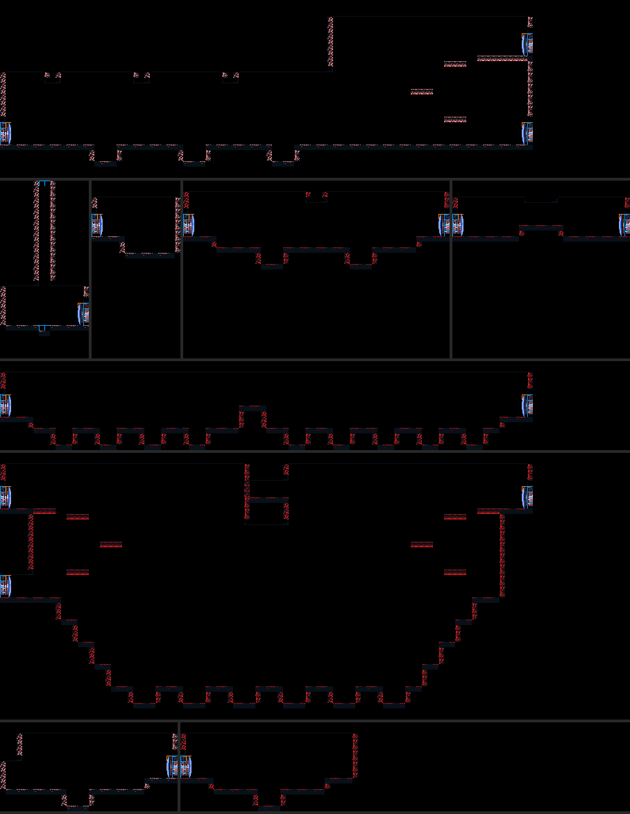
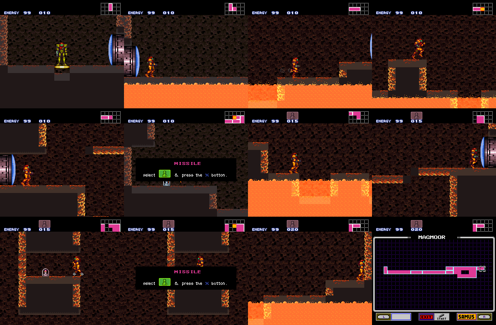
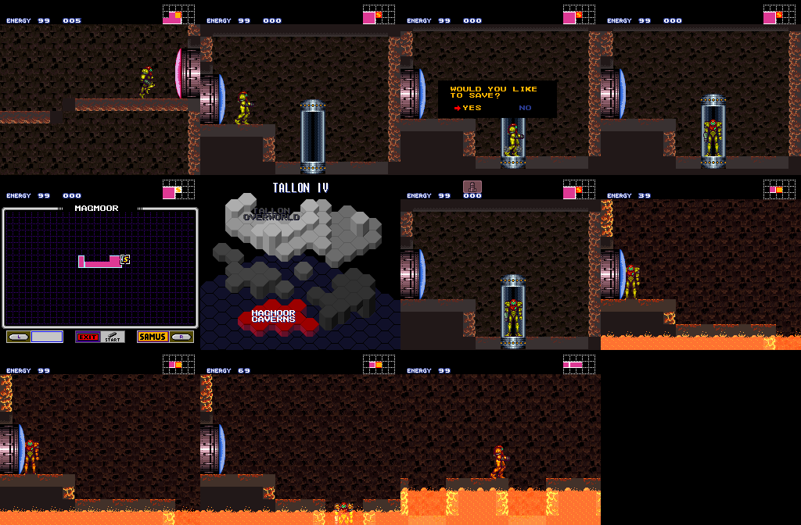

# 17f — Região A da Magmoor (norte: Burning Trail, Save Station A, Lava Lake, Triclops Pit)

Estado: verificada (01/11/2026: validate "146 salas, 300 portas, 0 problemas", as linhas do Tallon e das rodadas (12m) iguais;
`.ips` sha1 `4ce501026efcd8b179b2eb49a76f0717a5ece808` igual em dois builds; **90/90** testes em 6 min 31 s). Rascunho → aprovada
(pedido do orquestrador, decisões do épico) → implementada → verificada na mesma sessão.
Esforço estimado: 2–3 dias (salas 1 d; travas, itens, calor e lava 0,5 d; validador 0,25 d; emulador, fotos e mutações 0,75–1 d)
Épico: [17 — Magmoor Caverns](17-magmoor-caverns.md) (decisões do usuário 1–4; decisões técnicas 1, 4, 5, 8; linha 17f da tabela
de filhas); modelos: [12f](12f-regiao-a-chozo.md) (região com travas e itens), [12j](12j-regiao-c-chozo.md) (sala quente, Save
Station 2), [17d](17d-estilo-das-cavernas-de-lava.md) (estilo e regra da lava), [17e](17e-elevadores-da-magmoor.md) (elevadores,
`check_magmoor_rounds`).

## Contexto

Desde a 17e o elevador da Magmoor North da Chozo (P24, rodada 1) desce até a sala P0 da Magmoor, um beco. Esta filha constrói a
**região A** (a norte, 9 salas da tabela da 17c), abre a parede R1 da P0 para a Burning Trail, põe a trava do Prime da região
(o escudo de míssil da Save Station A), o **calor** nas 5 salas superaquecidas da região, a **lava de verdade** nos fossos e lagos
(regra da 17d), os **2 mísseis** da região e a **Save Station A** (estação 1 da área 2). Os inimigos ficam para a 17g.

## Estado antes (verificado)

- validate "138 salas, 284 portas, 0 problemas"; linhas "tallon (… 44 salas construídas, alcançáveis agora: 44, 20 itens em 7
  rodadas)" e "rodadas (specs/12m): Tallon + Chozo andados juntos, 51 itens em 7 rodadas … chozo_west 0, chozo_east 4,
  chozo_south 5 … 51%"; `.ips` sha1 `a35c10615644dee6da2debcb4f385aed4d264348`; 87/87 testes (~6,5 min).
- `tools/magmoor/rooms.py` (17c): região A = P0, P1 Burning Trail (6×2), P2 Lake Tunnel (3×1), P3 Save Station Magmoor A (1×1),
  P4 Lava Lake (6×1), P5 Pit Tunnel (2×1), P6 Triclops Pit (6×3), P7 Monitor Tunnel (2×1), P8 Storage Cavern (2×1). Ligações:
  P0 R1 ↔ Burning Trail L1; Burning Trail R1 ↔ Lake Tunnel L0, R0 ↔ Save Station A L0; Lake Tunnel R0 ↔ Lava Lake L0; Lava Lake
  R0 ↔ Pit Tunnel L0; Pit Tunnel R0 ↔ Triclops Pit L1; Triclops Pit R0 ↔ Monitor Tunnel L0, L0 ↔ Storage Cavern R0; Monitor
  Tunnel R0 ↔ Monitor Station (região B).
- **Travas do Prime** na região (`DOCK_LOCKS`, dados): só o **escudo de míssil** da Burning Trail → Save Station A (do lado da
  trilha). `HOT_ROOMS` (o `Area Damage` do Prime) na região: Lake Tunnel, Lava Lake, Pit Tunnel, Triclops Pit, Monitor Tunnel; frias:
  P0, Burning Trail (só o aviso "check for varia" do Prime), Save Station A, Storage Cavern. `FEATURES` "lava" em todas menos a P0,
  a Save Station A e a Pit Tunnel; Lava Lake "breakable"/"grapple" (o caminho do artefato), Triclops Pit "breakable".
- **Itens do Prime** (épico, tabela): Missile Expansion na Triclops Pit (P6, num pilar oco que o Prime alcança com o Space Jump:
  conhecimento) e na Storage Cavern (P8); o artefato da Lava Lake fora (decisão 2 do épico).
- Bits livres: itens a partir de `$D3` (Chozo até `$D2`); portas vermelhas a partir de `$C0` (Chozo `$B3–$BF`).
- Rodadas: a Varia é pega na rodada 2 (Sunchamber), o Space Jump na 2 (Alcove); com "sem a Varia não entra" (12g/12g2) as salas
  quentes ficam da rodada 3 em diante; a P0 e o outro lado do elevador, na 1.

## Mudança proposta

1. **Salas** (`tools/magmoor/layouts.py`, no estilo da 17d: quentes no tileset 09, frias no 0A, pelas regras do Tallon e da lava):
   - **Burning Trail** (6×2): a trilha na tela de baixo (chão na linha 26 = a borda da L1 e da R1; ar das linhas 13–25, o ápice do
     pulo sobre os fossos), **3 fossos de lava** (4 colunas, 2 linhas de fundo, superfície na linha 27), dentes de rocha no teto; no
     leste uma caverna até a prateleira da R0 (linha 10) por 3 bordas flutuantes de 5 em 5 linhas em zigue-zague (a da Tower of
     Light: a borda duas acima fica 10 linhas sobre a de onde ela pula).
   - **Save Station A** (1×1): a sala de save da 12j (pedestal em (8, 13), degrau sob a borda da L0). **Estação 1 da área 2.**
   - **Lake Tunnel** (3×1, quente): túnel com o chão na linha 12 (2 abaixo das bordas das portas: 10 linhas de ar para o pulo sobre
     um fosso), 2 fossos.
   - **Lava Lake** (6×1, quente): o lago de parede a parede, poças de 3 colunas entre rochas planas de 5, o **pilar vazio do
     artefato** no meio (subida de 4).
   - **Pit Tunnel** (2×1, quente, sem lava): túnel com um trecho alto.
   - **Triclops Pit** (6×3, quente): a L1 num chão (linha 26) junto da parede oeste; uma escada de rocha desce até o **fundo do
     poço** (linha 42, 6 poças de lava entre as rochas) e sobe a parede leste até um chão na linha 26; de cada um desses chãos 3
     bordas flutuantes em zigue-zague sobem às prateleiras (linha 10) da L0 (Storage Cavern) e da R0 (Monitor Tunnel). O **míssil**
     fica no oco de uma coluna de rocha pendurada do teto sobre o meio do poço (boca a leste), fora de todo pulo: **borda de Space
     Jump** (o pilar oco do Prime).
   - **Storage Cavern** (2×1, fria): caverna com o chão na linha 12, um fosso, o **míssil** no chão do fundo (5, 11).
   - **Monitor Tunnel** (2×1, quente): túnel na linha 12 com um fosso; a R0 (Monitor Station) **parede** até a região B (17h), o
     chão já na borda dela.
   - P0: a parede R1 abre (o chão da 17e já estava no batente).
2. **Travas** (`magmoor/rooms.py` `GATES`, `MAGMOOR_MISSILE_BIT0 = $C0`, `heat_gates`): o escudo de míssil = **porta vermelha** do
   lado da Burning Trail (bit `$C0`); toda porta para uma sala quente ganha a **Varia** na trava (a regra da 12g). A lava não é trava
   (decisão 4: nunca no caminho; os passeios não entram nela).
3. **Itens** (`tools/magmoor/items.py`, novo, no molde de `chozo/items.py`; bits `$D3`, `$D4`): o míssil da Triclops Pit (47, 7)
   rodada 3, `needs = {Space Jump}` (a borda de Space Jump: ver o desvio), o da Storage Cavern (5, 11) rodada 3. `build.py` os põe na ROM como os da Chozo.
4. **Estações** (`areas.magmoor_stations`): 0 = a chegada (17e), 1, 2… = as salas com save station, em ordem (Save Station A = 1).
5. **Rodadas** (`magmoor/rooms.py` `FIRST_ROUND`): 1 = P0, P16 (17e), Burning Trail, Save Station A (atrás da vermelha: os mísseis
   da rodada 0); 3 = as 5 quentes e a Storage Cavern (atrás da Triclops Pit). Itens: os 2 na rodada 3.
6. **Validador** (`tools/validate.py`):
   - `world_items` com a Magmoor (chave `("magmoor", n)`; `item_world`, `item_bit`, `ITEM_TABLES`); `check_tallon_items` confere
     os bits das três áreas juntos e os PLMs de item de toda sala;
   - `check_magmoor_rounds` (linha "magmoor (specs/17e, 17f)") confere também os itens da Magmoor (rodada declarada, bloco de ar
     longe das portas) e imprime salas e itens por rodada;
   - `check_world_rounds` (linha "rodadas (specs/12m)") continua **só Tallon + Chozo** (a 17j acrescenta a Magmoor, com a
     porcentagem das três áreas) e ganha a guarda "uma rodada que só acrescenta sala/item da Magmoor" é problema (a Magmoor não pode
     criar rodada nova no passeio);
   - **`check_magmoor_locks_mapped`** (novo, linha "magmoor (specs/17f)", no molde do `check_chozo_locks_mapped`): toda trava do
     Prime numa ligação construída tem o seu mecanismo do lado da doca (missile = tampa vermelha; key/morph = problema até a 17h/17i
     os mapearem), `GATES` só em ligações com trava do Prime, e **lava só em sala que tem lava no Prime**;
   - `check_arrival` passa a conferir as estações da Magmoor (a 0 da 17e não era conferida);
   - `check_item_geometry` aceita `needs = {Space Jump}`: o item não se pega de nenhuma porta a pé (com Morph, Bombas e Power Bomb)
     e se pega de toda porta com o Space Jump (o flood fill).
   As checagens de antes cobrem o resto: `check_room` (alcance a pé de toda porta, `check_lava`: nunca no caminho, toda lava com
   saída em ≤ 5 movimentos, ≤ 3 linhas de fundo; save station), `check_heat`/`check_heat_in_rom`, `check_lava_in_rom`,
   `check_gates`, `check_tallon_return`/`check_tallon_round_stuck` (volta à nave de toda sala em toda rodada), `check_pause_maps`,
   `check_map_shapes`, `check_orphans`, `check_reclaimed`.
7. **Testes** (`tests/run_tests.py`): `magmoor_regiao_a_rota`, `magmoor_calor`, `magmoor_save_station_a` (abaixo).

## Critérios de aceite

1. validate 0 problemas; **"44 salas construídas, alcançáveis agora: 44, 20 itens em 7 rodadas"** igual; **"rodadas (specs/12m)
   … 51 itens em 7 rodadas … chozo_west 0, chozo_east 4, chozo_south 5 … 51%" igual**; linhas da Magmoor com as 10 salas e os 2
   itens por rodada. (protege = travas, calor, lava, rodadas, softlock, mapa, bits; falha_quando = mutações; não_prova = que a forma
   agrada)
2. `magmoor_regiao_a_rota` (protege = a região A andada de verdade com o equipamento da rodada 3, os 2 mísseis, nenhum dano em toda a
   caminhada — calor com a Varia, nenhuma lava, nenhum dano nos primeiros quadros de porta (regra da spec 15) —, o mapa de pausa;
   falha_quando = mutações de emulador), `magmoor_calor` (protege = o calor sem a Varia nas salas quentes, a lava com a Varia e a
   saída dela; falha_quando = Lake Tunnel fria), `magmoor_save_station_a` (protege = a trilha e a subida da rodada 1, a porta
   vermelha, save/game over/continue na Magmoor). Os 87 antigos passam.
3. Mutações (`s17f/scripts/mutate_f.py`) pegas.
4. Dois builds com o mesmo sha1; fotos `specs/img/17f-*.png` olhadas; bateria inteira em < ~7,5 min.

## Plano de testes

| Camada | O quê | Qtde |
|---|---|---|
| validate.py | `check_magmoor_locks_mapped` (novo); `check_magmoor_rounds` com itens; `check_arrival` com a Magmoor; a guarda de rodada só da Magmoor | +1 |
| run_tests.py | `magmoor_regiao_a_rota`, `magmoor_calor`, `magmoor_save_station_a` | +3 |
| scratchpad | ~19 mutações do validador; mutações de emulador | ~22 |
| imagem | `specs/img/17f-*.png` (montagens das fotos do emulador, salas) | +3 |

## Riscos e reversão

- Caminhadas medidas (quadros de andar antes de cada pulo) mudam se a geometria mudar: o teste mostra a sala e a posição onde parou;
  `s17f/scripts/route.py` refaz a busca.
- `$8F`: a região A usa quase toda a faixa recuperada da 12a (2151 de 2153); as regiões B e C caem nas faixas da 17a (1563 livres).
- Reversão: `ACTIVE_REGIONS` vazio e os desenhos novos fora de `LAYOUTS` (e os testes novos): a ROM volta à da 17e.

## Fora de escopo

- Inimigos (17g: camada 0 do Prime — Burning Trail Metaree 16 + Parasite 1, Lake Tunnel Burrower 1 + Parasite 2, Lava Lake Puffer
  6, Pit Tunnel Tryclops 3, Triclops Pit Tryclops 5, Monitor Tunnel Puffer 5; Save Station A e Storage Cavern nenhum).
- Regiões B e C; a Monitor Station (a parede da Monitor Tunnel); o artefato e as rochas quebráveis do caminho dele na Lava Lake.

## Desvios (preenchido na implementação)

## Resultado

### Salas (10 na área 2: 8 novas + a P0 aberta; a P16 da 17e igual)

| Sala (P#) | Tamanho | Tileset | Lava (superfície) | Rodada | Notas |
|---|---|---|---|---|---|
| Transport to Chozo Ruins North (0) | 1×2 | 0A | — | 1 | R1 aberta para a Burning Trail |
| Burning Trail (1) | 6×2 | 0A | 27 (3 fossos) | 1 | R0 vermelha (bit `$C0`) para a Save Station A; caverna com 3 bordas até ela |
| Save Station Magmoor A (3) | 1×1 | 0A | — | 1 | estação 1 da área 2 |
| Lake Tunnel (2) | 3×1 | 09 quente | 13 (2 fossos) | 3 | |
| Lava Lake (4) | 6×1 | 09 quente | 13 (9 poças) | 3 | o pilar vazio do artefato |
| Pit Tunnel (5) | 2×1 | 09 quente | — | 3 | |
| Triclops Pit (6) | 6×3 | 09 quente | 43 (6 poças no fundo) | 3 | míssil no oco da coluna (Space Jump) |
| Storage Cavern (8) | 2×1 | 0A | 13 (1 fosso) | 3 | míssil no fundo |
| Monitor Tunnel (7) | 2×1 | 09 quente | 13 (1 fosso) | 3 | **R0 (Monitor Station) parede até a 17h** |

As prévias (`tools/preview_rooms.py`, `research/render/`) não desenham a lava (é uma camada de FX): as fotos do emulador mostram.

### Itens e rodadas

| Bit | Sala | Prime | Lugar / trava | Rodada |
|---|---|---|---|---|
| `$D3` | Triclops Pit | Missile Expansion (pilar oco) | oco da coluna pendurada, borda de Space Jump (47, 7) | 3 |
| `$D4` | Storage Cavern | Missile Expansion | chão do fundo da caverna (5, 11) | 3 |

### Linhas do validador (o que mudou e por quê)

- **Iguais** (diff contra a base): "tallon (… 44 salas construídas, alcançáveis agora: 44, 20 itens em 7 rodadas)" e "rodadas
  (specs/12m): Tallon + Chozo andados juntos, 51 itens em 7 rodadas … chozo_west 0, chozo_east 4, chozo_south 5 … 51%". Os 2 mísseis
  da Magmoor entram no passeio (rodada 3) mas não nessa linha nem na porcentagem: ela continua a das duas áreas, como a 17e a deixou;
  a 17j a estende às três (58 itens, 58% pelo épico). Os mísseis não abrem nada novo (os mísseis já existem desde a rodada 0) nem
  criam rodada: a guarda nova "rodada só da Magmoor" prova.
- "138 salas, 284 portas" → **"146 salas, 300 portas"** (8 salas, 8 ligações).
- "magmoor (specs/17e)" → **"magmoor (specs/17e, 17f; regiões ativas: A): 10 salas construídas, 2 itens … rodada 1: 4 salas, 0 itens;
  rodada 3: 6 salas, 2 itens; elevadores … (rodada 1) …"**.
- Nova **"magmoor (specs/17f): 1 trava(s) do Prime … salas quentes: 5 construídas, toda porta para elas com a Varia; lava em 6 salas,
  todas com lava no Prime"**.
- "magmoor (specs/17b)": 2 → 10 salas construídas; "magmoor (tabela inteira, specs/17c, salas construídas: 2)" → 10.
- "lava (specs/17d)": "salas do jogo com lava: 0 (0 lugares, pior saída 0)" → **"6 (79 lugares, pior saída 2)"**; tilesets "usados só
  pela área 2 (2 salas); estados com lava: 0" → "(10 salas); estados com lava: 6".
- "chozo (specs/12g)": a lista "salas quentes" é de todas as áreas: ganhou as 5 quentes da Magmoor.
- "ruínas (specs/12d)": "nenhuma das outras 74 salas nossas" → 82.
- "$8F recuperado": usados 1775 → **2151** (a faixa da 12a quase cheia: 2151/2153; as da 17a, 1563 bytes, livres para B e C).
- "bancos": nível 138 → 146 blobs (41 243 bytes).
- "órfãs": bytes só delas `$8F` 21567 → 21191 (as salas novas ocupam espaço recuperado que era só das órfãs) e `$83` 10470 → **10482**
  (+12: a estação 1 da área 2 agora é a Save Station A; a entrada de porta vanilla de 12 bytes que a estação 1 vanilla da Norfair
  apontava deixou de ser guardada pela tabela de estações).

### Testes (emulador)

- **`magmoor_regiao_a_rota`**: do pouso (atalhos até a P0, `magmoor_down`), equipamento da rodada 3 por RAM (Varia, Space Jump, Morph,
  Bombas; 10 mísseis), **andando** a região inteira: os 3 fossos da Burning Trail, os 2 da Lake Tunnel, as 9 poças e o pilar da Lava
  Lake, a Pit Tunnel, a Triclops Pit pelas bordas oeste até a L0, a Storage Cavern (míssil, 15) e a volta, do alto até o fundo do
  poço, as 6 poças, a escada e as bordas leste até a R0, **Space Jump de verdade** até o oco da coluna (míssil, 20) e de volta à
  prateleira, a Monitor Tunnel até a parede. A energia conferida em cada sala, **nunca reposta: 99 do começo ao fim** (calor com a
  Varia, nenhuma lava, nenhum dano nas entradas de porta: a regra de 120 quadros da spec 15 vale com folga; sem inimigos até a 17g).
  Bits explorados e o mapa de pausa "MAGMOOR".
- **`magmoor_calor`**: sem a Varia, na Lake Tunnel (entrando pela porta da Burning Trail) −60 em 240 quadros (o `HEAT_DROP` da 12g); na
  Burning Trail (fria) nada; com a Varia nada; na primeira poça da Lava Lake com a Varia −30 em 120 (¼ por quadro, a medida da 17d),
  um pulo para leste e ela fica de pé na rocha, a energia parada.
- **`magmoor_save_station_a`**: 5 mísseis (os da rodada 0), andando: a trilha, as 3 bordas da caverna até a prateleira (rodada 1: sem
  Space Jump), a porta vermelha (bit `$C0`), a Save Station A; save (estação 1 da área 2, bit de estação usada `$7ED8FC` bit 1), mapa
  com o ícone de save, game over, tela de área com "MAGMOOR / CAVERNS" escolhida, continue no pedestal da Magmoor.
- Os 87 antigos passam sem mudança de expectativa. Bateria: 90/90 em **6 min 31 s** (antes 6 min 25 s): sem divisão necessária.

Da esquerda para a direita, de cima para baixo: chegada na P0 (equipamento da rodada 3); a Burning Trail; a Lake Tunnel (quente); a
Lava Lake, no pilar do artefato; a Triclops Pit pela L1; o míssil da Storage Cavern; o fundo do poço com as poças; a prateleira da
R0; no oco da coluna depois do Space Jump; o míssil do oco; o fim da Monitor Tunnel; o mapa de pausa.

Na prateleira diante da porta vermelha; a Save Station A; a pergunta; salvo; o mapa com o ícone de save; a tela de área com "MAGMOOR /
CAVERNS"; o continue no pedestal; sem a Varia na Lake Tunnel (39); com a Varia (99); na poça da Lava Lake com a Varia (69); fora dela.

## Mutações

Validador (`s17f/scripts/mutate_f.py` → `s17f/emu/mutate_f.out`), todas pegas, sem mutação limpo: F1 escudo de míssil esquecido; F2
Lake Tunnel fria (rodada 1 em vez de 3); F3 portas das quentes sem a Varia; F4 míssil da Triclops declarado na rodada 2; F5 oco
alcançável a pé por degraus até a boca (só a checagem nova do `needs` Space Jump pega: a rodada continua 3); F6 fosso de 4 linhas;
F7 fosso largo na Lake Tunnel (porta inalcançável); F8 míssil dentro da lava (nunca pego); F9 atalho da Monitor Tunnel para o Tallon
(rodadas do Tallon/Chozo/Magmoor mudam); F10 bits de item sobre o `$D2` da Chozo; F11 bit da porta vermelha = `$BF` da Chozo; F12
Storage Cavern declarada na 1; F13 lava na Pit Tunnel (o Prime não tem); F14 míssil numa rodada 7. ROM: R1 sem a tampa vermelha; R2
míssil com outro bit; R3 Pit Tunnel sem o bit de calor; R4 Lava Lake sem o FX; R5 estação 1 da área 2 apontando para a P0.
Emulador (cópia `s17f/proj`): E1 Lake Tunnel fria → `magmoor_calor` falha (99 em vez de 39); E2 primeiro fosso da Burning Trail com 9
colunas → `magmoor_regiao_a_rota` falha (cai na lava, energia 57, não chega à Lake Tunnel). (Um fosso de 6 colunas ainda passa: as
janelas medidas dos pulos são largas.)

## Desvios (preenchido na implementação)

- **Salas fiéis à 17c, formas simplificadas**: o pilar oco do míssil da Triclops Pit virou uma coluna pendurada do teto com um oco
  (borda de Space Jump, regra da Chozo para gancho/Spider/Boost); as rochas quebráveis e os pontos de gancho da Lava Lake (o caminho do
  artefato) ficaram fora com o artefato; o bloco de bomba da camada 3 da Triclops Pit, idem (não guarda item). Decisão a confirmar.
- **Lava**: a superfície fica sob todo chão andável (a regra da 17d), então as salas de uma tela com fossos têm o chão 2 linhas abaixo
  das bordas das portas (linha 12): o pulo sobre um fosso pede 10 linhas de ar (o ápice do modelo). Na Lava Lake as poças têm 3
  colunas e as rochas 5 (com 4 e 4 a janela de pulo do emulador era de 2–3 quadros).
- **Space Jump ledge declarada no item** (`needs = {Space Jump}`) e checada (`check_item_geometry`): na Chozo a rodada provava a
  borda (o Space Jump é da rodada 2); aqui a sala quente já é da rodada 3 e a rodada não distingue (mutação F5).
- **A linha das rodadas (12m) continua só Tallon + Chozo** (51 itens, 51%): os itens da Magmoor têm a linha dela; a 17j junta as três.
- **Checagens a mais**: `check_magmoor_locks_mapped` (o épico a punha na 17i) já agora, com a regra "lava só onde o Prime tem";
  `check_arrival` com as estações da Magmoor; a guarda "rodada só da Magmoor".
- **Teste de entrada de porta (spec 15)**: sem inimigos (17g), a regra fica provada pela rota (energia 99 em toda a caminhada, com a
  Varia em toda sala quente: como a auditoria da spec 15 dá a Varia nas salas quentes). A auditoria `entry_audit` da Magmoor fica para
  a 17g, com os inimigos.
- **Atalhos nos testes** (contados): até a P0 por `door_teleport`/elevadores (`magmoor_down`); o equipamento por RAM; no `magmoor_calor`
  a Samus posta na poça por RAM. A rota e a subida do save são andadas.
- Experimentos e mutações na cópia `s17f/proj`; nada em `build/` da pasta real antes da verificação.
- Verificação (01/11/2026, pasta real): `python3 -I tools/build.py` duas vezes → sha1 `4ce501026efcd8b179b2eb49a76f0717a5ece808`;
  `python3 -I tools/validate.py` → "146 salas, 300 portas, 0 problemas"; `python3 -I tests/run_tests.py` → **90/90** em 6 min 31 s.

## Decisões para o usuário (escolhidas as recomendadas; confirmar)

1. O míssil da Triclops Pit numa borda de Space Jump (oco da coluna), como o pilar oco do Prime.
2. Sem as rochas quebráveis/pontos de gancho da Lava Lake (eram o caminho do artefato, fora).
3. Os desenhos (fossos e poças de 2 linhas, bordas em zigue-zague, a escada do fundo da Triclops Pit); trocar as tabelas de
   `tools/magmoor/layouts.py` e refazer as caminhadas medidas (`s17f/scripts/route.py`).

## Inimigos para a 17g (camada 0 do Prime)

Burning Trail: MetareeAlpha 16 + Parasite 1; Lake Tunnel: Burrower 1 + Parasite 2; Lava Lake: Puffer 6; Pit Tunnel: Tryclops 3;
Triclops Pit: Tryclops 5; Monitor Tunnel: Puffer 5; P0, Save Station A e Storage Cavern: nenhum. As caminhadas medidas desta filha
vão precisar de ajuste com eles (como a 12h fez na Chozo).

