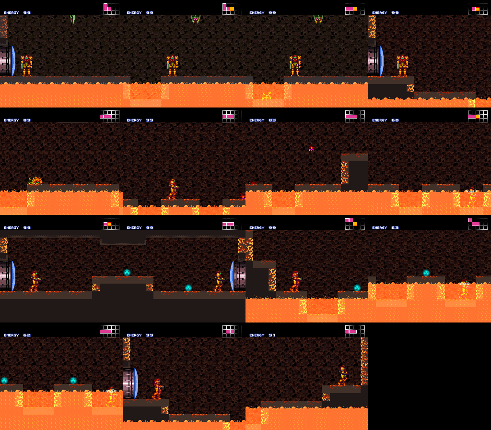
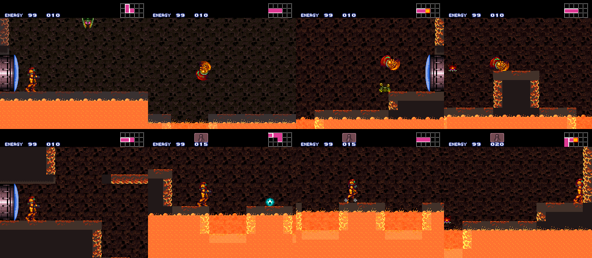

# 17g — Inimigos da Magmoor (região A)

Estado: **verificada** (01/11/2026: validate "146 salas, 300 portas, 0 problemas", as linhas do Tallon e das rodadas (12m) iguais;
`.ips` sha1 `7b1ef04fac8ae04eaec1fa8b4ee6a9936ec2814e` igual em dois builds; **91/91** testes). Rascunho → aprovada (pedido do
orquestrador, decisão técnica 7 do épico) → implementada → verificada na mesma sessão.
Esforço estimado: 1–2 dias (medido: ~1 dia; a maior parte é medir de novo as caminhadas com os inimigos vivos)
Épico: [17 — Magmoor Caverns](17-magmoor-caverns.md) (decisão técnica 7; linha 17g da tabela de filhas); modelos:
[12h](12h-inimigos-chozo.md) (camada 0 do Prime, set por sala, justiça), [15](15-auditoria-de-entrada.md) (nenhum dano nos 120
primeiros quadros de uma entrada de porta de verdade), [17f](17f-regiao-a-magmoor.md) (as salas e as caminhadas medidas).

## Contexto

A região A da Magmoor (17f) está construída sem inimigos. Esta filha põe os da camada 0 do Prime nas 6 salas da região que os têm,
com espécies do SM no lugar (como a 07i no Tallon e a 12h na Chozo), grava a tabela do Prime das regiões B e C para a 17h/17i, estende
a auditoria de entrada de porta (spec 15) à Magmoor e mede de novo as caminhadas da 17f com os inimigos **vivos**.

## Estado antes (verificado)

- validate "146 salas, 300 portas, 0 problemas"; linhas "tallon (… 44 salas construídas, alcançáveis agora: 44, 20 itens em 7
  rodadas)" e "rodadas (specs/12m) … 51 itens em 7 rodadas … 51%"; `.ips` sha1 `4ce501026efcd8b179b2eb49a76f0717a5ece808`; 90/90.
- `areas.MAGMOOR` sem `enemies`; `check_layer0_enemies` (07i/12h) só no Tallon e na Chozo, com a justiça só nas salas da chegada
  com Power Beam, mísseis e Morph (`FAIR_ARRIVAL`, rodadas 0–1).
- Rodadas da região A (17f, `tallon_progress_built`): Burning Trail e Save Station A na **1** (mísseis, Morph); Lake Tunnel, Lava Lake,
  Pit Tunnel, Triclops Pit, Storage Cavern, Monitor Tunnel na **3** (Varia, Space Jump, Charge, Wave, Bombas).

### O Prime, camada 0 (dados)

Roteiro do épico `s17/scripts/magmoor_objs.py` (retro-data-structures, `research/prime_fs`) → `s17/magmoor_objs.out` (geradores de
pickup e `ColorModulate` não são inimigos):

| P# | Sala | Camada 0 | Outras camadas (fora) |
|---|---|---|---|
| 1 | Burning Trail | MetareeAlpha 16, Parasite 1 | — |
| 2 | Lake Tunnel | Burrower 1, Parasite 2 | — |
| 4 | Lava Lake | Puffer 6 | 1: Parasite 2; 2: FlyingPirate 2; 3: Magdolite 2, Puffer 6 |
| 5 | Pit Tunnel | Tryclops 3 | — |
| 6 | Triclops Pit | Tryclops 5 | 1: FlyingPirate 2; 2: Puffer 9; 3: Parasite 1 |
| 7 | Monitor Tunnel | Puffer 5 | — |
| 0, 3, 8 | P0, Save Station A, Storage Cavern | — | — |
| 14 | Fiery Shores (B) | Magdolite 1, Tryclops 2 | — |
| 15 | Transport Tunnel B (B) | Magdolite 1 | — |
| 18 | Twin Fires (C) | Puffer 15 | 1, 2: Magdolite 1 |
| 22 | South Core Tunnel (C) | Burrower 2, PuddleSpore 1 | — |
| 24 | Workstation Tunnel (C) | Parasite 3 | — |

### O SM (cabeçalhos em `$A0`, nomes em `$B4`, ROM base; roteiro `s17g/scripts/species.py`)

| Espécie | Vida | Toque | Raio | Tiles | Tiros do Power Beam | Colocação vanilla copiada |
|---|---|---|---|---|---|---|
| SKREE `$DB7F` (Metaree, 12j) | 15 | 10 | 8×12 | `$400` | 1 | (12j) |
| ZEELA `$DC7F` (Parasite, 07i/12k) | 30 | 10 | 8×8 | `$600` | 2 | (07i) |
| MELLA `$D13F` (Puffer, 12h) | 30 | 16 | 8×4 | `$400` | 2 | (12h) |
| **NOVA `$DCBF`** (Sova) | 40 | 20 | 8×8 | `$600` | 2 | `$8F:A7DE` (`$A1:B9D8`): init 3, prop. `$2000`, p1 1, p2 4 |
| **VIOLA `$DABF`** (o do Oculus, 12h) | 30 | 15 | 8×8 | `$400` | 2 | `$8F:AB07` com **p1 = `$FF`** (parada) |
| MZOOMER `$DD3F` (candidato do épico) | 15 | 5 | 8×8 | `$600` | **imune** | recusado |
| HOTARY `$D6BF` (candidato do épico) | 20 | 4 | 8×8 | `$600` | 1 | não usado (flutua; nada da região flutua no chão) |
| LAVAMAN `$E83F` (Magdolite, épico) | 20 | **40** | 8×8 | `$600` | **imune** | região B (17h) |

## Mudança

1. **Prime → SM** (`tools/magmoor/enemies.py`, novo, no molde de `chozo/enemies.py`; `STAND_IN`): MetareeAlpha → **Skree**, Parasite →
   **Zeela**, Puffer → **Mella** (os padrões aceitos do épico); **Burrower → Sova** (o rastejador de fogo da Norfair de cima: o bicho
   que corre sob o chão e sai na Samus); **Tryclops → Viola parada** (a bola de fogo da Norfair agarrada à sua rocha: o Triclops do
   Prime fica nas rochas do poço esperando a Morph Ball). `ColorModulate`, `PickupGenerator` → nenhum.
2. **Espécies** (`tools/frigate/enemies.py SPECIES`): `burrower` (`$DCBF`, paleta 1, a colocação vanilla) e `tryclops` (`$DABF`, a
   paleta 2 do Oculus, **parâmetro 1 = `$FF`**: o init dos rastejadores, `StoneZoomer_E67A` `$A3:E67A`, só lê a velocidade da tabela
   `$A3:E5F0` se o parâmetro não for `$FF`; com `$FF` ela fica 0 e a Viola não sai da rocha — medido: parada para sempre).
3. **Por sala** (≥ 1 de cada tipo do Prime com substituto, ≤ a conta do Prime, ≤ 1 por tela; posições pelo desenho):

| Sala | Rodada | Inimigos (SM) | Onde | Set (tiles) |
|---|---|---|---|---|
| Burning Trail (6×2) | 1 | 3 Skrees, 1 Zeela | Skrees sob os 3 dentes do teto da trilha (x 9, 25, 41); Zeela no chão entre os fossos 1 e 2 (28) | Skree 3, Zeela 2 (`$A00`) |
| Lake Tunnel (3×1) | 3 | 1 Sova, 2 Zeelas | Sova entre os fossos (24); Zeelas no chão junto aos degraus das portas (10, 38) | Sova 1, Zeela 2 (`$C00`) |
| Lava Lake (6×1) | 3 | 3 Mellas | nas rochas (31, 65) e no pilar vazio do artefato (45, topo 8) | Mella 7 (`$400`) |
| Pit Tunnel (2×1) | 3 | 2 Violas | no trecho alto (16, topo 8) e no chão a leste dele (24) | Viola 2 (`$400`) |
| Triclops Pit (6×3) | 3 | 5 Violas | uma em cada rocha entre as poças do fundo (30, 39, 48, 57, 66; linha 42) | Viola 2 (`$400`) |
| Monitor Tunnel (2×1) | 3 | 2 Mellas | no chão do túnel (20, 24) | Mella 7 (`$400`) |
| P0, Save Station A, Storage Cavern | — | nenhum (o Prime não tem na camada 0) | | |

   Total **19 inimigos em 6 salas**; set "MAGMOOR".
4. **Burning Trail: os dentes do teto descem até a linha 16** (`layouts.BURNING_TRAIL_TEETH`, `BURNING_TRAIL_TOOTH_END`; eram linhas
   13–14). Medido: com a Samus na trilha a câmera fica com o topo em y 256–288, e um inimigo com `y + 8` acima do topo da câmera não
   roda (`DetermineWhichEnemiesToProcess` `$A0:8EB6`, `sm_a0.c:578`): Skrees pendurados no teto da trilha (linha 12) ou nos dentes da
   17f (y 260) ficavam dormindo. Pendurados nos dentes de 4 linhas (y 292) eles acordam e mergulham. Os pulos sobre os fossos não
   passam sob os dentes (o validador anda a sala de novo; as caminhadas foram medidas de novo).
5. **Formato da tabela para B/C**: `ENEMIES` (sala → `Spawn`s, só salas construídas), `PRIME_LAYER0` (já com **todas** as salas do
   Prime com inimigo na camada 0, B e C inclusive), `STAND_IN` (tipo do Prime → kind; um tipo sem decisão numa sala construída é
   erro), `PROPOSED_LATER` (Magdolite → LAVAMAN `$E83F`: toque 40 e imune ao Power Beam, a 17h decide; PuddleSpore → nenhum). A 17h/17i
   só acrescentam linhas em `ENEMIES` (e a decisão do Magdolite).
6. **Validador** (`tools/validate.py`): **`check_magmoor_enemies`** (linha nova "magmoor (specs/17g)"): `check_layer0_enemies` da
   Magmoor com **a justiça em toda sala, qualquer rodada** (`MAGMOOR_FAIR_EVERY_ROUND`: lava sob as caminhadas — um empurrão pode
   derrubá-la num fosso — e salas quentes; mais forte que a da Chozo, só rodadas 0–1): toda espécie morre com ≤ 5 tiros do Power Beam
   sem carga e tira ≤ 20 por toque; `PRIME_LAYER0` só com salas da tabela; `ENEMIES` só em salas construídas; **a caixa de todo
   inimigo acima da superfície da lava** (nasce fora dela; como todos morrem com o Power Beam, nenhum fecha uma saída de fosso para
   sempre). `check_enemies` (caixa no ar, chão/teto, longe das portas), `check_enemy_sets` (≤ 4 espécies, paletas, VRAM) e
   `check_enemies_in_rom` já percorriam toda área: cobrem a Magmoor.
7. **Testes** (`tests/run_tests.py`): novo **`entradas_de_porta_magmoor`** (spec 15: as 13 entradas de porta das 6 salas, entradas de
   verdade, nenhum dano nos 120 primeiros quadros; nenhuma exceção); `magmoor_regiao_a_rota` e `magmoor_save_station_a` medidos de
   novo com os inimigos vivos (abaixo); `MAGMOOR_MOVES`/`moves()` (o vocabulário das caminhadas achadas pela busca).

## Critérios de aceite

1. validate 0 problemas; "44 salas construídas, alcançáveis agora: 44, 20 itens em 7 rodadas" e "51 itens em 7 rodadas … 51%" iguais;
   linha nova 17g. (protege = contas do Prime, ≤ 1 por tela, justiça em toda rodada, fora da lava, sets, ROM = tabela; falha_quando =
   mutações G1–G15; não_prova = que a escolha das espécies agrada)
2. `entradas_de_porta_magmoor` passa (protege = nenhum dano nos 120 quadros de toda entrada de porta da Magmoor; falha_quando = E2).
3. `magmoor_regiao_a_rota` com os inimigos vivos, a energia 99 do começo ao fim (protege = a região A atravessável com o equipamento da
   rodada 3 sem levar dano, os 5 Triclops mortos com o Power Beam; falha_quando = E1, E3); `magmoor_save_station_a` idem na rodada 1;
   `magmoor_calor` igual. Os 90 antigos passam.
4. Dois builds com o mesmo sha1; fotos `specs/img/17g-*.png` olhadas; bateria inteira em < ~7,5 min.

## Plano de testes

| Camada | O quê | Qtde |
|---|---|---|
| validate.py | `check_magmoor_enemies` (justiça em toda rodada, fora da lava, tabela) | +1 |
| run_tests.py | `entradas_de_porta_magmoor`; `magmoor_regiao_a_rota` e `magmoor_save_station_a` medidos de novo | +1 |
| scratchpad (`s17g/`) | 15 mutações do validador; 3 de emulador; auditoria forte (8 jeitos, 600 quadros) | ~19 |
| imagem | `specs/img/17g-inimigos.png`, `specs/img/17g-rota.png` | +2 |

## Riscos e reversão

- As caminhadas da região A agora dependem dos inimigos: mexer numa posição, numa espécie ou na geometria das salas com inimigos pede
  refazer a busca (`s17g/scripts/route17g.py`, `fight.py`, `chain.py`; ~3–8 min por sala, 10 CPUs).
- Reversão: `areas.MAGMOOR` sem `enemies` (e os dentes da 17f, as caminhadas da 17f): a ROM volta à da 17f.

## Fora de escopo

- Regiões B e C (só a tabela do Prime); o Magdolite (17h decide: LAVAMAN pede cópia com toque ≤ 20 e algo que o Power Beam mate).
- Camadas de evento (Flying Pirates, os Puffers/Magdolites/Parasites dos passes seguintes), Puddle Spore.

## Resultado

### Auditoria das entradas (spec 15)

`entradas_de_porta_magmoor` (uma entrada por porta, andando quando dá): passa. Auditoria forte (`s17g/scripts/audit17g.py`, a da spec
15 — andando e por teleporte, com 0/9/17/30 quadros de espera antes, parada 600 quadros → `s17g/audit17g.out`): **nenhum
toque em 12 das 13 entradas em 600 quadros**; a Lake Tunnel R0 (entrando pela porta da Lava Lake) leva a Zeela do leste aos **220**
quadros andando / 250 por teleporte (acima dos 120). Por quê tão pouco: um inimigo fora da câmera não roda (spec 15), um rastejador que
sai da câmera fica parado na borda dela, e as Violas não andam.

### Justiça (números)

Toda espécie da Magmoor morre com o Power Beam sem carga: Skree 1 tiro (15 de vida), Zeela, Mella, Sova e Viola 2 (30–40 de vida, 20
por tiro); toque Skree 10, Zeela 10, Mella 16, Viola 15, Sova 20 (com a Varia, metade). VRAM: no máximo `$C00` de `$2000` (Lake Tunnel).

### Caminhadas medidas de novo (mudanças de expectativa)

| Teste | Mudança |
|---|---|
| `magmoor_regiao_a_rota` | Burning Trail, Lake Tunnel, Lava Lake (até o pilar e dele à porta), Pit Tunnel e Monitor Tunnel: os pulos medidos da 17f (`M_TRAIL_PITS`, `M_TRAIL_TO_LAKE`, `M_LAKE_TUNNEL_PITS`, `M_LAVA_LAKE`, `M_PIT_TUNNEL`, `M_MONITOR_TUNNEL`, `M_MONITOR_END`) trocados por **strings de `MAGMOOR_MOVES`** achadas por busca em feixe no emulador (`M17G_*`: pulos com giro — o Space Jump da rodada 3 entra —, tiros para cima e à frente); fundo da Triclops Pit: em cada rocha **2 tiros agachada** matam a Viola da rocha seguinte, depois o pulo da poça (quadros de andar procurados de novo: 6, 15, 21, 20, 19 e 17; eram 6, 12, 16, 17, 16, 16); as escaladas, a Storage Cavern e o Space Jump iguais à 17f. Novos expects: `enemies_alive` ao chegar em cada sala com inimigos (espécie e vida cheia em cada slot), os 3 Skrees sumidos ao fim da trilha (mortos a tiro ou estourados no chão atrás dela), as 5 Violas mortas, a energia **99** em toda chegada (igual à 17f: nenhum toque em toda a caminhada). Fotos novas `17g_rota_*` |
| `magmoor_save_station_a` | a trilha com a string `M17G_SAVE_TRAIL` (pulos simples da rodada 1, um tiro agachada na Zeela); da parede leste de volta para baixo da prateleira (35 quadros para oeste; antes, 180 para leste depois do fosso 3) e as 3 bordas com os quadros procurados de novo (`M_SAVE_CLIMB`: 11, 12, 4, 20; eram 11, 11, 8, 20); expects de energia 99 a mais |
| `magmoor_calor` | nenhuma (a Mella oeste da Lava Lake foi de 23 para 31: em 23 ela tocava a Samus de pé na rocha depois da poça) |
| novo `entradas_de_porta_magmoor` | as 13 entradas, de um estado salvo na P0 da Magmoor (`magmoor_down`: atalhos até lá) |

Bateria: **91/91 em 6 min 33 s** na pasta real (6 min 31 s na cópia do scratchpad; antes 90/90 em 6 min 31 s): sem divisão.

### Fotos (olhadas)

As 6 salas, a Samus posta por RAM com a Varia (`s17g/scripts/look.py`): Skrees verdes sob os dentes da Burning Trail; a Sova
(laranja, fogo) e as Zeelas da Lake Tunnel; Mellas sobre a Lava Lake (paradas ali, elas descem nela: a energia cai nas fotos); as
Violas paradas (bolas azul-claras) no trecho alto e no chão da Pit Tunnel e nas rochas do fundo da Triclops Pit; a Monitor Tunnel.

Da caminhada `magmoor_regiao_a_rota`: a chegada na Burning Trail (Skree sob o dente); o fim da trilha (Skrees mortos); a Lake Tunnel
(giro sobre os rastejadores); o pilar da Lava Lake (uma Mella à esquerda); a L1 da Triclops Pit; o fundo antes das Violas; depois das
4 primeiras mortas; o fim da Monitor Tunnel — energia 99 em todas.

### Espaço

`$A1` (populações) +322 bytes (livre a partir de `$A1:F87F`), `$B4` (sets) +86 (`$B4:F808`); nível +10 bytes (os dentes); `$8F`,
`$83`, `$84`, `$A0`, fixo, SRAM: nada.

## Mutações

Validador (`s17g/scripts/mutate_g.py` → `s17g/mutate_g.out`), todas pegas, sem mutação limpo: G1 Skree sem teto; G2 Mella dentro da
poça de lava; G3 3 Violas na Pit Tunnel (2 telas); G4 2 Sovas na Lake Tunnel (Prime 1); G5 a Burning Trail sem a Zeela; G6 Sidehopper
na Lava Lake (o Prime não tem); G7 Tryclops = Multiviola (toque 50) — na Pit Tunnel, rodada 3: **só a regra de toda rodada pega** (G7b,
sem ela, não pega); G8 Tryclops = MZOOMER (imune); G9 `PRIME_LAYER0` com sala fora da tabela; G10 inimigo numa sala fora do build; G11
tipo do Prime sem decisão numa sala construída; G12 Zeela colada na porta; G13 Sova na paleta da Zeela; G14 tabela mudada sem
reconstruir a ROM; G15 5 espécies numa sala. Emulador (`s17g/scripts/emu_mut_g.sh` → `s17g/emu_mut_g.out`): E1 os dentes da 17f com os
Skrees sob eles → `magmoor_regiao_a_rota` falha (os Skrees dormem: o slot 0 ainda `$DB7F` no fim da trilha e uma colisão tira 5); E2 a
Mella oeste da Lava Lake em 9 → `entradas_de_porta_magmoor` falha ("magmoor_lava_lake porta 0 (L0): perdeu energia 50 quadros depois
de chegar"); E3 as Violas andando (parâmetro 1 = 0) → `magmoor_regiao_a_rota` falha (energia 92 na Triclops Pit).

## Desvios

- **Contas abaixo do Prime** onde ele enche a sala 3D: Burning Trail 3 Skrees de 16 Metarees (os 3 dentes; mais Skrees pediriam mais
  dentes sobre a trilha), Lava Lake 3 de 6 Puffers, Pit Tunnel 2 de 3 Tryclops (2 telas), Monitor Tunnel 2 de 5 Puffers (2 telas).
- **Os dentes da Burning Trail mudaram** (linhas 13–14 → 13–16): mudança de geometria de uma sala da 17f, pela câmera (acima).
- **Tryclops parado** (parâmetro 1 = `$FF`): andando, a Viola descia nas poças e andava no fundo delas sob a lava (onde nenhum tiro a
  alcança) e saía sob os pés da Samus nas rochas (a busca não achou caminho sem dano; medido).
- **`magmoor_inimigos_vivos`** (o nome do épico) não virou teste próprio: a rota confere cada sala com inimigos na chegada
  (`enemies_alive`, espécie e vida cheia em cada slot) com a energia 99, e a auditoria de entrada cobre o "parada na porta".
- **Caminhadas por busca** (strings de `MAGMOOR_MOVES`) em vez dos pulos medidos um a um da 17f nas salas com inimigos: a busca
  (`fight.py`: feixe de 20, por quadros de entrada, só sequências sem perda de energia, menos inimigos vivos e mais perto do alvo
  primeiro) acha a sequência inteira de uma sala em 1–8 min. Na Lake Tunnel, Lava Lake, Pit Tunnel e Monitor Tunnel ela passa por cima
  dos inimigos girando (o Space Jump da rodada 3), sem matá-los; na Triclops Pit o fundo foi restrito a pular de rocha em rocha (sem
  voar por cima) e lá ela mata os 5.
- Experimentos, buscas e mutações na cópia `s17g/proj`; a pasta real só recebeu os arquivos finais.
- Verificação (01/11/2026, pasta real): `python3 -I tools/build.py` duas vezes → sha1 `7b1ef04fac8ae04eaec1fa8b4ee6a9936ec2814e`;
  `python3 -I tools/validate.py` → "146 salas, 300 portas, 0 problemas" (diferenças contra a 17f: a linha nova "magmoor (specs/17g)" e
  o nível +10 bytes); `python3 -I tests/run_tests.py` → **91/91** em 6 min 33 s.

## Decisões para o usuário (escolhidas as recomendadas; confirmar)

1. **Burrower = Sova** e **Tryclops = Viola parada** (os outros: os padrões aceitos do épico).
2. As contas por sala (19 inimigos; tabela acima) e a regra "justo em toda sala da Magmoor, qualquer rodada".
3. Os dentes mais longos da Burning Trail para os Skrees acordarem.
4. Para a 17h: o Magdolite = LAVAMAN pede uma cópia (toque ≤ 20) **e** um jeito de morrer com o Power Beam (ele é imune), ou outra
   espécie (recomendo decidir na 17h com a sala desenhada).
