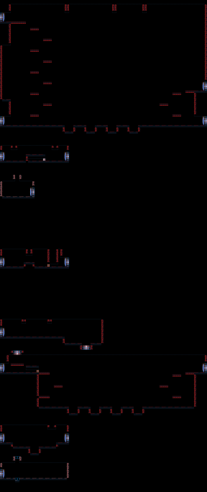
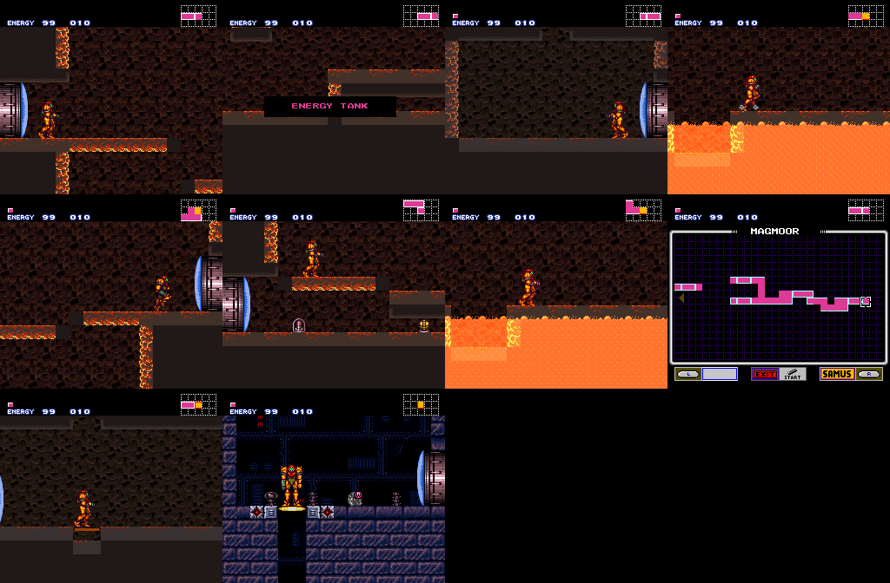
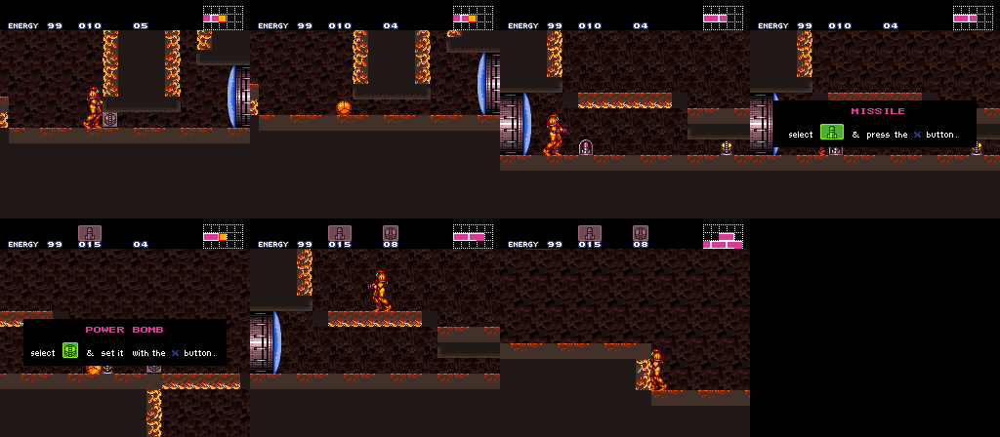

# 17h — Região B da Magmoor (centro: Monitor Station, Warrior Shrine, Fiery Shores e a saída para o Tallon)

Estado: verificada (01/11/2026: validate "153 salas, 318 portas, 0 problemas", as linhas do Tallon e das rodadas (12m) iguais;
`.ips` sha1 `2b960ef9f8b27d674c67dd40b660d32f5ab68a5c` igual em dois builds; **93/93** testes). Rascunho → aprovada (pedido do orquestrador, decisões do épico e do usuário
repassadas) → implementada → verificada na mesma sessão.
Esforço estimado: 2–3 dias (salas 1 d; travas, itens, rodadas 0,5 d; validador 0,25 d; emulador, fotos e mutações 0,75–1 d)
Épico: [17 — Magmoor Caverns](17-magmoor-caverns.md) (decisões do usuário 1–4; decisões técnicas 1, 4, 5, 7, 8; linha 17h da
tabela de filhas); modelos: [17f](17f-regiao-a-magmoor.md) (região com lava, calor e itens), [17g](17g-inimigos-magmoor.md)
(inimigos, justiça em toda sala), [09e](09e-power-bombs-e-xray.md) (blocos de Power Bomb), [10b](10b-subida-com-folga.md)
(subir por porta de teto), [15](15-auditoria-de-entrada.md) (entrada de porta).

## Contexto

A região A (17f/17g) termina na Monitor Tunnel, cuja porta R0 para a Monitor Station era parede; a P16 (elevador do Tallon West,
17e) era um beco. Esta filha constrói a **região B** (as 8 salas da tabela da 17c: P9–P16), com a trava do Prime da região (a porta
de Morph Ball da Warrior Shrine atrás de uma parede que só a Power Bomb quebra), o **calor** nas 6 salas superaquecidas dela, a
**lava** em fossos, os **3 itens** (E-tank do Transport Tunnel A, míssil e expansão de PB da Fiery Shores) e os **inimigos** da camada
0. Com ela, a Magmoor passa a ligar a Chozo (P0) ao Tallon (P16) a pé.

## Estado antes (verificado)

- validate "146 salas, 300 portas, 0 problemas"; linhas "tallon (… 44 salas construídas, alcançáveis agora: 44, 20 itens em 7
  rodadas)" e "rodadas (specs/12m): Tallon + Chozo andados juntos, 51 itens em 7 rodadas … chozo_west 0, chozo_east 4, chozo_south 5
  … 51%"; `.ips` sha1 `7b1ef04fac8ae04eaec1fa8b4ee6a9936ec2814e`; 91/91 testes (~6,5 min).
- `tools/magmoor/rooms.py` (17c): região B = P9 Monitor Station (6×4; portas L0 → Monitor Tunnel, L3 → Transport Tunnel A, R3 →
  Warrior Shrine, R2 → Shore Tunnel), P10 Transport Tunnel A (2×1; L0 → P13, R0), P13 Transport to Phendrana North (1×2; R0, de
  enfeite), P11 Warrior Shrine (2×2; L0, R0 → Fiery Shores L0), P12 Shore Tunnel (3×1; L0, **B2 → Fiery Shores T0**, a única porta de
  chão/teto da Magmoor), P14 Fiery Shores (6×2; L0, T0, R0 → TTB), P15 Transport Tunnel B (2×1), P16 (2×1, 17e: L0 → TTB, R0 → Twin
  Fires Tunnel, região C).
- Travas do Prime na região (`DOCK_LOCKS`): só **morph** Warrior Shrine → Fiery Shores (`Door_Area Morphball`, atrás de uma parede
  só de PB, vulnerabilidade `2 2 2 2 2 1`; do lado da Fiery Shores nenhuma porta, só uma câmera). `HOT_ROOMS` na região: Monitor
  Station, TTA, Warrior Shrine, Shore Tunnel, Fiery Shores, TTB (6); P13 e P16 frias. `FEATURES` "lava" em todas.
- Itens do Prime (épico): E-tank da TTA (num túnel de Morph sob a ponte), míssil (fim do túnel da Warrior Shrine) e expansão de PB
  (trilho de bola) da Fiery Shores; Ice Spreader (Shore Tunnel) e o artefato da Warrior Shrine fora (decisão 2).
- Inimigos do Prime, camada 0 (`magmoor/enemies.py PRIME_LAYER0`): Fiery Shores Magdolite 1 + Tryclops 2; TTB Magdolite 1.
- Rodadas: a Varia é da rodada 2 (Sunchamber): sala quente a partir da rodada 3; as duas pontas (P23 do Tallon, P24 da Chozo) são
  da rodada 1.

## Mudança

1. **Salas** (`tools/magmoor/layouts.py`, regras da 17f; quentes no tileset 09, frias no 0A; prévias em `specs/img/17h-salas.png`):
   - **Monitor Station** (6×4, quente): caverna do teto ao chão na linha 58 (a borda de L3 e R3), **4 fossos de lava** no chão
     (superfície 59); a prateleira da L0 (linha 10) no canto noroeste sobre um **zigue-zague de 9 bordas** pela parede oeste
     (`zigzag`, 5 linhas entre bordas); a prateleira da R2 (linha 42) numa rocha sobre a porta R3, por 3 bordas da parede leste (a
     subida leste da Triclops Pit, 32 linhas abaixo); rocha sobre as portas L0 e L3 (a Samus não pousa na tampa).
   - **Transport Tunnel A** (2×1, quente): túnel nas linhas 3–9; um estrado no meio (linhas 7–9) com um **túnel de 1 linha** ao pé
     (linha 9) fechado por um **bloco de bomba** na boca leste (20, 9); o **E-tank** no fundo dele (13, 9).
   - **Transport to Phendrana North** (1×2, fria, de enfeite): o salão na tela de cima e o poço de 2 blocos sobre a plataforma
     (chão comum, sem elevador); a tela de baixo é rocha.
   - **Warrior Shrine** (2×2, quente): o salão nas linhas 2–9 da L0, o estrado do guerreiro; a leste a câmara da R0 atrás de uma
     parede com um túnel de 1 linha ao pé, um **bloco de Power Bomb** na boca oeste (22, 9). A base (telas de baixo) é rocha.
   - **Shore Tunnel** (3×1, quente): o túnel na linha 10 e um degrau (chão 13) em volta da porta de chão B2.
   - **Fiery Shores** (6×2, quente): a praia no chão da linha 26 com **4 fossos de lava** (superfície 27); o penhasco oeste (colunas
     1–17, linhas 7–25) com a plataforma da T0 (linha 6, `Canvas.door_gap`) em cima; **sob a plataforma o bolso da L0** (linhas
     7–9: o fim do túnel da Warrior Shrine, o **míssil** em (5, 9)) e o **túnel de 1 linha** dele a leste pelo penhasco (linha 9: a
     **expansão de PB** em (14, 9), um **bloco de Power Bomb** na boca leste (17, 9)) até uma borda (linha 10) que um zigue-zague de
     2 bordas alcança da praia; a prateleira da R0 (linha 10) sobre uma rocha a leste, por 3 bordas.
   - **Transport Tunnel B** (2×1, quente): túnel no chão 12 com um fosso (o da Monitor Tunnel).
   - **P16**: a parede L0 abre (o chão da 17e já estava na borda); a R0 (região C) continua parede até a 17i.
2. **Travas** (`magmoor/rooms.py GATES`): Warrior Shrine ↔ Fiery Shores = `Gate({Morph Ball, Power Bomb}, ledge = os dois lados)`
   (geometria, sem tampa; `build_rooms` agora aceita trava só de geometria, a regra da Chozo). Calor: Varia em toda porta para as 6
   quentes (`heat_gates`). Nenhuma outra trava do Prime na região.
3. **Acesso à porta de chão/teto** (Shore Tunnel B2 ↔ Fiery Shores T0, spec 10b): descendo, ela cai na plataforma da T0; subindo,
   da praia pelo zigue-zague oeste (26 → 21 → 16 → 10), o penhasco (7), a plataforma (6) e o pulo para dentro da T0; no Shore Tunnel
   ela pousa no chão 13 ao lado do buraco guiando para qualquer lado (medido: guiando a leste para em x `$2EB`, a oeste em `$1E5`).
4. **Itens** (`tools/magmoor/items.py`, bits `$D5–$D7`): E-tank da TTA (13, 9) rodada 3, `needs {Morph, Bombas}`; míssil da Fiery
   Shores (5, 9) e **expansão de PB** (14, 9), rodada **6**, `needs {Morph, Power Bomb}`.
5. **Rodadas** (`FIRST_ROUND`): as 7 salas novas na **3** (todas quentes ou atrás de uma quente: P13 atrás da TTA), dos dois lados
   (Monitor Tunnel da região A, rodada 3; P16 do Tallon, rodada 1, pela TTB quente). P16 continua na 1.
6. **Inimigos** (`magmoor/enemies.py`): Fiery Shores 2 **Violas paradas** (Tryclops, 17g) nas rochas da praia (47, 57); **Magdolite
   fora** (`STAND_IN["Magdolite"] = None`, decisão abaixo); TTB vazia. Monitor Tunnel: a Mella leste de 24 → **12** (a R0 agora é
   porta: de 24 ela mergulhava na Samus 20 quadros depois da entrada — a auditoria da spec 15 pegou).
7. **Validador** (`tools/validate.py`):
   - `check_magmoor_locks_mapped`: **morph** = Morph Ball na trava, o lado da doca atrás da geometria (linha "magmoor (specs/17f,
     17h)");
   - `check_breakables`: os blocos de bomba e de PB da Magmoor (eram só Tallon/Chozo); bloco de PB vale em sala com porta atrás de
     uma trava de PB (a Warrior Shrine não tem item);
   - `check_item_geometry`: uma porta atrás da mesma geometria do item (a L0 da Fiery Shores) entra só com esses itens (a regra do
     `reach_on_foot`), então não conta como "pega-se sem";
   - o resto já cobria a região: `check_room` (alcance a pé de toda porta de toda entrada, com Morph/Bombas e com a PB, lava, sem
     lugar sem volta), `check_magmoor_rounds`, `check_world_rounds` (com a guarda "rodada só da Magmoor"), `check_tallon_rounds`/
     `check_chozo_rounds`, `check_tallon_return`/`check_tallon_round_stuck`, `check_heat(_in_rom)`, `check_lava(_in_rom)`,
     `check_magmoor_enemies`, `check_pause_maps`, `check_reclaimed`.
8. **ROM de teste da 17d** (`magmoor/testrooms.py`): a guarda "P16 sem portas" vira "P16 sem a porta R0"; `run_tests.host_door_to_cool`
   acha a porta da P16 para a sala de teste (a L0 da TTB veio antes dela na lista).

## Rodadas (o ponto crítico do pedido)

O caminho Chozo ↔ Tallon pela Magmoor (P0 … P16) só existe com a Varia (rodada 3: toda sala entre as duas pontas é quente ou atrás
de uma quente), e as duas pontas (P24 da Chozo, P23 do Tallon) já são da rodada 1 e já se ligam desde a rodada 0 pelo elevador
Chozo West. Chegar à P23 pela Magmoor na rodada 3 não abre nada novo do Tallon (a P23 e o Wave dela são da rodada 1); a expansão de
PB fica atrás de blocos de PB dos dois lados (rodada 6; a PB é da rodada 5). O validador prova: **as linhas do Tallon e das rodadas
(12m) são idênticas** (diff); a mutação H6 (atalho da região B para uma sala do Tallon da rodada 5) é pega. Nenhum conflito.

## Critérios de aceite

1. validate 0 problemas; "44 salas construídas, alcançáveis agora: 44, 20 itens em 7 rodadas" e "51 itens em 7 rodadas … chozo_west
   0, chozo_east 4, chozo_south 5 … 51%" iguais; linha da Magmoor com as 17 salas e os 5 itens por rodada. **Passa.**
2. `magmoor_regiao_b_rota` (protege = a região B andada com o equipamento da rodada 3, o E-tank, a Fiery Shores com as Violas vivas na
   chegada e mortas a tiro, a P16 e o elevador para o Tallon **a pé**, energia conferida em toda sala; falha_quando = E2),
   `magmoor_regiao_b_itens` (protege = a parede de PB: feixe e bomba não quebram, a PB quebra; o míssil e a expansão; a subida pela
   porta de teto; falha_quando = E1), `entradas_de_porta_magmoor` com as portas novas (falha_quando = E3). **Passam.**
3. Mutações pegas (abaixo). **Passa.**
4. Dois builds com o mesmo sha1; fotos `specs/img/17h-*.png` olhadas; bateria em < ~7,5 min. **Passa** (6 min 43 s no scratchpad).

## Plano de testes

| Camada | O quê | Qtde |
|---|---|---|
| validate.py | `check_magmoor_locks_mapped` com morph; `check_breakables` e `check_item_geometry` na Magmoor | 3 mudadas |
| run_tests.py | `magmoor_regiao_b_rota`, `magmoor_regiao_b_itens`; `entradas_de_porta_magmoor` 13 → 17 entradas | +2 |
| scratchpad (`s17h/`) | 17 mutações do validador; 3 de emulador | 20 |
| imagem | `specs/img/17h-salas.png`, `17h-rota.png`, `17h-itens.png` | +3 |

## Riscos e reversão

- As caminhadas medidas dependem da geometria e dos inimigos (`s17h/scripts`: `tr.py`, `hops.py`, `grid.py`, `chain.py`,
  `route17h.py`/`fight.py`). Mexer numa sala pede refazer o trecho.
- Reversão: `ACTIVE_REGIONS = {"A"}`, os itens `$D5–$D7`, os inimigos da Fiery Shores e os dois testes; a Mella da Monitor Tunnel e
  o fim da `magmoor_regiao_a_rota` voltam ao da 17g.

## Fora de escopo

- Região C (Twin Fires Tunnel em diante; a R0 da P16 continua parede), a 17j (rodadas das três áreas e a cadeia).
- Artefato da Warrior Shrine, Ice Spreader, Flying Pirates e Magdolites das camadas de evento, jatos de fogo, girador de Boost da
  Monitor Station (não trava nada no nosso desenho).

## Resultado

### Salas (17 na área 2: 7 novas + a P16 aberta)

| Sala (P#) | Tamanho | Tileset | Lava (superfície) | Rodada | Notas |
|---|---|---|---|---|---|
| Monitor Station (9) | 6×4 | 09 quente | 59 (4 fossos) | 3 | zigue-zagues oeste (9 bordas) e leste (3) |
| Transport Tunnel A (10) | 2×1 | 09 quente | — | 3 | E-tank no túnel de Morph (bloco de bomba) |
| Transport to Phendrana North (13) | 1×2 | 0A | — | 3 | de enfeite, vazia |
| Warrior Shrine (11) | 2×2 | 09 quente | — | 3 | parede de Power Bomb diante da R0 |
| Shore Tunnel (12) | 3×1 | 09 quente | — | 3 | porta de chão B2 |
| Fiery Shores (14) | 6×2 | 09 quente | 27 (4 fossos) | 3 | bolso da L0 (míssil), túnel (expansão de PB), 2 Violas |
| Transport Tunnel B (15) | 2×1 | 09 quente | 13 (1 fosso) | 3 | |
| Transport to Tallon West (16) | 2×1 | 0A | — | 1 | L0 aberta |

De cima para baixo: Monitor Station, TTA, Phendrana North, Warrior Shrine, Shore Tunnel, Fiery Shores, TTB, P16 (as prévias não
desenham a lava: é FX).

### Itens e rodadas

| Bit | Sala | Prime | Lugar / trava | Rodada |
|---|---|---|---|---|
| `$D5` | Transport Tunnel A | Energy Tank (túnel de Morph) | fundo do túnel do estrado, bloco de bomba (13, 9) | 3 |
| `$D6` | Fiery Shores | Missile Expansion (fim do túnel da Warrior Shrine) | bolso da L0 (5, 9), atrás de PB dos dois lados | 6 |
| `$D7` | Fiery Shores | Power Bomb Expansion (trilho de bola) | túnel do bolso (14, 9), atrás de PB dos dois lados | 6 |

### Linhas do validador (o que mudou e por quê)

- **Iguais** (diff): "tallon (… 44 salas construídas, alcançáveis agora: 44, 20 itens em 7 rodadas)" e "rodadas (specs/12m) … 51 itens
  em 7 rodadas … chozo_west 0, chozo_east 4, chozo_south 5 … 51%".
- "146 salas, 300 portas" → **"153 salas, 318 portas"** (7 salas, 9 ligações).
- "magmoor (specs/17e, 17f; regiões ativas: A): 10 salas … rodada 1: 4 salas, 0 itens; rodada 3: 6 salas, 2 itens" → **"regiões ativas:
  AB): 17 salas construídas, 5 itens … rodada 1: 4 salas, 0 itens; rodada 3: 13 salas, 3 itens; rodada 6: 0 salas, 2 itens"**.
- "magmoor (specs/17f): 1 trava(s) …; salas quentes: 5 …; lava em 6 salas" → **"magmoor (specs/17f, 17h): 2 trava(s) … (… a porta de
  Morph Ball da Warrior Shrine = túnel de Morph com bloco de Power Bomb); salas quentes: 11 …; lava em 9 salas"**.
- "magmoor (specs/17g): 19 inimigos em 6 salas (… tryclops 7 …); … regiões BC" → **"21 inimigos em 7 salas (… tryclops 9 …); … regiões
  C"**.
- "magmoor (specs/17b)" e "(tabela inteira, specs/17c …)": 10 → 17 salas construídas.
- "lava (specs/17d)": salas do jogo com lava 6 (79 lugares) → **9 (115 lugares, pior saída 2)**; tilesets usados por 17 salas, 9 estados
  com lava.
- "chozo (specs/12g)": a lista de salas quentes ganha as 6 da região B. "ruínas (specs/12d)": 82 → 89 outras salas.
- "$8F recuperado": usados 2151 (2151/2153 0/101 0/702 0/861) → **2482 (2152/2153 100/101 230/702 0/861)**: a região B usou **331
  bytes** do `$8F`, nas faixas da 17a (230 de `$8F:8ED6–9193`) e nas sobras da 12a; livres agora **1 + 1 + 472 + 861 = 1335**.
- "bancos": nível 146 → 153 blobs (+2170 bytes). "órfãs": bytes só delas no `$8F` 21191 → 20860.

### Testes (emulador)

- **`magmoor_regiao_b_rota`** (~33 s sozinha): atalhos até a Monitor Tunnel (`magmoor_down` + `door_teleport` pela região A, andada na
  `magmoor_regiao_a_rota`), o equipamento da rodada 3 por RAM; **andando**: a Monitor Tunnel sobre as Mellas vivas (string da busca
  em feixe `XRXXXXD`), a Monitor Station pelas bordas oeste até o chão, a L3, a TTA (bomba no bloco, rolando até o E-tank: 199 de
  energia), a P13 e a volta, os 4 fossos, a subida leste até a R2, o Shore Tunnel e a queda pela porta de chão até a plataforma da T0
  (Violas vivas na chegada), a praia (2 tiros agachada matam cada Viola, pulos entre as rochas), a subida leste, a TTB, a P16 (bits
  explorados de 16 telas, mapa de pausa "MAGMOOR"), **andando até a plataforma** (26 quadros, `$0E16` = 1), ↑: a P23 do Tallon (área
  0). Energia conferida em toda sala (99, depois 199), nunca reposta.
- **`magmoor_regiao_b_itens`** (~32 s): mesmos atalhos até a Monitor Station, equipamento da rodada 6 (+ 5 Power Bombs); andando: o
  chão, a R3, a Warrior Shrine contra a parede: o bloco (22, 9) fica depois de um tiro e de uma bomba, **a Power Bomb o quebra**; a
  bola pelo túnel, a porta R0; no bolso o míssil (15), rolando a expansão (10 PBs), outra PB no bloco (17, 9), a saída, as bordas, a
  plataforma e **a subida pela T0** guiando a oeste: o Shore Tunnel, de pé no chão 13. Energia 99 o tempo todo.
- **`entradas_de_porta_magmoor`**: 13 → **17** entradas (a R0 da Monitor Tunnel; L0, T0 e R0 da Fiery Shores), nenhuma exceção.
- `magmoor_regiao_a_rota`: a última letra (`D`) da string da Monitor Tunnel agora atravessa a porta: o teste confere a borda leste
  (x `$01AA`, antes da porta) e a chegada na Monitor Station (antes: `$01EB`, contra a parede). `lava_medida`/`porta_de_onda_lava`:
  a porta da P16 para a sala de teste por `host_door_to_cool` (era a de índice 0).
- Bateria: **93/93 em 6 min 43 s** (scratchpad; antes 91/91 em ~6,5 min): sem divisão.

Da esquerda para a direita, de cima para baixo: a chegada na Monitor Station (L0); o E-tank da TTA; a P13; os fossos da Monitor
Station; a prateleira da R2; a plataforma da T0 da Fiery Shores (o bolso com o míssil e a expansão embaixo); a praia depois das
Violas; o mapa de pausa; a P16 na plataforma; a P23 do Tallon depois do elevador.

Contra a parede de PB da Warrior Shrine; a bola no túnel depois da PB; o bolso da Fiery Shores; o míssil; a expansão de PB; na
plataforma da T0; no Shore Tunnel depois de subir pela porta de teto.

### Espaço

`$8F` 331 bytes (acima), `$83` 248 (livre a partir de `$83:BDE6`), `$A1` 35 (`$A1:F8A2`), `$B4` 13 (`$B4:F813`); nível +2170;
`$84`, `$A0`, `$82`, fixo, SRAM do mapa: nada.

## Mutações

Validador (`s17h/scripts/mutate_h.py` → `s17h/mutate_h.out`), todas pegas, sem mutação limpo: H1 sem o bloco de PB da Warrior Shrine;
H2 sem o bloco de PB da saída do túnel da Fiery Shores (os itens na rodada 3); H3 a trava de Morph esquecida em `GATES`; H4 a expansão
declarada na rodada 5; H5 TTB fria (a P16 chega à região B na rodada 1); H6 atalho da Monitor Station para a Great Tree Chamber do
Tallon (rodada 5 → 3: a linha do Tallon muda); H7 sem o bloco de bomba do E-tank; H8 sem a borda 48 da subida leste (R2
inalcançável); H9 Viola num fosso de lava; H10 Magdolite sem decisão; H11 Magdolite = LAVAMAN na TTB; H12 sem a borda do túnel da
Fiery Shores (T0 inalcançável); H13 só o lado da Warrior Shrine atrás da geometria; H14 a região B fora do build com a tabela da 17h.
ROM: R1 expansão com outro bit; R2 Warrior Shrine sem o bit de calor; R3 Monitor Station sem o FX de lava.
Emulador (`s17h/scripts/emu_mut_h.sh` → `s17h/emu_mut_h.out`, cópia `s17h/mut`): E1 o bloco de PB da Warrior Shrine trocado por bloco
de bomba → `magmoor_regiao_b_itens` falha (a bomba quebra); E2 o primeiro fosso da Monitor Station com 7 colunas →
`magmoor_regiao_b_rota` falha (cai na lava); E3 a Mella da Monitor Tunnel de volta em 24 → `entradas_de_porta_magmoor` falha.

## Desvios

- **Magdolite fora** (decisão abaixo), não uma cópia do LAVAMAN: a TTB fica sem inimigo.
- **A porta Warrior Shrine ↔ Fiery Shores nos dois sentidos**, cada lado atrás de Morph + PB (no Prime o lado da Fiery Shores não tem
  porta: provavelmente mão única). Assim o míssil e a expansão ficam atrás de PB vindo de qualquer lado.
- **Mella da Monitor Tunnel movida** (24 → 12): sala da 17g, pela porta nova (spec 15).
- **Checagens estendidas**: `check_breakables` e `check_item_geometry` (regra da porta atrás da mesma geometria) na Magmoor.
- **Caminhadas sem busca em feixe** onde não há inimigo que se mexa: traços (`tr.py`) e janelas de pulo (`hops.py`/`grid.py`, janelas
  de 13–14 quadros, o meio tomado); a busca (`route17h.py`) só na Monitor Tunnel (Mellas).
- **Atalhos nos testes** (contados): até a Monitor Tunnel / Monitor Station por `magmoor_down` + `door_teleport` (2 testes); o
  equipamento por RAM. Todo o resto é andado; o elevador para o Tallon parte de uma caminhada até a plataforma.
- Experimentos e mutações nas cópias `s17h/proj` e `s17h/mut`; a pasta real só recebeu os arquivos finais (e os `research/render`
  da Magmoor redesenhados pelo `preview_rooms.py`, que agora batem com a ROM).

## Verificação

01/11/2026, pasta real: `python3 -I tools/build.py` duas vezes → sha1 `2b960ef9f8b27d674c67dd40b660d32f5ab68a5c` nas duas;
`python3 -I tools/validate.py` → "153 salas, 318 portas, 0 problemas" (igual à do scratchpad; as linhas do Tallon e das rodadas (12m)
idênticas às da 17g: diff); `python3 -I tests/run_tests.py` → **93/93**; os dois builds, o validate e os testes em 6 min 58 s.

## Decisões para o usuário (escolhidas as recomendadas; confirmar)

1. **Magdolite fora** (a TTB sem inimigo, a Fiery Shores só com as 2 Violas): as espécies de lava do SM (LAVAMAN `$E83F`, toque 40;
   DRAGON `$D4BF`, toque 24) são imunes ao Power Beam e vivem dentro da lava, onde a regra da 17g não deixa inimigo nenhum; uma cópia
   (`SpeciesCopy`) só troca toque/paleta, não a imunidade nem a lava; uma espécie justa fora da lava não seria um Magdolite.
   Alternativa: uma cópia com tabela de vulnerabilidade nova, fora da lava (mais código, medir a IA no chão).
2. A porta Warrior Shrine ↔ Fiery Shores nos dois sentidos (atrás de PB dos dois lados), em vez de mão única.
3. Os desenhos: zigue-zagues de 9 e 3 bordas na Monitor Station, a Warrior Shrine e a P13 com as telas de baixo em rocha, o bolso sob
   a plataforma da T0, a P13 de enfeite só com o poço (sem plataforma de metal).
