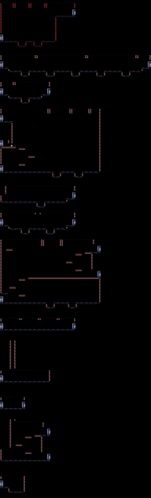
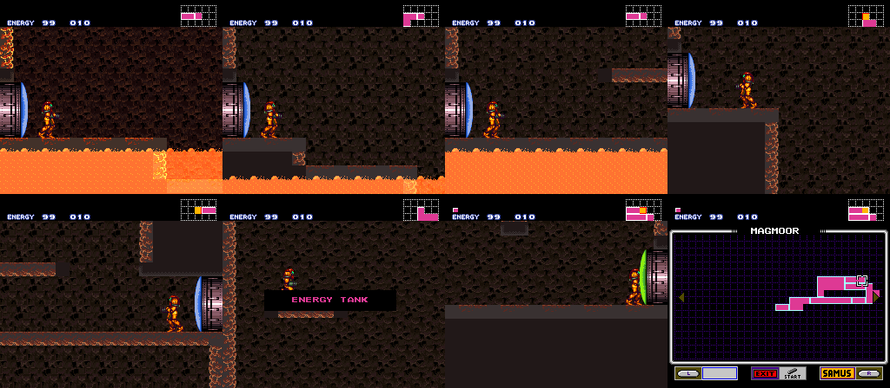
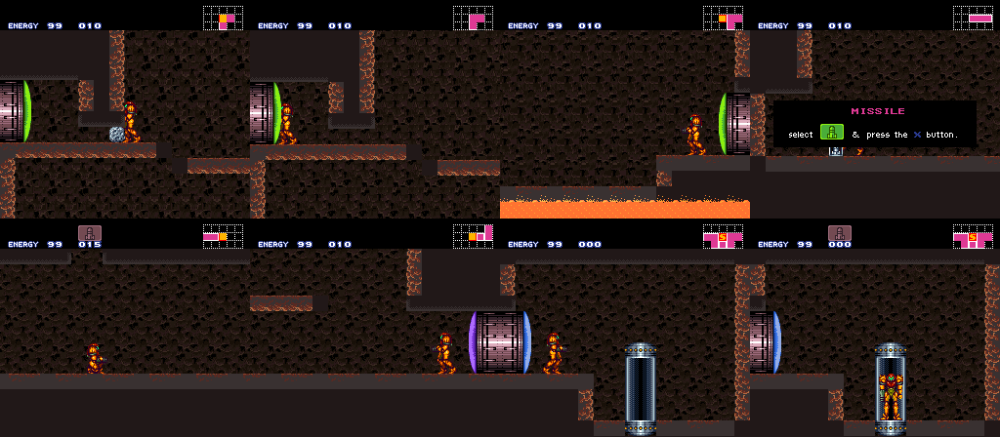

# 17i — Região C da Magmoor (sul: Twin Fires, Geothermal Core, Workstation, Save Station B)

Estado: verificada (01/11/2026: validate "165 salas, 342 portas, 0 problemas", as linhas do Tallon e das rodadas (12m) iguais;
`.ips` sha1 `15d37c8ace02ff12e8c0907cd085febe3eca65cd` igual em dois builds; **96/96** testes: grupo A 34/34 em 5 min 26 s, grupo B
62/62 em 3 min 22 s). Rascunho → aprovada
(pedido do orquestrador, decisões do épico e do usuário repassadas) → implementada → verificada na mesma sessão.
Esforço estimado: 3 dias (salas 1 d; travas, itens, rodadas 0,5 d; validador 0,25 d; emulador, divisão da bateria, fotos e
mutações 1–1,25 d)
Épico: [17 — Magmoor Caverns](17-magmoor-caverns.md) (decisões do usuário 1–5; decisões técnicas 1, 4, 5, 6, 7, 8; linha 17i da
tabela de filhas); modelos: [17f](17f-regiao-a-magmoor.md) e [17h](17h-regiao-b-magmoor.md) (regiões, itens, testes medidos),
[17g](17g-inimigos-magmoor.md) (tabela de inimigos, justiça em toda sala), [12l](12l-regiao-e-chozo.md) (portas key = feixe do
Prime), [15](15-auditoria-de-entrada.md) (entrada de porta).

## Contexto

As regiões A (17f/17g) e B (17h) estão construídas; a R0 da P16 (o elevador do Tallon West) era parede, e a ROM de teste da lava
(17d) estava pendurada nela. Esta filha constrói a **região C** (as 12 salas da tabela da 17c, P17–P28): a Twin Fires Tunnel (a
única quente do sul), as portas de cor do Prime (9 de onda, 3 de gelo, a de plasma da Plasma Processing como gelo), o quebra-cabeça
da Geothermal Core, a **Save Station B**, os elevadores de enfeite de Phendrana South e Mines West, os 2 itens (o míssil no lugar
do Plasma e o E-tank da Workstation) e os inimigos da camada 0. Com ela as **29 salas** da Magmoor estão na ROM. Pedido também:
**dividir a bateria de testes** (6 min 38 s antes; o limite de uma execução é ~7,5 min).

## Estado antes (verificado)

- validate "153 salas, 318 portas, 0 problemas"; linhas "tallon (… 44 salas construídas, alcançáveis agora: 44, 20 itens em 7
  rodadas)" e "rodadas (specs/12m): Tallon + Chozo andados juntos, 51 itens em 7 rodadas … chozo_west 0, chozo_east 4, chozo_south
  5 … 51%"; `.ips` sha1 `2b960ef9f8b27d674c67dd40b660d32f5ab68a5c`; 93/93 testes. A bateria inteira medida no scratchpad: 403 s
  (a cadeia completa `cadeia_completa_tallon_chozo` sozinha ocupa 399 s dela, rodando junto com as outras; soma de todos os
  testes 3083 s de CPU em 11 núcleos).
- `tools/magmoor/rooms.py` (17c): região C = P17 Twin Fires Tunnel (3×2; L1 ← P16 R0, R0 → Twin Fires), P18 Twin Fires (6×1),
  P19 North Core Tunnel (2×1), P20 Geothermal Core (4×3; L2 ← NCT, L1 ← Plasma Processing, L0 ← South Core Tunnel), P21 Plasma
  Processing (3×1), P22 South Core Tunnel (3×1), P23 Magmoor Workstation (4×3; R1 → SCT, R0 → Workstation Tunnel, L2 ← Transport
  Tunnel C), P24 Workstation Tunnel (3×1), P26 Transport to Mines West (2×2, L1), P25 Transport Tunnel C (1×1), P27 Transport to
  Phendrana South (2×2; R1 → TTC, R0 → Save Station B), P28 Save Station B (1×1).
- Travas do Prime na região (`DOCK_LOCKS`, `KEY_BEAM`, dados): **onda** nos dois lados de Twin Fires ↔ NCT, Workstation ↔ TTC e
  TTC ↔ Phendrana South, do lado da NCT na porta para a Geothermal Core, do lado da SCT nas duas portas dela; **gelo** Geothermal
  Core → Plasma Processing e os dois lados de Workstation Tunnel ↔ Mines West; **plasma** Plasma Processing → Geothermal Core;
  **escudo de míssil** Phendrana South → Save Station B. Features (`FEATURES`): trilho de Spider na Twin Fires Tunnel e na
  Geothermal Core, bomb slots e gancho na Geothermal Core, gancho na Twin Fires; lava em 9 das 12. `HOT_ROOMS`: só a Twin Fires
  Tunnel.
- Inimigos do Prime, camada 0 (`magmoor/enemies.py PRIME_LAYER0`): Twin Fires Puffer 15; South Core Tunnel Burrower 2 +
  PuddleSpore 1; Workstation Tunnel Parasite 3.
- Rodadas: Wave (Magmoor East do Tallon) rodada 0 → usado da 1; Varia e Space Jump rodada 2 → da 3; Ice (Root Cave) rodada 3 → da 4.

## Mudança

1. **Salas** (`tools/magmoor/layouts.py`, regras das 17f/17h; a Twin Fires Tunnel no tileset 09, as outras no 0A; prévias em
   `specs/img/17i-salas.png`):
   - **Twin Fires Tunnel** (3×2, quente): o salão de baixo (chão 26 = borda da L1) com 2 fossos de lava; a leste um **penhasco**
     cujo topo é a prateleira da R0 (linha 10), 16 linhas acima do chão sem nada no meio: **borda de Space Jump** (o trilho de
     Spider do Prime). Dentes de rocha no teto.
   - **Twin Fires** (6×1): a caverna no chão 12 (`LOW_FLOOR`) com 5 fossos e estalactites (enfeite).
   - **North Core Tunnel** (2×1): o túnel no chão 12, um fosso.
   - **Geothermal Core** (4×3): o chão de baixo (linha 42 = borda da L2) com 2 fossos; na parede oeste a **laje** da L1 (linha 26,
     colunas 1–10) por um zigue-zague de 3 bordas (37, 32, 27: a subida oeste da Triclops Pit, 16 linhas abaixo); a L1 numa
     **câmara fechada** (linhas 22–25) cuja parede tem um túnel de 1 linha no pé, fechado por um **bloco de bomba** na boca leste
     (7, 25) — os bomb slots do Prime; o topo da rocha sobre a câmara é a prateleira da L0 (linha 10), 16 linhas acima da laje:
     **borda de Space Jump** (trilhos de Spider e o gancho do Prime).
   - **Plasma Processing** (3×1): o salão no chão 12 da R0 para oeste, um fosso, o **míssil** no fim (5, 11).
   - **South Core Tunnel** (3×1): o desenho da Lake Tunnel (chão 12, 2 fossos).
   - **Magmoor Workstation** (4×3): o chão de baixo (42 = borda da L2) com 2 fossos; a **laje** do meio (26 = borda da R1) da parede
     leste até a coluna 17, pelo zigue-zague oeste (37, 32, 27); a prateleira da R0 (10) numa rocha sobre a R1, pelo zigue-zague
     leste (21, 16, 11: a subida leste da Fiery Shores); rocha sobre a L2 e a R0 (a Samus não pousa na tampa: armadilha da 17h);
     o **E-tank** numa plataforma alta a oeste (linha 8): **borda de Space Jump** (a plataforma que o Wave levanta no Prime; o Wave
     já é preciso para entrar: toda porta da sala é de onda).
   - **Workstation Tunnel** (3×1): túnel no chão 10, nervuras.
   - **Transport Tunnel C** (1×1): o salão.
   - **Transport to Phazon Mines West** (2×2, de enfeite): o salão na tela de baixo (chão 26) e o poço de 2 blocos do alto até a
     plataforma (chão comum, sem elevador).
   - **Transport to Phendrana Drifts South** (2×2, de enfeite): o salão de baixo (26 = borda da R1), o poço, e a prateleira da R0
     (10) numa rocha sobre a R1 pelo zigue-zague leste (21, 16, 11); rocha sobre a R0.
   - **Save Station B** (1×1): a sala da Save Station A. **Estação 2 da área 2** (`areas.magmoor_stations`).
   - **P16**: a parede R0 abre (o chão da 17e já estava na borda).
2. **Travas** (`magmoor/rooms.py GATES`): o escudo de míssil = **porta vermelha** do lado da Phendrana South (bit **`$C1`**, a
   segunda trava de míssil); as portas key = **portas de feixe do feixe do Prime** do lado de cada doca (onda roxa no 0A, gelo
   verde); a porta de dentro da Plasma Processing, de plasma no Prime, = **gelo** (`SM_BEAM`, decisão técnica 5); Geothermal Core
   ↔ Plasma Processing = gelo dos dois lados + `{Morph, Bombas}` do lado da Geothermal Core (o túnel); Geothermal Core ↔ SCT = onda
   do lado da SCT + Space Jump do lado da Geothermal Core (a borda); Twin Fires Tunnel ↔ Twin Fires = Space Jump do lado da Twin
   Fires Tunnel (sem trava de porta no Prime: a feature do trilho, `FEATURE_GEOMETRY`). Calor: Varia nas portas para a Twin Fires
   Tunnel (`heat_gates`).
3. **Itens** (`tools/magmoor/items.py`, bits `$D8–$D9`): míssil da Plasma Processing (5, 11) **rodada 4** (atrás do gelo); E-tank
   da Workstation (5, 7) **rodada 3**, `needs {Space Jump}`.
4. **Rodadas** (`FIRST_ROUND`): as 10 salas de C fora das de gelo na **3** (a Twin Fires Tunnel é quente: Varia; a borda dela pede
   o Space Jump, também da rodada 2); a Plasma Processing e a Mines West na **4** (o Ice da Root Cave é da rodada 3).
5. **Inimigos** (`magmoor/enemies.py`): Twin Fires 3 **Mellas** (Puffer, 6 telas); South Core Tunnel 2 **Sovas** (Burrower);
   Workstation Tunnel 2 **Zeelas** (Parasite); **Puddle Spore fora** (`STAND_IN None`, como os de camada de evento da Chozo;
   `PROPOSED_LATER` vazio). 28 inimigos em 10 salas.
6. **Validador** (`tools/validate.py`): `check_magmoor_locks_mapped` mapeia **key** (a tampa do feixe do Prime, `KEY_BEAM`, ou o
   de `SM_BEAM`, do lado da doca, o feixe na trava), confere que `KEY_BEAM` = as docas key do Prime e que `SM_BEAM` troca
   exatamente as portas de plasma (nenhuma porta de plasma na Magmoor), e aceita trava só de geometria numa ligação sem trava do
   Prime quando a sala do lado da borda tem a feature que a justifica (`FEATURE_GEOMETRY`: spider/grapple = Space Jump,
   bomb_slot = Morph + Bombas). O resto já cobria a região: `check_room` (alcance a pé de toda porta de toda entrada, a regra das
   bordas, sem lugar sem volta, lava), `check_magmoor_rounds`, `check_world_rounds` (guarda "rodada só da Magmoor"),
   `check_tallon_rounds`/`check_chozo_rounds`, `check_item_geometry`, `check_breakables`, `check_heat(_in_rom)`,
   `check_lava(_in_rom)`, `check_magmoor_enemies`, `check_gates`, `check_arrival` (a estação 2), `check_pause_maps`,
   `check_reclaimed`.
7. **ROM de teste da 17d** (`magmoor/testrooms.py`): sai da R0 da P16 (porta do jogo agora) para uma porta **R1 da Mines West**
   (P26), que o jogo não tem (o salão dela vai até essa parede); as salas de teste no mapa a leste dela (colunas 60–62 da linha 11,
   bytes da lista do mapa salvo que a P26 já tem). `HOST`/`HOST_DOOR`; `run_tests.into_lava_rooms`/`lava_wave_doors` usam os dois.
8. **Bateria dividida** (`tests/run_tests.py`): `--grupo A|B` (`TEST_GROUPS`, `group_of` pelo nome: B = os testes `chozo_*`,
   `magmoor_*`, `elevador_*`, `entradas_de_porta_*`, `nivel_cruza_banco_*` e os das ROMs de teste 12g/17d; A = o resto: fragata,
   Tallon, título, as duas cadeias). Sem `--grupo`, todos rodam como antes (e os filtros por nome continuam). Cada teste em
   exatamente um grupo (a função é total). Os testes já rodavam em paralelo (threads, um processo do emulador por teste, saídas
   separadas): nada a mudar ali.

## Rodadas (o ponto crítico do pedido)

A região C só liga ao resto pela P16 (Tallon, rodada 1) e pela Twin Fires Tunnel, **quente** no Prime (o único `Area Damage` do
sul): sem a Varia não se entra, então o sul fica na rodada 3, não antes (o pedido previa "talvez antes da 3": o sul é frio, mas a
porta dele não). Os elevadores de Phendrana South e Mines West são de enfeite: nenhuma ligação nova com o Tallon ou a Chozo. O
validador prova: as linhas do Tallon e das rodadas (12m) **idênticas** (diff); a mutação I19 (atalho da Workstation para uma sala
do Tallon da rodada 5) é pega.

## Critérios de aceite

1. validate 0 problemas; "44 salas construídas, alcançáveis agora: 44, 20 itens em 7 rodadas" e "51 itens em 7 rodadas … chozo_west
   0, chozo_east 4, chozo_south 5 … 51%" iguais; linha da Magmoor com as 29 salas e os 7 itens por rodada. **Passa.**
2. `magmoor_regiao_c_rota` (protege = a região C andada com o equipamento da rodada 3 e os inimigos vivos, as portas de onda, o
   E-tank, a porta de gelo fechada para o Wave; falha_quando = E1, E3), `magmoor_regiao_c_itens` (protege = o bloco de bomba do
   quebra-cabeça, a porta de gelo da câmara (o Wave não abre, o gelo abre), o míssil, a Mines West de enfeite; falha_quando = E2),
   `magmoor_save_station_b` (protege = a subida a pé da Phendrana South, a porta vermelha, save/game over/continue na estação 2),
   `entradas_de_porta_magmoor` com as portas novas (17 → 23 entradas); `lava_medida`/`porta_de_onda_lava` na porta nova da ROM de
   teste. **Passam.**
3. Mutações pegas (abaixo). **Passa.**
4. Dois builds com o mesmo sha1; fotos `specs/img/17i-*.png` olhadas; cada grupo da bateria em < ~6 min. **Passa** (tempos abaixo).

## Plano de testes

| Camada | O quê | Qtde |
|---|---|---|
| validate.py | `check_magmoor_locks_mapped` com key, `SM_BEAM`, `FEATURE_GEOMETRY` | 1 mudada |
| run_tests.py | `magmoor_regiao_c_rota`, `magmoor_regiao_c_itens`, `magmoor_save_station_b`; `entradas_de_porta_magmoor` 17 → 23 entradas; `--grupo A\|B` | +3 |
| scratchpad (`s17i/`) | 22 mutações do validador; 3 de emulador | 25 |
| imagem | `specs/img/17i-salas.png`, `17i-rota.png`, `17i-itens.png` | +3 |

## Riscos e reversão

- As caminhadas medidas dependem da geometria e dos inimigos (`s17i/scripts`: `seg.py` busca em feixe, `hops.py`, `trp.py`).
  Mexer numa sala pede refazer o trecho.
- A divisão pelo nome: um teste novo com prefixo de B cai em B; os outros em A. Se um grupo passar de ~6 min, mover prefixos.
- Reversão: `ACTIVE_REGIONS = {"A", "B"}`, os itens `$D8–$D9`, os inimigos de C, a ROM de teste de volta na P16 e os 3 testes; a
  divisão da bateria é independente (sem `--grupo` tudo roda como antes).

## Fora de escopo

- A 17j (rodadas das três áreas e a cadeia completa com a Magmoor).
- Artefatos, Ice Spreader, Flying Pirates, Puddle Spores e Magdolites das camadas de evento, jatos de fogo e estalactites como
  travas, os painéis de Wave da Workstation como mecanismo (o Wave já é pedido nas portas).

## Resultado

### Salas (29 na área 2: 12 novas + a R0 da P16 aberta)

| Sala (P#) | Tamanho | Tileset | Lava (superfície) | Rodada | Notas |
|---|---|---|---|---|---|
| Twin Fires Tunnel (17) | 3×2 | 09 quente | 27 (2 fossos) | 3 | R0 no penhasco: borda de Space Jump |
| Twin Fires (18) | 6×1 | 0A | 13 (5 fossos) | 3 | 3 Mellas; onda para a NCT |
| North Core Tunnel (19) | 2×1 | 0A | 13 (1 fosso) | 3 | ondas dos dois lados |
| Geothermal Core (20) | 4×3 | 0A | 43 (2 fossos) | 3 | laje + zigue-zague; câmara da L1 (bloco de bomba, gelo); L0 de Space Jump |
| Plasma Processing (21) | 3×1 | 0A | 13 (1 fosso) | 4 | míssil; porta de gelo (plasma no Prime) |
| South Core Tunnel (22) | 3×1 | 0A | 13 (2 fossos) | 3 | 2 Sovas; ondas |
| Magmoor Workstation (23) | 4×3 | 0A | 43 (2 fossos) | 3 | 2 zigue-zagues; E-tank de Space Jump |
| Workstation Tunnel (24) | 3×1 | 0A | — | 3 | 2 Zeelas; gelo para a Mines West |
| Transport Tunnel C (25) | 1×1 | 0A | — | 3 | ondas |
| Transport to Phazon Mines West (26) | 2×2 | 0A | — | 4 | de enfeite; hospeda a ROM de teste da 17d (porta R1 só lá) |
| Transport to Phendrana South (27) | 2×2 | 0A | — | 3 | de enfeite; zigue-zague até a vermelha |
| Save Station B (28) | 1×1 | 0A | — | 3 | estação 2 da área 2 |

De cima para baixo: Twin Fires Tunnel, Twin Fires, North Core Tunnel, Geothermal Core, Plasma Processing, South Core Tunnel,
Workstation, Workstation Tunnel, Mines West, Transport Tunnel C, Phendrana South, Save Station B (as prévias não desenham a lava
nem as tampas: é FX/PLM).

### Itens e rodadas

| Bit | Sala | Prime | Lugar / trava | Rodada |
|---|---|---|---|---|
| `$D8` | Plasma Processing | Plasma Beam (já no Tallon) → **Missile Expansion** | chão do fim do salão (5, 11), atrás da porta de gelo e do bloco de bomba | 4 |
| `$D9` | Magmoor Workstation | Energy Tank (plataforma levantada pelo Wave) | plataforma alta (5, 7), borda de Space Jump | 3 |

### Linhas do validador (o que mudou e por quê)

- **Iguais** (diff contra a pasta real antes): "tallon (… 44 salas construídas, alcançáveis agora: 44, 20 itens em 7 rodadas)" e
  "rodadas (specs/12m) … 51 itens em 7 rodadas … chozo_west 0, chozo_east 4, chozo_south 5 … 51%".
- "153 salas, 318 portas" → **"165 salas, 342 portas"** (12 salas, 12 ligações).
- "magmoor (specs/17e, 17f; regiões ativas: AB): 17 salas, 5 itens … rodada 1: 4 salas, 0 itens; rodada 3: 13 salas, 3 itens; rodada
  6: 0 salas, 2 itens" → **"ABC): 29 salas construídas, 7 itens … rodada 1: 4 salas, 0 itens; rodada 3: 23 salas, 4 itens; rodada
  4: 2 salas, 1 itens; rodada 6: 0 salas, 2 itens"**.
- "magmoor (specs/17f, 17h): 2 trava(s) …" → **"magmoor (specs/17f, 17h, 17i): 16 trava(s) … as portas key = tampas do feixe do
  Prime, a de plasma da Plasma Processing de gelo, SM_BEAM; travas de geometria pelas features do Prime: 1; salas quentes: 12 …;
  lava em 16 salas"**.
- "magmoor (specs/17g): 21 inimigos em 7 salas (burrower 1, …, puffer 5, …, zoomer 3) …; regiões C: só a tabela do Prime" →
  **"28 inimigos em 10 salas (burrower 3, metaree 3, puffer 8, tryclops 9, zoomer 5) …"** (todas as regiões construídas).
- "magmoor (specs/17b)" e "(tabela inteira, specs/17c …)": 17 → 29 salas construídas. "lava (specs/17d)": salas do jogo com lava
  9 (115 lugares) → **16 (175 lugares, pior saída 2)**; tilesets usados por 29 salas, 16 estados com lava. "chozo (specs/12g)": a
  lista de salas quentes ganha a Twin Fires Tunnel. "ruínas (specs/12d)": outras salas 89 → 101.
- "$8F recuperado": usados 2482 → **3122 (2152/2153 100/101 702/702 168/861)**: a região C usou **640 bytes** do `$8F` (dos 1335
  livres), livres agora **695** (1 + 1 + 0 + 693). "bancos": nível 153 → 165 blobs (+3154 bytes). "órfãs": `$8F` só delas 20860 →
  20220.

### Testes (emulador)

- **`magmoor_regiao_c_rota`**: atalho até a P16 (o elevador do Tallon), o equipamento da rodada 3 + Wave por RAM; **andando**: a
  porta da P16, a Twin Fires Tunnel (quente, Varia) e o Space Jump pelo penhasco até a R0, a Twin Fires com as 3 Mellas vivas na
  chegada, as portas de onda, a North Core Tunnel, a Geothermal Core pelo zigue-zague e o Space Jump pela face da rocha até a L0,
  a South Core Tunnel sobre as Sovas, a Workstation (Space Jump pela parede oeste até a plataforma: o E-tank, 199), o Space Jump
  pelo teto até a R0, a Workstation Tunnel sobre as Zeelas e a porta de gelo **fechada para o Wave**; bits explorados e o mapa de
  pausa. Energia conferida em toda sala, nunca reposta.
- **`magmoor_regiao_c_itens`**: equipamento da rodada 4 (+ Ice); na Geothermal Core por `door_teleport`, o zigue-zague **a pé**,
  o bloco de bomba fica com o tiro do Wave e quebra com a bomba, a bola pelo túnel, a porta de gelo da câmara: o Wave não abre, o
  gelo abre; a Plasma Processing até o míssil (15); por `door_teleport` na Workstation Tunnel, as Zeelas, a porta de gelo aberta, a
  Mines West de enfeite (↓ não faz nada). Energia 99.
- **`magmoor_save_station_b`**: por `door_teleport` na Workstation, a pé até a L2, a TTC, a Phendrana South pelo zigue-zague **a
  pé**, a porta vermelha (bit `$C1`), a Save Station B: save (estação 2 da área 2), mapa, game over, "MAGMOOR / CAVERNS", continue
  no pedestal.
- `entradas_de_porta_magmoor`: 17 → **23** entradas (Twin Fires, South Core Tunnel, Workstation Tunnel), nenhuma exceção.
  `lava_medida`/`porta_de_onda_lava`: na porta nova da ROM de teste (Mines West R1).
- Bateria: **96/96**; `--grupo A` 34 testes em 5 min 26 s (a cadeia completa sozinha leva ~5,2 min: é o piso do grupo), `--grupo
  B` 62 em 3 min 22 s (pasta real). Sem `--grupo` tudo junto levaria ~9 min.

Da esquerda para a direita, de cima para baixo: chegada na Twin Fires Tunnel (a lava embaixo), a Twin Fires, a Geothermal Core
(L2), a prateleira da L0, a Workstation (R1), o E-tank, a porta de gelo da Workstation Tunnel fechada, o mapa de pausa.

O bloco de bomba do quebra-cabeça, a porta de gelo da câmara (fechada para o Wave), a Plasma Processing, o míssil, a Mines West; a
Phendrana South (porta de onda roxa), a Save Station B, o continue no pedestal.

### Espaço

`$8F` 640 bytes (acima), `$83` 316 (livre a partir de `$83:BF22`), `$A1` 121 (`$A1:F91B`), `$B4` 39 (`$B4:F83C`); nível +3154;
`$84`, `$A0`, `$82`, fixo e SRAM do mapa (30 bytes, a tabela inteira desde a 17c): nada.

## Mutações

Validador (`s17i/scripts/mutate_i.py` → `s17i/mutate_i.out`), todas as 22 pegas, sem mutação limpo: I1 sem o bloco de bomba da
Geothermal Core; I2 o penhasco da Twin Fires Tunnel baixo com degraus (a R0 a pé); I3 a porta de onda Twin Fires ↔ NCT esquecida;
I4 `SM_BEAM` vazio; I5 `SM_BEAM` mantendo plasma; I6 o míssil da Plasma Processing na rodada 3; I7 a plataforma do E-tank baixa; I8
Twin Fires Tunnel fria (o sul na rodada 1); I9 Twin Fires quente; I10 Mella num fosso; I11 4 Sovas em 3 telas; I12 Puddle Spore
sem decisão; I13 a borda da Twin Fires Tunnel sem a feature spider; I14 sem a borda 16 da subida leste da Workstation; I15 o escudo
de míssil da Save Station B esquecido; I16 a Mines West declarada na 3; I17 a L0 da Geothermal Core a pé; I18 a ROM de teste da 17d
ainda na R0 da P16; I19 atalho da Workstation para a Great Tree Chamber (a linha do Tallon muda). ROM: R1 o míssil com outro bit;
R2 a Twin Fires Tunnel sem o bit de calor; R3 a tampa da Plasma Processing trocada pela de plasma.
Emulador (`s17i/scripts/emu_mut_i.sh` → `s17i/emu_mut_i*.out`, cópia descartável `s17i/mut`): E1 sem o bloco de bomba →
`magmoor_regiao_c_itens` falha; E2 a câmara com porta de onda em vez de gelo → `magmoor_regiao_c_itens` falha; E3 a Mella oeste da
Twin Fires em x 9 (perto da porta) → `entradas_de_porta_magmoor` falha; E4 os fossos da Twin Fires com 6 colunas →
`magmoor_regiao_c_rota` falha. Duas mutações mais fracas **não** foram pegas e ficam registradas: uma Zeela da Workstation Tunnel
em x 7 (ela se afasta da porta: nenhum toque em 120 quadros) e o segundo fosso da Twin Fires uma coluna a oeste (a caminhada
continua passando).

## Desvios

- **A região C fica na rodada 3**, não antes: o sul é frio, mas a porta dele (a Twin Fires Tunnel) é quente no Prime; sem a Varia
  não se entra. Nenhuma rodada do Tallon/Chozo muda.
- **Travas só de geometria sem trava de porta no Prime** (a borda de Space Jump da Twin Fires Tunnel): o validador as aceitava só com
  trava de porta do Prime; agora também quando a sala do lado da borda tem a feature que a justifica (`FEATURE_GEOMETRY`).
- **Puddle Spore fora** (decisão abaixo); `PROPOSED_LATER` vazio.
- **Painéis de Wave da Workstation**: sem mecanismo próprio (o Wave já é pedido em toda porta da sala); a plataforma = borda de
  Space Jump.
- **Rocha sobre portas laterais** (Workstation L2/R0, Phendrana South R0) e a prateleira da L0 da Geothermal Core sem beiral: medidos
  no emulador (a Samus pousava na tampa; o Space Jump batia a cabeça).
- **ROM de teste da 17d na Mines West R1** (porta que o jogo não tem), não numa sala nova.
- **Divisão da bateria por prefixo de nome** (dois grupos), em vez de paralelismo novo: os testes já rodavam em paralelo; o grupo A
  fica preso à cadeia completa (~5,2 min sozinha).
- **Atalhos nos testes** (contados): o elevador do Tallon até a P16 (3 testes), `door_teleport` para a Geothermal Core e a
  Workstation Tunnel (itens) e a Workstation (save), o equipamento e 5 mísseis da porta vermelha por RAM.

## Verificação

01/11/2026, pasta real: `python3 -I tools/build.py` duas vezes → sha1 `15d37c8ace02ff12e8c0907cd085febe3eca65cd` nas duas;
`python3 -I tools/validate.py` → "165 salas, 342 portas, 0 problemas" (igual à do scratchpad; as linhas do Tallon e das rodadas
(12m) idênticas às da 17h: diff); `python3 -I tests/run_tests.py --grupo A` → 34/34 (5 min 26 s); `python3 -I tests/run_tests.py
--grupo B` → 62/62 (3 min 22 s): **96/96**.

## Decisões para o usuário (escolhidas as recomendadas; confirmar)

1. **Puddle Spore fora** (nenhuma espécie do SM é um esporo de poça; a South Core Tunnel fica com as 2 Sovas).
2. O **E-tank da Workstation numa borda de Space Jump** (a plataforma que o Wave levanta no Prime).
3. As **bordas de Space Jump** no lugar dos trilhos de Spider (a R0 da Twin Fires Tunnel, a L0 da Geothermal Core) e o
   quebra-cabeça da Geothermal Core = túnel com bloco de bomba.
4. As contas de inimigos (3 Mellas de 15 Puffers, 2 Zeelas de 3 Parasites, 2 Sovas de 2 Burrowers).
5. A divisão da bateria (A = fragata, título, portas de feixe e a cadeia completa; B = Tallon, Chozo, Magmoor, elevadores,
   entradas, ROMs de teste) e os desenhos.
