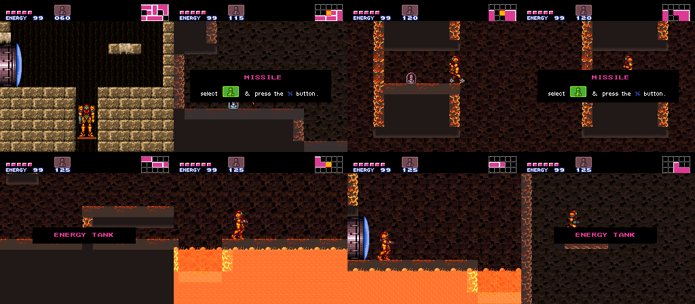
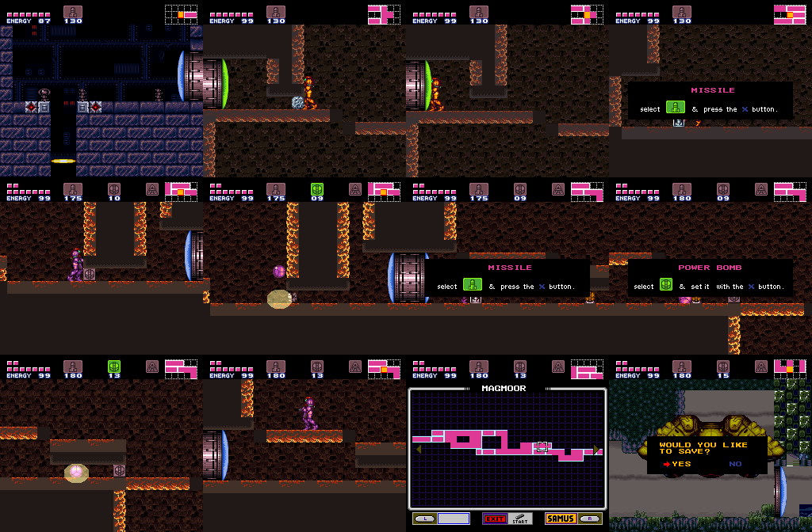
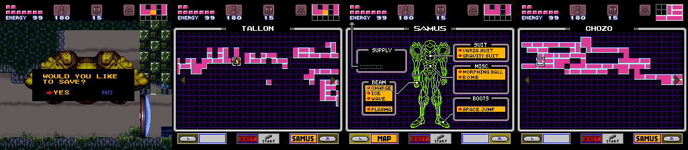

# 17j — Rodadas das três áreas e a cadeia completa (fecha o épico 17)

Estado: **verificada** (01/11/2026: validate "165 salas, 342 portas, 0 problemas", linha do Tallon igual, linhas novas
"rodadas (specs/12m, 17j)" e "magmoor (specs/17, …)"; `.ips` sha1 `15d37c8ace02ff12e8c0907cd085febe3eca65cd` igual em dois builds e
igual ao de antes; **98 testes**: grupo A 34/34 em 3 min 20 s, grupo B 64/64 em 4 min 43 s). Rascunho → aprovada (pedido do
orquestrador, o plano do épico) → implementada na cópia de rascunho `s17j/proj` → verificada na pasta real na mesma sessão.
Esforço estimado: 2 dias (validador 0,25 d; cadeia no emulador e divisão 1,25 d; docs e mutações 0,5 d). Medido: ~1 dia.
Épico: [17 — Magmoor Caverns](17-magmoor-caverns.md) (linha 17j da tabela de filhas; decisão técnica 8; critérios 3 e 4);
modelos: [12m](12m-rodadas-e-cadeia-completa.md) (rodadas das duas áreas e a cadeia completa) e
[14f](14f-rodadas-e-cadeia-com-chefes.md) (fecha um épico com uma linha de validador do épico inteiro).

## Contexto

Com a 17i as 29 salas da Magmoor estão na ROM, com os 7 itens declarados em rodadas (17f: os 2 mísseis da região A na 3; 17h: o
E-tank do Transport Tunnel A na 3, o míssil e a expansão de PB da Fiery Shores na 6; 17i: o E-tank da Workstation na 3, o míssil
da Plasma Processing na 4), conferidos um a um por `check_magmoor_rounds`. Faltava o que o épico deixou para a última filha:

1. `check_world_rounds` com a Magmoor: os 58 itens das três áreas num passeio só, a porcentagem do fim (58%), a linha dos
   elevadores com os 2 da Magmoor; a guarda da 17f ("nenhuma rodada só da Magmoor") ajustada;
2. a cadeia completa no emulador estendida pela Magmoor (os 7 itens nas rodadas deles, pelos elevadores de verdade);
3. **dividir a cadeia**: ela já levava ~5,2 min sozinha (o piso do grupo A, 5 min 26 s); com a Magmoor passaria do limite de
   uma execução da ferramenta (10 min; a regra do projeto: cada comando abaixo de ~6 min);
4. uma checagem do épico inteiro (como a `check_epic_bosses` da 14f) e o épico `verificada`.

## Estado antes (verificado)

Na cópia de rascunho, igual à pasta real: `.ips` sha1 `15d37c8ace02ff12e8c0907cd085febe3eca65cd`; validate "165 salas, 342 portas,
0 problemas" (`s17j/validate_before.out`); linhas:

- "tallon (… 44 salas construídas, alcançáveis agora: 44, 20 itens em 7 rodadas …)";
- "rodadas (specs/12m): Tallon + Chozo andados juntos, 51 itens em 7 rodadas, … (itens por rodada, Tallon + Chozo: 0: 2 + 1;
  1: 4 + 7; 2: 1 + 11; 3: 2 + 8; 4: 2 + 1; 5: 7 + 0; 6: 2 + 3); elevadores a partir da rodada: chozo_west 0, chozo_east 4,
  chozo_south 5; porcentagem do fim ($8B:E627) com todos: 51% (energia 799, mísseis 160, power bombs 10)";
- "magmoor (specs/17e, 17f; regiões ativas: ABC): 29 salas construídas, 7 itens, …: rodada 1: 4 salas, 0 itens; rodada 3: 23
  salas, 4 itens; rodada 4: 2 salas, 1 itens; rodada 6: 0 salas, 2 itens; elevadores: … (rodada 1) <-> … (rodada 1), … (rodada 1)
  <-> … (rodada 1)".

Testes 34/34 (grupo A, 5 min 26 s) + 62/62 (grupo B, 3 min 22 s). A cadeia `cadeia_completa_tallon_chozo`: 223 788 quadros de
roteiro (+ ~5 800 do pouso), **314 s sozinha** (medido, `s17j/scripts/chain_states.py`).

`tools/snesrun` já tem `save`/`load` de estado (LakeSnes `snes_saveState`, com a SRAM do cartucho). Medido: um trecho da cadeia
rodado a partir de um estado salvo dá **a mesma saída** (todas as linhas `ok`/`FAIL` e os valores) que rodado direto
(`s17j/scripts/from_step.py`, rodada 3 da Chozo a partir do fim da rodada 2).

## Mudança

1. **Validador** (`tools/validate.py`):
   - `check_world_rounds` anda e confere as **três áreas**: todos os itens com lugar (`world_items`, 58), as rodadas declaradas
     das salas da Magmoor (`magmoor_rooms.FIRST_ROUND`) entram no conjunto das rodadas, a porcentagem do fim com todos. A guarda
     da 17f fica, com o sentido de agora: **nenhuma rodada existe só pela Magmoor** (toda rodada acrescenta sala ou item do Tallon
     ou da Chozo: a Magmoor não mexe nas rodadas deles). As comparações item a item continuam em `check_tallon_rounds` /
     `check_chozo_rounds` / `check_magmoor_rounds`. Linha nova: **"rodadas (specs/12m, 17j): Tallon + Chozo + Magmoor andados
     juntos, 58 itens em 7 rodadas, … (itens por rodada, Tallon + Chozo + Magmoor: 0: 2 + 1 + 0; …); elevadores a partir da
     rodada: chozo_west 0, chozo_east 4, chozo_south 5, magmoor_north 1 (da Chozo), magmoor_east 1 (do Tallon); porcentagem do fim
     ($8B:E627) com todos: 58% (energia 999, mísseis 180, power bombs 15)"**.
   - `check_epic_magmoor` (linha nova **"magmoor (specs/17, épico fechado na 17j)"**): as 29 salas da tabela construídas (as 3
     regiões) com as 29 ligações; os itens da decisão 2 por sala do Prime (`EPIC_MAGMOOR_ITEMS`: 4 mísseis, 2 E-tanks, a expansão
     de PB; nada onde o Prime tem o Ice Spreader ou um artefato; a expansão de PB nunca antes da rodada 6); toda trava do Prime
     (`DOCK_LOCKS`, 16 docas) numa ligação construída (o mecanismo de cada uma é a `check_magmoor_locks_mapped`); calor em
     exatamente as 12 salas superaquecidas do Prime; lava só na área 2 e só onde o Prime tem; elevadores de verdade exatamente os
     2 (Chozo P24 ↔ P0, Tallon P23 ↔ P16), os 3 de enfeite construídos sem elevador; as 2 save stations (estações 1 e 2 da área
     2); nenhum chefe.
2. **A cadeia completa com a Magmoor** (`tests/run_tests.py`):
   - `FullChain` conhece a área `"magmoor"` (`items_of`, `CHAIN_AREAS`); `check_order` exige os itens das três áreas, cada um na
     rodada declarada (erro **ao gerar o roteiro** se não).
   - As caminhadas medidas dos testes das regiões viraram pedaços reaproveitáveis, **sem mudar uma linha dos roteiros deles**
     (conferido: os 91 outros roteiros gerados por `tests()` antes/depois idênticos, `s17j/scripts/dump_scripts.py`):
     `magmoor_a_to_storage`, `magmoor_a_to_column`, `magmoor_a_to_station` (17f/17g), `magmoor_b_to_tank`, `magmoor_b_to_p16`
     (17h), `magmoor_c_to_slab`, `magmoor_c_to_tank` (17i); cada um recebe a energia a conferir e o nome das fotos.
   - `fc_round_3_magmoor`: do Hall of the Elders (fim da rodada 3 da Chozo) por `door_teleport` até a Magmoor North da Chozo (a
     porta de teto do Sunchamber Lobby por `rise_through`), **andando** até a parede e para a plataforma (`CHAIN_P24_PAD`), desce:
     a região A andada (os 2 mísseis, o da coluna com o Space Jump), a B (o E-tank do Transport Tunnel A no túnel de bomba) até a
     P16, a C (o penhasco da Twin Fires Tunnel com o Space Jump, a Geothermal Core, o E-tank da Workstation); de volta à P16 por
     `door_teleport`, **andando** para a plataforma (`chain_ride_up_p16`), sobe: a Magmoor East do Tallon. A rodada 3 do Tallon
     (Root Cave, Ice) começa dali (antes: subia o elevador North da Chozo, `fc_round_3_up`, que saiu).
   - `fc_round_4_magmoor`: da Root Cave (o Ice) pela Tunnel B até a Magmoor East, **andando** para a plataforma
     (`chain_ride_down_p23`), desce à P16; a região C até a laje da Geothermal Core; o bloco de bomba do quebra-cabeça, a bola pelo
     túnel, a porta de gelo, a Plasma Processing: o míssil no lugar do Plasma; volta e sobe. A rodada 4 do Tallon começa da
     Magmoor East.
   - `fc_round_6_magmoor`: do Arbor Chamber pela Root Cave/Tunnel B, desce à P16; `door_teleport` à Fiery Shores, a porta de teto
     dela para a Shore Tunnel por `rise_through`, `door_teleport` à Warrior Shrine; a caminhada da `magmoor_regiao_b_itens`: a parede
     de PB com uma power bomb, o túnel, a porta R0, o bolso: o míssil, a bola até a expansão de PB, a power bomb na boca do túnel,
     a subida de verdade pela porta de teto até a Shore Tunnel; pausa: o mapa da Magmoor com as telas que a cadeia andou; volta à
     P16 e sobe. O `fc_end` sai da Magmoor East.
   - `fc_end`: os 58 bits, a porcentagem calculada com a fórmula e as tabelas da ROM = **58**, energia 999, mísseis 180, power
     bombs 15; depois do save, game over e continue, os bits de explorado das telas das três áreas (a Magmoor na cópia salva da área
     2).
3. **A cadeia em três partes** (`CHAIN_PARTS`, testes `cadeia_completa_parte_1`, `_2`, `_3`), divididas por rodadas: parte 1 =
   rodadas 0–2 (do pouso ao fim da rodada 2 na Chozo); parte 2 = rodada 3 nas três áreas; parte 3 = rodadas 4–6 e o fim. Cada parte
   termina com as checagens da passagem (`chain_handoff`: os 64 bits de item `$7ED884–$7ED88B`, mísseis e power bombs com as
   capacidades, energia máxima, o item do HUD, a sala, o jogo rodando) e `save build/tests/cadeia_completa_parte_<k>.state`; a
   seguinte começa com `load` desse estado e **as mesmas checagens**. O `run_tests.py` (`run_chain_parts`) roda as partes pedidas
   uma depois da outra num job só; depois de uma parte passar grava ao lado do estado um carimbo (`.state.json`: sha1 da ROM e sha1
   dos roteiros das partes até ela); se o estado de que uma parte precisa falta ou tem outro carimbo (outra ROM, outro roteiro), ela
   **roda antes a parte anterior** (relatada como pré-requisito); se uma parte falha, as seguintes falham sem rodar.
4. **Grupos** (`CHAIN_GROUP`): a parte 1 no grupo A, as partes 2 e 3 no grupo B (elas carregam o estado que o grupo A salvou: rodar
   **A antes de B**, a ordem da verificação). Os testes de cada grupo continuam pelo prefixo do nome.

## Critérios de aceite

1. validate 0 problemas; linha do Tallon **igual** ("44 salas construídas, alcançáveis agora: 44, 20 itens em 7 rodadas"); itens
   por rodada do Tallon e da Chozo iguais aos de hoje (0: 2 + 1; 1: 4 + 7; 2: 1 + 11; 3: 2 + 8; 4: 2 + 1; 5: 7 + 0; 6: 2 + 3) e
   elevadores chozo_west 0, chozo_east 4, chozo_south 5; os da Magmoor nas rodadas declaradas (3, 3, 3, 3, 4, 6, 6); 58 itens, 58%.
   (protege = rodadas das três áreas, porcentagem, o épico inteiro; falha_quando = mutações V1–V12; não_prova = que a ordem é a
   única, nem — V2b — o tipo de um item que vale o mesmo na porcentagem: isso só a linha do épico pega)
2. As três partes passam; gerar o roteiro com uma rodada de item da Magmoor mudada, sem a rodada 6 da Magmoor ou com um item a mais
   levanta erro (T1–T4); o estado da passagem corrompido falha (E2); um carimbo velho faz a parte anterior rodar antes (E1); uma ROM
   com outro item na Plasma Processing falha a parte 3 (E3).
3. Dois builds com o sha1 de antes (a ROM não muda); cada grupo passa, cada comando abaixo de ~6,5 min.

## Plano de testes

| Camada | O quê | Qtde |
|---|---|---|
| validate.py | `check_world_rounds` com as três áreas (linha "rodadas (specs/12m, 17j)"), `check_epic_magmoor` (linha "magmoor (specs/17, …)") | 1 mudada + 1 nova |
| run_tests.py | `cadeia_completa_parte_1/2/3` no lugar de `cadeia_completa_tallon_chozo` | +3 −1 |
| scratchpad (`s17j/`) | mutações V (validador), T (gerador), E (emulador e passagem); roteiros das regiões idênticos | 20 |
| imagem | `specs/img/17j-rodada-3.png`, `17j-rodadas-4-6.png`, `17j-fim.png` | 3 |

## Riscos e reversão

- **Dependência entre grupos**: as partes 2 e 3 (grupo B) carregam o estado da parte 1 (grupo A). Rodar o grupo B sozinho depois
  de um build novo faz a parte 1 rodar antes, dentro do grupo B (~3,3 min a mais: passa dos ~6 min). A ordem da verificação (A,
  depois B) nunca cai nisso. O carimbo impede usar um estado de outra ROM ou de outro roteiro.
- **Estado do emulador**: o estado do LakeSnes não guarda a ROM; um estado carregado numa ROM diferente rodaria o código novo (é
  o que o carimbo impede no `run_tests.py`; a mutação E3 usa isso de propósito).
- **Trechos medidos**: as caminhadas da Magmoor são as dos testes das regiões (mudar uma sala pede medir de novo nos dois); os
  ajustes próprios da cadeia estão em constantes com o `expect` logo depois (`CHAIN_P24_PAD`, `CHAIN_P16_PAD`, `CHAIN_P23_PAD`).
- Reversão: `tools/validate.py` (`check_world_rounds`, `check_epic_magmoor`, `EPIC_MAGMOOR_*`), `tests/run_tests.py` (pedaços
  `magmoor_*_to_*`, `fc_round_*_magmoor`, `CHAIN_PARTS`, `run_chain_parts`, `CHAIN_GROUP`); nenhuma mudança na ROM.

## Fora de escopo

Mudar salas ou itens; os testes das regiões (continuam iguais, byte a byte); Phendrana, Mines, Impact Crater; a porcentagem
mostrada na tela (o jogo só a mostra no fim vanilla, que a fragata não usa: aqui ela é calculada e conferida, como na 12m).

## Desvios (preenchido na implementação)

- **Atalhos novos da cadeia** (contados por `FullChain.note`, listados na docstring de `full_chain`):
  - `rise_through` (transição de porta de teto por RAM) em **2** portas: Sunchamber Lobby → Sunchamber Access (rodada 3; medido: o
    `door_teleport` para cima fica no Lobby) e Fiery Shores → Shore Tunnel (rodada 6; idem; coluna 0, guiando para oeste: as
    outras colunas caem de volta).
  - **energia, mísseis e power bombs repostos por RAM até a capacidade** ao entrar na Magmoor (3 vezes): os inimigos que ela mata lá
    soltam munição que a conta da cadeia não prevê (medido: 2 mísseis a mais na rodada 3); cheia, nada muda. Nunca capacidade.
  - `door_teleport`: 241 portas (eram 217; as voltas da Magmoor à P16 e as idas aos elevadores da Magmoor).
- **Tiros de feixe tirados** de dois trechos copiados dos testes das regiões: na cadeia ela tem Wave + Ice + Plasma, que
  atravessam paredes e **abrem a porta de trás** (medido: na Geothermal Core a porta de gelo da câmara, e a bola entrava rolando na
  Plasma Processing; na Warrior Shrine a porta R0, e a bola entrava na Fiery Shores). O teste da região continua mostrando que o
  feixe não quebra os blocos.
- **A porta R0 da P16**: andando da L0, o primeiro tiro já abre a porta (vindo do elevador, ele sai da tela e é preciso um
  segundo): o pedaço da região C recebe as letras da porta (`door`, "DD" no teste da região, "D" na cadeia).
- **Plataformas da P16 e da P23 a partir da parede** (um ponto fixo): o lugar em que ela chega por `door_teleport` depende para que
  lado olhava (medido: o mesmo pulso caía fora da plataforma na rodada 4).
- A rodada 3 sobe para o Tallon pelo elevador da Magmoor (P16 → Magmoor East) em vez do North da Chozo (`fc_round_3_up` saiu): a
  cadeia anda os 5 elevadores, 14 viagens (eram 9), sempre andando até a plataforma.
- A parte 2 termina no fim da rodada 3 (Root Cave) e a parte 3 começa pela rodada 4 da Magmoor, ao lado (Tunnel B).

## Resultado

- validate (pasta real): "165 salas, 342 portas, 0 problemas"; saída igual à da cópia de rascunho; em relação a antes, só a linha das
  rodadas mudou e uma linha nova entrou:
  - "tallon (… 44 salas construídas, alcançáveis agora: 44, 20 itens em 7 rodadas)" **igual**;
  - "rodadas (specs/12m, 17j): Tallon + Chozo + Magmoor andados juntos, 58 itens em 7 rodadas, cada um na rodada declarada (itens
    por rodada, Tallon + Chozo + Magmoor: 0: 2 + 1 + 0; 1: 4 + 7 + 0; 2: 1 + 11 + 0; 3: 2 + 8 + 4; 4: 2 + 1 + 1; 5: 7 + 0 + 0; 6: 2 +
    3 + 2); elevadores a partir da rodada: chozo_west 0, chozo_east 4, chozo_south 5, magmoor_north 1 (da Chozo), magmoor_east 1 (do
    Tallon); porcentagem do fim ($8B:E627) com todos: 58% (energia 999, mísseis 180, power bombs 15)" — a porcentagem medida é a
    esperada pelo épico (51 + 4 mísseis + 2 E-tanks + 1 expansão de PB, um ponto cada);
  - "magmoor (specs/17, épico fechado na 17j): as 29 salas construídas (regiões A B C), 29 ligações; 7 itens (2 Energy Tank, 4
    Missile Expansion, 1 Power Bomb; rodadas 3, 3, 3, 3, 4, 6, 6; um míssil no lugar do Plasma, nada no do Ice Spreader, sem
    artefatos); 16 travas do Prime nas ligações construídas; calor nas 12 salas superaquecidas do Prime; lava em 16 salas, todas com
    lava no Prime e nenhuma fora da área 2; elevadores: 2 de verdade (…), 3 de enfeite sem elevador; 2 save stations; nenhum chefe".
- build: sha1 `15d37c8ace02ff12e8c0907cd085febe3eca65cd` nas duas vezes (igual ao de antes: a ROM não muda).
- testes (pasta real, A antes de B): **grupo A 34/34 em 3 min 20 s** (era 5 min 26 s), **grupo B 64/64 em 4 min 43 s** (era 3 min
  22 s); nenhum pré-requisito rodou. As partes da cadeia (medidas na cópia, com a bateria): parte 1 193 s (125 515 quadros), parte 2
  123 s (62 707), parte 3 155 s (88 392); sozinhas e em sequência 6 min 29 s. Os outros roteiros gerados são **idênticos** aos de antes
  (os 91 de `tests()` conferidos linha a linha; os 4 das ROMs de teste não passam pelo código mudado); a parte 1 é o começo exato da cadeia antiga + as 12 checagens da passagem + o `save`.
- Fotos (olhadas): `specs/img/17j-rodada-3.png` (descendo da Chozo à Magmoor, o míssil da Storage Cavern, o oco da coluna e o
  míssil dele, o E-tank do Transport Tunnel A, a praia da Fiery Shores, a Twin Fires Tunnel, o E-tank da Workstation),
  `17j-rodadas-4-6.png` (descendo da Magmoor East, o bloco do quebra-cabeça, a porta de gelo, o míssil da Plasma Processing; a
  parede de PB da Warrior Shrine e a power bomb, o míssil e a expansão da Fiery Shores, a power bomb na boca do túnel, a plataforma
  da T0, o mapa da Magmoor com as telas andadas; o save na nave), `17j-fim.png` (o save com 9 E-tanks, 180 mísseis, 15 power bombs; o
  mapa do Tallon; a tela de equipamento; o mapa da Chozo).

### Atalhos da cadeia (contados por `FullChain.note` ao gerar os roteiros)

| Atalho | Parte 1 | Parte 2 | Parte 3 | Total |
|---|---|---|---|---|
| `door_teleport` entre salas | 96 | 54 | 91 | 241 |
| Samus posta perto de um item | 13 | 7 | 10 | 30 |
| Samus posta diante de uma porta | 3 | — | 4 | 7 |
| inimigos da sala apagados por RAM | 6 | 4 | — | 10 |
| mísseis repostos por RAM | 1 | 1 | 1 | 3 |
| energia reposta por RAM (Magmoor) | — | 1 | 2 | 3 |
| power bombs repostas por RAM (Magmoor) | — | — | 1 | 1 |
| porta de teto por `rise_through` | — | 1 | 1 | 2 |
| arenas vencidas por RAM (Hive Mecha, Incinerator Drone, Flaahgra) | 3 | — | — | 3 |
| plataforma da Tallon Canyon, volta à nave, Samus na nave | 2 | — | 1 | 3 |
| energia por RAM nas caminhadas cegas e lutas (`chozo_walk`, `tallon_walk`, portas vermelhas) | sim | — | — | (como a 12m) |

Nenhum item, feixe ou capacidade por RAM; todos os itens da Magmoor andados ou rolados para dentro; as 14 viagens de elevador
com a Samus andando até a plataforma.

### Mudanças de expectativa dos testes

| Teste | Mudança |
|---|---|
| `cadeia_completa_tallon_chozo` | substituído por `cadeia_completa_parte_1`, `_2`, `_3` (as rodadas 0–2 iguais byte a byte; a 3 sobe pela Magmoor) |
| os outros 95 | nenhuma (roteiros idênticos) |

## Mutações

Validador e gerador (`s17j/scripts/mutate_j.py` → `s17j/mutate_j.out`, na memória; sem mutação: nenhum problema): **V1** o E-tank da
Workstation declarado na rodada 4 (pego: "é pego na rodada 3 …, declarado na rodada 4"); **V2** a expansão de PB da Fiery Shores
vira míssil (pego pela linha do épico; **V2b**: a linha das rodadas sozinha não pega, a porcentagem continua 58); **V3** o míssil da
Plasma Processing vira E-tank (épico); **V4** um míssil no lugar do Ice Spreader (épico); **V5** um item de tipo sem valor na
porcentagem (o passeio para com erro `KeyError`, como antes); **V6** a power bomb valendo 10 ("… é 61%"); **V7** a Fiery Shores sem
calor; **V8** lava na Save Station A; **V9** o elevador de enfeite da Mines West como de verdade; **V10** uma sala fora do build;
**V11** só uma save station; **V12** a expansão de PB declarada na rodada 5 ("antes da 6"). **T1** E-tank da Workstation na rodada 4,
**T2** a cadeia sem a rodada 6 da Magmoor, **T3** o míssil da Plasma Processing na rodada 3, **T4** um item a mais na tabela da
Magmoor: `ValueError` "cadeia 17j: itens/rodadas diferentes das declaradas" ao gerar o roteiro (o teste nem roda).

Emulador e passagem: **E1** o carimbo da parte 1 trocado, pedida só a parte 2 → a parte 1 roda antes ("pré-requisito"), as duas
passam, 4 min 27 s (`s17j/mut_E1.out`); **E2** o estado da parte 2 cortado → a parte 3 falha ("load failed", `s17j/mut_E2.out`);
**E3** uma ROM com um E-tank no lugar do míssil da Plasma Processing, a parte 3 rodada direto do estado da parte 2 → 30 FAIL (mísseis
e capacidade a menos desde o item, `s17j/mut_E3.out`); a ROM refeita depois: sha1 de antes.

## Decisões para o usuário (padrão escolhido, a confirmar)

1. **A cadeia em três testes ligados por estado salvo do emulador**, o grupo B dependendo do A (rodar A antes de B; fora de ordem,
   correto mas mais lento). Alternativa: começar cada parte por RAM (equipamento e bits postos), sem dependência, mas sem provar
   que o estado é o de um jogo de verdade.
2. **Os atalhos novos**: 2 portas de teto por `rise_through` e energia/munição repostas até a capacidade ao entrar na Magmoor.
