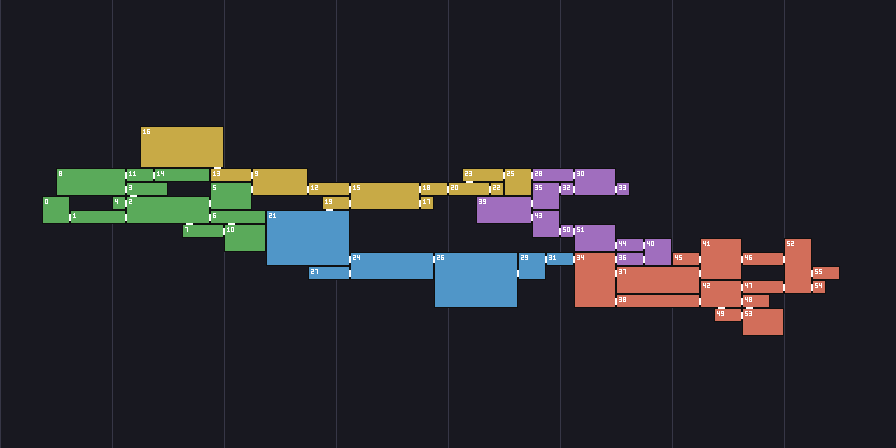

# 18c — Grafo, mapa e travas do Prime de Phendrana

Estado: verificada (03/11/2026: validate 165/342/0 com as linhas novas "phendrana (tabela inteira, specs/18c …)" e "super missile
(specs/18c) …"; .ips sha1 `15d37c8ace02ff12e8c0907cd085febe3eca65cd` igual em dois builds; grupo A 34/34, grupo B 64/64)
Esforço estimado: 2 dias
Épico: [18 — Phendrana Drifts](18-phendrana-drifts.md) (decisões 1 e 2; dados, nenhuma sala na ROM)

## Contexto

Como a 12c (Chozo) e a 17c (Magmoor): antes de desenhar qualquer sala de Phendrana o projeto precisa da planta do mundo inteiro — as 56
salas, o tamanho de cada uma, onde fica no mapa de pausa da área 4 (18b) e por qual porta liga na vizinha —, com as checagens do
validador. Ficam gravadas também as **travas do Prime** de cada porta (com a cor), as features que travam movimento dentro das salas, a
**neve**, a **água**, o **gelo que só o Plasma derrete** e os **painéis de onda**, como dados lidos do jogo, **sem escolher item nem
mecanismo do SM** (isso é das regiões, 18f em diante). E a varredura que a regra 3 do épico pede: o Super Missile não abre nada no jogo
(nenhuma porta verde, nenhum bloco de super). Nenhuma sala vai para a ROM.

## Estado atual (verificado)

- `research/prime_worlds.json`, MLVL "Phendrana Drifts": 56 salas, 118 docas = 59 ligações, todas com volta; 4 ciclos (épico).
- `tools/dump_prime_locks.py` (12c, 17c) grava travas por doca, features, `key_vuln` e `area_damage`; a neve (`AreaAttributes`) e os
  gatilhos de um feixe só (gelo de plasma, painéis de onda) foram lidos à parte no épico (`s18/scripts/phen_envfx.py`, `phen_named.py`).
- Tamanho pela regra do Tallon (`tallon/rooms.py screens`): **302 telas** (A 59, B 58, C 69, D 42, E 74).
- Itens de super na ROM base: porta verde = PLMs `C872 C878 C87E C884` (`research/sm_room_format.md` §5); bloco de super = bloco de
  tiro (tipo C) com BTS `$0A`/`$0B` (tabela `$94:9EA6` → PLMs `$D08C`/`$D090`, setup `$84:CF67`
  `PlmSetup_D08C_SuperMissileBlockRespawning`, lidos dos bytes).

## Mudança proposta

1. `tools/dump_prime_locks.py`: campos novos por sala — `"env_fx"` (o tipo de FX do `AreaAttributes`: 0 nada, 1 neve; `null` sem ele) e
   `"beam_only"` (`{feixe: n}`: `DamageableTrigger` que não são de porta e que só um feixe fere, pela `DamageVulnerability` como o
   `key_vuln`). Os campos antigos iguais. Saída: `research/prime_phendrana_locks.json` (56 salas).
2. `tools/phendrana/rooms.py` (novo, no molde da 17c): `TABLE` (56 `Row`), `LINKS` (59), `REGIONS` A–E (as do épico), `ACTIVE_REGIONS`
   vazio, `ROOMS = []`, `ALL_ROOMS` (caixas provisórias), `ELEVATOR_ROOMS` (P0 → Magmoor P13, P29 → Magmoor P27: de verdade a partir da
   18e), `DECORATIVE_ELEVATORS` vazio, `TRANSPORT_TO`; dados do Prime: `DOCK_LOCKS` (regra da Chozo), `KEY_BEAM` (por `BEAM_OF_KEY` =
   o `BEAM_OF_VULN` da Magmoor + `ANY_BEAM` para `1 1 1 1`), `FEATURES`, `SNOW_ROOMS`, `WATER_ROOMS`, `PLASMA_ICE`, `WAVE_PANELS`;
   `check_prime` (tudo igual ao Prime, nenhuma sala com calor, os dois elevadores de verdade e cada um apontando para o lado da Magmoor
   que o nomeia em `magmoor/rooms.py TRANSPORT_TO`).
3. **Disposição no mapa** por busca (roteiro descartável `s18c/layout_phen.py`, o construtivo da 17c com Phendrana): colocação
   aleatória em largura a partir da P0, cada sala encostando em todas as vizinhas já postas, **puxada para o lugar dela no Prime visto de
   cima** (x do mapa = norte → sul, y = oeste → leste), a melhor por custo (portas de chão/teto, bytes do save, ordem do Prime, porta
   do elevador fora da tela de baixo). Resultado: **8 ligações de chão/teto** (a Chozo tem 15, a Magmoor 1), nenhuma em sala de
   elevador, **57 bytes** de SRAM, colunas 3–59, linhas 8–22.
4. `tools/validate.py`:
   - **`check_phendrana()`** (sempre): `check_prime`; `check_layout` na tabela inteira e em cada região sozinha; sala de elevador sem
     porta de chão/teto; as salas `phendrana_*` do build = `ROOMS` (nenhuma); bytes do mapa salvo ≤ `LIST_ROOM[4]`. Linha nova.
   - **`check_no_super_locks(rom, base, manifest)`** (ROM construída): nenhum PLM de porta verde em nenhum estado das nossas salas e
     nenhum bloco de super (BTS cujo PLM tem o setup `$84:CF67`, lido dos bytes) no nível de nenhuma sala nossa. Linha nova.
5. `tools/preview_rooms.py --mapa-phendrana` → `specs/img/18c-mapa.png`.

Cores: **A verde, B amarelo, C azul, D roxo, E vermelho.** Da esquerda para a direita: a P0 (elevador da Magmoor) e a Shoreline
Entrance, a Shorelines com a Save Station B, o Temple Entryway e o Ice Temple em cima, a Chapel Tunnel e a Chapel of the Elders, o
anel da Plaza Walkway / Ice Ruins East / Ice Ruins Access embaixo; a região B numa faixa (Ruins Entryway → Ice Ruins West com a
Canyon Entryway e o Phendrana Canyon em cima, a Courtyard Entryway, o Ruined Courtyard com a Save Station A, a Specimen Storage, a
Research Entrance com a Map Station, a Hydra); a quarentena embaixo (as duas Quarantine Tunnels, a Quarantine Cave com a Monitor à
esquerda, a P29 e a Transport Access); as torres e os laboratórios em cima à direita (Observatory, Control Tower, West/East Tower,
Aether, Research Core) descendo até a Pike Access; o sul fundo na ponta direita (Frozen Pike, as cavernas, a Gravity Chamber,
Phendrana's Edge com a Storage Cave e a Security Cave). O grande anel fecha pela Frozen Pike ↔ Pike Access.

| Região | Salas | Telas | Bytes do save (região sozinha) |
|---|---|---|---|
| A | 12 | 59 | 14 |
| B | 12 | 58 | 11 |
| C | 6 | 69 | 17 |
| D | 12 | 42 | 10 |
| E | 14 | 74 | 15 |
| **Phendrana inteira** | **56** | **302** | **57 de 80** |

## Critérios de aceite

1. validate "165 salas, 342 portas, 0 problemas" (igual) com as linhas "phendrana (tabela inteira, specs/18c, salas construídas: 0): 56
   salas, 59 ligações (8 de chão/teto), 302 telas, mapa 57/80 bytes de SRAM (por região: A 14 B 11 C 17 D 10 E 15); travas do Prime em
   88 docas (event 20, key 72, missile 5, morph 4; cor das portas: any_beam 1, ice 4, plasma 2, wave 65); neve em 23 salas, água em 10,
   gelo de plasma em 3, painel de onda em 2, nenhuma quente nem fria; elevadores: 2 de verdade (18e); sem item SM" e "super missile
   (specs/18c): nenhuma porta verde nem bloco de super (BTS $0A $0B) nas 165 salas do jogo: o item só soma munição e dano". (protege =
   tabela, mapa, cota, travas, cores, neve, água, gelos e painéis iguais ao Prime; nenhum uso do Super Missile no jogo; falha_quando =
   mutações abaixo; não_prova = salas jogáveis, 18e em diante)
2. Mutações (`s18c/mutate_c.py`, em memória), cada uma pega.
3. ROM igual: sha1 `15d37c8a…65cd` em dois builds; A 34/34, B 64/64.
4. `specs/img/18c-mapa.png` olhada: regiões juntas, nenhuma sala solta; `07d-mapa.png`, `12c-mapa.png`, `17c-mapa.png` e
   `research/render/` iguais byte a byte.

## Plano de testes

| Camada | O quê | Qtde |
|---|---|---|
| validate.py | `check_phendrana`; `check_no_super_locks` | +2 |
| scratchpad | 24 mutações da tabela + 2 da varredura de super; o dumper rodado de novo para a Chozo e a Magmoor (campos antigos iguais) | 28 |
| run_tests.py | nenhum (ROM igual) | 0 |
| imagem | `specs/img/18c-mapa.png` | +1 |

## Riscos e reversão

- 8 portas de chão/teto (lista em `LINKS`, lados B/T): as regiões desenham o acesso (degraus até a borda, como a 12f/17h).
- A P29 (elevador sul) tem a porta R0 na tela de cima (a busca não achou lugar para ela na tela de baixo sem mais portas de chão/teto):
  a 18e confere o poço e a porta.
- Reversão: apagar `tools/phendrana/`, `research/prime_phendrana_locks.json`, `check_phendrana`, `check_no_super_locks`,
  `--mapa-phendrana` e os dois campos novos do dumper.

## Fora de escopo

- Desenho das salas, `AreaDef` de Phendrana, mapa de pausa na ROM, elevadores (18e em diante).
- Itens, mecanismo SM de cada trava, neve, água, inimigos, chefes (18d–18n).

## Desvios (preenchido na implementação)

- **Travas de evento (20) e uma porta "de qualquer feixe"**: o épico contava 71 docas key, 5 de míssil e 4 de Morph; os dados dão
  **72 key** (65 onda, 4 gelo, 2 plasma e **1 `1 1 1 1`**: a Canyon Entryway → Ice Ruins West, uma porta key que qualquer feixe abre,
  `KEY_BEAM` = `ANY_BEAM`) e **20 de evento** (`Actor Door Lock`: a Chapel of the Elders do Sheegoth, a Quarantine Cave do Thardus,
  as emboscadas dos laboratórios — Research Entrance, Observatory, Control Tower, Research Core Access, Aether —, a Quarantine Access, o
  Ruined Courtyard, e Shorelines/Plaza Walkway, do 2º passe). Gravadas como dado, como a Chozo; o mecanismo é das regiões e dos chefes.
- **Neve e gelos no dumper, não à mão** (como a cor e o calor na 17c): `env_fx` e `beam_only`. Os campos antigos de Phendrana iguais
  aos do épico (`s18/phendrana_locks.json`); rodado de novo para a Chozo (`docks` sem o `key_vuln`, `features`) e a Magmoor (`docks`,
  `features`, `area_damage`) no scratchpad: iguais aos de `research/`. A Chozo tem um `beam_only` `power` (sala 36), sem uso.
- **Mapa visto de cima**, não de lado como a Magmoor (x = norte → sul, y = altura): Phendrana se espalha de oeste a leste (0,7 km)
  mais que em altura (180 m), e o grande anel (labs em cima, quarentena embaixo) fecha naturalmente assim. A busca puxa cada sala para
  o lugar do Prime (peso gaussiano, σ 7 células); 20 rodadas de 300 000–500 000 tentativas (11 processos); a escolhida
  (`s18c/phen_40_23_7.json`, deslocada para a coluna 3, linha 8): 8 de chão/teto, 55 bytes na busca (57 depois do deslocamento).
- **Checagens a mais**: os dois elevadores de verdade (nenhum de enfeite: os dois levam à Magmoor) e cada lado apontando para a sala
  da Magmoor que o nomeia (mutações C20, C21).
- A varredura de super percorre as **165 salas construídas** (portas verdes nos estados da ROM, blocos de super nos níveis); hoje
  nenhuma, como esperado.
- O `preview_rooms.py` redesenha `research/render/` inteiro: os 176 arquivos saíram iguais byte a byte; `07d/12c/17c-mapa.png` iguais.
- Mutações (`s18c/mutate_c.out`), todas pegas: C1 Ruined Courtyard uma coluna à direita (20 problemas); C2 ligação faltando; C3 nome;
  C4 caixa; C5 escudo de míssil virou cor; C6 trava de evento esquecida; C7 feature inventada; C8 cota de 40 bytes; C9 porta numa tela
  fora da sala; C10 lados não opostos (o `build_rooms` para); C11 região desconhecida; C12 chave sem prefixo; C13 a porta de plasma
  da Storage Cave marcada gelo; C14 a porta de qualquer feixe marcada onda; C15 neve na Map Station; C16 Chapel sem neve; C17 Gravity
  Chamber sem água; C18 gelo de plasma esquecido; C19 painel de onda inventado; C20 elevador sul de enfeite; C21 elevador norte com o
  lado errado da Magmoor; C22 elevador com porta de teto (disposição válida, só essa checagem pega); C23 sala de Phendrana no build fora
  de `ROOMS`; C24 uma Quarantine Tunnel sobre a outra; S1 porta verde plantada na Landing Site; S2 bloco de PB da Life Grove com BTS
  `$0B`. Sem mutação: limpo (as duas checagens).
- Verificação (03/11/2026, pasta real): `python3 -I tools/build.py` duas vezes → sha1 `15d37c8ace02ff12e8c0907cd085febe3eca65cd` nas
  duas; `python3 -I tools/validate.py` → "165 salas, 342 portas, 0 problemas", só as duas linhas novas; grupo A **34/34**, grupo B **64/64**.
