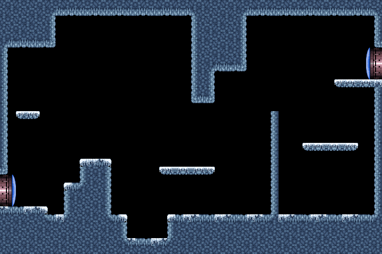
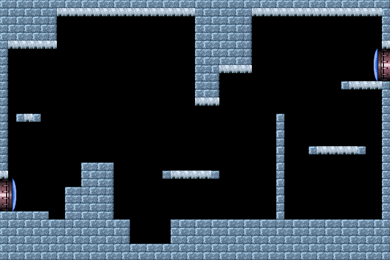
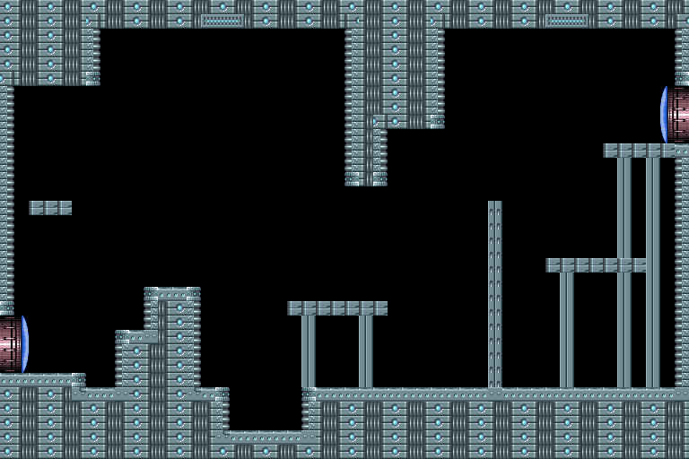
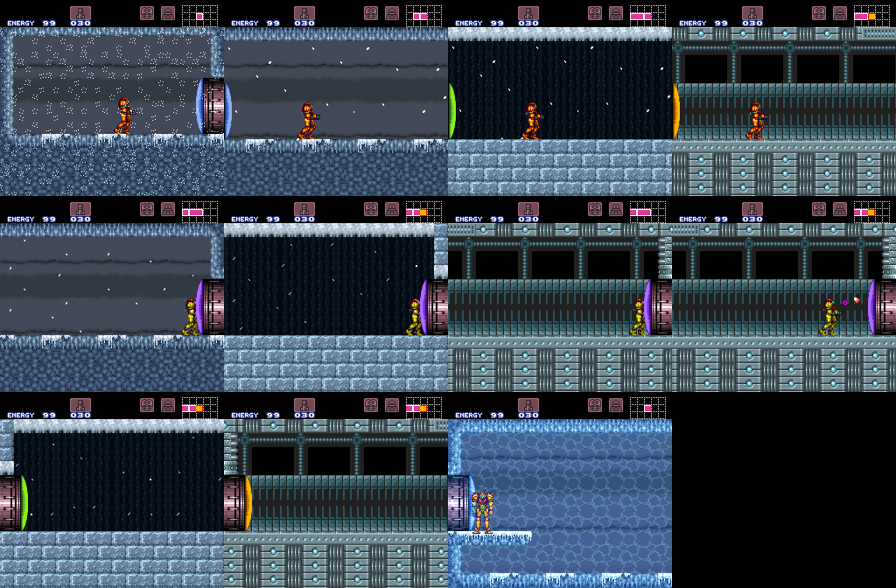

# 18d — Estilos do gelo (três caras), neve, portas e água medidas numa ROM de teste

Estado: verificada (03/11/2026: validate "165 salas, 342 portas, 0 problemas" com as linhas novas "gelo (specs/18d) …";
.ips sha1 `31168d29eae7515f5b11585fc92ef07065603387` igual em dois builds; grupo A **37/37** em 3 min 03 s, grupo B **64/64** em 4 min 14 s)
Esforço estimado: 2,5–3 dias (gasto: 1 sessão)
Épico: [18 — Phendrana Drifts](18-phendrana-drifts.md) (decisão 6, "padrão aceito, a confirmar": três caras e neve onde neva no
Prime; decisão 5: água só na Gravity Chamber, inundada inteira)

## Contexto

As salas de Phendrana (18e em diante) precisam das suas caras — exterior com neve, ruínas Chozo de gelo, laboratórios dos piratas —,
da porta de onda roxa em cada uma, das cores de porta do projeto, da neve caindo onde o Prime tem neve (`SNOW_ROOMS`, 18c) e da
música. O épico pediu medir a neve numa ROM de teste antes de qualquer sala depender dela (como a lava na 17d), e a água da área 4
para a 18m usar.

## Estado antes (verificado nos bytes; roteiros em `s18d/scripts/`)

- Tabela de tilesets `$8F:E7A7` (29 entradas, `survey.py`): `$00`/`$01` dividem metatiles `$C1:B6F6` e gráficos `$BA:C629` (paletas
  diferentes); **nenhum estado vanilla usa o `$01`**; `$04`/`$05` dividem `$C1:C5CF`/`$BB:AE9E`; `$05` é usado por 14 salas órfãs da
  Wrecked Ship **e pela sala de demo `$CC6F`**; `$1A` (Kraid) também por demo; `$1B` (Crocomire `$A98D`) e `$1C` (Draygon `$DA60`)
  só por uma sala órfã cada. Nenhum código vanilla lê o número do tileset além do carregamento (`LoadStateHeader $82:DEF2`; só a área
  6 trata a tabela de outro jeito).
- Peças: `crateria.SURFACE` sólida toda na linha 4 (cores 1–3 e 12 = a borda de grama em cima do chão, 4–7 e 15 = a rocha: contado nos
  tiles, `piececols.py`); a grama (ar) nas linhas 0 e 4. `ruins.RUINS` na linha 7. As peças da fragata (`smlib/style.py`) na linha 4.
  Fundos: o céu do Tallon (`$8A:C180`) todo na linha 5; o das ruínas (`$BA:A69F`, lista `$8F:E25A`) na 6; o da fragata (`$BA:8DE7`,
  `$8F:E117`) nas 5 e 0. CRE: linhas 0–3 só.
- Metatiles `$3F0–$3F7` do `$00` = enchimento (`03FF ×4`); o `$0C` (cópia da Chozo) e o 4 (cópia da fragata) já têm a porta roxa
  (linhas 5 e 6).
- Cores das portas: linhas 0 (1–3) e 1 (1–7) do `$00`, `$04` e `$0C` = as do tileset 4.
- FX que caem no SM (C de `vendor/sm`): **esporos** (tipo 8, `$88:DA11`; 4 estados da área 1) e **chuva** (tipo `$0A`, `$88:D950`;
  Landing Site). Os dois desenham o mapa do BG3 (`$83:ABF0` → `$8A:98C0`/`$8A:A100`) com a paleta 6 do BG3 = cores 24–27 = **linha 1
  cores 8–11**; os tiles animados (`$87:82FD`/`$87:82E7`) usam os valores 1–2 para os flocos/gotas e 3 para o fundo, que a mistura 0
  do FX deixa preto (`LoadFxEntry $89:AB02`: cor 27 = 0), invisível na soma de camadas. **Nenhum tile do CRE usa a linha 1 cores
  8–11** (`cre_line1.py`): essas cores são só do FX. Neve: não existe no SM.

## O que foi feito

1. **`tools/smlib/ice.py`** (novo): as três caras, cada uma numa entrada da tabela que nenhuma sala carregada usa, com a cópia da
   paleta no alocador fixo:
   - **neve** = entrada **`$01`** (metatiles/gráficos do `$00`): estilo `SNOW` = `SURFACE` sem a grama; `SNOW_COLOURS` (linha 4: neve na
     borda, gelo azul-acinzentado na rocha; linha 5: céu de inverno); a porta roxa na **linha 6** (`SNOW_PAINT_LINE`) numa cópia da
     tabela do `$00` com os 8 metatiles;
   - **ruínas de gelo** = entrada **`$1C`** apontada para os gráficos do `$0C` e a **cópia da tabela da Chozo** (porta roxa na linha 5,
     de charge na 4); paleta = a da Chozo (`build.ruins_palette`) com `RUINS_COLOURS` (linha 7 tijolos de gelo, linha 6 fundo gelo
     escuro); estilo `ICE_RUINS` = `RUINS`;
   - **laboratórios** = entrada **`$1B`** apontada para os gráficos vanilla do `$04` e a **cópia da tabela do tileset 4** (porta roxa na
     linha 6); paleta = a vanilla do `$04` com `LAB_COLOURS` (linhas 4 e 5: aço frio ciano); estilo = o da fragata.
   - **neve** (`SNOW_FLAKES`): linha 1 cores 9 e 10 das três paletas = branco e azul-claro; `SNOW_FX` = a entrada dos esporos vanilla
     (`$83:82F4`, tipo 8, sem FX de paleta nem tiles animados da área); `RAIN` (só na ROM de teste, para comparar) = a chuva da Landing
     Site sem o bit de paleta da área (que na área 4 é da Maridia) e sem a mistura.
   - `BACKGROUND` por cara (céu `crateria.SKY_BG`/`$0181`; `$E25A`/`$01C1`; `$E117`/`$C1C1`), `MUSIC = $1B/$06` (o tema de dentro da
     Maridia: calmo e lento; o `$1B` já é o da Chozo), `PAINT_LINES`, `check(rom)`.
2. **`tools/build.py`**: `ice_palette`, `ice_metatiles`; depois dos blobs da Magmoor (nada antes muda de lugar) grava a tabela da neve
   e as 3 paletas (do ROM vanilla: a paleta do tileset 4 já é a da fragata) e reaponta as 3 entradas (9 bytes cada); `room_fx` com a
   neve (`RoomDef.snow`, só na área 4, nunca com água/lava/calor/outro FX); modo **`--teste-18d`** → `build/teste-18d/`.
   `tools/frigate/rooms.py`: `RoomDef.snow`.
3. **`tools/phendrana/testrooms.py`** (só na ROM de teste): uma área 4 própria (acrescentada a `AREAS` só nesse build) com 5 salas em
   fila: chuva (`$01`, chuva), neve (`$01`, esporos), ruínas de gelo (`$1C`, esporos), laboratório (`$1B`), água (`$01`, inundada,
   2×1); porta de onda na parede leste de cada cara; porta de gelo (verde) na oeste das ruínas e de plasma (laranja) na do laboratório.
   Os testes entram carregando a estação 0 da área 4 por RAM.
4. **Validador**: `ice.check` (base: entradas próprias, `$01` = `$00`, peças e linhas, linhas pintadas fora das peças/fundo/CRE, cores
   das portas = tileset 4, CRE sem as cores 8–11 da linha 1, céu na linha 5, enchimento em `$3F0`, FX dos esporos e da chuva vanilla,
   tabelas de cor); **`check_ice_in_rom`** (entradas no lugar, gráficos = os vanilla da fonte, metatiles = a cópia certa, paleta = a do
   build e o roxo e a neve lidos direto, **nenhuma sala carregada fora da área 4 nem sala de demo usa `$01/$1C/$1B`**, toda sala com
   neve aponta o FX dela e nenhuma outra tem FX de esporos/chuva fora do `RoomDef.fx`); **`check_ice_test_rooms`** (a ROM de teste);
   `check_room`: neve só os esporos e só na área 4; `check_wave_paint_free` com os três tilesets (e os metatiles de charge no `$1C`).
   Linhas novas "gelo (specs/18d) …".
5. **Testes** (ROM de teste, construída pelo `run_tests.py` antes deles; grupo A por enquanto, a 18e cria o C): **`neve_medida`**
   (FX tipo `$0A`/8/8/0 nas 4 salas, cores 25–26 = `SNOW_FLAKES` e 27 = 0 na WRAM, o BG3 lido 64 quadros depois: **esporos 16 px, a
   chuva 122 px**, as cores de cada cara na WRAM; fotos), **`porta_de_onda_gelo`** (nas três caras: a tampa leste com o metatile `$3F0`
   no nível da WRAM e o roxo na linha pintada da paleta da WRAM; o Power Beam não abre, o Wave abre e ela passa à sala seguinte; fotos
   das tampas verde e laranja), **`agua_medida_area_4`** (FX tipo 6, superfície `$10`, os 4 pulos de `pulo_na_agua_medido` na sala
   inundada da área 4: subidas iguais a `reach.WATER_*`, alcance nunca menor que o do modelo).
6. Prévia `python3 -I tools/preview_rooms.py --estilo-gelo` → `specs/img/18d-(neve|ruinas-de-gelo|laboratorio)(-limpo).png`.

  

No emulador, da esquerda, de cima: a chuva (flocos densos e rápidos), a neve (esporos: flocos esparsos e lentos), as ruínas de gelo
com neve (porta verde de gelo a oeste), o laboratório (porta laranja de plasma a oeste); as portas de onda roxas na neve, nas ruínas,
no laboratório e abrindo com o Wave; as tampas verde e laranja; a sala inundada da área 4.

## Medidas (emulador, ROM de teste)

| | chuva (tipo `$0A`) | neve (esporos, tipo 8) |
|---|---|---|
| BG3 em 64 quadros | desce 122 px (~1,9 px/quadro) | desce 16 px (¼ px/quadro: o `$88:DA47`) |
| cores na WRAM (25, 26, 27) | `SNOW_FLAKES`, 0 | `SNOW_FLAKES`, 0 |

Água na área 4 (`WATER_FX` da 07l): FX tipo 6, superfície `$0010`, nenhum FX de paleta da área (as listas da Maridia ficam
desligadas: 18b); pulo sem a Gravity sobe 51 px e alcança `{0: 144, 1: 131, 2: 116, 3: 91}` = `reach.WATER_*`; com a Gravity sobe 113
e alcança `{0: 114, 1: 108, 2: 105, 3: 100, 4: 93, 5: 87, 6: 78, 7: 62}` — 2 px a mais que o modelo na altura 0 (na Savestation a
mesma medida dá 112: o chão de lá não é plano naquele ponto). O modelo fica do lado seguro.

## Critérios de aceite

1. validate 0 problemas, "165 salas, 342 portas" (nenhuma sala nova no jogo); as linhas do Tallon ("44 salas construídas, alcançáveis
   agora: 44, 20 itens em 7 rodadas") e das rodadas ("58 itens em 7 rodadas … 58%") iguais; linhas novas "gelo (specs/18d) …".
   **Passa.**
2. `neve_medida`, `porta_de_onda_gelo` e `agua_medida_area_4` passam (protege = a neve, as cores, a porta roxa nas três caras, a
   água da área 4 com o pulo do modelo; falha_quando = as mutações do emulador abaixo; não_prova = salas de Phendrana, 18e em diante);
   os antigos passam. **Passa.**
3. Mutações pegas (abaixo). **Passa.**

## Mutações (`s18d/scripts/mutate_d.py` → `s18d/mutate_d.out`)

Sem mutação: limpo (`ice.check`, a ROM, a ROM de teste). M1 cor numa linha fora das da cara; M2 neve com a grama; M3 porta roxa da neve
na linha 4 (das peças); M4 neve pintada na cor 4 da linha 1 (moldura das portas); M5 FX da neve ligando a lista de paleta da área; M6
a sala de demo `$CC6F` com o tileset `$1B`; R1 gráficos do `$1B` = os do `$0C`; R2 paleta do `$01` = a vanilla do `$00`; R3 metatiles do
`$01` = a tabela vanilla do `$00`; R4 metatiles do `$1C` = a tabela vanilla do `$0C`; R5 a Landing Site com o tileset `$01`; R6 a Tallon
Canyon com o FX dos esporos; R7 o roxo das ruínas de gelo mexido; S1 neve numa sala da Magmoor; S2 neve numa sala inundada (o build
para); S3 o laboratório de teste sem porta de onda; S4 chuva numa sala do jogo; S5 uma sala usando o metatile `$3F0`. Emulador: com a
linha 6 do `$01` e a cor 9 da linha 1 trocadas, `porta_de_onda_gelo` e `neve_medida` falham. Todas pegas.

## Riscos e reversão

- A neve é o BG3 dos esporos: nada da física muda; numa sala com neve não cabe outro FX (água, lava): a Gravity Chamber (inundada) não
  tem neve no Prime.
- Os flocos são aditivos: num fundo muito claro aparecem pouco (as caras têm fundo escuro).
- Reversão: tirar `smlib/ice.py`, o bloco das entradas no `build.py`, `RoomDef.snow`, `phendrana/testrooms.py`, as checagens e os testes.

## Fora de escopo

- Salas de Phendrana (18e em diante), qual cara cada sala usa (cada região escolhe), música por sala.

## Decisões para o usuário (escolhidas as recomendadas; confirmar)

1. **Cores** das três caras (`ice.SNOW_COLOURS`, `RUINS_COLOURS`, `LAB_COLOURS`, `SNOW_FLAKES`): mudar a tabela e reconstruir.
2. **Neve = os esporos do SM** em branco (lenta, esparsa, ¼ px por quadro); a chuva (rápida e densa) ficou só na ROM de teste.
3. **Música** `$1B/$06` (Maridia de dentro) para a área; os laboratórios podem ganhar outra depois.

## Desvios (preenchido na implementação)

- **Laboratórios no `$1B`, não no `$05`** do épico: a sala de demo `$CC6F` usa o `$05` (e o `$1A`); com o `$1B` nenhuma demo nem sala
  carregada toca a entrada, sem depender das demos desligadas. Os gráficos vêm do `$04` vanilla (a cópia da fragata tem os tiles da
  Parasite Queen no fim).
- As ruínas de gelo usam a mesma cópia da tabela do `$0C` da Chozo (portas roxa e branca); a regra "porta de charge só na Chozo" fica.
- A ROM do jogo muda (4 blobs fixos: a tabela da neve e 3 paletas, 2825 bytes, `$F1:B6C3–C1CB`; e as 3 entradas), sem nada visível:
  nenhuma sala usa `$01/$1C/$1B` (provado por `check_ice_in_rom`).
- A ROM de teste tem uma área 4 própria (não pendura numa sala do jogo como a da 17d: Phendrana ainda não tem sala); os testes carregam a
  estação por RAM. A 18e a pendura na P0 de Phendrana.
- O pulo na água da área 4 começa com os sub-pixels que a Samus tinha na Savestation (lidos: `$CC00 $DC00 $FFFF $BFFF`, y `$FFFF`):
  com outros o alcance muda 1–3 px; e o alcance pode ser maior que o do modelo (Gravity, altura 0: 114 contra 112), nunca menor.
- Água medida (decisão 5 do épico): a da 07l funciona igual na área 4.
- Experimentos e mutações na cópia `s18d/proj`.
- Verificação (03/11/2026, pasta real): `python3 -I tools/build.py` duas vezes → sha1 `31168d29eae7515f5b11585fc92ef07065603387`;
  `python3 -I tools/validate.py` → "165 salas, 342 portas, 0 problemas", só as duas linhas novas "gelo (specs/18d)" (as outras
  idênticas, diff); `run_tests.py --grupo A` → **37/37** (3 min 03 s; os 3 novos no grupo A até a 18e criar o C), `--grupo B` →
  **64/64** (4 min 14 s).
