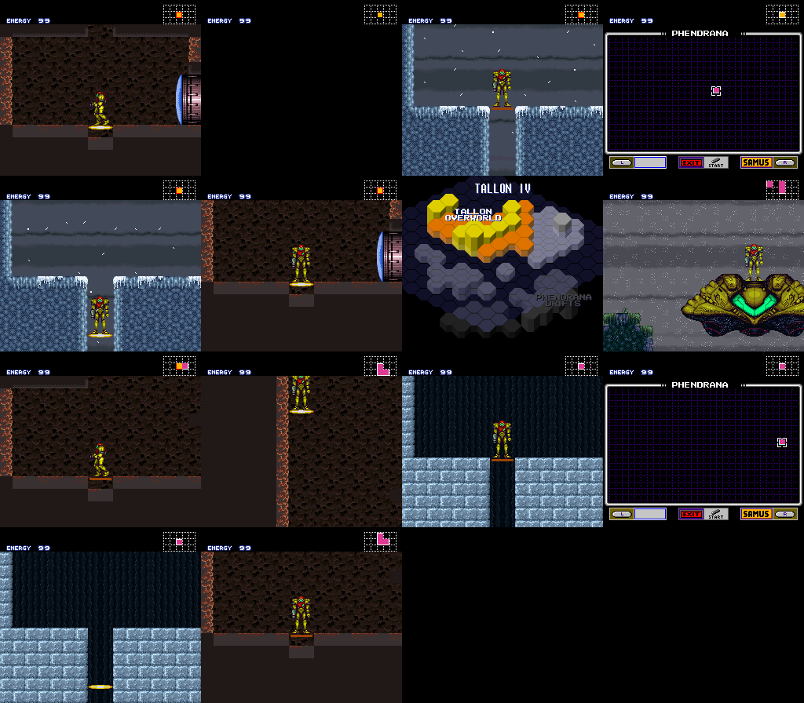
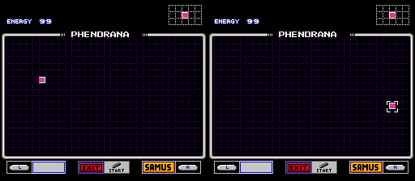

# 18e — Elevadores de verdade para Phendrana (Magmoor ↔ Phendrana) e o grupo C de testes

Estado: verificada (03/11/2026: validate "167 salas, 342 portas, 0 problemas", linhas do Tallon e das rodadas idênticas, linha nova
"phendrana (specs/18e) …"; .ips sha1 `f53f4f0d82948583c2ec486703c9c99441dbc4f9` igual em dois builds; grupo A **34/34** em 3 min 03 s, B
**64/64** em 4 min 27 s, C **5/5** em 28 s)
Esforço estimado: 2 dias (gasto: 1 sessão)
Épico: [18 — Phendrana Drifts](18-phendrana-drifts.md) (decisão técnica 4: elevadores de verdade; decisão técnica 8: grupo C)

## Contexto

Os dois elevadores da Magmoor que no Prime levam a Phendrana eram de enfeite desde a 17h/17i: `magmoor_transport_phendrana_north`
(P13, região B) e `magmoor_transport_phendrana_south` (P27, região C), os dois na rodada 3. Esta filha os liga, como a 12e e a 17e
fizeram: cada um sobe até a sua sala de elevador de Phendrana (área 4, 18b), e volta. As salas de Phendrana, por ora, são só essas duas,
nas caras da 18d e **becos** (as portas da tabela ficam fechadas até as regiões: 18f a P0, 18j a P29). Cria também o **grupo C** de
testes. Critério duro: **as rodadas do Tallon, da Chozo e da Magmoor não mudam** ("44 salas construídas, alcançáveis agora: 44, 20
itens em 7 rodadas"; "58 itens em 7 rodadas … 58%").

## Estado antes (verificado)

- Destinos (`WorldTeleporter`, épico 18): Phendrana P0 ↔ Magmoor P13, Phendrana P29 ↔ Magmoor P27. Na Magmoor o poço dos dois sai da
  linha 0 (a P13: salão na tela de cima, chão 10; a P27: salão na tela de baixo, chão 26), isto é, **eles sobem**: Phendrana fica em
  cima, os elevadores de Phendrana descem.
- Tabela (18c): P0 2×2 em (3, 13), porta R1 (tela de baixo, leste) → Shoreline Entrance; P29 2×2 em (37, 17), portas L1 (tela de baixo,
  oeste, de onda) e **R0 na tela de cima** (de gelo) → Transport Access. Neve no Prime: a P0 sim, a P29 não.
- Área 4: `VANILLA_PAUSE[4]` (18b); nome vanilla na tela de continue: spritemap `$3D` em `$82:CD09`, 7 peças ("MARIDIA"), lugar
  `$81:AA1C` área 4 = (`$CE`, `$9F`) (lidos dos bytes).
- O mapa de pausa da área 4 rola 24 px a mais para a esquerda (`DetermineMapScrollLimits $82:9EC4`, `sm_82.c:1811`:
  `map_min_x_scroll = coluna mais à esquerda · 8 − 24`).

## O que foi feito

1. **Salas de Phendrana** (`tools/phendrana/layouts.py`, novo; `phendrana/rooms.py build_rooms` com o desenho, a cara `LOOK` — a da
   18d — o fundo dela e a neve de `SNOW_ROOMS`; `ROOMS = build_rooms(ACTIVE_REGIONS, ELEVATOR_ROOMS)`): **P0** e **P29** (2×2) com o
   salão nas telas de baixo (linhas 19–25, chão 26 = o batente das portas dessa tela) e a plataforma em x 7–8 da tela oeste, o poço
   **descendo** da plataforma até a última linha (`Elevator(7, 26, up=False)`). A P0 na cara da **neve** (`$01`, neve caindo: os
   esporos da 18d); a P29 nas **ruínas de gelo** (`$1C`, seca: no Prime não neva nela). A porta R0 da P29 fica na tela de cima, longe
   do poço (que só desce da tela de baixo): a 18j só desenha a subida até ela. `FIRST_ROUND` = 3 nas duas.
2. **Lados da Magmoor**: P13 e P27 com `Elevator(7, 10/26, up=True)` (o poço escavado até a linha da plataforma); `magmoor/rooms.py`:
   `ELEVATOR_ROOMS` com as duas, `DECORATIVE_ELEVATORS` = só a Mines West, `TRANSPORT_TO` com as chaves de Phendrana.
3. **`tools/areas.py`**: `PHENDRANA` (área 4, "PHENDRANA", a cara da neve e o céu, música `ice.MUSIC`, estação 0 = o chão ao lado da
   plataforma da P0, lista do mapa salvo = a tabela inteira, 57 bytes em +475: 532/1280), `ELEVATORS` + 2 pares, `AREAS` com
   Phendrana por último (nada alocado antes muda de ordem).
4. **Tela de continue** (`frigate/areaselect.py`): nome da área 4 = **"PHENDRANA / DRIFTS"** (letras pequenas, como os outros; 15
   peças, a vanilla tem 7), spritemap nova no `$82`.
5. **Validador**: `PRIME_ELEVATORS` com os 2 pares; `world_rooms` com Phendrana; **`check_phendrana_rounds`** (linha nova "phendrana
   (specs/18e)": cada sala na rodada declarada e na mesma do lado da Magmoor); a guarda "nenhuma rodada só da Magmoor" vale para
   Phendrana também; a linha das rodadas lista só os elevadores de antes (**igual**); `check_arrival` com a área 4;
   `PHENDRANA_MIN_MAP_X = 3` no `check_phendrana` (nenhuma sala da tabela antes da coluna 3: a rolagem da área 4 nunca passa de 0);
   `check_phendrana` aceita o lado da Magmoor pela chave.
6. **ROM de teste da 18d**: as 5 salas agora entram na área de Phendrana (`testrooms.apply(PHENDRANA)`, como a 17e fez com a da lava),
   na linha 25 do mapa (abaixo de toda a tabela; os bytes delas entram na lista do mapa salvo só nesse build), com a estação 7 (o último
   slot de save da área 4). `check_ice_test_rooms` passa o `check_layout` nelas com as salas construídas.
7. **Grupo C** (`tests/run_tests.py`): `TEST_GROUP_C` = prefixos `phendrana_`, `elevador_phendrana_` e os 3 testes da 18d; `--grupo
   A|B|C`; ordem de verificação **A → B → C** (B carrega o estado da cadeia que A salvou; as partes novas da cadeia, na 18n, vão no C
   depois das de A e B, ligadas pelo mesmo `CHAIN_GROUP`; se o C passar de ~5 min sozinho, um grupo D pela mesma regra).
8. **Testes**: **`elevador_phendrana_norte`** (do pouso, pelo elevador do Tallon até a P16 da Magmoor; por teleporte de porta até a P13;
   ↑: a P0 de Phendrana, área 4, de pé na plataforma, bit explorado dela ligado e o da P13 na cópia da área 2, FX de neve `$196E = 8`,
   linha 4 da paleta = a da neve; pausa: mapa "PHENDRANA" com o tile da sala; ↓: de volta à P13, o bit da P0 na cópia da área 4; pela
   P16 de volta ao Tallon e à nave; o bit de estação usada da área 4 por RAM (Phendrana ainda não tem save), salva, game over: "PHENDRANA
   / DRIFTS" na OAM no lugar dele, `check_phendrana_label`; continue: Landing Site com os bits das áreas 2 e 4 salvos) e
   **`elevador_phendrana_sul`** (P27 ↑ P29: área 4, sem FX, linha 7 = as ruínas de gelo; mapa; ↓).

Da esquerda, de cima: na plataforma da P13 da Magmoor; subindo (a troca de sala, preto); chegada na P0 de Phendrana (neve caindo);
o mapa "PHENDRANA"; descendo pelo poço da P0; de volta à P13; a tela de continue com "PHENDRANA / DRIFTS"; o continue na nave; a
P27 da Magmoor; subindo; chegada na P29 (ruínas de gelo); o mapa com a P29; descendo; de volta à P27.

O mapa de pausa da área 4 com as duas salas exploradas (bits postos por RAM numa cópia do roteiro, `s18d/`): rolando para a esquerda
até o fim aparece a P0 (coluna 3), para a direita a P29; limites medidos `map_min_x_scroll = $0008`, `map_max_x_scroll = $0128`.

## Medidas (emulador)

- P0 ← P13 e P29 ← P27: chega de pé na plataforma de cima (y = 26·16 + 2 − 26), área 4, `$0E18` = 0, no tempo do `ride_elevator` (900
  quadros); a volta para baixo idem.
- Mapa: com as duas salas exploradas, a rolagem vai de `$0008` a `$0128`: o mapa inteiro de Phendrana (colunas 3–59) cabe; a regra
  da coluna 3 fica no validador.
- Grupo C sozinho (cópia): 5 testes em ~28 s.

## Critérios de aceite

1. validate 0 problemas, "167 salas, 342 portas" (2 salas novas, nenhuma porta nova); **linhas do Tallon e das rodadas idênticas**;
   linha nova "phendrana (specs/18e): 2 salas construídas (becos, 0 itens) … magmoor_transport_phendrana_north (rodada 3) <->
   phendrana_transport_magmoor_west (rodada 3), magmoor_transport_phendrana_south (rodada 3) <-> phendrana_transport_magmoor_south
   (rodada 3) …". **Passa.**
2. `elevador_phendrana_norte` (protege = ida e volta Magmoor ↔ Phendrana pelo norte, área `$079F`, bits explorados das áreas 2 e 4,
   mapa "PHENDRANA", neve e paleta na WRAM, save, game over, nome no continue, continue com os mapas salvos; falha_quando = as mutações
   R1–R5) e `elevador_phendrana_sul` passam (grupo C); A e B passam sem mudança de expectativa. **Passa.**
3. Mutações pegas (abaixo). **Passa.**

## Mutações (`s18d/scripts/mutate_e.py` → `s18d/mutate_e.out`; a bateria da 18d rodada de novo: `s18d/mutate_d.out`)

Sem mutação: limpo. E1 pares trocados (P0 ↔ P27) → "o Prime liga …"; E2 P0 subindo → o nível não monta; E3 rodada declarada errada da
P29; E4 Phendrana na área 2; E5 poço da P0 fechado; E6 um atalho da P0 para uma sala do Tallon da rodada 0 → "fica alcançável na
rodada 0"; E7 a P0 na coluna 2 (a porta não encosta) e E7b a regra da coluna mínima uma coluna a leste (pega a P0); E8 salão da P0
soterrado; E9 chuva na P29. ROM: R1 saída da P0 sem troca de área; R2 a P13 levando à P29; R3 uma letra do nome trocada; R4 o nome do
mapa de pausa da área 4 apagado; R5 a P0 sem o FX de neve. Todas pegas.

## Riscos e reversão

- As salas de Phendrana são becos sem save: morrer lá volta ao último save. O nome no continue só aparece com um save em Phendrana
  (18f).
- A ROM de teste da 18d ocupa a estação 7 e a linha 25 do mapa da área 4 (só nela); se uma região precisar delas, a 18f+ muda o lugar.
- Reversão: tirar `PHENDRANA` de `AREAS` e os 2 pares de `ELEVATORS`, os elevadores da P13/P27, o nome da área 4 e o grupo C.

## Fora de escopo

- As regiões (18f em diante), os saves de Phendrana, a cadeia completa por Phendrana (18n), ícones de elevador no mapa.

## Decisões para o usuário (escolhidas as recomendadas; confirmar)

1. **Cara das salas de elevador**: a P0 com neve (o Prime neva nela); a P29 nas ruínas de gelo (Chozo, seca).
2. **O elevador desce em Phendrana** (sobe na Magmoor), pelo desenho que a Magmoor já tinha (o poço de enfeite saía pelo teto).
3. **Grupo C** com os testes de Phendrana e os da ROM de teste da 18d; as partes novas da cadeia vão nele (18n).

## Desvios (preenchido na implementação)

- O poço da P13 e o da P27 foram escavados até a linha da plataforma (os blocos dela entram sobre ar, como na P0/P16 da Magmoor).
- `magmoor_rooms.TRANSPORT_TO` passa a ter a chave da sala de Phendrana (antes "Phendrana Drifts P0"); a linha "magmoor (specs/17,
  épico)" diz agora "4 de verdade, 1 de enfeite" e a "magmoor (specs/17e, 17f)" lista os 4 elevadores; as do Tallon e das rodadas,
  iguais.
- A ROM de teste da 18d entrou na área de Phendrana (item 6), como a 17e moveu a da lava.
- Regra nova não pedida: `PHENDRANA_MIN_MAP_X` (a rolagem do mapa da área 4, medida).
- Experimentos na cópia `s18d/proj`; nenhum em `build/` da pasta real antes da verificação.
- Verificação (03/11/2026, pasta real): `python3 -I tools/build.py` duas vezes → sha1 `f53f4f0d82948583c2ec486703c9c99441dbc4f9`;
  `python3 -I tools/validate.py` → "167 salas, 342 portas, 0 problemas" (as linhas do Tallon e das rodadas idênticas às da base, diff);
  `run_tests.py --grupo A` → **34/34** (3 min 03 s), `--grupo B` → **64/64** (4 min 27 s), `--grupo C` → **5/5** (28 s).
