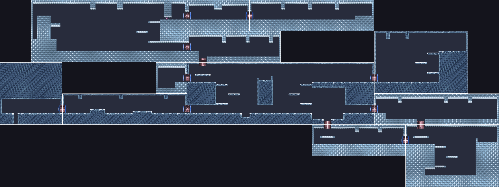
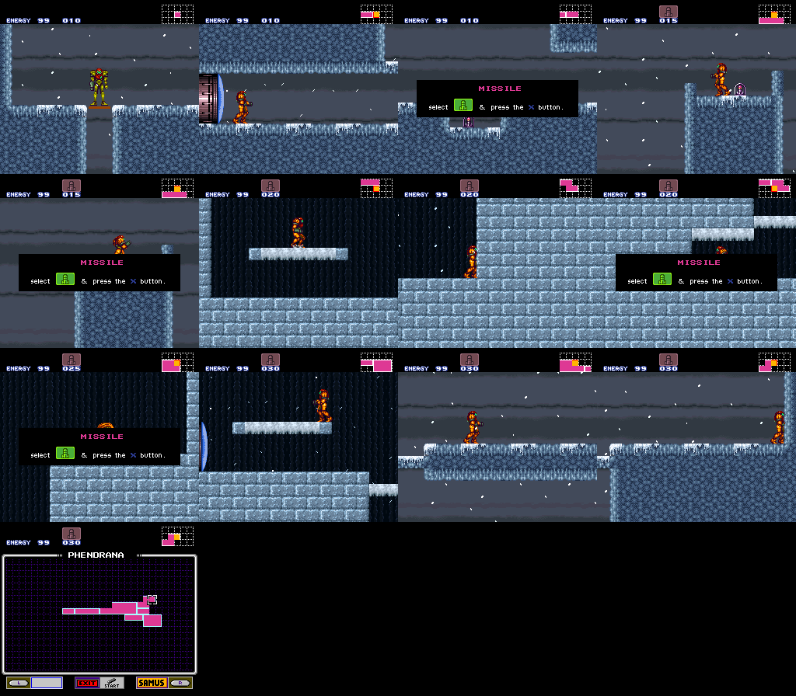
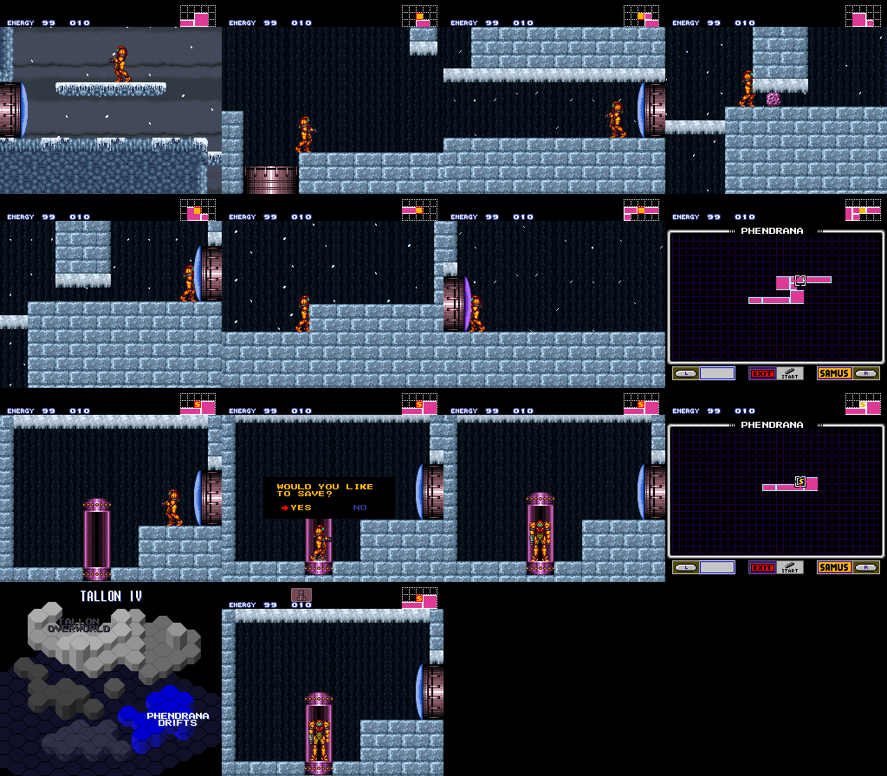

# 18f — Região A de Phendrana (norte: Shorelines, Ice Temple, Chapel, Ice Ruins East)

Estado: verificada (03/11/2026: validate "178 salas, 366 portas, 0 problemas", as linhas do Tallon e das rodadas (12m, 17j) idênticas
às da 18e (diff); `.ips` sha1 `8a823bc9cefdb15ad17d1d31173acf931e1dc232` igual em dois builds; grupo A **34/34** em 3 min 01 s, B
**64/64** em 4 min 29 s, C **8/8** em 31 s). Rascunho → aprovada (épico aprovado pelo usuário; pedido do orquestrador) → implementada →
verificada na mesma sessão.
Esforço estimado: 2,5 dias (salas 1 d; travas, itens e validador 0,5 d; emulador, fotos e mutações 1 d)
Épico: [18 — Phendrana Drifts](18-phendrana-drifts.md) (decisões do usuário 1, 3, 5 e 6; decisões técnicas 1, 3 e 6; linha 18f da tabela
de filhas); modelos: [17f](17f-regiao-a-magmoor.md) (região com travas, itens e save), [17i](17i-regiao-c-magmoor.md) (bomb slot =
túnel com bloco de bomba, FEATURE_GEOMETRY), [18d](18d-estilos-do-gelo.md) (as caras e a neve), [18e](18e-elevadores-de-phendrana.md)
(as salas de elevador, `check_phendrana_rounds`, o grupo C).

## Contexto

Desde a 18e o elevador da Magmoor P13 (rodada 3) sobe até a P0 de Phendrana, um beco. Esta filha constrói a **região A** (o norte, as
12 salas da tabela da 18c com a P0), abre a parede R1 da P0 para a Shoreline Entrance, põe as travas do Prime da região com os
mecanismos do SM, a neve onde neva no Prime, os **4 mísseis** da região e a **Save Station B** (estação 1 da área 4). Os inimigos ficam
para a 18g e o Sheegoth (com o míssil no lugar do Wave) para a 18h.

## Estado antes (verificado)

- validate "167 salas, 342 portas, 0 problemas"; linhas "tallon (… 44 salas construídas, alcançáveis agora: 44, 20 itens em 7
  rodadas)" e "rodadas (specs/12m, 17j): … 58 itens em 7 rodadas … 58%" (`scratchpad/v18e.txt`); `.ips` sha1 `f53f4f0d…c4f9`; A 34/34, B
  64/64, C 5/5.
- `tools/phendrana/rooms.py` (18c): região A = P0 (2×2), P1 Shoreline Entrance (4×1), P2 Phendrana Shorelines (6×2), P3 Temple Entryway
  (3×1), P4 Save Station B (1×1), P5 Ruins Entryway (3×2), P6 Plaza Walkway (4×1), P7 Ice Ruins Access (3×1), P8 Chozo Ice Temple (5×2),
  P10 Ice Ruins East (3×2), P11 Chapel Tunnel (2×1), P14 Chapel of the Elders (4×1); 13 ligações, 3 de chão/teto (Temple Entryway B0 ↔
  Shorelines T0, Shorelines B4 ↔ Ice Ruins Access T0, Plaza Walkway B1 ↔ Ice Ruins East T0); a Ruins Entryway R0 leva à Ice Ruins West
  (região B).
- Travas do Prime na região (`DOCK_LOCKS`): Chapel of the Elders → Chapel Tunnel `event` + `key` de **onda** (só do lado da capela); 3
  `event` do 2º passe (Shorelines → Ice Ruins Access, Plaza Walkway → Shorelines e → Ice Ruins East). Nenhum escudo de míssil nem porta de
  Morph. Features: Shorelines e Ice Ruins East `spider` (os mísseis no alto), Chozo Ice Temple `bomb_slot`; `PLASMA_ICE` só o artefato do
  Ice Temple (fora). Neve (`SNOW_ROOMS`) em 7 salas da região: P0, P1, P2, P5, P8, P10, P14.
- Itens do Prime (épico): 2 Missile Expansions na Shorelines, 2 na Ice Ruins East, o Wave Beam da Chapel (míssil, prêmio da arena: 18h),
  o artefato do Ice Temple (fora).
- Bits livres: itens a partir de `$DA` (Magmoor até `$D9`); nenhuma porta vermelha na região.
- Rodadas: Phendrana só se entra pelos elevadores da rodada 3; Wave (rodada 1), Morph/Bombas (0/1) e Space Jump (2) já valem lá.

## Mudança proposta

1. **Salas** (`tools/phendrana/layouts.py`; regras do Tallon e da Magmoor: porta lateral nas linhas 6–9 com o chão na 10; sala com porta
   de chão tem o chão na linha do batente dela, a porta lateral um degrau de 3 acima, como a Nursery Access da Chozo; subidas de 5 linhas
   por bordas em zigue-zague, o `zigzag` da Magmoor):
   - **Shoreline Entrance** (4×1, neve): o caminho na linha 10 sob o céu, dois montes de neve, estalactites.
   - **Phendrana Shorelines** (6×2, neve): a praia na linha 26 (L1 e R1); o penhasco oeste (linhas 10–21: a prateleira da L0 e a
     plataforma da T0 em cima) subido por 3 bordas; no leste uma saliência de gelo (linhas 10–12, a prateleira da R0) sobre a bacia da
     porta de chão B4 (chão 29) e o caminho para a R1, subida por 3 bordas a oeste da bacia; a **torre em ruínas sobre um arco** no meio,
     o topo (linha 9) fora de todo pulo (o trilho de Spider do Prime = borda de Space Jump) com um **míssil**; um buraco no lago congelado
     (2 linhas) com o outro **míssil**.
   - **Temple Entryway** (3×1, ruínas): o corredor na linha 13 (porta de chão B0), a L0 um degrau de 3 acima.
   - **Save Station B** (1×1, ruínas, sem neve): a Save Station A da Magmoor espelhada (pedestal em (6, 13)). **Estação 1 da área 4.**
   - **Ruins Entryway** (3×2, neve): o chão na linha 26 (L1), o penhasco leste (prateleira na linha 10: a R0, parede até a 18i) por 3
     bordas.
   - **Plaza Walkway** (4×1, ruínas): o passadiço na linha 13 (porta de chão B1), a L0 um degrau de 3 acima.
   - **Ice Ruins Access** (3×1, ruínas): passagem na linha 10, a plataforma da porta de teto T0 a oeste.
   - **Ice Ruins East** (3×2, ruínas, neve): o bloco oeste (prateleira da L0 e plataforma da T0) desce por 3 bordas ao chão (26); a
     torre contra a parede leste, o topo (linha 9) só com o Space Jump (o trilho de Spider) com um **míssil**; um nicho de gelo no pé do
     bloco oeste com o outro **míssil** (o "bloco de gelo" do Prime não tem gatilho de feixe nos dados: a pé).
   - **Chozo Ice Temple** (5×2, ruínas, neve): o salão na linha 26 (R1), a estátua contra a parede oeste (estrado, figura, o braço do
     bomb slot), o penhasco leste subido por 3 bordas até a prateleira (10) e nela a **câmara da R0 atrás de uma parede de gelo com um
     túnel de 1 linha fechado por um bloco de bomba** (o bomb slot: Morph Ball + Bombas, o quebra-cabeça da Geothermal Core, 17i).
   - **Chapel Tunnel** (2×1, ruínas): túnel na linha 10.
   - **Chapel of the Elders** (4×1, ruínas, neve): a nave na linha 10, o altar (estrado de 2) a leste; a L0 de onda por dentro.
   - P0: a parede R1 abre (o chão da 18e já estava no batente).
2. **Travas** (`phendrana/rooms.py GATES`, molde da Magmoor): a porta key de onda da Chapel = **porta de onda** do lado da capela; o bomb
   slot = borda (`ledge`) de Morph + Bombas do lado do Ice Temple (`FEATURE_GEOMETRY`); `BOSS_DOORS` registra as travas de evento dos
   chefes (a da Chapel espera a 18h, as da Quarantine Cave a 18k); as outras de evento (2º passe) ficam fora (camadas de evento).
3. **Itens** (`tools/phendrana/items.py`, novo; bits `$DA–$DD`, rodada 3): torre da Shorelines (40, 8) `needs` Space Jump; lago da
   Shorelines (29, 27); torre da Ice Ruins East (41, 8) `needs` Space Jump; nicho da Ice Ruins East (11, 25). `build.py` os põe na ROM
   como os da Magmoor.
4. **Estações** (`areas.phendrana_stations`, 18e): 1 = Save Station B.
5. **Rodadas** (`FIRST_ROUND`): as 13 salas na rodada 3; os 4 itens na rodada 3.
6. **Validador**:
   - `world_items`, `ITEM_TABLES`, `item_world`, bits únicos (`check_tallon_items`) com Phendrana;
   - `check_world_rounds` (linha "rodadas (specs/12m, 17j)") **filtra os itens de Phendrana**: a linha e a porcentagem continuam das três
     áreas até a 18n (como a 17f fez com a Magmoor); a guarda "rodada só da Magmoor ou de Phendrana" continua;
   - `check_phendrana_rounds` (linha "phendrana (specs/18e, 18f)") confere também os itens (rodada declarada, bloco de ar longe das portas)
     e lista as estações;
   - **`check_phendrana_locks_mapped`** (novo, linha "phendrana (specs/18f)"): toda trava do Prime numa ligação construída com o seu
     mecanismo do lado da doca (missile = vermelha, morph = Morph na borda, key = a tampa do feixe do Prime, `any_beam` sem tampa, event =
     porta de chefe quando a arena existir, senão "esperando" com a filha; as de evento fora das salas dos chefes = camada de evento);
     `BOSS_DOORS` = as docas de evento das salas dos chefes da decisão 4; `GATES` sem trava do Prime só como geometria em sala com a
     feature; item com `needs` Space Jump só em sala com trilho de Spider/gancho/meio-tubo, e item sem ele pegável a pé de alguma porta;
     neve exatamente onde neva no Prime; nenhuma sala inundada (só a Gravity Chamber), quente ou com lava;
   - `check_breakables` aceita bloco de bomba na área 4.
   As checagens de antes cobrem o resto: `check_room` (alcance a pé de toda porta e de toda entrada, nada sem volta, save station),
   `check_item_geometry` (as bordas de Space Jump), `check_gates`, `check_arrival`, `check_tallon_return`/`check_tallon_round_stuck`,
   `check_pause_maps`, `check_map_shapes`, `check_ice_in_rom` (a neve na ROM), `check_door_push`, `check_orphans`, `check_reclaimed`.
7. **Testes** (grupo C): `phendrana_regiao_a_rota`, `phendrana_regiao_a_templo`, `phendrana_save_station_b` (abaixo).

## Critérios de aceite

1. validate 0 problemas; **"44 salas construídas, alcançáveis agora: 44, 20 itens em 7 rodadas"** e **"58 itens em 7 rodadas … 58%"**
   idênticas às da 18e; linhas de Phendrana com as 13 salas e os 4 itens na rodada 3. **Passa.** (protege = travas, rodadas, neve,
   bordas de Space Jump, softlock, mapa, bits; falha_quando = as mutações; não_prova = que a forma agrada)
2. `phendrana_regiao_a_rota` (protege = a parte aberta da região andada com o equipamento da rodada 3, os 4 mísseis com os bits e a
   capacidade, as duas bordas de Space Jump de verdade, as portas de chão e de teto nos dois sentidos usados, neve na Shoreline Entrance,
   energia 99 o tempo todo, o mapa de pausa; falha_quando = E2), `phendrana_regiao_a_templo` (protege = a subida pela porta de teto, o bloco
   de bomba que o tiro não tira e a bomba tira, o túnel de Morph, a porta de onda da Chapel que o Power Beam não abre e o Wave abre;
   falha_quando = E1), `phendrana_save_station_b` (protege = save na estação 1 da área 4, bit de estação usada, game over, tela de área com
   "PHENDRANA / DRIFTS", continue no pedestal). Os testes antigos passam. **Passa.**
3. Mutações pegas. **Passa.**
4. Dois builds com o mesmo sha1; fotos `specs/img/18f-*.png` olhadas. **Passa.**

## Plano de testes

| Camada | O quê | Qtde |
|---|---|---|
| validate.py | `check_phendrana_locks_mapped` (novo); `check_phendrana_rounds` com itens; itens/bits/breakables com Phendrana | +1 |
| run_tests.py (grupo C) | `phendrana_regiao_a_rota`, `phendrana_regiao_a_templo`, `phendrana_save_station_b` | +3 |
| scratchpad | 16 mutações do validador, 4 de ROM, 2 de emulador | 22 |
| imagem | `specs/img/18f-salas.png`, `18f-rota.png`, `18f-templo-e-save.png` | +3 |

## Resultado

As 12 salas da região (e a P0) nos seus lugares do mapa de pausa, metade do tamanho, sem o fundo (prévia nas paletas do build): em cima a
Chozo Ice Temple (estátua a oeste, a parede de gelo com o bloco de bomba diante da R0), a Chapel Tunnel e a Chapel; abaixo a Temple
Entryway e, à esquerda, a Save Station B; a P0 e a Shoreline Entrance; a Shorelines (torre sobre o arco, o buraco do lago, a bacia da
porta de chão sob a saliência); a Ruins Entryway em cima à direita; a Plaza Walkway; embaixo a Ice Ruins Access e a Ice Ruins East.

| Bit | Sala | Prime | Lugar / trava | Rodada |
|---|---|---|---|---|
| `$DA` | Phendrana Shorelines | Missile Expansion (trilho de Spider da torre) | topo da torre (40, 8), borda de Space Jump | 3 |
| `$DB` | Phendrana Shorelines | Missile Expansion | buraco do lago congelado (29, 27) | 3 |
| `$DC` | Ice Ruins East | Missile Expansion (trilho de Spider) | topo da torre (41, 8), borda de Space Jump | 3 |
| `$DD` | Ice Ruins East | Missile Expansion (no gelo) | nicho de gelo no chão (11, 25) | 3 |

`phendrana_regiao_a_rota`, da esquerda, de cima: a P0 com o equipamento da rodada 3; a Shorelines pela L1; o míssil do lago; no topo da
torre depois do Space Jump; o míssil da torre; a Ice Ruins Access na plataforma da porta de teto (caiu pela B4); o chão da Ice Ruins
East; o míssil do nicho; o míssil da torre leste; a plataforma da T0; a saliência da Shorelines diante da R0; a Ruins Entryway na parede
da região B; o mapa de pausa "PHENDRANA".

`phendrana_regiao_a_templo`: na plataforma da T0 da Shorelines; na Temple Entryway (borda leste da porta de chão); a chegada no Ice
Temple (neve); diante da parede de gelo com o bloco de bomba; na câmara da R0 depois do túnel; a Chapel; a porta de onda roxa por
dentro; o mapa. `phendrana_save_station_b`: a sala; a pergunta; salvo; o mapa com o ícone de save; a tela de área com "PHENDRANA /
DRIFTS"; o continue no pedestal.

### Linhas do validador (o que mudou)

- **Iguais** (diff contra `scratchpad/v18e.txt`): "tallon (… 44 salas construídas, alcançáveis agora: 44, 20 itens em 7 rodadas)" e
  "rodadas (specs/12m, 17j): … 58 itens em 7 rodadas … 58%".
- "167 salas, 342 portas" → **"178 salas, 366 portas"** (11 salas, 12 ligações).
- "phendrana (specs/18e)" → **"phendrana (specs/18e, 18f; regiões ativas: A): 13 salas construídas, 4 itens … rodada 3: 13 salas, 4
  itens; … estações: 0 transport_magmoor_west, 1 save_station_b"**.
- Nova **"phendrana (specs/18f): 1 trava(s) do Prime nas ligações construídas …; esperando o chefe: chapel_of_the_elders (18h); travas
  de evento fora: 3; travas de geometria pelas features do Prime: chapel_tunnel-chozo_ice_temple; itens em bordas de Space Jump: 2; neve
  em 7 das 13 salas construídas …"**.
- 18b/18c: 2 → 13 salas construídas; "gelo (specs/18d)": área 4 com 13 salas, neve em 7 estados; super missile: 178 salas; ruínas: 114
  outras salas; `$8F` recuperado: 3216 → 3737 usados (a faixa da 12a cheia, 2153/2153; a das demos, 3796, livre); órfãs `$8F` 20126 →
  19605, `$83` 10506 → 10518 (a estação 1 vanilla da área 4 deixou de ser guardada); nível: 167 → 178 blobs.

## Mutações (`s18f/scripts/mutate_f.py` → `s18f/mutate_f.out`; emulador `s18f/mut_e1.out`, `mut_e2.out`)

Sem mutação: limpo (as checagens estáticas e as de ROM). Validador: F1 porta de onda da Chapel esquecida; F2 trava do bomb slot esquecida
(o bloco fica: "bloco de bomba numa sala sem trava"); F3 trava de bomba numa ligação sem a feature; F4 sem o bloco (túnel aberto: R0
alcançável sem Bombas); F5 bordas até o topo da torre da Shorelines (pega-se sem o Space Jump); F6 `needs` do Space Jump esquecido (regra
nova: não se pega a pé); F7 míssil declarado na rodada 4; F8 míssil na parede; F9 míssil de borda de Space Jump numa sala sem trilho de
Spider (regra nova); F10 bits sobre o `$D9` da Magmoor; F11 Chapel declarada na rodada 4; F12 Shorelines sem neve; F13 neve na Temple
Entryway; F14 Shorelines inundada (regra da decisão 5); F15 a porta do Sheegoth tirada de `BOSS_DOORS`; F16 atalho da Landing Site para a
Shoreline Entrance (Phendrana na rodada 0). ROM: R1 míssil com outro bit; R2 sem a tampa de onda; R3 Save Station B com a estação 2; R4
Shorelines sem o FX de neve. Emulador (cópia `s18f/proj`, reconstruída e restaurada): E1 sem a porta de onda → `phendrana_regiao_a_templo`
falha (o Power Beam abre); E2 a torre da Shorelines 2 linhas mais alta → `phendrana_regiao_a_rota` falha. Todas pegas.

## Riscos e reversão

- As caminhadas são medidas (quadros antes de cada pulo, número de giros do Space Jump): mudar a geometria pede refazê-las
  (`s18f/scripts/hopx.py`, `mv.py`); a 18g (inimigos) vai precisar ajustar algumas, como a 17g fez.
- `$8F`: a região usou 521 bytes (a faixa da 12a encheu; 79 + 3796 livres para as regiões B–E).
- Reversão: `ACTIVE_REGIONS` vazio, `GATES`/`items.ITEMS` vazios e os desenhos novos fora de `LAYOUTS` (e os 3 testes): a ROM volta à da 18e.

## Fora de escopo

- Inimigos (18g: camada 0 — Shorelines Parasite 4, Ice Ruins Access AtomicBeta 2; os Babygoths e o Sheegoth da Chapel na 18h).
- O Sheegoth, a trava de evento da Chapel e o míssil no lugar do Wave (18h); a Ice Ruins West e o resto (18i em diante); o artefato do
  Ice Temple e o gelo de plasma dele (fora).

## Desvios (preenchido na implementação)

- **11 salas novas**, não 12: a tabela do épico conta a P0 (da 18e). **Neve em 7 salas da região**, não 8 (a Ice Ruins West é da B).
- **3 testes** em vez de `_rota`, `_itens` e `_save_station_b`: os itens entraram na rota (como a 17f) e o caminho do templo virou um
  teste próprio (`phendrana_regiao_a_templo`), para cada um ficar curto. Grupo C: 8 testes em 31 s.
- **Formas simplificadas** (como a 17f): os trilhos de Spider viraram torres cujo topo só o Space Jump alcança; o bomb slot (no Prime o
  fogo da estátua derrete o gelo diante da porta) virou o túnel com bloco de bomba diante da R0; os blocos de gelo da Chapel Tunnel e o
  "bloco de gelo" do míssil da Ice Ruins East são enfeite/nicho a pé (os dados do Prime não têm gatilho de feixe neles).
- **Regras a mais no validador** (não pedidas pelo épico): item sem `needs` Space Jump tem de se pegar a pé; item de borda de Space Jump só
  em sala com trilho/gancho/meio-tubo; `BOSS_DOORS` = as docas de evento das salas dos chefes da decisão 4; neve/água/calor/lava pelas
  decisões 5 e 6.
- **A linha das rodadas (12m, 17j) filtra Phendrana** até a 18n (os itens de Phendrana entram no passeio, rodada 3, mas não na linha nem
  na porcentagem: as linhas pedidas ficam idênticas).
- Na Shorelines a subida leste fica a oeste da bacia da porta de chão e a R0 sobre uma saliência de gelo: com as bordas sobre a bacia a
  primeira ficava 8 linhas acima do chão dela (fora do pulo) ou tapava a saída para a R1 (o validador mostrou as duas).
- Subir pela porta de teto da Shorelines para a Temple Entryway: a Samus cai de volta se nada for segurado; o teste segura → depois de
  120 quadros (ela pousa na borda leste). Para a Plaza Walkway ela pousa sozinha.
- Experimentos e mutações na cópia `s18f/proj`; nada em `build/` da pasta real antes da verificação.
- Verificação (03/11/2026, pasta real): `python3 -I tools/build.py` duas vezes → sha1 `8a823bc9cefdb15ad17d1d31173acf931e1dc232`;
  `python3 -I tools/validate.py` → "178 salas, 366 portas, 0 problemas" (as duas linhas pedidas idênticas, diff); `--grupo A` **34/34**
  (3 min 01 s), `--grupo B` **64/64** (4 min 29 s), `--grupo C` **8/8** (31 s).

## Decisões para o usuário (escolhidas as recomendadas; confirmar)

1. **Formas das salas** (a torre sobre o arco e a bacia sob a saliência na Shorelines, a estátua no Ice Temple, as subidas em zigue-zague):
   trocar em `tools/phendrana/layouts.py` e refazer as caminhadas.
2. **Os mísseis "sem trava"**: o 2º da Shorelines no buraco do lago congelado; o "no gelo" da Ice Ruins East num nicho a pé.
3. **Caras**: neve (exterior com céu) na Shoreline Entrance, Shorelines e Ruins Entryway; ruínas de gelo nas salas Chozo (Temple
   Entryway, Ice Temple, Chapel Tunnel, Chapel, Plaza Walkway, Ice Ruins Access/East) e na Save Station B.
4. **A Chapel 4×1 de chão plano** por ora; a arena do Sheegoth (18h) pode mudá-la.
