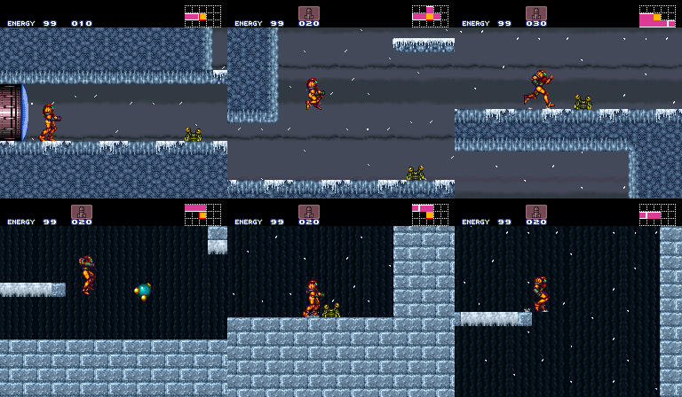
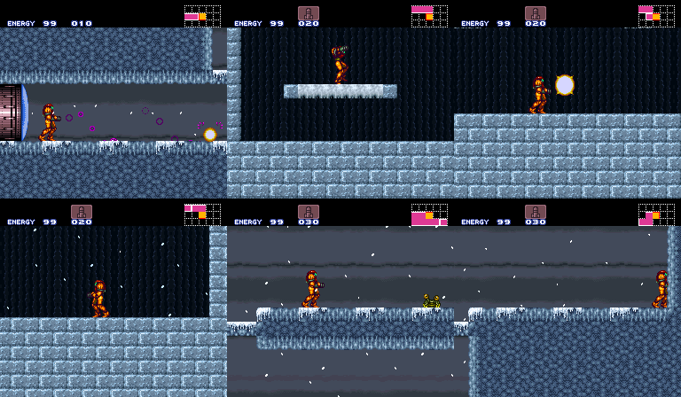

# 18g — Inimigos de Phendrana (região A)

Estado: **verificada** (03/11/2026: validate "178 salas, 366 portas, 0 problemas", as linhas do Tallon e das rodadas (12m, 17j)
idênticas às da 18f (diff contra `scratchpad/v18f.txt`); `.ips` sha1 `1c152d188f75acaf941def22ef314dc360c1fb92` igual em dois builds;
grupo A **34/34** em 2 min 59 s, B **64/64** em 4 min 24 s, C **9/9** em 33 s). Rascunho → aprovada (épico aprovado pelo usuário;
pedido do orquestrador) → implementada → verificada na mesma sessão.
Esforço estimado: 1,5–2 dias (medido: ~1 dia; a maior parte é a busca das caminhadas com os inimigos vivos)
Épico: [18 — Phendrana Drifts](18-phendrana-drifts.md) (decisão técnica 5, decisão do usuário 7; linha 18g da tabela de filhas);
modelos: [17g](17g-inimigos-magmoor.md) (camada 0 do Prime, justiça em toda sala, caminhadas por busca), [15](15-auditoria-de-entrada.md)
(nenhum dano nos 120 primeiros quadros de uma entrada de porta de verdade), [14a](14a-plated-beetle.md) (cópia de espécie em `$A0`),
[18f](18f-regiao-a-phendrana.md) (as salas e as caminhadas medidas).

## Contexto

A região A de Phendrana (18f) está construída sem inimigos. Esta filha põe os da camada 0 do Prime nas salas da região que os têm, com
espécies do SM no lugar, faz a **cópia justa do ATOMIC** em `$A0` (a decisão técnica 5), grava a tabela do Prime das regiões B–E para
as filhas delas, leva a regra de justiça "toda sala, toda rodada" da Magmoor à área 4, estende a auditoria de entrada de porta (spec 15)
a Phendrana e mede de novo as caminhadas da 18f com os inimigos **vivos**. O Sheegoth e os Babygoths da Chapel são a arena da 18h.

## Estado antes (verificado)

- validate "178 salas, 366 portas, 0 problemas"; linhas "tallon (… 44 salas construídas, alcançáveis agora: 44, 20 itens em 7
  rodadas)" e "rodadas (specs/12m, 17j): … 58 itens em 7 rodadas … 58%" (`scratchpad/v18f.txt`); `.ips` sha1 `8a823bc9…c1dc232`;
  A 34/34, B 64/64, C 8/8.
- `areas.PHENDRANA` sem `enemies`; `check_layer0_enemies` só no Tallon, na Chozo e na Magmoor; `SpeciesCopy` (14a) muda só o toque e
  as partes.

### O Prime, camada 0 da região A (dados: `s18/phen_objs.out`)

| P# | Sala | Camada 0 | Telas SM |
|---|---|---|---|
| 2 | Phendrana Shorelines | Parasite 4 | 6×2 |
| 7 | Ice Ruins Access | AtomicBeta 2 | 3×1 |
| 10 | Ice Ruins East | **Parasite 4** (a lista do épico esqueceu esta sala; os dados têm) | 3×2 |
| 14 | Chapel of the Elders | Babygoth 4, IceSheegoth 1 (a luta: 18h) | 4×1 |
| outras | P0, 1, 3, 4, 5, 6, 8, 11 | nenhum (só `PickupGenerator`/`ColorModulate`) | |

### O SM (cabeçalhos em `$A0`, ROM base)

| Espécie | Vida | Toque | Tiros do Power Beam | Uso |
|---|---|---|---|---|
| ZEELA `$DC7F` | 30 | 10 | 2 | Parasite (padrão aceito do épico, como no Tallon/Chozo/Magmoor) |
| ATOMIC `$E9FF` (orbe da Wrecked Ship) | 250 | 40 | 13 | **recusado como está**; a cópia `$A0:F8BF` com vida 100 (5 tiros) e toque 20 |

O ATOMIC (`WreckedShipOrbs_Main` `$A8:E3C3`) flutua e vai direto até a Samus **atravessando paredes**, a velocidade do parâmetro 2 da
tabela `kCommonEnemySpeeds_Linear` (`$A2:8187`) em cada eixo, só enquanto aparece na câmera; colocação vanilla copiada de `$8F:CA7E`
(`$A1:BFE6`: init 0, propriedades `$2000`, parâmetro 2 = 8 → ½ px por quadro).

## Mudança

1. **Cópia** (`tools/chozo/bosses.py`): `SpeciesCopy` ganha `health` (cabeçalho +4); `ATOMIC_COPY = SpeciesCopy($F8BF, $E9FF, 20,
   health=100)`; `build_copies` grava a vida; `validate.species_info` lê a vida da cópia; `check_species_copies` confere o byte novo.
2. **Espécies** (`tools/frigate/enemies.py`): campo `Species.homing` (vai até a Samus); `atomic_alpha` e `atomic_beta` (a mesma
   cópia, uma entrada de enemy set, paleta 3, `hover` 32, parâmetro 2 = 8).
3. **Tabela** (`tools/phendrana/enemies.py`, novo, molde da Magmoor): `ENEMIES` (região A), `STAND_IN` (Parasite → Zeela, AtomicAlpha/
   Beta → a cópia), `PRIME_LAYER0` com **todas** as salas de Phendrana com inimigo na camada 0, `ARENA_LATER` (a Chapel: 18h),
   `PROPOSED_LATER` (para B–E: Babygoth/Beetle → Sidehopper pequeno, WallCrawlerSwarm → o zoomer da Wrecked Ship, MetroidAlpha →
   Metroid enfraquecido (decisão 7, a 18l mede), Ripper → a 18m decide (o RIPPER do SM é imune ao Power Beam), JellyZap, Drone,
   FlyingPirate, SpankWeed → fora). `areas.PHENDRANA.enemies`; set "PHENDRA".
4. **Por sala** (≥ 1 de cada tipo do Prime, ≤ a conta do Prime, ≤ 1 por tela):

| Sala | Inimigos (SM) | Onde |
|---|---|---|
| Phendrana Shorelines (6×2) | 3 Zeelas | praia sob o penhasco oeste (9, 26), praia entre a torre e o zigue-zague leste (50, 26), saliência de gelo da R0 (74, 10) |
| Ice Ruins Access (3×1) | 2 orbes (AtomicBeta) | sobre a passagem (18 e 32, 32 px acima do chão): a mais de 120 quadros de deriva das duas portas |
| Ice Ruins East (3×2) | 2 Zeelas | chão das ruínas entre o pé do zigue-zague e a torre (22, 30) |
| Chapel of the Elders | nenhum ainda | a arena do Sheegoth (18h) |

   Total **7 inimigos em 3 salas**.
5. **Validador** (`tools/validate.py`): **`check_phendrana_enemies`** (linha nova "phendrana (specs/18g)"): `check_layer0_enemies` da
   área 4 com a justiça **em toda sala, qualquer rodada** (`PHENDRANA_FAIR_EVERY_ROUND`, como a Magmoor: ≤ 5 tiros do Power Beam sem
   carga, ≤ 20 por toque); `PRIME_LAYER0` só com salas da tabela; `ENEMIES` só em salas construídas; nada na sala de uma arena futura
   (`ARENA_LATER` ⊆ salas de chefe do épico, com a filha certa); todo tipo do Prime decidido ou proposto, nunca os dois; **regra nova
   do que vem até a Samus** (`homing_problems`): para cada porta, a Samus parada nas células de dentro da porta ou até `ENTRY_REACH` = 2
   blocos além; a distância (maior eixo, entre as caixas) dividida pela velocidade lida da ROM tem de passar de `ENTRY_FRAMES` = 120.
   `check_enemies`, `check_enemy_sets`, `check_enemies_in_rom`, `check_bosses` (nenhuma sala usa o `$E9FF` vanilla) já percorriam toda
   área.
6. **Testes** (grupo C): novo **`entradas_de_porta_phendrana`** (spec 15: as 10 entradas de porta das 3 salas, de verdade, nenhum dano
   nos 120 primeiros quadros); `phendrana_regiao_a_rota` medido de novo; `phendrana_regiao_a_templo` e `phendrana_save_station_b`
   ganham o tiro na Zeela da praia (`phendrana_to_shorelines`).

## Critérios de aceite

1. validate 0 problemas; as duas linhas pedidas idênticas; linha nova 18g. **Passa.** (protege = contas do Prime, ≤ 1 por tela, justiça
   em toda rodada, arena livre, decisões/propostas, deriva longe das portas, a cópia nos bytes, ROM = tabela; falha_quando = G1–G15, R1,
   R2; não_prova = que as espécies agradam)
2. `entradas_de_porta_phendrana` passa (protege = nenhum dano nos 120 quadros de toda entrada de porta das salas com inimigos;
   falha_quando = E1). **Passa.**
3. `phendrana_regiao_a_rota` com os inimigos vivos na chegada (`enemies_alive`), mortos no caminho só com o Power Beam (orbes e Zeelas da
   Ice Ruins East conferidos mortos), energia 99 do começo ao fim (falha_quando = E3); `_templo` e `_save_station_b` com a energia 99
   (falha_quando = E2). Os testes antigos passam. **Passa.**
4. Dois builds com o mesmo sha1; fotos `specs/img/18g-*.png` olhadas. **Passa.**

## Plano de testes

| Camada | O quê | Qtde |
|---|---|---|
| validate.py | `check_phendrana_enemies` (justiça em toda rodada, deriva, arena, tabela) | +1 |
| run_tests.py (grupo C) | `entradas_de_porta_phendrana`; as 3 caminhadas da 18f medidas de novo | +1 |
| scratchpad (`s18g/`) | 15 mutações do validador, 2 de ROM, 3 de emulador; auditoria forte (600 quadros) | 21 |
| imagem | `specs/img/18g-inimigos.png`, `specs/img/18g-rota.png` | +2 |

## Resultado

Em cima: a chegada na Shorelines pela L1 (a Zeela oeste vem pela praia); do alto da torre, a Zeela entre a torre e o zigue-zague leste;
a Zeela da saliência de gelo diante da R0. Embaixo: a Ice Ruins Access (um orbe azul-esverdeado já vindo até a Samus na plataforma da
porta de teto); o chão da Ice Ruins East com as 2 Zeelas; o zigue-zague da Ice Ruins East.

De `phendrana_regiao_a_rota`: a Zeela oeste estourando no tiro agachado (energia 99); a chegada na Ice Ruins Access; o segundo orbe
estourando; o chão da Ice Ruins East (Zeelas mortas); a saliência da Shorelines (a Zeela de lá viva, numa visita nova: os inimigos voltam
a cada entrada); a Ruins Entryway — energia 99 em todas.

### Justiça (números)

Zeela 2 tiros, 10 por toque (5 com a Varia); orbe (cópia) 5 tiros (100 de vida, 20 por tiro), 20 por toque. Deriva do orbe ½ px por
quadro: os da Ice Ruins Access ficam a ≥ 128 px (≥ 256 quadros) das células de entrada das duas portas. VRAM: no máximo `$600` (Zeela)
de `$2000`.

### Auditoria das entradas (spec 15)

`entradas_de_porta_phendrana` (10 entradas): passa. Auditoria forte (o mesmo teste com 600 quadros de espera, só no scratchpad):
**nenhum toque em 9 das 10 entradas em 600 quadros**; a Ice Ruins Access R0 leva o orbe leste aos **350** quadros (ele vem até a Samus
parada: é o que ele faz). Com o orbe a 4 blocos das células da R0 (x 40, a primeira posição) ele a tocava aos **90** quadros: daí a
regra nova do validador e as posições 18 e 32.

### Caminhadas medidas de novo

| Teste | Mudança |
|---|---|
| todos os 3 (`phendrana_to_shorelines`) | na chegada da Shorelines (L1): `enemies_alive` e **2 tiros agachada** (`P18G_SHORE_ZEELA = "cc"`) na Zeela oeste que vem pela praia; ela morta, energia 99 |
| `phendrana_regiao_a_rota` | da torre para a porta de chão: `P18F_TOWER_OFF` `xRRRRRRRRRR` → `xgXcRggR` (busca em feixe: a Zeela da praia morta no caminho); Ice Ruins Access: `P18F_ACCESS` 20 R + D → `RxaasRRxrraas` + `DD` (os 2 orbes mortos com tiros para cima e à frente, conferidos mortos); Ice Ruins East: `P18F_RUINS_DOWN` 12 R → `RRRRRRRRXcLc` (as 2 Zeelas mortas agachada no chão, conferidas; o nicho e o resto iguais, a parede do nicho para a caminhada para oeste); a saliência: `P18G_OVERHANG_ZEELA = "cc"` (a Zeela da R0 morta, conferida); `enemies_alive` na chegada da Ice Ruins Access e da Ice Ruins East; foto nova `18g_rota_orbes` |
| novo `entradas_de_porta_phendrana` | as 10 entradas, de um estado salvo na P0 de Phendrana (`phendrana_up`) |

Grupo C: **9 testes em 33 s** (antes 8 em 31 s).

### Espaço

`$A0` +64 (a cópia em `$A0:F8BF`, livre a partir de `$A0:F8FF`), `$A1` (populações) +121 (até `$A1:F9E0`), `$B4` (sets) +39 (até
`$B4:F863`); `$8F`, `$83`, `$84`, nível, fixo, SRAM: nada.

## Mutações

Validador (`s18g/scripts/mutate_g.py` → `s18g/mutate_g.out`), todas pegas, sem mutação limpo: G1 orbe a 4 blocos da R0 (x 40: "vai até
a Samus na porta 1 (R0) em 64 quadros"); G2 cópia com a vida vanilla (13 tiros); G3 cópia com toque 40; G4 5 Zeelas na Shorelines (Prime
4); G5 Ice Ruins East sem Zeela; G6 Zeela na Chapel (arena da 18h); G7 Ripper sem decisão nem proposta; G8 `PRIME_LAYER0` com sala fora
da tabela; G9 inimigos numa sala fora do build; G10 orbe a 1,5 px por quadro (o de x 18 chega à T0 em 85 quadros); G11 `ARENA_LATER`
com a filha errada; G12 tipo decidido e ainda proposto; G13 Zeela dentro da parede; G14 Zeela colada na porta L1; G15 3 orbes (Prime 2).
ROM: R1 a vida da cópia trocada para 250 na ROM construída ("bytes do cabeçalho diferentes da origem … +$04"); R2 a tabela mudada sem
reconstruir ("sem a população/enemy set da tabela"). Emulador (cópia `s18g/proj`, reconstruída e restaurada): E1 o orbe em x 40 →
`entradas_de_porta_phendrana` falha (perdeu energia 90 quadros depois de chegar pela R0); E2 sem os 2 tiros na Zeela da praia →
`phendrana_regiao_a_templo` e `phendrana_save_station_b` falham; E3 a cópia com a vida vanilla → `phendrana_regiao_a_rota` falha (os
orbes vivos depois da sequência de tiros).

## Riscos e reversão

- As caminhadas da região A dependem dos inimigos: mexer numa posição, numa espécie ou na geometria pede refazer a busca
  (`s18g/scripts/srch.py`, `fight.py`; ~1–6 min por trecho, 10 CPUs).
- Os orbes atravessam paredes: numa sala nova a regra de deriva do validador vale para toda porta, mas não para um item ou uma borda
  estreita; a filha da região confere no emulador.
- Reversão: `areas.PHENDRANA` sem `enemies` e as caminhadas da 18f; `ATOMIC_COPY` fora de `COPIES`: a ROM volta à da 18f.

## Fora de escopo

- Regiões B–E (só a tabela do Prime e as propostas); a arena do Sheegoth (18h); o Metroid enfraquecido (18l mede: decisão 7).
- Camadas de evento (Babygoths, Flickerbats, Ice Troopers, Elite Pirates, Ice Sheegoths do 2º passe, o voo do Ridley).

## Desvios

- **Ice Ruins East com 4 Parasites na camada 0**: a lista do épico (seção "Inimigos") não a tinha; os dados têm, e ela entrou.
- **Contas abaixo do Prime**: Shorelines 3 de 4 Parasites, Ice Ruins East 2 de 4 (cada uma mata-se no caminho: mais Zeelas pediriam mais
  paradas na busca sem mudar o jogo).
- **Regra nova no validador** (não pedida pelo épico): o inimigo que vem até a Samus (`Species.homing`) nasce a mais de 120 quadros de
  deriva de toda porta, com a velocidade lida da ROM; `ENTRY_REACH` = 2 blocos medido no emulador (a primeira posição tocava a Samus aos
  90 quadros).
- **Sem `phendrana_inimigos_vivos`** (o nome do épico) como teste próprio: a rota confere cada sala com inimigos na chegada
  (`enemies_alive`) com a energia 99, e a auditoria de entrada cobre o "parado na porta" (como a 17g).
- **Sem cores de gelo** nos inimigos: a Zeela e o orbe ficam com as paletas do SM (o épico não pediu; ver as decisões).
- A mensagem de justiça de `check_layer0_enemies` diz a área certa ("Phendrana: toda rodada"; antes fixa "Magmoor").
- Experimentos, buscas e mutações na cópia `s18g/proj`; a pasta real só recebeu os arquivos finais.
- Verificação (03/11/2026, pasta real): `python3 -I tools/build.py` duas vezes → sha1 `1c152d188f75acaf941def22ef314dc360c1fb92`;
  `python3 -I tools/validate.py` → "178 salas, 366 portas, 0 problemas" (diferenças contra a 18f: a linha nova "phendrana (specs/18g)" e
  "3 cópia(s) de espécie conferida(s)" na linha 14a); `--grupo A` **34/34** (2 min 59 s), `--grupo B` **64/64** (4 min 24 s), `--grupo C`
  **9/9** (33 s).

## Decisões para o usuário (escolhidas as recomendadas; confirmar)

1. **Atomic Alpha/Beta = o orbe elétrico da Wrecked Ship** (cópia com vida 100 e toque 20), vindo até a Samus a ½ px por quadro como o
   vanilla (o Bombu do Prime também deriva até ela). Alternativa: mais devagar (¼ px) ou parado.
2. As contas por sala (7 inimigos; tabela acima) e as posições.
3. **Cores**: Zeela e orbe com as cores do SM (o orbe já é azul-esverdeado). Pintar de gelo pede uma cópia por espécie com paleta nova.
4. Para as filhas seguintes (`PROPOSED_LATER`): Babygoth/Beetle = Sidehopper pequeno; WallCrawlerSwarm = o zoomer da Wrecked Ship;
   MetroidAlpha = Metroid enfraquecido (18l: o vanilla é imune ao Power Beam e suga em vez de tocar: a regra de justiça precisa de uma
   cópia com tabela de vulnerabilidade própria, ou uma exceção como a regra 13 dos chefes); Ripper (imune ao Power Beam) decidido na
   18m; JellyZap, Drone, Flying Pirate, Spank Weed fora.
