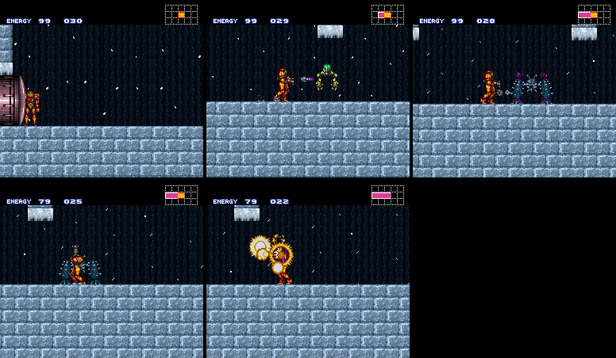
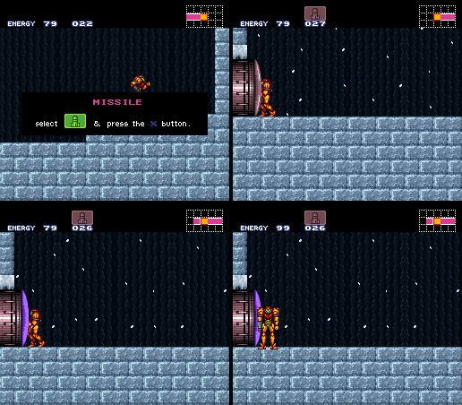

# 18h — Sheegoth (arena da Chapel of the Elders)

Estado: **verificada** (03/11/2026: validate "178 salas, 366 portas, 0 problemas", as linhas do Tallon e das rodadas (12m, 17j)
idênticas às da 18g (diff contra `scratchpad/v18g.txt`); `.ips` sha1 `81fcea22302a32252d08721a88aff2b91418acef` igual em dois
builds; grupo A **34/34** em 2 min 59 s, B **64/64** em 4 min 19 s, C **10/10** em 35 s). Rascunho → aprovada (épico aprovado pelo usuário; pedido do orquestrador) →
implementada → verificada na mesma sessão.
Esforço estimado: 2 dias (medido: ~1 dia; a luta achada por busca em feixe no emulador em ~2 min)
Épico: [18 — Phendrana Drifts](18-phendrana-drifts.md) (decisão do usuário 4, decisão 3: o míssil no lugar do Wave; linha 18h da
tabela de filhas); modelos: [14b](14b-arena-e-hive-mecha.md) (a rotina comum das arenas, o estado morto), [14a](14a-plated-beetle.md)
(cópia de espécie com as cores do Prime), [14c](14c-flaahgra.md) (regra 13: chefe que o Power Beam não fere), [14d](14d-incinerator-drone.md)
(porta cinza de cota de mortes), [18g](18g-inimigos-phendrana.md) (a Chapel reservada, `SpeciesCopy.health`).

## Contexto

A Chapel of the Elders (P14) está construída desde a 18f (4×1, chão plano, o altar a leste, a porta de onda por dentro) e vazia desde a
18g (`ARENA_LATER`), esperando a luta. O usuário decidiu (épico 18, decisão 4): **Sheegoth = cópia mais dura do Dessgeega grande, em cores
de gelo, com 2–3 Sidehoppers pequenos** (os Babygoths), os tetos de justiça do épico 14. A decisão 3: o Wave Beam da Chapel já é do Tallon,
então o prêmio é **um míssil**. Os dados do Prime têm um `Actor Door Lock` na única porta da Chapel (como a Sunchamber e o Burn Dome):
a porta tranca até a vitória (`phendrana_rooms.BOSS_DOORS` já registrava a trava, esperando a 18h).

## Estado antes (verificado)

- validate "178 salas, 366 portas, 0 problemas" (`scratchpad/v18g.txt`); `.ips` sha1 `1c152d18…fb92`; A 34/34, B 64/64, C 9/9.
- `tools/chozo/bosses.py`: 4 arenas, todas da Chozo; `check_arenas`/`check_arenas_in_rom`/`check_epic_bosses` (validate) só olhavam a
  Chozo (`CHOZO.by_key()`, `CHOZO.music`, `chozo_items`), e os bits de arena eram únicos no jogo inteiro (o Hive Mecha já usa `$08`, da
  área 1).
- **Dessgeega** (`$A0:DA3F`, ROM base): vida **800**, toque **160**, raio 24×20, uma parte, a IA do Sidehopper (`$A3:AB09`/`$ABCF`) com
  o campo `+$2A` = 2 (os pulos e quadros do Dessgeega), tiles `$400` de `$AE:D120`, paleta `$A3:B217` (1–8 casco roxo, 9–12 vermelho,
  13–15 olhos verdes), vulnerabilidades `$B4:EC32`: **Power, Wave, Ice e Ice+Wave = 0** (o tiro sem carga não fere), Spazer 1, Plasma 2,
  míssil 2 (100 por míssil), tiro carregado 2 (60). Colocações vanilla no chão (`$A1:A560`): init 0, propriedades `$2000`, parâmetros 0.
- Sidehopper pequeno `$A0:D93F`: 60 de vida (3 tiros do Power Beam), toque 20 (o Beetle da Chozo, 12h).
- Prime (`research/prime_fs`, `s18h/scripts/ancs_goth.py`): o `IceSheegoth` e os 4 `Babygoth` da Chapel usam o ANCS `EAD9FE87`
  (personagem 0 `IceSheegoth` CMDL `B1DAB41D`; 1 `BabyGoth` CMDL `07D51E01`). Texturas do Sheegoth exportadas (`s18h/sheegoth_tex`):
  couro azul-branco, cristais ciano, olhos ciano.
- Bits de chefe vanilla da área 4 (lidos da ROM base, `vanilla_boss_bits`): `$01`, `$02`. A rodada da Chapel: **3** (Wave, Charge, Varia,
  Space Jump, mísseis com capacidade **85** pela `round_missiles`).
- Medido no emulador: uma porta cinza de tipo 3 na lista de PLMs da sala fecha atrás da Samus quando ela entra por ela; aberta pela cota,
  vira uma porta azul (um tiro abre); logo depois de um `door_teleport` a Samus fica na pose 0 (de frente) e o SELECT não troca a arma.

## Mudança

1. **Cópia** (`tools/chozo/bosses.py`): `SHEEGOTH = SpeciesCopy($F8FF, $DA3F, toque 40, cores)` — a vida (800) e as vulnerabilidades do
   Dessgeega ficam: a "cópia mais dura" é o Dessgeega inteiro, a casca que o feixe sem carga não fere (como o gelo do Sheegoth do Prime),
   vencida pela **regra 13** do épico 14 (os mísseis da capacidade da rodada, ou ≤ 20 tiros carregados). Cores: cada cor guarda o brilho e
   toma a rampa do seu grupo (o jeito da 14a/14c): casco → o couro azul-branco, corpo → os cristais ciano, olhos → o brilho dos olhos
   (`SHEEGOTH_HIDE/CRYSTAL/EYES`, de `s18h/scripts/sheegoth_ramps.py`); paleta nova em `$A3:F331`.
2. **Arena** (`ARENAS`): `Arena("phendrana_chapel_of_the_elders", $08, KILLS, prêmio = o míssil do altar, needs = {MISSILE})`, objeto do
   Prime "IceSheegoth + Babygoth". A rotina comum (`$84:F500`) não muda: a tabela ganha a 5ª entrada (12 bytes); o bit é da área corrente
   (`SetBossBitForCurArea`): `$7ED82C` bit 3.
3. **Inimigos** (`tools/frigate/enemies.py`, `tools/phendrana/enemies.py`): `sheegoth` (a cópia, paleta 2, `boss`) e `sheegoth_baby`
   (o Sidehopper pequeno, paleta 3, `boss`: some com ele no estado morto); na Chapel 2 pequenos (x 24 e 34) e o Sheegoth (x 46, antes do
   altar), todos fora da tela da porta, o Sheegoth no último slot; `ARENA_LATER` → `ARENA_ROOMS` + `ARENA_KINDS` (tipo → tipo do Prime).
4. **Prêmio** (`tools/phendrana/items.py`, `layouts.py`): o 5º item, bit **`$DE`**, míssil no meio do altar `CHAPEL_ALTAR_MISSILE` = (58, 7),
   rodada 3 (a trava `boss` do passeio: só com os mísseis). A sala não muda de forma (a nave tem 8 linhas: os pulos do Dessgeega cabem).
5. **Porta** (`frigate/rooms.py`, `phendrana/rooms.py`, `build.py`): `DoorLink.dead_lock` novo; a porta de chefe de uma arena construída
   vira `lock = "boss"` (trava `BOSS_GATE` + a de onda) e guarda a tampa do Prime (`wave`) para o estado morto. O build põe a **porta cinza
   de tipo 3** (cota de mortes, `$C848` arg `$8C00`) só na lista do estado vivo, e a **porta de onda** só na do morto
   (`kills_arena_door`). Achado: o `$8F` principal está cheio desde a 12a; o cabeçalho condicional de uma arena calcula os ponteiros para
   onde vai cair (`Allocator.next_at`, novo), a faixa das demos (18a).
6. **Validador** (`tools/validate.py`):
   - `check_arenas`/`check_arenas_in_rom` de qualquer área (`arena_area`, `prize_name`, `world_items`, a música da área no estado morto),
     bits únicos **por área**, justiça de Phendrana em toda rodada (como os inimigos dela);
   - `check_epic_bosses` → `epic_area_bosses` por área: a linha "chefes (specs/14)" igual, linha nova **"chefes de Phendrana (specs/18h)"**
     (`EPIC_PHENDRANA_BOSSES`, `PHENDRANA_BOSS_CHILDREN_DONE = {"18h"}`: a arena exigida; o Thardus esperando a 18k);
   - `check_phendrana_enemies`: na sala de arena só os tipos dela (`Species.boss`, `ARENA_KINDS`), entre 1 e a conta do Prime de cada
     tipo, e a sala em `ARENAS`; a linha conta só a camada 0;
   - `check_phendrana_locks_mapped`: a trava key da Chapel conta pela `dead_lock` da porta de chefe;
   - portas na ROM: a da arena tem a cinza tipo 3 só no estado vivo e a de onda só no morto.
7. **Testes** (grupo C): **`phendrana_sheegoth`** novo; `phendrana_regiao_a_templo` com o atalho anotado `poke 7ED82C 08` (a Chapel morta:
   a porta de onda por dentro, como antes).

## Critérios de aceite

1. validate 0 problemas; as duas linhas pedidas idênticas; linha nova "chefes de Phendrana (specs/18h)". **Passa.** (protege = cópia nos
   bytes, cores, arena, prêmio, porta por estado, contas do Prime, justiça, rodada do prêmio; falha_quando = V1–V16, R1–R5; não_prova = que
   a luta se vence: critério 2)
2. `phendrana_sheegoth` (emulador): a arena viva na entrada (3 inimigos com vida cheia, cota 3, bit desligado, música `2A/05`, porta cinza
   no slot 39, nenhum míssil); a porta não abre por dentro; a luta **de verdade** com o equipamento da rodada 3 e 30 mísseis (`SHEEGOTH_FIGHT`,
   nada reposto, nenhuma RAM): 3 mortos, bit `$08`, música parada, o míssil no altar (slot 38), energia 79; pegar o míssil (bit `$DE`, 35);
   sair pela porta (aberta pela cota); voltando: estado morto (nenhum inimigo, música da área, porta de onda, sem míssil); save, game over,
   continue: os bits ligados, a Chapel morta. **Passa.** (falha_quando = E1–E4)
3. `phendrana_regiao_a_templo` passa com o atalho anotado; `entradas_de_porta_phendrana` cobre a entrada da Chapel; os outros testes
   iguais. **Passa.**
4. Dois builds com o mesmo sha1; fotos `specs/img/18h-*.png` olhadas. **Passa.**

## Plano de testes

| Camada | O quê | Qtde |
|---|---|---|
| validate.py | arenas de qualquer área, linha "chefes de Phendrana (specs/18h)", arena em `check_phendrana_enemies`, porta da arena por estado | +1 linha |
| run_tests.py (grupo C) | `phendrana_sheegoth`; `phendrana_regiao_a_templo` com o atalho | +1 (10) |
| scratchpad (`s18h/`) | 16 mutações do validador, 5 de ROM, 4 de emulador; robustez da luta (20 tempos de entrada) | 25 |
| imagem | `specs/img/18h-luta.png`, `specs/img/18h-premio.png` | +2 |

## Resultado

A entrada pela L0 (a porta cinza fechada atrás da Samus); um míssil indo num Sidehopper pequeno (Babygoth) na nave; o Sheegoth (o
Dessgeega em azul de gelo e ciano) levando um míssil; a Samus sob o arco das pernas dele (energia 79: o único toque da luta); a explosão
da morte.

O míssil no altar ("MISSILE"); a porta da arena aberta pela cota (azul: um tiro abre); voltando, a Chapel morta com a porta de onda roxa;
depois do save, game over e continue, a Chapel ainda morta.

### Justiça (números)

| | Vida | Toque (com a Varia) | Mísseis | Tiros carregados | Power Beam sem carga |
|---|---|---|---|---|---|
| Sheegoth (cópia do Dessgeega) | 800 | 40 (20) | 8 | 14 | não fere |
| 2 Babygoths (Sidehopper pequeno) | 60 cada | 20 (10) | 1 cada | 1 cada | 3 tiros cada |
| arena | | **até 40** | **10** (capacidade na rodada 3: 85) | **16** (máximo 20) | — |

No teste: 20 lances (`RXhcRRRsXrxccsLscccs`, 520 quadros, ~9 s de jogo), 8 mísseis disparados (30 → 22 com um drop), energia 99 → **79** (um toque
do Sheegoth: 20 com a Varia). **Robustez** (`s18h/scripts/robust.py`, o mesmo roteiro começando 0–38 quadros depois): a energia nunca
fica abaixo de 79 em nenhum dos 20 começos; o roteiro sozinho vence em 10 dos 20, e com um rabo genérico de tiros (`cscRcsRcscLcsLcscscRcsc`)
em **20 de 20** — a luta não é injusta, e o roteiro do teste é só um dos jeitos de vencer.

### Espaço

`$A0` +64 (a cópia em `$A0:F8FF`, livre a partir de `$A0:F93F`), `$A3` +32 (a paleta em `$A3:F331`), `$A1` +49 (as populações viva e
morta), `$B4` +14 (o set), `$84` +12 (a entrada da tabela das arenas), `$8F` +45 na faixa das demos (18a: 3737 → 3782 de 7613 recuperados;
a principal continua cheia). Nível, fixo, `$83`, SRAM: nada novo.

## Mutações

Validador (`s18h/scripts/mutate_h.py` → `s18h/mutate_h.out`), **todas pegas**, sem mutação limpo: V1 toque 80; V2 a arena tirada de
`ARENAS` (os inimigos ficam); V3 5 pequenos (Prime 4); V4 um Sova na arena; V5 sem o Sheegoth; V6 `needs` vazio (o Power Beam não o fere);
V7 vida 9000 (92 mísseis > 85, 152 carregados > 20); V8 bit `$01` (vanilla); V9 18h fora de `PHENDRANA_BOSS_CHILDREN_DONE`; V10 o prêmio
fora de um item (o build também recusa); V11 a porta de chefe sem a tampa de onda no estado morto; V12 o épico sem prêmio; V13 a porta
tirada de `BOSS_DOORS`; V14 os pequenos sem a marca de arena; V15 o míssil declarado na rodada 4; V16 o Sheegoth dentro do altar. ROM:
R1 a tampa cinza do vivo de tipo 4; R2 a tampa cinza no estado morto; R3 o toque da cópia 80; R4 uma cor da paleta; R5 a cota 3 → 4.
Emulador (`s18h/scripts/emu_mut_h.py` → `s18h/emu_mut_h.out`, `emu_mut_h2.out`): E1 a cota 4 (bytes) → falha na entrada; E2 vida 1600 →
falha (o Sheegoth vivo no fim); E3 a porta de onda no lugar da cinza → falha (a tampa); E4 o bit `$10` → falha (bit `$08` desligado).

## Riscos e reversão

- **Roteiro da luta** (`SHEEGOTH_FIGHT`): achado por busca (`s18h/scripts/boss.py`, estados salvos por nó) a partir do estado exato do
  teste (`s18h/scripts/entry.py`); mexer na Chapel, nas posições, no caminho até ela ou em `phendrana_up` pede nova busca (~2 min).
- **A porta depois da vitória** fica azul nessa visita (a cinza aberta), não de onda: só o estado morto (as visitas seguintes) tem a de onda.
- Reversão: tirar a entrada de `ARENAS`, os inimigos da Chapel e o item 4 (e o atalho do teste do templo): a ROM volta à da 18g.

## Fora de escopo

- A forma da Chapel (fica a da 18f); cores de gelo nos Babygoths (uma cópia do Sidehopper pequeno faria a regra "nenhuma sala usa a
  espécie vanilla de uma cópia" recusar o Beetle da Chozo); o 2º passe do Prime (os Ice Sheegoths das outras salas); a cena e a música
  própria do Sheegoth.
- O Thardus (18k) e o resto de Phendrana.

## Desvios

- **A "cópia mais dura"** = o Dessgeega com a vida e as vulnerabilidades dele (800, imune ao feixe sem carga), toque 40: a luta é de
  mísseis ou tiros carregados (regra 13 do épico 14), não de "≤ 20 tiros do Power Beam" (a linha do épico supunha o feixe). Fica mais fiel ao
  Prime (o gelo do Sheegoth bloqueia o feixe).
- **2 Babygoths** (Prime 4), marcados como da arena (somem no estado morto), não como inimigos da camada 0.
- **Arenas de qualquer área**: `check_arenas`, `check_arenas_in_rom` e `check_epic_bosses` deixaram de ser só da Chozo; os bits de arena são
  únicos por área (o Hive Mecha e o Sheegoth usam `$08`, cada um na sua).
- `Allocator.next_at` (novo): o cabeçalho condicional da arena caía na faixa recuperada com ponteiros calculados para a principal (o build
  recusava: `put_at`).
- `ARENA_LATER` virou `ARENA_ROOMS` (+ `ARENA_KINDS`); `phendrana_regiao_a_templo` entra na Chapel morta por um atalho anotado
  (`poke 7ED82C 08`), para continuar provando a porta de onda.
- Um movimento novo nos testes, `S` (SELECT) em `MAGMOOR_MOVES`.
- Verificação (03/11/2026, pasta real): `python3 -I tools/build.py` duas vezes → sha1 `81fcea22302a32252d08721a88aff2b91418acef`;
  `python3 -I tools/validate.py` → "178 salas, 366 portas, 0 problemas" (diferenças contra a 18g: "5 itens" na linha "phendrana (specs/18e,
  18f)", a trava do Sheegoth mapeada na "phendrana (specs/18f)", "arenas: … (18h: construída)" na 18g, "4 cópia(s)" na 14a, a arena nova
  na "arenas (specs/14b)", a linha nova "chefes de Phendrana (specs/18h)", o `$8F` recuperado 3737 → 3782 (os bytes só de órfãs 19605 → 19560) e a neve com 8 estados (os dois
  da Chapel)); `--grupo A` **34/34**, `--grupo B` **64/64**, `--grupo C` **10/10**.

## Decisões para o usuário (escolhidas as mais perto do Prime e dos padrões; confirmar)

1. **Sheegoth imune ao feixe sem carga** (o Dessgeega inteiro: 800 de vida, só mísseis e tiros carregados ferem; 8 mísseis), toque 40 (20
   com a Varia). Alternativa: vida cortada e vulnerável ao Power Beam (a proposta original do épico, ≤ 20 tiros).
2. **2 Babygoths** (Sidehoppers pequenos amarelos, com as cores do SM) em vez de 3–4; eles somem com o Sheegoth.
3. **A porta tranca** durante a luta (o `Actor Door Lock` do Prime, como a Sunchamber e o Burn Dome); depois volta a ser de onda.
4. O míssil aparece **no meio do altar**; a Chapel continua 4×1 de chão plano.
5. As cores do Sheegoth: o azul escuro/ciano que sai do brilho do Dessgeega (o Sheegoth do Prime é mais claro; clarear pede outra regra que
   não a de brilho das 14a/14c).
