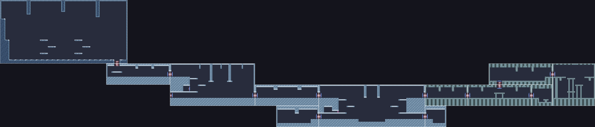
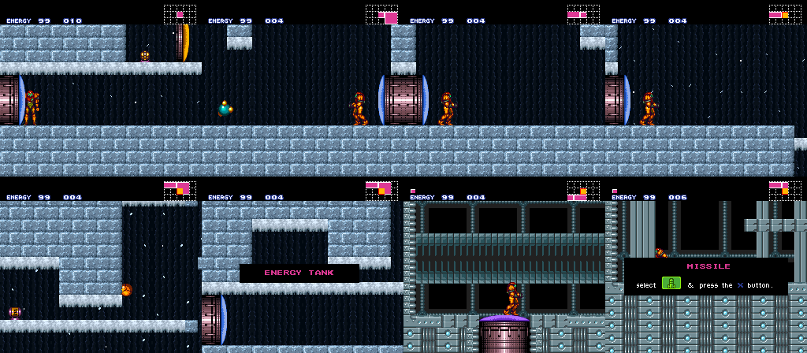
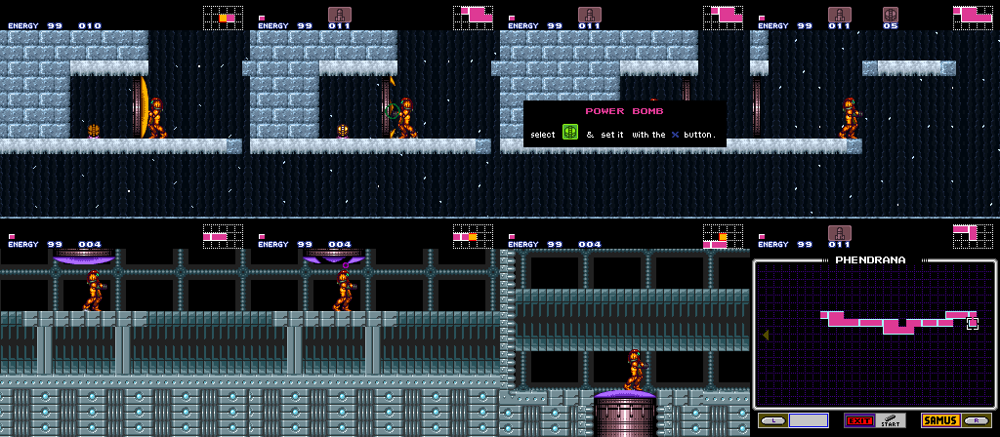
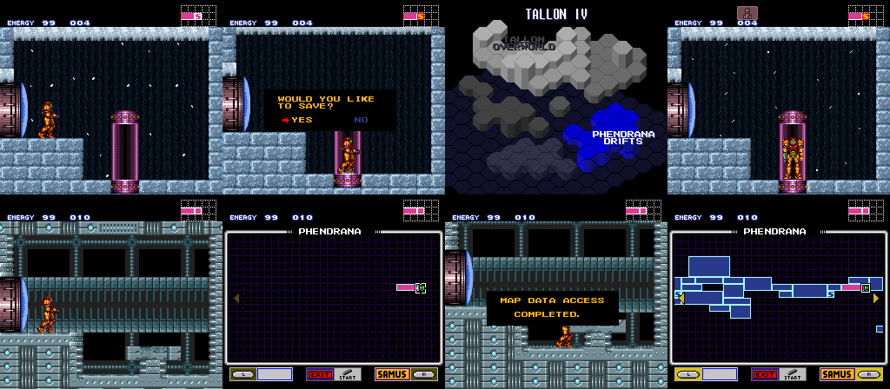

# 18i — Região B de Phendrana (Ice Ruins West, Ruined Courtyard, Hydra)

Estado: verificada (03/11/2026: validate "190 salas, 390 portas, 0 problemas", as linhas do Tallon e das rodadas (12m, 17j)
idênticas às da 18h (diff contra `scratchpad/v18h.txt`); `.ips` sha1 `942db180ea8ad6131473faa4f164f9e7dcf95cfe` igual em dois builds;
grupo A **34/34** em 3 min 10 s, B **64/64** em 4 min 26 s, C **13/13** em 43 s).
Rascunho → aprovada (épico aprovado pelo usuário; pedido do orquestrador) → implementada → verificada na mesma sessão.
Esforço estimado: 3 dias (medido: ~1 dia; as caminhadas acharam-se por busca em feixe no emulador)
Épico: [18 — Phendrana Drifts](18-phendrana-drifts.md) (decisões do usuário 1, 3, 5 e 6; decisões técnicas 3 e 5; linha 18i da tabela
de filhas); modelos: [18f](18f-regiao-a-phendrana.md) (região, travas, itens, save), [18g](18g-inimigos-phendrana.md) (inimigos,
justiça, deriva dos orbes, `PROPOSED_LATER`), [18h](18h-sheegoth.md) (`Allocator.next_at`), [12l](12l-regiao-e-chozo.md) (portas de
gelo verticais), [12i](12i-regiao-b-chozo.md) (map station), [09a](09a-portas-de-feixe.md)/[10d](10d-porta-de-onda-roxa.md) (portas
de feixe, a roxa).

## Contexto

A região A (18f–18h) termina na Ruins Entryway, cuja R0 era parede "até a 18i". Esta filha constrói a **região B** do épico: as 12
salas da Ice Ruins West ao primeiro laboratório (Hydra), abre a R0, põe as travas do Prime da região com os mecanismos do SM, os
3 itens, a **Save Station A** (estação 2 da área 4), a **Map Station**, os inimigos da camada 0 (as propostas da 18g) e a neve/cara
de cada sala.

## Estado antes (verificado)

- validate "178 salas, 366 portas, 0 problemas" (`scratchpad/v18h.txt`); sha1 `81fcea22…acef`; A 34/34, B 64/64, C 10/10.
- `tools/phendrana/rooms.py` (18c): região B = P9 Ice Ruins West (4×2), P12 Courtyard Entryway (3×1), P13 Canyon Entryway (3×1),
  P15 Ruined Courtyard (5×2), P16 Phendrana Canyon (6×3), P17 Save Station A (1×1), P18 Specimen Storage (2×1), P19 Quarantine
  Access (2×1), P20 Research Entrance (3×1), P22 Map Station (1×1), P23 Hydra Lab Entryway (3×1), P25 Research Lab Hydra (2×2).
- Travas do Prime da região (`DOCK_LOCKS`, `KEY_BEAM`): escudos de míssil Ice Ruins West → Canyon Entryway e Ruined Courtyard →
  Save Station A; portas de onda (Ice Ruins West → Courtyard Entryway; os dois lados de Courtyard ↔ Specimen Storage, Specimen ↔
  Research Entrance, **Research Entrance T1 ↔ Hydra Lab Entryway B0 (porta de teto/chão)**, Hydra Lab Entryway ↔ Hydra); a do Canyon
  Entryway → Ice Ruins West abre com qualquer feixe; 6 travas de evento (emboscadas dos laboratórios, 2º passe). Features: Courtyard
  bomb slot + Spider + água; Canyon meio-tubo; gelo de plasma na Ice Ruins West; vidro dos tubos na Hydra (enfeite).
- Itens do Prime: expansão de PB na Ice Ruins West (num bloco de gelo de **plasma**), E-tank no Ruined Courtyard, míssil na Hydra, a
  Boost Ball no Canyon (nada: decisão 3).
- Não existiam: tampa de feixe **dentro** de uma sala; porta de **onda** em parede de chão/teto (só as de gelo verticais da 12l).
- `$84`: as portas de feixe acabam em `$84:F4FB`, a rotina das arenas começa em `$84:F500` (5 bytes entre elas).

## Mudança

1. **Salas** (`tools/phendrana/layouts.py`, as regras de sempre; as salas com duas portas no mesmo lado uma tela acima da outra
   usam o penhasco oeste da Shorelines, `west_cliff`):
   - **Ice Ruins West** (4×2, ruínas de gelo, neve): chão na 26 (L1, R1), o penhasco oeste com a prateleira da L0 e o zigue-zague; o
     **nicho da expansão de PB** cortado na face do penhasco diante do 1º degrau, fechado por uma **tampa de plasma** (o gelo de
     plasma do Prime); colunas Chozo quebradas pendem do alto.
   - **Courtyard Entryway** e **Canyon Entryway** (3×1, ruínas): passagens na 10 (a do Canyon com a plataforma da porta de teto).
   - **Phendrana Canyon** (6×3, neve): o chão na 45 (a porta de chão B5), plataformas flutuantes em dois zigue-zagues, agulhas no teto.
   - **Ruined Courtyard** (5×2, ruínas, neve): chão na 26 (L1, R1), os dois penhascos (prateleiras da L0 e da R0), a piscina seca
     (um degrau de 2 linhas), o **E-tank numa câmara no penhasco oeste** atrás de um túnel de 1 linha fechado por bloco de bomba (o
     bomb slot, como o Ice Temple).
   - **Save Station A** (1×1, ruínas, neve como no Prime): a Save Station A da Magmoor. **Estação 2 da área 4.**
   - **Specimen Storage**, **Research Entrance** (plataforma da porta de teto T1), **Hydra Lab Entryway** (chão na 13, porta de chão
     B0), **Map Station** (o terminal da Chozo espelhado, `(11, 13)`), **Research Lab Hydra** (2×2: duas lajes na 10 sobre um vão, o
     laboratório de baixo, zigue-zague de volta; o míssil no chão de baixo) — todas na cara de laboratório.
   - **Quarantine Access** (2×1, ruínas): chão na 13 (a porta de chão para a região C, parede até a 18j).
   - A R0 da Ruins Entryway abre (porta azul dos dois lados).
2. **Tampa de feixe dentro da sala** (nova): `RoomDef.caps` / `Shape.caps` = (x, linha de cima, parede R/L, feixe). O build põe o PLM
   da porta de feixe (`beamdoors.PLM`, argumento `$8000`) e o nível recebe os blocos de uma tampa de porta (`RoomDef.cap_blocks`: tipo
   C em cima e 3 extensões D com BTS `$FF/$FE/$FD`; **medido**: com o BTS 0 das extensões a Samus atravessava a tampa fechada). Modelo:
   `reach.Loadout.plasma`, `LOADOUT_FIELD[PLASMA]`; `validate.with_caps` deixa os 4 blocos sólidos sem o feixe (a pé e no flood fill
   do Space Jump); o memo do passeio inclui o feixe só nas salas com tampa.
3. **Porta de onda vertical** (nova, `tallon/beamdoors.py`): cópias da porta verde de chão/teto (`$C87E/$C884`) com a pré-instrução
   do Wave, pintadas de roxo com 8 metatiles próprios (`VERT_PAINT_METATILES` `$3F8–$3FE`, `$3EF`: enchimento vanilla) na tabela do
   tileset 4 (a dos laboratórios, `$1B`); num bloco próprio em `$84:FE00` (250 bytes; o fim da faixa livre, longe da tabela das arenas
   que cresce desde `$84:F500`). PLMs `$FE64` (B) e `$FE6A` (T).
4. **Travas** (`GATES`): portas vermelhas `$C2` (Ice Ruins West L0) e `$C3` (Ruined Courtyard R1) (`PHENDRANA_MISSILE_BIT0`,
   `MISSILE_BITS`); as portas de onda nos lados do Prime (5 ligações, uma vertical); nenhuma tampa na Canyon Entryway → Ice Ruins West
   (qualquer feixe); as de evento fora.
5. **Itens** (`tools/phendrana/items.py`, bits `$DF–$E1`): expansão de PB no nicho (11, 20), rodada **6**, `needs` Plasma; E-tank na
   câmara (6, 20), rodada 3, `needs` Morph + Bombas; míssil da Hydra (3, 25), rodada 3.
6. **Inimigos** (`tools/phendrana/enemies.py`; as propostas da 18g aceitas): Courtyard Entryway 1 orbe (Atomic Alpha) + 1 zoomer da
   Wrecked Ship (Wall Crawler Swarm, `$DC3F`); Canyon Entryway 2 orbes (Atomic Beta); Phendrana Canyon 1 Sidehopper pequeno
   (Babygoth, espécie `babygoth` nova, não de arena) + 2 Zeelas (Parasite); Hydra Lab Entryway 2 orbes. 9 inimigos em 4 salas.
7. **Rodadas** (`FIRST_ROUND`): as 12 salas na rodada 3; itens 3, 3 e 6.
8. **Validador**:
   - `check_niche_caps` (novo, linha "nichos (specs/18i)"): tampa em parede R/L com PLM de feixe, ar no desenho e blocos de tampa de
     porta no nível, rocha logo acima e abaixo, um item atrás que pede o feixe, inalcançável sem ele de toda porta mesmo com o Space
     Jump e toda a geometria; o modelo só abre feixes com campo no `Loadout`;
   - `check_gates`: a tampa dentro da sala em toda lista de PLMs;
   - `check_vertical_wave_doors` (novo): porta de onda de chão/teto só em sala de tileset com a pintura vertical (4, `$1B`);
     `check_wave_paint_free` cobre os metatiles novos; a tabela do tileset 4 conferida com a pintura vertical;
   - `check_room` anda as salas com tampa também com ela aberta (nada sem volta no nicho); `check_item_geometry` aceita o feixe das
     tampas como geometria da sala;
   - `check_phendrana_locks_mapped`: item atrás de geometria (Morph + Bombas) só em sala com a feature do Prime (bomb slot); item atrás
     de feixe só no gelo de plasma do Prime (`PLASMA_ICE`) com tampa de plasma, e todo item de sala com esse gelo atrás dela; tampas
     de feixe só no gelo de plasma; **save stations e map station exatamente nas salas do Prime** (`EPIC_PHENDRANA_SAVES`,
     `EPIC_PHENDRANA_MAP`); a linha conta os nichos e as estações.
9. **Testes** (grupo C): `phendrana_regiao_b_rota`, `phendrana_save_station_a`, `phendrana_map_station` (novos);
   `phendrana_regiao_a_rota` passa pela R0 (agora porta); `entradas_de_porta_phendrana` cobre sozinho as 7 entradas novas.

## Critérios de aceite

1. validate 0 problemas; **"44 salas construídas, alcançáveis agora: 44, 20 itens em 7 rodadas"** e **"58 itens em 7 rodadas … 58%"**
   idênticas às da 18h; linhas de Phendrana com 25 salas, 8 itens (7 na rodada 3, 1 na 6), estações 0–2. **Passa.** (protege = travas,
   tampa no nicho, portas verticais, rodadas, estações, inimigos; falha_quando = V1–V19, R1–R3; não_prova = que as formas agradam)
2. `phendrana_regiao_b_rota` (protege = a tampa de plasma que o Wave não abre e que segura a Samus, a porta vermelha `$C2`, as de onda,
   os inimigos vivos na chegada sem dano, o bloco de bomba e o E-tank, a porta de onda vertical que o Power Beam não abre e o Wave abre,
   o míssil da Hydra, o mapa; com o Plasma (atalho da rodada 6) a tampa abre e a expansão de PB dá 5 power bombs; falha_quando = E1,
   E2), `phendrana_save_station_a` (porta vermelha `$C3`, save na estação 2, game over, tela de área, continue no pedestal, o bit da
   porta mantido; falha_quando = E4), `phendrana_map_station` (salas não visitadas em branco antes; "map data access completed"; o mapa
   revelado, `$7ED90C = $FF`; falha_quando = E3). Os testes antigos passam. **Passa.**
3. Mutações pegas. **Passa.**
4. Dois builds com o mesmo sha1; fotos `specs/img/18i-*.png` olhadas. **Passa.**

## Plano de testes

| Camada | O quê | Qtde |
|---|---|---|
| validate.py | `check_niche_caps`, `check_vertical_wave_doors`; regras novas em `check_phendrana_locks_mapped`, `check_gates`, `check_room`, `check_item_geometry`, tabela do tileset 4 | +2 checagens |
| run_tests.py (grupo C) | `phendrana_regiao_b_rota`, `phendrana_save_station_a`, `phendrana_map_station` | +3 (13) |
| scratchpad (`s18i/`) | 19 mutações do validador, 3 de ROM, 4 de emulador | 26 |
| imagem | `18i-salas.png`, `18i-rota.png`, `18i-tampa-e-portas.png`, `18i-save-e-mapa.png` | +4 |

## Resultado

As 12 salas da região nos seus lugares do mapa de pausa (prévia nas paletas do build, sem PLMs): em cima a Phendrana Canyon sobre a
Canyon Entryway; a Ice Ruins West (o nicho na face do penhasco), a Courtyard Entryway, o Ruined Courtyard (a câmara do E-tank no
penhasco oeste, a piscina seca), a Quarantine Access embaixo à esquerda dele e a Save Station A à direita; os laboratórios: Specimen
Storage, Research Entrance, Map Station, a Hydra Lab Entryway por cima e a Research Lab Hydra.

| Bit | Sala | Prime | Lugar / trava | Rodada |
|---|---|---|---|---|
| `$DF` | Ice Ruins West | Power Bomb Expansion (gelo de plasma) | nicho no penhasco atrás da tampa de plasma (11, 20) | 6 |
| `$E0` | Ruined Courtyard | Energy Tank (bomb slot) | câmara atrás do túnel com bloco de bomba (6, 20) | 3 |
| `$E1` | Research Lab Hydra | Missile Expansion | chão do laboratório de baixo (3, 25) | 3 |

`phendrana_regiao_b_rota`: a chegada na Ice Ruins West; a Canyon Entryway pela porta vermelha; a Courtyard Entryway (orbe e zoomer);
a prateleira do Ruined Courtyard; a bomba no bloco; o E-tank; a Hydra Lab Entryway; o míssil da Hydra.

A tampa de plasma (laranja) fechada depois do tiro do Wave; o tiro do Plasma abrindo; a expansão de PB; o nicho aberto (ficam as
colunas do batente). A porta de onda roxa no teto da Research Entrance fechada para o Power Beam; o tiro do Wave abrindo; a chegada na
Hydra Lab Entryway sobre a porta de chão roxa; o mapa de pausa.

`phendrana_save_station_a`: a sala (neve caindo); a pergunta; a tela de área com "PHENDRANA / DRIFTS"; o continue no pedestal.
`phendrana_map_station`: a sala; o mapa antes; "MAP DATA ACCESS COMPLETED"; o mapa revelado (regiões A e B, os ícones de save e de map
station).

### Justiça e espaço

Orbe (cópia) 5 tiros, 20 por toque, a mais de 120 quadros de deriva de toda porta; zoomer 1 tiro, 5; Sidehopper pequeno 3 tiros, 20;
Zeela 2, 10. Espaço: `$8F` +634 (as salas na faixa das demos: 602/3796 usados, **3194 livres** nela, 3 bytes nas outras faixas), `$84`
+250 em `$84:FE00`, nível +18 blobs; `$A1`, `$B4`, `$83` pouco.

### Linhas do validador (o que mudou)

- **Iguais** (diff contra `scratchpad/v18h.txt`): as duas linhas pedidas.
- "178 salas, 366 portas" → **"190 salas, 390 portas"**; "phendrana (specs/18e, 18f; regiões ativas: AB): 25 salas construídas, 8
  itens … rodada 3: 25 salas, 7 itens; rodada 6: 0 salas, 1 itens … estações: 0 transport_magmoor_west, 1 save_station_b, 2
  save_station_a"; nova "nichos (specs/18i)"; "phendrana (specs/18f): 14 trava(s) … travas de evento fora: 8 … itens em nichos de gelo
  de plasma: 1; save stations: save_station_a, save_station_b; map station: map_station; neve em 11 das 25"; 18g: 16 inimigos em 7 salas;
  `$8F` recuperado 3782 → 4416.

## Mutações (`s18i/scripts/mutate_i.py` → `s18i/mut/mutate_i.out`; emulador `emu_mut_i.py` → `mut/emu_mut_i.out`)

Validador, todas pegas, sem mutação limpo: V1 sem a tampa (nicho aberto: a PB na rodada 3 muda até o X-Ray do Tallon); V2 tampa de
onda; V3 PB na rodada 3; V4 PB sem `needs`; V5 extensões da tampa com BTS 0; V6 buraco no chão do nicho; V7 E-tank sem `needs`; V8
míssil da Hydra atrás de Morph + Bombas; V9 bits vermelhos a partir de `$C0`; V10 porta de onda da Ice Ruins West esquecida; V11 a
vertical esquecida; V12 Hydra Lab Entryway nas ruínas (porta vertical sem pintura); V13 map station do épico em outra sala; V14 Save
Station A sem estação; V15 2 Babygoths; V16 orbe colado na R0; V17 túnel sem bloco de bomba; V18 Hydra sem zigue-zague; V19 Wall
Crawler decidido e proposto. ROM: R1 a tampa de plasma trocada pela de gelo; R2 um byte da porta vertical no `$84`; R3 a porta vermelha
com o bit `$C4`. Emulador: E1 BTS 0 nas extensões → `phendrana_regiao_b_rota` falha (a Samus atravessa a tampa); E2 a porta vertical de
gelo → falha (o Wave não abre); E3 o terminal colado no degrau → `phendrana_map_station` falha; E4 a porta da Save Station A com o bit
`$C2` → `phendrana_save_station_a` falha.

## Riscos e reversão

- Caminhadas por busca em feixe (`s18i/scripts/srch.py`): mexer nas salas, nos inimigos ou em `phendrana_up` pede nova busca.
- A tampa no nicho deixa as colunas do batente da porta depois de aberta (é o desenho da porta vanilla aberta).
- Reversão: `ACTIVE_REGIONS = {"A"}` (os desenhos ficam fora do build), os itens 5–7 e os 3 testes; a porta vertical e as tampas na sala
  ficam como infraestrutura sem uso.

## Fora de escopo

Regiões C–E; o Thardus (18k); o Super Missile (18l); as camadas de evento (emboscadas dos laboratórios, Metroids dos tubos); a água do
Courtyard (seca, decisão 5).

## Desvios

- **Mecanismo novo: tampa de feixe dentro da sala** (`RoomDef.caps`), pedido pela decisão técnica 3 do épico ("nicho fechado por
  porta de plasma") mas sem precedente no projeto. Medido: a tampa precisa dos blocos de tampa de porta no nível (extensões D com BTS
  apontando para cima), senão a Samus a atravessa.
- **Porta de onda vertical nova** (Research Entrance ↔ Hydra Lab Entryway), num bloco próprio em `$84:FE00` (não cabia depois das
  portas de gelo verticais: a rotina das arenas começa 5 bytes depois). Pintada só na tabela do tileset 4 (laboratórios); a validação
  recusa porta de onda vertical em outro tileset (as regiões C e E têm 3 ligações assim: a filha delas pinta a neve/ruínas).
- **Contas abaixo do Prime**: Courtyard Entryway 1 zoomer de 2 Wall Crawler Swarms; Phendrana Canyon 2 Zeelas de 7 Parasites.
- A **Phendrana Canyon** não entra na caminhada (beco sem item: o lugar da Boost fica vazio); a auditoria de entrada cobre a porta dela.
- O **E-tank** do Courtyard vem do bomb slot (túnel com bloco de bomba), não da água que sobe nem do trilho de Spider (enfeite).
- **Atalhos anotados**: o Plasma por RAM para a PB (a rodada 6 anda na 18n); 6 mísseis da capacidade gastos nas portas vermelhas
  (`phendrana_red_door`, sem repor energia nem mísseis); entradas por `door_teleport` na Ice Ruins West, no Courtyard e na Research
  Entrance.
- `phendrana_regiao_a_rota` agora atravessa a R0 da Ruins Entryway (era parede).
- Regras a mais no validador (não pedidas pelo épico): estações nas salas do Prime; item atrás de geometria só com a feature do Prime.
- Experimentos, buscas e mutações na cópia `s18i/proj`; a pasta real só recebeu os arquivos finais.
- Verificação (03/11/2026, pasta real): `python3 -I tools/build.py` duas vezes → sha1 `942db180ea8ad6131473faa4f164f9e7dcf95cfe`;
  `python3 -I tools/validate.py` → "190 salas, 390 portas, 0 problemas" (as duas linhas pedidas idênticas, diff); `--grupo A` **34/34**
  (3 min 10 s), `--grupo B` **64/64** (4 min 26 s), `--grupo C` **13/13** (43 s).

## Decisões para o usuário (escolhidas as mais perto do Prime e dos padrões; confirmar)

1. **Gelo de plasma = nicho com tampa de plasma laranja** na face do penhasco (depois de aberta, ficam as colunas do batente).
   Alternativa: bloco que só o Plasma quebra (precisaria de um PLM novo).
2. **Formas**: o penhasco oeste com zigue-zague na Ice Ruins West e no Courtyard; a câmara do E-tank no penhasco; a Hydra em dois
   andares; a Canyon com plataformas flutuantes vazias.
3. **Caras**: ruínas de gelo nas salas Chozo (Ice Ruins West, as duas entryways, Courtyard, Quarantine Access, Save Station A);
   laboratório nas dos piratas; a cara de neve (exterior com céu) só na Phendrana Canyon. Neve caindo onde neva no Prime: Ice Ruins
   West, Courtyard, Save Station A e Canyon.
4. **Inimigos**: as propostas da 18g (Babygoth = Sidehopper pequeno amarelo; Wall Crawler = zoomer laranja da Wrecked Ship).
