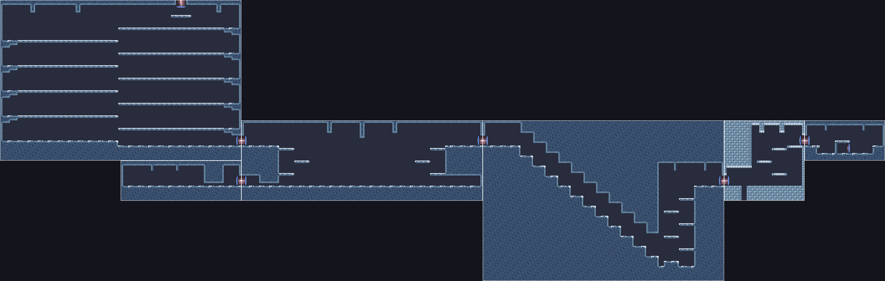
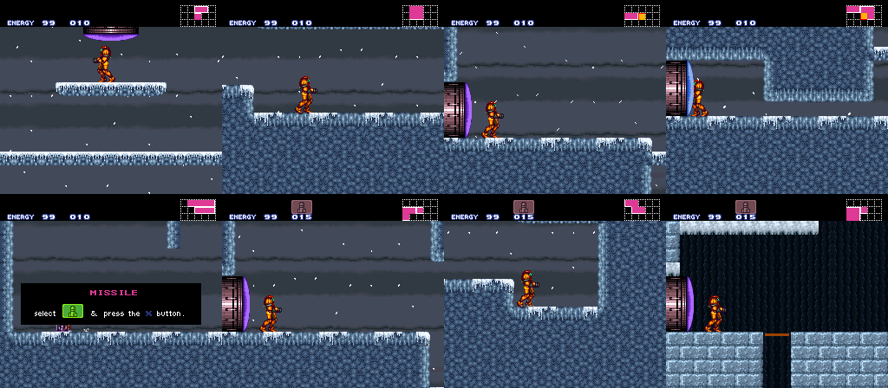
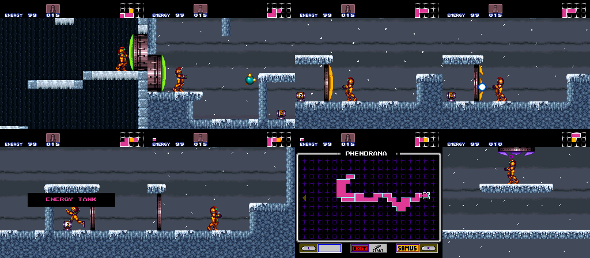

# 18j — Região C de Phendrana (quarentena e o elevador sul)

Estado: verificada (03/11/2026: validate "195 salas, 402 portas, 0 problemas", as linhas do Tallon e das rodadas (12m, 17j)
idênticas às da 18i (diff contra `scratchpad/v18i.txt`); `.ips` sha1 `4982c9c68d5f3e118d8f73ebfb1bd770178f5858` igual em dois builds;
grupo A **34/34** em 3 min 14 s, B **64/64** em 4 min 37 s, C **14/14** em 56 s).
Rascunho → aprovada (épico aprovado pelo usuário; pedido do orquestrador) → implementada → verificada na mesma sessão.
Esforço estimado: 2,5–3 dias (linha 18j do épico)
Épico: [18 — Phendrana Drifts](18-phendrana-drifts.md) (decisões do usuário 1, 3, 4, 5 e 6; decisões técnicas 3 e 5; linha 18j da
tabela de filhas); modelos: [18i](18i-regiao-b-phendrana.md) (região, tampa de plasma dentro da sala, porta de onda vertical),
[18g](18g-inimigos-phendrana.md) (orbes, deriva, `PROPOSED_LATER`, auditoria de entrada), [18e](18e-elevadores-de-phendrana.md) (a
P29), [18h](18h-sheegoth.md) (portas de chefe que esperam a arena), [12f](12f-regiao-a-chozo.md) (porta de Morph = túnel de Morph),
[17f](17f-regiao-a-magmoor.md) (a sala alta de zigue-zague, Monitor Station).

## Contexto

A região B (18i) termina na Quarantine Access, cuja porta de chão B0 era parede "até a 18j"; a P29 (elevador sul, 18e) é um beco
cujas portas L1 e R0 esperavam esta filha. Esta filha constrói a **região C** do épico: as 6 salas da quarentena e do elevador sul
(5 novas e a P29 aberta), as travas do Prime da região com os mecanismos do SM, os 2 itens, os inimigos da camada 0 (as propostas
da 18g), a neve/cara de cada sala. O **Thardus** (a arena da Quarantine Cave, as portas que trancam) é da 18k: aqui a caverna fica
pronta para ele, vazia.

## Estado antes (verificado)

- validate "190 salas, 390 portas, 0 problemas" (`scratchpad/v18i.txt`); `.ips` sha1 `942db180…cfe`; A 34/34, B 64/64, C 13/13.
- `tools/phendrana/rooms.py` (18c): região C = P21 North Quarantine Tunnel (6×4), P24 Quarantine Cave (6×2), P26 South Quarantine
  Tunnel (6×4), P27 Quarantine Monitor (3×1), P29 Transport to Magmoor South (2×2, já construída: 18e), P31 Transport Access (2×1).
  Ligações: Quarantine Access B0 ↔ NQT T4 (chão/teto), NQT R3 ↔ QC L0, QC R0 ↔ SQT L0, QM R0 ↔ QC L1, SQT R1 ↔ P29 L1, P29 R0 ↔ TA
  L0; TA R0 → Frozen Pike (região E: parede até a 18m).
- Travas do Prime (`DOCK_LOCKS`, `KEY_BEAM`): onda dos dois lados de NQT ↔ QC, QC ↔ SQT e SQT ↔ P29; **onda só do lado da NQT** na
  ligação com a Quarantine Access (do outro lado só `event`); **gelo dos dois lados** de P29 ↔ TA; **Morph dos dois lados** de QC ↔
  QM; `event` nas duas portas da QC (o Thardus: `BOSS_DOORS`, 18k) e na Quarantine Access → NQT (as cenas da quarentena: fora).
  Features: QC `spider`, `grapple`, `morph_door`; QM `morph_door`; P29 `spider`; `PLASMA_ICE` na TA (o E-tank).
- Itens do Prime: míssil na Quarantine Monitor, E-tank na Transport Access (gelo de plasma), a Spider Ball na QC (prêmio do
  Thardus: nada, decisão 3).
- Inimigos da camada 0 do Prime: NQT 2 Atomic Alpha, SQT 2 Atomic Alpha, TA 1 Atomic Alpha (a QC não tem: o Thardus é da camada 3).
- Neve (`SNOW_ROOMS`) nas 5 salas novas; a P29 não neva.
- A porta de onda vertical (`$84:FE00`, 18i) só tem a pintura na tabela do tileset 4 (laboratórios); `check_vertical_wave_doors`
  recusa outra cara. A NQT (cara de neve) tem uma porta de onda de teto.
- `$8F`: 3194 bytes livres na faixa das demos.

## Mudança

1. **Salas** (`tools/phendrana/layouts.py`; as regras de sempre: porta lateral nas linhas 6–9 com o chão/prateleira na 10, subidas de
   5 linhas, `zigzag` da Magmoor):
   - **North Quarantine Tunnel** (6×4, neve): uma **trilha em zigue-zague** de terraços de rocha nevada a 5 linhas um do outro, cada um
     de uma parede até o meio da sala, alternando os lados (a Samus desce saindo de um para o de baixo e sobe de volta pelo meio, como
     num zigue-zague); a plataforma da porta de teto T4 (linha 6) sobre o primeiro; no pé um degrau (56) e o chão (58, a R3); uma cunha
     de rocha sob cada terraço na parede; estalactites.
   - **Quarantine Cave** (6×2, neve): o chão da arena na 26, os dois penhascos do Ruined Courtyard (prateleiras da L0 e da R0 na linha
     10) com 3 bordas em zigue-zague cada; sob o penhasco oeste a **câmara da porta L1** (a Samus fica de pé nela para abrir a porta) e
     um **túnel de Morph** de 1 linha até a arena (a porta de Morph do Prime); agulhas de gelo no teto. A arena (entre os penhascos,
     plana) fica para o Thardus (18k).
   - **South Quarantine Tunnel** (6×4, neve): um **túnel de degraus** da prateleira da L0 (linha 10) até um chão na 58: 11 degraus de 5
     colunas, cada um 4 linhas abaixo do anterior, o teto 9 linhas acima; no pé um salão até a parede leste e nele a **prateleira da R1**
     (rocha das linhas 26–57) subida do chão por um degrau e 5 bordas em zigue-zague.
   - **Quarantine Monitor** (3×1, neve): o mirante na linha 10; a câmara da porta R0 atrás de uma parede com um túnel de Morph de 1
     linha no pé; o **míssil** na ponta oeste.
   - **Transport to Magmoor South** (P29, ruínas de gelo, sem neve): o caminho até a R0 (no alto da tela de cima): a metade leste da
     tela de cima aberta até o salão do elevador, 3 bordas em zigue-zague do chão do salão e a prateleira da R0 (linha 10).
   - **Transport Access** (2×1, neve): o chão na 13, degraus de 3 sob as portas; um **pilar de gelo** no meio (topo na 8, a Samus passa
     por cima) com um **nicho na face leste fechado por uma tampa de plasma** (o gelo de plasma do Prime, o jeito da 18i) e o **E-tank**
     dentro; a R0 (Frozen Pike) parede até a 18m.
   - A B0 da Quarantine Access abre (sem tampa do lado dela: só `event` no Prime).
2. **Porta de onda vertical na cara de neve**: os 8 metatiles da porta vertical (`VERT_PAINT_METATILES`, enchimento vanilla no `$00`)
   pintados também na cópia da tabela do tileset `$01` (neve, `build.ice_metatiles`, linha `SNOW_PAINT_LINE`). Validador:
   `VERTICAL_WAVE_TILESETS` (tileset 4, laboratório, **neve**) em `check_vertical_wave_doors` e em `check_wave_paint_free`; `ice.check`
   confere que esses metatiles são enchimento no `$00` vanilla.
3. **Travas** (`GATES`): portas de onda nos lados do Prime (5 ligações; a da NQT ↔ Quarantine Access só do lado da NQT, vertical);
   portas de gelo dos dois lados de P29 ↔ TA; a porta de Morph QC ↔ QM = `Gate({MORPH}, (), (QC, QM))` (as duas portas atrás do
   túnel); as portas de evento do Thardus esperam a 18k (`BOSS_DOORS`, a linha diz "esperando o chefe"); a da Quarantine Access fora.
4. **Itens** (`tools/phendrana/items.py`, bits `$E2–$E3`): míssil da Quarantine Monitor (4, 9), rodada 3; E-tank da Transport Access
   no nicho (14, 12), rodada **6**, `needs` Plasma.
5. **Inimigos** (`tools/phendrana/enemies.py`; a proposta da 18g, Atomic Alpha = a cópia do orbe, já em `STAND_IN`): NQT 2 orbes
   (terraços das linhas 26 e 41), SQT 2 orbes (degraus das linhas 30 e 42), TA 1 orbe (sobre o pilar). 5 inimigos em 3 salas, as
   contas do Prime.
6. **Rodadas** (`FIRST_ROUND`): NQT, QC, SQT e QM na rodada 3; a TA na **4** (portas de gelo: o Ice Beam é pego na rodada 3); itens 3 e 6.
7. **Validador**: as regras novas do item 2; `check_phendrana_locks_mapped`, `check_niche_caps`, `check_item_geometry`,
   `check_phendrana_rounds`, `check_phendrana_enemies` e `check_room` cobrem a região sem mudança (as travas do Prime nas ligações
   novas, a tampa da TA, a porta de Morph atrás do túnel dos dois lados, as rodadas, os orbes longe das portas, nenhum lugar sem volta).
8. **Testes** (grupo C): `phendrana_regiao_c_rota` (novo); `entradas_de_porta_phendrana` cobre sozinho as entradas novas das
   salas com inimigos (NQT T4/R3, SQT L0/R1, TA L0); `elevador_phendrana_sul` passa pela P29 nova.
9. **Regra nova** (achada pela mutação V7): `check_phendrana_locks_mapped` confere que **cada porta de Morph Ball do Prime fecha algo
   na sala dela**: da entrada da própria porta, sem a Morph Ball, a Samus chega a menos lugares do que com ela. Antes, numa sala cuja
   única porta é a de Morph (a Quarantine Monitor), o túnel podia sumir sem nenhum aviso (`reach_on_foot` só confere o túnel a partir
   das outras entradas).

## Critérios de aceite

1. validate 0 problemas; **"44 salas construídas, alcançáveis agora: 44, 20 itens em 7 rodadas"** e **"58 itens em 7 rodadas … 58%"**
   idênticas às da 18i; linhas de Phendrana com 30 salas, 10 itens (rodada 3: 29 salas, 8 itens; rodada 4: 1 sala; rodada 6: 2
   itens), "esperando o chefe: quarantine_cave (18k)", 2 nichos, 2 portas de Morph atrás de túnel. **Passa.** (protege = travas, tampa no nicho, porta vertical na neve, rodadas,
   inimigos; falha_quando = mutações V*; não_prova = que as formas agradam)
2. `phendrana_regiao_c_rota`: da Quarantine Access (atalho) andando: a porta de chão para a NQT, a porta de onda vertical de neve
   fechada para o Power Beam, a trilha com os 2 orbes vivos na chegada e mortos sem dano, a R3 de onda; a QC, o túnel de Morph, a QM e
   o míssil (bit `$E2`); de volta pelo túnel, o zigue-zague leste, a R0 de onda; o túnel de degraus da SQT com os 2 orbes, o
   zigue-zague até a R1; a P29 até a R0, a porta de gelo (o Wave não abre, o Ice abre: equipamento da rodada 4 por RAM); a TA, o orbe,
   a tampa de plasma que o Ice não abre; com o Plasma (atalho da rodada 6) a tampa abre e o E-tank (bit `$E3`); os bits de explorado
   e o mapa. Os testes antigos passam. **Passa.**
3. Mutações pegas. **Passa** (as que quebram de verdade; ver Mutações).
4. Dois builds com o mesmo sha1; fotos `specs/img/18j-*.png` olhadas. **Passa.**

## Plano de testes

| Camada | O quê | Qtde |
|---|---|---|
| validate.py | `VERTICAL_WAVE_TILESETS` (neve) em `check_vertical_wave_doors` / `check_wave_paint_free`; `ice.check`; a pintura vertical lida na tabela da neve da ROM (`check_ice_in_rom`); a porta de Morph fecha algo (`check_phendrana_locks_mapped`) | regras novas |
| run_tests.py (grupo C) | `phendrana_regiao_c_rota` | +1 (14) |
| scratchpad (`s18j/`) | 18 mutações do validador, 3 de ROM, 4 de emulador | 25 |
| imagem | `18j-salas.png`, `18j-rota.png`, `18j-tampa-e-mapa.png` | +3 |

## Resultado

As 6 salas da região nos seus lugares do mapa de pausa (prévia nas paletas do build, sem PLMs): à esquerda a North Quarantine Tunnel
(a trilha de terraços, a porta de teto em cima); embaixo dela a Quarantine Monitor (o túnel de Morph diante da R0) e a Quarantine Cave
(os dois penhascos, a câmara e o túnel da L1 embaixo à esquerda, a arena vazia); a South Quarantine Tunnel (o túnel de degraus, o
salão e o zigue-zague até a R1); a P29 nas ruínas de gelo (o salão do elevador, o zigue-zague até a R0); a Transport Access (o pilar
com o nicho e a tampa).

| Bit | Sala | Prime | Lugar / trava | Rodada |
|---|---|---|---|---|
| `$E2` | Quarantine Monitor | Missile Expansion | ponta oeste do mirante, depois do túnel de Morph da porta (4, 9) | 3 |
| `$E3` | Transport Access | Energy Tank (gelo de plasma) | nicho no pilar atrás da tampa de plasma (14, 12) | 6 |

`phendrana_regiao_c_rota`: a chegada na plataforma da porta de teto da NQT (a porta de onda roxa na cara de neve); o pé da trilha; a
Quarantine Cave pela R3; de pé na câmara da L1 depois do túnel; o míssil da Monitor; a chegada na SQT; o pé dos degraus (os 2 orbes
mortos); a P29 pela L1.

A R0 da P29 (porta de gelo verde) no alto do zigue-zague; a Transport Access (o orbe sobre o pilar); a tampa de plasma fechada depois do
tiro de Wave + Ice; o Plasma abrindo; o E-tank; o nicho aberto; o mapa de pausa com as regiões A, B e C; a porta de teto da NQT abrindo
com o Wave.

### Justiça e espaço

Orbes (cópia da 18g): 5 tiros, 20 por toque, a mais de 120 quadros de deriva de toda porta. Na NQT a Samus desce pelo meio da sala e
os 2 orbes, longe da câmera, ficam parados (o orbe só anda na tela): a caminhada passa sem lutar; na SQT os 2 aparecem nos degraus e
morrem; na TA o orbe morre do degrau da L0. Energia 99 a caminhada toda até o E-tank (199). Espaço: `$8F` **+303** (602 → 904 na faixa
das demos: 302; 1 nas outras), **2892 livres** na faixa das demos para as regiões D e E; nível +5 blobs; `$84` nada (a porta vertical já
existia); a tabela da neve +8 metatiles (no alocador fixo, comprimida).

### Linhas do validador (o que mudou)

- **Iguais** (diff contra `scratchpad/v18i.txt`): as duas linhas pedidas.
- "190 salas, 390 portas" → **"195 salas, 402 portas"**; "phendrana (specs/18e, 18f; regiões ativas: ABC): 30 salas construídas, 10
  itens … rodada 3: 29 salas, 8 itens; rodada 4: 1 salas, 0 itens; rodada 6: 0 salas, 2 itens"; "nichos (specs/18i): 2 tampa(s) …
  transport_access (plasma L em 17,9)"; "phendrana (specs/18f): 25 trava(s) … esperando o chefe: quarantine_cave (18k), quarantine_cave
  (18k); travas de evento fora …: 9 … itens em nichos de gelo de plasma: 2; specs/18j: portas de Morph Ball do Prime atrás de túnel …: 2
  … neve em 16 das 30"; 18g: 21 inimigos em 10 salas; `$8F` recuperado 4416 → 4719.

## Mutações (`s18j/scripts/mutate_j.py` → `s18j/mut/mut1.out`, `mut2.out`; emulador `emu_mut_j.py` → `mut/emu_mut_j.out`)

Validador (numa cópia própria, `s18j/mutproj`), todas pegas, sem mutação limpo: V1 a TA sem a tampa (o E-tank na rodada 4); V2 o E-tank
declarado na rodada 4; V3 o E-tank sem `needs` (a tampa sem item atrás); V4 a tabela da neve sem a pintura vertical (`build.ice_metatiles`
de antes: a leitura independente da ROM pega); V5 a NQT nas ruínas (porta de onda de teto sem pintura); V6 a porta de Morph QC ↔ QM
esquecida; V7 o túnel da Monitor com 3 linhas (**só a regra nova pega**: na 1ª rodada passou limpo); V8 o túnel da QC tapado; V9 as
portas P29 ↔ TA de onda (a TA na rodada 3); V10 a TA declarada na rodada 3; V11 a porta de onda NQT → Quarantine Access esquecida; V12 um
orbe da NQT a 2 blocos da porta de teto (64 quadros); V13 3 orbes na NQT; V14 a SQT sem o zigue-zague; V15 a P29 sem o zigue-zague; V16 o
míssil da Monitor numa borda de Space Jump; V17 um terraço da NQT a menos; V18 o túnel da QC com 4 linhas (a L1 de pé). ROM: R1 a tampa
da TA trocada pela de onda na lista de PLMs; R2 a porta de teto da NQT trocada pela de gelo vertical; R3 a tabela da neve apontada para
a do tileset 0 vanilla. Emulador: E1 a tampa da TA de onda → `phendrana_regiao_c_rota` falha (o PLM); E2 a porta de teto da NQT de gelo →
falha (a tampa); E3 as portas P29 ↔ TA de onda → falha (o Wave abre a R0); E4 a câmara da L1 da QC com 2 linhas → **passa** (não é
quebra: o vão de 4×4 da porta continua aberto e a Samus fica de pé nele; a 1ª versão da V18 era a mesma coisa e também passou limpa).

## Riscos e reversão

- Caminhadas por busca em feixe (`s18j/scripts/srch.py`): mexer nas salas, nos inimigos ou em `phendrana_up` pede nova busca.
- A 18k vai pôr o Thardus (Bomb Torizo) na arena da QC: o chão plano entre os penhascos (colunas 15–80) é o lugar dele; se a luta
  pedir outra forma, a 18k muda a sala (e as caminhadas desta filha que passam por ela).
- Reversão: `ACTIVE_REGIONS = {"A", "B"}` (os desenhos ficam fora do build), os itens 8–9, o teste novo; a pintura vertical na neve
  fica como infraestrutura sem uso (o validador a aceita).

## Fora de escopo

Regiões D–E; o Thardus e as portas que trancam (18k); a Spider Ball (nada, decisão 3); as camadas de evento (as cenas da quarentena).

## Desvios

- **A porta de Morph sem o gancho**: a Quarantine Monitor no Prime se alcança pelo Grapple Beam (a feature `grapple` da QC permitiria uma
  borda de Space Jump), mas a porta L1 da QC fica na tela de baixo (o mapa da 18c), na altura do chão: não cabe uma borda de Space Jump
  na frente dela. A ligação fica só com o túnel de Morph dos dois lados (o dado do Prime: `morph` nas duas docas).
- **A trilha da NQT**: os terraços vão de uma parede até o meio da sala, então a Samus desce sempre pelo meio e não percorre os terraços;
  os 2 orbes, longe da câmera, ficam parados e a caminhada não luta com eles (a auditoria de entrada confere as duas portas da sala).
- **A SQT** desce até o fundo e sobe de volta por um zigue-zague até a R1 (a R1 está na 2ª tela de cima): a sala usa as 4 telas de altura.
- **Regra a mais no validador** (não pedida pelo épico): a porta de Morph do Prime fecha algo na própria sala (achada pela mutação V7).
- A pintura da porta de onda vertical foi para a tabela da **neve** (a NQT é de neve); as **ruínas de gelo** continuam sem ela (a região
  E decide: Chamber Access ↔ Gravity Chamber e Hunter Cave ↔ Lake Tunnel).
- **Atalhos anotados** no teste: a entrada na Quarantine Access por `door_teleport`; o Ice Beam (rodada 4) e o Plasma Beam (rodada 6) por
  RAM.
- Experimentos, buscas e mutações nas cópias `s18j/proj` e `s18j/mutproj`; a pasta real só recebeu os arquivos finais.
- Verificação (03/11/2026, pasta real): `python3 -I tools/build.py` duas vezes → sha1 `4982c9c68d5f3e118d8f73ebfb1bd770178f5858`;
  `python3 -I tools/validate.py` → "195 salas, 402 portas, 0 problemas" (as duas linhas pedidas idênticas, diff); `--grupo A` **34/34**
  (3 min 14 s), `--grupo B` **64/64** (4 min 37 s), `--grupo C` **14/14** (56 s).

## Decisões para o usuário (escolhidas as mais perto do Prime e dos padrões; confirmar)

1. **Quarantine Cave ↔ Monitor = túnel de Morph dos dois lados** (sem a borda de Space Jump do gancho do Prime: não cabe diante da L1).
2. **Formas**: a NQT como trilha de terraços alternados (parece um pouco "estacionamento"; dá para quebrar as bordas depois); a SQT como
   túnel de degraus que desce até o fundo e sobe por zigue-zague; a QC com o chão plano entre dois penhascos (o lugar do Thardus, 18k);
   o E-tank num pilar de gelo com a tampa laranja.
3. **Caras**: neve (exterior) nas 5 salas novas, todas com neve caindo como no Prime; a P29 continua nas ruínas de gelo, sem neve.
4. **Inimigos**: as contas do Prime (NQT 2, SQT 2, TA 1 orbe); os da NQT ficam longe do caminho.
