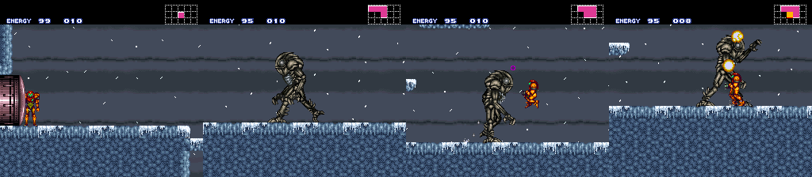
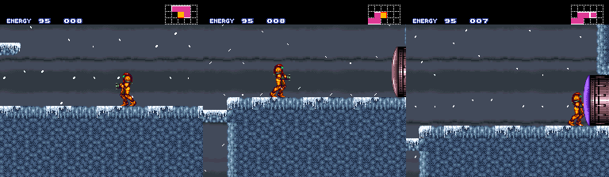

# 18k — Thardus (arena da Quarantine Cave)

Estado: **verificada** (03/11/2026: validate "195 salas, 402 portas, 0 problemas", as linhas "44 salas construídas, alcançáveis agora:
44, 20 itens em 7 rodadas" e "58 itens em 7 rodadas … 58%" idênticas às da 18j (diff contra `scratchpad/v18j.txt`); `.ips` sha1
`a7a45deb8f09637d0575e2dc854bb214bf6f5b30` igual em dois builds; grupo A **34/34** em 3 min 01 s, B **64/64** em 4 min 20 s, C **15/15**
em 55 s). Rascunho → aprovada (épico aprovado pelo usuário; pedido do orquestrador) → implementada → verificada na mesma sessão.
Esforço estimado: 2–3 dias (linha 18k do épico; medido: ~1 dia)
Épico: [18 — Phendrana Drifts](18-phendrana-drifts.md) (decisão do usuário 4: o Thardus = cópia do Bomb Torizo em cores de pedra, portas
trancadas até ele morrer, os tetos de justiça do épico 14; decisão 3: nada no lugar da Spider Ball; linha 18k da tabela de filhas);
modelos: [18h](18h-sheegoth.md) (arena de Phendrana, porta por estado, `DoorLink.dead_lock`), [14c](14c-flaahgra.md) (chefe do SM
corrigido no lugar, condição `BOSS_BIT`), [14](14-chefes.md) ("Torizo fora da área 0"), [18j](18j-regiao-c-phendrana.md) (a caverna).

## Contexto

A Quarantine Cave (P24, 6×2) está construída desde a 18j: dois penhascos com zigue-zague (as portas L0 da North Quarantine Tunnel e R0
da South Quarantine Tunnel no alto deles), a câmara da L1 (porta de Morph para a Quarantine Monitor) sob o penhasco oeste e o chão plano
entre eles, vazio, esperando o Thardus. O usuário decidiu (épico 18, decisão 4): **Thardus = cópia do Bomb Torizo em cores de pedra, as
portas trancadas até ele morrer**; a decisão 3 diz que no lugar da Spider Ball (o prêmio do Thardus no Prime) **não vai nada** (não há
item do SM). `phendrana_rooms.BOSS_DOORS` já registrava as duas travas de evento (L0 e R0), esperando esta filha.

## Estado antes (verificado)

- validate "195 salas, 402 portas, 0 problemas" (`scratchpad/v18j.txt`); `.ips` sha1 `4982c9c6…5858`; A 34/34, B 64/64, C 14/14.
- **Bomb Torizo** (`$A0:EEFF`, ROM base): vida 800, toque **8**, raio 18×48, uma parte, tiles `$2000` (a VRAM de inimigos inteira), IA
  em `$AA`, vulnerabilidades `$B4:F0C0` de inimigo comum (Power 2, míssil 2). Projéteis (`$86`, dano = `+8 & $0FFF`): o golpe explosivo
  `$A985` 10, os orbes Chozo `$AD5E` 8, a onda sônica `$AEA8` 10; baba, pedaços e explosões 0. Colocação vanilla (`$A1:84ED`): init 0,
  propriedades `$2000`, parâmetros 0; set `$B4:80B3` (paleta 1); sala `$8F:9804`, música `24/03`.
- O código escolhe Bomb ou Golden **pela área** (`$079F`): 7 leituras em `$AA` (`$B25E`, `$C2E0`, `$C620`, `$C895` = `LDY`, `$C907`,
  `$C97C`, `$C9C2`; uma oitava em `$AA:E7AF` é de outro inimigo). Na área 4 o índice `LDY $079F` (4) lê além das tabelas de 2 palavras.
  O init põe o Torizo na posição da tabela (`$AA:C95F`/`$C963`: (219, 179)), seja qual for a da população; liga a bruma da sala vanilla
  (`JSL $88:DD32`); acorda quando o PLM da estátua `$84:D6EA` some (`Torizo_Func_4`; o PLM espera as Bombas e quebra os blocos da
  estátua). A morte liga o bit `$04` da área corrente (`Torizo_Instr_38` `$AA:B24D`) — **não** conta como morte de inimigo (`$0E50`;
  medido na E2). A porta cinza de **tipo 2** (`$84:BDF2`) abre com esse bit.
- Bits de chefe vanilla da área 4: `$01`, `$02` (`vanilla_boss_bits`); o Sheegoth usa `$08`. Nenhum quarto nosso usa um Torizo.
- Prime (`research/prime_fs`, `s18k/scripts/qc_types.py`, `thardus_models.py`): o `Thardus` está na **camada 3** da Quarantine Cave
  (um objeto; as rochas são partes dele), ANCS `76C35773` personagem 0, CMDL `CE196B36` e 14 CMDLs de rocha, TXTR de brilho `6FC03D46`
  (texturas: pedras marrom-cinza com neve entre elas).

## Mudança

1. **Cópia** (`tools/chozo/bosses.py`): `THARDUS = SpeciesCopy($F93F, $EEFF, toque 8, health=400)`: a vida cortada para **20 tiros do
   Power Beam** (o teto do épico 14; o Torizo é ferido pelo feixe, então a regra 13 não vale); toque, IA, tiles e vulnerabilidades do
   Torizo.
2. **O Torizo corrigido no lugar** (como o Spore Spawn da 14c; nenhuma sala nossa usa um Torizo; `torizo_patches`, com checagem dos
   bytes vanilla): as 7 leituras da área viram `LDA #0` / `LDY #0` (o jeito do Bomb Torizo em qualquer área; some também o atalho de
   depuração `$C0C0` que dava todos os itens fora da área 0); a bruma do init vira NOPs (`TORIZO_HAZE`: no alto de neve ela lavava as
   cores e escondia a neve, foto); a posição da tabela = a do Thardus (`Species.fixed` (776, 368): o chão da caverna, no meio da arena);
   as paletas do corpo (`$AA:86C7/86E7` estátua, `$AA:8707/8727` acordado) e o pulso do peito (efeito de paleta `$8D:E2F1`, 6 quadros)
   nas **cores do Thardus**: rampas das texturas do Prime (`s18k/scripts/thardus_ramps.py`: pedra 1–8, brilho 9–11, neve 12–14).
3. **Arena** (`ARENAS`): `Arena("phendrana_quarantine_cave", $10, BOSS_BIT, $04, None, …, music=(24, 03))`: o bit do Torizo é a
   condição (como o `$02` do Flaahgra), o bit da arena é o `$10` (reservado pelo épico); **sem prêmio**; a música da sala vanilla do
   Torizo (o código dele enfileira as faixas de acordar e de luta desse set). O Thardus **acorda quando a sala carrega** (o PLM da
   estátua nunca é posto): como o Thardus do Prime, que se forma quando a Samus entra.
4. **Inimigos** (`tools/frigate/enemies.py` `thardus`, `tools/phendrana/enemies.py`): o Thardus sozinho na caverna (x 48, chão 26),
   `ARENA_ROOMS` + `ARENA_KINDS`; `PRIME_BOSS_LAYERS` (novo): a conta do Prime de um chefe fora da camada 0 (Thardus 1, camada 3).
5. **Portas** (`build.py`): `kills_arena_door` virou `arena_door_alive_cap`: a porta de chefe cuja tampa muda com o estado — a cinza de
   **tipo 2** (o bit do Torizo) só no estado vivo, a de onda (`dead_lock`, a trava key do Prime) só no morto; a da Chapel (tipo 3) igual.
   A L1 (porta de Morph para a Monitor) não tranca (o Prime não tem `Actor Door Lock` nela).
6. **Validador** (`tools/validate.py`): `check_torizo` (o único inimigo da sala, cópia do Bomb Torizo, posição fixa no ar e de pé no chão
   e igual à da tabela, a condição = o bit do Torizo, as portas de tipo 2); em `check_arenas_in_rom`: o cabeçalho e as vulnerabilidades
   vanilla, os patches iguais aos de `bosses.py`, as cores lidas de novo sozinhas (nenhuma cor do corpo nem do pulso igual à vanilla),
   nenhuma leitura de `$079F` sobrando no código dos Torizos, nenhum PLM da estátua; `arena_kills` com os projéteis do Torizo; o bit
   `$04` aceito como condição só numa arena de Torizo e se nenhuma sala vanilla da área o usa; o Golden Torizo `$EF7F` proibido em sala
   nossa; `check_phendrana_enemies`: `PRIME_BOSS_LAYERS` e nenhum inimigo de arena fora de `ARENA_ROOMS`;
   `PHENDRANA_BOSS_CHILDREN_DONE = {"18h", "18k"}`; a linha "chefes de Phendrana (specs/18h, 18k)".
7. **Testes** (grupo C): **`phendrana_thardus`** novo; `phendrana_regiao_c_rota` entra na caverna morta por atalho anotado
   (`poke 7ED82C 10`); `entradas_de_porta_phendrana` ganha a arena ganha por RAM (o bit dela) quando a entrada sai da caverna por uma
   porta de chefe (as entradas da NQT pela R3 e da SQT pela L0).

## Critérios de aceite

1. validate 0 problemas; as duas linhas pedidas idênticas; a linha "chefes de Phendrana (specs/18h, 18k)" com o Thardus e "esperando:
   nenhum". **Passa.** (protege = cópia, patches, cores, arena, portas por estado, contas do Prime, justiça; falha_quando = V1–V18,
   R1–R8; não_prova = que a luta se vence: critério 2)
2. `phendrana_thardus` (emulador): a arena viva na entrada pela L0 (o Thardus no slot 0 com vida 400, bits `$04`/`$10` desligados, set
   `$24`, a matemática de cor da neve sem a bruma, as tampas cinza de tipo 2 nos slots 39 (L0) e 38 (R0)); a L0 não abre por dentro; a
   luta **de verdade** com o equipamento da rodada 3 (`THARDUS_FIGHT`: o Wave Beam e 2 mísseis, nada reposto, nenhuma RAM): vida 0, a
   morte (~370 quadros), o slot vazio, bits `$04` + `$10`, música parada, energia 95, 8 mísseis; o zigue-zague leste até a R0, que abre
   (a tampa cinza aberta pelo bit) para a SQT; de volta: o estado morto (nenhum inimigo, música da área, portas de onda nas duas); a L0
   de onda abre com o Wave para a NQT. **Passa.** (falha_quando = E1–E5)
3. `phendrana_regiao_c_rota` passa com o atalho anotado; `entradas_de_porta_phendrana` cobre as entradas na caverna; os outros testes
   iguais. **Passa.**
4. Dois builds com o mesmo sha1; fotos `specs/img/18k-*.png` olhadas. **Passa.**

## Plano de testes

| Camada | O quê | Qtde |
|---|---|---|
| validate.py | `check_torizo`, patches/cores/leituras do Torizo na ROM, `PRIME_BOSS_LAYERS`, bit do Torizo como condição, linha do épico | regras novas |
| run_tests.py (grupo C) | `phendrana_thardus`; atalho em `phendrana_regiao_c_rota`; arena ganha por RAM no `entry_audit` ao sair dela | +1 (15) |
| scratchpad (`s18k/`) | 18 mutações do validador, 8 de ROM, 5 de emulador; justiça (20 tempos de entrada) | 31 |
| imagem | `specs/img/18k-luta.png`, `specs/img/18k-vitoria.png` | +2 |

## Resultado

A entrada pela L0 (a tampa cinza fechada atrás da Samus); o Thardus (o Bomb Torizo em pedra marrom-cinza com o peito branco-gelo)
andando no chão da caverna, com a neve caindo; a Samus no ar atirando nele; os mísseis explodindo no peito (a morte começa).

Depois da morte (o slot vazio, energia 95); a Samus no alto do penhasco leste diante da R0 (a tampa cinza já aberta pelo bit: um míssil
a abre); voltando pela R0, a caverna morta com as portas de onda roxas.

### Justiça (números)

| | Vida | Toque (com a Varia) | Golpe mais forte | Tiros do Power Beam | Mísseis |
|---|---|---|---|---|---|
| Thardus (cópia do Bomb Torizo) | 400 | 8 (4) | 10 (golpe explosivo, onda sônica) | **20** (máximo de chefe 20) | 4 |

No teste: 19 lances (`XxXXXRXcRYsychsSsls`, ~650 quadros até a vida 0, mais ~370 da morte), o Wave Beam e 2 mísseis, energia 99 → **95**
(um toque). **Robustez** (`s18k/scripts/robust.py`, o mesmo roteiro começando 0–38 quadros depois, 20 começos): o roteiro sozinho só vence
do começo exato (0 de 20 com atraso; a energia nunca abaixo de 62); com um rabo genérico de tiros para os dois lados (`fsescs` × 80)
vence em **20 de 20**, energia mínima **45**. Só com o Power Beam (os feixes tirados por RAM, tiros genéricos no chão): vence, energia 38.

### Espaço

`$A0` +64 (a cópia em `$A0:F93F`, livre a partir de `$A0:F97F`), `$A1` +22 (populações viva e morta), `$B4` +13 (o set), `$84` +12 (a
entrada da tabela das arenas), `$8F` +45 (na faixa das demos 904 → 950: **2846 livres** para as regiões D e E). No lugar, sem espaço novo:
`$AA` 21 bytes (leituras da área) + 4 (bruma) + 4 (posição) + 128 (paletas), `$8D` 36 (o pulso do peito). Nível, fixo, `$83`, SRAM: nada.

### Linhas do validador (o que mudou)

- **Iguais** (diff contra `scratchpad/v18j.txt`): as duas linhas pedidas.
- "phendrana (specs/18g)": "arenas: chapel_of_the_elders (18h: construída), quarantine_cave (18k: construída)"; "phendrana (specs/18f)":
  27 travas mapeadas (eram 25), "esperando o chefe: nenhuma"; `$8F` recuperado 4719 → 4764; neve "16 (18 estados)"; "chefes (specs/14a)":
  5 cópias; "arenas (specs/14b)": a arena nova ("1 thardus, bit de chefe $04, bit $10, 20 tiros do Power Beam (rodada 3), até 10 por golpe,
  nenhum prêmio"); "chefes de Phendrana (specs/18h, 18k)": o Thardus (as duas portas trancam até a vitória, vence quando o Torizo liga o
  bit `$04`, nenhum prêmio), "esperando: nenhum".

## Mutações

Validador (`s18k/scripts/mutate_k.py` → `s18k/mut/mutate_k.out`, `mutate_k2.out`), **todas pegas**: V1 vida 9000; V2 toque 80; V3 o bit da
arena `$04`; V4 a condição espera o `$08` (o build recusa); V5 18k fora de `PHENDRANA_BOSS_CHILDREN_DONE`; V6 o chão da tabela errado; V7 a
posição fixa no ar; V8 um zoomer na arena (VRAM, conta do Prime, tipo); V9 o Torizo vanilla; V10 a caverna fora de `ARENA_ROOMS` (**na 1ª
rodada passou limpa**: regra nova, inimigo de arena fora de `ARENA_ROOMS`); V11 sem `PRIME_BOSS_LAYERS`; V12 dois Thardus; V13 uma leitura
da área esquecida (a varredura do código pega); V14 o épico com prêmio; V15 uma porta fora de `BOSS_DOORS`; V16 sem a arena; V17 condição
`KILLS`; V18 o pulso do peito sem as cores (**na 1ª rodada passou limpa**: regra nova, as cores lidas sozinhas). ROM
(`mutate_rom_k.py` → `mutate_rom_k.out`), todas pegas: R1 uma leitura da área de volta; R2 a bruma de volta; R3 uma cor do corpo; R4 a tampa
da L0 de tipo 3; R5 a vida da cópia 800; R6 o PLM da estátua no lugar da tampa da R0; R7 a tabela de vulnerabilidade vanilla; R8 a posição
na tabela. Emulador (`emu_mut_k.py` → `emu_mut_k.out`, `emu_mut_k2.out`): E1 vida 800 → falha (vivo no fim); E2 tampas de cota de mortes →
falha (a R0 nunca abre: a morte do Torizo não conta como morte); E3 a morte liga o `$08` → falha; E4 a bruma de volta → **passou** na 1ª
rodada (só muda a cor), pega depois da expectativa nova da matemática de cor (`7E1986`); E5 o init lê a área → falha.

## Riscos e reversão

- **Roteiro da luta** (`THARDUS_FIGHT`): achado por busca em feixe (`s18k/scripts/boss.py`, estados salvos por nó) a partir do estado
  exato do teste (`s18k/scripts/entry.py`); só vence do começo exato: mexer na caverna, na posição, no caminho até ela ou em
  `phendrana_up` pede nova busca (~1 min). A subida até a R0 depois da luta (`THARDUS_CLIMB`) foi medida a partir do pé do penhasco
  oeste (141–153 quadros funcionam, `s18k/scripts/climb.py`).
- **O código dos Torizos foi mudado no lugar**: um Golden Torizo no futuro jogaria como o Bomb (o validador recusa o `$EF7F` em sala nossa).
- Os limiares de vida baixa do Torizo são absolutos (350 e 100): com 400 de vida ele entra no modo "babando" depois de 3 tiros.
- Reversão: tirar a entrada de `ARENAS`, o inimigo da caverna, a cópia e os patches (e os atalhos dos testes): a ROM volta à da 18j.

## Fora de escopo

- A forma da caverna (fica a da 18j: o chão plano já servia; o Torizo cabe entre os zigue-zagues); a cena do Thardus se montando das
  rochas, a música própria, o Thermal Visor das fases; a Spider Ball (nada, decisão 3); as regiões D–E (18l, 18m).

## Desvios

- **Sem prêmio** (decisão 3: a Spider Ball não existe no SM): a arena só marca o chefe morto e abre as portas; a linha 18k do épico dizia
  "o prêmio pela decisão 3", que é nada. Os itens e as rodadas não mudam (as duas linhas pedidas iguais).
- **O Thardus acorda quando a sala carrega** (o PLM da estátua vanilla não é posto; ele também desenharia blocos da Crateria): fiel ao
  Prime (o Thardus se forma quando a Samus entra), sem o gatilho de item do Bomb Torizo vanilla.
- **A condição é o bit do Torizo** (`BOSS_BIT $04`, a porta cinza de tipo 2), não a cota de mortes: medido (E2) que a morte do Torizo
  não conta em `$0E50`. O validador aceita o `$04` como condição só numa arena de Torizo (a regra antiga pedia um bit vanilla da área).
- **A bruma do Torizo tirada** (NOPs no init): na caverna de neve ela lavava as cores e escondia a neve (foto `s18k/emu/m4.png`).
- **O pulso do peito** (efeito de paleta `$8D:F759`) também recolorido: sem ele o peito ficava rosa (medido).
- **Música**: a da sala vanilla do Torizo (`24/03`, as faixas 6 e 5 que o código dele enfileira), não a de mini-chefe `2A/05` da regra
  7a do épico 14: o próprio Torizo troca a faixa ao acordar e ao morrer.
- `kills_arena_door` virou `arena_door_alive_cap` (as duas arenas de Phendrana); `PRIME_BOSS_LAYERS` novo (o Thardus é da camada 3).
- Testes: `phendrana_regiao_c_rota` cruza a caverna morta por atalho (`poke 7ED82C 10`); a auditoria de entrada ganha a arena por RAM ao
  sair dela por uma porta de chefe (sem isso as entradas da NQT pela R3 e da SQT pela L0 ficavam presas atrás da tampa cinza).
- Experimentos, buscas e mutações na cópia `s18k/proj` e em `s18k/mut/*`; a pasta real só recebeu os arquivos finais.
- Verificação (03/11/2026, pasta real): `python3 -I tools/build.py` duas vezes → sha1 `a7a45deb8f09637d0575e2dc854bb214bf6f5b30`;
  `python3 -I tools/validate.py` → "195 salas, 402 portas, 0 problemas" (as duas linhas pedidas idênticas, diff); `--grupo A` **34/34**
  (3 min 01 s), `--grupo B` **64/64** (4 min 20 s), `--grupo C` **15/15** (55 s).

## Decisões para o usuário (escolhidas as mais perto do Prime e dos padrões; confirmar)

1. **Nenhum prêmio** no lugar da Spider Ball (a decisão 3 do épico, aplicada à letra).
2. **Dificuldade**: vida 400 (20 tiros do Power Beam, o teto do épico) e o toque do próprio Torizo (8; 4 com a Varia; golpes até 10). Na
   rodada 3 a luta é fácil (o teste perde 4 de energia). Alternativa: subir o toque até o teto de 40.
3. **Acorda na entrada** (sem o gatilho de item do SM), como o Thardus do Prime.
4. **Música do Torizo** (set `$24`) durante a luta. Alternativa: a de mini-chefe `2A/05` (pede tirar as filas de música do código dele).
5. **Cores**: pedra marrom-cinza com o peito e os olhos branco-gelo (rampas das texturas do Prime); a bruma vanilla tirada para a neve
   aparecer.
6. A **porta de Morph para a Quarantine Monitor não tranca** (como no Prime); sair por ela e voltar reinicia a luta (vida cheia).
