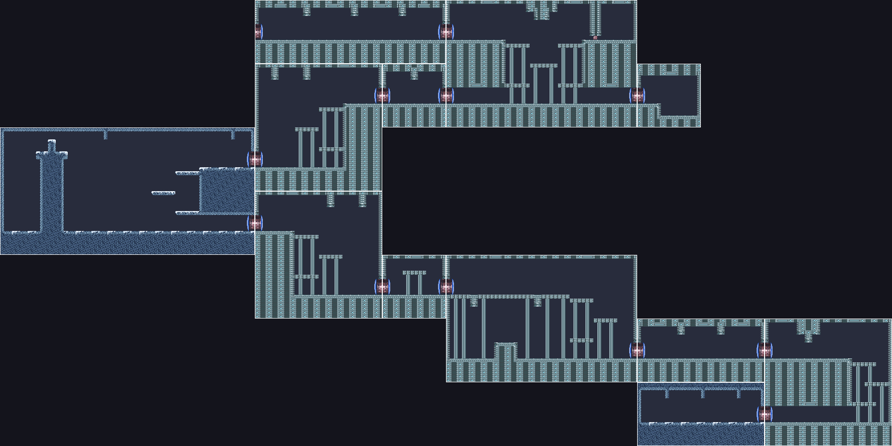
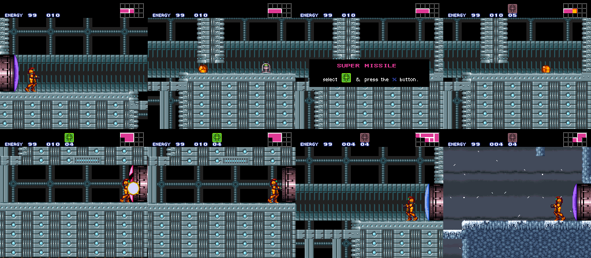
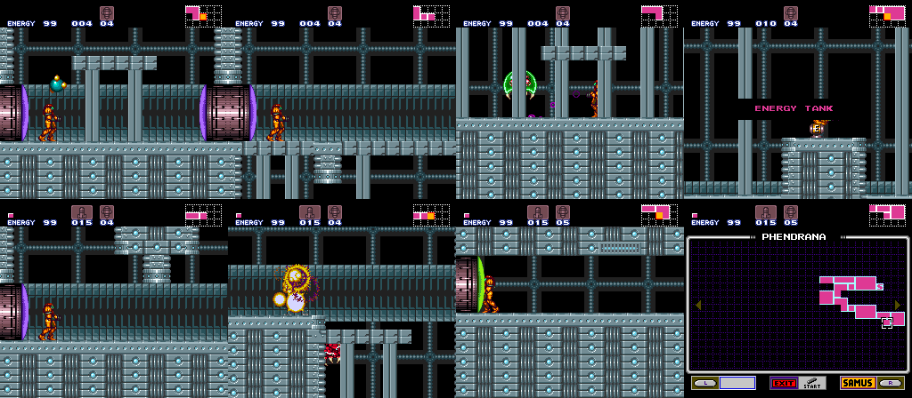
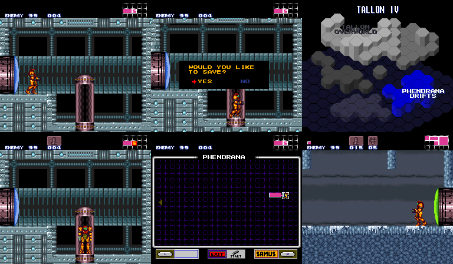

# 18l — Região D de Phendrana (observatório, torres, laboratórios; o Super Missile)

Estado: verificada (03/11/2026: validate "207 salas, 426 portas, 0 problemas", as linhas "44 salas construídas, alcançáveis agora: 44,
20 itens em 7 rodadas" e "58 itens em 7 rodadas … 58%" idênticas às da 18k (diff contra `scratchpad/v18k_me.txt`); `.ips` sha1
`88a4a15886296455993a75542bf87b9165b92b6e` igual em dois builds; grupo A **34/34** em 3 min 05 s, B **64/64** em 4 min 23 s, C **17/17**
em 1 min 04 s). Rascunho → aprovada (épico aprovado pelo usuário; pedido do orquestrador) → implementada → verificada na mesma sessão.
Esforço estimado: 3 dias (linha 18l do épico)
Épico: [18 — Phendrana Drifts](18-phendrana-drifts.md) (decisões do usuário 1, 3, 6 e 7; decisões técnicas 3 e 5; linha 18l da tabela
de filhas); modelos: [18i](18i-regiao-b-phendrana.md) (região, portas vermelhas, bomb slot = túnel com bloco de bomba, save station),
[18j](18j-regiao-c-phendrana.md) (portas de gelo, rodada 4), [18g](18g-inimigos-phendrana.md) (orbes, deriva, `PROPOSED_LATER`,
auditoria de entrada), [18h](18h-sheegoth.md)/[18k](18k-thardus.md) (`SpeciesCopy`), [12i](12i-regiao-b-chozo.md) (um bit para a porta
vermelha dos dois lados).

## Contexto

A região C (18j, 18k) está pronta; a R0 da Research Lab Hydra (região B) era parede "até a 18l". Esta filha constrói a **região D** do
épico: as 12 salas do observatório, das torres e dos laboratórios Aether e Research Core, abre a R0 da Hydra, põe as travas do Prime da
região com os mecanismos do SM, os 3 itens — entre eles **o Super Missile do SM** (decisão 3 do usuário: o item do SM no lugar do Super
Missile do Prime, no Observatory) —, a **Save Station D** (estação 3 da área 4), os inimigos da camada 0 — entre eles **os Metroids do
Prime** (decisão 7, padrão aceito: o Metroid do SM enfraquecido, justo pelas regras de sempre) — e a cara de cada sala.

## Estado antes (verificado)

- validate "195 salas, 402 portas, 0 problemas" (`scratchpad/v18k_me.txt`); `.ips` sha1 `a7a45deb…5b30`; A 34/34, B 64/64, C 15/15.
- `tools/phendrana/rooms.py` (18c): região D = P28 Observatory Access (3×1), P30 Observatory (3×2), P32 West Tower Entrance (1×1), P33
  Save Station D (1×1), P35 West Tower (2×2), P39 Control Tower (4×2), P43 East Tower (2×2), P50 Aether Lab Entryway (1×1), P51 Research
  Lab Aether (3×2), P44 Research Core Access (2×1), P40 Research Core (2×2), P36 Pike Access (2×1). Ligações (todas laterais): Hydra R0 ↔
  OA L0, OA R0 ↔ Observatory L0, WTE R0 ↔ Observatory L1, Observatory R1 ↔ Save D L0, WT R0 ↔ WTE L0, CT R0 ↔ WT L1, CT R1 ↔ ET L0, ET
  R1 ↔ ALE L0, ALE R0 ↔ Aether L0, Aether R1 ↔ RCA L0, RCA R0 ↔ Research Core L0, Pike Access R0 ↔ Research Core L1; Frozen Pike R0 ↔
  Pike Access L0 (região E: parede até a 18m).
- Travas do Prime (`DOCK_LOCKS`, `KEY_BEAM`): portas de **onda** dos dois lados de 9 ligações (Hydra–OA, OA–Observatory,
  Observatory–WTE, WT–CT, CT–ET, ET–ALE, ALE–Aether, Aether–RCA, RCA–Research Core); de **gelo** dos dois lados de Research Core ↔ Pike
  Access; **escudos de míssil** Observatory → Save D (só do lado do Observatory) e WTE ↔ WT (dos dois lados); 8 travas de evento (as
  emboscadas dos laboratórios, a Control Tower). Features: Observatory `bomb_slot`; Research Core painel de onda (o quebra-cabeça do
  Thermal Visor).
- Itens do Prime: **Super Missile** no Observatory (no alto, depois que os bomb slots ligam o projetor); E-tank e míssil na Research Lab
  Aether; o Thermal Visor no Research Core (nada: decisão 3).
- Inimigos da camada 0 do Prime: Aether Lab Entryway 3 Atomic Beta; Research Core 3 MetroidAlpha; Research Lab Aether 1 MetroidAlpha
  (`PRIME_LAYER0`; a 18g deixou o Metroid como proposta).
- Neve (`SNOW_ROOMS`): só a Control Tower na região.
- O **Metroid do SM** (`$A0:DD7F`, ROM base): vida 500, toque 120, IA em `$A3`; a IA de tiro (`Metroid_Shot` `$A3:EF07`) só empurra o
  Metroid se ele não está congelado, e congelado só o míssil e o super o ferem (a tabela `$B4:EF60` dá 0 aos feixes, `$FF` ao gelo); a de
  toque (`Metroid_Touch` `$A3:EDEB`) agarra a Samus e drena a energia a cada quadro até uma bomba soltá-lo; a principal voa até ela a
  até 3 px por quadro em cada eixo, só na câmera (propriedades sem `$0800`). Tal como está, a regra de justiça (≤ 5 tiros do Power Beam,
  ≤ 20 por toque) o recusa.
- O **Super Missile do SM**: PLM `$84:EEDF` (setup `$EE57`, instruções `$E0E3`, lidos); nenhum item nosso é dele; `check_no_super_locks`
  (18c) prova que nenhuma porta verde nem bloco de super existe no jogo.
- `$8F`: 2846 bytes livres na faixa das demos.

## Mudança

1. **Salas** (`tools/phendrana/layouts.py`; as regras de sempre: porta lateral nas linhas 6–9 com o chão/prateleira na 10, subidas de 5
   linhas, `zigzag`, `west_cliff`):
   - **Observatory Access**, **West Tower Entrance**, **Aether Lab Entryway**, **Research Core Access** (laboratório): corredores na 10;
     na ALE uma luminária sob o teto (linha 4) com espaço em cima (o orbe flutua ali).
   - **Observatory** (3×2, laboratório): chão na 26 (L1, R1), o penhasco oeste (`west_cliff`: a prateleira da L0) e o espelho dele na
     parede leste (a R1 passa por baixo), cada um com zigue-zague; no alto do penhasco leste, no canto da cúpula, a **câmara do
     projetor** atrás de uma parede com um túnel de 1 linha no pé fechado por **bloco de bomba** (o bomb slot; o jeito do Ice Temple), o
     **Super Missile** dentro; a lente do projetor pendurada na cúpula.
   - **Save Station D** (1×1, laboratório): a Save Station A da região B. **Estação 3 da área 4.**
   - **West Tower** e **East Tower** (2×2, laboratório): chão na 26, uma massa de rocha contra a parede da porta de cima (a prateleira
     dela), zigue-zague de 3 bordas.
   - **Control Tower** (4×2, neve, neva como no Prime): o pátio sob o céu, chão na 26 (R1), o penhasco espelhado na parede leste (a
     prateleira da R0), a torre de controle em pé no oeste (o topo fora de todo pulo: o lugar do artefato, vazio).
   - **Research Lab Aether** (3×2, laboratório): a laje de cima na 10 (L0) até a coluna 30, o laboratório de baixo (chão 26, R1), o
     zigue-zague de volta a leste da laje; o tanque vazio do Metroid no meio de baixo com o **E-tank** em cima; o **míssil** no canto
     oeste de baixo.
   - **Research Core** (2×2, laboratório): o núcleo = rocha da parede oeste até a coluna 21 (linhas 10–21: a prateleira da L0 em cima,
     a passagem da L1 embaixo); o poço em volta até a parede leste (colunas 22–30) com zigue-zague; a máquina do núcleo no teto. O caminho
     da L0 à L1 passa por cima do núcleo, desce o poço (onde estão os Metroids) e volta por baixo.
   - **Pike Access** (2×1, neve sem neve caindo: o túnel de gelo): corredor na 10; a L0 (Frozen Pike) parede até a 18m.
   - A R0 da Research Lab Hydra abre.
2. **Travas** (`GATES`): portas vermelhas `$C4` (Observatory R1) e `$C5` (WTE ↔ WT, **um bit para os dois lados**, a regra da 12i, que
   `check_gates` exige: o `$C6` do épico fica livre); portas de onda nos dois lados das 9 ligações; portas de gelo nos dois lados de
   Research Core ↔ Pike Access; as de evento fora (camadas de evento).
3. **Itens** (`tools/phendrana/items.py`, bits `$E4–$E6`): **Super Missile** na câmara do projetor (43, 9), rodada 3, `needs` Morph +
   Bombas; E-tank da Aether (14, 21) e míssil da Aether (3, 25), rodada 3.
4. **O Super Missile no jogo**: `tallon/items.py` `SUPER_MISSILE_TANK = $EEDF` (`KIND_NAME`, `GRANTS` = `SUPER`, item de trava que
   nenhuma trava pede: como o X-Ray); `validate.ITEM_GAIN`: 5 supers (a porcentagem do fim: um item); o modelo de alcance não muda (sem
   porta verde nem bloco de super: `check_no_super_locks`; as portas de feixe só abrem com o tiro do feixe delas, o super não as abre:
   `tallon/beamdoors.py`; a vermelha abre com um super, como no SM). A linha das rodadas (12m, 17j) continua das três áreas até a 18n.
5. **Metroid justo** (decisão 7; `tools/chozo/bosses.py` `METROID`, `$A0:F97F`): cópia do Metroid com **vida 100** (5 tiros do Power
   Beam), **a IA de toque comum do banco** (`Enemy_NormalTouchAI_A3` `$A3:8023`: o dano do cabeçalho, **20**, empurrão e 96 quadros de
   invencibilidade; **sem agarrar nem drenar**), **uma IA de tiro própria** (6 bytes no `$A3` livre: `LDX $0E54 / JMP $A3:EF2E`, o ramo
   "congelado" do `Metroid_Shot` para todo tiro: a IA de tiro comum com a tabela, e morto o fim do próprio Metroid: os dois sprites dele
   apagados, a animação, os drops) e **uma tabela de vulnerabilidade própria** (22 bytes no `$B4` livre: a do Metroid com os feixes sem
   gelo e o carregado em ×1; o gelo continua só congelando, `$FF`; míssil ×1, super ×2, power bomb como antes). `SpeciesCopy` ganha
   `touch`, `shot`, `vulnerability`; `build_copies` escreve o código e a tabela; o validador confere os bytes e lê a tabela da cópia
   (`species_info`), e o Metroid vanilla (ou uma cópia sem essa IA) conta como imune ao feixe e de toque sem teto.
6. **Inimigos** (`tools/phendrana/enemies.py`; `MetroidAlpha` sai de `PROPOSED_LATER` para `STAND_IN`): ALE 1 orbe (Atomic Beta, sobre
   a luminária: mais de 60 px acima das duas portas); Research Lab Aether 1 Metroid (no laboratório de baixo, a leste do tanque); Research
   Core 3 Metroids (no poço). Espécie `metroid` (`tools/frigate/enemies.py`), com `chase = 3` (px por quadro).
7. **Regra nova do validador** (o Metroid voa até a Samus a 3 px por quadro, mas **só na câmera**, e as paredes o param):
   `chaser_problems` — com a Samus entrando por cada porta e parada, a câmera mostra a tela da porta (±32 px); um Metroid nessa janela
   (a do jogo, `sm_a0.c:578`) a alcançaria antes de 120 quadros: tem de começar fora da câmera de toda porta.
8. **Rodadas** (`FIRST_ROUND`): as 11 salas até o Research Core na rodada 3; a **Pike Access na 4** (portas de gelo, como a Transport
   Access); os 3 itens na 3.
9. **Testes** (grupo C): `phendrana_regiao_d_rota` (novo), `phendrana_save_station_d` (novo); `entradas_de_porta_phendrana` cobre
   sozinho as entradas novas das salas com inimigos (ALE, Aether, Research Core).

## Critérios de aceite

1. validate 0 problemas; **"44 salas construídas, alcançáveis agora: 44, 20 itens em 7 rodadas"** e **"58 itens em 7 rodadas … 58%"**
   idênticas às da 18k (diff contra `scratchpad/v18k_me.txt`); linhas de Phendrana com 42 salas, 13 itens (rodada 3: 40 salas, 11
   itens; rodada 4: 2 salas; rodada 6: 2 itens), estações 0–3; os Metroids justos e fora da câmera de toda porta.
2. `phendrana_regiao_d_rota`: da Research Lab Hydra (atalho) andando: a R0 de onda, o Observatory, o bloco de bomba, **o Super Missile
   pego (5 de capacidade e munição, a mensagem, o HUD)**, **um Super Missile disparado abre a porta vermelha da Save Station D (bit
   `$C4`, supers 4)**; a WTE, a porta vermelha com mísseis (`$C5`), as torres, a ALE (o orbe), a Aether (o Metroid vivo na chegada, morto
   com o feixe; o E-tank e o míssil), a Research Core Access, o Research Core (**os 3 Metroids mortos**), a porta de gelo da L1 (o Wave
   não abre, o Ice abre: atalho da rodada 4), a Pike Access; os bits de explorado e o mapa.
3. `phendrana_save_station_d`: a porta vermelha (`$C4`), save na estação 3, game over, tela de área, continue no pedestal.
4. Os testes antigos passam; mutações pegas; dois builds com o mesmo sha1; fotos `specs/img/18l-*.png` olhadas.

## Plano de testes

| Camada | O quê | Qtde |
|---|---|---|
| validate.py | `chaser_problems`; `species_info`/`check_species_copies` com a IA de tiro, o toque e a tabela da cópia; as regras de sempre nas salas novas | regras novas |
| run_tests.py (grupo C) | `phendrana_regiao_d_rota`, `phendrana_save_station_d` | +2 (17) |
| scratchpad (`s18l/`) | mutações do validador, de ROM e de emulador | ~25 |
| imagem | `18l-salas.png`, `18l-rota.png`, `18l-super-e-metroids.png`, `18l-save.png` | +4 |

## Fora de escopo

Região E (18m: a Frozen Pike, a L0 da Pike Access); o Thermal Visor (nada: decisão 3); as camadas de evento (as emboscadas, os Metroids
dos tubos, as Elite Pirates); o agarrar do Metroid (ver Decisões); a cadeia completa e a linha das rodadas com Phendrana (18n).

## Resultado

As 12 salas nos seus lugares do mapa de pausa (prévia nas paletas do build, sem PLMs): em cima a Observatory Access e o Observatory (os
dois penhascos, a câmara do projetor no canto de cima à direita), a Save Station D à direita; a West Tower Entrance e a West Tower; a
Control Tower (neve, a torre no oeste) e a East Tower; embaixo a Aether Lab Entryway, a Research Lab Aether (a laje, o tanque), a Research
Core Access, o Research Core (o núcleo e o poço) e a Pike Access.

| Bit | Sala | Prime | Lugar / trava | Rodada |
|---|---|---|---|---|
| `$E4` | Observatory | Super Missile | câmara do projetor no alto do penhasco leste, atrás do bloco de bomba (43, 9) | 3 |
| `$E5` | Research Lab Aether | Energy Tank | em cima do tanque vazio do Metroid (14, 21) | 3 |
| `$E6` | Research Lab Aether | Missile Expansion | canto oeste do laboratório de baixo (3, 25) | 3 |

`phendrana_regiao_d_rota`, primeira metade: a chegada no Observatory pela L0; o bloco de bomba aberto (a Samus na bola no túnel); a
mensagem "SUPER MISSILE"; o HUD com o ícone do super (5); **o Super Missile disparado na porta vermelha da Save Station D** (a explosão;
um super basta, o bit `$C4` liga, sobram 4, os mísseis intactos) e a porta aberta; a West Tower pela porta vermelha da WTE (6 mísseis,
`$C5`); a Control Tower (neve caindo).

Segunda metade: a Aether Lab Entryway (o orbe sobre a luminária); a Research Lab Aether (o Metroid verde no laboratório de baixo); depois
dele, morto; o E-tank no tanque; a chegada no Research Core; um Metroid explodindo no poço; a porta de gelo verde da L1 (o tiro do Wave
não a abre); o mapa de pausa com as regiões A–D.

`phendrana_save_station_d`: a sala; a pergunta; a tela de área ("PHENDRANA / DRIFTS"); o continue no pedestal; o mapa; e (da rota) a Pike
Access pela porta de gelo.

### Justiça e espaço

Metroid (cópia `$A0:F97F`): 5 tiros do Power Beam (2 do Wave), 20 por toque (10 com a Varia), nunca agarra; medido antes da busca (s18l,
`watch.py`): ele só se mexe quando entra na câmera, voa até a Samus, toca uma vez (10 com a Varia) e passa; morto, os sprites somem e
cai drop. Na caminhada os 4 Metroids e o orbe morrem sem nenhum dano (a energia 99 até o E-tank, 199 depois). A auditoria de entrada
(`entradas_de_porta_phendrana`) passa nas entradas novas (ALE, Aether, Research Core). Espaço: `$8F` **+700** (950 → 1650 de 3796 na
faixa das demos: **2146 livres** para a região E); `$A0` +64 (a cópia), `$A3` +6 (a IA de tiro), `$B4` +22 (a tabela), nível +12 blobs.

### Linhas do validador (o que mudou)

- **Iguais** (diff contra `scratchpad/v18k_me.txt`): as duas linhas pedidas.
- "195 salas, 402 portas" → **"207 salas, 426 portas"**; "phendrana (specs/18e, 18f; regiões ativas: ABCD): 42 salas construídas, 13
  itens … rodada 3: 40 salas, 11 itens; rodada 4: 2 salas, 0 itens; rodada 6: 0 salas, 2 itens … estações: 0 transport_magmoor_west,
  1 save_station_b, 2 save_station_a, 3 save_station_d …; specs/18l: o Super Missile do SM só em observatory"; 18g: "26 inimigos em 13
  salas (… metroid 4 …) …; specs/18l: os que voam até ela na câmera (3 px por quadro, os Metroids) fora da câmera de toda porta"; 18f:
  50 travas mapeadas, 17 de evento fora; super missile: nenhuma porta verde nem bloco de super nas 207 salas; `$8F` recuperado 4764 → 5466.

## Mutações (`s18l/scripts/mutate_l.py` → `s18l/mut/mut_l.out`; emulador `emu_mut_l.py` → `mut/emu_mut_l.out`)

Validador (cópia própria `s18l/mutproj`), 20 de 21 pegas, sem mutação limpo: V1 o Metroid sem a IA de tiro própria (0 por tiro); V2 sem o
toque comum (toque sem teto: o dreno); V3 com a tabela vanilla; V4 vida 200; V5 toque 40; V6 um Metroid do Research Core na câmera da L0;
V7 o da Aether na câmera da R1; V8 4 Metroids no Research Core; V9 o orbe da ALE no chão (96 quadros); V10 o Super Missile sem `needs`;
V11 declarado na rodada 4; V12 o Observatory sem o bloco de bomba; V13 a Pike Access na rodada 3; V14 as portas de gelo de onda; V15 a
porta vermelha WTE ↔ WT esquecida; V16 só do lado da WTE; V17 a Save Station D sem save station; V18 o Research Core sem o zigue-zague;
**V20 um segundo Super Missile na Aether e V21 o Metroid sem `chase`: na 1ª rodada passaram limpas**, e cada uma virou regra (o único
Super Missile é o do Observatory; todo Metroid declara `chase` ≥ 3); **V19 a Control Tower na cara de laboratório não é pega** (a cara
é gosto, não regra: nenhuma filha a valida). ROM: R1 o cabeçalho do Metroid com a IA de tiro vanilla; R2 a IA de tiro pulando para
`$EF2F`; R3 a tabela com o Power Beam 0; R4 um míssil no lugar do Super Missile na lista de PLMs; R5 a porta vermelha com o bit `$C2`.
Emulador: E1 sem a IA de tiro → `phendrana_regiao_d_rota` falha (o Metroid não morre); E2 com o toque vanilla → falha (a energia cai:
ele agarra e drena); E3 um míssil no lugar do super → falha (supers 0); E4 as portas Research Core ↔ Pike Access de onda → falha (o Wave
abre); E5 a porta vermelha da Save Station D do lado de dentro → `phendrana_save_station_d` falha (o bit não liga).

## Riscos e reversão

- Caminhadas por busca em feixe (`s18l/scripts/seg.py`): mexer nas salas, nos inimigos ou em `phendrana_up` pede nova busca. A luta do
  Research Core usa o Wave (equipamento da rodada 3: 2 tiros por Metroid).
- Com o Super Missile na mão, o SELECT passa por mais um item: a cadeia da 18n (que pega o super) precisa contar isso.
- A regra da câmera assume a Samus parada na porta (a promessa da spec 15); andando para dentro, o Metroid acorda e voa até ela (a luta).
- Reversão: `ACTIVE_REGIONS = {"A", "B", "C"}`, os itens 10–12, a cópia `METROID` e o `metroid` em `SPECIES`, os 2 testes; o Super
  Missile (`SUPER_MISSILE_TANK`, `SUPER`, `ITEM_GAIN`) e os campos novos de `SpeciesCopy` ficam como infraestrutura sem uso.

## Desvios

- **O Metroid não agarra**: a decisão 7 pedia "o Metroid do SM enfraquecido, justo"; o agarrar do SM drena a energia sem teto por toque
  (só uma bomba o solta), então a cópia usa o toque comum (20, empurrão, invencibilidade). O resto é o Metroid: voa até a Samus, o gelo o
  congela, míssil/super/power bomb o matam, os sprites e os drops dele.
- **IA de tiro e tabela próprias** (`SpeciesCopy.shot`, `.vulnerability`): sem precedente no projeto (as cópias só mudavam vida, toque,
  partes e paleta). A IA são 6 bytes que pulam no ramo "congelado" da vanilla (conferido byte a byte no build e no validador).
- **Regra nova de câmera** (`chaser_problems`) em vez da regra de deriva dos orbes: o Metroid a 3 px por quadro cruzaria uma tela em
  120 quadros, mas só se mexe na câmera e as paredes o param; a regra exige que ele comece fora da câmera da tela de toda porta. Regras
  a mais (achadas pelas mutações V20, V21): um único Super Missile, no Observatory; todo Metroid declara `chase`.
- **Bits vermelhos**: `$C4` (Observatory → Save D) e `$C5` para os dois lados da WTE ↔ West Tower (a regra da 12i); o épico listava
  `$C5` e `$C6`; o `$C6` fica livre.
- **Contas abaixo do Prime**: a Aether Lab Entryway tem 1 orbe (o Prime 3; a sala tem 1 tela: no máximo 1 inimigo), sobre uma luminária
  sob o teto para ficar a mais de 120 quadros de deriva das duas portas.
- **Caras**: a Control Tower (pátio com céu e neve) e a Pike Access (túnel de gelo, sem neve caindo, como no Prime) na cara de neve; o
  resto (inclusive a Save Station D e as torres) na de laboratório.
- **O Super Missile no alto do Observatory** atrás de bloco de bomba (o bomb slot do Prime, o jeito do Ice Temple); no Prime o projetor se
  ergue e a Samus sobe por ele.
- **Atalhos anotados** no teste: a entrada na Research Lab Hydra e na Observatory (save) por `door_teleport`; o Ice Beam (rodada 4) por
  RAM na porta de gelo. O teste da rota prova o Super Missile disparando um numa porta vermelha (o jeito do SM: um super abre).
- A linha das rodadas (12m, 17j) e a porcentagem do fim continuam das três áreas até a 18n (o `ITEM_GAIN` do super já conta 1 item).
- Experimentos, buscas e mutações nas cópias `s18l/proj` e `s18l/mutproj`; a pasta real só recebeu os arquivos finais.
- Verificação (03/11/2026, pasta real): `python3 -I tools/build.py` duas vezes → sha1 `88a4a15886296455993a75542bf87b9165b92b6e`;
  `python3 -I tools/validate.py` → "207 salas, 426 portas, 0 problemas" (as duas linhas pedidas idênticas, diff); `--grupo A` **34/34**
  (3 min 05 s), `--grupo B` **64/64** (4 min 23 s), `--grupo C` **17/17** (1 min 04 s).

## Decisões para o usuário (escolhidas as mais perto do Prime e dos padrões; confirmar)

1. **Metroid sem agarrar** (toque de 20 com empurrão). Alternativa: um agarrar com dreno limitado a 20 (código novo no `$A3`).
2. **Contas do Prime**: 3 Metroids no Research Core, 1 na Aether, cada um de 5 tiros do Power Beam; 1 orbe na Aether Lab Entryway (de 3).
3. **Super Missile** no alto do Observatory atrás de bloco de bomba; o teste o prova abrindo a porta vermelha da Save Station D.
4. **A porta WTE ↔ West Tower** com um bit para os dois lados (abre-se de um lado, fica aberta dos dois).
5. **Formas e caras**: torres com zigue-zague contra a parede da porta de cima; Research Core = núcleo de rocha com o poço dos Metroids em
   volta; Aether = laje e laboratório de baixo com o tanque vazio; Control Tower com neve e a torre em pé (o lugar do artefato, vazio).
