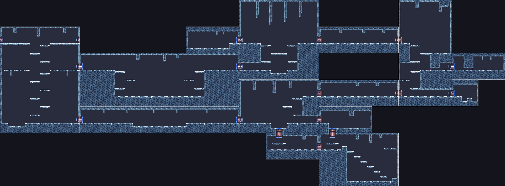
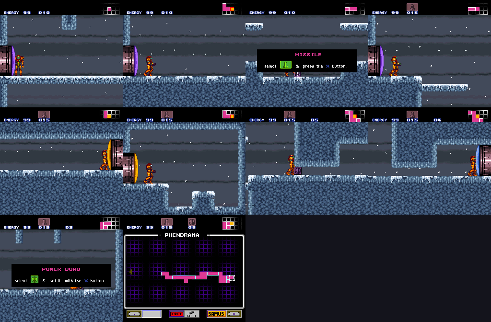
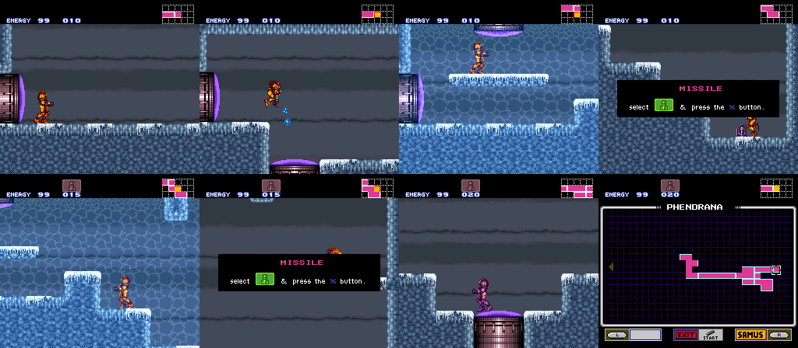
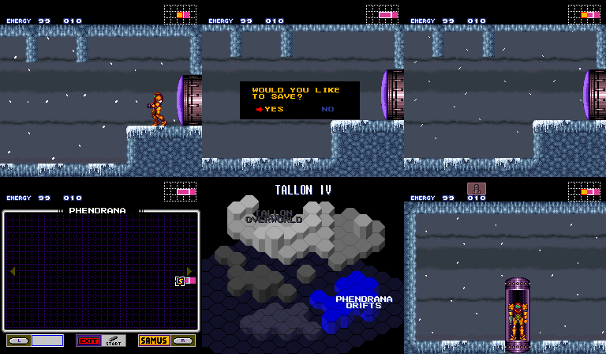

# 18m — Região E de Phendrana (sul fundo: Frozen Pike, cavernas, Phendrana's Edge, a Gravity Chamber inundada)

Estado: verificada (04/11/2026: validate "221 salas, 460 portas, 0 problemas", as linhas "44 salas construídas, alcançáveis agora: 44,
20 itens em 7 rodadas" e "58 itens em 7 rodadas … 58%" idênticas às da 18l (diff contra `scratchpad/v18l.txt`); `.ips` sha1
`8e5d377133b668151f4a558ebbb192d1bff0f01a` igual em dois builds; grupo A **34/34** em 2 min 59 s, B **64/64** em 4 min 16 s, C **20/20**
em 1 min 15 s). Rascunho → aprovada (épico aprovado pelo usuário; pedido do orquestrador) → implementada → verificada.
Esforço estimado: 3 dias (linha 18m do épico)
Épico: [18 — Phendrana Drifts](18-phendrana-drifts.md) (decisões do usuário 1, 3, 5 e 6; decisões técnicas 3 e 5; linha 18m da tabela
de filhas); modelos: [18j](18j-regiao-c-phendrana.md) (portas de Morph = túnel, portas de gelo), [18l](18l-regiao-d-phendrana.md)
(região, save station, regra da câmera), [17h](17h-regiao-b-magmoor.md) (porta de Morph com bloco de Power Bomb dos dois lados),
[12l](12l-regiao-e-chozo.md) (a Reflecting Pool: sala inundada andada sem a Gravity), [18d](18d-estilos-do-gelo.md) (a água medida na
área 4).

## Contexto

As regiões A–D estão prontas (42 salas, 13 itens). Esta filha constrói a **região E**, a última: as 14 salas do sul fundo, abre a R0
da Transport Access e a L0 da Pike Access, põe as travas do Prime com os mecanismos do SM, os 4 itens que faltam, a **Save Station C**
(estação 4 da área 4) e a **Gravity Chamber inundada** (decisão 5 do usuário: sem frio; só ela com água, a sala inteira). Depois
dela Phendrana tem as 56 salas e os 17 itens do épico.

## Estado antes (verificado)

- validate "207 salas, 426 portas, 0 problemas" (`scratchpad/v18l.txt`); `.ips` `88a4a158…6b92b6e`; A 34/34, B 64/64, C 17/17.
- `tools/phendrana/rooms.py` (18c): região E = P34 Frozen Pike (3×4), P37 Frost Cave Access (6×2), P38 Hunter Cave Access (6×1), P41
  Frost Cave (3×3), P45 Save Station C (2×1), P42 Hunter Cave (3×2), P46 Upper Edge Tunnel (3×1), P47 Lower Edge Tunnel (3×1), P48
  Chamber Access (2×1), P49 Lake Tunnel (2×1), P52 Phendrana's Edge (2×4), P53 Gravity Chamber (3×2), P54 Storage Cave (1×1), P55
  Security Cave (2×1). Travas do Prime: **onda dos dois lados** em todas as ligações da região (e nas da Transport Access e da Pike
  Access com a Frozen Pike; Hunter Cave ↔ Lake Tunnel e Chamber Access ↔ Gravity Chamber são de chão/teto); **plasma** dos dois lados
  de Edge ↔ Storage Cave; **Morph** dos dois lados de Edge ↔ Security Cave. Features: ganchos (Hunter Cave, Edge, Gravity Chamber),
  água em 8 salas da região (secas, menos a Gravity Chamber), estalactites (Frost Cave, Hunter Cave).
- Itens do Prime: Missile Expansion na Frost Cave; Gravity Suit e Missile Expansion na Gravity Chamber; Power Bomb Expansion na Security
  Cave; artefato na Storage Cave (fora).
- Camada 0: Frozen Pike JellyZap 1; Frost Cave Access Beetle 2 + WallCrawlerSwarm 1; Hunter Cave Access JellyZap 3; Frost Cave Ripper 1;
  Lower Edge Tunnel AtomicBeta 2; Chamber Access Drone 1; Lake Tunnel AtomicBeta 1; Edge FlyingPirate 2 + JellyZap 2 + Ripper 1;
  Gravity Chamber JellyZap 2 + SpankWeed 6 (`PRIME_LAYER0`; a 18g deixou Beetle, Ripper e os outros em `PROPOSED_LATER`).
- A água da área 4 (18d): FX tipo 6, superfície `$10`, pulo sem a Gravity = `reach.WATER_*` (3 blocos), com a Gravity como em terra
  (o modelo fica do lado seguro); `check_tallon_water` anda as salas inundadas sem a suit (só Tallon e Chozo).
- `$8F`: 2146 bytes livres na faixa das demos.

## Mudança

1. **Salas** (`tools/phendrana/layouts.py`; todas na **cara de neve**, a neve caindo só onde o Prime neva: Frozen Pike, Frost Cave
   Access, Save Station C, Edge, Storage e Security Cave; nenhuma porta vertical nas ruínas de gelo, então a tabela delas não precisou
   da porta de onda vertical):
   - **Frozen Pike** (3×4): dois andares de lajes (linhas 10 e 26) com um vão no meio (colunas 18–29), o chão na 58 (R3), dois
     zigue-zagues pelo vão, a lagoa seca no chão, pingentes.
   - **Frost Cave Access** (6×2): as duas portas em penhascos (prateleiras na 10), o barranco entre eles na 26, um zigue-zague em cada.
   - **Hunter Cave Access** (6×1): o túnel na 10 com o lago seco (2 linhas de buraco).
   - **Frost Cave** (3×3): o chão na 42 (L2), o penhasco oeste (L1) e a rocha leste (R1) com zigue-zagues; o **lago seco** no chão entre
     eles com o **míssil**; estalactites.
   - **Save Station C** (2×1): a sala da Save Station B, larga; **estação 4 da área 4**.
   - **Hunter Cave** (3×2): o chão na 26 (L1, R1), o penhasco leste (R0) com zigue-zague, a bacia em volta da porta de chão (B1).
   - **Upper/Lower Edge Tunnel**, **Lake Tunnel**: corredores na 10 (a Lower = a forma da Ice Ruins Access, dos orbes); **Chamber
     Access**: a Quarantine Access espelhada (chão na 13, a porta de chão B0).
   - **Phendrana's Edge** (2×4): o chão na 58 (L3, R3), o penhasco oeste (L1), a rocha leste (linhas 42–53) e nela a câmara da porta R2
     atrás de rocha com um túnel de Morph de 1 linha fechado por **bloco de Power Bomb** (o jeito da Warrior Shrine, 17h); zigue-zagues
     do chão à rocha e da rocha à prateleira da L1.
   - **Gravity Chamber** (3×2, **inundada**): a rocha oeste (a prateleira da L0, sob a plataforma da porta de teto T0, com a ponta leste 2
     linhas mais alta: o degrau para a plataforma), a água funda até o chão (29), **uma escada de rocha de degraus de 3 linhas e 4
     colunas** subindo para oeste até a rocha (o que ela tem sem a suit: 3 blocos de pulo debaixo d'água), o **míssil no lugar da
     Gravity Suit** no chão a leste da escada, e **o outro míssil numa borda contra a parede leste** (linha 9): fora de todo pulo, só o
     Space Jump, que debaixo d'água só funciona com a Gravity (o gancho do Prime).
   - **Storage Cave** (1×1): o pedestal vazio (o artefato fora). **Security Cave** (2×1): a câmara da porta L0 atrás de parede com túnel
     de Morph e bloco de Power Bomb, a caverna, a **expansão de PB** no fundo.
   - A R0 da Transport Access e a L0 da Pike Access abrem.
2. **Travas** (`GATES`): portas de onda dos dois lados das 15 ligações; de plasma dos dois lados de Edge ↔ Storage Cave (rodada 6);
   Edge ↔ Security Cave = Morph Ball + Power Bomb dos dois lados (geometria, rodada 6: a expansão de PB nunca antes da 6).
3. **Água** (`rooms.FLOODED = {gravity_chamber}`, `RoomDef.water`): o validador anda a sala sem a Gravity Suit (linha "água (specs/07l,
   12l, 18m)": as 2 entradas, nenhum lugar sem volta) e exige **só a Gravity Chamber inundada** (`EPIC_PHENDRANA_FLOODED`, numa sala
   com a água do Prime; uma sala de Phendrana inundada fora dela, ou ela seca, é erro).
4. **Itens** (`tools/phendrana/items.py`, bits `$E7–$EA`): míssil da Frost Cave (23, 43) rodada 4; míssil no lugar da Gravity Suit
   (43, 28) rodada 4 (sem a suit); míssil da borda (43, 8) rodada 5, `needs` Space Jump (a Gravity da rodada 4 o libera debaixo
   d'água); expansão de PB da Security Cave (26, 9) rodada 6.
5. **Inimigos** (`tools/phendrana/enemies.py`): Frost Cave Access 2 Beetles (o Sidehopper pequeno, o Beetle da Chozo) + 1 zoomer;
   Lower Edge Tunnel 2 orbes (Atomic Beta); Lake Tunnel 1 orbe. Fora (`STAND_IN` None): o Ripper, as Jelly Zaps, o Drone, os Flying
   Pirates e as Spank Weeds; `PROPOSED_LATER` fica vazio.
6. **Rodadas** (`FIRST_ROUND`): as 12 salas da região na rodada 4 (atrás das portas de gelo da P29 e do Research Core); Storage Cave e
   Security Cave na 6.
7. **Validador**: `check_power_bomb_blocks` vale para Phendrana; `check_tallon_water` com as salas inundadas de Phendrana; a regra da
   água acima; regra nova (achada pela mutação V11): **a porta de Morph do Prime fecha algo na própria sala sem cada item de geometria
   da trava** (a Security Cave, de uma porta só, podia perder o bloco de Power Bomb); a linha da 18c diz "salas construídas: 56, todas
   as 56 do Prime (specs/18m)".
8. **Testes** (grupo C): `phendrana_regiao_e_rota`, `phendrana_regiao_e_agua`, `phendrana_save_station_c` (novos);
   `entradas_de_porta_phendrana` cobre sozinho as entradas novas (Frost Cave Access, Lower Edge Tunnel, Lake Tunnel); ajustes:
   `TA_CAP_SLOT` 38 → 37 (a R0 da Transport Access ganhou a tampa de onda, slot 38).

## Critérios de aceite

1. validate 0 problemas; as duas linhas pedidas idênticas às da 18l; Phendrana com **56 salas e 17 itens** (rodada 3: 40 salas, 11
   itens; 4: 14 salas, 2 itens; 5: 1 item; 6: 2 salas, 3 itens), estações 0–4; a Gravity Chamber andada sem a suit. **Passa.**
2. `phendrana_regiao_e_rota`: da Frozen Pike (atalho) andando: a Frost Cave Access (inimigos vivos, sem dano), o míssil da Frost Cave,
   a Edge, a porta de plasma (o Wave não abre, o Plasma por RAM abre), a Storage Cave, a Power Bomb (por RAM) no bloco da Edge e no da
   Security Cave, a expansão de PB; mapa. **Passa.**
3. `phendrana_regiao_e_agua`: a Pike até o chão, a Hunter Cave, a porta de chão de onda da Chamber Access (o Power Beam não abre; um
   tiro para baixo no ar com o Wave abre), a Gravity Chamber com FX 6, **sem a suit** até o chão (o míssil) e de volta pela escada; a
   Gravity por RAM, o Space Jump até a borda (o míssil); a Lake Tunnel, a porta de teto para a Hunter Cave, a Lower Edge Tunnel, a Edge;
   energia 99 o tempo todo; mapa. **Passa.**
4. `phendrana_save_station_c`: save na estação 4, game over, tela de área, continue no pedestal. **Passa.**
5. Os testes antigos passam; mutações pegas; dois builds com o mesmo sha1; fotos olhadas. **Passa.**

## Plano de testes

| Camada | O quê | Qtde |
|---|---|---|
| validate.py | regra da água de Phendrana, PB em Phendrana, porta de Morph × cada item da trava, as regras de sempre nas 14 salas | 3 regras |
| run_tests.py (grupo C) | `phendrana_regiao_e_rota`, `phendrana_regiao_e_agua`, `phendrana_save_station_c` | +3 (20) |
| scratchpad (`s18m/`) | mutações do validador, de ROM e de emulador | 32 |
| imagem | `18m-salas.png`, `18m-rota.png`, `18m-agua.png`, `18m-save.png` | +4 |

## Fora de escopo

A cadeia completa e a linha das rodadas das quatro áreas (18n); água parcial nos lagos (decisão 5); o Ripper, as Jelly Zaps e os
outros tipos fora; o Grapple Beam (decisão 3).

## Resultado

As 14 salas nos lugares do mapa (prévia nas paletas do build, sem PLMs): à esquerda a Frozen Pike (as lajes e o vão), a Frost Cave
Access e a Hunter Cave Access; no meio a Save Station C, a Frost Cave (estalactites, o lago seco), a Hunter Cave (a bacia da porta de
chão), a Lake Tunnel e a Chamber Access; à direita os túneis da Edge, a Phendrana's Edge (a câmara da R2), a Storage e a Security Cave, e
embaixo a Gravity Chamber (a escada de rocha, a borda alta).

| Bit | Sala | Prime | Lugar / trava | Rodada |
|---|---|---|---|---|
| `$E7` | Frost Cave | Missile Expansion | no lago seco (23, 43) | 4 |
| `$E8` | Gravity Chamber | Gravity Suit → míssil | no chão a leste da escada (43, 28), sem a suit | 4 |
| `$E9` | Gravity Chamber | Missile Expansion | borda alta (43, 8): Space Jump, que debaixo d'água pede a Gravity | 5 |
| `$EA` | Security Cave | Power Bomb Expansion | atrás dos blocos de Power Bomb da porta de Morph | 6 |

**Os 17 itens de Phendrana** (bits `$DA–$EA`): 11 mísseis (os **9 Missile Expansions** do Prime + o do lugar do Wave + o do lugar da
Gravity), **3 Energy Tanks** (Courtyard, Transport Access, Aether), **2 expansões de PB** (Ice Ruins West, Security Cave), **1 Super
Missile** (Observatory) = 17, como o épico (decisão 3). Por região: A 5, B 3, C 2, D 3, E 4.

`phendrana_regiao_e_rota`: a chegada na Frozen Pike (neve); a Frost Cave Access; o míssil da Frost Cave; a Edge; a porta de plasma
laranja (o tiro do Wave não a abre); a Storage Cave (o pedestal vazio); a Samus diante do bloco de Power Bomb; de pé na câmara da R2
depois dele; a expansão de PB da Security Cave; o mapa.

`phendrana_regiao_e_agua`: a Hunter Cave; o tiro para baixo no ar na porta de chão roxa da Chamber Access; a chegada na Gravity Chamber
(a água azul, as portas roxas); o míssil do fundo sem a suit; na escada; o míssil da borda com a Gravity (a Samus roxa); a subida pela
porta de teto da Lake Tunnel na bacia da Hunter Cave; o mapa. (Com a caixa de mensagem na tela o BG3 da água some: é do jogo.)

`phendrana_save_station_c`: a sala (neve); a pergunta; salvo; o mapa; a tela de área ("PHENDRANA / DRIFTS"); o continue no pedestal.

### Justiça e espaço

Os 3 inimigos da Frost Cave Access ficam no barranco, longe das duas portas; os 3 orbes passam pela regra de deriva (a Lower Edge
Tunnel com as posições da Ice Ruins Access); a auditoria de entrada passa nas 3 salas novas com inimigos. Nas caminhadas nenhum dano
(energia 99 do começo ao fim). Espaço: `$8F` **+864** (1650 → 2514 de 3796 na faixa das demos: **1282 livres**); nível +14 blobs
(64 876 bytes, 459 412 livres); nenhuma cópia de espécie nova.

### Linhas do validador (o que mudou)

- **Iguais** (diff contra `scratchpad/v18l.txt`): as duas linhas pedidas.
- "207 salas, 426 portas" → **"221 salas, 460 portas"**; "phendrana (specs/18e, 18f; regiões ativas: ABCDE): 56 salas construídas, 17
  itens … rodada 3: 40 salas, 11 itens; rodada 4: 14 salas, 2 itens; rodada 5: 0 salas, 1 itens; rodada 6: 2 salas, 3 itens … estações:
  … 4 save_station_c"; "água (specs/07l, 12l, 18m): … 4 entradas (…, phendrana_gravity_chamber porta 0, phendrana_gravity_chamber porta
  1)"; 18g: "32 inimigos em 16 salas (… beetle 2 …)" e sem "regiões E: só a tabela"; 18c: "salas construídas: 56, todas as 56 do Prime
  (specs/18m)"; 18f: "84 trava(s) …; itens em bordas de Space Jump: 3; portas de Morph Ball …: 4; save stations: a, b, c, d; … inundada:
  gravity_chamber (decisão 5: só a Gravity Chamber)"; `$8F` recuperado 5466 → 6330.

## Mutações (`s18m/scripts/mutate_m.py` → `s18m/mut/mut_m.out`; emulador `emu_mut_m.py` → `mut/emu_mut_m.out`)

Validador (cópia `s18m/mutproj`), **22 de 22 pegas** depois da correção: V1 a Gravity Chamber seca; V2 a Frost Cave inundada; V3 sem a
escada; V4 a escada em zigue-zague de 3 linhas; V5 o míssil da borda sem `needs`; V6 declarado na rodada 4; V7 a borda baixa (o pulo
com a suit chega); V8 o míssil do fundo na rodada 5; V9 a expansão de PB na rodada 5; V10 o túnel da Edge sem o bloco de PB; **V11 o
túnel da Security Cave sem o bloco: na 1ª rodada passou limpa** e virou regra (a porta de Morph fecha algo na sala sem cada item da
trava); V12 a porta de Morph sem a Power Bomb; V13 as portas da Storage de onda; V14 a porta de onda Hunter ↔ Lake esquecida; V15 a Save
Station C sem save; V16 3 Beetles; V17 o orbe da Lake Tunnel junto da R0; V18 o Ripper com dublê e nenhum posto; V19 a Frost Cave
Access sem o zigue-zague; V20 a Frozen Pike sem o zigue-zague de baixo; V21 neve na Gravity Chamber (o build para); V22 o míssil da
Frost Cave dentro da rocha. ROM: R1 a Gravity Chamber sem o FX de água; R2 a Frost Cave com o FX de água; R3 a expansão de PB trocada
por um míssil; R4 o míssil da borda trocado por um E-tank: todas pegas. Emulador: E1 a Gravity Chamber seca → `_agua` falha (FX 0); E2
as portas da Storage de onda → `_rota` falha; E3 sem o bloco da Security Cave → `_rota` falha; E4 a porta de chão sem a tampa de onda →
`_agua` falha; E5 degraus de 4 linhas → `_agua` falha (ela não sobe); E6 a Save Station C sem save → `phendrana_save_station_c` quebra
(sem a estação 4). Todas pegas.

## Riscos e reversão

- Caminhadas por busca em feixe (`s18m/scripts/seg.py`, `sjsearch.py` para o Space Jump debaixo d'água, sensível ao ritmo): mexer nas
  salas, nos inimigos ou em `phendrana_up` pede nova busca.
- O tiro para baixo no ar abre a tampa de uma porta de chão (medido aqui pela primeira vez no projeto).
- Reversão: `ACTIVE_REGIONS` sem o "E", os itens 13–16, `FLOODED`, as 3 entradas de `ENEMIES` e as decisões em `STAND_IN`, os 3 testes.

## Desvios

- **A Gravity Chamber com escada de rocha**, não zigue-zague: debaixo d'água sem a suit o pulo sobe 3 blocos, e um zigue-zague de 3
  linhas deixa a borda de dois degraus acima a 6 linhas, sem lugar para o corpo (a validação mostrou lugares sem volta); os degraus são
  rocha até o chão (sem vão de 2 linhas nem poço embaixo). O míssil do lugar da Gravity no chão a leste da escada.
- **O míssil da borda na rodada 5**, não na 4 do épico (rodadas previstas: "Gravity Chamber 2" na 4): o gancho do Prime vira borda de
  Space Jump (a regra de sempre), e debaixo d'água o Space Jump só funciona com a Gravity Suit (pega na rodada 4). Mais perto do Prime
  (lá o míssil pede Grapple, da Mines). Nenhuma rodada nova (a 5 já tem itens de outras áreas).
- **Rodadas da região**: 4 itens em 3 rodadas (4: 2, 5: 1, 6: 1); com a região: Phendrana rodada 3: 11, 4: 2, 5: 1, 6: 3.
- **A porta de Morph Edge ↔ Security Cave pede também a Power Bomb dos dois lados** (o épico: "túnel de Morph com bloco de Power Bomb
  onde guarda a expansão"; o jeito da Warrior Shrine, 17h); a Security Cave inteira fica na rodada 6.
- **Inimigos**: o Ripper fora (o RIPPER do SM é imune a todo feixe, como o Ripper blindado do Prime, que é ponto de gancho; a regra de
  justiça o recusa e um Ripper que morre com o feixe não seria ele); as Jelly Zaps, o Drone, os Flying Pirates e as Spank Weeds fora
  (como na 18g). A Gravity Chamber, a Frozen Pike, a Hunter Cave Access, a Frost Cave, a Chamber Access e a Edge ficam vazias.
- **Caras**: as 14 salas na cara de neve (cavernas de gelo naturais), a neve caindo só nas 6 onde o Prime neva; a porta de onda vertical
  nas ruínas de gelo não foi necessária (nenhuma porta vertical da região é de ruína).
- **Regra nova de validador** (V11): a porta de Morph do Prime fecha algo na própria sala sem cada item de geometria da trava.
- **Testes**: a caminhada da região dividida em dois (`_rota`, a parte seca; `_agua`, a Gravity Chamber), no lugar de `_rota`/`_itens`/
  `phendrana_agua` do épico; `TA_CAP_SLOT` 38 → 37 em `phendrana_regiao_c_rota`.
- **Atalhos anotados** nos testes: a entrada na Frozen Pike por `door_teleport`; o Ice Beam (rodada 4), o Plasma e a Power Bomb
  (rodada 6) e a Gravity (rodada 5) por RAM.
- Experimentos, buscas e mutações nas cópias `s18m/proj` e `s18m/mutproj`; a pasta real só recebeu os arquivos finais.

## Decisões para o usuário (escolhidas as mais perto do Prime e dos padrões; confirmar)

1. **O Ripper fora** (Frost Cave, Edge). Alternativa: uma cópia que o feixe mata (vida 100, tabela própria como a do Metroid da 18l).
2. **O míssil da borda da Gravity Chamber pede a Gravity Suit + Space Jump** (rodada 5). Alternativa: a borda ao alcance do pulo sem a
   suit (rodada 4, como as rodadas previstas no épico).
3. **A porta de Morph da Security Cave com bloco de Power Bomb dos dois lados** (a Warrior Shrine). Alternativa: só do lado de dentro.
4. **A região toda na cara de neve**; nenhuma porta nas ruínas.
5. **Formas**: a Frozen Pike em dois andares de lajes; a Gravity Chamber com escada de rocha e a borda alta contra a parede leste.
