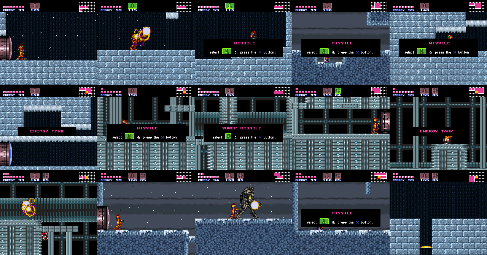
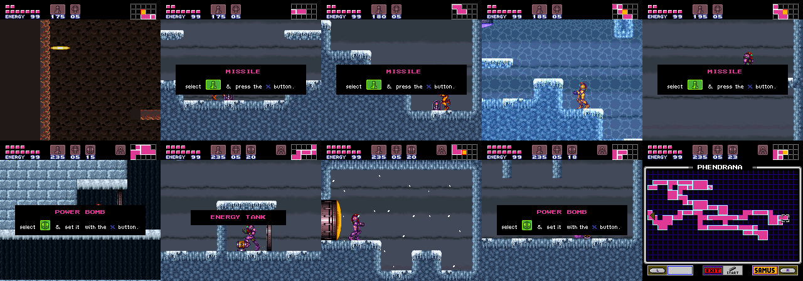
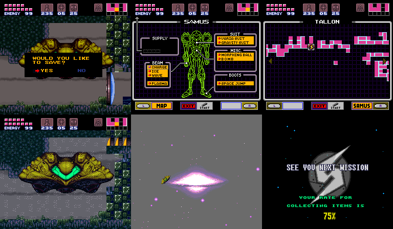

# 18n — Rodadas das quatro áreas e a cadeia completa (75%; fecha o épico 18)

Estado: **verificada** (04/11/2026: validate "221 salas, 460 portas, 0 problemas", a linha do Tallon idêntica à da 18m (diff contra
`scratchpad/v18m.txt`), a linha das rodadas das quatro áreas e a linha nova do épico; `.ips` sha1
`8e5d377133b668151f4a558ebbb192d1bff0f01a` igual em dois builds e igual ao de antes; **119 testes**: grupo A **34/34** em 3 min 0 s,
B **63/63** em 3 min 20 s, C **22/22** em 5 min 30 s, rodados A → B → C na pasta real). Rascunho → aprovada (épico aprovado pelo
usuário; pedido do orquestrador, a linha 18n do épico) → implementada na cópia de rascunho `s18n/proj` → verificada na pasta real.
Esforço estimado: 2,5 dias (linha 18n do épico). Medido: ~1 dia.
Épico: [18 — Phendrana Drifts](18-phendrana-drifts.md) (linha 18n da tabela de filhas; decisões técnicas 6 e 8; critérios 3 e 4);
modelos: [17j](17j-rodadas-e-cadeia-tres-areas.md) (as rodadas das três áreas, a cadeia em partes ligadas por estado salvo) e
[12m](12m-rodadas-e-cadeia-completa.md) (a cadeia completa).

## Contexto

Com a 18m Phendrana tem as 56 salas e os 17 itens (bits `$DA–$EA`), cada um conferido na rodada declarada por
`check_phendrana_rounds`, que imprime a sua própria linha. Desde a 18f o passeio das rodadas anda as quatro áreas, mas a linha das
rodadas do mundo e a porcentagem do fim continuavam das três áreas (`check_world_rounds` filtrava os itens de Phendrana, como a 17f
fez com a Magmoor até a 17j). Faltava o que o épico deixou para a última filha:

1. `check_world_rounds` com Phendrana: os 75 itens das quatro áreas num passeio só, a porcentagem do fim (75%), os 2 elevadores de
   Phendrana na linha dos elevadores;
2. uma checagem do épico inteiro (`check_epic_phendrana`, como a `check_epic_magmoor` da 17j) e o épico `verificada`;
3. a cadeia completa no emulador pelos 17 itens de Phendrana, cada um na rodada declarada, pelos elevadores de verdade, com os dois
   chefes (Sheegoth e Thardus) vencidos de verdade, sem item, feixe ou chefe por RAM;
4. a cadeia dividida para cada grupo de testes ficar num tempo de uma execução (A ~3 min, B abaixo de ~6 min), as partes novas no
   grupo C (18e);
5. a porcentagem na tela do fim.

## Estado antes (verificado)

Na cópia de rascunho, igual à pasta real: `.ips` sha1 `8e5d377133b668151f4a558ebbb192d1bff0f01a`; validate "221 salas, 460 portas, 0
problemas" (`scratchpad/v18m.txt`); testes A 34/34 (3 min 41 s nesta máquina hoje: a parte 1 da cadeia 218 s), B 64/64 (4 min 27 s:
partes 2 e 3, 113 s e 148 s), C 20/20 (1 min 17 s). Linhas:

- "tallon (… 44 salas construídas, alcançáveis agora: 44, 20 itens em 7 rodadas)";
- "rodadas (specs/12m, 17j): Tallon + Chozo + Magmoor andados juntos, 58 itens em 7 rodadas, cada um na rodada declarada (itens por
  rodada, Tallon + Chozo + Magmoor: 0: 2 + 1 + 0; 1: 4 + 7 + 0; 2: 1 + 11 + 0; 3: 2 + 8 + 4; 4: 2 + 1 + 1; 5: 7 + 0 + 0; 6: 2 + 3 +
  2); elevadores a partir da rodada: chozo_west 0, chozo_east 4, chozo_south 5, magmoor_north 1 (da Chozo), magmoor_east 1 (do
  Tallon); porcentagem do fim ($8B:E627) com todos: 58% (energia 999, mísseis 180, power bombs 15)";
- "phendrana (specs/18e, 18f; …): 56 salas construídas, 17 itens, …: rodada 3: 40 salas, 11 itens; rodada 4: 14 salas, 2 itens;
  rodada 5: 0 salas, 1 itens; rodada 6: 2 salas, 3 itens; …".

**O fim do jogo**: o jogo ainda não tem fim próprio (o do Prime vem depois da Impact Crater). A nave do Tallon é a da Crateria com o
código vanilla (`$A2`, pesquisa §13): com o evento `$0E` (a fuga de Zebes) ligado ela decola para o fim do SM (estado `$26` → `$27`,
o fim e os créditos), que no fim dos créditos escreve "YOUR RATE FOR COLLECTING ITEMS IS …%" com a conta do jogo
(`CalcItemPercentageCount`, `$8B:E627`): os dígitos vão como palavras de tile do `$8B:E741` para o tilemap dos créditos na WRAM
(`$7E339C/$33DC` centena, `$339E/$33DE` dezena, `$33A0/$33E0` unidade; `$33A2/$33E2` o %; conferido no código, `s18n`). Medido num
jogo novo: "0%"; a 17j/12m conferiam só a conta em Python.

## Mudança

1. **Validador** (`tools/validate.py`):
   - `check_world_rounds` anda e confere as **quatro áreas**: todos os itens com lugar (`world_items`, 75: o filtro de Phendrana da
     18f saiu), as rodadas declaradas das salas de Phendrana (`phendrana_rooms.FIRST_ROUND`) no conjunto das rodadas, a porcentagem
     do fim com todos (o Super Missile soma 5 de capacidade de super mísseis: 1 ponto). A guarda da 17f/18e fica: nenhuma rodada
     existe só pela Magmoor ou por Phendrana. Linha nova (a protegida que **muda de propósito**): **"rodadas (specs/12m, 17j, 18n):
     Tallon + Chozo + Magmoor + Phendrana andados juntos, 75 itens em 7 rodadas, cada um na rodada declarada (itens por rodada, Tallon
     + Chozo + Magmoor + Phendrana: 0: 2 + 1 + 0 + 0; 1: 4 + 7 + 0 + 0; 2: 1 + 11 + 0 + 0; 3: 2 + 8 + 4 + 11; 4: 2 + 1 + 1 + 2; 5: 7 +
     0 + 0 + 1; 6: 2 + 3 + 2 + 3); elevadores a partir da rodada: chozo_west 0, chozo_east 4, chozo_south 5, magmoor_north 1 (da
     Chozo), magmoor_east 1 (do Tallon), phendrana_north 3 (da Magmoor), phendrana_south 3 (da Magmoor); porcentagem do fim ($8B:E627)
     com todos: 75% (energia 1299, mísseis 235, super mísseis 5, power bombs 25)"**. Os elevadores de Phendrana levam o nome do lado
     da Magmoor de onde se sobe (`magmoor_transport_phendrana_north/south`).
   - `check_epic_phendrana` (linha nova **"phendrana (specs/18, épico fechado na 18n)"**): as 56 salas da tabela construídas (as 5
     regiões) com as 59 ligações; os itens da decisão 3 por sala do Prime (`EPIC_PHENDRANA_ITEMS`: 11 mísseis — os 9 Missile
     Expansions e os lugares do Wave e da Gravity —, 3 E-tanks, 2 expansões de PB, o Super Missile no Observatory); nada onde o Prime
     tem a Boost Ball, a Spider Ball, o Thermal Visor ou um artefato (`EPIC_PHENDRANA_NO_ITEM`); as expansões de PB nunca antes da
     rodada 6; toda trava do Prime (`DOCK_LOCKS`, 88 docas) numa ligação construída; neve exatamente nas 23 salas onde neva no Prime
     (decisão 6); água só na Gravity Chamber, sem calor nem lava (decisão 5); elevadores de verdade exatamente os 2 para a Magmoor
     (decisão técnica 4), nenhum de enfeite; as 4 save stations nas estações 1–4 da área 4, nas salas de save do Prime, e a map station;
     os 2 chefes da decisão 4 (as arenas da Chapel of the Elders e da Quarantine Cave) e nenhuma outra arena na área 4.
2. **A cadeia completa com Phendrana** (`tests/run_tests.py`):
   - `FullChain` conhece a área `"phendrana"` (`CHAIN_AREAS`, `items_of`) e o **Super Missile** (`supers`/`max_supers`, o item conta 5
     de munição e de capacidade; `select` com o lugar 2 do HUD entre os mísseis e as power bombs: a ordem do SM); a passagem entre as
     partes (`chain_handoff`) confere também os super mísseis; `walked_into` aceita a espera antes da foto (`wait`): os testes de
     Phendrana esperam menos, e uma caixa de mensagem que ainda não aceita o A pega o próximo botão segurado, com que a caminhada
     seguinte foi medida (medido: no Ruined Courtyard o "segure à direita 100" depois do E-tank).
   - As caminhadas medidas dos testes das regiões viraram pedaços reaproveitáveis **sem mudar uma linha dos roteiros deles**
     (conferido: os 108 roteiros gerados por `tests()` fora as partes da cadeia idênticos antes/depois, `s18n/scripts/dump_scripts.py`):
     `phendrana_a_to_lake`, `_to_tower`, `_to_niche`, `_to_east_tower`, `_to_irw`, `_to_chapel_tunnel` (18f/18g),
     `phendrana_b_to_red_door`, `_to_tank`, `_to_hydra`, `_to_pb` (18i), `phendrana_c_to_nqt_foot`, `_to_monitor_missile`, `_to_p29`,
     `_to_ta`, `phendrana_c_ta_to_cap`, `_to_ta_tank` (18j), `phendrana_d_to_super`, `_to_save_d_door`, `_to_wte_door`,
     `_to_aether_tank`, `_to_core` (18l), `phendrana_e_to_frost_missile`, `_to_edge`, `_to_storage`, `_to_security`, `_to_chamber`,
     `_to_low_missile`, `_up_the_stair`, `_to_high_missile`, `_lake_to_hunter` (18m); cada um recebe a energia a conferir e o nome das
     fotos; os que no teste dão um feixe por RAM para provar uma porta (`beam_proof`) pulam essa prova na cadeia, que nunca dá feixe.
   - **Rodada 3** (Wave, Charge, Space Jump, Varia, Morph, Bombas, mísseis): a Magmoor termina no E-tank da Workstation; dali
     `fc_round_3_phendrana_up` volta pela Magmoor (door_teleport), sobe a porta de teto da Fiery Shores (`rise_through`, como a rodada 6
     da 17j) e **anda** até a plataforma da P13: Phendrana. `_a`: o caminho do templo (`phendrana_regiao_a_templo`) até a Chapel;
     `_sheegoth`: **a luta de verdade** (`CHAIN_SHEEGOTH_FIGHT`, buscada do estado da própria cadeia: 10 mísseis, 40 de energia), o
     míssil do altar; `_shore`: a região A (os 4 mísseis); `_ruins`: a região B (a porta vermelha da Canyon Entryway, o E-tank do
     Courtyard, o míssil da Hydra); `_labs`: a região D (o **Super Missile**; **um super míssil abre a porta vermelha da Save Station
     D**; a porta vermelha da West Tower; o E-tank e o míssil da Aether; os 3 Metroids do Research Core); `_quarantine`: de volta pelos
     laboratórios até a Quarantine Access, a North Quarantine Tunnel, a Quarantine Cave viva; `_thardus`: **a luta de verdade**
     (`CHAIN_THARDUS_FIGHT`: só o feixe, 5 de energia), o míssil da Quarantine Monitor, a South Quarantine Tunnel, a P29; `_down`:
     **anda** até a plataforma da P29, desce para a P27 da Magmoor, sobe a P16. A rodada 3 do Tallon (o Ice) continua de lá.
   - **Rodada 4** (+ Ice): a Magmoor termina no míssil da Plasma Processing; `fc_round_4_phendrana`: à P27, sobe; a porta de gelo da
     P29 aberta pelo Ice, a Transport Access; a Frozen Pike: o míssil da Frost Cave; a Gravity Chamber inundada **sem a Gravity Suit**:
     o míssil do chão (o lugar da Gravity) e a escada de volta; a L0, a Lake Tunnel, a porta de teto para a Hunter Cave; desce pela
     P29. Depois a rodada 4 do Tallon e da Chozo (a Gravity Suit).
   - **Rodada 5** (+ Gravity): `fc_round_5_phendrana` antes da do Tallon: da Chozo East à Magmoor East, desce, à P27, sobe; na Gravity
     Chamber pela L0, **com a suit, o Space Jump debaixo d'água até a borda**: o míssil; volta; `fc_round_5` (Tallon) começa da Magmoor
     East.
   - **Rodada 6** (+ Plasma, Power Bomb): a Magmoor termina na Shore Tunnel; `fc_round_6_phendrana`: à P13, sobe; o Plasma abre a
     tampa da Ice Ruins West: a **expansão de PB**; ao sul pela quarentena, a P29, a Transport Access: o Plasma abre a tampa: o
     **E-tank**; a Frozen Pike, a Frost Cave, a Edge, a porta de plasma da Storage Cave, os blocos de Power Bomb: a **expansão de PB**
     da Security Cave; o mapa de pausa de Phendrana com as telas andadas; desce pela P29, sobe a P16. O `fc_end` sai da Magmoor East.
   - `fc_end`: os 75 bits, a porcentagem calculada com a fórmula e as tabelas da ROM = **75** (`CHAIN_END_PERCENT`; erro ao gerar o
     roteiro se não), energia 1299, mísseis 235, super mísseis 5, power bombs 25; depois do save, game over e continue, os bits de
     explorado das telas das quatro áreas (Phendrana na cópia salva da área 4).
   - `fc_ending` (novo): sobe o elevador North da Chozo, volta à nave, **o evento `$0E` por RAM** (o único atalho novo: o jogo ainda
     não tem fim próprio), DOWN: a nave decola para o fim do SM; no fim dos créditos, **"YOUR RATE FOR COLLECTING ITEMS IS 75%"**,
     conferido nas palavras que a conta do próprio jogo escreve (`ending_digits`) e na foto.
3. **A cadeia em quatro partes** (`CHAIN_PARTS`): parte 1 = rodadas 0–2 (grupo A, igual); parte 2 = rodada 3 na Chozo e na Magmoor
   (grupo B; termina na Workstation); parte 3 = rodada 3 em Phendrana e no Tallon (grupo C); parte 4 = rodadas 4–6 nas quatro áreas,
   o fim e a tela do fim (grupo C). As partes 3 e 4 carregam o estado da 2 (rodar **A, B, C** nessa ordem, a da verificação); o resto
   como na 17j (carimbo, pré-requisito, falha em cadeia).

## Critérios de aceite

1. validate 0 problemas; linha do Tallon **igual** ("44 salas construídas, alcançáveis agora: 44, 20 itens em 7 rodadas"), diff contra
   `scratchpad/v18m.txt`; linha das rodadas = a do item 1 acima (75 itens, 75%, os itens por rodada do Tallon, da Chozo e da Magmoor
   iguais aos de antes); linha nova do épico. (protege = rodadas das quatro áreas, porcentagem, o épico inteiro; falha_quando =
   mutações V1–V12; não_prova = que a ordem é a única)
2. As quatro partes passam; o roteiro com um item de Phendrana em outra rodada, sem a visita da rodada 5 a Phendrana, sem pegar um
   item ou com outra porcentagem esperada levanta erro ao ser gerado (T1–T5); no emulador, a tela do fim com outra porcentagem
   esperada falha, uma ROM com outro item no lugar de um de Phendrana falha a parte 3.
3. Dois builds com o sha1 de antes (a ROM não muda); A ~3 min, B abaixo de ~6 min, C medido.

## Plano de testes

| Camada | O quê | Qtde |
|---|---|---|
| validate.py | `check_world_rounds` com as quatro áreas (linha "rodadas (specs/12m, 17j, 18n)"), `check_epic_phendrana` (linha "phendrana (specs/18, …)") | 1 mudada + 1 nova |
| run_tests.py | `cadeia_completa_parte_1..4` (eram 3) | +1 |
| scratchpad (`s18n/`) | mutações V (validador), T (gerador), E (emulador); os outros roteiros idênticos | ~20 |
| imagem | `specs/img/18n-rodada-3.png`, `18n-rodadas-4-6.png`, `18n-fim.png` | 3 |

## Riscos e reversão

- **Lutas medidas**: as duas lutas e as caminhadas buscadas da cadeia valem para a entrada exata da cadeia (o estado do jogo naquele
  quadro); mudar qualquer coisa antes delas pede buscar de novo (`s18n/scripts/boss.py`, `seg.py`: as sequências ficam em constantes
  com o `expect` logo depois).
- **Dependência entre grupos**: as partes 3 e 4 (C) carregam o estado da 2 (B). Rodar C sozinho depois de um build novo roda antes a
  parte 2 (e a 1), mais lento.
- Reversão: `tools/validate.py` (`check_world_rounds`, `check_epic_phendrana`, `EPIC_PHENDRANA_ITEMS…`), `tests/run_tests.py` (os
  pedaços `phendrana_*_to_*`, os passos `fc_round_*_phendrana*`, `fc_ending`, `CHAIN_PARTS`, `CHAIN_GROUP`); nenhuma mudança na ROM.

## Fora de escopo

Mudar salas, itens ou inimigos; os testes das regiões (continuam iguais, byte a byte); Phazon Mines e Impact Crater; um fim próprio do
jogo (o do SM é só a tela que mostra a conta).

## Resultado

- validate (pasta real, igual à cópia de rascunho): "221 salas, 460 portas, 0 problemas"; em relação à 18m, só a linha das rodadas
  mudou e uma linha nova entrou:
  - "tallon (tabela inteira, regiões ativas: ABCDE, 44 salas construídas, alcançáveis agora: 44, 20 itens em 7 rodadas)" **igual**;
  - **antes**: "rodadas (specs/12m, 17j): Tallon + Chozo + Magmoor andados juntos, 58 itens em 7 rodadas, … porcentagem do fim
    ($8B:E627) com todos: 58% (energia 999, mísseis 180, power bombs 15)";
  - **depois**: "rodadas (specs/12m, 17j, 18n): Tallon + Chozo + Magmoor + Phendrana andados juntos, 75 itens em 7 rodadas, cada um na
    rodada declarada (itens por rodada, Tallon + Chozo + Magmoor + Phendrana: 0: 2 + 1 + 0 + 0; 1: 4 + 7 + 0 + 0; 2: 1 + 11 + 0 + 0;
    3: 2 + 8 + 4 + 11; 4: 2 + 1 + 1 + 2; 5: 7 + 0 + 0 + 1; 6: 2 + 3 + 2 + 3); elevadores a partir da rodada: chozo_west 0, chozo_east
    4, chozo_south 5, magmoor_north 1 (da Chozo), magmoor_east 1 (do Tallon), phendrana_north 3 (da Magmoor), phendrana_south 3 (da
    Magmoor); porcentagem do fim ($8B:E627) com todos: 75% (energia 1299, mísseis 235, super mísseis 5, power bombs 25)" — os itens
    por rodada do Tallon, da Chozo e da Magmoor iguais aos de antes; os de Phendrana nas rodadas declaradas (onze na 3, dois na 4, um
    na 5, três na 6); 75 = 58 + 11 mísseis + 3 E-tanks + 2 expansões de PB + o Super Missile, um ponto cada;
  - nova: "phendrana (specs/18, épico fechado na 18n): as 56 salas construídas (regiões A B C D E), 59 ligações; 17 itens (3 Energy
    Tank, 11 Missile Expansion, 2 Power Bomb, 1 Super Missile; rodadas 3, 3, 3, 3, 3, 3, 3, 3, 3, 3, 3, 4, 4, 5, 6, 6, 6; o Super
    Missile no Observatory, um míssil no lugar do Wave e da Gravity, nada no da Boost, da Spider, do Thermal e dos artefatos); 88
    travas do Prime nas ligações construídas; neve nas 23 salas onde neva no Prime; inundada só a gravity_chamber, sem calor nem lava;
    elevadores: 2 de verdade (…); 4 save stations e a map station; chefes: chapel_of_the_elders (18h), quarantine_cave (18k)".
- build: sha1 `8e5d377133b668151f4a558ebbb192d1bff0f01a` nas duas vezes (igual ao de antes: a ROM não muda).
- testes (pasta real, A → B → C): **grupo A 34/34 em 3 min 0 s**, **grupo B 63/63 em 3 min 20 s** (era 4 min 27 s hoje: a parte 3 antiga
  saiu), **grupo C 22/22 em 5 min 30 s** (era 1 min 17 s); nenhum pré-requisito rodou. As partes (medidas na cópia com a bateria,
  mesmo código): parte 1 177 s, parte 2 101 s, parte 3 108 s, parte 4 216 s; as quatro em sequência ~10 min (só pelos grupos). Os 108
  roteiros de `tests()` fora as partes da cadeia são **idênticos** aos de antes (conferidos linha a linha); a parte 1 é a de antes
  com as 2 linhas novas da passagem (os super mísseis, 0).
- **A tela do fim**: "SEE YOU NEXT MISSION / YOUR RATE FOR COLLECTING ITEMS IS **75%**", as palavras da conta do jogo conferidas
  (`$7E339E` = `$3867`, `$7E33A0` = `$3865`, o % `$386A`) ~13 500 quadros depois de a Samus embarcar.
- Fotos (olhadas):
  - `specs/img/18n-rodada-3.png`: a Chapel com o Sheegoth vivo, a vitória (a explosão), o míssil do altar; os mísseis do lago e do
    nicho; o E-tank do Courtyard; o míssil da Hydra; o Super Missile; a porta vermelha da Save Station D aberta por um super (o HUD
    com 04); o E-tank da Aether; um Metroid do Research Core morto; a Quarantine Cave; o Thardus morrendo; o míssil da Quarantine
    Monitor; descendo pelo poço da P29;
  - `specs/img/18n-rodadas-4-6.png`: subindo pela P27; o míssil da Frost Cave; o da Gravity Chamber pego **sem a suit** (laranja, a
    Varia); a escada de volta; o da borda **com a suit** (roxa); a expansão de PB da Ice Ruins West; o E-tank da Transport Access; a
    Storage Cave (porta de plasma); a expansão de PB da Security Cave; o mapa de Phendrana com as telas andadas;
  - `specs/img/18n-fim.png`: o save na nave (235 mísseis, 5 super mísseis, 25 power bombs), a tela de equipamento, o mapa do Tallon;
    a nave decolando, a fuga da explosão, a tela do fim com **75%**.

### Atalhos da cadeia (contados por `FullChain.note` ao gerar os roteiros)

| Atalho | Parte 1 | Parte 2 | Parte 3 | Parte 4 | Total |
|---|---|---|---|---|---|
| `door_teleport` entre salas | 96 | 44 | 47 | 186 | 373 |
| Samus posta perto de um item | 13 | 7 | — | 10 | 30 |
| Samus posta diante de uma porta | 3 | — | — | 4 | 7 |
| inimigos da sala apagados por RAM | 6 | 4 | — | — | 10 |
| mísseis repostos por RAM | 1 | 1 | 3 | 1 | 6 |
| super mísseis repostos por RAM | — | — | 1 | — | 1 |
| energia reposta por RAM (Magmoor, Phendrana) | — | 1 | 5 | 5 | 11 |
| power bombs repostas por RAM | — | — | — | 2 | 2 |
| porta de teto por `rise_through` | — | 1 | 1 | 1 | 3 |
| arenas da Chozo vencidas por RAM (Hive Mecha, Incinerator Drone, Flaahgra) | 3 | — | — | — | 3 |
| plataforma da Tallon Canyon, volta à nave, Samus na nave | 2 | — | — | 2 | 4 |
| **evento `$0E` por RAM (o fim do SM)** | — | — | — | 1 | 1 |

**Nenhum item, feixe ou capacidade por RAM; os dois chefes de Phendrana vencidos de verdade** (nenhum bit de chefe por RAM); os 17
itens de Phendrana andados ou rolados para dentro; a cadeia anda os 7 elevadores, **25 viagens** (eram 14: a P13 ↑ 2, a P27 ↑ 2, a
P29 ↓ 4, a P23 ↓ e a P16 ↑ uma vez a mais), sempre com a Samus andando até a plataforma.

### Mudanças de expectativa dos testes

| Teste | Mudança |
|---|---|
| `cadeia_completa_parte_2` | termina na Workstation (a rodada 3 sobe para Phendrana dali); a parte 3 antiga (rodadas 4–6) virou a parte 4 |
| `cadeia_completa_parte_3`, `_4` | no grupo C; Phendrana nas rodadas 3–6, o fim com 75 itens e a tela do fim |
| os outros 115 | nenhuma (roteiros idênticos) |

## Mutações (`s18n/scripts/mutate_n.py` → `s18n/mut/mutate_n.out`; emulador `s18n/scripts/emu_mut_n.py` → `s18n/mut/E*.out`)

Validador (na memória; sem mutação: nenhum problema): **V1** o E-tank do Ruined Courtyard declarado na rodada 4 (**item na rodada
errada**: "é pego na rodada 3 …, declarado na rodada 4", linha de Phendrana; **V1b**: a linha das rodadas sozinha não pega, a
comparação item a item é das linhas de cada área, como na 17j); **V2** o míssil da Frost Cave declarado na rodada 3; **V3** o Super
Missile valendo 10 de capacidade (**porcentagem errada**: "a porcentagem do fim … com os 75 itens é 76%"); **V4** o Super Missile
sem valor ("… é 74%"); **V5** o Super Missile vira míssil (a linha do épico pega; **V5b**: a das rodadas não, a porcentagem continua
75); **V6** o míssil da Hydra fora do jogo (74 itens: o épico); **V7** um E-tank no lugar do Thermal Visor; **V8** a expansão de PB da
Security Cave na rodada 5; **V9** a Shorelines sem neve; **V10** a Storage Cave fora do build; **V11** só três save stations; **V12** um
terceiro elevador de verdade. Todas pegas (as "b" documentam o que a linha das rodadas sozinha não prova).

Gerador da cadeia (`full_chain`): **T1** o E-tank do Courtyard declarado na rodada 4; **T2** sem a visita da rodada 5 a Phendrana (o
míssil da borda da Gravity Chamber **fora da cadeia**); **T3** a cadeia anda até o míssil da Hydra mas não o pega (**um item de
Phendrana faltando na cadeia**); **T4** a porcentagem esperada 76; **T5** a conta da cadeia com um ponto a mais: `ValueError` ao gerar o
roteiro ("itens/rodadas diferentes das declaradas" ou "porcentagem do fim …"), o teste nem roda.

Emulador: **E1** a tela do fim esperando 76% → 2 FAIL (`$7E33A0` = `$3865`, o 5 desenhado pelo jogo, esperado `$3866`); **E2** uma ROM
com um E-tank no lugar do míssil da Hydra (`s18n/mut/rom_E2.sfc`), a parte 3 rodada do estado da parte 2 → 31 FAIL (mísseis e
capacidade a menos desde o item); **E3** o roteiro da parte 3 sem pegar o míssil da Hydra (check_order desligado) → 87 FAIL (a caixa
de mensagem aberta, a caminhada perdida); **E4** o carimbo da parte 2 trocado, pedida só a parte 3 → a parte 2 roda antes
("pré-requisito"), as duas passam (2 min 46 s).

## Desvios

- **Quatro partes, não 4–5 com um grupo D**: a parte 3 (Phendrana na rodada 3 e o Ice) e a parte 4 (rodadas 4–6 e o fim) ficam no
  grupo C, que passa a 5 min 30 s (o épico dizia "cada grupo ≤ ~5 min; se o C passar de ~5 min, um grupo D"); o grupo B caiu para 3 min
  20 s. Está abaixo do limite de ~6 min do pedido; um grupo D com a parte 4 é a alternativa (decisão para o usuário).
- **A parte 2 termina na Workstation da Magmoor** (antes: na Root Cave): a rodada 3 sobe para Phendrana pela P13 (pela Fiery Shores e
  a Shore Tunnel, `rise_through` como na rodada 6 da 17j: a P13 só se alcança pela Shore Tunnel na rodada 3) e volta pela P29 → P27 e a
  P16; a rodada 3 do Tallon (o Ice) vem **depois** de Phendrana, para Phendrana ser andada com o equipamento da rodada 3 (com o Ice os
  tiros congelam os inimigos e as caminhadas medidas mudam).
- **Uma visita a Phendrana por rodada**: rodada 4 (antes da Gravity Suit: o míssil do chão da Gravity Chamber pego sem a suit, como a
  18m), rodada 5 (antes do Tallon: a borda com a suit; `fc_round_5` começa da Magmoor East), rodada 6 (depois da Magmoor; o norte e o
  sul num passe só, pela quarentena).
- **Caminhadas buscadas de novo na cadeia** (a entrada da cadeia não é a do teste da região: outra direção, outro momento dos
  inimigos): as duas lutas (`CHAIN_SHEEGOTH_FIGHT`, `CHAIN_THARDUS_FIGHT`; a busca agora roda cada sequência inteira a partir do
  estado da entrada: a busca com um estado salvo por passo da 18k divergia no fim da luta do Thardus); a laje do meio da Frozen Pike
  (`CHAIN_PIKE_MID`: ela entra virada para leste, o teste entra de frente vindo do elevador); a Lake Tunnel nas rodadas 4 e 5
  (`CHAIN_LAKE`, `CHAIN_LAKE_5`: o orbe chega em outro momento); a Transport Access e a subida da Frost Cave na rodada 6
  (`CHAIN_TA_6`, `CHAIN_FROST_UP_6`: com o Plasma os tiros do teste não matam o orbe a tempo; sem a caixa do míssil, já pego); a saída
  da Gravity Chamber sem a suit (`CHAIN_GRAV_OUT_NO_SUIT`) e a borda com a suit vinda da L0 (`CHAIN_GRAV_TO_LEDGE`); as plataformas da
  P13, P27 e P29 a partir da parede (`CHAIN_P13_PAD`, `CHAIN_P27_PAD`, `CHAIN_P29_PAD`).
- **Reentradas por `door_teleport`** onde o teste da região entra assim (a Ice Ruins West e a Research Lab Hydra: andando ela entra
  mais para dentro e a caminhada medida não serve); a espera antes da foto do item igual à do teste (`walked_into(wait=…)`).
- **A tela do fim** (pedida pelo orquestrador, fora do plano do épico): o fim do SM pela nave com o evento `$0E` por RAM, o único atalho
  novo; a 17j/12m diziam que a porcentagem não aparecia na tela (o fim vanilla não era usado) — ela aparece pelo código vanilla da nave
  da área 0.
- **Prova de feixe só nos testes das regiões**: os pedaços que dão um feixe por RAM para mostrar que uma porta não abre com menos
  (`beam_proof`) pulam essa prova na cadeia (que nunca dá feixe); na cadeia as portas abrem com o feixe que ela tem.

## Decisões para o usuário (padrão escolhido, a confirmar)

1. **O grupo C em 5 min 30 s** (as partes 3 e 4 da cadeia), acima dos ~5 min que o épico pedia; alternativa: um grupo D só com a parte
   4 (o C cairia para ~2 min, o D ~4 min; um comando a mais na verificação).
2. **O fim do SM como tela do fim**, com o evento `$0E` posto por RAM no teste: o jogo de verdade ainda não tem fim (o do Prime vem
   depois da Impact Crater, fora deste épico); quem joga não chega a essa tela hoje.
3. **A rodada 3 sobe para Phendrana pela Shore Tunnel** (a porta de teto da Fiery Shores por `rise_through`, um atalho já usado na
   rodada 6) e o Ice do Tallon fica para o fim da rodada 3.
