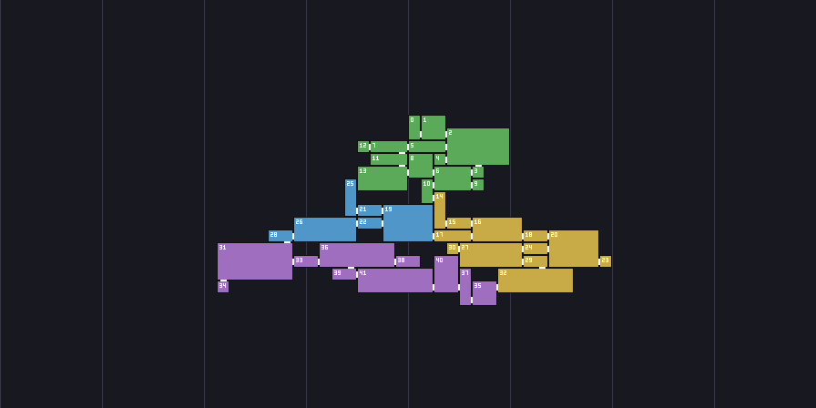

# 19c — Grafo, mapa e travas do Prime da Mines

Estado: verificada (05/11/2026: validate 221/460/0 com as linhas novas "mines (tabela inteira, specs/19c …)" e "grapple (specs/19c)
…"; .ips sha1 `8e5d377133b668151f4a558ebbb192d1bff0f01a` igual em dois builds; grupo A 34/34, grupo B 63/63, grupo C 22/22)
Esforço estimado: 2 dias
Épico: [19 — Phazon Mines](19-phazon-mines.md) (decisões 1 e 3; dados, nenhuma sala na ROM)

## Contexto

Como a 12c, a 17c e a 18c: antes de desenhar qualquer sala da Mines o projeto precisa da planta do mundo inteiro — as 42 salas, o
tamanho de cada uma, onde fica no mapa de pausa da área 5 (19b) e por qual porta liga na vizinha —, com as checagens do validador.
Ficam gravadas também as **travas do Prime** de cada porta (com a cor), as features que travam movimento dentro das salas e **o que só
a Power Bomb quebra** (as paredes de Bendezium, as rochas, a grade), como dados lidos do jogo, **sem escolher item nem mecanismo do
SM** (isso é das regiões, 19f em diante). E a varredura que a regra 3 do épico pede: o Grapple Beam não abre nada no jogo (nenhum bloco
de gancho, nenhum inimigo nosso em que a Samus se agarra). Nenhuma sala vai para a ROM.

## Estado atual (verificado)

- `research/prime_worlds.json`, MLVL "Phazon Mines": 42 salas, 86 docas = 43 ligações, todas com volta; 2 ciclos (épico).
- `tools/dump_prime_locks.py` (12c, 17c, 18c) grava travas por doca, features, `key_vuln`, `area_damage`, `env_fx`, `beam_only`; as
  rochas de Power Bomb eram lidas à parte no épico (`s19/scripts/mines_rocks.py`, perdido com o scratchpad, 19a): o retro-data-structures
  0.44.1 não lê a `DamageVulnerability` das `Platform`.
- O `DamageVulnerability` do Prime nos bytes: contagem `$12`, 16 fraquezas (power, ice, wave, plasma, bomb, power bomb, missile, boost,
  phazon, …), depois os 5 dos feixes carregados e os 5 dos combos (o Super Missile primeiro). Depois do nome: +36 no
  `DamageableTrigger`, +222 na `Platform`, +80 no `Actor` (conferido em todas as do mundo: a contagem `$12` está lá).
- Tamanho pela regra do Tallon (`tallon/rooms.py screens`): **205 telas** (A 54, B 58, C 31, D 62).
- No SM, o gancho pega um bloco de tipo `$E` ou um inimigo cuja reação de gancho (cabeçalho da espécie `+$1A`) é `$8005`, `$8014` ou
  `$8019` do banco dele (`Enemy_GrappleReact_SamusLatchesOn*`; a checagem do `GrappleBeam`, `sm_a0.c:2339`, trata qualquer outro valor
  como "não agarra": a plataforma do elevador, `$A3:952A`, também).

## Mudança proposta

1. `tools/dump_prime_locks.py`: campos novos — por doca `"key_vuln_full"` (a `DamageVulnerability` inteira da `Trigger_DoorKey`, 26
   valores) e por sala `"pb_only"` (`[tipo, nome, camada]` de cada `DamageableTrigger`, `Platform` ou `Actor` que só a Power Bomb fere:
   o valor da power bomb 0 ou 1 e nenhum de power, ice, wave, plasma, bomb, missile, boost). Os campos antigos iguais. Saída:
   `research/prime_mines_locks.json` (42 salas).
2. `tools/mines/rooms.py` (novo, no molde da 18c): `TABLE` (42 `Row`), `LINKS` (43), `REGIONS` A–D (as do épico), `ACTIVE_REGIONS`
   vazio, `ROOMS = []`, `ALL_ROOMS` (caixas provisórias), `ELEVATOR_ROOMS` (P0 → Tallon P43, P25 → Magmoor P26: de verdade a partir da
   19e), `DECORATIVE_ELEVATORS` vazio, `TRANSPORT_TO`; dados do Prime: `DOCK_LOCKS` (regra da Chozo), `KEY_BEAM` (`BEAM_OF_VULN` da
   Magmoor), `FEATURES`, `PB_ONLY` (quantos objetos só de Power Bomb a sala tem na camada 0), `WAVE_PANELS`; `check_prime` (tudo igual
   ao Prime; nenhuma sala com calor, neve/chuva, água ou gelo de plasma; nenhuma porta que só o Super Missile abre; os dois elevadores de
   verdade, o outro lado um transporte do Tallon ou da Magmoor com o nome da Mines, e o `TRANSPORT_TO` da Magmoor apontando para a sala
   — o nome provisório "Phazon Mines P25" vale até a 19e).
3. **Disposição no mapa** por busca (roteiro descartável `s19c/layout_mines.py`): colocação ao longo dos dois anéis, com volta atrás,
   cada sala encostando em todas as vizinhas já postas, **puxada para a faixa do seu nível** (de cima para baixo: A o nível de cima, B o do
   meio, C o oeste, D o de baixo; dentro da faixa, x do mapa = o y do Prime, com um pouco do x), a melhor por custo (portas de chão/teto,
   bytes do save, distância do lugar, e como regra: nenhuma porta de chão/teto em sala de elevador e a porta dela na tela de baixo).
   Resultado: **7 ligações de chão/teto**, **39 bytes** de SRAM (no `$81`, 19b), colunas 17–47, linhas 8–22.
4. `tools/validate.py`:
   - **`check_mines()`** (sempre): `check_prime`; `check_layout` na tabela inteira e em cada região sozinha; sala de elevador sem porta
     de chão/teto e com a porta na tela de baixo; as salas `mines_*` do build = `ROOMS` (nenhuma); os bytes do mapa salvo ≤
     `mapsave.list_room(5)` e ≤ o que sobra da SRAM. Linha nova.
   - **`check_no_grapple_locks(rom, base, manifest)`** (ROM construída): nenhum bloco de gancho no nível de nenhuma sala nossa e nenhuma
     espécie das populações das nossas salas (todos os estados) com reação que agarra (lida do cabeçalho na ROM construída: as cópias
     também). Linha nova.
5. `tools/preview_rooms.py --mapa-mines` → `specs/img/19c-mapa.png`.

Cores: **A verde, B amarelo, C azul, D roxo.** Em cima, o nível de cima: a P0 (elevador do Tallon) e a Quarry Access entrando na Main
Quarry pela esquerda, a Save Station A e a Security Access A, o anel com a Mine Security Station, a Security Access B (embaixo dela) e a
Elite Research, a Research Access, a Ore Processing (com a Storage Depot B) e a Waste Disposal debaixo da Main Quarry; a Elevator Access
A desce para a Elevator A (o poço amarelo). No meio, à direita, o nível do meio: Elite Control Access, Elite Control, Ventilation Shaft
e Omega Research (com a Map Station na ponta), a Maintenance Tunnel para a esquerda, a Central Dynamo com a Save Station B e a Dynamo
Access, a Quarantine Access A descendo para a Metroid Quarantine A. No meio, à esquerda, o oeste: o Phazon Processing Center, a
Transport Access e a P25 (elevador da Magmoor), a Processing Center Access e a Elite Quarters. Embaixo, o nível de baixo: a Metroid
Quarantine B (com a Save Station C embaixo), a Quarantine Access B, a Fungal Hall B (com a Missile Station), a Phazon Mining Tunnel, a
Fungal Hall A, a Fungal Hall Access e a Elevator B subindo para a Elevator Access B, que fecha o grande anel na Metroid Quarantine A.

| Região | Salas | Telas | Bytes do save (região sozinha) |
|---|---|---|---|
| A | 14 | 54 | 11 |
| B | 12 | 58 | 14 |
| C | 6 | 31 | 10 |
| D | 10 | 62 | 12 |
| **Mines inteira** | **42** | **205** | **39** (no `$81`; a área 5 guarda até 255) |

## Critérios de aceite

1. validate "221 salas, 460 portas, 0 problemas" (igual) com as linhas "mines (tabela inteira, specs/19c, salas construídas: 0): 42
   salas, 43 ligações (7 de chão/teto), 205 telas, mapa 39 bytes de SRAM no $81 (passa dos 21 do lugar vanilla, specs/19b), sobram 748
   (por região: A 11 B 14 C 10 D 12); travas do Prime em 86 docas (event 15, key 86; cor das portas: ice 48, plasma 26, wave 12); só a
   Power Bomb quebra em 10 salas (11 objetos), painel de onda em 1, nenhuma quente, fria, com neve ou água, nenhuma porta só de Super
   Missile; elevadores: 2 de verdade (19e), a porta na tela de baixo; sem item SM" e "grapple (specs/19c): nenhum bloco de gancho (tipo
   $E) nas 221 salas do jogo e nenhuma das 28 espécies delas agarrável (reação $8005/$8014/$8019): o item só soma à porcentagem e ao
   HUD". (protege = tabela, mapa, cota, travas, cores, o que só a PB quebra, painel de onda iguais ao Prime; nenhum uso do Grapple no
   jogo; falha_quando = mutações abaixo; não_prova = salas jogáveis, 19e em diante)
2. Mutações (`s19c/mutate_c.py`, em memória; o JSON das travas mexido numa cópia no scratchpad), cada uma pega.
3. ROM igual: sha1 `8e5d3771…f01a` em dois builds; A 34/34, B 63/63, C 22/22 (rodados uma vez aqui, pelas três filhas: a ROM não mudou).
4. `specs/img/19c-mapa.png` olhada: regiões juntas, nenhuma sala solta; `07d-mapa.png`, `12c-mapa.png`, `17c-mapa.png`, `18c-mapa.png`
   iguais byte a byte.

## Plano de testes

| Camada | O quê | Qtde |
|---|---|---|
| validate.py | `check_mines`; `check_no_grapple_locks` | +2 |
| scratchpad | 27 mutações da tabela + 3 do gancho (2 controles); o dumper rodado de novo para a Chozo, a Magmoor e Phendrana (campos antigos iguais) | 33 |
| run_tests.py | nenhum (ROM igual) | 0 |
| imagem | `specs/img/19c-mapa.png` | +1 |

## Riscos e reversão

- 7 portas de chão/teto (lista em `LINKS`, lados B/T): as regiões desenham o acesso (degraus até a borda, como a 12f/17h/18m). Uma é a
  da Save Station C (o teto, vinda da Metroid Quarantine B) e uma é a da Waste Disposal (o teto, vinda da Main Quarry).
- Os elevadores internos do Prime (Elevator A e B, 1×3) ficaram com portas dos lados: a Elevator A na tela de cima (L0) e na de baixo
  (R2), a Elevator B na do meio (L1) e na de baixo (R2): o poço que a Samus sobe com o Space Jump (decisão técnica 4) cabe nessa forma.
- Reversão: apagar `tools/mines/`, `research/prime_mines_locks.json`, `check_mines`, `check_no_grapple_locks`, `--mapa-mines` e os dois
  campos novos do dumper.

## Fora de escopo

- Desenho das salas, `AreaDef` da Mines, mapa de pausa na ROM, elevadores (19e em diante).
- Itens, mecanismo SM de cada trava, inimigos, chefes, estilo (19d–19m).

## Desvios (preenchido na implementação)

- **Os dados contra o épico**: **15 travas de evento** (o épico contava 11): além das da Security Access A, Elite Research, Elite
  Control, Omega Research, Central Dynamo e Elite Quarters, as 2 da Mine Security Station e as 2 da Dynamo Access (`Actor Door Lock` na
  camada 0); **nenhuma doca de Morph**: as 4 `Door_Area Morphball` da Waste Disposal ficam dentro da sala (15–35 m das docas, o túnel
  dela), gravadas como feature `morph_door` (4), não como trava de doca; **11 objetos só de Power Bomb em 10 salas** na camada 0 — os do
  épico (Security Access A, Mine Security Station, PPC, Phazon Mining Tunnel, as rochas da Maintenance Tunnel, Omega Research e Central
  Dynamo, a grade da Ventilation Shaft, os 2 da Metroid Quarantine A) e mais uma `Platform` da **Ore Processing** que o épico não
  listava; os 2 da Elite Research são das camadas de evento (o tanque do Phazon Elite e uma caixa). **Nenhum bomb slot nem bloco de
  bomba pelo nome** (o pilar da Ore Processing, o canhão da Elite Research e os blocos da Phazon Mining Tunnel têm outros nomes: o épico
  os lista como conhecimento, as regiões os mapeiam). Gravados como dado.
- **Super Missile lido do vetor inteiro** (a dúvida do épico): `key_vuln_full` em todas as 86 docas; nenhuma porta que só o Super
  Missile abre: o Super Missile (o combo do Power Beam) não fere nenhuma das 86; cada porta de cor fere só com o feixe dela e o combo
  desse feixe.
- **`pb_only` é uma lista, não um conjunto**: na primeira versão os dois objetos iguais da Metroid Quarantine A (mesmo tipo, nome e
  camada) viravam um; trocado antes de gravar o JSON.
- **Mapa em faixas por nível**, não visto de lado nem de cima: os anéis da Mines são deitados e os níveis empilhados; a vista de lado
  amassava os anéis (a busca não fechava nenhum: 0 de 2000 tentativas) e a vista de cima punha os três níveis um sobre o outro. Com uma
  faixa por região, dentro dela x = o y do Prime e um pouco do x, a ordem de colocação seguindo os dois anéis e volta atrás, a busca
  fechou ~10% das tentativas. A porta do elevador na tela de baixo virou regra da busca (a P29 de Phendrana ficou com a porta na tela de
  cima na 18c, e a 18e teve de lidar com isso). 5 rodadas de 10 processos, 700–4000 tentativas cada; a escolhida (`s19c/chosen_layout.json`,
  deslocada para a coluna 17, linha 8, o deslocamento com menos bytes): 7 de chão/teto, 39 bytes. Roteiros: `s19c/layout_mines.py`,
  `run_many.sh`, `gen.py` (gera `TABLE`, `LINKS` e as tabelas do Prime).
- **Checagens a mais**: a porta da sala de elevador na tela de baixo (C20); o outro lado de cada elevador é um transporte da Mines no
  Tallon ou na Magmoor (C22) e o `TRANSPORT_TO` da Magmoor aponta para a sala (C23); os bytes do mapa contra o que sobra da SRAM (C27).
- **A varredura do gancho percorre as 221 salas construídas** (níveis e as 28 espécies das populações); hoje nenhuma agarra, como
  esperado (as reações são `$800A` mata, `$800F` cancela, `$8000` nada, e a do elevador).
- O `preview_rooms.py` redesenha `research/render/` inteiro: 2 imagens da Magmoor mudaram (as salas de elevador para Phendrana, mudadas
  na 18e) e 56 de Phendrana são novas (as salas feitas depois da 18c): o diretório estava desatualizado desde a 18c; as outras iguais
  byte a byte. `07d/12c/17c/18c-mapa.png` iguais.
- Mutações (`s19c/mutate_c.out`), todas pegas: C1 Main Quarry uma coluna à direita (16 problemas); C2 ligação faltando; C3 nome; C4
  caixa; C5 trava de evento esquecida (Elite Quarters); C6 porta de plasma marcada gelo; C7 feature inventada; C8 a Metroid Quarantine A
  com 1 objeto de PB (são 2); C9 a rocha da Maintenance Tunnel esquecida; C10 o painel de onda esquecido; C11 água no Prime; C12 calor no
  Prime; C13 neve no Prime; C14 uma porta que só o Super Missile abre (o vetor mexido); C15 porta numa tela fora da sala; C16 lados não
  opostos (o `build_rooms` para); C17 região desconhecida; C18 chave sem prefixo; C19 elevador com porta de chão; C20 porta do elevador
  na tela de cima; C21 elevador da Magmoor de enfeite; C22 elevador do Tallon levando à Landing Site; C23 a Magmoor P26 nomeando outra
  sala; C24 sala da Mines no build fora de `ROOMS`; C25 a Save Station B sobre a Central Dynamo; C26 cota da lista da área 5 em 30
  bytes; C27 SRAM com 30 bytes livres; G1 bloco de gancho plantado na Landing Site; G2 o pirata `$F653` com a reação `$8005`. Controles
  limpos: C0 e G0 sem mutação, G3 o pirata com `$800A` (morre no gancho, não agarra). Dumper rodado de novo para a Chozo, a Magmoor e
  Phendrana no scratchpad: campos antigos iguais aos de `research/` (os arquivos de lá não mudaram).
- Verificação (05/11/2026, pasta real): `python3 -I tools/build.py` duas vezes → sha1 `8e5d377133b668151f4a558ebbb192d1bff0f01a` nas
  duas; `python3 -I tools/validate.py` → "221 salas, 460 portas, 0 problemas", só as duas linhas novas (diff com a saída da 19b; a do
  Tallon e a das rodadas iguais à de antes da 19a); grupo A **34/34**, grupo B **63/63**, grupo C **22/22** (5 min 49 s).
