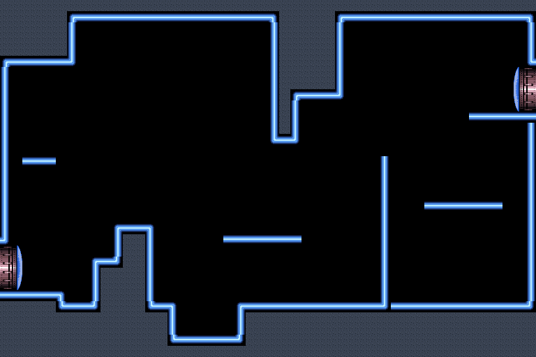
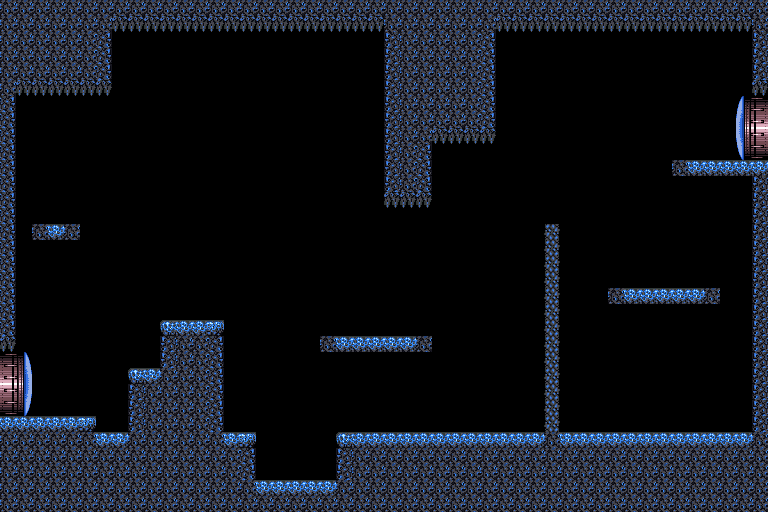
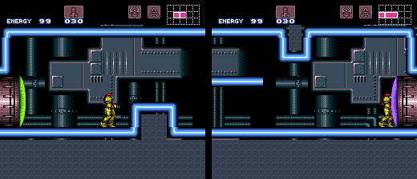
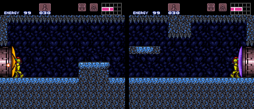

# 19d — Estilos da mina (duas caras), o azul do phazon e as portas, numa ROM de teste

Estado: verificada (05/11/2026: validate "221 salas, 460 portas, 0 problemas" com as 3 linhas novas "mina (specs/19d) …"; .ips
sha1 `8e5d377133b668151f4a558ebbb192d1bff0f01a` igual em dois builds (a ROM do jogo não muda); grupo A **35/35** em 3 min 05 s (o teste
novo `porta_de_plasma_mina` entrou no A), B **63/63** em 3 min 27 s, C **22/22** em 5 min 35 s)
Esforço estimado: 2–2,5 dias (gasto: 1 sessão)
Épico: [19 — Phazon Mines](19-phazon-mines.md) (decisão 7, "padrão aceito, a confirmar": duas caras, base pirata com os gráficos da
Tourian e mina de rocha e fungos com os do Brinstar, música da Tourian; decisão 6: o phazon é só cor, sem dano). Aprovada junto com o
épico.

## Contexto

As salas da Mines (19e em diante) precisam das suas caras — a base dos piratas (metal, canos, telas) e a mina de rocha e fungos —, do
azul do phazon, das portas de gelo, onda e plasma pintadas em cada cara, da música e do fundo. O épico pediu tudo isso numa **ROM de
teste**, com a ROM do jogo igual (a Mines ainda não tem sala), e um teste no emulador em que a porta de plasma da mina abre.

## Estado antes (verificado nos bytes; roteiros em `s19d/scripts/`)

- Tabela de tilesets `$8F:E7A7` (`survey.py`): `$0D` e `$0E` (Tourian) dividem metatiles `$C2:9B01` e gráficos `$BF:D414` (paletas
  `$C2:BAED`/`$C2:BBC1`); o `$0D` é usado por 22 estados de 15 salas órfãs, o **`$0E` só pela sala da Mother Brain `$DD58`** (órfã).
  O `$06` (Brinstar verde, metatiles `$C1:CFA6`, gráficos `$BB:E6B0`) tem 30 estados, **8 deles em salas de demo**; o `$07` (Brinstar
  vermelho) tem 3 salas de demo e o `$1A` (Kraid) também. O **`$08`** (gêmeo do `$07`) é usado **só pela sala órfã `$A5ED`**, sem demo.
- Peças (`pieces.py`: a peça mais comum por vizinhança de ar nas salas vanilla): na Tourian, a borda de cano que brilha (`$2EF`
  chão/teto, `$2EE` paredes, `$316`/`$315` cantos de fora e de dentro) na **linha 5**; o recheio vanilla é o `$044` do CRE (preto, não
  recolore), por isso o recheio daqui é o painel `$169` da **linha 6**. No Brinstar verde, a rocha com musgo (`$16E` recheio, `$16B`
  chão, `$196` teto, `$16F` paredes, `$16A`/`$16C` cantos de cima, `$173` pilar) toda na **linha 4**.
- Fundos (`bg.py`, a linha de cada tile do mapa do BG2): Tourian `$E454` (canos e máquinas) nas linhas 3 e 0; Brinstar `$BAF4` (rocha
  azul-escura) só na linha 2. Nenhum dos dois usa as linhas que as caras repintam.
- Metatiles `$3F0–$3F7` e os da porta de onda vertical (`$3F8–$3FE`, `$3EF`) = enchimento (`03FF ×4`) nas tabelas do `$0D` e do `$06`.
- Cores das portas: linhas 0 (1–3) e 1 (1–7) do `$0D` e do `$06` = as do tileset 4.
- Música: a Tourian vanilla usa `$1E/$05` em 8 estados do `$0D`.
- O mapa da Mines (19c) tem **2 ligações de onda no chão/teto** (Mine Security Station ↔ Security Access B, Quarantine Access A ↔
  Metroid Quarantine A) e **3 de plasma no chão/teto** (Elite Quarters Access ↔ Metroid Quarantine B, Metroid Quarantine B ↔ Save
  Station C, Fungal Hall B ↔ Phazon Mining Tunnel).

## O que foi feito

1. **`tools/smlib/mines.py`** (novo), no molde do `ice.py`:
   - **base pirata** = entrada **`$0E`** apontada para os gráficos do `$0D` e uma cópia da tabela do `$0D`; estilo `PIRATE_BASE` (os
     canos em volta, painéis dentro); paleta = a do `$0D` com a **linha 5 (os canos) no azul do phazon** e a **linha 6 (os painéis) em aço
     escuro** (`BASE_COLOURS`); fundo `$E454`/`$C1C1`;
   - **mina de rocha** = entrada **`$08`** apontada para os gráficos do `$06` e uma cópia da tabela do `$06`; estilo `MINE_ROCK`; paleta
     = a do `$06` com a **linha 4 em rocha cinza e o musgo virando fungo azul de phazon** (`ROCK_COLOURS`); fundo `$BAF4`/`$C1C1`;
   - `PHAZON` (5 tons de azul, os dois usam), `PAINT_LINE = 7` (a porta roxa nas duas), `MUSIC = $1E/$05` (Tourian), `check(rom)`.
2. **`tools/build.py`**: `mines_palette`, `mines_metatiles` (a tabela da fonte com as portas de onda roxas de lado **e a vertical**, na
   linha 7); a escrita das duas entradas **só com `test_19d`** (depois de todos os blobs fixos); `build(test_19d=True)` acrescenta a área
   5 de teste a `AREAS` só enquanto roda (e tira no fim); modo **`--teste-19d`** → `build/teste-19d/`.
3. **`tools/mines/testrooms.py`** (só na ROM de teste): uma área 5 própria (a 19e cria a de verdade) com 4 salas em fila na linha 26 do
   mapa: entrada (base) → **base pirata** (2×1; porta de gelo verde a oeste, de onda a leste) → **mina de rocha** (2×1; **porta de plasma
   laranja a oeste**, de onda a leste) → fim (rocha). Cada sala grande tem um degrau, uma plataforma e um bloco pendurado no teto, para a
   foto mostrar chão, paredes, cantos e plataformas. Estação 0 na entrada (o teste carrega por RAM, como a 18d).
4. **Validador**:
   - `mines.check` (ROM base: entradas próprias, `$0E` = `$0D`, peças sólidas nas salas de origem e nas linhas que a cara pinta, linha 7
     fora das peças/fundo/CRE, CRE sem as linhas pintadas, enchimento nos 16 metatiles das portas de onda, cores das portas = tileset 4,
     linhas dos fundos, música da Tourian, tabelas de cor);
   - **`check_mines_in_rom`** na **ROM do jogo** (sem sala da área 5: as 2 entradas têm os 9 bytes vanilla) e na **ROM de teste, feita na
     memória** (`mines_test_build`, ~2 s: gráficos = os da fonte, tabela = `mines_metatiles` e os 16 metatiles das portas de onda na linha
     7 lidos à parte, paleta = `mines_palette` com o roxo e o azul lidos direto); nas duas: **nenhuma sala nossa fora da área 5 nem sala
     de demo usa `$0E/$08`**, e nenhum estado de sala da área 5 aponta um FX com bit de paleta ou de tiles animados (a lista da área 5
     começa com o calor, 19b);
   - `check_mines_test_rooms` (as salas de teste: área 5, mapa, níveis, cada sala numa das duas caras com o estilo dela, uma porta de onda
     por cara, as tampas de plasma na rocha e de gelo na base, nenhum FX, nenhum metatile de porta de onda no nível);
   - `check_wave_paint_free` e `VERTICAL_WAVE_TILESETS` com os dois tilesets da mina. Linhas novas "mina (specs/19d) …".
5. **Teste** `porta_de_plasma_mina` (ROM de teste, construída pelo `run_tests.py` antes dele; grupo A): carrega a estação 0 da área 5;
   em cada cara as cores da cara e o roxo da linha 7 na paleta da WRAM e nenhum FX; a porta de onda leste fechada (a Samus para nela, o
   metatile roxo `$3F0` no nível da WRAM), o Power Beam não abre, o Wave abre e ela passa; na rocha, a **porta de plasma oeste: o Power
   Beam e o Wave não abrem, o Plasma abre e ela volta para a base**; fotos.
6. Prévia `python3 -I tools/preview_rooms.py --estilo-mina` → `specs/img/19d-(base-pirata|mina-de-rocha)(-limpo).png`.

 

No emulador: em cima, a base pirata (canos azuis de phazon, máquinas da Tourian no fundo) com a tampa verde de gelo a oeste e a roxa
de onda a leste; embaixo, a mina de rocha (rocha cinza, fungo azul nas bordas, rocha azul-escura no fundo) com a tampa laranja de plasma
abrindo com o tiro do Plasma, e a roxa de onda a leste.

## Critérios de aceite

1. validate 0 problemas, "221 salas, 460 portas" (nenhuma sala nova no jogo); as linhas do Tallon ("44 salas construídas, alcançáveis
   agora: 44, 20 itens em 7 rodadas") e das rodadas ("75 itens em 7 rodadas … 75%") iguais; 3 linhas novas "mina (specs/19d) …".
   **Passa.**
2. ROM do jogo igual: sha1 `8e5d3771…f01a` em dois builds. **Passa.**
3. `porta_de_plasma_mina` passa (protege = as duas caras na ROM de teste, o azul, as portas de onda e a de plasma abrindo só com o
   Plasma; falha_quando = as mutações do emulador abaixo; não_prova = salas da Mines, 19e em diante); os antigos passam. **Passa.**
4. Mutações pegas (abaixo). **Passa.**

## Mutações (`s19d/scripts/mutate_d.py` → `s19d/mutate_d.out`; emulador numa cópia, `s19d/proj` → `s19d/mutate_emu.out`)

Controles limpos: M0 (`mines.check`), R0 (ROM do jogo), R0b (ROM de teste), S0 (salas de teste). Pegas: M1 cor da rocha numa linha que
não é da cara; M2 recheio da base numa linha do CRE (`$1A4`, linha 3); M3 porta de onda da base na linha 6 (das peças); M4 fundo da
rocha `$BAA3` (linha 4, a das peças); M5 peça da rocha que não é sólida nas salas de origem; M6 música que não é a da Tourian; M7 entrada
`$0E` dividida com a `$0D`; R1 ROM do jogo com a paleta do `$0E` mexida sem sala da Mines; R2 ROM de teste com os gráficos do `$08` = os
do `$07`; R3 metatiles do `$0E` = a tabela vanilla (sem as portas); R4 paleta do `$08` = a da base; R5 a Landing Site com o tileset
`$08`; R6 uma sala de demo (a mesma nas duas ROMs) com o tileset `$0E`; R7 sala da área 5 com o bit 0 de paleta (o calor); R8 entrada
`$08` dividida com a `$07`; R9 o roxo da base na linha 6; S1 rocha sem a porta de onda; S2 sala de teste com FX (a chuva); S3 rocha com o
estilo da base; S4 nível da base usando o metatile `$3F0`; S5 rocha sem a tampa de plasma. Emulador: E1 as duas caras com a paleta da
base → `porta_de_plasma_mina` falha (as cores da linha 4 na WRAM); E2 a porta oeste da rocha de onda em vez de plasma → falha (o Wave
abriu: a Samus passou).

## Riscos e reversão

- As duas entradas só são escritas na ROM de teste: a 19e passa a escrevê-las no jogo (o validador já troca sozinho: com sala na área
  5, confere o conteúdo; sem sala, confere os bytes vanilla).
- O fundo da base (`$E454`) e o da rocha (`$BAF4`) ficam nas cores vanilla (linhas 3/0 e 2, divididas com o CRE: não se repintam).
- Reversão: tirar `smlib/mines.py`, `mines/testrooms.py`, o bloco `test_19d` do `build.py`, as checagens, o teste e as prévias.

## Fora de escopo

- Salas da Mines (19e em diante), qual cara cada sala usa (cada região escolhe), música por sala.
- **A porta de plasma no chão/teto** (achado; ver Desvios).

## Decisões para o usuário (escolhidas as recomendadas; confirmar)

**Confirmado pelo usuário em 09/11/2026: padrão aceito** (todas as escolhas abaixo ficam como estão).

1. **Cores** das duas caras (`mines.PHAZON`, `BASE_COLOURS`, `ROCK_COLOURS`): mudar a tabela e reconstruir.
2. **Fundos**: canos e máquinas da Tourian (`$E454`) na base, rocha azul-escura do Brinstar (`$BAF4`) na mina.
3. **Música** `$1E/$05` (Tourian) nas duas caras.

## Desvios (preenchido na implementação)

- **Rocha no `$08`, não no `$07` nem no `$1A`** do épico: os dois têm salas de demo; o `$08` só tem a sala órfã `$A5ED`. A base no
  `$0E`, como o épico pediu.
- **O recheio da base não é o da Tourian**: o vanilla é o `$044` do CRE (preto, linha do CRE, não recolore); o `$169` (painel, linha 6)
  vira aço escuro.
- **ROM do jogo igual** (a 18d mudava a ROM do jogo com os blobs; aqui só a ROM de teste os grava, como o épico pediu): o validador
  confere a ROM de teste feita na memória (`mines_test_build`, ~2 s a mais no validate).
- **A porta de onda vertical já está pintada** nas duas tabelas (o mapa tem 2 ligações de onda no chão/teto).
- **Achado — porta de plasma no chão/teto**: o mapa da 19c tem 3 ligações de plasma no chão/teto (Elite Quarters Access ↔ Metroid
  Quarantine B, Metroid Quarantine B ↔ Save Station C, Fungal Hall B ↔ Phazon Mining Tunnel), e o projeto só tem portas verticais de
  gelo e de onda (`beamdoors.PLM`: `ice B/T`, `wave B/T`). Fazer a de plasma vertical (cópia da porta amarela vertical, como a 18i fez a
  de onda) muda o `$84` da ROM do jogo: fica para a filha da região D/C (19j ou 19l), ou a 19c pode mudar esses lados no mapa. **Para o
  usuário confirmar**.
- O teste `porta_de_plasma_mina` está no **grupo A** (o épico o punha no grupo D, que só nasce na 19e; o C já está perto do limite).
- A ROM de teste tem uma área 5 própria (a Mines não tem sala); a 19e pode pendurá-la na área de verdade, como a 18e fez com a 18d.
- Mutações do emulador numa cópia do projeto sem `.claude/` (`s19d/proj`).
- Verificação (05/11/2026, pasta real): `python3 -I tools/build.py` duas vezes → sha1 `8e5d377133b668151f4a558ebbb192d1bff0f01a`;
  `python3 -I tools/validate.py` → "221 salas, 460 portas, 0 problemas" (21 s), só as 3 linhas novas "mina (specs/19d)"; `run_tests.py
  --grupo A` → **35/35** (3 min 05 s), `--grupo B` → **63/63** (3 min 27 s), `--grupo C` → **22/22** (5 min 35 s).
