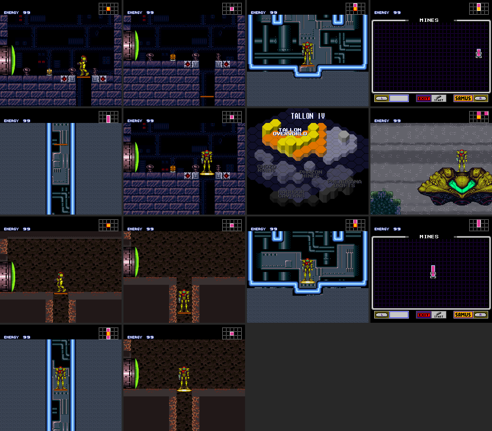
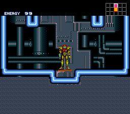
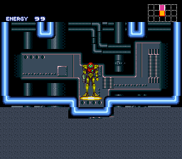
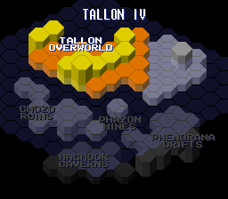

# 19e — Elevadores de verdade para a Phazon Mines (Tallon ↔ Mines, Magmoor ↔ Mines) e o grupo D de testes

Estado: verificada (05/11/2026: validate "223 salas, 460 portas, 0 problemas", linhas do Tallon e das rodadas idênticas, linha nova
"mines (specs/19e) …"; .ips sha1 `b4ede270b542b99b23ced809023d1c78b44b63fb` igual em dois builds; grupo A **34/34** em 3 min 26 s, B
**63/63** em 4 min 12 s, C **22/22** em 5 min 45 s, D **3/3** em 30 s)
Esforço estimado: 2 dias (gasto: 1 sessão)
Épico: [19 — Phazon Mines](19-phazon-mines.md) (decisão técnica 4: elevadores de verdade; decisão técnica 9 e decisão do usuário 8,
"padrão aceito, a confirmar": grupo D). Aprovada junto com o épico.

## Contexto

Os dois elevadores que no Prime levam à Mines eram **de enfeite**: `tallon_transport_mines_east` (Tallon P43, região E, rodada 5, onde
fica a Power Bomb do jogo) e `magmoor_transport_mines_west` (Magmoor P26, região C, rodada 4; a sala que hospeda a porta R1 da ROM de
teste da 17d). Esta filha os liga, como a 12e, a 17e e a 18e fizeram: cada um desce até a sua sala de elevador da Mines (área 5, 19b),
e volta. As salas da Mines, por ora, são só essas duas, na cara da base pirata (19d) e **becos** (as portas da tabela ficam fechadas até
as regiões: 19f a P0, 19j a P25). Cria também a `AreaDef` da Mines, o nome "MINES" no mapa e "PHAZON / MINES" no continue, a lista do
mapa salvo no `$81` e o **grupo D** de testes. Critério duro: **as rodadas das outras quatro áreas não mudam** ("44 salas construídas,
alcançáveis agora: 44, 20 itens em 7 rodadas"; "75 itens em 7 rodadas … 75%").

## Estado antes (verificado)

- Destinos (`WorldTeleporter`, épico 19): Mines P0 ↔ Tallon P43, Mines P25 ↔ Magmoor P26.
- Tabela (19c): P0 1×2 em (32, 8), porta R1 (tela de baixo, leste) → Quarry Access; P25 1×3 em (27, 13), porta R2 (tela de baixo,
  leste) → Transport Access. A busca do mapa pôs a porta dos dois na tela de baixo ("o poço do elevador é o teto").
- Tallon P43 (`tallon/layouts.py` `low_transport("L")`): salão na tela de baixo, a plataforma de metal em x 9–12 (chão 26), o poço de
  enfeite subindo; a Power Bomb em (6, 25). Magmoor P26 (`magmoor/layouts.py`): salão na tela de baixo (chão 26), o poço de enfeite
  **subindo** do teto até o chão, sem elevador.
- Área 5: `VANILLA_PAUSE[5]` (19b); nome vanilla no continue: spritemap `$3E` em `$82:CCE4`, 7 peças ("TOURIAN"), lugar `$81:AA1C`
  área 5 = (`$87`, `$8B`) (lidos dos bytes). A lista de ícones de map station da área 5 é só `FFFF` (19b).
- Testes: grupo A 35/35, B 63/63, C 22/22 (19d).

## O que foi feito

1. **Quem fica em cima**: a Mines fica **embaixo dos dois** (no Prime os dois elevadores descem para a mina; o mapa da 19c pôs o poço
   no teto das duas salas). Então o elevador do Tallon P43 desce (como os da Chozo e o da Magmoor), o da Magmoor P26 **desce**, e os dois
   da Mines **sobem**.
2. **Salas da Mines** (`tools/mines/layouts.py`, novo; `mines/rooms.py`: `LOOK` (vazio = base pirata), `FIRST_ROUND`, `build_rooms` com
   o desenho, a cara e o fundo dela, `ROOMS = build_rooms(ACTIVE_REGIONS, ELEVATOR_ROOMS)`): **P0** (1×2) e **P25** (1×3), o salão na
   tela de baixo (linhas 3–9 dela, chão = o batente da porta da tabela), dois canos pendurados no teto do salão, a plataforma no chão em
   x 128 e o poço de 2 blocos do topo da sala até a plataforma (`Elevator(7, 26 / 42, up=True)`). As duas na **base pirata** (`$0E`,
   fundo `$8F:E454`, música `$1E/$05`). `FIRST_ROUND`: P0 = 5, P25 = 4 (as rodadas dos lados de cima, como o épico previa).
3. **Lado do Tallon**: P43 com `low_transport("L", ride=True)` (o poço escavado sob a plataforma; a Power Bomb continua em (6, 25),
   longe dela).
4. **Lado da Magmoor**: P26 redesenhada **descendo** (o desenho da 18e para Phendrana): o salão igual, a plataforma no chão em x 128 da
   tela oeste e o poço de 2 blocos até a última linha; o teto fechado (o poço de enfeite que subia saiu). `magmoor/rooms.py`:
   `ELEVATOR_ROOMS` com ela, `DECORATIVE_ELEVATORS` vazio, `TRANSPORT_TO` com a chave da sala da Mines. A porta R1 da ROM de teste da
   17d (`magmoor/testrooms.py` `HOST`) continua na mesma parede leste da tela de baixo: **o `HOST` não muda** (os testes `lava_` e
   `porta_de_onda_lava` passam no grupo B).
5. **`tools/areas.py`**: `MINES` (área 5, "MINES", a base pirata e a música da Tourian, estação 0 = o chão ao lado da plataforma da P0,
   lista do mapa salvo = a tabela inteira, 39 bytes, que vão para o `$81:EF1A` pelo `mapsave.list_at` da 19b), `ELEVATORS` + 2 pares
   (Tallon P43 ↔ Mines P0, Magmoor P26 ↔ Mines P25: 9 no total), `AREAS` com a Mines por último (nada alocado antes muda de ordem).
6. **Tela de continue** (`frigate/areaselect.py`): nome da área 5 = **"PHAZON / MINES"** (letras pequenas, 11 peças; a vanilla tem 7),
   spritemap nova no `$82` livre.
7. **Build** (`tools/build.py`): as duas entradas de tileset da mina (`$0E`, `$08`, 19d) agora são escritas também na ROM do jogo,
   porque a área 5 tem sala; a ROM de teste da 19d (`--teste-19d`) põe as 4 salas de teste numa **cópia** da área da Mines
   (`mines/testrooms.area()`), que toma o lugar da `MINES` em `AREAS` só durante esse build, na estação **7** (a 0 é a chegada da Mines),
   como a 18e fez com a ROM de teste do gelo.
8. **Validador**:
   - `PRIME_ELEVATORS` com os 2 pares; `world_rooms` com a Mines; `check_arrival` com a área 5;
   - **`check_mines_rounds`** (linha nova "mines (specs/19e)"): cada sala na rodada declarada e na mesma do lado de cima; os elevadores
     iguais a `TRANSPORT_TO`, a Mines sempre embaixo; os lados de cima nas rodadas do épico (`EPIC_MINES_LIFT_ROUNDS`: Tallon 5,
     Magmoor 4);
   - `check_world_rounds`: as rodadas declaradas da Mines entram na conta; a guarda "nenhuma rodada só da Magmoor ou de Phendrana" vale
     para a Mines também; **a linha das rodadas lista só os elevadores de antes (igual)**, os 2 novos ficam na linha da 19e até a 19m;
   - `check_epic_magmoor` compara os pares sem ordem (a P26 agora é a sala de cima do par);
   - `VANILLA_SHARED` com o fundo da base pirata (`$8F:E454`); `check_phendrana_slot` (o plano das áreas) não conta a própria Mines;
   - `mines_test_build`/`check_mines_test_rooms` com a cópia da área (linha "mina (specs/19d, 19e): ROM de teste … estação 7");
   - `mines/rooms.py check_prime`: a Magmoor P26 tem de apontar a chave da sala da Mines (não mais "Phazon Mines P25").
9. **Grupo D** (`tests/run_tests.py`): `TEST_GROUP_D` = prefixos `mines_`, `elevador_mines_`, o teste da 19d `porta_de_plasma_mina`
   (saiu do grupo A) e `entradas_de_porta_mines`; `--grupo A|B|C|D`; ordem de verificação **A → B → C → D**.
10. **Testes** (grupo D):
    - **`elevador_mines_leste`**: do pouso, pela porta da Tunnel E até a P43 (teleporte de porta, atalho como o
      `elevador_chozo_east_e_south`); na plataforma ↓: a P0 da Mines, **área 5** (`$079F`), de pé na plataforma, o bit explorado dela
      ligado e o da P43 na cópia da área 0, sem FX, as cores da base pirata (linhas 5–6) e o roxo da linha 7 na paleta da WRAM, a música
      `$1E/$05`; pausa: mapa "MINES" com o tile da sala; ↑: de volta à P43, o bit da P0 na cópia da área 5; de volta à nave; um bit de
      estação usada por RAM em cada um dos outros quatro mundos (Mines, Chozo, Magmoor, Phendrana: estação 0); salva, game over: **os cinco
      nomes** na tela de área, na ordem do jogo, cada peça no seu lugar (`check_five_labels`: "TALLON / OVERWORLD", "PHAZON / MINES",
      "CHOZO / RUINS", "PHENDRANA / DRIFTS", "MAGMOOR / CAVERNS"); continue: a Landing Site, área 0, com o bit da P43 e o da P0 da Mines
      salvos (a lista da área 5 no `$81`, pela SRAM);
    - **`elevador_mines_oeste`**: do pouso até a P16 da Magmoor (`to_magmoor_p16`), pela porta da Workstation Tunnel até a P26; ↓ a P25
      (o poço de 3 telas), as mesmas conferências, o mapa; ↑ de volta à P26.
11. **Testes antigos ajustados** (as expectativas que a 19e muda de propósito):
    - `magmoor_regiao_c_itens` (grupo B) terminava provando que o elevador da P26 era de enfeite (o `DOWN` não fazia nada); agora ela anda
      até a plataforma, o `DOWN` liga o elevador e ela chega na P25 da Mines (área 5);
    - `mapa_da_tourian_sobrevive_ao_save` (grupo A, spec 03) punha `FF` no 1º e no 21º byte da lista vanilla da Tourian; a área 5 agora
      é da Mines, com a lista própria no `$81`: o teste usa o 1º e o último byte dela (`MINES.map_save_bytes()`). O nome ficou (a spec
      03 cita).

Da esquerda, de cima: na plataforma da P43 do Tallon (a Power Bomb no chão à esquerda); descendo; chegada na P0 da Mines (base pirata,
canos azuis de phazon); o mapa "MINES"; subindo pelo poço da P0; de volta à P43; a tela de continue com os cinco nomes; o continue na
nave; a P26 da Magmoor; descendo; chegada na P25; o mapa com a P25; subindo; de volta à P26.

  

## Medidas (emulador)

- P0 ← P43 e P25 ← P26: chega de pé na plataforma, área 5, `$0E18` = 0, dentro dos 900 quadros do `ride_elevator` (também o poço de 3
  telas da P25); a volta para cima idem.
- O passeio do validador: a P25 é alcançada na rodada 4 e a P0 na 5, as mesmas dos lados de cima, **como o épico previa** (Tallon 5,
  Magmoor 4).

## Critérios de aceite

1. validate 0 problemas, "223 salas, 460 portas" (2 salas novas, nenhuma porta nova); **linhas do Tallon e das rodadas idênticas**
   (diff com a saída de antes); linha nova "mines (specs/19e; regiões ativas: nenhuma): 2 salas construídas (becos), 0 itens, … rodada 4:
   1 salas; rodada 5: 1 salas; elevadores: tallon_transport_mines_east (rodada 5) <-> mines_transport_tallon_south (rodada 5),
   magmoor_transport_mines_west (rodada 4) <-> mines_transport_magmoor_south (rodada 4); área 5, mapa "MINES", estações: 0
   transport_tallon_south …". **Passa.**
2. `elevador_mines_leste` (protege = ida e volta Tallon ↔ Mines, área `$079F` = 5, bits explorados das áreas 0 e 5, a cara da base
   pirata e a música na WRAM, mapa "MINES", save, game over, os cinco nomes no continue, continue com a lista da área 5 no `$81`;
   falha_quando = as mutações T1–T3) e `elevador_mines_oeste` (Magmoor ↔ Mines pelo poço de 3 telas; falha_quando = T4) passam (grupo
   D); A, B e C passam com as duas expectativas ajustadas acima. **Passa.**
3. Mutações pegas (abaixo). **Passa.**

## Mutações (scratchpad da sessão, `s19e/`; cópia do projeto sem `.claude/` em `s19e/proj`)

Validador (`s19e/scripts/mutate_e.py` → `mutate_e.out`): V0 sem mutação: limpo. V1 pares trocados (P43 ↔ P25) → "o Prime liga …"; V2 a
P0 descendo → o nível não monta; V3 rodada declarada errada da P25 → "fica alcançável na rodada 4"; V4 a Mines na área 4 → o build (que
o validador roda) para; V5 poço da P0 fechado → "poço do elevador fechado"; V6 a P26 de enfeite de novo → "elevadores de enfeite …"; V7
o épico com a Magmoor na rodada 5 → "o épico diz 5"; V8 o fundo da base fora da `VANILLA_SHARED` → "dado vanilla fora da
VANILLA_SHARED"; V9 a P43 sem o elevador → o build para ("um que desce e outro que sobe"); V10 a P26 subindo → o nível não monta (o teto
fechado); V11 `FIRST_ROUND` com sala fora do build; V12 `TRANSPORT_TO` da P25 errado → "mines: elevadores …"; V13 a ROM de teste na
estação 0 → "estação 0 já usada".

ROM (`s19e/scripts/mutate_rom.py` → `mutate_rom.out`, na ROM construída, pelas funções do validador): R0 sem mutação: limpo. R1 saída
da P0 sem a troca de área; R2 a P43 levando à P25; R3 uma letra de "PHAZON / MINES" trocada; R4 o nome do mapa de pausa da área 5
apagado; R5 o ponteiro da lista do mapa da área 5 de volta ao vanilla (a lista do `$81` sem uso); R6 a paleta da base pirata = a
vanilla da Tourian. Todas pegas.

Emulador (`s19e/scripts/mutate_emu.py` → `mutate_emu.out`, a ROM construída mexida): T1 a P43 levando à P25 → `elevador_mines_leste`
falha (a sala de chegada); T2 o ponteiro da lista da área 5 vanilla → falha depois do continue (o bit da P0 perdido: prova a lista no
`$81`); T3 o nome da área 5 de volta a "TOURIAN" → `check_five_labels` falha; T4 a paleta da base pirata vanilla → `elevador_mines_oeste`
falha (as cores na WRAM). Todas pegas.

## Riscos e reversão

- As salas da Mines são becos sem save: morrer lá volta ao último save. O nome no continue só aparece com um save na Mines (19f); no
  teste ele vem de um bit posto por RAM.
- A ROM de teste da 19d ocupa a estação 7 e a linha 26 do mapa da área 5 (só nela); se uma região precisar delas, muda o lugar.
- A lista de ícones de map station da área 5 continua a vanilla (`FFFF`): sem map station construída, nada a escrever. **Fica para a
  19i** (a Map Station Mines): uma lista nova no `$82` livre e o ponteiro `$82:C7FB + 2·5` (o `write_pause_map` recusa a map station
  na área 5 até lá, 19b).
- Reversão: tirar `MINES` de `AREAS` e os 2 pares de `ELEVATORS`, o `ride=True` da P43, o desenho da P26 (volta o de enfeite), o nome
  da área 5, a escrita das entradas `$0E/$08` no jogo, o grupo D e os dois ajustes de teste.

## Fora de escopo

- As regiões (19f em diante), os saves e a map station da Mines, a cadeia completa pela Mines (19m), ícones de elevador no mapa.

## Decisões para o usuário (escolhidas as recomendadas; confirmar)

**Confirmado pelo usuário em 09/11/2026: padrão aceito** (todas as escolhas abaixo ficam como estão).

1. **A Mines fica embaixo dos dois mundos**: os elevadores do Tallon e da Magmoor descem, os da Mines sobem (o Prime faz assim; o mapa
   da 19c já supunha). A P26 da Magmoor perdeu o poço de enfeite que subia.
2. **As duas salas de elevador na base pirata** (metal e canos azuis), como o épico pedia para as salas de elevador.
3. **Grupo D** com os testes da Mines, os 2 elevadores e o `porta_de_plasma_mina` (que saiu do grupo A).

## Desvios (preenchido na implementação)

- **A Magmoor P26 desce** (o épico deixava o sentido do lado da Magmoor *(incerto)* para esta filha): o desenho mudou (a 18e mudou só a
  profundidade do poço da P13/P27, que já subiam).
- **A linha das rodadas fica igual tirando os 2 elevadores novos dela** (como a 18e fez com os de Phendrana até a 18n); eles estão na
  linha "mines (specs/19e)". As linhas da Magmoor mudam de propósito: "elevadores: 5 de verdade …, 0 de enfeite" (épico 17) e "5 de
  verdade (17e), 0 de enfeite" (tabela 17c); as linhas "mines (specs/19b)" (2 salas, lista usa 39 bytes no `$81`, "a 19i dá uma nova"
  para a map station) e "mina (specs/19d)" (ROM do jogo: as entradas escritas, 2 salas) também.
- **A lista de map station da área 5 não foi feita agora** (não há map station construída; o build escreve `FFFF` igual ao vanilla):
  fica para a 19i (Riscos).
- **Dois testes antigos ajustados** (item 11): os dois provavam o que a 19e muda de propósito (o elevador de enfeite, a lista vanilla
  da Tourian); agora provam o novo (o elevador anda, a lista da Mines sobrevive ao save).
- `porta_de_plasma_mina` **foi para o grupo D** (a ROM de teste agora pendura as salas na área da Mines, estação 7): o grupo A tem 34.
- `elevador_mines_leste` entra na P43 por **um** teleporte de porta a partir da Tunnel E (como o `elevador_chozo_east_e_south`): pela
  cadeia de teleportes desde o pouso ela chegava andando e ficava 2 px fora do meio da plataforma.
- `VANILLA_SHARED` ganhou o fundo da base pirata `$8F:E454` (o `check_orphans` pediu); o da rocha (`$BAF4`) entra quando a primeira sala
  de rocha for construída (19f).
- Experimentos na cópia `s19e/proj`; a verificação na pasta real.
- Verificação (05/11/2026, pasta real, um grupo por vez, na ordem A → B → C → D): `python3 -I tools/build.py` duas vezes → sha1
  `b4ede270b542b99b23ced809023d1c78b44b63fb` nas duas (a ROM muda nesta filha, como esperado); `python3 -I tools/validate.py` → "223
  salas, 460 portas, 0 problemas" (28 s; as linhas do Tallon e das rodadas idênticas às de antes, diff); `run_tests.py --grupo A` →
  **34/34** (3 min 26 s), `--grupo B` → **63/63** (4 min 12 s), `--grupo C` → **22/22** (5 min 45 s; numa rodada anterior 6 min 10 s:
  a máquina varia; o C não ganhou teste), `--grupo D` → **3/3** (30 s).
