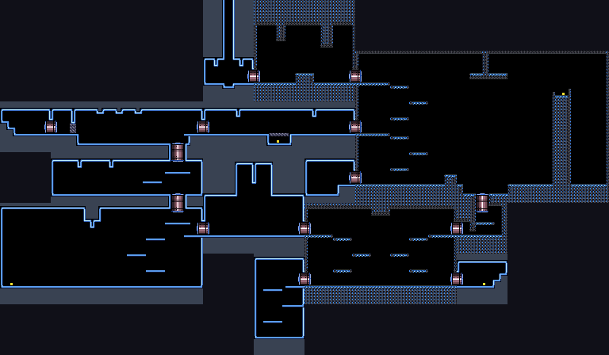
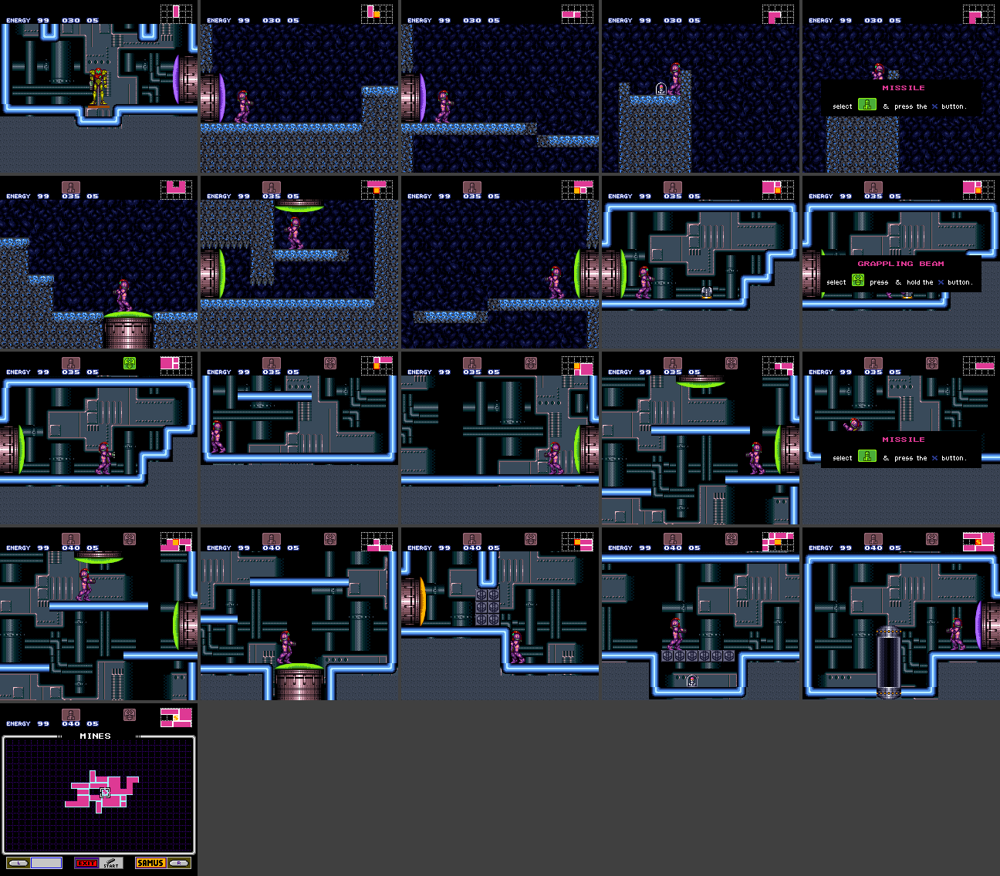
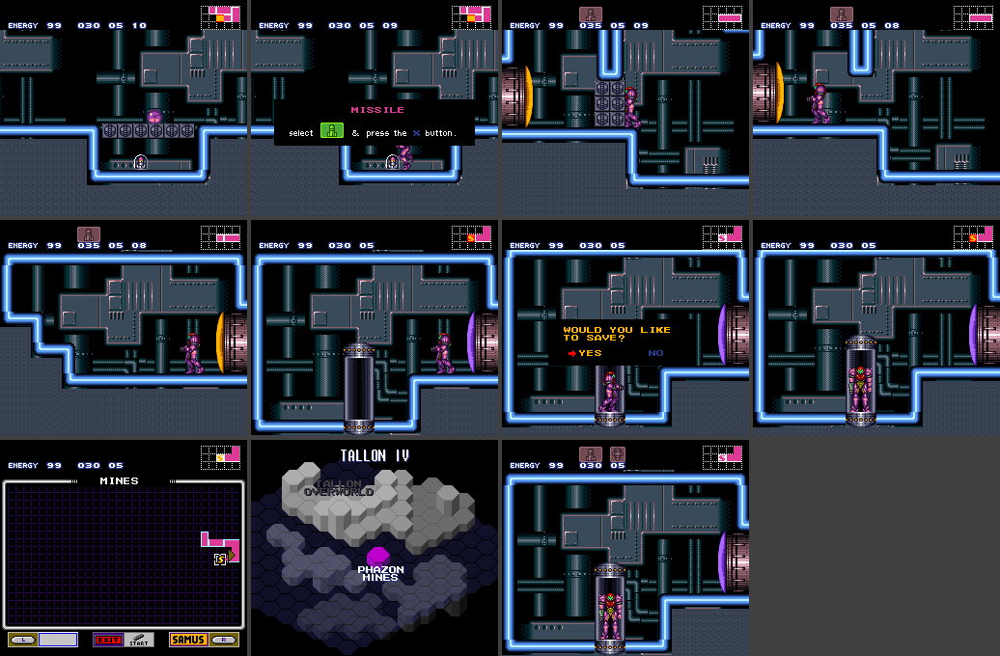

# 19f — Região A da Phazon Mines (nível de cima: a pedreira, a segurança, o Grapple Beam)

Estado: verificada (05/11/2026: validate "236 salas, 488 portas, 0 problemas", a linha do Tallon idêntica, a das rodadas mudada só
pelos 4 itens da Mines (79 itens, 79%); `.ips` sha1 `923324419fcbd76ff3cf33724a286a66e199f074` igual em dois builds; grupo A **34/34**
em 3 min 22 s, B **64/64** em 4 min 00 s, C **21/21** em 2 min 06 s, D **7/7** em 4 min 08 s). Rascunho → aprovada (épico aprovado
pelo usuário; pedido do orquestrador) → implementada → verificada na mesma sessão.
Esforço estimado: 3 dias (salas 1 d; travas, itens, Grapple e validador 0,5 d; emulador, fotos e mutações 1,5 d)
Épico: [19 — Phazon Mines](19-phazon-mines.md) (decisões do usuário 1, 3a e 6; decisões técnicas 1, 3 e 4; linha 19f da tabela de
filhas); modelos: [18f](18f-regiao-a-phendrana.md) (região com travas, itens e save), [18l](18l-regiao-d-phendrana.md) (um item do SM
novo no projeto: o Super Missile), [19d](19d-estilos-da-mina.md) (as duas caras), [19e](19e-elevadores-da-mines.md) (as salas de
elevador, `check_mines_rounds`, o grupo D).

## Contexto

Desde a 19e o elevador do Tallon P43 (rodada 5) desce até a P0 da Mines, um beco. Esta filha constrói a **região A** (o nível de cima:
as 13 salas novas da tabela da 19c e a P0), abre a parede R1 da P0 para a Quarry Access, põe as travas do Prime da região com os
mecanismos do SM, os **3 mísseis** da região, **o Grapple Beam do SM** na Storage Depot B (item novo nas áreas: nada o pede) e a
**Save Station A** (estação 1 da área 5). Os inimigos ficam para a 19g e o Phazon Elite para a 19h (a Elite Research fica pronta
para a arena). E, a pedido do orquestrador, o tempo dos testes: o grupo C chegou a 6 min; a parte 4 da cadeia vai para o grupo D.

## Estado antes (verificado)

- validate "223 salas, 460 portas, 0 problemas" (`scratchpad/s19f/v19e_before.txt`); linhas "tallon (… 44 salas construídas,
  alcançáveis agora: 44, 20 itens em 7 rodadas)", "rodadas (specs/12m, 17j, 18n): … 75 itens em 7 rodadas … 75% (energia 1299,
  mísseis 235, super mísseis 5, power bombs 25)" e "mines (specs/19e; regiões ativas: nenhuma): 2 salas construídas (becos), 0
  itens …"; `.ips` sha1 `b4ede270…63fb`; A 34/34, B 63/63, C 22/22 (5 min 45 s, numa rodada 6 min 10 s), D 3/3.
- `tools/mines/rooms.py` (19c): região A = P0 (1×2), P1 Quarry Access (2×2), P2 Main Quarry (5×3), P3 Waste Disposal (1×1), P4 Save
  Station Mines A (1×1), P5 Security Access A (3×1), P6 Ore Processing (3×2), P7 Mine Security Station (3×1), P8 Research Access (2×2),
  P9 Storage Depot B (1×1), P10 Elevator Access A (1×2), P11 Security Access B (3×1), P12 Storage Depot A (1×1), P13 Elite Research
  (4×2); 3 ligações de chão/teto (Main Quarry B2 ↔ Waste Disposal T0, de gelo; Mine Security Station B2 ↔ Security Access B T2, de
  onda; Security Access B B2 ↔ Elite Research T3, de gelo): **nenhuma de plasma**, então a região A não precisa da porta de plasma
  vertical (a decisão técnica do épico a deixa para a região que a usa). A Elevator Access A R1 leva à Elevator A (região B).
- Travas do Prime na região (`DOCK_LOCKS`, `KEY_BEAM`): todas as docas com porta de cor (gelo, onda; plasma só entre a Mine Security
  Station e a Storage Depot A); de evento: as emboscadas da Security Access A e da Mine Security Station e a porta do Phazon Elite
  (Elite Research → Security Access B). Features: Main Quarry gancho + Spider, Ore Processing gancho + Spider, Research Access e
  Elevator Access A Spider, Waste Disposal o túnel de Morph (`morph_door`). `PB_ONLY`: Security Access A, Mine Security Station e Ore
  Processing (1 objeto cada).
- O **Grapple Beam do SM**: PLM `$84:EF17` (lido na ROM base: setup `$EE64`, instruções `$E366`, como o X-Ray e os feixes); bit `$4000`
  de `$09A2/$09A4`; a tabela do fim `$8B:E721` o conta (o 10º dos 11 bits: lido). `check_no_grapple_locks` (19c) limpo.
- Bits livres: itens a partir de `$EB` (Phendrana até `$EA`).

## O que foi feito

1. **Salas** (`tools/mines/layouts.py`; as regras de sempre: porta lateral nas linhas 6–9 com o chão na 10; sala com porta de chão tem
   o chão na linha do batente dela e as portas laterais num degrau de 3; porta de teto com a plataforma (linha 6) e um jeito de subir
   nela (até 4 linhas); subidas de 5 linhas por bordas em zigue-zague, sem o Space Jump):
   - **Quarry Access** (2×2, rocha): a caverna, o caminho na linha 26, um monte de entulho, duas estalactites.
   - **Main Quarry** (5×3, rocha): o chão da pedreira na linha 42 (L2), uma bacia em volta da porta de chão B2 (chão 45); o penhasco
     oeste com duas prateleiras finas (a da L1 na 26, a da L0 na 10), cada uma com 3 bordas em zigue-zague; **a torre do guindaste** no
     leste, o topo (linha 14) fora de todo pulo (o trilho de Spider e o ponto de gancho do Prime = borda de Space Jump) com o **míssil**;
     o braço e o cabo do guindaste pendurados; uma pedra no chão.
   - **Waste Disposal** (1×1, rocha): a câmara do duto debaixo da porta de teto (chão 10, a plataforma 4 linhas acima) e a parede até a
     porta L0 com **um túnel de 1 linha** no pé (a Morph Ball: as "Door_Area Morphball" do Prime).
   - **Save Station Mines A** (1×1, base pirata): a Save Station B de Phendrana. **Estação 1 da área 5.**
   - **Security Access A** (3×1, base pirata): o corredor na linha 10; **um nicho debaixo do chão coberto por 6 blocos de Power Bomb**
     (a parede de Bendezium do Prime) com o **míssil** dentro (rodada 6).
   - **Ore Processing** (3×2, rocha): o chão na 26 (L1, R1), as prateleiras das portas de cima (L0, R0) na 10 contra as paredes, cada
     uma com 3 bordas em zigue-zague; a coluna de minério pendurada no meio (o chão passa por baixo).
   - **Mine Security Station** (3×1, base pirata): o chão na 13 (a porta de chão B2), as portas laterais em degraus de 3; **a parede de
     blocos de Power Bomb** no degrau da L0, diante da porta de plasma da Storage Depot A (rocha por cima até o teto); canos no teto.
   - **Research Access** (2×2, base pirata): o salão na 26 e o poço do trilho de Spider por cima.
   - **Storage Depot B** (1×1, base pirata): a sala na 10, caixas no canto leste, **o Grapple Beam do SM** no chão.
   - **Elevator Access A** (1×2, base pirata): o poço, o chão na 26 (a R1, parede até a 19i) e 3 bordas até a prateleira da R0 (10).
   - **Security Access B** (3×1, base pirata): o corredor na 13, a plataforma da porta de teto (T2) sobre a porta de chão (B2), uma
     borda (linha 9) a oeste para subir nela.
   - **Storage Depot A** (1×1, base pirata): a sala na 10, caixas no canto oeste, **vazia** (o Flamethrower do Prime não existe no SM).
   - **Elite Research** (4×2, base pirata): o chão do laboratório na 26 de parede a parede (a arena da 19h), 3 bordas em zigue-zague até
     a plataforma da porta de teto (T3) e dela, a leste, a prateleira da R0 (10); o tanque vazio do Phazon Elite no teto; o **míssil**
     no canto oeste, a pé.
   - P0: a parede R1 abre (o chão da 19e já estava no batente).
   - Caras (`mines/rooms.py LOOK`): **rocha** para a mina (Quarry Access, Main Quarry, Waste Disposal, Ore Processing); **base pirata**
     para as salas dos piratas (o resto). `VANILLA_SHARED` ganha o fundo da rocha `$8F:BAF4` (a 19e deixou para a primeira sala de rocha).
2. **Travas** (`mines/rooms.py GATES`, molde de Phendrana): toda doca key = a tampa do feixe do Prime dos dois lados (gelo, onda;
   plasma entre a Mine Security Station e a Storage Depot A; as 3 de chão/teto = as portas verticais de gelo e de onda); o túnel da Waste
   Disposal = borda de Morph do lado dela (`{ICE, MORPH}`); a parede de PB da Mine Security Station = borda de Morph + Power Bomb do
   lado dela na ligação da Storage Depot A (`{PLASMA, MORPH, POWER_BOMB}`); `BOSS_DOORS` registra as travas de evento dos chefes (a da
   Elite Research espera a 19h, as da Elite Quarters a 19k); as outras de evento (emboscadas) ficam fora (camadas de evento).
   `FEATURE_GEOMETRY` (o de Phendrana + `morph_door` = Morph e `pb_only` = Morph + Power Bomb); `PB_NOTHING` = a plataforma de PB da
   Ore Processing, que não trava nada aqui.
3. **Itens** (`tools/mines/items.py`, novo; bits `$EB–$EE`): `$EB` míssil no topo da torre da Main Quarry (65, 13), rodada 5, `needs`
   Space Jump; `$EC` míssil no nicho da Security Access A (23, 12), rodada 6, `needs` Morph + Power Bomb; `$ED` **Grapple Beam** na
   Storage Depot B (8, 9), rodada 5; `$EE` míssil da Elite Research (3, 25), rodada 5. `build.py` os põe na ROM como os de Phendrana.
4. **O Grapple no jogo** (`tallon/items.py`): `GRAPPLE_BEAM = $EF17`, `KIND_NAME` "Grapple Beam", `GRANTS` = `GRAPPLE` (um item de trava
   que nenhuma trava pede, como o Super Missile e o X-Ray; `tallon/rooms.py GRAPPLE = "grapple"`); `validate.ITEM_GAIN`: `$EF17` = o bit
   `$4000` dos itens (um ponto na porcentagem). O HUD do SM mostra o ícone do gancho quando o bit está ligado (SELECT: mísseis, super
   mísseis, gancho).
5. **Estações** (`areas.mines_stations`, 19e): 1 = Save Station A.
6. **Rodadas** (`FIRST_ROUND`): as 12 salas novas da região na rodada 5 (as portas pedem a Onda e o Gelo, o túnel a Morph), a Storage
   Depot A na **6** (a Power Bomb e o Plasma são pegos na 5); os itens: 3 na rodada 5, o do nicho na 6.
7. **Validador**:
   - `world_items`, `ITEM_TABLES`, bits únicos (`check_tallon_items`), `build` com a Mines;
   - `check_world_rounds`: **os itens da Mines entram na linha e na porcentagem de propósito** (pedido do orquestrador), com a coluna
     "Mines" nos itens por rodada; os elevadores da linha continuam os de antes (os 2 da Mines na linha da 19e até a 19m);
   - `check_mines_rounds` (linha "mines (specs/19e, 19f)"): os itens (rodada declarada, bloco de ar longe das portas), as estações, e
     **o Grapple do SM só na Storage Depot B** (`EPIC_MINES_GRAPPLE`; nenhum outro no jogo);
   - **`check_mines_locks_mapped`** (novo, linha "mines (specs/19f)"; o épico o punha na 19j, aqui ele nasce na primeira região, como a
     18f fez com o de Phendrana): toda trava do Prime numa ligação construída com o seu mecanismo do lado da doca (key = a tampa do feixe
     do Prime; event = porta de chefe quando a arena existir, senão "esperando" com a filha; as outras de evento = camada de evento);
     `BOSS_DOORS` = as docas de evento das salas dos chefes da decisão 4; `GATES` só em ligação com trava do Prime e a geometria de cada
     lado só onde a sala tem a feature do Prime; item com `needs` Space Jump só em sala com trilho de Spider/gancho/meio-tubo, item atrás
     de outra geometria só onde a feature a pede, item sem Space Jump pegável a pé; **blocos de Power Bomb só e sempre onde o Prime tem o
     que só a Power Bomb quebra** (menos `PB_NOTHING`); a porta de Morph do Prime dentro da sala (a Waste Disposal) atrás do túnel e o
     túnel fechando algo; as save stations nas salas de save do Prime; nada quente, frio, com água ou lava;
   - `check_breakables` aceita blocos de bomba e de Power Bomb na área 5; `check_mines_test_rooms` (19d) conta só as salas de teste.
8. **Teste do nível que cruza o banco**: o nível da Main Quarry ficou em `$E1:FF4D + 495` (cruza `$E1:FFFF`): o
   `nivel_cruza_banco_mines_main_quarry` (grupo B, gerado pelo manifest) agora sabe ir até uma sala da Mines (o elevador da P43 e
   `door_teleport` de sala em sala); `room_def` conhece a Mines.
9. **Testes** (grupo D): `mines_regiao_a_rota`, `mines_regiao_a_rodada_6`, `mines_save_station_a` (abaixo).
10. **Tempo dos testes**: `CHAIN_GROUP` = A, B, C, **D** (a parte 4 da cadeia sai do grupo C; ela carrega o estado que a parte 3 salvou:
    a ordem continua A → B → C → D). O conteúdo da cadeia não mudou.

A região A (e a P0) nos seus lugares do mapa de pausa, um quarto do tamanho, com as cores do build (sem o fundo; em amarelo os lugares
dos itens). Em cima, no meio: a P0 (o poço) e a Quarry Access; à direita a Main Quarry (o penhasco oeste com as duas prateleiras, a
bacia da porta de chão, a torre do guindaste com o míssil). Na fila de baixo dela, da esquerda: a Storage Depot A, a Mine Security
Station (a parede de PB diante da porta laranja) e a Security Access A (o nicho com o míssil). Abaixo: a Security Access B, a Research
Access e a Save Station A; embaixo à esquerda a Elite Research (o chão da arena, o míssil no canto oeste); no meio a Ore Processing (a
coluna de minério), a Elevator Access A debaixo dela; à direita a Waste Disposal (o túnel) e a Storage Depot B (o Grapple).

| Bit | Sala | Prime | Lugar / trava | Rodada |
|---|---|---|---|---|
| `$EB` | Main Quarry | Missile Expansion (trilho de Spider e gancho do guindaste) | topo da torre (65, 13), borda de Space Jump | 5 |
| `$EC` | Security Access A | Missile Expansion (atrás da parede de Bendezium) | nicho debaixo de 6 blocos de PB (23, 12) | 6 |
| `$ED` | Storage Depot B | **Grapple Beam** | o Grapple do SM, no chão (8, 9) | 5 |
| `$EE` | Elite Research | Missile Expansion | canto oeste do laboratório (3, 25), a pé | 5 |

`mines_regiao_a_rota`, da esquerda, de cima: a chegada na P0 (rodada 5 por RAM); a Quarry Access; a Main Quarry na prateleira da L0; no
topo da torre (Space Jump); o míssil da torre; na tampa de gelo da porta de chão; a Waste Disposal na plataforma da porta de teto; a Ore
Processing na prateleira da R0; a Storage Depot B; **"GRAPPLING BEAM"**; o HUD com o gancho escolhido; a Elevator Access A no fundo do
poço; a Research Access; a Elite Research; o míssil da Elite Research; na plataforma da porta de teto; a Security Access B na tampa da
porta de chão; a parede de PB e a porta de plasma da Mine Security Station; o nicho de PB da Security Access A (o míssil lá dentro); a
Save Station A; o mapa de pausa "MINES".

`mines_regiao_a_rodada_6`: a bola sobre os blocos do nicho depois da bomba (os blocos ficam); o míssil do nicho; a parede de PB; a
parede quebrada e a porta de plasma ainda fechada depois do tiro de Onda + Gelo; a Storage Depot A vazia. `mines_save_station_a`: a
sala; a pergunta; salvo; o mapa; a tela de área com "PHAZON / MINES"; o continue no pedestal.

### Linhas do validador (o que mudou)

- **Iguais** (diff contra `scratchpad/s19f/v19e_before.txt`): "tallon (tabela inteira, regiões ativas: ABCDE, 44 salas construídas,
  alcançáveis agora: 44, 20 itens em 7 rodadas): …".
- **Rodadas, de propósito** (os itens novos da Mines entram):
  - antes: "rodadas (specs/12m, 17j, 18n): Tallon + Chozo + Magmoor + Phendrana andados juntos, 75 itens em 7 rodadas, … (itens por
    rodada, Tallon + Chozo + Magmoor + Phendrana: 0: 2 + 1 + 0 + 0; 1: 4 + 7 + 0 + 0; 2: 1 + 11 + 0 + 0; 3: 2 + 8 + 4 + 11; 4: 2 + 1 +
    1 + 2; 5: 7 + 0 + 0 + 1; 6: 2 + 3 + 2 + 3); elevadores a partir da rodada: chozo_west 0, …, phendrana_south 3 (da Magmoor);
    porcentagem do fim ($8B:E627) com todos: 75% (energia 1299, mísseis 235, super mísseis 5, power bombs 25)";
  - depois: "rodadas (specs/12m, 17j, 18n, 19f): Tallon + Chozo + Magmoor + Phendrana + Mines andados juntos, **79 itens em 7
    rodadas**, … (itens por rodada, Tallon + Chozo + Magmoor + Phendrana + Mines: 0: 2 + 1 + 0 + 0 + 0; 1: 4 + 7 + 0 + 0 + 0; 2: 1 +
    11 + 0 + 0 + 0; 3: 2 + 8 + 4 + 11 + 0; 4: 2 + 1 + 1 + 2 + 0; 5: 7 + 0 + 0 + 1 + **3**; 6: 2 + 3 + 2 + 3 + **1**); elevadores a
    partir da rodada: (iguais); porcentagem do fim ($8B:E627) com todos: **79%** (energia 1299, **mísseis 250**, super mísseis 5,
    power bombs 25)". Nenhuma rodada nova; as rodadas das outras quatro áreas iguais (as colunas delas iguais, linha por linha).
- "mines (specs/19e; regiões ativas: nenhuma): 2 salas construídas (becos), 0 itens …" → **"mines (specs/19e, 19f; regiões ativas: A):
  15 salas construídas, 4 itens, …: rodada 4: 1 salas, 0 itens; rodada 5: 13 salas, 3 itens; rodada 6: 1 salas, 1 itens; … estações: 0
  transport_tallon_south, 1 save_station_a; …; specs/19f: o Grapple Beam do SM só em storage_depot_b"**.
- Nova **"mines (specs/19f): 28 trava(s) do Prime nas ligações construídas, cada uma com o seu mecanismo SM (…: gelo, onda, plasma);
  esperando o chefe: elite_research (19h); travas de evento fora (camadas de evento do Prime): 4; itens em bordas de Space Jump (trilho
  de Spider e gancho): 1; blocos de Power Bomb onde só a Power Bomb quebra no Prime: security_access_a, security_station (nada:
  ore_processing); portas de Morph Ball do Prime atrás de túnel: 1; save stations: save_station_a; nenhuma sala quente, fria, com água ou
  lava"**.
- "223 salas, 460 portas" → **"236 salas, 488 portas"** (13 salas, 14 ligações); "mines (specs/19b)", "mines (tabela inteira,
  specs/19c)" e "mina (specs/19d)" com 15 salas construídas; "super missile"/"grapple" com 236 salas; ruínas: 172 outras salas; `$8F`
  recuperado: 6424 → 7213 usados; órfãs `$8F` 16891 → 16075, `$83` 10554 → 10566; nível: 223 → 236 blobs, **mais um nível que cruza o
  banco** (`mines_main_quarry`, `$E1:FF4D + 495`).

## Critérios de aceite

1. validate 0 problemas; **"44 salas construídas, alcançáveis agora: 44, 20 itens em 7 rodadas" idêntica**; a linha das rodadas muda só
   pelos 4 itens da Mines (acima); linhas da Mines com as 15 salas, os 4 itens e a estação 1. (protege = travas, rodadas, bordas de
   Space Jump, blocos de PB, softlock, mapa, bits, o Grapple único; falha_quando = as mutações; não_prova = que a forma agrada)
2. `mines_regiao_a_rota` (protege = a região andada com o equipamento da rodada 5, as portas abertas pelo feixe delas (de lado, de chão
   e de teto), a borda de Space Jump da torre, o túnel de Morph, os 2 mísseis da rodada 5 com os bits e a capacidade, **o Grapple com o
   bit, a mensagem, o equipamento e o HUD**, a Elevator Access A de ida e volta, energia 99 o tempo todo, os bits explorados e o mapa de
   pausa; falha_quando = E1, E5), `mines_regiao_a_rodada_6` (protege = a bomba não quebra os blocos de PB e a Power Bomb quebra, o míssil
   do nicho, a porta de plasma que o Gelo e a Onda não abrem e o Plasma abre, a Storage Depot A; falha_quando = E2, E3),
   `mines_save_station_a` (protege = save na estação 1 da área 5, bit de estação usada, game over, tela de área com "PHAZON / MINES",
   continue no pedestal; falha_quando = E4). Os testes antigos passam.
3. Mutações pegas.
4. Dois builds com o mesmo sha1; fotos `specs/img/19f-*.png` olhadas.
5. Grupo C bem abaixo de 5 min.

## Plano de testes

| Camada | O quê | Qtde |
|---|---|---|
| validate.py | `check_mines_locks_mapped` (novo); `check_mines_rounds` com itens e o Grapple; itens/bits/breakables/porcentagem com a Mines | +1 |
| run_tests.py (grupo D) | `mines_regiao_a_rota`, `mines_regiao_a_rodada_6`, `mines_save_station_a` | +3 |
| run_tests.py (grupo B) | `nivel_cruza_banco_mines_main_quarry` (gerado: o nível novo cruza o banco) | +1 |
| scratchpad | mutações do validador, de ROM e do emulador | 31 |
| imagem | `specs/img/19f-salas.png`, `19f-rota.png`, `19f-rodada-6-e-save.png` | +3 |

## Riscos e reversão

- As caminhadas são medidas (quadros antes de cada pulo; `scratchpad/s19f/scripts/drv.py`, `hop.py`, `route.py`, `segs.py`): mudar a
  geometria pede refazê-las; a 19g (inimigos) vai precisar ajustar algumas.
- A Elite Research de 4×2 de chão plano é a arena do Phazon Elite (19h): o ninja dourado do SM pula de parede a parede em salas de uma
  tela; a 19h pode estreitar a arena.
- Reversão: `ACTIVE_REGIONS` vazio, `GATES` e `mines/items.ITEMS` vazios, os desenhos novos fora de `LAYOUTS` (e os 3 testes): a ROM
  volta à da 19e; o `GRAPPLE_BEAM` e o `ITEM_GAIN` podem ficar (sem item, nada muda).

## Fora de escopo

- Inimigos (19g: camada 0 da região A — Main Quarry SpacePirate 4, Elevator Access A AtomicBeta 4).
- O Phazon Elite e a trava de evento da Elite Research (19h); as regiões B–D (19i em diante); o Flamethrower e o artefato (fora).
- O Grapple como trava (decisão 3a: nada o pede; `check_no_grapple_locks`).

## Decisões para o usuário (escolhidas as recomendadas; confirmar)

**Confirmado pelo usuário em 09/11/2026: padrão aceito** (todas as escolhas abaixo ficam como estão).

1. **Formas das salas**: a torre do guindaste com o míssil no alto (o trilho de Spider e o gancho do Prime = borda de Space Jump); o
   nicho de PB debaixo do chão da Security Access A; a coluna de minério pendurada na Ore Processing.
2. **A parede de PB da Mine Security Station diante da porta de plasma da Storage Depot A** (no Prime ela fica na sala, o lugar exato
   *(incerto)*); com isso a Storage Depot A pede a Power Bomb e o Plasma (rodada 6, como antes).
3. **A plataforma de PB da Ore Processing não trava nada** (`PB_NOTHING`): na nossa sala os caminhos são as bordas.
4. **O míssil da Elite Research a pé** no canto oeste (os dados do Prime não dão um bomb slot a ele).
5. **Caras**: rocha na Quarry Access, Main Quarry, Waste Disposal e Ore Processing; base pirata no resto.

## Mutações (`scratchpad/s19f/scripts/mutate_f.py` → `mutate_f.out`, `mutate_rom.py` → `mutate_rom.out`, `mutate_emu.py` → `mutate_emu.out`; na cópia `s19f/proj`, sem `.claude/`)

Validador (cada uma edita um arquivo, roda o validate, volta): V0 sem mutação: limpo. V1 túnel da Waste Disposal fechado; V2 túnel de
3 linhas (passa de pé); V3 a trava da Waste Disposal sem a Morph; V4 a torre da Main Quarry baixa (o topo a pé); V5 o míssil da torre
sem o `needs` do Space Jump; V6 o míssil do nicho declarado na rodada 5; V7 o nicho sem os blocos de PB; V8 a parede de PB da Mine
Security Station tirada; V9 a porta da Storage Depot A de gelo; V10 a porta de gelo da Storage Depot B esquecida; V11 o Grapple na Elite
Research; V12 um segundo Grapple; V13 o Grapple fora do `ITEM_GAIN`; V14 o Grapple com um bit que o fim não conta (78%); V15 os bits da
Mines sobre o `$EA` de Phendrana; V16 a porta do Phazon Elite fora de `BOSS_DOORS`; V17 a Save Station A sem a estação; V18 a Storage
Depot A declarada na rodada 5; V19 um bloco de PB na Ore Processing (`PB_NOTHING`); V20 a Elite Research sem o último degrau (lugares
sem volta); V21 a porta da Storage Depot B pedindo o Grapple (o Grapple nunca é pego). Todas pegas.

ROM (o `.sfc` construído mexido): R0 sem mutação: limpo. R1 o PLM do Grapple virou míssil; R2 o míssil do nicho com outro bit; R3 a
tampa de plasma virou de gelo; R4 a Main Quarry no tileset da base pirata (**pega só depois de uma regra nova**: `check_mines_in_rom`
confere o tileset de cada estado de cada sala da área 5 contra a cara dela). Todas pegas.

Emulador (fonte mexida, build e um teste na cópia): E1 um míssil no lugar do Grapple → `mines_regiao_a_rota` falha (`$09A2`/`$09A4`
sem `$4000`, o HUD não chega ao gancho); E2 a porta da Storage Depot A de gelo → `mines_regiao_a_rodada_6` falha (o tiro de Gelo a abre);
E3 o nicho sem os blocos de PB → `mines_regiao_a_rodada_6` falha (o bloco já é ar, a PB sobra); E4 a Save Station A sem a estação →
`mines_save_station_a` nem monta (não há estação 1); E5 a torre 2 linhas mais alta → `mines_regiao_a_rota` falha (o topo, o míssil).
Todas pegas.

## Desvios (preenchido na implementação)

- **3 testes** em vez de 2: além de `mines_regiao_a_rota` e `mines_save_station_a`, o `mines_regiao_a_rodada_6` (as travas da rodada 6:
  os blocos de PB do nicho e da parede, a porta de plasma), para a rota ficar curta e os dois rodarem em paralelo.
- **A linha das rodadas muda de propósito** (o orquestrador pediu: os itens novos entram, a porcentagem sobe): 75 → 79 itens, 75% → 79%,
  mísseis 235 → 250, uma coluna "Mines" nos itens por rodada (3 na rodada 5, 1 na 6). A 18f tinha filtrado os itens de Phendrana até a
  18n; aqui não. A linha do Tallon idêntica e as colunas das outras quatro áreas iguais.
- **`check_mines_locks_mapped` nasceu nesta filha** (o épico o punha na 19j): como o de Phendrana, ele cobre as regiões que existem e
  pega uma porta esquecida (V10), o que as rodadas sozinhas não pegam.
- **Achados no emulador, corrigidos no desenho**: na Ore Processing as bordas do zigue-zague se encostavam numa coluna (a de cima
  tapava o pulo da de baixo; o validador passava); na Elite Research a prateleira da R0 debaixo da plataforma da porta de teto deixava
  só 3 linhas (não dava para pular para a plataforma): a prateleira ficou só no canto da R0 e o zigue-zague leva direto à plataforma;
  na Elevator Access A a borda de cima encostava na do meio (o validador achou: lugares sem volta).
- **Regras a mais no validador**: blocos de PB só onde o Prime tem o que só a PB quebra (e `PB_NOTHING` para a Ore Processing); o
  tileset de cada estado das salas da Mines = a cara dela (R4); o Grapple único (`EPIC_MINES_GRAPPLE`).
- **Um nível novo cruza o banco** (`mines_main_quarry`, `$E1:FF4D + 495`): o teste gerado `nivel_cruza_banco_mines_main_quarry` (grupo B)
  agora sabe chegar a uma sala da Mines; o grupo B ficou com 64 testes.
- `check_mines_test_rooms` (19d) contava as portas de onda de todas as salas da área 5 da ROM de teste: agora só as das salas de teste.
- `VANILLA_SHARED` ganhou o fundo da rocha `$8F:BAF4` (a 19e o deixou para a primeira sala de rocha).
- **A porta de plasma vertical não foi feita**: as 3 ligações de chão/teto da região A são de gelo e de onda.
- **Tempo**: a parte 4 da cadeia foi para o grupo D (`CHAIN_GROUP`): C 22 → 21 testes, ~5 min 45 s → 2 min 06 s; D 3 → 7 testes. A
  cadeia não mudou (ela não passa pela Mines; o fim continua 75%, a soma das quatro áreas que ela anda).
- Experimentos e mutações na cópia `s19f/proj`; caminhadas medidas com `scratchpad/s19f/scripts/drv.py`, `hop.py`, `route.py`, `segs.py`.
- Verificação (05/11/2026, pasta real, um grupo por vez, na ordem A → B → C → D): `python3 -I tools/build.py` duas vezes → sha1
  `923324419fcbd76ff3cf33724a286a66e199f074` nas duas; `python3 -I tools/validate.py` → "236 salas, 488 portas, 0 problemas" (diff: a
  linha do Tallon idêntica); `--grupo A` **34/34**, `--grupo B` **64/64**, `--grupo C` **21/21** (2 min 06 s), `--grupo D` **7/7** (4 min
  08 s). A máquina estava muito carregada (carga 20–40, outros processos) na primeira rodada: A 6 min 20 s e B 6 min 57 s; rodados de
  novo com a carga em ~7: A 3 min 22 s, B 4 min 00 s (os dois passando nas duas vezes).
