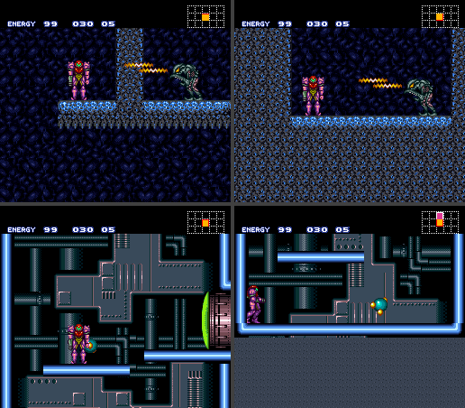
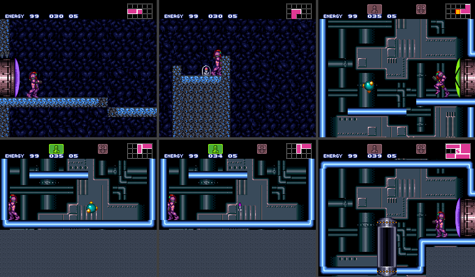

# 19g — Inimigos da Phazon Mines (região A)

Estado: **verificada** (05/11/2026: validate "236 salas, 488 portas, 0 problemas", a linha do Tallon e a das rodadas idênticas às da
19f (diff contra `scratchpad/v19f_me.txt`: só a linha nova "mines (specs/19g)"); `.ips` sha1 `06289783a1bf206bdb625283e1f2999472dd04fa`
igual em dois builds; grupo A **34/34** em 3 min 29 s, B **64/64** em 3 min 42 s, C **21/21** em 2 min 05 s, D **9/9** em
3 min 58 s; carga da máquina 6–28 por outros processos). Rascunho → aprovada (épico aprovado pelo usuário; pedido do orquestrador) →
implementada → verificada na mesma sessão.
Esforço estimado: 1,5–2 dias (medido: ~0,5 dia; as caminhadas da 19f quase não mudaram: os piratas ficam fora do caminho)
Épico: [19 — Phazon Mines](19-phazon-mines.md) (decisão técnica 5, decisão do usuário 5: as Elite Pirates fora; linha 19g da tabela
de filhas); modelos: [18g](18g-inimigos-phendrana.md) (camada 0 do Prime, a cópia do orbe, justiça em toda sala, a regra da deriva,
a tabela das outras regiões com propostas), [18l](18l-regiao-d-phendrana.md) (a regra da câmera), [15](15-auditoria-de-entrada.md)
(nenhum dano nos 120 primeiros quadros de uma entrada de porta de verdade), [19f](19f-regiao-a-mines.md) (as salas e as caminhadas).

## Contexto

A região A da Mines (19f) está construída sem inimigos. Esta filha põe os da camada 0 do Prime nas salas da região que os têm, com
espécies do SM que já existem no projeto (nenhuma cópia nova em `$A0`), grava a tabela do Prime das regiões B–D com as propostas para as
filhas delas, leva a regra de justiça "toda sala, toda rodada" à área 5, estende a auditoria de entrada de porta (spec 15) à Mines e
mede de novo as caminhadas da 19f com os inimigos **vivos**. A Elite Research fica livre para a arena do Phazon Elite (19h).

## Estado antes (verificado)

- validate "236 salas, 488 portas, 0 problemas" (`scratchpad/v19f_me.txt`); `.ips` sha1 `92332441…f074`; A 34/34, B 64/64, C 21/21,
  D 7/7.
- `areas.MINES` sem `enemies`; nenhuma regra de inimigo na área 5.

### O Prime, camada 0 da Mines (dados: `scratchpad/s19g/mines_objs.txt`, roteiro `s19g/scripts/mines_objs.py`)

Igual à lista do épico ("Inimigos"). Na região A só duas salas têm inimigo na camada 0:

| P# | Sala | Camada 0 | Telas SM |
|---|---|---|---|
| 2 | Main Quarry | SpacePirate 4 | 5×3 |
| 10 | Elevator Access A | AtomicBeta 4 | 1×2 |
| 13 | Elite Research | nenhum (o Phazon Elite é da camada 1: a arena da 19h) | 4×2 |
| outras | P0, 1, 3–9, 11, 12 | nenhum (os piratas das emboscadas são de camadas de evento) | |

Regiões B–D: Elite Control Access SpacePirate 2; Ventilation Shaft Puffer 8; Metroid Quarantine A MetroidAlpha 5 (e um `TeamAIMgr`, que
não é inimigo); Quarantine Access B AtomicAlpha 3; Elevator Access B Burrower 3; Fungal Hall B MetroidAlpha 6 + Ripper 1; Fungal Hall
Access AtomicAlpha 3 + SpacePirate 1; Fungal Hall A MetroidBeta 4 + Ripper 1. A região C não tem nada na camada 0 (os 3 AtomicAlpha da
Processing Center Access são da camada 3).

### O SM (cabeçalhos em `$A0`, ROM base)

| Espécie | Vida | Toque | Tiros do Power Beam | Uso |
|---|---|---|---|---|
| pirata andante cinza `$F653` (fragata, Tallon) | 20 | 15 | 1 | SpacePirate |
| cópia do orbe `$A0:F8BF` (18g) | 100 | 20 | 5 | AtomicBeta (e AtomicAlpha) |
| Mella `$D13F` (Chozo) | 30 | 16 | 2 | proposta: Puffer |
| cópia do Metroid `$A0:F97F` (18l) | 100 | 20 | 5 | proposta: MetroidAlpha e MetroidBeta |
| Sova `$DCBF` (Magmoor) | 40 | 20 | 2 | proposta: Burrower |
| PIPE `$E97F` (insetos de cano) | 100 | 10 | **nenhum** (vulnerabilidade 0 ao Power Beam) | recusado (a proposta do épico) |

O pirata (`WalkingSpacePirates_Main` `$B2:FD32`) anda até 48 px para cada lado (parâmetro 2 = `$30`), vira na ponta da borda e na
parede, e **atira o laser (10) na linha dele sempre que a Samus está a menos de 16 px da altura dele**, a qualquer distância, enquanto
ele está na câmera (`WalkingSpacePirates_FD44` `$B2:FD44`, `IsSamusWithinEnemy_Y` 16). No emulador o laser **atravessa paredes** (o cabo
do guindaste, foto abaixo).

## O que foi feito

1. **Espécie** (`tools/frigate/enemies.py`): campo novo `Species.fires` (a altura, em px, em que ele atira na Samus); o `pirate` com
   `fires=16`. Só a regra nova da Mines o lê.
2. **Tabela** (`tools/mines/enemies.py`, novo, molde de Phendrana): `ENEMIES` (região A), `STAND_IN` (SpacePirate → pirata,
   AtomicBeta/AtomicAlpha → a cópia do orbe, Ripper → fora, como em Phendrana), `PRIME_LAYER0` com **todas** as salas da Mines com
   inimigo na camada 0, `ARENA_ROOMS` (Elite Research → 19h, Elite Quarters → 19k: nenhuma das duas tem inimigo na camada 0),
   `PROPOSED_LATER` para B–D (Puffer → Mella, MetroidAlpha → o Metroid justo, MetroidBeta → o mesmo Metroid (a 19l pode dar uma cópia
   com mais vida, dentro dos 5 tiros), Burrower → a Sova da Magmoor). `areas.MINES.enemies`.
3. **Por sala** (≥ 1 de cada tipo do Prime, ≤ a conta do Prime, ≤ 1 por tela):

| Sala | Inimigos (SM) | Onde |
|---|---|---|
| Main Quarry (5×3) | 2 piratas | no braço do guindaste, a leste do cabo (45, 7: a tela do céu); no chão a leste da torre (77, 42) |
| Elevator Access A (1×2) | 2 orbes (AtomicBeta) | sobre a borda de cima, no oeste da tela de cima (4, 11); sobre o chão, no leste da tela de baixo (12, 26) |
| Elite Research | nenhum | a arena do Phazon Elite (19h) |

   Total **4 inimigos em 2 salas**.
4. **Validador** (`tools/validate.py`): **`check_mines_enemies`** (linha nova "mines (specs/19g)"): `check_layer0_enemies` da área 5
   com a justiça **em toda sala, qualquer rodada** (`MINES_FAIR_EVERY_ROUND`: ≤ 5 tiros do Power Beam sem carga, ≤ 20 por toque);
   `PRIME_LAYER0` só com salas da tabela; `ENEMIES` só em salas construídas; `ARENA_ROOMS` = as salas de chefe do épico
   (`EPIC_MINES_BOSS_ROOMS`) com a filha certa, e nada nelas até a arena existir (só os tipos da luta); nenhum tipo de chefe fora delas;
   todo tipo do Prime decidido ou proposto, nunca os dois; **uma proposta que é espécie nossa tem de ser justa**; a regra da deriva
   (`homing_problems`, 18g) e a da câmera (`chaser_problems`, 18l) em toda sala; e a **regra nova do que atira** (`shooter_problems`):
   para cada porta, com a câmera na tela da porta (32 px de folga, como a 18l), o pirata em qualquer ponto da caminhada dele (o
   parâmetro 2) ou fica fora da câmera, ou fica a mais de `fires` px da altura da Samus parada nas células de dentro da porta (até
   `ENTRY_REACH` = 2 blocos além). `check_enemies`, `check_enemy_sets`, `check_enemies_in_rom` e `check_bosses` já percorriam toda área.
5. **Testes** (grupo D):
   - novo **`mines_inimigos_vivos`** (como o `chozo_inimigos_vivos`): da P0 (atalho, o equipamento da rodada 5), a entrada em cada sala
     com inimigos (atalho pela porta do vizinho): cada inimigo no lugar dele da tabela de WRAM com a vida cheia, parada na porta 300
     quadros sem perder energia; uma foto de cada inimigo;
   - novo **`entradas_de_porta_mines`** (spec 15: as 5 entradas de porta das 2 salas, de verdade, nenhum dano nos 120 primeiros quadros);
   - `mines_regiao_a_rota` medido de novo (abaixo); `mines_regiao_a_rodada_6` e `mines_save_station_a` passam sem mudança.

## Resultado

Em cima: o pirata do braço do guindaste atirando na Samus do outro lado do cabo (o laser atravessa o cabo); o pirata do chão a leste
da torre atirando. Embaixo: a Elevator Access A com o orbe de cima vindo até a Samus na borda de cima, e o orbe de baixo vindo pelo chão.

De `mines_regiao_a_rota`, energia 99 em todas: a chegada na Main Quarry pela L0 (os dois piratas fora da câmera); no topo da torre; a
chegada na Elevator Access A com o orbe de cima vindo; no chão, o orbe de baixo vindo; os dois mortos (o míssil do segundo ainda
voando); a Save Station A no fim.

### Justiça (números)

Pirata 1 tiro (20 de vida), 15 por toque, laser 10; orbe (cópia) 5 tiros, 20 por toque; com a Varia e a Gravity da rodada 5, toque do
orbe 5. Deriva do orbe ½ px por quadro: os dois ficam a ≥ 112 px (≥ 224 quadros) das células de entrada da R0. Os piratas: o do braço
fica 59 px acima da Samus na prateleira da L0 e fora da câmera de toda porta; o do chão leste fica fora da câmera das 4 portas (a da porta de
chão, a mais perto, acaba 376 px antes da caminhada dele). VRAM: no máximo `$C00` (pirata) de `$2000`.

### Auditoria das entradas (spec 15)

`entradas_de_porta_mines` (5 entradas: Main Quarry L0, B2, L2, L1; Elevator Access A R0): passa. Auditoria forte (o mesmo teste com 600
quadros de espera, só no scratchpad): **nenhum toque em 4 das 5 entradas em 600 quadros**; a Elevator Access A R0 leva o orbe de cima aos
**220** quadros (ele vem até a Samus parada: é o que ele faz).

### Caminhadas medidas de novo

| Teste | Mudança |
|---|---|
| `mines_regiao_a_rota` | na chegada da Main Quarry: `enemies_alive` (os 2 piratas vivos; a rota passa sem que nenhum a veja à altura dela, igual à 19f); a Elevator Access A: a porta L1 da Ore Processing com o tiro e **30 quadros** depois da porta (`M19G_EAA_IN`, era 200), `enemies_alive`, **um míssil** no orbe de cima (`M19G_ORB_WEST`: SELECT, tiro), ele conferido morto; a descida da 19f; no chão, virada para leste, **um míssil** no orbe de baixo e a virada de volta (`M19G_ORB_EAST`; a subida medida da 19f começa igual), ele conferido morto; o HUD de volta ao feixe (`M19G_HUD_OFF`); fotos novas `19g_rota_orbe_de_cima`, `19g_rota_orbes_mortos` |
| novo `mines_inimigos_vivos` | as 2 salas, de um atalho da P0 |
| novo `entradas_de_porta_mines` | as 5 entradas, de um estado salvo na P0 (`mines_down`) |

**Por que míssil**: o Ice Beam da rodada 5 congela o orbe no primeiro tiro; os tiros seguintes no orbe congelado não tiraram vida (no
emulador: 6 tiros, 3 acertos, 40 de vida sobrando), e o orbe descongela e volta a vir. Um míssil (100) mata a cópia (vida 100) de uma
vez. Logo depois da porta o míssil passou pelo orbe sem acertar; 30 quadros depois, acerta.

Grupo D: **9 testes** (antes 7).

### Espaço

`$A1` (populações) +70 (as 2 salas, até `$A1:FC62`), `$B4` (sets) +26 (até `$B4:F96D`); `$A0` (nenhuma cópia nova), `$8F`, `$83`,
`$84`, nível, fixo, SRAM: nada.

## Critérios de aceite

1. validate 0 problemas; a linha do Tallon e a das rodadas idênticas às da 19f; linha nova 19g. **Passa.** (protege = contas do Prime,
   ≤ 1 por tela, justiça em toda rodada, arenas livres, decisões/propostas justas, deriva e tiro longe das portas, ROM = tabela;
   falha_quando = G1–G14, G16, G17, R1–R3; não_prova = que as espécies agradam)
2. `entradas_de_porta_mines` passa (protege = nenhum dano nos 120 quadros de toda entrada de porta das salas com inimigos;
   falha_quando = E1, E3, E5). **Passa.**
3. `mines_inimigos_vivos` passa (protege = os 4 inimigos nos lugares, com a vida cheia, parada na porta sem perder energia). **Passa.**
4. `mines_regiao_a_rota` com os inimigos vivos na chegada, os orbes mortos no caminho (conferidos), energia 99 do começo ao fim
   (falha_quando = E2, E4); os testes antigos passam. **Passa.**
5. Dois builds com o mesmo sha1; fotos `specs/img/19g-*.png` olhadas. **Passa.**

## Plano de testes

| Camada | O quê | Qtde |
|---|---|---|
| validate.py | `check_mines_enemies` (justiça em toda rodada, deriva, tiro, câmera, arenas, tabela, propostas) | +1 |
| run_tests.py (grupo D) | `mines_inimigos_vivos`, `entradas_de_porta_mines`; `mines_regiao_a_rota` medida de novo | +2 |
| scratchpad (`s19g/`) | 17 mutações do validador (e o G0 limpo), 3 de ROM (e o R0 limpo), 5 do emulador; auditoria forte (600 quadros) | 26 |
| imagem | `specs/img/19g-inimigos.png`, `specs/img/19g-rota.png` | +2 |

## Mutações

Validador (`s19g/scripts/mutate_g.py` → `s19g/mutate_g.out`, na cópia `s19g/proj`), todas pegas, sem mutação limpo (G0): G1 orbe de cima
a 4 blocos das células da R0 ("vai até a Samus na porta 0 (R0) em 64 quadros"); G2 pirata no chão na câmera da L2 ("na câmera da porta 2
(L2) à altura da Samus"); G3 pirata no degrau do zigue-zague à altura da L0; G4 5 piratas (Prime 4); G5 Elevator Access A sem orbe; G6 3
orbes em 2 telas; G7 pirata na Elite Research (arena da 19h); G8 MetroidBeta sem decisão nem proposta; G9 Ripper decidido e proposto;
G10 `PRIME_LAYER0` com sala fora da tabela; G11 inimigos numa sala fora do build; G12 `ARENA_ROOMS` com a filha errada; G13 proposta
injusta (MetroidBeta → o Kago); G14 pirata dentro do braço do guindaste; G16 orbe a 1,5 px por quadro (também os de Phendrana); G17
SpacePirate fora de `STAND_IN`. Controle G15: o G2 com o pirata sem `fires` — nenhuma regra de inimigo pega (só a ROM velha): a regra
nova é a que pega o G2.
ROM (`s19g/scripts/mutate_rom.py` → `s19g/mutate_rom.out`): R1 o pirata do braço 1 bloco a leste na ROM construída ("sem a
população/enemy set da tabela"); R2 a paleta do enemy set da Elevator Access A trocada; R3 a vida da cópia do orbe 250 na ROM ("bytes do
cabeçalho diferentes da origem … +$04").
Emulador (`s19g/scripts/mutate_emu.py` → `s19g/mutate_emu.out`; cópia reconstruída e restaurada): E1 o orbe de cima a 4 blocos da R0 →
`entradas_de_porta_mines` falha (perdeu energia 90 quadros depois de chegar); E2 sem o míssil no orbe de cima → `mines_regiao_a_rota`
falha (o orbe vivo, energia 94); E3 pirata no chão na câmera da L2 → `entradas_de_porta_mines` falha (o laser aos 100 quadros); E4 a
cópia do orbe com a vida vanilla (250) → `mines_regiao_a_rota` falha (o míssil não mata); E5 pirata no degrau à altura da L0 →
`entradas_de_porta_mines` falha (o laser aos 100 quadros).

## Riscos e reversão

- A caminhada da Elevator Access A depende dos orbes (quadros medidos: `s19g/scripts/trace.py`); mexer na posição deles, na espécie ou
  na geometria pede medir de novo.
- **O laser do pirata atravessa paredes**: a regra nova olha só a câmera e a altura, não as paredes (de propósito). Um pirata numa sala
  nova pode atirar na Samus que anda numa linha do caminho, longe da porta: a filha da região confere no emulador (a regra vale para as
  portas).
- Reversão: `mines/enemies.ENEMIES` vazio (e `areas.MINES` sem `enemies`) e as caminhadas da 19f: a ROM volta à da 19f.

## Fora de escopo

- Regiões B–D (só a tabela do Prime e as propostas); as arenas do Phazon Elite (19h) e do Omega Pirate (19k).
- Camadas de evento (os piratas das emboscadas da Security Access A, da Mine Security Station e das outras salas, os Shadow Pirates, os
  Drones, os Metroids dos tanques, as torretas, as 3 Elite Pirates: decisão 5 do usuário).

## Desvios

- **Main Quarry com 2 piratas** (o Prime tem 4): onde nenhuma porta os vê à altura da Samus e a rota da região não passa à altura deles;
  os outros lugares com chão (as prateleiras das portas, os degraus do zigue-zague, o chão entre o penhasco e a torre) ficam no caminho
  ou na câmera de uma porta, e o laser dele atravessa paredes. Elevator Access A com 2 orbes (o Prime tem 4; a sala tem 2 telas).
- **Regra nova no validador** (não pedida pelo épico): o que atira na Samus (`Species.fires`, o pirata) fica fora da câmera de toda porta
  ou fora da altura dela; nasceu do E3/E5 (o laser aos 100 quadros).
- **Os orbes morrem com míssil** na rota (não com o feixe): o Ice Beam da rodada 5 congela o orbe e os tiros seguintes não tiram vida.
  A justiça (5 tiros do Power Beam) é a da espécie, igual à de Phendrana.
- **Proposta do Burrower = a Sova da Magmoor**, não o PIPE `$E97F` do épico: o PIPE não sofre dano do Power Beam (vulnerabilidade 0,
  lida na ROM base); a Sova já é o Burrower da Magmoor (17g). **MetroidBeta = o mesmo Metroid justo** (proposta; a 19l decide se precisa
  de uma cópia com mais vida).
- **Nenhuma cópia nova em `$A0`**: o épico previa até 4 cópias na Mines; a região A só usa espécies que já existem (o pirata, a cópia do
  orbe da 18g). As cópias do Phazon Elite (19h) e do Omega (19k) ficam com as filhas delas.
- `tallon_look` (testes) ganhou o parâmetro `settle` (quadros depois de voltar da pausa antes da foto; padrão 200, igual a antes): as
  fotos dos piratas saem aos 110 (aos 200 o laser já tinha acertado e a Samus piscava).
- Experimentos, buscas e mutações na cópia `s19g/proj` (sem `.claude/`); a pasta real só recebeu os arquivos finais.
- Verificação (05/11/2026, pasta real, um grupo por vez, na ordem A → B → C → D): `python3 -I tools/build.py` duas vezes → sha1
  `06289783a1bf206bdb625283e1f2999472dd04fa` nas duas; `python3 -I tools/validate.py` → "236 salas, 488 portas, 0 problemas" (diff
  contra a 19f: só a linha nova "mines (specs/19g)"); `--grupo A` **34/34** (3 min 29 s), `--grupo B` **64/64** (3 min 42 s),
  `--grupo C` **21/21** (2 min 05 s), `--grupo D` **9/9** (3 min 58 s). Carga da máquina entre 6 e 28 (outros processos).

## Decisões para o usuário (escolhidas as recomendadas; confirmar)

**Confirmado pelo usuário em 09/11/2026: padrão aceito** (todas as escolhas abaixo ficam como estão).

1. **Main Quarry com 2 piratas fora do caminho** (no braço do guindaste e no chão a leste da torre). Alternativa: um terceiro no chão
   do caminho, que a rota mata (pede outra busca da caminhada e um lugar fora da câmera das portas).
2. As propostas para B–D: Puffer = Mella; MetroidAlpha e MetroidBeta = o Metroid justo da 18l; Burrower = Sova; Ripper fora.
