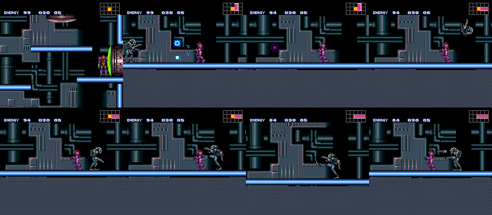
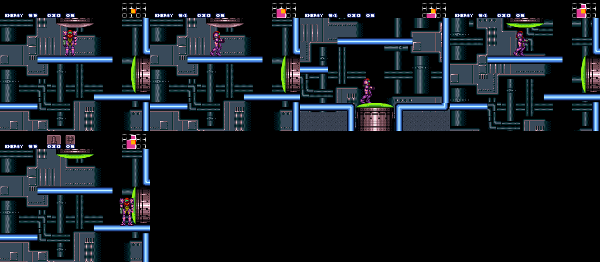

# 19h — Phazon Elite (arena da Elite Research)

Estado: **verificada** (06/11/2026: validate "236 salas, 488 portas, 0 problemas", as linhas do Tallon e das rodadas idênticas às da 19g
(diff contra `scratchpad/s19h/v19g_before.txt`); `.ips` sha1 `182608467ebcf40fa1d613807dad6e357dbbd2d4` igual em dois builds; grupo A
**34/34**, B **64/64**, C **21/21**, D **10/10**). Rascunho → aprovada (épico aprovado pelo usuário; pedido do orquestrador) →
implementada → verificada na mesma sessão.
Esforço estimado: 2 dias (linha 19h do épico; medido: ~1 dia, a luta achada por busca em feixe no emulador)
Épico: [19 — Phazon Mines](19-phazon-mines.md) (decisão do usuário 4: o Phazon Elite = cópia do pirata ninja dourado do SM em cores de
phazon, a porta tranca até ele morrer, sem prêmio, os tetos de justiça do épico 14; linha 19h da tabela de filhas); modelos:
[18h](18h-sheegoth.md) (arena de cota de mortes, porta cinza no estado vivo e a do feixe no morto), [18k](18k-thardus.md) (chefe do SM
corrigido no lugar, `PRIME_BOSS_LAYERS`), [14b](14b-arena-e-hive-mecha.md) (a rotina comum das arenas), [19f](19f-regiao-a-mines.md)
(a Elite Research), [19g](19g-inimigos-mines.md) (`ARENA_ROOMS`, a justiça em toda rodada da Mines).

## Contexto

A Elite Research (P13, 4×2, base pirata) está construída desde a 19f: o chão do laboratório na linha 26 de parede a parede, a porta R0
(da Research Access) na prateleira do alto a leste, três bordas em zigue-zague até a plataforma da porta de teto T3 (para a Security
Access B), o tanque vazio pendurado no teto e o míssil no canto oeste. A 19g a deixou vazia (`ARENA_ROOMS`). No Prime o Phazon Elite é
um `ElitePirate` da camada 1 da sala que sai do tanque, e a porta para a Security Access B tem um `Actor Door Lock`
(`mines/rooms.py BOSS_DOORS`, esperando esta filha). A 19f avisou: o ninja do SM é feito para salas de uma tela; talvez a arena
precisasse estreitar.

## Estado antes (verificado)

- validate "236 salas, 488 portas, 0 problemas" (`scratchpad/s19h/v19g_before.txt`, 15 min 41 s com a máquina carregada); `.ips` sha1
  `06289783a1bf206bdb625283e1f2999472dd04fa`; A 34/34, B 64/64, C 21/21, D 9/9 (os da 19g).
- **Pirata ninja dourado** `BATTA2Na` (`$A0:F593`, ROM base, `s19h/scripts/ninja.py`): vida **1800**, toque **100**, raio 16×32, uma
  parte, tiles `$1800` de `$AD:C600`, IA em `$B2` (init `NinjaSpacePirates_Init` `$B2:F5DE`, main `$F6A2`), paleta `$B2:8707`
  (1–8 armadura cinza-branca, 9–12 juntas rosadas, 13–15 o dourado), vulnerabilidades `$B4:EC74`: Power, Wave, Ice, Ice+Wave = `$80`
  (nada), Spazer 1×, Plasma 2×, míssil 2, super 4, tiro carregado 2.
- **O código do ninja** (`vendor/sm/src/sm_b2.c`, bytes conferidos): **não lê área, sala nem parede**. Ele salta entre dois x da
  própria colocação: o parâmetro 2 é o vão, o bit 0 do parâmetro 1 diz se começa na ponta oeste; o y é o da colocação. A sala vanilla
  dele (`$8F:B62B`) tem **3 telas** de largura, com 2 ninjas (x 232 e 536, parâmetro 2 `$C0`), set de paleta 1, cota 2. O salto
  de lado e o mergulho mexem x e y sem colisão (`SpacePirates_Func_11/13`), só o pouso do mergulho usa `Enemy_MoveDown`.
  Conclusão: **a sala de 4×2 não precisa mudar**; basta pôr o vão longe das bordas.
- Casos especiais só para o ponteiro `$F593` (`WalkingSpacePirates_87C8`, `_883E`, `_8789`): rebater os tiros que não ferem e soltar
  5 itens na morte. Uma cópia num outro endereço usa a IA de tiro comum (`NormalEnemyShotAi`).
- **A outra paleta**: o init copia 16 cores de `$B2:8727` (`kWallSpacePirates_Palette_3`, `LDA $8727,Y` em `$B2:F692`) para a linha
  de sprite 7, que os saltos mostram (`SpacePirates_Instr_20` `$B2:F536` com `$0E00`); depois volta à linha 1 (`$0200`): o set de
  paleta tem de ser 1. `$B2:8727` também é a paleta de 2 piratas vanilla (`$A0:F413`, `$F713`).
- Projéteis (`$86`, dano = `+8 & $0FFF`): as garras `$86:A189` **20**; o laser `$86:A17B` (10) é só dos piratas andantes.
- Prime (`research/prime_fs`, `s19h/scripts/er_types.py`, `ancs.py`): 1 `ElitePirate` na camada 1 da Elite Research; ANCS `6B45F06D`,
  personagem `Elite_Phazon_Pirate`, CMDL `87BFC431`; texturas em `s19h/elite_tex` (armadura cinza, carne lilás, veias de phazon azuis).
- Bits de chefe vanilla da área 5: só `$04` (`vanilla_boss_bits`). Rodada de chegada da Elite Research: **5** (Wave, Ice, Charge,
  Varia, Space Jump, Gravity, Morph, Bombas).
- Espaço livre: `$A0` a partir de `$A0:F9BF`; `$B2:FEAA–FFFF` (342 bytes, só `$FF` na base e no build).

## Mudança

1. **Cópia** (`tools/chozo/bosses.py`): `PHAZON_ELITE = SpeciesCopy($F9BF, $F593, toque 40, cores, health=400, vulnerability=
   ELITE_VULN)`. Vida **400** = 20 tiros do Power Beam (o teto do épico, como o Thardus); tabela própria: a do dourado com Power,
   Wave, Ice e Ice+Wave a **1×** (`$82`: o bit alto = nunca congela), o resto igual (míssil 2, carregado 2…). Cores (rampas de
   `s19h/scripts/elite_ramps.py`, das texturas do Prime): 1–8 a armadura cinza, 9–12 o azul do phazon, 13–15 o brilho do phazon.
2. **A paleta do salto** (corrigida no lugar, como o Torizo da 18k): o operando do `LDA $8727,Y` aponta para uma cópia em `$B2` com
   1–8 e 13–15 no brilho do phazon e 9–12 no azul (`ninja_patches`, com conferência dos bytes vanilla); `$B2:8727` fica.
   Nenhuma sala nossa tem ninja vanilla (o validador confere).
3. **Inimigo** (`tools/frigate/enemies.py` `phazon_elite`, `tools/mines/enemies.py`): a colocação vanilla (init 0, propriedades
   `$2800`, extra `$0004`, parâmetro 1 = 0, parâmetro 2 = `$C0`), set de paleta 1, `boss`; na Elite Research `Spawn(PE, 28, 26)`: o
   salto entre x 263 e 457, no chão, a oeste do zigue-zague e longe do míssil. `ARENA_KINDS` e `PRIME_BOSS_LAYERS` (camada 1) novos.
4. **Arena** (`ARENAS`): `Arena("mines_elite_research", $08, KILLS, …, sem prêmio)`; música de mini-chefe `2A/05` no estado vivo, a
   da Mines no morto. Bit `$08` da área 5 (`$7ED82D`).
5. **Porta** (`tools/mines/rooms.py`): a regra de Phendrana: a porta de chefe de uma arena construída (a T3, de teto) vira `boss`
   com a tampa de gelo do Prime como `dead_lock`. O build já punha a **cinza de tipo 3** (cota de mortes, `$C854` de teto) só no
   estado vivo e a de gelo vertical só no morto (`arena_door_alive_cap`). A R0 (gelo) não tranca: o Prime não tem trava nela.
6. **Build**: `$B2` vira alocador (`$B2:FEAA`): a paleta da cópia e a do salto.
7. **Validador** (`tools/validate.py`):
   - `check_arenas` com a justiça da Mines em toda rodada (`MINES_FAIR_EVERY_ROUND`); `arena_kills` conta as garras do ninja;
   - `check_ninja` (novo): cópia do dourado (nunca o vanilla), o único inimigo da sala, set de paleta 1, o salto inteiro
     (`bosses.ninja_leap`: o vão do parâmetro 2 e a subida) sobre chão firme e com a caixa no ar até o topo do salto;
   - na ROM: o operando do init e as cores do salto iguais às de `bosses.py`, `$B2:8727` vanilla, as cores do salto diferentes das
     vanilla; as tampas da porta de chefe da Mines por estado (a regra das de Phendrana);
   - `check_mines_enemies`: na arena só os tipos dela (`ARENA_KINDS`), entre 1 e a conta do Prime (com `PRIME_BOSS_LAYERS`); a linha
     diz "arenas: elite_research (19h: construída), elite_quarters (19k: livre)";
   - `check_epic_bosses`: linha nova **"chefes da Mines (specs/19h)"** (`EPIC_MINES_BOSSES`, `MINES_BOSS_CHILDREN_DONE = {"19h"}`).
8. **Testes** (grupo D): **`mines_phazon_elite`** novo; `mines_regiao_a_rota` cruza a Elite Research morta por atalho anotado
   (`MINES_ELITE_WON_BY_RAM` = `poke 7ED82D 08` antes da porta); `entradas_de_porta_mines` passa a cobrir as 2 entradas da Elite
   Research (R0 e T3) sem mudança no código.

## Resultado

Em cima: a entrada pela R0 (a tampa cinza da T3 no teto, à esquerda); um tiro carregado de Ice + Wave voando no Phazon Elite (a
armadura cinza, as pernas no azul do phazon); a morte (a bola roxa) com energia 94; um salto dele (alto, na linha 7: o brilho azul).
Embaixo (fotos do roteiro de exploração `s19h/scripts/entry.py`, a mesma ROM): ele chegando perto, o chute, a Samus atingida (84).

A porta de teto trancada na luta (um tiro para cima não abre: foto do `s19h/emu/locked.txt`); depois da vitória a Samus na plataforma,
a tampa aberta pela cota; a Security Access B; voltando, a sala morta com a porta de gelo (verde); depois do save, game over e
continue, ainda morta.

### Justiça (números)

| | Vida | Toque (com Varia e Gravity) | Garras | Tiros do Power Beam | Ice + Wave (sem carga / carregado) |
|---|---|---|---|---|---|
| Phazon Elite (cópia do ninja dourado) | 400 | 40 (10) | 20 | **20** (máximo de chefe 20) | 60 / 180 |

No teste: `ELITE_FIGHT = "LLLLLLLLCCL"` (da prateleira da R0 ao chão, dois tiros carregados), ~380 quadros até a vida 0, energia 99 →
**94** (um toque). **Robustez** (`s19h/scripts/robust.py`, começando 0–38 quadros depois, 20 começos): o roteiro sozinho vence em **20 de
20**, energia mínima 94. **Só com o Power Beam** (os feixes tirados por RAM, tiros sem carga às cegas para os dois lados): vence, energia
mínima 69. A luta é curta na rodada 5 (o Ice + Wave carregado tira 180).

### Espaço

`$A0` +64 (a cópia em `$A0:F9BF`, livre a partir de `$A0:F9FF`), `$B2` +64 (as duas paletas, livre a partir de `$B2:FEEA`), `$B4` +35 (a
tabela de vulnerabilidade e o set), `$A1` +22 (populações viva e morta), `$84` +12 (a entrada da tabela das arenas), `$8F` +51 (faixa
das demos: 3398 → 3449 de 3796). No lugar: `$B2:F693` 2 bytes (o operando). Nível, fixo, `$83`, SRAM: nada.

### Linhas do validador (o que mudou)

- **Iguais**: a do Tallon ("44 salas construídas, alcançáveis agora: 44, 20 itens em 7 rodadas") e a das rodadas ("79 itens em 7
  rodadas … 79% (energia 1299, mísseis 250, super mísseis 5, power bombs 25)").
- "mines (specs/19g)": "arenas: elite_research (19h: construída), elite_quarters (19k: livre)"; "mines (specs/19f)": 29 travas mapeadas
  (eram 28), "esperando o chefe: nenhuma"; "chefes (specs/14a)": 7 cópias; "arenas (specs/14b)": a arena nova ("1 phazon_elite, cota
  de mortes, bit $08, 20 tiros do Power Beam (rodada 5), até 40 por golpe, nenhum prêmio"); nova "chefes da Mines (specs/19h): Phazon
  Elite (mines_elite_research, rodada 5, bit $08): a porta para mines_security_access_b tranca até a vitória; esperando: Omega Pirate
  (19k)"; "grapple": 29 espécies; `$8F` recuperado 7213 → 7264.

## Critérios de aceite

1. validate 0 problemas; as linhas do Tallon e das rodadas idênticas; a linha nova "chefes da Mines (specs/19h)". (protege = cópia,
   cores, paleta do salto, arena, porta por estado, contas do Prime, justiça, o salto no ar e no chão; falha_quando = V1–V14, R1–R5;
   não_prova = que a luta se vence: critério 2)
2. `mines_phazon_elite` (emulador): a arena viva na entrada pela R0 (o Phazon Elite no slot 0 com vida 400, cota 1, bit `$08` da área
   5 desligado, música `2A/05`, a tampa cinza `$C854` na T3, a de gelo na R0); a luta **de verdade** com o equipamento da rodada 5
   (`ELITE_FIGHT`, nada reposto, nenhuma RAM): vida 0, o slot vazio, 1 morte, bit `$08`, música parada, energia 94, 30 mísseis; o
   zigue-zague até a plataforma (`ELITE_CLIMB`), um tiro para cima, a T3 abre: Security Access B; voltando: o estado morto (nenhum
   inimigo, música da Mines, a tampa de gelo na T3); save na Save Station A, game over, continue: o bit ligado, a sala morta.
   (falha_quando = E1–E4)
3. `mines_regiao_a_rota` passa com o atalho anotado; `entradas_de_porta_mines` cobre as entradas da Elite Research; os outros testes
   iguais.
4. Dois builds com o mesmo sha1; fotos `specs/img/19h-*.png` olhadas.

## Plano de testes

| Camada | O quê | Qtde |
|---|---|---|
| validate.py | `check_ninja`, paleta do salto na ROM, arenas da Mines (justiça em toda rodada, garras), tipos da arena, linha do épico | regras novas |
| run_tests.py (grupo D) | `mines_phazon_elite`; atalho em `mines_regiao_a_rota` | +1 (10) |
| scratchpad (`s19h/`) | mutações do validador, de ROM e do emulador; robustez (20 começos); só Power Beam | ~25 |
| imagem | `specs/img/19h-luta.png`, `specs/img/19h-portas.png` | +2 |

## Mutações

Validador (`s19h/scripts/mutate_h.py` → `s19h/mutate_h.out`, nas cópias `s19h/mut1`–`mut4`, sem `.claude/`; cada uma muda um arquivo,
constrói, valida, volta), **todas pegas**, sem mutação limpo (V0): V1 toque 80; V2 vida 9000 (450 tiros); V3 a tabela do dourado (o
feixe sem carga não fere: "não morre com o Power Beam"); V4 a arena tirada de `ARENAS`; V5 dois Phazon Elites (Prime 1); V6 um pirata
na arena (VRAM, tipo, conta); V7 o ninja vanilla `$F593`; V8 set de paleta 2; V9 o ninja sob as bordas do zigue-zague (o salto nos
blocos); V10 19h fora de `MINES_BOSS_CHILDREN_DONE`; V11 a porta tirada de `BOSS_DOORS`; V12 o bit `$04` (o vanilla da área 5); V13 o
épico com prêmio; V14 sem `PRIME_BOSS_LAYERS`. Controle V15: as garras fora da conta (`NINJA_EPROJS` vazio) passa limpa, como esperado
(20 < o toque 40).
ROM (`s19h/scripts/mutate_rom.py` → `mutate_rom.out`), todas pegas, R0 limpo: R1 o init lendo `$8727` de novo; R2 uma cor do salto; R3
a tampa cinza da T3 de tipo 4; R4 a vida da cópia 800; R5 a paleta vanilla `$B2:8727` mudada.
Emulador (`s19h/scripts/mutate_emu.py` → `mutate_emu.out`, na cópia `mut4`), E0 passa: E1 vida 1600 → falha (vivo no fim); E2 o bit da
arena `$10` → falha; E3 a condição "slot 1 vazio" → o build recusa (porta de chefe sem arena que a abra); E4 sem a tampa de gelo no
estado morto → falha (a T3 sem tampa).

## Riscos e reversão

- **Roteiro da luta** (`ELITE_FIGHT`) e a subida (`ELITE_CLIMB`): medidos a partir do estado exato do teste (`s19h/scripts/boss.py`,
  `climb.py`); mexer na sala, na posição do ninja, no caminho até ela ou em `mines_down` pede nova busca (~2 min). Robusto a 0–38 quadros.
- **O init dos ninjas foi mudado no lugar**: um ninja vanilla numa sala futura usaria as cores do salto do Phazon Elite (o validador
  recusa ninja vanilla em sala nossa).
- O vão do salto (194 px) não cobre a sala inteira: o ninja fica na metade oeste; a Samus o procura.
- Reversão: tirar a entrada de `ARENAS`, o inimigo da Elite Research, a cópia e o patch do init (e o atalho do teste da rota): a ROM volta à
  da 19g.

## Fora de escopo

- A cena do tanque (o Phazon Elite saindo dele), as camadas de evento da sala (piratas, Metroids, torretas da camada 1), o artefato
  Warrior (nada, decisão 3), a música própria; o Omega Pirate (19k) e as regiões B–D.

## Desvios (preenchido na implementação)

- **A sala não mudou**: o ninja do SM não supõe uma sala de uma tela (o código não lê paredes; a sala vanilla tem 3 telas); o vão do
  parâmetro 2 (o vanilla, `$C0`) cabe no chão a oeste do zigue-zague. A 19f previa talvez estreitar a arena: não precisou.
- **O feixe sem carga fere** (tabela própria): o dourado vanilla rebate os feixes, mas o épico pede ≤ 20 tiros do Power Beam; a cópia
  não usa o rebote (o código compara o ponteiro com `$F593`), então sem a tabela nova o feixe só faria "plink".
- **A paleta do salto** (linha 7) também recolorida, por um patch de 2 bytes no init (sem ele o salto ficava dourado-laranja).
- **As cores**: a primeira tentativa (9–12 na carne lilás das texturas) não mostrava azul nenhum (`s19h/emu/zoom.png`); ficou 9–12 no
  azul do phazon e 13–15 no brilho.
- `$B2` ganhou um alocador no build; `PRIME_BOSS_LAYERS`/`ARENA_KINDS` da Mines (como os de Phendrana).
- **A subida depois da luta** foi medida de novo (`ELITE_CLIMB`): a `M19F_ELITE_UP` da 19f começa vindo do oeste, correndo; da parede
  leste parada ela errava a terceira borda.
- Na Security Access B o teste confere a sala, o estado e a energia (não a altura dos pés: a chegada pela porta de chão daqui pousa
  numa borda diferente da da rota).
- Busca: o sistema de arquivos ignora maiúsculas (`r` e `R` eram o mesmo estado salvo); os nomes dos nós ganharam `_` nas maiúsculas.
- Experimentos, buscas e mutações na cópia `s19h/proj` e em `s19h/mut1`–`mut4` (sem `.claude/`); a pasta real só recebeu os arquivos
  finais. A sessão foi interrompida uma vez (o computador dormiu): nenhum processo ficou rodando, as edições estavam inteiras.
- Verificação (06/11/2026, pasta real, um grupo por vez, na ordem A → B → C → D): `python3 -I tools/build.py` duas vezes → sha1
  `182608467ebcf40fa1d613807dad6e357dbbd2d4` nas duas; `python3 -I tools/validate.py` → "236 salas, 488 portas, 0 problemas" (1 min 54 s;
  diff contra a 19g: só as linhas da Mines, dos chefes, das arenas, do `$8F` recuperado e do gancho, acima); `--grupo A` **34/34** (18 min
  24 s), `--grupo B` **64/64** (39 min 32 s), `--grupo C` **21/21** (13 min 26 s), `--grupo D` **10/10** (16 min 32 s). A máquina estava
  muito carregada (carga 40–147: antivírus e outros processos); os tempos de antes eram ~3–4 min por grupo. Nenhum teste falhou: os
  testes contam quadros, não tempo.

## Decisões para o usuário (escolhidas as mais perto do épico e dos padrões; confirmar)

**Confirmado pelo usuário em 09/11/2026: padrão aceito** (todas as escolhas abaixo ficam como estão).

1. **O feixe sem carga fere o Phazon Elite** (vida 400 = 20 tiros do Power Beam, o teto do épico). Na rodada 5 o Ice + Wave carregado
   tira 180: a luta dura ~2 tiros carregados. Alternativa: a imunidade do dourado (só tiros carregados e mísseis: regra 13), vida até
   1200 (20 tiros carregados do Power Beam).
2. **Cores**: armadura cinza com as pernas e juntas no azul do phazon, o brilho azul no salto. Alternativa: mais azul (a armadura toda).
3. **A sala ficou como na 19f** (4×2): o ninja salta na metade oeste do chão; a porta R0 não tranca (o Prime não tem trava nela): sair por
   ela e voltar recomeça a luta com vida cheia.
4. **Sem prêmio** (o artefato Warrior não existe no SM); o míssil da sala continua no canto oeste, pegável durante a luta.
