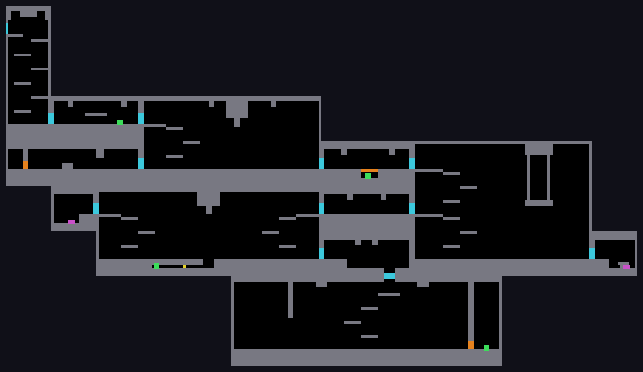
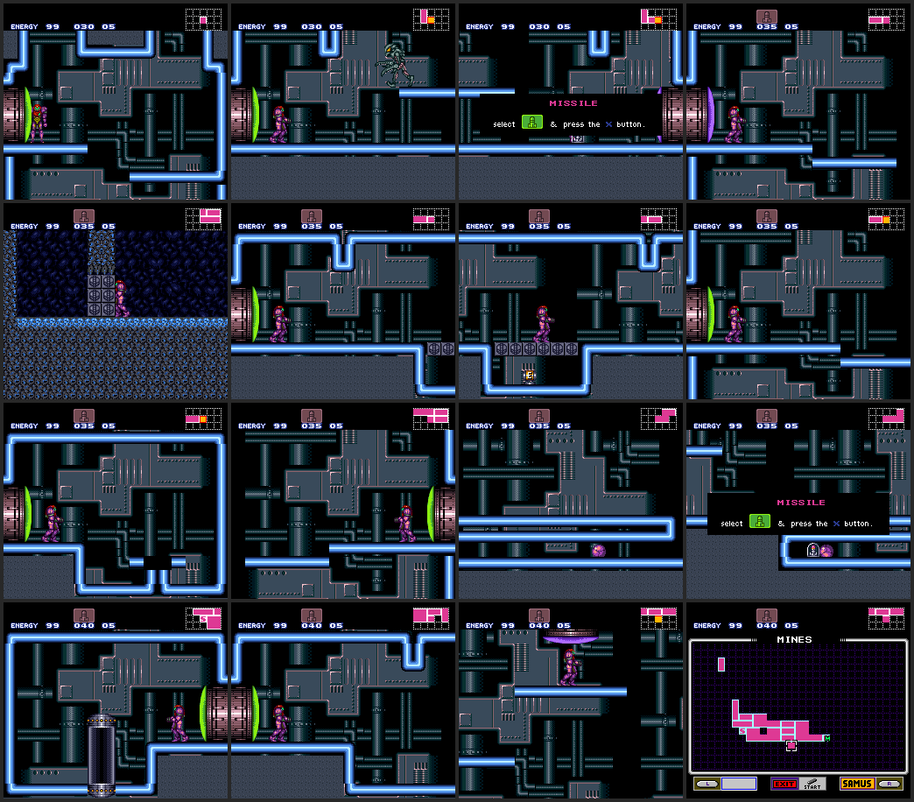
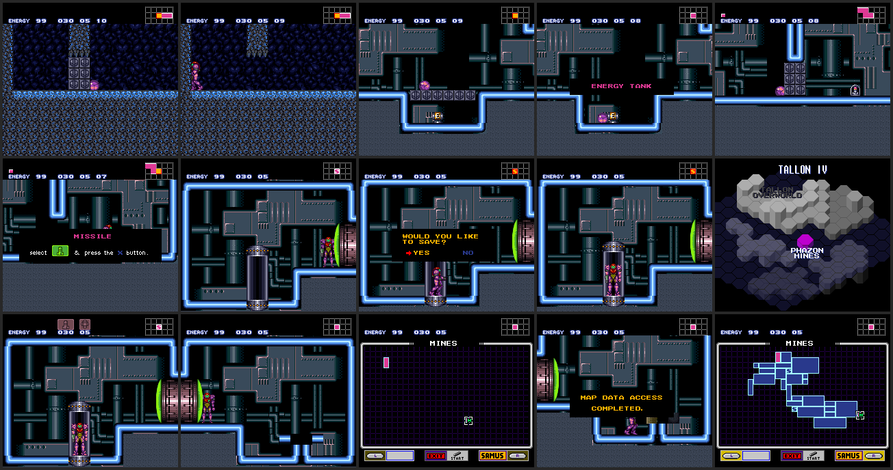

# 19i — Região B da Phazon Mines (nível do meio: Elite Control, Omega Research, Central Dynamo, Metroid Quarantine A)

Estado: **verificada** (06/11/2026: validate "248 salas, 512 portas, 0 problemas", a linha do Tallon idêntica, a das rodadas mudada só
pelos 4 itens da Mines (83 itens, 83%); `.ips` sha1 `cef34dc475439869cd267315f4eea18c64d2aff4` igual em dois builds; grupo A **34/34** (3 min 02 s), B **64/64** (3 min 22 s), C **21/21** (1 min 53 s), D **14/14** (3 min 50 s), um grupo
por vez, na ordem). Rascunho → aprovada (épico aprovado pelo usuário; pedido do orquestrador) → implementada → verificada na mesma
sessão.
Esforço estimado: 3 dias (linha 19i do épico; medido: ~1 dia, as caminhadas achadas por busca no emulador)
Épico: [19 — Phazon Mines](19-phazon-mines.md) (decisões do usuário 1, 3a, 5 e 6; decisões técnicas 1, 3, 4 e 5; linha 19i da tabela de
filhas); modelos: [19f](19f-regiao-a-mines.md) (região com travas, itens e save; as formas das salas que esta filha reaproveita),
[19g](19g-inimigos-mines.md) (a camada 0 e as propostas para B), [18i](18i-regiao-b-phendrana.md) (a map station de Phendrana e o
teste dela), [17h](17h-regiao-b-magmoor.md) (região do meio com parede de PB).

## Contexto

Desde a 19f a região A está pronta e a porta R1 da Elevator Access A (para a Elevator A, região B) era parede. Esta filha constrói a
**região B** (o nível do meio, 12 salas), abre aquela parede, põe as travas do Prime da região com os mecanismos do SM, os **4 itens**
(o míssil da Elite Control Access, o E-tank da Ventilation Shaft, **o míssil no lugar da Power Bomb** na Central Dynamo, o míssil da
Metroid Quarantine A), a **Save Station B** (estação 2 da área 5), a **Map Station** (a primeira da área 5: a lista de ícones dela na
Tourian vanilla é só `FFFF`) e os inimigos da camada 0 (o pirata, a Mella, os Metroids: as propostas da 19g). A rocha de PB da
Maintenance Tunnel fica diante da porta L0 (para o Phazon Processing Center, região C), que continua parede até a 19j.

## Estado antes (verificado)

- validate "236 salas, 488 portas, 0 problemas"; linhas "tallon (… 44 salas construídas, alcançáveis agora: 44, 20 itens em 7
  rodadas)" e "rodadas (specs/12m, 17j, 18n, 19f): … 79 itens em 7 rodadas … 79% (energia 1299, mísseis 250, super mísseis 5, power
  bombs 25)"; `.ips` sha1 `182608467ebcf40fa1d613807dad6e357dbbd2d4` em dois builds (conferido no começo desta sessão).
- `tools/mines/rooms.py` (19c): região B = P14 Elevator A (1×3), P15 Elite Control Access (2×1), P16 Elite Control (4×2), P17
  Maintenance Tunnel (3×1), P18 Ventilation Shaft (2×1), P20 Omega Research (4×3), P23 Map Station (1×1), P24 Dynamo Access (2×1), P27
  Central Dynamo (5×2), P29 Quarantine Access A (2×1), P30 Save Station B (1×1), P32 Metroid Quarantine A (6×2); uma ligação de
  chão/teto (Quarantine Access A B1 ↔ Metroid Quarantine A T3, **de onda**: a porta de onda vertical existe desde a 18i); as ligações
  para fora: A (Elevator Access A R1 ↔ Elevator A L0, gelo), C (Maintenance Tunnel L0 ↔ Phazon Processing Center, gelo + a rocha de PB),
  D (Metroid Quarantine A L1 ↔ Elevator Access B, gelo).
- Travas do Prime na região (`DOCK_LOCKS`, `KEY_BEAM`): todas as docas com porta de cor — gelo, e onda entre a Elite Control Access e
  a Elite Control e entre a Quarantine Access A e a Metroid Quarantine A; de evento (camadas de evento: fora) as da Elite Pirate da
  Elite Control e da Omega Research e as dos Drones da Central Dynamo. Features: Ventilation Shaft meio-tubo, Metroid Quarantine A
  Spider. `PB_ONLY`: Maintenance Tunnel, Ventilation Shaft, Omega Research, Central Dynamo (1 cada) e Metroid Quarantine A (2).
- A lista de ícones de map station da área 5 (ponteiro em `$82:C805` → `$82:CA4F`) é só `FFFF` (19b): `write_pause_map` só sabia escrever por
  cima da lista vanilla, do mesmo tamanho.
- Bits livres: itens a partir de `$EF` (Mines `$EB–$EE` na 19f).

## O que foi feito

1. **Salas** (`tools/mines/layouts.py`; as regras da 19f: porta lateral nas linhas 6–9 com o batente na 10; sala com porta de chão com o
   chão na linha do batente dela; subidas de 5 linhas por bordas em zigue-zague; reaproveitando as formas medidas da região A onde a
   sala do Prime é parecida):
   - **Elevator A** (1×3, base pirata): o poço do elevador interno do Prime (sem máquina: decisão técnica 4), o chão na 42 (porta R2) e
     **seis bordas em zigue-zague** (37 … 12) até a prateleira da L0 (10); a plataforma parada no alto, os trilhos.
   - **Elite Control Access** (2×1, base pirata): o corredor na 10 (o teto uma linha mais alto), **uma passarela no meio (linha 6)** por
     cima do corredor com o **pirata** de guarda (ela passa por baixo: ele nunca fica à altura dela), o **míssil** no chão depois da
     passarela (rodada 5, a pé).
   - **Elite Control** (4×2, base pirata): o chão na 26 (L1, R1), a prateleira da L0 (10) com três bordas em zigue-zague (a parede oeste
     da Ore Processing); o console pendurado no meio.
   - **Maintenance Tunnel** (3×1, **rocha**): o túnel na 10, **a parede de blocos de Power Bomb diante da L0** (a da Mine Security
     Station: rocha por cima até o teto), entulho (2 linhas, pulado), uma estalactite. A L0 continua parede até a 19j.
   - **Ventilation Shaft** (2×1, base pirata): o duto na 10, os ventiladores no teto; **um duto debaixo do chão coberto por blocos de
     Power Bomb** (a grade do Prime *(incerto)*) com o **E-tank** dentro (rodada 6: o nicho da Security Access A).
   - **Omega Research** (4×3, base pirata): o chão na 42 (R2), o penhasco oeste de duas prateleiras (L1 na 26, L0 na 10), cada uma com
     três bordas em zigue-zague (o penhasco da Main Quarry); o tanque de pesquisa pendurado a leste. A rocha de PB do Prime não trava
     nada aqui (`PB_NOTHING`).
   - **Map Station Mines** (1×1, base pirata): a map station do SM (PLM `$B6D3`) como a de Phendrana: a Samus entra no terminal pelo
     oeste.
   - **Dynamo Access** (2×1, base pirata): o corredor na 10.
   - **Central Dynamo** (5×2, base pirata): o chão na 26, as duas prateleiras (L0 e R0, linha 10) contra as paredes, cada uma com três
     bordas em zigue-zague (as paredes da Ore Processing); **o labirinto de Morph do Prime**: um poço no chão (3 linhas), do fundo dele um
     **túnel de 1 linha para oeste com um bloco de bomba** e, no fim, o **míssil no lugar da Power Bomb** (rodada 5: Morph e Bombas); o
     dínamo pendurado. A rocha de PB do Prime não trava nada (`PB_NOTHING`).
   - **Quarantine Access A** (2×1, base pirata): o chão na 13 (a porta de chão de onda B1), a L0 num degrau de 3.
   - **Save Station Mines B** (1×1, base pirata): a sala da Save Station A. **Estação 2 da área 5.**
   - **Metroid Quarantine A** (6×2, base pirata): o chão na 26 (a L1, parede até a 19l), três bordas em zigue-zague até a plataforma
     da porta de teto (a subida da Elite Research); **a câmara leste atrás de uma parede de blocos de Power Bomb** (os "Powerbomb Wall"
     do Prime) com o **míssil** (rodada 6); a viga do trilho de Spider pendurada a oeste; os dois **Metroids** na metade oeste.
   - A Elevator Access A: a parede R1 vira a porta de gelo para a Elevator A; **o orbe de baixo vai de x 12 para x 6** (o 12 ficava a
     menos de 120 quadros da porta nova: `homing_problems`).
   - Caras (`mines/rooms.py LOOK`): rocha na Maintenance Tunnel; base pirata no resto.
2. **Travas** (`mines/rooms.py GATES`): toda doca key = a tampa do feixe do Prime dos dois lados (gelo; onda na Elite Control Access ↔
   Elite Control e na porta de chão/teto da Quarantine Access A ↔ Metroid Quarantine A); a parede de PB da Maintenance Tunnel = borda de
   Morph + Power Bomb do lado dela na ligação com o Phazon Processing Center (`{ICE, MORPH, POWER_BOMB}`, **aplicada quando a região C
   existir**: até lá a L0 é parede); `PB_NOTHING` += Omega Research e Central Dynamo; **`MAZES`** (novo): o labirinto de Morph da
   Central Dynamo (os `DamageableTrigger Bomb` do Prime, que o dumper não chama de feature) pode guardar item atrás de Morph + Bombas.
3. **Itens** (`tools/mines/items.py`; bits `$EF–$F2`): `$EF` míssil da Elite Control Access (24, 9), rodada 5; `$F0` E-tank da
   Ventilation Shaft no duto (16, 12), rodada 6, `needs` Morph + Power Bomb; `$F1` **míssil no lugar da Power Bomb** na câmara do
   labirinto da Central Dynamo (21, 28), rodada 5, `needs` Morph + Bombas; `$F2` míssil da Metroid Quarantine A na câmara leste (90,
   25), rodada 6, `needs` Morph + Power Bomb.
4. **Inimigos** (`tools/mines/enemies.py`; as propostas da 19g tomadas: `STAND_IN` Puffer = a **Mella** da Chozo, MetroidAlpha = o
   **Metroid justo** da 18l): Elite Control Access **1 pirata** (Prime 2; 2 telas, as duas de porta) na passarela; Ventilation Shaft **1
   Mella** (Prime 8) a leste do duto; Metroid Quarantine A **2 Metroids** (Prime 5; 12 telas) na metade oeste, fora da câmera da porta de
   teto e da L1.
5. **Map Station** e a lista de ícones da área 5 (`build.py write_pause_map`): uma área cuja lista vanilla de map station é só `FFFF`
   ganha uma lista nova no `$82` livre (o alocador do `$82`, depois da rotina de jogo novo) e o ponteiro `$82:C805` (`$82:C7CB + $30 + 2·5`) aponta para ela
   (`$82:F75D`); o `FFFF` vanilla fica onde está. O `build_rooms` da Mines passa a `map_station` do desenho para a `RoomDef`. A máquina
   do SM funciona na área 5 sem mais nada: o byte `map_station_byte_array[5]` (`$7ED90D`) vira `FF`, o mapa de pausa se revela (medido
   no emulador).
6. **Estações** (`areas.mines_stations`): 2 = Save Station B.
7. **Rodadas** (`FIRST_ROUND`): as 12 salas na rodada 5 (as portas pedem o Gelo e a Onda; nenhuma trava a mais no caminho); os itens: 2 na
   rodada 5, 2 na 6.
8. **Validador**:
   - `check_mines_locks_mapped`: `allowed()` soma `MAZES`; a map station só na sala de mapa do Prime (`EPIC_MINES_MAP`); a linha diz a map
     station;
   - `check_breakables`: um bloco de Power Bomb da Mines também se justifica por uma trava de `GATES` com Power Bomb do lado da sala cuja
     outra sala ainda não existe (a parede da Maintenance Tunnel, esperando a 19j);
   - `check_mines_slot` (linha "mines (specs/19b)"): com map station construída, a lista da área 5 está no `$82` livre e o `FFFF` vanilla
     intacto.
9. **Testes** (grupo D): `mines_regiao_b_rota`, `mines_regiao_b_rodada_6`, `mines_save_station_b`, `mines_map_station` (abaixo);
   `mines_inimigos_vivos` com as 3 salas novas; `entradas_de_porta_mines` cobre as portas delas sozinho.

A região B nos seus lugares do mapa de pausa (2 px por bloco, a colisão do build: rocha cinza, portas azuis, blocos de Power Bomb
laranja, bloco de bomba amarelo, itens verdes, save e map station roxos). Em cima à esquerda a Elevator A (o poço com o zigue-zague) e,
embaixo dela, a Elite Control Access (a passarela); à direita a Elite Control e, embaixo, a Maintenance Tunnel (a parede laranja a
oeste); a Ventilation Shaft (o duto laranja), a Omega Research (o penhasco oeste, o tanque) e a Map Station; a Dynamo Access; embaixo à
esquerda a Save Station B e a Central Dynamo (o poço, o túnel com o bloco de bomba, o míssil), a Quarantine Access A e a Metroid
Quarantine A (a subida até a porta de teto, a parede laranja e o míssil a leste).

| Bit | Sala | Prime | Lugar / trava | Rodada |
|---|---|---|---|---|
| `$EF` | Elite Control Access | Missile Expansion | no chão depois da passarela (24, 9), a pé | 5 |
| `$F0` | Ventilation Shaft | Energy Tank (atrás da grade de PB *(incerto)*) | duto debaixo de 6 blocos de PB (16, 12) | 6 |
| `$F1` | Central Dynamo | **Power Bomb** (a do jogo é a do Tallon: míssil, decisão 3a) | câmara do labirinto, atrás de um bloco de bomba (21, 28) | 5 |
| `$F2` | Metroid Quarantine A | Missile Expansion (atrás do "Powerbomb Wall") | câmara leste atrás de 6 blocos de PB (90, 25) | 6 |

`mines_regiao_b_rota`, da esquerda, de cima: a Elevator A na prateleira da L0; a Elite Control Access (o pirata na passarela); o míssil;
a Elite Control na prateleira da L0; a parede de PB da Maintenance Tunnel; a Ventilation Shaft (a Mella); a Mella morta, sobre os blocos
do duto; a Omega Research na prateleira da L0; a Map Station; a Central Dynamo na prateleira da R0; o bloco de bomba quebrado no túnel;
o míssil do labirinto; a Save Station B; a Quarantine Access A; a Metroid Quarantine A na plataforma da porta de teto; o mapa de pausa
"MINES".

`mines_regiao_b_rodada_6`: a bola diante da parede da Maintenance Tunnel depois da bomba (os blocos ficam); a parede quebrada pela Power
Bomb; a bola sobre o duto depois da bomba; o E-tank; a bola diante da parede da Metroid Quarantine A; o míssil da câmara.
`mines_save_station_b`: a sala; a pergunta; salvo; a tela de área com "PHAZON / MINES"; o continue no pedestal. `mines_map_station`: a
sala; o mapa antes (as salas não visitadas em branco); a mensagem; o mapa revelado.

### Linhas do validador (o que mudou)

- **Iguais**: "tallon (tabela inteira, regiões ativas: ABCDE, 44 salas construídas, alcançáveis agora: 44, 20 itens em 7 rodadas): …";
  "chefes da Mines (specs/19h): …"; as colunas do Tallon, da Chozo, da Magmoor e de Phendrana na linha das rodadas.
- **Rodadas, de propósito** (os itens novos da Mines entram, como na 19f): 79 → **83 itens**, 79% → **83%** (energia 1299 → **1399**,
  mísseis 250 → **265**); a coluna "Mines": rodada 5: 3 → **5**, rodada 6: 1 → **3**. Nenhuma rodada nova.
- "mines (specs/19e, 19f; regiões ativas: **AB**): **27 salas construídas, 8 itens** …: rodada 4: 1 salas, 0 itens; rodada 5: **25**
  salas, **5** itens; rodada 6: 1 salas, **3** itens; … estações: 0 transport_tallon_south, 1 save_station_a, **2 save_station_b**".
- "mines (specs/19f): **53** trava(s) do Prime nas ligações construídas …; travas de evento fora: **12**; … blocos de Power Bomb …:
  **maintenance_tunnel, metroid_quarantine_a**, security_access_a, security_station, **ventilation_shaft** (nada: **central_dynamo,
  omega_research**, ore_processing); …; save stations: save_station_a, **save_station_b**; **map station: map_station**; …".
- "mines (specs/19g): **8 inimigos em 5 salas (atomic_beta 2, metroid 2, pirate 3, puffer 1)** …; regiões **D**: só a tabela do Prime".
- "mines (specs/19b): … map station 0 de 1: a lista vanilla é só FFFF; **specs/19i: a nova, com a map station, em $82F75D no $82
  livre** …".
- "236 salas, 488 portas" → **"248 salas, 512 portas"** (12 salas, 12 ligações novas); `$8F` recuperado: **7984** usados; nível:
  236 → 248 blobs, nenhum nível novo cruzando banco.

## Critérios de aceite

1. validate 0 problemas; **"44 salas construídas, alcançáveis agora: 44, 20 itens em 7 rodadas" idêntica**; a linha das rodadas muda só
   pelos 4 itens da Mines (as colunas das outras quatro áreas iguais); linhas da Mines com as 27 salas, os 8 itens, as estações 1 e 2 e a
   map station. (protege = travas, rodadas, bordas, blocos de PB e de bomba, softlock, mapa, bits, a map station e a lista de ícones;
   falha_quando = as mutações; não_prova = que a forma agrada)
2. `mines_regiao_b_rota` (protege = a região andada com o equipamento da rodada 5 e os inimigos vivos, as portas abertas pelos feixes
   delas (de lado e a de chão de onda), o labirinto (a bola, a bomba no bloco, o míssil), os 2 mísseis da rodada 5 com os bits e a
   capacidade, a parede de PB da Maintenance Tunnel de pé, energia 99 o tempo todo, os bits explorados e o mapa de pausa; falha_quando =
   E1), `mines_regiao_b_rodada_6` (protege = a bomba não quebra os blocos de PB e a Power Bomb quebra, nas 3 paredes; o E-tank (199 de
   199) e o míssil atrás delas; falha_quando = E3), `mines_save_station_b` (protege = save na estação 2 da área 5, bit de estação usada,
   game over, tela de área, continue no pedestal; falha_quando = V18), `mines_map_station` (protege = a máquina na área 5, o byte
   `$7ED90D`, o mapa revelado, a lista de ícones nova; falha_quando = E2). Os testes antigos passam.
3. Mutações pegas.
4. Dois builds com o mesmo sha1; fotos `specs/img/19i-*.png` olhadas.

## Plano de testes

| Camada | O quê | Qtde |
|---|---|---|
| validate.py | `MAZES` em `check_mines_locks_mapped`, a map station do Prime, a parede esperando a 19j em `check_breakables`, a lista de ícones da área 5 em `check_mines_slot` | +3 regras |
| run_tests.py (grupo D) | `mines_regiao_b_rota`, `mines_regiao_b_rodada_6`, `mines_save_station_b`, `mines_map_station`; `mines_inimigos_vivos` e `entradas_de_porta_mines` com as salas novas | +4 |
| scratchpad | mutações do validador, de ROM e do emulador | 26 |
| imagem | `specs/img/19i-salas.png`, `19i-rota.png`, `19i-rodada-6-save-e-mapa.png` | +3 |

## Riscos e reversão

- As caminhadas são medidas (quadros antes de cada pulo: `scratchpad/s19i/scripts/drv.py`, `hop_search`): mudar a geometria pede
  refazê-las. A saída da Ventilation Shaft para a Omega Research é curta de propósito (a prateleira L0 é estreita: andando demais a Samus
  cai até o chão).
- A L0 da Maintenance Tunnel e a L1 da Metroid Quarantine A são paredes até a 19j e a 19l: as filhas só abrem a parede (a trava da
  Maintenance Tunnel já está em `GATES`).
- Reversão: `ACTIVE_REGIONS` = {A}, as linhas de B fora de `GATES`/`FIRST_ROUND`/`items.ITEMS`/`enemies.ENEMIES`, os desenhos novos fora
  de `LAYOUTS` (e os 4 testes): a ROM volta à da 19h (o orbe da Elevator Access A pode voltar ao x 12); o código da lista de ícones da
  área 5 só age com map station construída.

## Fora de escopo

- As regiões C e D (19j, 19l), o Omega Pirate (19k); as Elite Pirates, os Drones e os outros inimigos de camada de evento (decisão 5).
- O "bloco de bomba" da Quarantine Access A do Prime (não trava nada nos dados; a 19j/`check_mines_locks_mapped` não o pede).

## Decisões para o usuário (escolhidas as recomendadas; confirmar)

**Confirmado pelo usuário em 09/11/2026: padrão aceito** (todas as escolhas abaixo ficam como estão).

1. **A rocha de PB da Omega Research e a da Central Dynamo não travam nada** (`PB_NOTHING`): os dados do Prime não dizem onde ficam; com
   elas travando, o míssil do labirinto passaria à rodada 6 (o épico o prevê na 5).
2. **O E-tank da Ventilation Shaft atrás de blocos de Power Bomb** (a grade do Prime: *incerto* se só a PB a quebra) — rodada 6.
3. **1 pirata** na Elite Control Access (Prime 2: a sala tem 2 telas, as duas de porta; na passarela ele nunca atira nela), **1 Mella**
   na Ventilation Shaft (Prime 8), **2 Metroids** na Metroid Quarantine A (Prime 5).
4. **Formas**: a passarela com o pirata e o míssil no chão (a 1ª tentativa, o míssil em cima de um bloco com o pirata, deixava o pirata
   fora do alcance dos tiros dela); o labirinto como um túnel com um bloco de bomba; o duto e a câmara de PB.

## Mutações (`scratchpad/s19i/scripts/mutate_i.py` → `mutate_i.out`, `mutate_rom.py` → `mutate_rom.out`, `mutate_emu.py` → `mutate_emu.out`; na cópia `s19i/proj`, sem `.claude/`)

Validador (cada uma edita um arquivo, roda o validate, volta): V0 sem mutação: limpo. V1 o bloco de bomba do labirinto tirado; V2 o duto
sem os blocos de PB; V3 a parede da Metroid Quarantine A sem os blocos de PB; V4 a parede da Maintenance Tunnel tirada; V5 o E-tank
declarado na rodada 5; V6 o míssil do labirinto declarado na rodada 6; V7 o míssil do labirinto sem o `needs`; V8 a map station na
Dynamo Access; V9 a porta Ventilation Shaft–Omega Research de onda; V10 a Elevator A sem a borda da linha 22 (a L0 inalcançável do
fundo); V11 o pirata no chão da Elite Control Access (atira na altura dela); V12 um Metroid na câmera da porta de teto; V13 a Central
Dynamo fora do `PB_NOTHING`; V14 `MAZES` vazio; V15 a trava da Maintenance Tunnel (esperando a 19j) tirada de `GATES` (os blocos dela
viram "sala sem item que peça a Power Bomb"); V16 a Map Station declarada na rodada 6; V17 a Mella tirada (0 Puffer); V18 a Save
Station B sem a estação; V19 o duto com 4 linhas (a Samus de pé por baixo dos blocos). **Todas pegas** (`mutate_i.out`).

ROM (o `.sfc` construído da cópia mexido): R0 sem mutação: limpo. R1 o ponteiro da lista de map station da área 5 de volta ao `FFFF`
vanilla; R2 o ícone da map station numa outra tela; R3 o `FFFF` vanilla da área 5 escrito por cima. Todas pegas (`mutate_rom.out`).

Emulador (fonte mexida, build e um teste na cópia): E1 o túnel do labirinto sem o bloco de bomba → `mines_regiao_b_rota` falha (o bloco
já é ar); E2 a sala de mapa sem a map station → `mines_map_station` falha (`$7ED90D` = 0, sem a pausa, o mapa não se revela); E3 o duto
sem os blocos de PB → `mines_regiao_b_rodada_6` falha (o bloco já é ar). Todas pegas (`mutate_emu.out`).

## Desvios (preenchido na implementação)

- **A lista de ícones de map station da área 5** (a 19b/19e a deixaram para cá): o `write_pause_map` escrevia só por cima da lista
  vanilla, do mesmo tamanho; a da Tourian é só `FFFF` (2 bytes). Agora uma área com a lista vanilla vazia ganha uma lista nova no `$82`
  livre (`$82:F75D`, logo depois da rotina de jogo novo) e o ponteiro; **o texto da tela de área (`areaselect`) andou 6 bytes no `$82`**
  (ele é alocado depois: o validador só pede que fique na faixa livre). A máquina da map station funciona na área 5 sem mudança.
- **`MAZES`** (novo em `mines/rooms.py`): o labirinto de Morph da Central Dynamo não é uma feature do dumper; sem ele o validador não
  deixaria o míssil atrás de Morph + Bombas (a regra da 19f: geometria só onde o Prime tem o que a pede).
- **A parede de PB da Maintenance Tunnel antes da porta dela**: a trava (`GATES` Maintenance Tunnel ↔ Phazon Processing Center) só se
  aplica com a região C; o `check_breakables` aceita os blocos por ela (regra nova: uma trava de `GATES` da Mines com Power Bomb do lado
  da sala, esperando a outra sala).
- **O orbe de baixo da Elevator Access A foi de x 12 para x 6** (região A, fora do escopo estrito: a porta R1 nova o deixava a 0
  quadros dela); `mines_regiao_a_rota` e `mines_inimigos_vivos` passaram sem mudar.
- **A Elite Control Access**: a 1ª forma (um bloco de console com o pirata e o míssil em cima) deixava o pirata fora de todo tiro dela
  (o bloco tapava os tiros de baixo; no emulador nenhum tiro o feriu); virou uma passarela por cima do corredor, com o teto uma linha
  mais alto (o pirata de pé nela), e o míssil no chão.
- **A Mella da Ventilation Shaft** foi de x 24 para x 16: a 24 ela chegava à Samus 20 quadros depois de ela entrar pela R0
  (`entradas_de_porta_mines`). Ela morre com 6 tiros agachada (balança: os primeiros nem sempre acertam).
- **A Elevator A**: a plataforma parada de enfeite no chão virou um degrau de 1 bloco que a Samus não sobe andando (no emulador): foi
  para o alto do poço. A Central Dynamo: a câmara do míssil com 2 linhas não contava para o flood fill do Space Jump (12k: a bola só "pega"
  num túnel de 1 linha): virou 1 linha.
- **`mines_inimigos_vivos`**: a entrada por RAM (`enter_through`) na Metroid Quarantine A pela porta de chão da Quarantine Access A não
  terminava (estado `$0B`): primeiro a Quarantine Access A (pela Central Dynamo), depois `door_teleport` pela porta de chão
  (`MINES_ENTER_AT_DOOR`).
- **A rota cruza a Ventilation Shaft com a saída curta** (`M19I_VS_OUT`): os tiros na Mella abrem a tampa da R0; andando 300 quadros a
  Samus atravessava a porta e caía da prateleira da Omega Research.
- `mines_save_station_b` e `mines_map_station` começam por `door_teleport` (a rota anda até lá); `mines_regiao_b_rota` entra na Elevator
  A por `door_teleport` (a região A é a `mines_regiao_a_rota`).
- A bateria D cresceu 4 testes (de 10 para 14).
- Verificação (06/11/2026, pasta real, um grupo por vez, na ordem A → B → C → D): `python3 -I tools/build.py` duas vezes → sha1
  `cef34dc475439869cd267315f4eea18c64d2aff4` nas duas; `python3 -I tools/validate.py` → "248 salas, 512 portas, 0 problemas" (`scratchpad/s19i/v19i_final.txt`); grupo
  A **34/34** (3 min 02 s), B **64/64** (3 min 22 s), C **21/21** (1 min 53 s), D **14/14** (3 min 50 s) (carga da máquina 5–70 durante as rodadas).
