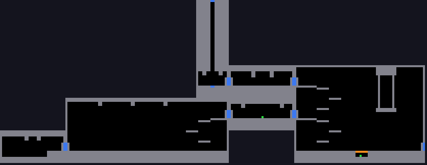
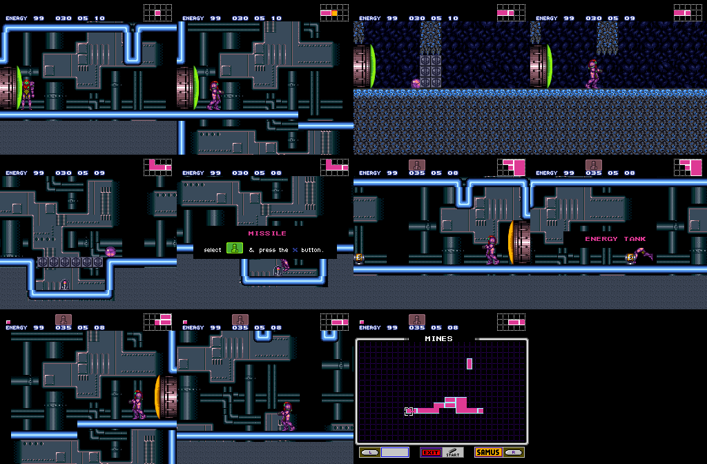

# 19j — Região C da Phazon Mines (oeste: o elevador da Magmoor, o Phazon Processing Center, a Elite Quarters)

Estado: **verificada** (09/11/2026: validate "253 salas, 524 portas, 0 problemas", a linha do Tallon idêntica, a das rodadas mudada só
pelos 2 itens da Mines (85 itens, 85%); `.ips` sha1 `4c29592959c687dc62b150f1b0c8793419b06da5` igual em dois builds; grupo A **34/34** (3 min 10 s), B **64/64** (3 min 38 s), C **21/21** (1 min 52 s), D **15/15** (3 min 48 s), um grupo por vez, na ordem). Rascunho → aprovada (épico aprovado pelo usuário; o usuário mandou seguir em 09/11/2026) →
implementada → verificada na mesma sessão.
Esforço estimado: 2 dias (linha 19j do épico; medido: ~meio dia, as caminhadas do Phazon Processing Center reaproveitadas da Omega
Research)
Épico: [19 — Phazon Mines](19-phazon-mines.md) (decisões do usuário 1, 3a, 5 e 6; decisões técnicas 1, 3 e 4; linha 19j da tabela de
filhas); modelos: [19i](19i-regiao-b-mines.md) (região do meio: as formas que esta filha reaproveita, a parede da Maintenance Tunnel
que aqui ganha o outro lado), [19f](19f-regiao-a-mines.md) (o nicho de PB da Security Access A), [18j](18j-regiao-c-phendrana.md).

## Contexto

Desde a 19i as regiões A e B estão prontas; a porta L0 da Maintenance Tunnel (para o Phazon Processing Center) era parede, e a P25
(o elevador para a Magmoor, 19e) era um beco. Esta filha constrói a **região C** (o oeste, 5 salas novas e a P25 aberta), põe as
travas do Prime da região com os mecanismos do SM, os **2 itens** (o míssil do Phazon Processing Center e o E-tank da Processing
Center Access) e deixa a **Elite Quarters pronta para a arena do Omega Pirate** (19k). Com ela, a trava da parede de PB da
Maintenance Tunnel (escrita na 19i) passa a valer: **do elevador da Magmoor até a região B, e daí ao Tallon, só na rodada 6** (a
regra do épico: nenhum atalho Magmoor ↔ Tallon antes dela).

## Estado antes (verificado)

- validate "248 salas, 512 portas, 0 problemas"; linha "tallon (… 44 salas construídas, alcançáveis agora: 44, 20 itens em 7
  rodadas)"; "rodadas (…): … 83 itens em 7 rodadas … 83% (energia 1399, mísseis 265, super mísseis 5, power bombs 25)"; `.ips` sha1
  `cef34dc475439869cd267315f4eea18c64d2aff4` (conferido no começo da sessão).
- `tools/mines/rooms.py` (19c): região C = P19 Phazon Processing Center (4×3), P21 Transport Access (2×1), P22 Processing Center
  Access (2×1), P25 Transport to Magmoor Caverns South (1×3, construída na 19e), P26 Elite Quarters (5×2), P28 Elite Quarters Access
  (2×1). Ligações: P25 R2 ↔ Transport Access L0 (gelo), Transport Access R0 ↔ PPC L0 (gelo), PPC L1 ↔ Processing Center Access R0
  (plasma), PPC R2 ↔ Maintenance Tunnel L0 (gelo + a rocha de PB: `GATES` desde a 19i), Processing Center Access L0 ↔ Elite Quarters
  R0 (plasma), Elite Quarters L1 ↔ Elite Quarters Access R0 (plasma); para fora: Elite Quarters Access B1 ↔ Metroid Quarantine B T5
  (plasma, de chão/teto, região D).
- Travas do Prime na região: todas as docas com porta de cor (gelo e plasma); de evento só as 2 da Elite Quarters (`BOSS_DOORS`,
  19k). Features: Transport Access gancho (2), PPC trilho de Spider. `PB_ONLY`: PPC (1). Inimigos de camada 0: nenhum (os 3 Atomic
  Alpha da Processing Center Access são da camada 3).
- Bits livres: itens a partir de `$F3`.

## O que foi feito

1. **Salas** (`tools/mines/layouts.py`; as regras da 19f):
   - **Transport Access** (2×1, base pirata): o corredor na 10, os pilares dos dois pontos de gancho pendurados (enfeite).
   - **Phazon Processing Center** (4×3, base pirata): **o salão da Omega Research** (o chão na 42, a R2; o penhasco oeste de duas
     prateleiras, a L1 na 26 e a L0 na 10, cada uma com três bordas em zigue-zague) e, no chão, **um fosso coberto por 6 blocos de
     Power Bomb** (o nicho da Security Access A, colunas 30–35, linhas 42–44) com o **míssil** (a parede Bendezium do Prime
     *(incerto onde)*; rodada 6); a cuba da refinaria pendurada a leste.
   - **Processing Center Access** (2×1, base pirata): o corredor na 10 entre as duas portas de plasma, o **E-tank** no chão (rodada 6).
   - **Elite Quarters** (5×2, base pirata): **o chão da arena na 26** de ponta a ponta (a L1), a prateleira da R0 na 10 com três bordas
     em zigue-zague (a Elite Control espelhada); canos no teto. Vazia até a 19k, com as portas de plasma.
   - **Elite Quarters Access** (2×1, base pirata): a Quarantine Access A espelhada (o chão na 13, a linha da porta de chão B1; a R0
     num degrau de 3). A B1 continua parede até a 19l.
   - A P25 (19e) não mudou: a parede R2 vira a porta de gelo para a Transport Access.
2. **Travas** (`mines/rooms.py GATES`): as portas de gelo P25 ↔ Transport Access ↔ PPC; as de plasma PPC ↔ Processing Center Access
   ↔ Elite Quarters ↔ Elite Quarters Access. A trava da Maintenance Tunnel (19i: `{ICE, MORPH, POWER_BOMB}`, a borda do lado dela)
   agora se aplica. As portas da Elite Quarters ficam de plasma até a arena (`BOSS_DOORS`: o validador diz "esperando o chefe:
   elite_quarters (19k)").
3. **Itens** (`tools/mines/items.py`; bits `$F3–$F4`): `$F3` míssil do PPC no fosso (32, 44), rodada 6, `needs` Morph + Power Bomb;
   `$F4` E-tank da Processing Center Access (16, 9), rodada 6, a pé.
4. **Rodadas** (`FIRST_ROUND`): a Transport Access e o PPC na **rodada 4** (do elevador da Magmoor, P26 na rodada 4; as portas de gelo
   pedem o Ice, rodada 3); a **Maintenance Tunnel também na 4** (era 5): do PPC entra-se no pedaço dela entre a L0 e a parede de PB; a
   parede segura o resto até a rodada 6. A Processing Center Access, a Elite Quarters e o acesso na **rodada 6** (o Plasma é da 5).
5. **Inimigos**: nenhum (a camada 0 do Prime na região não tem). A Elite Quarters é a arena da 19k (`mines_inimigos_vivos` não muda).
6. **Testes** (grupo D): `mines_regiao_c_rota` (abaixo); `entradas_de_porta_mines` cobre as portas novas sozinho.

A região C nos seus lugares do mapa de pausa (2 px por bloco, a colisão do build: rocha cinza, portas azuis, blocos de Power Bomb
laranja, itens verdes). À esquerda embaixo a Elite Quarters Access (a porta de chão ainda parede) e a Elite Quarters (a prateleira da
R0 e o zigue-zague a leste); no meio, em cima, o poço do elevador da P25 e a Transport Access; embaixo dela a Processing Center Access
(o E-tank); à direita o Phazon Processing Center (o penhasco oeste, a cuba, o fosso laranja com o míssil no chão).

| Bit | Sala | Prime | Lugar / trava | Rodada |
|---|---|---|---|---|
| `$F3` | Phazon Processing Center | Missile Expansion (atrás da parede Bendezium *(incerto)*) | fosso debaixo de 6 blocos de PB (32, 44) | 6 |
| `$F4` | Processing Center Access | Energy Tank | no chão entre as portas de plasma (16, 9) | 6 |

`mines_regiao_c_rota`, da esquerda, de cima: a Transport Access na L0; o PPC na prateleira da L0; a parede de PB da Maintenance
Tunnel, pelo oeste, depois da bomba (os blocos ficam); a parede quebrada pela Power Bomb; os blocos do fosso do PPC depois da bomba; o
míssil do fosso; a Processing Center Access; o E-tank; a Elite Quarters na prateleira da R0 (vazia); a Elite Quarters Access; o
mapa de pausa "MINES".

### Linhas do validador (o que mudou)

- **Iguais**: "tallon (tabela inteira, regiões ativas: ABCDE, 44 salas construídas, alcançáveis agora: 44, 20 itens em 7 rodadas): …";
  as colunas do Tallon, da Chozo, da Magmoor e de Phendrana na linha das rodadas e os elevadores delas.
- **Rodadas, de propósito**: 83 → **85 itens**, 83% → **85%** (energia 1399 → **1499**, mísseis 265 → **270**); a coluna "Mines":
  rodada 6: 3 → **5**.
- "mines (specs/19e, 19f; regiões ativas: **ABC**): **32 salas construídas, 10 itens** …: rodada 4: **4** salas, 0 itens; rodada 5:
  **24** salas, 5 itens; rodada 6: **4** salas, **5** itens; …".
- "mines (specs/19f): **65** trava(s) …; esperando o chefe: **elite_quarters (19k), elite_quarters (19k)**; … blocos de Power Bomb …:
  maintenance_tunnel, metroid_quarantine_a, **phazon_processing_center**, security_access_a, security_station, ventilation_shaft …".
- "248 salas, 512 portas" → **"253 salas, 524 portas"** (5 salas, 6 ligações novas).

## Critérios de aceite

1. validate 0 problemas; a linha do Tallon idêntica; a das rodadas muda só pelos 2 itens da Mines; as linhas da Mines com as 32 salas,
   os 10 itens e as portas da Elite Quarters esperando a 19k. (protege = travas, rodadas, bordas, blocos de PB, softlock, mapa, bits;
   falha_quando = as mutações V1–V13; não_prova = que a forma agrada)
2. `mines_regiao_c_rota` (protege = a região andada com o equipamento da rodada 6, as portas abertas pelos feixes delas (gelo e plasma),
   a parede de PB da Maintenance Tunnel quebrada pelo oeste, o fosso do PPC (a bomba não quebra, a Power Bomb quebra), o míssil (bit e
   capacidade 35), o E-tank (199 de 199), a Elite Quarters vazia, os bits explorados e o mapa de pausa; falha_quando = E1, E2). Os testes
   antigos passam.
3. Mutações pegas.
4. Dois builds com o mesmo sha1; fotos `specs/img/19j-*.png` olhadas.

## Plano de testes

| Camada | O quê | Qtde |
|---|---|---|
| validate.py | nenhuma regra nova: `check_mines_rounds` (as rodadas e o atalho Magmoor ↔ Tallon), `check_mines_locks_mapped` (as travas da região C, a espera da 19k) e as regras de sala já cobrem | 0 |
| run_tests.py (grupo D) | `mines_regiao_c_rota` | +1 |
| scratchpad | mutações do validador e do emulador | 17 |
| imagem | `specs/img/19j-salas.png`, `19j-rota.png` | +2 |

## Riscos e reversão

- As caminhadas do PPC são as da Omega Research (`M19I_DOWN_EAST`, `M19I_OR_UP`): mudar a forma de um dos dois salões pede medi-las
  de novo. O fosso fica no caminho do chão: a rota passa por cima dele intacto e só o quebra na volta, saindo dele a oeste
  (`M19I_PIT_OUT`).
- Reversão: `ACTIVE_REGIONS` = {A, B}, as linhas de C fora de `GATES`/`FIRST_ROUND`/`items.ITEMS`, os desenhos novos fora de `LAYOUTS`,
  a Maintenance Tunnel de volta à rodada 5 (e o teste): a ROM volta à da 19i.

## Fora de escopo

- O Omega Pirate (19k: a arena da Elite Quarters, as portas cinza) e a região D (19l: a porta de chão de plasma da Elite Quarters
  Access para a Metroid Quarantine B, a primeira porta de plasma vertical).
- As Elite Pirates e os inimigos de camada de evento (decisão 5).

## Decisões para o usuário (escolhidas as recomendadas; confirmar)

1. **O míssil do PPC atrás de blocos de Power Bomb** num fosso do chão (a parede Bendezium do Prime: *incerto* se é ela que guarda o
   míssil) — rodada 6. Alternativa: numa borda de Space Jump (o trilho de Spider), rodada 4.
2. **O gancho da Transport Access não trava nada**: a sala tem uma tela de altura, não cabe um penhasco de Space Jump; o Space Jump é
   da rodada 2, então nenhuma rodada mudaria.
3. **Formas**: o PPC com o salão da Omega Research (as mesmas medidas), a Elite Quarters com o chão plano da arena.

## Mutações (`scratchpad/s19j/mutate_j.py` → `mutate_j.out`, `mutate_emu.py` → `mutate_emu.out`; na cópia `s19j/proj`, sem `.claude/`)

Validador (cada uma edita um arquivo, roda o validate, volta): V0 sem mutação: limpo. V1 o fosso do PPC sem os blocos de PB (o míssil
pego na rodada 4, sem a Morph); V2 a trava Maintenance Tunnel–PPC sem a Power Bomb (com a parede: as portas dela sem volta); **V2b a
trava e a parede tiradas (o caminho aberto): 72 problemas, salas do Tallon alcançáveis na rodada 4 — o atalho Magmoor → Tallon que o
épico proíbe**; V3 o míssil do PPC declarado na rodada 5; V4 o míssil sem o `needs` (blocos de PB sem item que os peça); V5 o E-tank
declarado na rodada 5; V6 a porta Processing Center Access–Elite Quarters de gelo; V7 a Elite Quarters na rodada 5; V8 a região C
fora do build (item em sala fora do build); V9 a Elite Quarters sem o zigue-zague (a R0 sem volta do chão); V10 a porta Transport
Access–PPC de plasma; V11 o PPC em `PB_NOTHING`; V12 o E-tank dentro da parede; V13 a Transport Access na rodada 5. **Todas pegas.**

Emulador (fonte mexida, build e `mines_regiao_c_rota` na cópia): E0 sem mutação: passa. E1 o fosso sem os blocos de PB → falha (a
Samus cai no fosso na ida, fora do lugar); E2 o PPC sem a prateleira da L1 → falha (a subida não chega à porta de plasma). Pegas.

## Desvios (preenchido na implementação)

- **O caminho de gancho da Transport Access não virou borda de Space Jump** (o épico pedia): a sala do Prime tem 1 tela de altura
  pela regra do Tallon, e as portas laterais ficam nas linhas 6–9 com o chão na 10; um penhasco de Space Jump pede ~16 linhas (a
  Twin Fires Tunnel da Magmoor tem 2 telas). Sem efeito nas rodadas (o Space Jump é da rodada 2). `check_mines_locks_mapped` não pede
  feature usada.
- **A Maintenance Tunnel na rodada 4** (era 5): do PPC se entra no pedaço dela entre a L0 e a parede; o validador conta a sala na
  rodada em que é alcançada, e a parede continua fechando o caminho para a região B até a rodada 6.
- Nenhuma regra nova no validador: o "nenhum atalho Magmoor ↔ Tallon antes da rodada 6" já é provado pelas rodadas das salas da região
  B e do elevador do Tallon (`FIRST_ROUND`, `EPIC_MINES_LIFT_ROUNDS`): sem a Power Bomb na trava (mutação V2) a região B fica alcançável
  na rodada 4 e o validador recusa.
- A bateria D cresceu 1 teste (de 14 para 15).
- Verificação (09/11/2026, pasta real, um grupo por vez, na ordem A → B → C → D): `python3 -I tools/build.py` duas vezes → sha1
  `4c29592959c687dc62b150f1b0c8793419b06da5` nas duas; `python3 -I tools/validate.py` → "253 salas, 524 portas, 0 problemas" (`scratchpad/s19j/v19j_final.txt`);
  grupo A **34/34** (3 min 10 s), B **64/64** (3 min 38 s), C **21/21** (1 min 52 s), D **15/15** (3 min 48 s).
