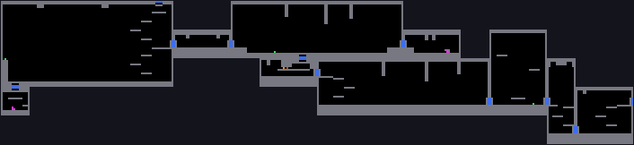
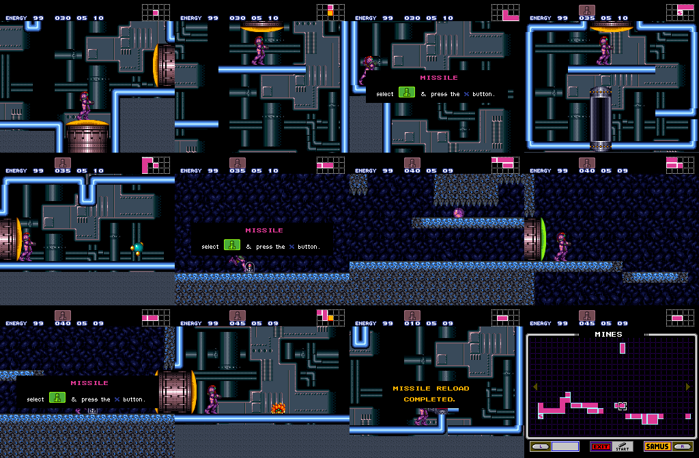
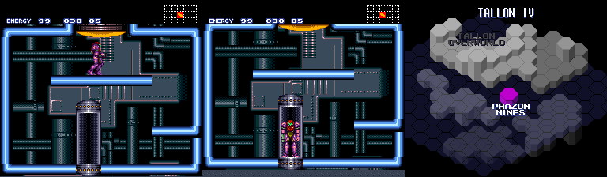

# 19l — Região D da Phazon Mines (o nível de baixo: os fungos, a Metroid Quarantine B, a Missile Station)

Estado: **verificada** (09/11/2026: validate "263 salas, 546 portas, 0 problemas", a linha do Tallon idêntica, a das rodadas mudada
só pelos 3 itens da Mines (88 itens, 88%); `.ips` sha1 `f5b0f58b3cd6ef58d573403852b091a7446b0dac` igual em dois builds; grupo A
**34/34** (3 min 8 s), B **64/64** (3 min 17 s), C **21/21** (1 min 49 s), D **18/18** (3 min 47 s), um grupo por vez, na ordem).
Rascunho → aprovada (épico aprovado pelo usuário; o usuário mandou seguir com a 19l em 09/11/2026) → implementada → verificada na
mesma sessão.
Esforço estimado: 2,5–3 dias (linha 19l do épico; medido: ~meio dia, as formas reaproveitadas das regiões A–C)
Épico: [19 — Phazon Mines](19-phazon-mines.md) (decisões do usuário 1, 3a, 5 e 6; decisões técnicas 1, 3, 4, 5 e **6, a Missile
Station**; linha 19l da tabela de filhas); modelos: [19j](19j-regiao-c-mines.md) (região, formato), [19i](19i-regiao-b-mines.md)
(o labirinto e as paredes de PB), [19f](19f-regiao-a-mines.md) (a coluna de Space Jump da Main Quarry), [18i](18i-regiao-b-phendrana.md)
(as portas de onda verticais), [19k](19k-omega-pirate.md) (a Elite Quarters, o atalho da arena).

## Contexto

Desde a 19k as regiões A, B e C estão prontas, com os dois chefes. Duas portas esperavam a região D: a **L1 da Metroid Quarantine
A** (região B, para a Elevator Access B) e a **B1 da Elite Quarters Access** (região C, a porta de chão para a Metroid Quarantine B).
Esta filha constrói as **10 salas** do nível de baixo, abre as duas paredes, põe as travas do Prime com os mecanismos do SM, os
**3 mísseis**, a **Save Station C**, a **Missile Station** (decisão técnica 6) e os inimigos da camada 0 (os Hunter Metroids, os
Metroids, os Burrowers, os Atomics e o pirata). Com ela **as 42 salas da Mines estão na ROM**.

## Estado antes (verificado)

- validate "253 salas, 524 portas, 0 problemas"; linha "tallon (… 44 salas construídas, alcançáveis agora: 44, 20 itens em 7
  rodadas)"; "rodadas (…): … 85 itens em 7 rodadas … 85% (energia 1499, mísseis 270, super mísseis 5, power bombs 25)"; `.ips` sha1
  `931e7f1043cfe9fc90ab37f6f3c931b9a7256ddb` (conferido pelo orquestrador antes desta filha).
- `tools/mines/rooms.py` (19c): região D = P31 Metroid Quarantine B (6×3), P33 Quarantine Access B (2×1), P34 Save Station C (1×1),
  P35 Elevator Access B (2×2), P36 Fungal Hall B (6×2), P37 Elevator B (1×3), P38 Missile Station (2×1), P39 Phazon Mining Tunnel
  (2×1), P40 Fungal Hall Access (2×3), P41 Fungal Hall A (6×2). Ligações: as de dentro da região e as duas para fora (Metroid
  Quarantine A L1 ↔ Elevator Access B R0, de gelo; Elite Quarters Access B1 ↔ Metroid Quarantine B T5, de plasma, de chão/teto).
- Travas do Prime na região (`DOCK_LOCKS`, `KEY_BEAM`): todas as docas com porta de cor — **plasma** em toda a região, menos as duas
  docas da Fungal Hall A, que são **de gelo do lado dela e de plasma do outro lado** (as duas ligações gelo–plasma do Prime);
  3 ligações de chão/teto, todas de plasma (a primeira **porta de plasma vertical**). Features: Metroid Quarantine B trilho de Spider
  e gancho. `PB_ONLY`: Phazon Mining Tunnel (1, a parede Bendezium). Os 17 blocos de bomba da Phazon Mining Tunnel (o que a bomba
  quebra) e o X-Ray da Fungal Hall B (o chão falso) só como conhecimento. Inimigos da camada 0 (`PRIME_LAYER0`): Quarantine Access
  B 3 AtomicAlpha; Elevator Access B 3 Burrower; Fungal Hall B 6 MetroidAlpha + 1 Ripper; Fungal Hall Access 3 AtomicAlpha + 1
  SpacePirate; Fungal Hall A 4 MetroidBeta (os Hunter Metroids) + 1 Ripper.
- Bits livres: itens a partir de `$F5`. A área 5 tem 3 estações (0 chegada, 1 Save A, 2 Save B); a lista de ícones de save tem 8.
- `tallon/beamdoors.py`: portas de feixe verticais só de gelo (12l) e de onda (18i). O espaço livre do `$84` depois das de onda:
  `$84:FEFA`–`$84:FFBA` (192 bytes, só `$FF` no build).

## O que foi feito

1. **A porta de plasma vertical** (`tools/tallon/beamdoors.py`): blocos das paredes B e T copiados da porta amarela vanilla
   (`$C866`/`$C86C`, o mesmo formato das verdes, lido dos bytes por `vanilla_parts`) com a pré-instrução do plasma (`PRE[PLASMA]`),
   sem pintura (amarelo já é a cor do plasma), logo depois das de onda: `$84:FEFA`, 112 bytes; PLMs `$FF5E` (B) e `$FF64` (T). O
   build já põe qualquer `(feixe, lado)` de `beamdoors.PLM`.
2. **A Missile Station** (decisão técnica 6; achado: o PLM é o `$B6EB` do SM, `PlmSetup_PlmB6EB`, sm_84.c: o bloco sólido e os dois
   vizinhos viram os blocos de acesso, tipo B, BTS `$4C`/`$4B`): `Canvas.refill_station` (a base das salas vanilla: o bloco na linha
   do canhão sobre um pé, o chão 2 linhas abaixo; lida da sala de `$8F:8550`, nível `$CE:8CB3`), `RoomDef.missile_station` e
   `Shape.missile_station`, o PLM no build (`MISSILE_STATION_PLM = $B6EB`, argumento `$8000`: o código não lê), e no validador
   `check_missile_station` (um lado de pé alcançável, a regra da map station) e o PLM em todo estado da sala. **Sem ícone no mapa
   de pausa** (desvio).
3. **Salas** (`tools/mines/layouts.py`; as regras das regiões A–C):
   - **Metroid Quarantine B** (6×3, base pirata): o chão na 45 (a linha da porta de chão B0); a parede leste com dois zigue-zagues
     (40, 35, 30 do chão até a prateleira da R1 na 26; 21, 16, 11 dela até a plataforma da porta de teto: a subida da Elite
     Research); o **míssil no alto de uma coluna encostada na parede oeste** (topo na 33, 12 linhas acima do chão: só o Space Jump;
     o trilho de Spider e o gancho do Prime); as tampas dos tanques.
   - **Quarantine Access B** (2×1, base pirata): o corredor na 10.
   - **Save Station C** (1×1, base pirata): o chão na 13, o pedestal debaixo da plataforma da porta de teto (6), uma borda (10) a
     leste do chão até ela. Estação 3 da área 5.
   - **Elevator Access B** (2×2, base pirata): o chão na 26 (L1), a prateleira da R0 na 10 com três bordas em zigue-zague (a subida
     leste da Elite Quarters).
   - **Fungal Hall B** (6×2, rocha): o chão na 29 (a linha da porta de chão B2), cada porta lateral num degrau de 3 (a Mine
     Security Station); o **míssil no chão** a oeste (a pé); colunas de fungo.
   - **Elevator B** (1×3, base pirata): o poço da Elevator A, o chão na 42 (R2), três bordas em zigue-zague (37, 32, 27) até a borda
     da porta L1 (26); a plataforma do elevador parada em cima.
   - **Missile Station** (2×1, base pirata): o chão na 13, o degrau debaixo da borda da L0 (a Map Station), **a estação em (24, 13)**.
   - **Phazon Mining Tunnel** (2×1, rocha): o túnel na 10 da R0 para oeste; em cima da ponta leste a **câmara da porta de teto**
     (o chão dela = a plataforma, linha 6), fechada a oeste por um **túnel de Morph de 1 linha (linha 5) com um bloco de bomba e um
     bloco de Power Bomb**; depois deles uma borda (6) sobre a caverna oeste, onde o túnel sai (do chão, um pulo de 4 linhas).
   - **Fungal Hall Access** (2×3, rocha): o chão na 42 (as duas portas), uma passarela no meio (38: o pirata) e o **míssil no chão**
     depois dela (a pé); o poço com bordas de fungo.
   - **Fungal Hall A** (6×2, rocha): a parede oeste da Elite Control (a prateleira da L0 na 10, o zigue-zague 21, 16, 11), o chão
     na 26 (R1).
   - **Elite Quarters Access** (19j): o degrau da R0 encurtado para as colunas 26–30 (estava em 23–30, em cima da porta de chão
     22–25: com a porta aberta a Samus não tinha onde ficar de pé; o validador achou).
4. **Travas** (`mines/rooms.py`): `GATES` com as portas de plasma da região (as de chão/teto: a plasma vertical) e a de gelo da
   Metroid Quarantine A; **`SIDE_CAPS`** novo na Mines (a regra da Chozo, 12l): as duas ligações da Fungal Hall A com a tampa de gelo
   do lado dela e a de plasma do outro (`build_rooms` aceita um tipo de tampa por lado); a câmara da Phazon Mining Tunnel atrás de
   `{Morph, Bombas, Power Bomb}` (a trava da ligação Fungal Hall B–Phazon Mining Tunnel, a borda do lado do túnel); `MAZES` ganha a
   Phazon Mining Tunnel (os blocos de bomba do Prime) e `PB_ONLY` já tinha a parede Bendezium.
5. **Itens** (`tools/mines/items.py`; bits `$F5–$F7`, os 13 da Mines completos): `$F5` míssil da Metroid Quarantine B (2, 32) no
   alto da coluna, `needs` Space Jump; `$F6` míssil da Fungal Hall B (24, 28), a pé; `$F7` míssil da Fungal Hall Access (24, 41), a
   pé. Todos na **rodada 6** (atrás de portas de plasma).
6. **Rodadas** (`FIRST_ROUND`): a Elevator Access B na **rodada 5** (da Metroid Quarantine A pela porta de gelo); as outras 9 na
   **rodada 6** (o Plasma é da 5).
7. **Inimigos** (`tools/mines/enemies.py`; as propostas da 19g tomadas): 1 orbe na Quarantine Access B; 1 Sova (o Burrower) na
   Elevator Access B; 2 Metroids na Fungal Hall B (colunas 54 e 70, fora da câmera das portas); 1 pirata na passarela e 1 orbe no
   alto da Fungal Hall Access; 2 Hunter Metroids na Fungal Hall A. Um tipo novo, `hunter_metroid` (a mesma cópia justa do Metroid
   da 18l: um tipo por tipo do Prime, como os dois Atomics); os Rippers fora (imunes). `PROPOSED_LATER` fica vazio.
8. **Testes** (grupo D): `mines_regiao_d_rota`, `mines_save_station_c`; `pause_shows` usa na Mines o ladrilho vazio (30, 26) — o
   (30, 20) de sempre agora é da Fungal Hall A.

A região D nos seus lugares do mapa de pausa (2 px por bloco, a colisão do build: rocha cinza, portas azuis, bloco de Power Bomb
laranja, bloco de bomba marrom, itens verdes, estações magenta). À esquerda a Metroid Quarantine B (a coluna com o míssil encostada
na parede oeste, os zigue-zagues a leste, a porta de teto em cima à direita) e, embaixo dela, a Save Station C; ao lado a Quarantine
Access B, a Fungal Hall B (os degraus, a porta de chão) e a Missile Station; embaixo a Phazon Mining Tunnel (a câmara, o túnel com os
dois blocos) e a Fungal Hall A; à direita a Fungal Hall Access (alta), a Elevator B e a Elevator Access B.

| Bit | Sala | Prime | Lugar / trava | Rodada |
|---|---|---|---|---|
| `$F5` | Metroid Quarantine B | Missile Expansion (trilho de Spider e gancho) | no alto da coluna oeste (2, 32), Space Jump | 6 |
| `$F6` | Fungal Hall B | Missile Expansion | no chão (24, 28), a pé | 6 |
| `$F7` | Fungal Hall Access | Missile Expansion | no chão depois da passarela (24, 41), a pé | 6 |

`mines_regiao_d_rota`, da esquerda, de cima: a tampa de plasma no chão da Elite Quarters Access (o tiro de gelo e onda não abre); a
Metroid Quarantine B na plataforma da porta de teto; o míssil da coluna; a Save Station C (pela porta de chão); a Quarantine Access B
(o orbe); o míssil da Fungal Hall B; o túnel da Phazon Mining Tunnel depois da bomba e da Power Bomb; a Fungal Hall A (a tampa verde
do lado dela); o míssil da Fungal Hall Access; a Elevator Access B (a Sova); a Missile Station ("MISSILE RELOAD COMPLETED."); o mapa
de pausa "MINES".

`mines_save_station_c`: a sala, o save feito, a tela de área ("PHAZON MINES") depois do game over.

### Linhas do validador (o que mudou)

- **Iguais**: "tallon (tabela inteira, regiões ativas: ABCDE, 44 salas construídas, alcançáveis agora: 44, 20 itens em 7 rodadas): …";
  as colunas do Tallon, da Chozo, da Magmoor e de Phendrana na linha das rodadas e os elevadores delas.
- **Rodadas, de propósito**: 85 → **88 itens**, 85% → **88%** (mísseis 270 → **285**; energia 1499); a coluna "Mines": rodada 6:
  5 → **8**.
- "mines (specs/19e, 19f; regiões ativas: **ABCD**): **42 salas construídas, 13 itens** …: rodada 4: 4 salas, 0 itens; rodada 5:
  **25** salas, 5 itens; rodada 6: **13** salas, **8** itens; … estações: 0 transport_tallon_south, 1 save_station_a, 2
  save_station_b, **3 save_station_c**".
- "mines (specs/19g): **16 inimigos em 10 salas** (atomic_alpha 2, atomic_beta 2, burrower 1, hunter_metroid 2, metroid 4, pirate
  4, puffer 1) …".
- "mines (specs/19f): **89** trava(s) …; blocos de Power Bomb …: maintenance_tunnel, metroid_quarantine_a, **phazon_mining_tunnel**,
  phazon_processing_center, …; itens em bordas de Space Jump: **2**; save stations: save_station_a, save_station_b,
  **save_station_c** …".
- "253 salas, 524 portas" → **"263 salas, 546 portas"** (10 salas, 11 ligações novas).

## Critérios de aceite

1. validate 0 problemas; a linha do Tallon idêntica; a das rodadas muda só pelos 3 itens da Mines (88 itens, 88%); as linhas da
   Mines com as 42 salas, os 13 itens, a estação 3. (protege = travas, rodadas, bordas, blocos de bomba e de PB, softlock, mapa,
   bits, a Missile Station; falha_quando = as mutações V1–V15; não_prova = que a forma agrada)
2. `mines_regiao_d_rota` (protege = a região andada com o equipamento da rodada 6; a porta de plasma vertical: fechada para o gelo e
   a onda, aberta pelo plasma; as portas de chão de plasma; os 3 mísseis (bits e capacidade 35, 40, 45); o túnel (a bomba quebra o
   bloco de bomba, a Power Bomb o de PB); a tampa de gelo do lado da Fungal Hall A; a Missile Station (10 → 45 de 45); os inimigos
   vivos na chegada, o orbe e a Sova mortos; os bits explorados e o mapa de pausa; falha_quando = E1–E3). `mines_save_station_c`
   (a estação 3: save, game over, tela de área, continue). Os testes antigos passam.
3. Mutações pegas.
4. Dois builds com o mesmo sha1; fotos `specs/img/19l-*.png` olhadas.

## Plano de testes

| Camada | O quê | Qtde |
|---|---|---|
| validate.py | `check_missile_station` e o PLM da Missile Station em todo estado (novos); as regras de sala, de travas (`SIDE_CAPS` na Mines), de rodadas e de inimigos já cobrem o resto | +2 |
| run_tests.py (grupo D) | `mines_regiao_d_rota`, `mines_save_station_c` | +2 |
| scratchpad | mutações do validador (16) e do emulador (3) | 19 |
| imagem | `specs/img/19l-salas.png`, `19l-rota.png`, `19l-save-station-c.png` | +3 |

## Riscos e reversão

- **Atalhos anotados** no teste de rota (`door_teleport`): a subida leste da Metroid Quarantine B (a da Elite Research, medida na 19f),
  o chão da Fungal Hall A (os dois Hunter Metroids no caminho) e a ida à Missile Station; o resto andado. O teste confere os inimigos
  vivos na chegada dessas salas.
- O orbe da Quarantine Access B morre com **míssil** (o Ice Beam congela o orbe, o tiro de feixe não tira vida: a regra da 19g).
- Reversão: `ACTIVE_REGIONS` = {A, B, C}, as linhas de D fora de `GATES`/`SIDE_CAPS`/`FIRST_ROUND`/`items.ITEMS`/`ENEMIES`, os
  desenhos novos fora de `LAYOUTS`; o degrau da Elite Quarters Access pode ficar (a porta B1 volta a ser parede). A porta de plasma
  vertical e a Missile Station não mudam nada sem uma sala que as use.

## Fora de escopo

- As rodadas das cinco áreas e a cadeia completa (19m).
- Os Elite Pirates e os inimigos das camadas de evento (decisão 5); os Rippers (imunes a todo feixe); o artefato da Phazon Mining
  Tunnel (sem item SM).
- O ícone da Missile Station no mapa de pausa (a lista vanilla de ícones de recarga da Tourian; não pedida no épico).

## Decisões para o usuário (escolhidas as recomendadas; confirmar)

1. **O míssil da Metroid Quarantine B no alto de uma coluna de Space Jump** (o trilho de Spider e o gancho do Prime): rodada 6.
   Alternativa: a pé no chão (o Space Jump é da rodada 2: nenhuma rodada muda).
2. **A Phazon Mining Tunnel**: um túnel de Morph com **um** bloco de bomba e **um** de Power Bomb antes da câmara da porta de teto
   (o Prime tem 17 blocos e a parede Bendezium). Alternativa: um labirinto maior.
3. **Inimigos**: 1 orbe (Prime 3), 1 Sova (3), 2 Metroids (6), 1 pirata + 1 orbe (3 + 1), 2 Hunter Metroids (4) — a regra de no máximo
   1 por tela e longe das portas; os Rippers fora.
4. **A Missile Station sem ícone no mapa de pausa.**
5. **Formas**: a Metroid Quarantine B com a subida da Elite Research, a Fungal Hall A com a parede da Elite Control, a Elevator B com
   o poço da Elevator A, a Missile Station com a sala da Map Station.

## Mutações (`scratchpad/s19l/mutate_l.py` → `mutate_l.out`; `mutate_emu.py` → `mutate_emu.out`; na cópia `s19l/proj`, sem `.claude/`)

Validador (cada uma edita um arquivo, faz o build e roda o validate, volta): V0 sem mutação: limpo. V1 a coluna da Metroid
Quarantine B baixa (topo 41): o míssil fora do passeio declarado; V2 a trava Fungal Hall B–Phazon Mining Tunnel sem a Power Bomb: a R0
inalcançável da T1; V3 o túnel sem o bloco de PB: a T1 alcançável sem a Power Bomb; V4 sem o bloco de bomba: alcançável sem as Bombas;
V5 o míssil da Fungal Hall B declarado na rodada 5; V6 a Elevator Access B declarada na 6; V7 o lado da Fungal Hall A de plasma em
`SIDE_CAPS`: o build recusa; V8 a porta Metroid Quarantine B–Save Station C de gelo: sem o mecanismo do Prime; V9 a Missile Station sem
a base: "sem lado onde a Samus alcance o terminal"; V10 o build sem o PLM `$B6EB`; V11 o degrau da Elite Quarters Access de volta a
23–30: a entrada B1 sem lugar de pé; V13 um Hunter Metroid na câmera da R1; V14 o orbe da Quarantine Access B colado na L0; V15 a Fungal
Hall B sem os Metroids. **15 de 16 pegas.** **V12 (a Save Station C sem a borda da linha 10) passou limpa**: o pedestal do save já é o
degrau do chão até a plataforma (a borda não carrega nada; ficou como enfeite).

Emulador (fonte mexida, build e `mines_regiao_d_rota` na cópia): E0 sem mutação: passa. E1 a porta de plasma vertical com a
pré-instrução da onda → falha (o tiro de gelo e onda abre: a sala muda); E2 a Phazon Mining Tunnel sem o bloco de bomba → falha; E3 a
Missile Station com o PLM da Energy Station → falha (os mísseis ficam em 10). **Pegas.**

## Desvios (preenchido na implementação)

- **A Elite Quarters Access mudou** (região C, 19j): o degrau da R0 ia das colunas 23 a 30 e cobria a porta de chão B1 (22–25), que
  era parede até agora; com a porta aberta o validador achou "entrada B1 sem lugar para a Samus ficar de pé". O degrau ficou em
  26–30. A caminhada da 19j (`M19J_EQA_DOWN`) continua igual.
- **A coluna do míssil da Metroid Quarantine B foi para a parede oeste**: no meio do chão ela separava a porta de chão B0 do resto da
  sala (sem o Space Jump, 12 linhas de altura).
- **A Phazon Mining Tunnel ganhou o teto da caverna oeste mais alto** (linhas 1–2): com o teto na 3 o pulo do chão para a borda do
  túnel batia a cabeça (o modelo de alcance recusava).
- **Um tipo novo de inimigo, `hunter_metroid`**: o validador casa cada tipo do Prime com um tipo nosso (`PRIME_OF`); MetroidAlpha e
  MetroidBeta no mesmo `metroid` se misturavam (a Metroid Quarantine A contava "2 MetroidBeta").
- **`pause_shows` na Mines usa o ladrilho (30, 26)** como o vazio conferido (o (30, 20) agora é da Fungal Hall A).
- A Missile Station **sem ícone** no mapa de pausa.
- A bateria D cresceu 2 testes (de 16 para 18).
- A borda da Save Station C (linha 10) é só enfeite: o pedestal do save já leva do chão à plataforma da porta de teto (mutação V12).
- Verificação (09/11/2026, pasta real, um grupo por vez, na ordem A → B → C → D): `python3 -I tools/build.py` duas vezes → sha1
  `f5b0f58b3cd6ef58d573403852b091a7446b0dac` nas duas; `python3 -I tools/validate.py` → "263 salas, 546 portas, 0 problemas"
  (`scratchpad/s19l/v19l_final.txt`); grupo A **34/34** (3 min 8 s), B **64/64** (3 min 17 s), C **21/21** (1 min 49 s), D **18/18**
  (3 min 47 s).
