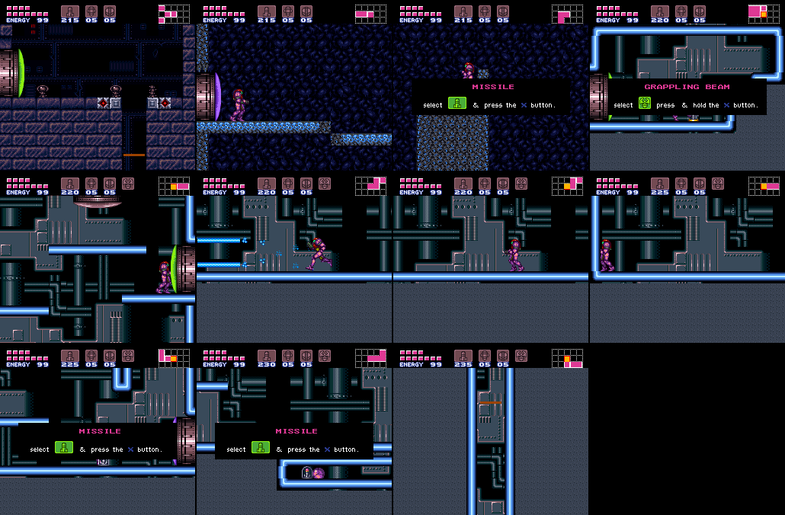
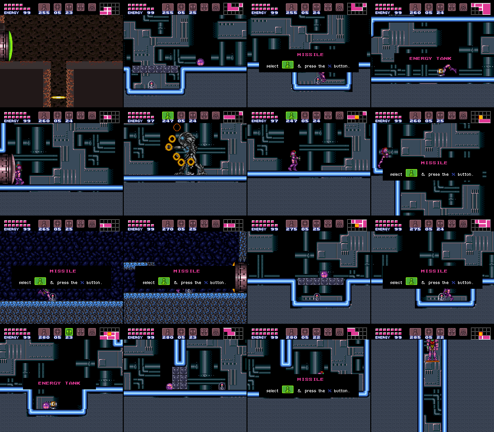
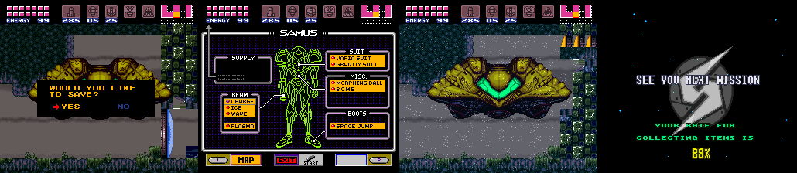

# 19m — Rodadas das cinco áreas e a cadeia completa (88%; fecha o épico 19)

Estado: **verificada** (10/11/2026: validate "263 salas, 546 portas, 0 problemas", a linha do Tallon idêntica, a linha das rodadas
com os 2 elevadores da Mines e a linha nova do épico; `.ips` sha1 `f5b0f58b3cd6ef58d573403852b091a7446b0dac` igual em dois builds e
igual ao de antes (a ROM não muda); **138 testes**: grupo A **34/34** em 3 min 17 s, B **64/64** em 3 min 52 s, C **22/22** em 4 min
24 s, D **18/18** em 3 min 31 s, rodados A → B → C → D na pasta real; mutações 14/14 pegas, com os 3 controles limpos). Rascunho → implementada → verificada
(épico aprovado pelo usuário; pedido do orquestrador, "pode seguir", a linha 19m do épico). **Fecha o épico 19.**
Esforço estimado: 2,5–3 dias (linha 19m do épico). Medido: ~1 dia.
Épico: [19 — Phazon Mines](19-phazon-mines.md) (linha 19m da tabela de filhas; decisões 3 e 4; critério 4); modelos:
[18n](18n-rodadas-e-cadeia-quatro-areas.md) (as rodadas das quatro áreas, a cadeia em partes, os chefes vencidos de verdade) e
[17j](17j-rodadas-e-cadeia-tres-areas.md).

## Contexto

Com a 19l as 42 salas da Mines e os 13 itens (bits `$EB–$F7`) estão na ROM, cada item conferido na rodada declarada. Desde a 19f a
linha das rodadas do mundo já anda as cinco áreas e conta os itens da Mines (88 itens, 88%); os 2 elevadores da Mines ficavam só na
linha "mines (specs/19e, 19f)". A cadeia completa no emulador ainda passava só pelas quatro áreas: terminava em **75%** na tela do fim
(o `fc_end` contava só os itens delas). Faltava o que o épico deixou para a última filha:

1. a linha das rodadas com os 2 elevadores da Mines;
2. uma checagem do épico inteiro (`check_epic_mines`, como a `check_epic_phendrana` da 18n) e o épico fechado;
3. a cadeia pelos 13 itens da Mines, cada um na rodada declarada, pelos 2 elevadores de verdade, com os 2 chefes (Phazon Elite e
   Omega Pirate) vencidos de verdade, sem item, feixe ou bit de chefe por RAM;
4. a cadeia dividida para cada grupo de testes ficar numa execução (~5 min);
5. a tela do fim com **88%**.

## Estado antes (verificado)

Pasta real, 10/11/2026: `.ips` sha1 `f5b0f58b3cd6ef58d573403852b091a7446b0dac` (o da 19l); validate "263 salas, 546 portas, 0
problemas" (`scratchpad/v19l.txt`); linha "rodadas (specs/12m, 17j, 18n, 19f): … 88 itens em 7 rodadas … elevadores a partir da
rodada: chozo_west 0, …, phendrana_south 3 (da Magmoor); porcentagem do fim ($8B:E627) com todos: 88% (energia 1499, mísseis 285,
super mísseis 5, power bombs 25)". A cadeia em 4 partes (A, B, C, D), a parte 4 = rodadas 4–6 nas quatro áreas, o fim e a tela de 75%.

## Mudança

1. **Validador** (`tools/validate.py`):
   - `check_world_rounds`: a linha das rodadas (a protegida que **muda de propósito**) passa a "rodadas (specs/12m, 17j, 18n, 19m)"
     e lista os 2 elevadores da Mines pelo nome da sala de onde se desce: **"mines_east 5 (do Tallon), mines_west 4 (da Magmoor)"**.
     Itens por rodada e porcentagem iguais aos de antes.
   - `check_epic_mines` (linha nova **"mines (specs/19, épico fechado na 19m)"**): as 42 salas da tabela construídas (as 4 regiões)
     com as 43 ligações; os 13 itens da decisão 3 por sala do Prime (`EPIC_MINES_ITEMS`: 10 mísseis — os 9 Missile Expansions e o
     lugar da Power Bomb —, 2 E-tanks, o Grapple Beam do SM na Storage Depot B); nada onde o Prime tem o Flamethrower, o Phazon Suit
     ou um artefato (`EPIC_MINES_NO_ITEM`); toda trava do Prime (`DOCK_LOCKS`, 86 docas) numa ligação construída; nenhuma sala com
     calor, água, neve ou lava (decisão 6: o phazon é só cor); elevadores de verdade exatamente os 2 (P0 ↔ P43 do Tallon, P25 ↔ P26
     da Magmoor), nenhum de enfeite; as 3 save stations (estações 1–3 da área 5) e a map station; os 2 chefes da decisão 4 (as arenas
     da Elite Research e da Elite Quarters) e nenhuma outra arena na área 5.
2. **A cadeia completa com a Mines** (`tests/run_tests.py`):
   - `FullChain` conhece a área `"mines"` (`CHAIN_AREAS`, `items_of`) e o **Grapple Beam** (`GRAPPLE_KIND`: o bit de equipamento
     `$4000` coletado e ligado; `select` com o lugar 4 do HUD entre as power bombs e o X-Ray, a ordem do SM); a passagem entre as
     partes (`chain_handoff`) confere também as palavras de bits `$7ED88C` e `$7ED88E` (Phendrana e a Mines).
   - `chain_door_path` (o caminho de portas entre duas salas construídas, para `fc.tp`); `chain_ride` (o elevador com a Samus posta
     na plataforma, atalho contado: com todo o equipamento da cadeia os 4 quadros para cada lado terminam **2 px a leste** do meio,
     medido nos três elevadores; virada para o leste antes, `CHAIN_FACE_EAST`); `chain_mines_bomb_then_pb` (bomba que não quebra,
     power bomb que quebra, o HUD da cadeia); `chain_fight` (a luta de verdade: os lances, a vida 0, a morte, o slot vazio, a música
     parada; os SELECTs da luta movem o HUD da cadeia).
   - **Rodada 5** (`fc_round_5_mines`, depois do `fc_round_5`, que pega a Power Bomb na P43): desce o elevador leste; a região A
     **andada** como a `mines_regiao_a_rota` (a Quarry Access, a Main Quarry até a bacia, o Space Jump pela torre: o **míssil**; a
     tampa de gelo do chão, a Waste Disposal, a Ore Processing, a Storage Depot B: o **Grapple Beam**); a Elite Research pela R0: o
     **Phazon Elite vencido de verdade** (`CHAIN_ELITE_FIGHT` = o `ELITE_FIGHT` da 19h, que vence também da entrada da cadeia, com o
     Plasma: o bit `$08`), o **míssil** do canto oeste; o Elevator A pelo zigue-zague, o **míssil** da Elite Control Access; a Central
     Dynamo pela R0: o fosso, a bola pelo labirinto (bomba no bloco), o **míssil** no lugar da Power Bomb; sobe o elevador leste.
   - **Rodada 6** (`fc_round_6_mines`, depois do `fc_round_6_phendrana`): desce a P23 para a P16 da Magmoor, à P26, **desce o elevador
     oeste** (o da Magmoor, o único que a cadeia não usava); a região C andada como a `mines_regiao_c_rota` (a Transport Access, o
     Phazon Processing Center até o chão, os blocos de PB do fosso: o **míssil**; o zigue-zague, a porta de plasma: o **E-tank** da
     Processing Center Access); a Elite Quarters pela L1 (como a `mines_omega_pirate`): o **Omega Pirate vencido de verdade**
     (`CHAIN_OMEGA_FIGHT` = o `OMEGA_FIGHT` da 19k, que vence também da entrada da cadeia: os bits `$04` e `$10`), sai pela L1 andando;
     de volta pela arena morta (`omega_dead`) e de novo na Elite Quarters Access como a região D entra; a região D andada como a
     `mines_regiao_d_rota` (a porta de plasma do chão, a Metroid Quarantine B, o Space Jump pela coluna: o **míssil**; o orbe da
     Quarantine Access B morto por um míssil, o **míssil** da Fungal Hall B; o **míssil** da Fungal Hall Access); as salas de PB das
     regiões A e B (como as `mines_regiao_*_rodada_6`): o **míssil** do nicho da Security Access A, o **E-tank** do duto da
     Ventilation Shaft, o **míssil** da Metroid Quarantine A; sobe o elevador leste; volta à Magmoor East do Tallon (o `fc_end` sai de
     lá).
   - `fc_end`: os 88 bits (até `$7ED88E`), o Grapple no equipamento, a porcentagem calculada = **88** (`CHAIN_END_PERCENT`; erro ao
     gerar o roteiro se não), energia 1499, mísseis 285, super mísseis 5, power bombs 25; a recarga na nave com mais tempo (1700
     quadros: até 1499 de energia). `fc_ending`: **"YOUR RATE FOR COLLECTING ITEMS IS 88%"**, conferido nas palavras que a conta do
     jogo escreve.
3. **A cadeia em cinco partes** (`CHAIN_PARTS`): parte 1 = rodadas 0–2 (grupo A); parte 2 = rodada 3 na Chozo e na Magmoor (B);
   parte 3 = rodada 3 em Phendrana e no Tallon (C); **parte 4 = rodadas 4–5 nas cinco áreas (C, depois da 3)**, termina na P43 do
   Tallon; **parte 5 = rodada 6 nas cinco áreas, o fim e a tela do fim (D)**. Rodar A, B, C, D nessa ordem.

A ROM não muda (nenhum arquivo da ROM mexido).

## Critérios de aceite

1. validate 0 problemas; linha do Tallon **igual**; linha das rodadas = a do item 1 (os itens por rodada e a porcentagem iguais aos de
   antes, os 2 elevadores da Mines a mais); linha nova do épico. (protege = rodadas das cinco áreas, porcentagem, o épico inteiro;
   falha_quando = mutações V1–V6; não_prova = que a ordem é a única)
2. As cinco partes passam; o roteiro sem um item da Mines, sem a visita da rodada 5 à Mines, com a Mines da rodada 6 na 5 ou com outra
   porcentagem esperada levanta erro ao ser gerado (T1–T4); no emulador, a tela do fim com outra porcentagem esperada falha, uma luta
   mais curta falha, uma ROM com outro item no lugar de um da Mines falha (E1–E4).
3. Dois builds com o sha1 de antes (a ROM não muda); cada grupo numa execução.

## Plano de testes

| Camada | O quê | Qtde |
|---|---|---|
| validate.py | linha "rodadas (specs/12m, 17j, 18n, 19m)" com os 2 elevadores da Mines; `check_epic_mines` (linha "mines (specs/19, …)") | 1 mudada + 1 nova |
| run_tests.py | `cadeia_completa_parte_1..5` (eram 4) | +1 |
| scratchpad (`s19m/`) | mutações V (validador), T (gerador), E (emulador) | 14 + 3 controles |
| imagem | `specs/img/19m-rodada-5.png`, `19m-rodada-6.png`, `19m-fim.png` | 3 |

## Riscos e reversão

- **Lutas medidas**: as duas lutas valem para a entrada exata da cadeia (o estado do jogo naquele quadro). Mudar qualquer coisa antes
  delas pode pedir buscar de novo (o molde: `scratchpad/s19k/greedy.py`; aqui as lutas da 19h e da 19k venceram da entrada da cadeia
  sem busca nova).
- **Dependência entre grupos**: a parte 4 (C) carrega o estado da 3; a parte 5 (D) o da 4. Rodar D sozinho depois de um build novo
  roda antes as partes 1–4.
- Reversão: `tools/validate.py` (`check_world_rounds`, `check_epic_mines`, `EPIC_MINES_*`), `tests/run_tests.py` (`fc_round_5_mines`,
  `fc_round_6_mines`, `chain_*`, `CHAIN_PARTS`, `CHAIN_GROUP`, `CHAIN_END_PERCENT`); nenhuma mudança na ROM.

## Fora de escopo

Mudar salas, itens ou inimigos; os testes das regiões (iguais); a Impact Crater; um fim próprio do jogo; as decisões do usuário
pendentes da 19j, 19k e 19l (ficam como padrão).

## Resultado

- validate (pasta real): "263 salas, 546 portas, 0 problemas"; em relação à 19l (`scratchpad/v19l.txt` → `v19m.txt`), só a linha das
  rodadas mudou e uma linha nova entrou:
  - "tallon (tabela inteira, regiões ativas: ABCDE, 44 salas construídas, alcançáveis agora: 44, 20 itens em 7 rodadas)" **igual**;
  - **depois**: "rodadas (specs/12m, 17j, 18n, 19m): Tallon + Chozo + Magmoor + Phendrana + Mines andados juntos, 88 itens em 7
    rodadas, cada um na rodada declarada (itens por rodada, Tallon + Chozo + Magmoor + Phendrana + Mines: 0: 2 + 1 + 0 + 0 + 0; 1: 4 +
    7 + 0 + 0 + 0; 2: 1 + 11 + 0 + 0 + 0; 3: 2 + 8 + 4 + 11 + 0; 4: 2 + 1 + 1 + 2 + 0; 5: 7 + 0 + 0 + 1 + 5; 6: 2 + 3 + 2 + 3 + 8);
    elevadores a partir da rodada: chozo_west 0, chozo_east 4, chozo_south 5, magmoor_north 1 (da Chozo), magmoor_east 1 (do Tallon),
    phendrana_north 3 (da Magmoor), phendrana_south 3 (da Magmoor), **mines_east 5 (do Tallon), mines_west 4 (da Magmoor)**;
    porcentagem do fim ($8B:E627) com todos: 88% (energia 1499, mísseis 285, super mísseis 5, power bombs 25)" — itens por rodada e
    porcentagem iguais aos da 19l;
  - nova: "mines (specs/19, épico fechado na 19m): as 42 salas construídas (regiões A B C D), 43 ligações; 13 itens (2 Energy Tank, 1
    Grapple Beam, 10 Missile Expansion; rodadas 5, 5, 5, 5, 5, 6, 6, 6, 6, 6, 6, 6, 6; um míssil no lugar da Power Bomb, o Grapple
    Beam do SM na Storage Depot B, nada no do Flamethrower, do Phazon Suit e dos artefatos); 86 travas do Prime nas ligações
    construídas; sem calor, água, neve nem lava; elevadores: 2 de verdade (magmoor_transport_mines_west <-> mines_transport_magmoor_south,
    tallon_transport_mines_east <-> mines_transport_tallon_south); 3 save stations e a map station; chefes: elite_quarters (19k),
    elite_research (19h)".
- build: sha1 `f5b0f58b3cd6ef58d573403852b091a7446b0dac` nas duas vezes (o da 19l: a ROM não muda).
- testes (pasta real, A → B → C → D, nenhum pré-requisito rodou): **A 34/34 em 3 min 17 s**, **B 64/64 em 3 min 52 s**, **C 22/22 em
  4 min 24 s** (com as partes 3 e 4: era 21 com a 3), **D 18/18 em 3 min 31 s** (a parte 5 no lugar da 4). As partes novas medidas
  no roteiro de desenvolvimento (`scratchpad/s19m/dev.py`, do estado salvo da parte anterior): a Mines da rodada 5 ~29 s, a da rodada 6
  ~66 s, o fim e a tela ~38 s.
- **As duas lutas de verdade na cadeia**: o `ELITE_FIGHT` da 19h e o `OMEGA_FIGHT` da 19k venceram também da entrada da cadeia (o
  Phazon Elite com o Plasma a mais; o Omega com os mísseis), sem busca nova; as mutações E2 e E4 mostram que um lance a menos deixa o
  chefe vivo (vida `$00C8` e `$0064`).
- **A tela do fim**: "SEE YOU NEXT MISSION / YOUR RATE FOR COLLECTING ITEMS IS **88%**", as palavras da conta do jogo conferidas.
- **Mutações** (`scratchpad/s19m/mutate.py`, na cópia `mut` sem `.claude`; cada uma desfeita; controles limpos V0, T0, E0):
  - V1 o míssil da Central Dynamo vira E-tank → "mines (épico): itens por sala"; V2 o Grapple vira míssil → 2 problemas (o Grapple da
    decisão 3a e o épico); V3 o míssil da Main Quarry na rodada 6 → "é pego na rodada 5"; V4 o P0 na rodada 4 → "fica alcançável na
    rodada 5"; V5 a arena do Omega fora de `ARENAS` → o build recusa; V6 um elevador de enfeite na Mines → 3 problemas (o épico e a
    linha dos elevadores).
  - T1 porcentagem esperada 87 → `ValueError: cadeia 19m: … (o épico 19: 87%)`; T2 sem a Mines na rodada 5 → os 5 itens da rodada 5
    faltam; T3 sem o míssil da Fungal Hall Access → falta `('mines', 12)`; T4 a Mines da rodada 6 na rodada 5 → o bit do item já
    tomado (`AssertionError`).
  - E1 a tela do fim esperando 87% → FAIL nas palavras `$7E33A0`/`$7E33E0`; E2 o Omega sem os 6 últimos lances → vida `$00C8`; E3
    uma ROM com um E-tank no lugar do míssil da Central Dynamo (o roteiro esperando o míssil) → FAIL nos mísseis (`$00E6` ≠ `$00EB`);
    E4 o Phazon Elite sem o último lance → vida `$0064`. (A primeira E3 mudou o `items.py` antes de gerar o roteiro: a cadeia
    acompanhou o item e passou limpa; refeita mudando só a ROM.)

### Desvios

- **A Samus posta na plataforma** (`chain_ride`): os elevadores da Mines usam o `onto_platform` (atalho contado, 4 vezes), não a
  caminhada medida das outras áreas; com todo o equipamento da cadeia os 4 quadros para cada lado terminam 2 px a leste do meio
  (medido: P43 `$00B2`, P0 `$0082`; sem a virada para o leste, P43 `$00B1`); a posição medida é a conferida.
- **A Mines da rodada 4 não é visitada**: lá não há item (4 salas: a P25, a Transport Access, o Phazon Processing Center e o pedaço
  da Maintenance Tunnel); o validador prova a rodada. O elevador oeste é andado na rodada 6.
- **Depois do Omega** a Samus sai da arena andando (prova a porta) e volta a ela por `door_teleport` para entrar de novo na Elite
  Quarters Access como a `mines_regiao_d_rota`: entrando andando ela chega correndo e passa da tampa de plasma do chão (medido).
- **O míssil do fosso do PPC**: o passo até ele é de 90 quadros (a região C usa 45): na cadeia a Samus fica um bloco mais longe; a
  parede do fosso a segura.
- **O orbe da Quarantine Access B** devolve o míssil gasto (medido): a conta da cadeia fica igual.
- **A recarga na nave** do `fc_end` espera 1700 quadros (era 1000): com 1499 de energia não acabava.
- **As telas da Mines** não entram na conferência do mapa salvo do `fc_end` (a lista da área 5 está no `$81`, `explored_at` lê as
  cópias por área; os testes das regiões já conferem o mapa da Mines).

### Atalhos da cadeia nas partes da Mines (contados por `FullChain.note`)

| Atalho | Rodada 5 | Rodada 6 |
|---|---|---|
| `door_teleport` entre salas | 24 | 86 |
| energia reposta por RAM | 2 | 2 |
| power bombs repostas por RAM | — | 2 |
| Samus posta na plataforma do elevador | 2 | 2 |
| Samus posta perto de um item | **0** | **0** |
| arena vencida por RAM | **0** | **0** |

Os 13 itens da Mines são pegos andando ou rolando; os dois chefes, vencidos de verdade.

