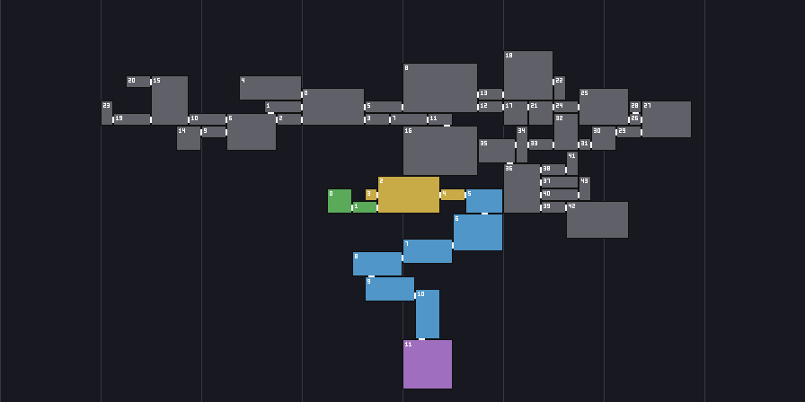

# 20c — Grafo, mapa e travas do Prime da Impact Crater

Estado: verificada (10/11/2026: validate "263 salas, 546 portas, 0 problemas" com a linha nova "impact crater (specs/20c) …"; .ips
sha1 `f5b0f58b3cd6ef58d573403852b091a7446b0dac` igual em dois builds, igual ao de antes; grupo A 34/34 (3 min 12 s))
Esforço estimado: 1 dia
Épico: [20 — Impact Crater](20-impact-crater.md) (decisões 1 e 2; dados, nenhuma sala na ROM)

## Contexto

Como a 12c, 17c, 18c e 19c: antes de desenhar qualquer sala da cratera o projeto precisa da planta do mundo inteiro — as 12 salas, o
tamanho de cada uma, onde fica no mapa de pausa da área 0 (junto com o Tallon, decisão 2 do épico) e por qual porta liga na vizinha —,
com as checagens do validador. Ficam gravadas também as **travas do Prime** de cada porta (com a cor) e as features que travam o
movimento dentro das salas, como dados lidos do jogo, **sem escolher item nem mecanismo do SM** (isso é das filhas das salas, 20e em
diante). Nenhuma sala vai para a ROM.

## Estado atual (verificado)

- `research/prime_worlds.json`, MLVL "Impact Crater": 12 salas, 22 docas = 11 ligações, todas com volta, sem ciclo (20a).
- `tools/dump_prime_locks.py` é genérico (recebe o nome do mundo): rodado para "Impact Crater" sem mudança no código, com a venv
  `tools/venv` e `research/prime_fs`. Saída nova: `research/prime_impact_locks.json` (12 salas).
- Mapa da área 0: o Tallon (`tallon/rooms.py ALL_ROOMS`, 44 salas) ocupa as colunas 8–54, linhas 3–17 da grade 64×32, e guarda 47
  dos 80 bytes da lista do mapa da área 0 (`mapsave.LIST_ROOM[0]`). Livre: as colunas 0–31 das linhas 11 em diante, as colunas 32–39
  das linhas 13 em diante (logo abaixo do Artifact Temple, colunas 32–37, linhas 9–12) e tudo das linhas 18 em diante. Coube **sem
  mexer no mapa do Tallon**.

## Mudança feita

1. `research/prime_impact_locks.json` (novo): o dump do `dump_prime_locks.py` para "Impact Crater", com os mesmos campos dos outros
   mundos (o dumper não mudou, os campos antigos ficam iguais por construção).
2. `tools/impact/` (novo pacote: `__init__.py` vazio e `rooms.py`, no molde da 19c): `TABLE` (12 `Row`: chave `impact_*`, índice e
   nome do Prime, região, caixa em metros, posição no mapa), `LINKS` (11), `REGIONS` A–D (as filhas: A entrada 20e, B cratera de cima
   20f, C descida 20g, D Lair 20h), `ACTIVE_REGIONS` vazio, `ROOMS = []`, `ALL_ROOMS` (caixas provisórias), `ENTRY`/`LAIR`;
   dados do Prime: `DOCK_LOCKS` (regra da Chozo, `prime_dock_locks`), `KEY_BEAM` (`BEAM_OF_VULN` da Magmoor), `FEATURES`;
   `check_prime` (tudo igual ao Prime; nenhuma sala com calor, neve/chuva, água, gelo de plasma, painel de onda ou objeto só de Power
   Bomb; nenhuma porta que só o Super Missile abre; nenhuma sala de transporte; caminho da Crater Entry Point até a Lair pelas
   ligações).
3. **Disposição no mapa** à mão (12 salas em linha, sem busca): vista de lado, logo abaixo do Artifact Temple. Em cima (linhas 13–15),
   de oeste para leste = o sul do Prime (−y): Entry Point, Tunnel A, Phazon Core (com a Missile Station encostada à esquerda, na tela
   do meio), Tunnel B, Infusion Chamber. Daí a descida volta para oeste e desce, como no Prime (cada Subchamber mais baixa que a
   anterior): Subchamber One (debaixo da Infusion), Two, Three, Four, Five e a Lair embaixo (linhas 26–29). **3 ligações de chão/teto**,
   as três quedas do Prime (Infusion → Subchamber One, Three → Four, Five → Lair: a doca no chão de uma e no teto da outra).
4. `tools/validate.py`: **`check_impact_graph()`** (sempre, logo depois do `check_mines`): `check_prime`; `check_layout` na tabela
   inteira e em cada região sozinha; nenhuma tela sobre uma sala do Tallon; as salas `impact_*` do build e do manifest (se a ROM existe)
   = `ROOMS` (nenhuma); o mapa da área 0 (Tallon + cratera) sem tela repetida, dentro dos 80 bytes da área 0 e do que sobra da SRAM.
   Linha nova no resumo.
5. `tools/preview_rooms.py --mapa-impact` → `specs/img/20c-mapa.png` (o Tallon em cinza na mesma grade).

Cores: **A verde, B amarelo, C azul, D roxo**; cinza = o Tallon. A cratera fica debaixo do Artifact Temple (a sala 8 cinza grande).

| # | Sala do Prime | Chave | Região | Telas | Mapa (x, y) | Portas |
|---|---|---|---|---|---|---|
| 0 | Crater Entry Point | `impact_entry_point` | A | 2×2 | 26, 14 | R1 |
| 1 | Crater Tunnel A | `impact_tunnel_a` | A | 2×1 | 28, 15 | L0, R0 |
| 2 | Phazon Core | `impact_phazon_core` | B | 5×3 | 30, 13 | L2 (Tunnel A), L1 (Missile), R1 (Tunnel B) |
| 3 | Crater Missile Station | `impact_missile_station` | B | 1×1 | 29, 14 | R0 |
| 4 | Crater Tunnel B | `impact_tunnel_b` | B | 2×1 | 35, 14 | L0, R0 |
| 5 | Phazon Infusion Chamber | `impact_infusion_chamber` | C | 3×2 | 37, 14 | L0, B1 |
| 6 | Subchamber One | `impact_subchamber_one` | C | 4×3 | 36, 16 | T2, L2 |
| 7 | Subchamber Two | `impact_subchamber_two` | C | 4×2 | 32, 18 | R0, L1 |
| 8 | Subchamber Three | `impact_subchamber_three` | C | 4×2 | 28, 19 | R0, B1 |
| 9 | Subchamber Four | `impact_subchamber_four` | C | 4×2 | 29, 21 | T0, R1 |
| 10 | Subchamber Five | `impact_subchamber_five` | C | 2×4 | 33, 22 | L0, B0 |
| 11 | Metroid Prime Lair | `impact_lair` | D | 4×4 | 32, 26 | T1 |

**Travas do Prime** (`research/prime_impact_locks.json`): as 10 docas das 5 ligações de cima são portas de **plasma** (`key`,
vulnerabilidade 2 2 2 1); a doca da Infusion Chamber para a Tunnel B tem também uma trava de **evento** (`Actor Door Lock`); as 12 docas
da Infusion para baixo não têm porta (a descida). Nenhuma porta que só o Super Missile abre (o combo não fere nenhuma). **Features:**
Spider Ball na Tunnel B (77 pontos de trilho); "heat" na Lair = 4 objetos com "heat"/"varia" no nome *(o que são: incerto, 20a)*, sem
`Area Damage` em sala nenhuma. Nenhum objeto só de Power Bomb, nenhuma neve, chuva ou água.

## Critérios de aceite

1. validate "263 salas, 546 portas, 0 problemas" (igual) com a linha "impact crater (specs/20c): 12 salas no grafo, 11 ligações (3 de
   chão/teto), 90 telas, caminho da entrada à Lair; mapa da área 0 com o Tallon 70 bytes de SRAM (Tallon 47, de 80), nenhuma tela sobre
   o Tallon; travas do Prime em 10 docas (event 1, key 10; cor das portas: plasma 10), 12 sem porta (a descida); nenhuma quente, fria,
   com água, só de Power Bomb ou só de Super Missile; 0 construídas". **Feito.** (protege = tabela, ligações, mapa, cota, travas, cores
   iguais ao Prime; falha_quando = mutações abaixo; não_prova = salas jogáveis, 20e em diante)
2. Mutações pegas (abaixo). **Feito.**
3. ROM igual: sha1 `f5b0f58b…dac` em dois builds. **Feito.**
4. Grupo A passa (B, C e D não rodaram: a ROM é a mesma byte a byte e só o validador, o preview e os dados mudaram). **Feito: 34/34.**

## Mutações (`scratchpad/s20c/mutate.py`, em memória; o JSON das travas mexido numa cópia no scratchpad)

| Mutação | Resultado |
|---|---|
| M0 controle | limpa |
| M1 ligação trocada (Subchamber Three → Five em vez de Four) | pega ("ligações diferentes do Prime: sobram [[8, 10]], faltam [[8, 9]]" e a porta que não encosta) |
| M2 caixa errada (Phazon Core z 72 em vez de 102) | pega ("P2 no Prime é 'Phazon Core' (142, 150, 102), a tabela diz … (142, 150, 72)") |
| M3 a Lair sobre o Artifact Temple (y 9) | pega ("sobrepõe ['tallon_artifact_temple'] do Tallon" e as portas soltas) |
| M4 nome errado | pega |
| M5 a trava de evento da Infusion esquecida | pega |
| M6 porta de plasma marcada gelo | pega |
| M7 a Spider Ball da Tunnel B esquecida | pega |
| M8 ligação faltando (Subchamber Five–Lair) | pega (a ligação do Prime e "sem caminho de impact_entry_point até impact_lair") |
| M9 calor no Prime (`area_damage` na Subchamber Three) | pega |
| M10 água no Prime (Subchamber Two) | pega |
| M11 porta só de Super Missile (vetor mexido) | pega |
| M12 porta numa tela fora da sala (R5 da Entry Point) | pega |
| M13 sala `impact_entry_point` no build sem estar em `ROOMS` | pega |
| M14 controle depois da M13 | limpa |

## Riscos e reversão

- **Mapa até a linha 30** (a Lair, `map_y` 26 + 4 telas + a linha que o jogo soma): as outras áreas vão até a 24. O validador aceita
  (`pausemap.out_of_bounds`); a rolagem do mapa de pausa na parte de baixo da área 0 só é vista no emulador quando a cratera for
  construída (20e em diante).
- **70 de 80 bytes** do mapa salvo da área 0 com a cratera inteira: sobram 10. Uma sala nova do Tallon mais para baixo/direita pode
  comer o resto; o validador acusa.
- As 3 portas de chão/teto (lista em `LINKS`, lados B/T): as filhas desenham as quedas (20g, 20h).
- Reversão: apagar `tools/impact/`, `research/prime_impact_locks.json`, `check_impact_graph` (com `PRIME_IMPACT_LOCKS`,
  `IMPACT_TABLE_AREA`, o import e a chamada), `--mapa-impact` e a cor "-" do `preview_rooms.py`, e `specs/img/20c-mapa.png`.

## Fora de escopo

- Desenho das salas, `AreaDef`/salas da cratera no build, mapa de pausa na ROM, a entrada (teleporte do Artifact Temple, 20e).
- Itens (não há), mecanismo SM de cada trava, inimigos, a luta, o estilo (20d–20j).

## Desvios (preenchido na implementação)

- **O dumper não mudou**: já era genérico (nome do mundo na linha de comando); só a saída nova foi gravada.
- **Disposição à mão**, não por busca (12 salas em linha, um só beco): a busca da 19c servia para anéis.
- **Regiões = filhas** (A 20e, B 20f, C 20g, D 20h), não do épico (que não tem regiões): servem para checar cada filha sozinha.
- **`FEATURES` da Lair "heat"**: gravado como o Prime dá (nomes com "heat"/"varia"), marcado *(incerto)*; não é calor (nenhum `Area
  Damage`).
- **`research/render/`**: o `preview_rooms.py` redesenha o diretório inteiro a cada chamada (como na 19c). Estava desatualizado desde a
  19c: 42 imagens novas (as salas da Mines feitas depois) e 2 mudadas (`magmoor_transport_mines_west`, `tallon_transport_mines_east`,
  elevadores de verdade da 19e); `specs/img/` só ganhou a `20c-mapa.png` (as outras iguais byte a byte).
- Verificação (10/11/2026, pasta real): `python3 -I tools/build.py` duas vezes → sha1 `f5b0f58b3cd6ef58d573403852b091a7446b0dac` nas
  duas; `python3 -I tools/validate.py` → "263 salas, 546 portas, 0 problemas", com a linha nova; grupo A 34/34 (3 min 12 s).
