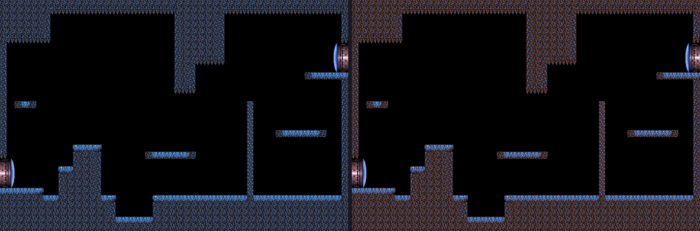

# 20d — Estilo da cratera (tileset, paleta e cores de phazon), numa ROM de teste

Estado: verificada (10/11/2026: validate "263 salas, 546 portas, 0 problemas" com a linha nova "impact crater (specs/20d) …"; .ips
sha1 `f5b0f58b3cd6ef58d573403852b091a7446b0dac` igual em dois builds, igual ao de antes (a ROM do jogo não muda); grupo A 34/34)
Esforço estimado: 1–1,5 dia (gasto: 1 sessão)
Épico: [20 — Impact Crater](20-impact-crater.md) (estilo como dados e numa ROM de teste; nenhuma sala)

## Contexto

As salas da cratera (20e em diante) precisam de uma cara: tileset, paleta e as cores do phazon. O épico pediu partir da Mines (19d) e
fazer isso numa **ROM de teste**, com a ROM do jogo igual. Esta filha **não constrói sala nenhuma**: só define o estilo, escreve-o na ROM
de teste e põe a checagem no validador.

## Estado atual (verificado)

- **O Prime** (novo: `tools/dump_prime_area_colours.py` → `research/prime_area_colours.json`, a média de cor de cada textura que a
  geometria de cada sala usa, lida das dependências da MLVL): a cratera é **quente**, com 121 de 298 texturas vermelho/laranja (média
  delas `57362E`: matiz 12°, saturação 0,31); a Mines é **cinza**, com 64 de 870. As texturas azuis (o phazon) têm a **mesma matiz nos
  dois mundos**: `223F57` (207°) na cratera e `28384C` (213°) na Mines; o `PHAZON` da 19d tem 213°. A cratera escurece até a Lair
  (média `4E3A32` na Crater Entry Point, `2F262E` na Lair).
- **A Mines** (`tools/smlib/mines.py`, 19d): duas caras. A **rocha** fica na entrada `$08`, com os gráficos do `$06` (Brinstar verde),
  uma cópia da tabela do `$06` com as portas de onda roxas na linha 7, as peças `MINE_ROCK` na linha 4 e a paleta do `$06` com a
  linha 4 em rocha cinza e fungo azul de phazon (`ROCK_COLOURS`). Na ROM do jogo o `$08` já está escrito (a Mines tem 42 salas).
- **Entradas da tabela de tilesets livres** (lidas nos bytes, `scratchpad/s20d/survey.py`): a `$03` (gêmea do `$02`, Crateria de
  baixo) é usada por 2 salas órfãs, nenhuma sala de demo e nenhuma sala nossa; tem entrada própria. As já usadas: `$00/$02` (Tallon),
  `$01/$1B/$1C` (Phendrana), `$04` (fragata), `$08/$0E` (Mines), `$09/$0A` (Magmoor), `$0C` (Chozo).

## Mudança feita

1. **`tools/impact/style.py`** (novo): o estilo da cratera = **a rocha da Mines com a rocha avermelhada**.
   - `TILESET = $03`, apontado para a **tabela e os gráficos da entrada `$08`** (divididos, não copiados) e para uma **paleta própria**
     (uma paleta é por entrada, por isso a entrada nova);
   - `STYLE` = `MINE_ROCK` com o tileset `$03` (as mesmas peças); fundo = o da rocha da Mines (`$BAF4`, linha 2, cores vanilla);
   - `COLOURS`: as 5 cores do **phazon** (linha 4, cores 4, 8, 9, 12, 14) **iguais às da Mines**, porque o azul do phazon no Prime é o
     mesmo nos dois mundos; as 7 cores da **rocha** (3, 5, 6, 7, 10, 11, 13) = o cinza da Mines com a luz de cada uma e a matiz e a
     saturação da cratera do Prime (`ROCK_HUE = 12`, `ROCK_SAT = 0,31`). Ex.: `40444A` → `5A3830`, `5A5E66` → `7E4E42`;
   - `palette(rom)`: a do `$06` vanilla com essas cores e o roxo da porta de onda na linha 7 (como `build.mines_palette` faz a da rocha).
2. **`tools/build.py`**: `build(test_20d=True)` e o modo **`--teste-20d`** (→ `build/teste-20d/`) escrevem a entrada `$03` depois de
   todos os blobs fixos; o build do jogo só a escreve quando existir sala `impact_*` (20e em diante). Sem isso, nada muda.
3. **`tools/validate.py`**: **`check_impact_style()`** (sempre; a parte da ROM quando a ROM existe):
   - contra a Mines: mesmas peças, tabela, gráficos, fundo e linha de pintura da rocha; o phazon = o da Mines; a rocha = o cinza da
     Mines na matiz da cratera (e diferente dele); a paleta difere da rocha da Mines **só** nas 7 cores da rocha;
   - contra o Prime: matiz e saturação = as do JSON; a cratera tem mais texturas quentes que a Mines; o azul do phazon tem a matiz das
     texturas azuis dos dois mundos (diferença de até 20°);
   - contra as outras áreas: a `$03` tem entrada própria no vanilla, nenhuma cara nem área nossa e nenhuma sala de demo a usa; as cores
     das portas (linha 0 cores 1–3, linha 1 cores 1–7) = as do tileset 4; a linha 7 com o roxo;
   - **ROM do jogo**: sem sala da cratera, os 9 bytes da entrada `$03` são os vanilla; nenhuma sala nossa usa o `$03`;
   - **ROM de teste** (feita na memória, `impact_test_build`, ~2 s): a `$03` aponta a tabela e os gráficos do `$08`, a paleta fica no
     alocador fixo e é igual à do estilo, e a ROM de teste **só difere da do jogo** na entrada `$03` e na paleta.
   - `IMPACT_TABLE_AREA` (20c) passa do tileset 0 provisório para o `$03`.
4. **`tools/preview_rooms.py --estilo-impact`** → `specs/img/20d-estilo.png`: a sala sintética de teste na rocha da Mines (esquerda) e
   na cratera (direita), com as paletas da ROM de teste.

À esquerda a rocha da Mines (cinza com o fungo azul); à direita a cratera: a mesma rocha, avermelhada, com o mesmo azul do phazon nas
bordas.

## Critérios de aceite

1. validate "263 salas, 546 portas, 0 problemas" (igual) com a linha nova "impact crater (specs/20d): estilo no tileset 03 (tabela,
   gráficos e peças da rocha da mina, 08), paleta própria em $F1D5F2 na ROM de teste (251 bytes); rocha na matiz 12/saturação 0.31 do
   Prime (texturas quentes: cratera 121/298, mina 64/870), phazon = o da mina (matiz 213; azul do Prime 207 na cratera, 213 na mina);
   ROM do jogo: entrada 03 vanilla (sem sala da cratera); 0 salas fora da cratera no 03". **Passa.** (protege = o estilo coerente com
   a Mines e com o Prime, a entrada sem conflito, a ROM do jogo igual, a ROM de teste certa; falha_quando = as mutações abaixo;
   não_prova = a cara no emulador: não há sala para carregar, fica para a 20e)
2. ROM do jogo igual: sha1 `f5b0f58b…dac` em dois builds. **Passa.**
3. Grupo A passa (B, C e D não rodaram: a ROM do jogo é a mesma byte a byte). **Passa: 34/34.**
4. Mutações pegas (abaixo). **Passa.**

## Mutações (`scratchpad/s20d/mutate.py`, em memória; nada no código real)

| Mutação | Resultado |
|---|---|
| M0 controle | limpa |
| M1 phazon da cratera vermelho (linha 4 cor 14 `FF0000`) | pega ("(phazon) FF0000, a mina usa B8E8FF") |
| M2 rocha cinza da Mines sem a matiz (cor 3) | pega |
| M3 tileset `$08` (o da rocha da Mines) | pega ("já é de outra área ou cara") |
| M4 tileset `$06` (salas de demo) | pega (as 7 salas de demo) |
| M5 matiz 200 (rocha azul) | pega ("o Prime diz 12 0.307") |
| M6 recheio diferente do da Mines | pega |
| M7 JSON do Prime com a Mines mais quente que a cratera | pega |
| M8 ROM de teste com um byte da paleta mexido | pega |
| M9 ROM de teste mexendo na entrada da rocha da Mines | pega ("1 bytes diferentes da ROM do jogo fora da entrada 03 e da paleta") |
| M10 ROM de teste com a tabela vanilla do `$06` (sem as portas) | pega |
| M11 ROM do jogo com a entrada `$03` mexida sem sala | pega |
| M12 controle depois | limpa |

## Riscos e reversão

- **A cara não foi vista no emulador**: sem sala da cratera não há o que carregar; a 20e (a primeira sala) é que mostra. A prévia usa
  as mesmas paletas da ROM de teste.
- **Tabela dividida com o `$08`**: se a Mines mudar a tabela da rocha, a cratera muda junto (de propósito: as mesmas portas pintadas).
  O build recusa escrever a `$03` se o `$08` não estiver escrito.
- **O fundo** é o azul-escuro da rocha da Mines (linha 2, dividida com o CRE: não se repinta).
- Reversão: apagar `tools/impact/style.py`, `tools/dump_prime_area_colours.py`, `research/prime_area_colours.json`, o bloco
  `test_20d`/`--teste-20d` do `build.py`, `check_impact_style`/`impact_test_build`/`PRIME_AREA_COLOURS` e o import do validador, o
  tileset de `IMPACT_TABLE_AREA` (volta a 0), `--estilo-impact` do `preview_rooms.py` e `specs/img/20d-estilo.png`.

## Fora de escopo

- Qualquer sala da cratera (20e em diante); qual sala usa o estilo.
- Música da cratera, um tom mais escuro para a Lair, o phazon que machuca (decisão 4 do épico: 20g).

## Decisões para o usuário (escolhidas as recomendadas; confirmar)

1. **Uma cara só** para a cratera (a rocha da Mines avermelhada), sem a base pirata: o Prime não tem base na cratera.
2. **Cores**: `impact/style.py` `COLOURS` (a rocha na matiz do Prime; o phazon igual ao da Mines). Mudar a tabela e reconstruir.
3. **Fundo**: o mesmo da rocha da Mines (rocha azul-escura do Brinstar).

## Desvios (preenchido na implementação)

- **Dados do Prime lidos de um jeito novo**: as filhas de estilo anteriores escolheram as cores pelo conhecimento do jogo; aqui a cor
  saiu das texturas (o dumper novo, que roda na venv `tools/venv` com `research/prime_fs`). A média é das texturas, não do que aparece
  na tela (iluminação e brilho do phazon não entram) *(aproximação)*.
- **Entrada `$03`**, não a `$08` da Mines: uma paleta é por entrada, e a cratera precisa da rocha avermelhada.
- **Sem sala de teste**: a 19d fez salas de teste e um teste no emulador; aqui o pedido foi nenhuma sala, então a ROM de teste só tem
  a entrada e a paleta, conferidas byte a byte pelo validador (e feita em cópia no scratchpad,
  `scratchpad/s20d/teste-20d/`, sha1 da .sfc `d5a540fb…a718`).
- Verificação (10/11/2026, pasta real): `python3 -I tools/build.py` duas vezes → sha1 `f5b0f58b3cd6ef58d573403852b091a7446b0dac` nas
  duas; `python3 -I tools/validate.py` → "263 salas, 546 portas, 0 problemas" com a linha nova; `research/render/` igual byte a byte
  depois do `preview_rooms.py`.
